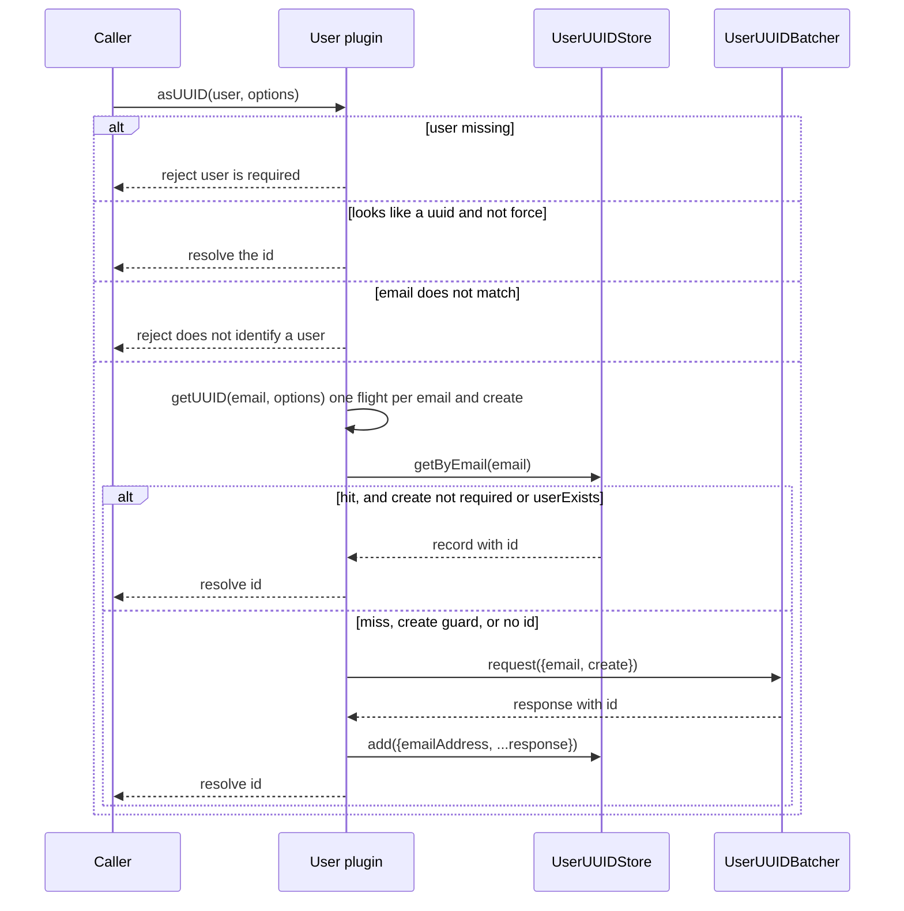
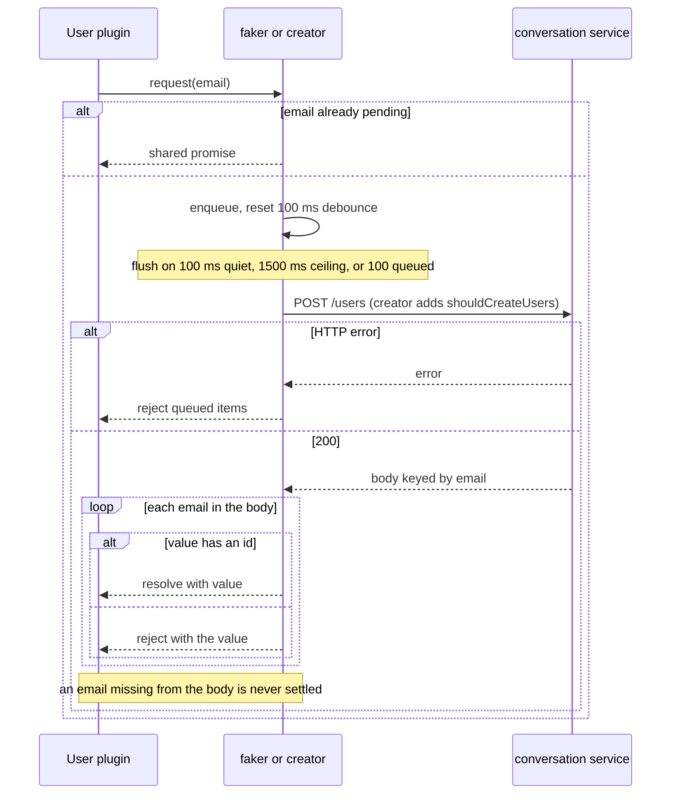
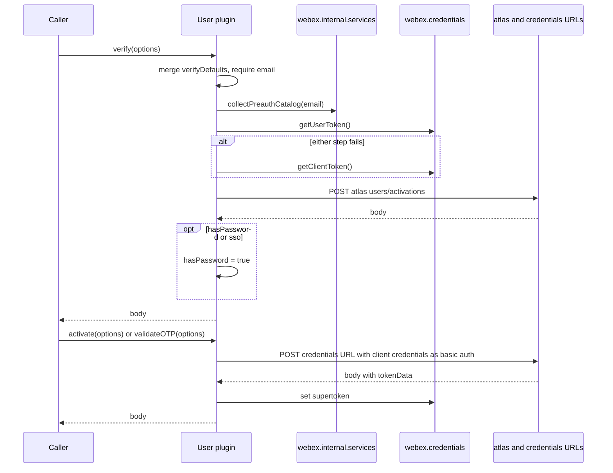
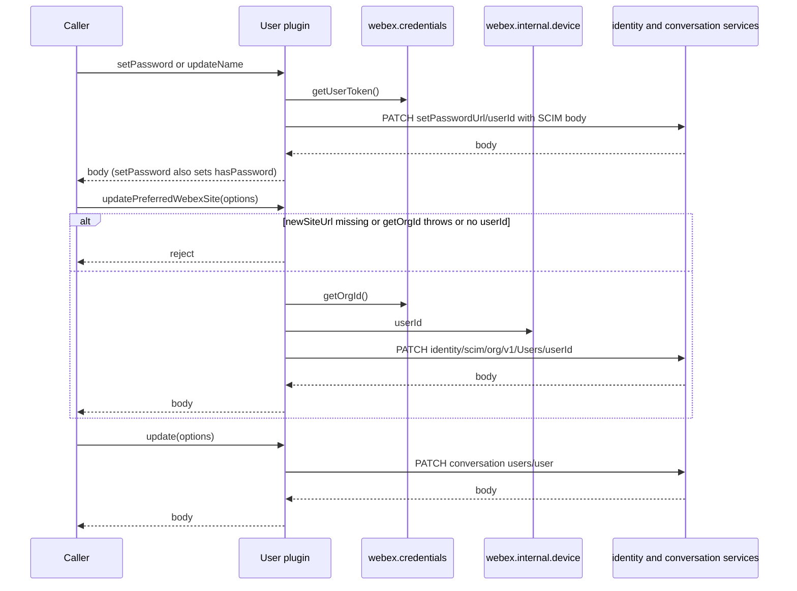
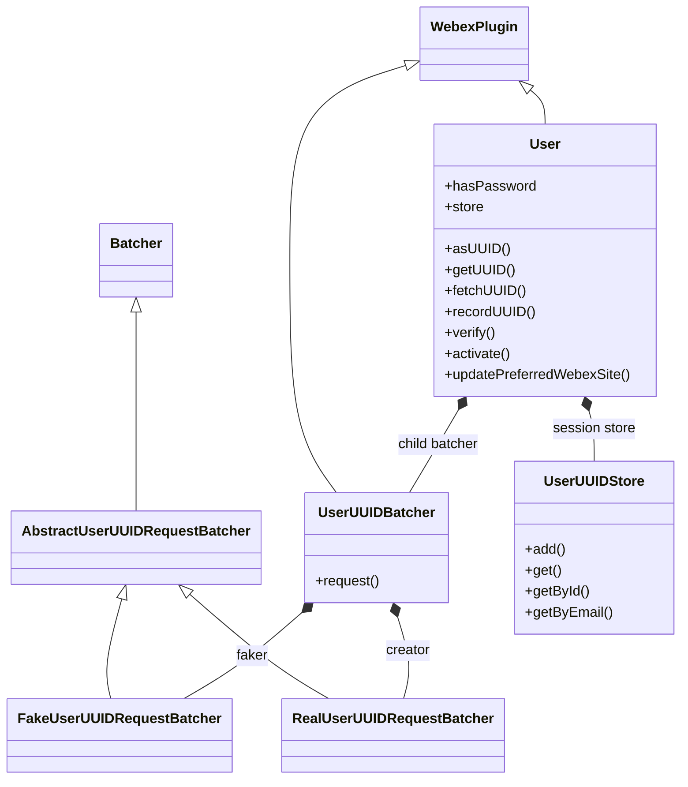

<!-- sdd-generated-metadata
doc_kind: module-spec
generated_from: module-spec@0.3.0
generated_by: claude-code
approved_by: riag@cisco.com
updated_at: 2026-10-27T00:00:00Z
validation_status: pass
-->

# User plugin

This source-local document at `src/docs/README.md` owns the stable specification for **the user
plugin**: the `webex.internal.user` identity lookup and account-flow manager. Ground every claim in
package evidence and link to the [package architecture](../../docs/architecture.md) instead of
repeating broader facts. No service specification exists because this package is a library.

Related context: [documentation index](../../docs/index.md) ·
[package agent instructions](../../AGENTS.md)

## Metadata

| Field             | Value |
| ----------------- | ----- |
| Owner             | @webex/web-client, @webex/web-sdk |
| Source path       | `src` |
| Resource kind     | package |
| Status            | Draft |
| Last verified     | 2026-10-27 at `382c4fd8af` |
| Module id         | `internal-plugin-user` |
| Parent spec       | — |
| Doc kind          | Module spec |
| Coverage score    | 93.3% assessed 2026-10-27 — 14 of 15 mandatory fields PRESENT, critical 8 of 8; test strategy is WEAK because account-flow request shapes, the create guard, `fetchUUID`, the `faker` batcher, the store, `getUserCI`, the config defaults, and persistence have no unit case and no characterization baseline exists |
| Validation status | Pass — revalidated 2026-10-27 by runtime `codex`; 0 findings against source commit `382c4fd8af`; deterministic SDD and routing checks, implementation review, 45 unit tests, and style checks pass |

## Applicability

| Condition ID                         | Status     | Evidence or reason | Owned section |
| ------------------------------------ | ---------- | ------------------ | ------------- |
| `module.has_tiers`                   | N/A        | No tier policy exists in this package or its `package.json` | Tier |
| `module.has_ui`                      | N/A        | No view or screen. The module issues requests and keeps lookup records. | UI use-case flow |
| `module.crosses_service_boundaries`  | Applicable | `src/user.js` and `src/user-uuid-batcher.js` send HTTP requests to the conversation, atlas, activation, OTP, password, and identity (SCIM) services | Cross-boundary use-case flow |
| `module.holds_client_state` | Applicable | The hasPassword property and the in-memory UserUUIDStore in `src/user.js` and `src/user-uuid-store.js` | Client state model |
| `module.enforces_domain_rules`       | Applicable | Argument guards and the uuid and email pattern checks in `src/user.js` and `src/user-uuid-store.js` | Business rules and invariants |
| `module.is_concurrent_async` | Applicable | Promise-based methods, the debounced lookup batcher, and @oneFlight on getUUID in `src/user.js` and `src/user-uuid-batcher.js` | Concurrency and reactive flow |
| `module.owns_persistence` | N/A | The module owns no store. @persist('@') on initialize hands the model to the webex-core storage layer, and the uuid store is in memory only. | Data, schema, and migration discipline |
| `module.stateful_transitions` | N/A | hasPassword is a single boolean and each store entry is only added or merged; there is no lifecycle or guarded transition | State machine |
| `module.exposes_wire_protocol`       | N/A        | The module is an HTTP client. It defines no frame, serialization, or binary format of its own. | Protocol and wire format |
| `module.ui_multi_screen`             | N/A        | No UI | UI flow |
| `module.large_data_model`            | N/A        | One user lookup record and one boolean property | Data model |
| `module.returns_caller_errors` | Applicable | Methods reject with Error instances for missing or malformed arguments, and pass service errors through | Caller-visible failure modes |
| `module.module_specific_conventions` | N/A        | No convention beyond the repository-wide rules; the local `.eslintrc.js` only extends the legacy eslint config package | Module-specific rules |
| `module.published_package` | Applicable | `package.json` names the package @webex/internal-plugin-user and deploy:npm publishes it | Export stability |
| `module.embedded_in_host`            | N/A        | No host theme or embed API | Host integration and theming |
| `module.has_design_tradeoff`         | Applicable | Fake-uuid resolution, batched lookup latency, an unbounded session cache, and the partial-batch hang, confirmed by the module owner | Key design trade-off |
| `module.has_submodules` | N/A | Computed false by the Repo Annotation module_tree.py script: src has no child module | Sub-modules |

## Evidence register

| Evidence | What it establishes |
| -------- | ------------------- |
| `src/index.js` | Imports the device plugin, registers `user` with `config`, and re-exports the default class |
| `src/user.js` | The `User` plugin: account flows, uuid resolution, profile updates, SCIM helpers, and the `hasPassword` property |
| `src/user-uuid-batcher.js` | The batcher family that collapses email lookups into batched HTTP requests |
| `src/user-uuid-store.js` | The in-memory id and email lookup store |
| `src/config.js` | `config.user` batching and verify defaults, and the `device.preDiscoveryServices` atlas defaults |
| `package.json` | Name, entry points, dependencies, and scripts |
| `process` | Package-root module exporting `{browser: true}`; nothing in `src/` imports it |
| `test/unit/spec/user.js` | Unit cases for the SCIM helpers, argument guards, `recordUUID`, `updatePreferredWebexSite`, and `getMeetingSiteList` |
| `test/unit/spec/user-uuid-batcher.js` | Unit cases for the `creator` batcher fingerprints, request shape, and response handling |
| `test/integration/spec/user.js` | Integration cases against live services (not run in unit CI): verify, password, activate, OTP, get, asUUID, update, updateName |
| ../internal-plugin-device/src/docs/README.md | Sibling package internal-plugin-device spec: `webex.internal.device.userId` and `url`, which `_setUser` and `updatePreferredWebexSite` read |
| ../common/src/docs/README.md | Sibling package common spec: `oneFlight`, `tap`, `deprecated`, `Defer`, and `patterns` behavior |
| ../webex-core/src/lib/batcher.js, ../webex-core/src/lib/storage/decorators.js, ../webex-core/src/lib/credentials/credentials.js | Sibling package webex-core has no module spec, so source was used: `Batcher` queue and deferreds, `persist` and `waitForValue`, and `getOrgId` |
| ../internal-plugin-conversation/src/conversation.js, ../plugin-meetings/package.json | Consumer evidence: conversation records participant ids through `recordUUID`, and plugin-meetings declares the dependency |
| `README.md` | Retained product documentation, not the behavioral authority. See ADR 0001. |

## Purpose and boundary

- Responsibility: give the SDK a `webex.internal.user` plugin that turns users and email addresses
  into uuids (batched lookup plus an in-memory cache), and that calls the identity, atlas,
  conversation, and SCIM services for account activation, one-time passwords, password and name
  updates, preferred-meeting-site updates, and meeting-site list building.
- In scope: the `User` class in `src/user.js`, the batcher family in `src/user-uuid-batcher.js`, the
  store in `src/user-uuid-store.js`, the `config.user` defaults, the registration side effect in
  `src/index.js`, and the exported SCIM helpers.
- Out of scope: request transport, retries, authentication interceptors, and token refresh, which
  belong to `webex-core` and its interceptors; device registration and the `device.userId` value,
  owned by the device plugin; the services catalog behind `collectPreauthCatalog`; credentials
  storage and token handling in `webex.credentials`; and the server-side rule that produces a
  deterministic uuid for an unknown email.
- Consumers: sibling packages internal-plugin-avatar, internal-plugin-conversation,
  internal-plugin-team, plugin-meetings, recipe-private-web-client, and webex-server, all of which
  list it in `dependencies`.

## Structure and key files

| Path | Responsibility |
| ---- | -------------- |
| `src/index.js` | Imports `@webex/internal-plugin-device`, calls `registerInternalPlugin('user', User, {config})`, and re-exports the default class |
| `src/user.js` | `User` plugin, the `buildPreferredSiteBody` and `buildMeetingSiteList` helpers, and the `SCIM_SCHEMAS` constant |
| `src/user-uuid-batcher.js` | `UserUUIDBatcher` and the two request batchers `faker` and `creator` that it owns |
| `src/user-uuid-store.js` | `UserUUIDStore`, two private `Map`s keyed by id and by email |
| `src/config.js` | `config.user` and `config.device.preDiscoveryServices` defaults |
| `test/unit/spec/user.js`, `test/unit/spec/user-uuid-batcher.js` | Unit specs run by Jest through `webex-legacy-tools` |
| `test/integration/spec/user.js` | Integration spec that needs live services and test users |
| `process` | Package-root module exporting `{browser: true}`; not imported by `src/` |

## Public surface

Declarations live in `src/index.js`, `src/user.js`, and `src/config.js`. This section summarises them
and does not restate signatures.

| Surface | Consumer | Compatibility commitment | Source |
| ------- | -------- | ------------------------ | ------ |
| Default export `User` | Every importer | The plugin class, the only export of the package entry point; importing it registers `webex.internal.user` | `src/index.js` |
| Deep-path exports `buildPreferredSiteBody`, `buildMeetingSiteList`, `SCIM_SCHEMAS` | Tests | Exported from `src/user.js`, not from the package entry point; reached only by the deep import path | `src/user.js` |
| Registration side effect | Every importer | Importing the package installs `webex.internal.user` (`MOD-001`) | `src/index.js` |
| `asUUID`, `getUUID`, `fetchUUID`, `recordUUID` | conversation, team, avatar, plugin-meetings | Resolve and cache user uuids (`MOD-002` to `MOD-006`) | `src/user.js` |
| `get()` | Internal callers | Fetch the current user and record the id and email (`MOD-008`) | `src/user.js` |
| `update`, `updateName`, `setPassword` | Internal callers | Profile and password changes (`MOD-009`, `MOD-014`) | `src/user.js` |
| `verify`, `register` (deprecated alias), `getUserCI` | Sign-in and sign-up flows | Account status lookup (`MOD-010`, `MOD-011`) | `src/user.js` |
| `activate`, `generateOTP`, `validateOTP` | Sign-in and sign-up flows | Activation and one-time password exchange (`MOD-012`, `MOD-013`) | `src/user.js` |
| `updatePreferredWebexSite`, `getMeetingSiteList` | plugin-meetings | Meeting-site preference and list (`MOD-015`, `MOD-016`) | `src/user.js` |
| `hasPassword` property | Internal callers | Boolean, default `false`, persisted (`MOD-018`) | `src/user.js` |
| `config.user` keys | SDK integrators | Defaults in `MOD-017` | `src/config.js` |
| `batcher` child and `store` session value | Tests and internal callers | Not documented API; read directly by tests | `src/user.js` |

Contract `user-sdk` is published with native artifact `package.json`. Contract `user-identity-http`
is internal with source `src/user.js`. Required contracts: `webex-core-plugin-host`,
`webex-device-registration`, and `webex-common-sdk`. The helpers `buildPreferredSiteBody`,
`buildMeetingSiteList`, and `SCIM_SCHEMAS` are exported from `src/user.js` but not from
`src/index.js`; only tests import them, through the deep path `@webex/internal-plugin-user/src/user`.

## Dependencies

| Dependency | Why it is required | Failure behavior |
| ---------- | ------------------ | ---------------- |
| `@webex/webex-core` (`webex-core-plugin-host`) | `registerInternalPlugin`, `WebexPlugin`, `Batcher`, `persist`, `waitForValue`, `this.request`, `this.config`, and `webex.credentials` | A rejected `request` rejects the calling method |
| `@webex/internal-plugin-device` (`webex-device-registration`) | `webex.internal.device.userId` for `_setUser` and `updatePreferredWebexSite`; imported first by `src/index.js` | A missing `userId` rejects `updatePreferredWebexSite` with a message, but is not checked by `_setUser` |
| `@webex/common` (`webex-common-sdk`) | `patterns`, `oneFlight`, `tap`, `deprecated` | Used at load time and call time; no fallback |
| Conversation service | Batched lookup (`POST /users`), `get()`, and `update()` | Item failures reject the matching lookup; HTTP errors reject the batch |
| Atlas service | `verify` (`users/activations`) | Errors reject `verify` |
| Credentials URLs in `config.credentials` | `activationUrl`, `generateOtpUrl`, `validateOtpUrl`, `setPasswordUrl`, and `identity.url` | An unset value produces an invalid request URI; no check here |
| `lodash` | `isArray` | Load time |

`@webex/internal-plugin-services` behavior (`collectPreauthCatalog`) is reached through
`webex.internal.services` and has no specification in this package's scope; its source was not read
beyond the call site in `verify`. `@webex/webex-core` has no module specification, so its source was
used.

## Requirements

| ID | WHAT | WHY | Source evidence | Test or example evidence | Assumptions or gaps | Confidence |
| -- | ---- | --- | --------------- | ------------------------ | ------------------- | ---------- |
| `MOD-001` | Importing the package imports the device plugin and registers `User` as internal plugin `user` with `config`. | Registers the plugin so `webex.internal.user` exists on every webex instance. The device plugin is imported first because `_setUser` and `updatePreferredWebexSite` read `webex.internal.device.userId`. | `src/index.js` | `test/unit/spec/user.js` builds `MockWebex` with `user: UserService` | No test asserts the registration itself | Present |
| `MOD-002` | `asUUID` rejects a missing `user`; maps an array element by element; returns a value that looks like a uuid unchanged unless `options.force` is truthy; otherwise extracts an email, rejects when it does not match the email pattern, and calls `getUUID`. | Callers pass ids, user objects, emails, or lists and get uuids back. | `src/user.js` | `test/unit/spec/user.js` `#asUUID` cases; `test/integration/spec/user.js` `#asUUID` | Email lookup and `force` are tested only against live services | Present |
| `MOD-003` | `getUUID` is de-duplicated per email and `create` flag. It reads the store by email, rejects a `create: true` caller when the cached entry has no truthy `userExists`, rejects an entry with no id, and on any rejection falls through to `fetchUUID`. | Concurrent identical lookups share one flight, and a cached fake id is never returned to a caller that needs a real user (`INV-002`). | `src/user.js` | `test/integration/spec/user.js` `with {create: true}` cases | No unit case | Present |
| `MOD-004` | `fetchUUID` sends `{email, create}` to the batcher, records the response with `recordUUID`, and resolves the response `id`. | Requests a uuid from the service for an email the store cannot answer and caches the result, so `getUUID` serves later lookups from the store. | `src/user.js` | `test/integration/spec/user.js` `#asUUID` | No unit case | Present |
| `MOD-005` | The batcher routes `create: true` lookups to the `creator` batcher, which adds `shouldCreateUsers=true`, and all others to the `faker` batcher. Each is a separate `Batcher` with its own queue and timers. Items are keyed by email, so a second request for a pending email shares the first request's promise. A response key with an `id` resolves its request; any other value rejects it. | Separates create and non-create semantics and sends one request for many lookups. | `src/user-uuid-batcher.js`, ../webex-core/src/lib/batcher.js | `test/unit/spec/user-uuid-batcher.js` (`creator` only) | `faker` has no unit case; settlement of real deferreds is not tested | Present |
| `MOD-006` | `recordUUID` rejects a missing user, a missing id, an id that is not a uuid, a missing email, and an email that does not match the email pattern; otherwise it adds the user to the store. | Caches the uuid for the specified email address; the guards reject records the store cannot key. | `src/user.js` | `test/unit/spec/user.js` `#recordUUID` cases | — | Present |
| `MOD-007` | `UserUUIDStore.add` applies the same four guards, then merges the new record over any existing one under both the id key and the email key. `get` routes to `getById` or `getByEmail` by pattern. Missing entries reject. No method removes an entry. | Keeps each record reachable by id and by email address, which is how `get` routes a lookup. | `src/user-uuid-store.js` | `test/unit/spec/user.js` `places the user in the userstore` (stubbed `add`) | The store has no direct unit case | Present |
| `MOD-008` | `get()` requests the current user from the conversation service, records its id and email (`email` or `emailAddress`), and resolves the response body. A failure while recording does not reject the call. | Fetches details about the current user and caches that user's id and email. The email can be in one of a few fields because the CI endpoints do not use the actor format. | `src/user.js`, ../common/src/tap.js | `test/integration/spec/user.js` `#get()` | The swallowed-failure path has no test | Present |
| `MOD-009` | `update` requires `options.displayName`, PATCHes `users/user` on the conversation service with `options`, and resolves the response body. | Updates the current user's display name. | `src/user.js` | `test/unit/spec/user.js` `#update()` (guard only); `test/integration/spec/user.js` `#update()` | Request shape is not unit-tested | Present |
| `MOD-010` | `verify` merges `config.verifyDefaults` under `options`, requires `email`, collects the preauth catalog, obtains a user token and falls back to a client token on any failure of those two steps, POSTs `users/activations` on the atlas service with the token header, `x-prelogin-userid`, and `shouldRefreshAccessToken: false`, sets `hasPassword` when the response says `hasPassword` or `sso`, and resolves the response body. `register` calls `verify`. | Determines whether the user needs to sign up or can sign in, and triggers the activation email when client credentials are used. The request disables token refresh. | `src/user.js` | `test/unit/spec/user.js` `#verify()` (guard only); `test/integration/spec/user.js` `#verify()` | The token fallback and the request shape are untested at unit level | Present |
| `MOD-011` | `getUserCI(email, lookupCI)` calls `verify` with `suppressEmail: true` and resolves its `userEntities` when `lookupCI` is truthy; otherwise it resolves the configured idbroker and identity URLs. | Federation callers learn the user's identity URLs without sending another email. | `src/user.js` | none found | No test | Weak |
| `MOD-012` | `activate` requires `verificationToken` or both `confirmationCode` and `id`, sets `options.scope` from credentials config, strips `email`, POSTs to `activationUrl` with client credentials as basic auth, stores `tokenData` as the supertoken, and resolves the body. It waits for stored state to load first. | Exchanges an activation proof for a user token. | `src/user.js` | `test/unit/spec/user.js` `#activate()` (guard only); `test/integration/spec/user.js` `#activate()` | Request shape and supertoken write are unit-untested | Present |
| `MOD-013` | `generateOTP` requires `email` or `id`; `validateOTP` requires `email` or `id` and `oneTimePassword`, sets `scope`, and stores `tokenData` as the supertoken. Both POST with client credentials as basic auth. | Generates and validates a one-time password; validation stores the returned token data as the supertoken. | `src/user.js` | `test/unit/spec/user.js` `#generateOTP()`, `#validateOTP()` (guards); `test/integration/spec/user.js` OTP case | Request shape is unit-untested | Present |
| `MOD-014` | `setPassword` requires `options.password`; `updateName` requires one of `givenName`, `familyName`, or `displayName`. Both PATCH `${setPasswordUrl}/${device.userId}` with the user token as the authorization header and the SCIM schemas in the body. `setPassword` sets `hasPassword` to `true`; both resolve the response body. | Updates the user's password and name through the identity set-password URL. | `src/user.js` | `test/unit/spec/user.js` `#setPassword()`, `#updateName()` (guards); `test/integration/spec/user.js` | Request shape is unit-untested | Present |
| `MOD-015` | `updatePreferredWebexSite` requires `newSiteUrl`, resolves the org id from `options.orgId` or `credentials.getOrgId()`, rejects when `device.userId` is unset, PATCHes `<identity url>/identity/scim/<org>/v1/Users/<user>` with the SCIM body from `buildPreferredSiteBody`, sets no authorization header itself, and resolves the response body. Any synchronous throw becomes a rejection. | Changes the preferred meeting site under the org-scoped SCIM API. | `src/user.js` | `test/unit/spec/user.js` `#updatePreferredWebexSite()` | — | Present |
| `MOD-016` | `buildPreferredSiteBody` adds a delete operation for the old site when given, then an add for the new site. `buildMeetingSiteList` merges `linkedTrainSiteNames` and `trainSiteNames`, removes duplicates and any name containing `#`, and sorts. `getMeetingSiteList` delegates to it. | Matches the native client's SCIM format and site-list rules. | `src/user.js` | `test/unit/spec/user.js` helper and `#getMeetingSiteList()` cases | — | Present |
| `MOD-017` | `config.user` defaults: `batcherWait` 100, `batcherMaxCalls` 100, `batcherMaxWait` 1500, and `verifyDefaults.reqId` `WEBCLIENT`. `config.device.preDiscoveryServices` sets `atlasServiceUrl` and `atlas` from `ATLAS_SERVICE_URL`, else the atlas default URL. | Sets the batching limits of the uuid lookup batcher and the atlas address used before service discovery. | `src/config.js` | none found | No test asserts the defaults | Weak |
| `MOD-018` | `hasPassword` is a boolean property defaulting to `false`, set by `verify` and `setPassword`, and persisted because `initialize` carries `@persist('@')`. | Indicates whether the current user is known to have a password; `verify` and `setPassword` set it. | `src/user.js`, ../webex-core/src/lib/storage/decorators.js | none found | Persistence is exercised only by `webex-core` | Weak |

## Design overview

`User` is a `WebexPlugin` subclass built with `extend`. It owns one child, `batcher` (a
`UserUUIDBatcher`), and one session value, `store` (a `UserUUIDStore`). `UserUUIDBatcher` is itself a
plugin with two `Batcher` children: `faker` for ordinary lookups and `creator` for lookups that must
produce a real account. Both share the abstract batcher's fingerprinting and response handling and
differ only in the request they submit.

A uuid lookup goes through three layers. `asUUID` filters out values that are already uuids.
`getUUID` consults the in-memory store, shares concurrent flights per email and `create` flag, and
falls back to `fetchUUID`. `fetchUUID` hands the email to the batcher and caches whatever comes back.
The account flows (`verify`, `activate`, OTP, password, name, preferred site) are independent single
requests that share only the plugin's request helper and credentials access.

Authentication differs by flow. `activate`, `generateOTP`, and `validateOTP` send the client id and
secret as basic auth. `verify` sends a user token, or a client token when none can be obtained.
`_setUser` sends the user token. `updatePreferredWebexSite` and the conversation calls leave the
authorization header to the shared interceptors. `src/user.js` has no logger calls.

## Data flow and sequence coverage

Transport: HTTP through `this.request` (and `this.webex.request` in the batchers); in-process calls
for the store and helpers.

| Operation group | Entry and outcome | Diagram or evidence | Failure and recovery coverage |
| --------------- | ----------------- | ------------------- | ----------------------------- |
| Resolve a uuid | `asUUID` → `getUUID` → store or batcher → `recordUUID` → id | Resolve diagram below | Missing user, bad email, create guard, item failure, partial batch |
| Batched lookup | `fetchUUID` → `faker` or `creator` → POST `/users` → deferreds | Batch diagram below | HTTP error, item failure, partial response |
| Record and read the cache | `recordUUID`, `store.add`, `store.get*` | Promise-based, in-process operations; MOD-006, MOD-007 | Each guard rejects with its message |
| Sign-in and activation | `verify`, `activate`, `generateOTP`, `validateOTP` | Sign-in diagram below | Missing arguments, token fallback, service errors |
| Profile and password | `update`, `updateName`, `setPassword`, `updatePreferredWebexSite` | Profile diagram below | Missing arguments, missing `device.userId`, service errors |
| Helpers | `buildPreferredSiteBody`, `buildMeetingSiteList`, `getMeetingSiteList` | Pure functions; MOD-016 | None needed |

Resolve a uuid:

Batched lookup:

Sign-in and activation:

Profile and password:

## Class and component relationships

| Component | Relationship |
| --------- | ------------ |
| `User` | Plugin facade; owns the child batcher and the session store |
| `UserUUIDBatcher` | Chooses `faker` or `creator` from the `create` flag |
| `AbstractUserUUIDRequestBatcher` | Shared fingerprint, item preparation, and response handling over `Batcher` from `webex-core` |
| `UserUUIDStore` | Two private maps keyed by id and by email, held in module-level `WeakMap`s |

## Use cases and flows

| Use case | Actor or caller | Primary steps and outcome | Failure or boundary behavior | Evidence |
| -------- | --------------- | ------------------------- | ---------------------------- | -------- |
| `UC-001` | Conversation or team code | `asUUID(email)` resolves a uuid, from the cache or one batched request | Unknown emails resolve a fake id (`INV-002`) | `src/user.js`, `test/integration/spec/user.js` |
| `UC-002` | Code that must address a real user | `asUUID(email, {create: true})` goes through the `creator` batcher and caches an entry marked as existing | A cached entry without `userExists` is refetched | `src/user.js`, `test/integration/spec/user.js` |
| `UC-003` | Conversation fetch | `recordUUID(participant)` caches a participant's id and email | A malformed participant rejects; conversation logs and continues | `src/user.js` |
| `UC-004` | Sign-in screen | `verify({email})` reports sign-in or sign-up status and may set `hasPassword` | Token lookup falls back to a client token | `src/user.js`, `test/integration/spec/user.js` |
| `UC-005` | Activation link | `activate({id, confirmationCode})` exchanges the code for a supertoken | Missing arguments reject before any request | `src/user.js`, `test/unit/spec/user.js` |
| `UC-006` | Settings screen | `updatePreferredWebexSite({newSiteUrl, oldSiteUrl})` PATCHes the SCIM user | Rejects without `userId` or an org id | `src/user.js`, `test/unit/spec/user.js` |
| `UC-007` | Meeting scheduling | `getMeetingSiteList(user)` returns the sorted, de-duplicated site list | Missing arrays give an empty list | `src/user.js`, `test/unit/spec/user.js` |

### Cross-boundary use-case flow

| Boundary | Transport | Ordering | Timeout and retry | Recovery |
| -------- | --------- | -------- | ----------------- | -------- |
| Conversation service (`/users`) | HTTP POST through the batcher | After the debounce window | No timeout or retry here | Caller repeats the lookup after an HTTP error |
| Conversation service (`users`, `users/user`) | HTTP through `this.request` | Immediate | Shared `webex-core` behavior | Caller repeats |
| Atlas service | HTTP POST | After preauth catalog and token steps | None here | Caller repeats |
| Credentials URLs | HTTP POST or PATCH | Immediate | None here | Caller repeats |
| Identity SCIM | HTTP PATCH | After org and user id resolution | None here | Caller repeats |

## Client state model

| State or slice | Owner | Initial state | Transition triggers | Reset or persistence boundary |
| -------------- | ----- | ------------- | ------------------- | ----------------------------- |
| `hasPassword` | `User` | `false` | `verify` (when `hasPassword` or `sso`), `setPassword` | Persisted through `@persist('@')` and the `webex-core` storage layer |
| `store` id map and email map | `UserUUIDStore` | empty | `recordUUID` and `get()` through `store.add` | In memory for the plugin's lifetime; never evicted; lost on reload (`INV-003`) |
| Pending lookups | `Batcher` deferreds and queue | empty | `request`; cleared when a lookup settles | In memory (`INV-004`) |
| In-flight `getUUID` calls | `oneFlight` | none | A call per email and `create` flag | Removed when the call settles |

## Business rules and invariants

| ID | Invariant | WHY | Enforcement source | Test evidence |
| -- | --------- | --- | ------------------ | ------------- |
| `INV-001` | An id is a uuid and an email address matches the shared email pattern before either enters the store; the same checks run in `recordUUID` and in `UserUUIDStore.add`. | Lookups by id and by email stay unambiguous. | `src/user.js`, `src/user-uuid-store.js`, ../common/src/patterns.js | `test/unit/spec/user.js` `#recordUUID` cases; the store guards have no direct test |
| `INV-002` | A lookup without `create` may resolve an id for an email that has no account. Only `create: true` guarantees a real user. A cached entry is reused for a `create: true` caller only when its `userExists` is truthy. | The fake id lets callers address a user before the account exists, and the guard stops it leaking to a caller that needs an account. | `src/user.js`, `src/user-uuid-batcher.js` | `test/integration/spec/user.js` fake-uuid and `{create: true}` cases (live services) |
| `INV-003` | No store method deletes or clears an entry. | Records are only ever added or merged. | `src/user-uuid-store.js` | none found |
| `INV-004` | A queued lookup is keyed by email, so concurrent requests for one email share a deferred, and the deferred is removed only after it settles. | One request per pending email. | `src/user-uuid-batcher.js`, ../webex-core/src/lib/batcher.js | `test/unit/spec/user-uuid-batcher.js` (fingerprints only) |
| `INV-005` | The three client-credential flows (`activate`, `generateOTP`, `validateOTP`) authenticate with the configured client id and secret; `verify` sends a user token or, failing that, a client token; `_setUser` sends the user token. | Anonymous account flows need the client identity, signed-in changes need the user's. | `src/user.js` | none found |

## Concurrency and reactive flow

- Execution model: single JavaScript event loop; promises throughout.
- Ordering guarantees: within one lookup, store read precedes batch request, and the cache write
  precedes the resolved id. Nothing orders two lookups for different emails.
- Idempotency and retry: `getUUID` is de-duplicated per email and `create` flag with `oneFlight`.
  The batcher shares one deferred per pending email. Nothing here retries a failed request.
- Shared-state protection: none beyond the per-flight de-duplication; the store is a plain map.
- Blocking restrictions: a lookup whose email is missing from a 200 response never settles and
  holds its flight (see Pitfalls and constraints).

## Caller-visible failure modes

| Condition | Signal or result | Caller behavior | Retry or recovery | Evidence |
| --------- | ---------------- | --------------- | ----------------- | -------- |
| Missing or malformed argument | Rejection with an `Error` naming the argument (for example `` `user` is required ``) | Fix the call | None | `src/user.js`, `test/unit/spec/user.js` |
| `asUUID` input is a bare uuid with `force` | Rejects `Provided user object does not appear to identify a user` | Do not force a uuid | None | `src/user.js` |
| `create: true` and the cached entry is not known to exist | `getUUID` refetches through the `creator` batcher | None needed | Automatic | `src/user.js` |
| Batch item without an id | The lookup rejects with the raw response value, which can be `undefined` or an object without an `Error` | Do not assume an `Error` | Retry later | `src/user-uuid-batcher.js` |
| Batch response omits a requested email | The lookup never settles | Time out in the caller | None; the email is poisoned for the session | `src/user-uuid-batcher.js` |
| `device.userId` unset in `updatePreferredWebexSite` | Rejects with a message to finish `device.register()` | Register first | Register, then retry | `src/user.js`, `test/unit/spec/user.js` |
| `device.userId` unset in `setPassword` or `updateName` | The request URI ends in `undefined`; no guard | Register first | None here | `src/user.js` |
| Service error | The request rejection propagates unchanged | Report | Caller | `src/user.js` |

## Pitfalls and constraints

- A lookup that the conversation service answers with a body missing the requested email never
  settles. `handleHttpSuccess` walks the response keys, not the submitted queue, so the deferred for
  the missing email stays pending with no timeout. It stays in the batcher's deferred map, which is
  cleaned only when a deferred settles, and in the `oneFlight` map, which is cleaned only when the
  call settles, so every later lookup for that email and flag combination returns the same pending
  promise.
- `handleItemFailure` rejects with the raw response value. By the branch condition that value is
  falsy or has no `id`, so a caller can receive `undefined` instead of an `Error`.
- `asUUID` accepts an `options.force` that its JSDoc does not mention. It skips the uuid
  short-circuit, so `asUUID(uuid, {force: true})` falls through to email extraction on a bare uuid
  string and always rejects. The integration test uses it with a user object that carries an email.
- `recordUUID` is called from `get()` through `tap`, which swallows its rejection, so a malformed
  current-user record never fails `get()`.
- `setPassword` and `updateName` build their URI from `webex.internal.device.userId` without a
  guard, unlike `updatePreferredWebexSite`.
- `activate` and `validateOTP` write `options.scope` onto the caller's options object. `verify`
  merges into a new object and leaves the caller's options untouched.
- `verify` falls back to a client token on any failure of `collectPreauthCatalog` or of
  `getUserToken`, so a catalog failure alone silently switches the token type.
- `register` is a deprecated alias for `verify`; the `deprecated` decorator is inert in production
  builds (`common` specification).
- The unit test named `fingerprintResponse returns 'email'` calls `fingerprintRequest`, so
  `fingerprintResponse` has no test.
- The `README.md` usage block ends in the placeholder `webex.internal.user.WHATEVER`.
- `@webex/test-helper-chai`, `@webex/test-helper-mock-webex`, and `@webex/test-helper-test-users`
  are listed under `dependencies`, not only `devDependencies`, in `package.json`.

## Export stability

| Export or entry point | Consumer | Stability | Versioning and deprecation rule | Declaration or API report |
| --------------------- | -------- | --------- | ------------------------------- | ------------------------- |
| default export `User` and registration as `user` | Every webex instance and the sibling packages | Internal plugin | README says semver is not strictly followed | `src/index.js` |
| `webex.internal.user` methods and `hasPassword` | Sibling packages | Internal plugin | `register` is deprecated in favor of `verify` | `src/user.js` |
| `config.user` keys | SDK integrators | Internal plugin | Defaults in `MOD-017` | `src/config.js` |
| `buildPreferredSiteBody`, `buildMeetingSiteList`, `SCIM_SCHEMAS` | Tests | Not exported from the package entry point | Deep-path imports only | `src/user.js` |

## Key design trade-off

| Chosen trade-off | Preserved invariant or benefit | Cost or limitation | Decision evidence |
| ---------------- | ------------------------------ | ------------------ | ----------------- |
| Without `create`, an email with no account resolves to a service-generated id (intentional) | Callers can address a user before the account exists (`INV-002`) | The id is indistinguishable from a real one; only `create: true` guarantees an account | FakeUserUUIDRequestBatcher and RealUserUUIDRequestBatcher in `src/user-uuid-batcher.js`; asUUID JSDoc; integration case in `test/integration/spec/user.js` |
| Lookups are batched on a debounce (intentional) | Many lookups become one request (`INV-004`) | Three triggers flush a batch: `batcherWait` is a resetting 100 ms quiet-period debounce, so a lone lookup waits about 100 ms; `batcherMaxCalls` flushes immediately once 100 calls are queued, so a burst of 100 has no wait; `batcherMaxWait` 1500 ms is the ceiling when calls keep arriving less than 100 ms apart. `faker` and `creator` have separate queues and timers, so create and non-create lookups never share a batch. | `src/config.js`, ../common/src/capped-debounce.js, ../webex-core/src/lib/batcher.js |
| The uuid cache lives for the session with no bound or invalidation (intentional caching) | Repeat lookups cost nothing, and `internal-plugin-conversation` fills it from fetched conversations | No TTL, cap, or removal method (`INV-003`), so it grows for the session. A reload empties it and every lookup is repeated. Growth is the part consumers cannot work around. | `src/user-uuid-store.js`; _recordUUIDs in the conversation package records each participant that has an email, two entries per user |
| A partial batch response hangs the missing lookup (not a chosen trade-off) | None | An undocumented consequence with no test or comment showing it was weighed; see Pitfalls and constraints | `src/user-uuid-batcher.js` |

## Verification

| Requirement or invariant | Test level | Positive evidence | Negative or boundary evidence | Gap |
| ------------------------ | ---------- | ----------------- | ----------------------------- | --- |
| `MOD-001` | Unit (indirect) | `test/unit/spec/user.js` MockWebex setup | none found | No registration assertion |
| `MOD-002` | Unit and integration | `test/unit/spec/user.js` #asUUID(); `test/integration/spec/user.js` #asUUID() | `test/unit/spec/user.js` missing user, bad email | Array result, `force`, and email lookup at unit level |
| `MOD-003`, `INV-002` | Integration | `test/integration/spec/user.js` with {create: true} | same file, cached non-existent and unknown-existence cases | No unit case |
| `MOD-004` | Integration | `test/integration/spec/user.js` | none found | No unit case |
| `MOD-005`, `INV-004` | Unit (partial) | `test/unit/spec/user-uuid-batcher.js` (creator) | handled item failure | `faker`, real deferred settlement, partial response |
| `MOD-006`, `INV-001` | Unit | `test/unit/spec/user.js` #recordUUID() | the four guard cases | Store-level guards |
| `MOD-007`, `INV-003` | Unit (stubbed) | `test/unit/spec/user.js` places the user in the userstore | none found | The store itself |
| `MOD-008` | Integration | `test/integration/spec/user.js` #get() | none found | Swallowed record failure |
| `MOD-009` | Unit (guard) and integration | `test/unit/spec/user.js` #update() | missing displayName | Request shape |
| `MOD-010` | Unit (guard) and integration | `test/unit/spec/user.js` #verify(); `test/integration/spec/user.js` #verify() | missing email | Token fallback, request shape |
| `MOD-011` | none | none found | none found | Whole method |
| `MOD-012`, `MOD-013`, `INV-005` | Unit (guards) and integration | `test/unit/spec/user.js` #activate(), #generateOTP(), #validateOTP(); `test/integration/spec/user.js` | missing arguments | Request shape, supertoken write |
| `MOD-014` | Unit (guards) and integration | `test/unit/spec/user.js` #setPassword(), #updateName() | missing arguments | Request shape, `hasPassword` write |
| `MOD-015` | Unit | `test/unit/spec/user.js` #updatePreferredWebexSite() | missing site, org error, missing user id, request errors | — |
| `MOD-016` | Unit | `test/unit/spec/user.js` helper and #getMeetingSiteList() cases | empty and missing inputs | — |
| `MOD-017`, `MOD-018` | none | none found | none found | Defaults and persistence |

Unit checks run with `yarn workspace @webex/internal-plugin-user test:unit`. The integration spec
needs live services and test users and is not part of the documented unit command. The browser
runner is described in [Getting started](../../docs/getting-started.md).
