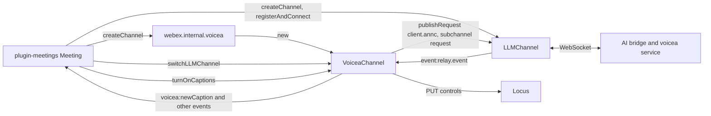
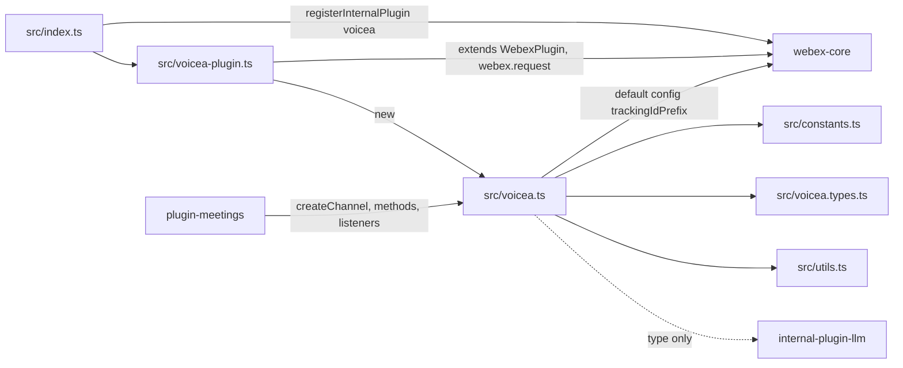
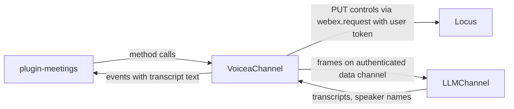

<!-- sdd-generated-metadata
doc_kind: standing-doc
generated_from: architecture@0.3.0
generated_by: claude-code
approved_by: rarajes2@cisco.com
updated_at: 2026-11-12T09:22:36Z
validation_status: pass-with-warnings
-->

# @webex/internal-plugin-voicea architecture

Canonical architecture for this package. Flow behavior lives in the
[voicea channel specification](../src/docs/README.md). This page owns package boundaries, the plugin
registration, the contract index, and how the package meets the rest of the SDK.

Related context: [specification registry](specs/README.md) ·
[package agent instructions](../AGENTS.md)

## Applicability

| Condition ID                         | Status     | Evidence or reason | Owned section |
| ------------------------------------ | ---------- | ------------------ | ------------- |
| `repo.owns_datastore`                | N/A        | No database, file store, or migration in `src/voicea.ts` | Repository data and schema |
| `repo.holds_client_state`            | Applicable | Status, language, and binding fields of each channel in `src/voicea.ts` | Client state model |
| `repo.components_interact`           | Applicable | `src/voicea.ts` borrows an LLM channel from internal-plugin-llm and is driven by plugin-meetings | Dependency and interaction topology |
| `repo.domain_data_across_components` | Applicable | Caption and language data arrive over the LLM channel and are handed to plugin-meetings as events from `src/voicea.ts` | Object and data ownership |
| `repo.caches_data`                   | N/A        | `src/voicea.ts` keeps current state only, no cache | Caching catalog |
| `repo.observability_convention`      | N/A        | `src/voicea.ts` does not log and emits no metric; outbound frames carry a trackingId only | Observability patterns |
| `repo.deploys_to_infra`              | N/A        | Library published to npm (`package.json`). No service runtime | Runtime and infrastructure |
| `repo.shared_base_libs`              | Applicable | Extends WebexPlugin from webex-core and uses the legacy build, lint, and test stack (`babel.config.js`, `jest.config.js`, `.eslintrc.js`) | Shared and base libraries |
| `repo.is_monorepo`                   | N/A        | This SDD root is one package. The workspace around it is out of scope | Package map and inter-package dependencies |
| `repo.multi_platform`                | N/A        | `src/voicea.ts` uses no platform-specific API; the `webex` package bundles it for browser and Node alike | Platform matrix |
| `repo.published_package`             | Applicable | `package.json` name is @webex/internal-plugin-voicea and deploy:npm publishes it | Release and versioning |
| `repo.embedded_in_host`              | N/A        | No host theme or embed API in `src/voicea.ts` | Host integration and theming |
| `repo.exposes_commands_or_artifacts` | Applicable | build:src in `package.json` writes dist and its type declarations | Commands and generated artifacts |
| `repo.cross_repo_deps_material`      | Applicable | Behavior depends on Locus controls and on the voicea service reached over the LLM data channel (`src/voicea.ts`) | Cross-repository topology |
| `repo.security_arch_warranted`       | Applicable | Meeting captions, transcripts, speaker names, and manual captions pass through `src/voicea.ts` | Security architecture |

## Design overview

`@webex/internal-plugin-voicea` is a published TypeScript library with one module. Importing it
registers `VoiceaPlugin` as the internal plugin `voicea`. The `webex` package requires it from
`src/meetings.js`, and plugin-meetings declares it as a dependency, so every full SDK build has
`webex.internal.voicea`.

The plugin is a factory. `createChannel(llmChannel?)` returns a `VoiceaChannel`, and plugin-meetings
keeps one per meeting. A channel does two kinds of work. It sends Locus `controls` requests that turn
captions, transcription, and manual captions on and set the spoken language. It also talks to the
voicea service over the meeting's LLM data channel: it announces the client, requests caption
languages, sends manual captions, manages the transcription subchannel, and re-emits inbound relay
events as `voicea:*` and `aibridge:*` events.

The LLM channel belongs to the caller. plugin-meetings creates it through
`webex.internal.llm.createChannel()`, connects it, and lends it to the voicea channel through
`switchLLMChannel`. The package serves no routes and persists nothing.

## Resource inventory and responsibilities

| Resource | Kind | Responsibility | Owner | Source | Detailed specification |
| -------- | ---- | -------------- | ----- | ------ | ---------------------- |
| Voicea plugin and channel | package (one module) | Caption, transcription, and manual-caption control; voicea announcement and language requests; relay-event translation | @webex/web-client, @webex/web-sdk | `src` | [`src/docs/README.md`](../src/docs/README.md) |

## Interaction and execution flows

Representative end-to-end flow: a meeting connects its LLM channel, binds the voicea channel to it,
and turns captions on; captions then arrive from the voicea service.

| From | To | Interaction or transport | Purpose | Failure or compatibility behavior |
| ---- | -- | ------------------------ | ------- | --------------------------------- |
| plugin-meetings | `webex.internal.voicea` | In-process call | Create one channel per meeting | None |
| plugin-meetings | `VoiceaChannel` | In-process calls and event listeners | Bind the LLM channel, change caption settings, receive captions | Throws and rejections propagate; see the module spec |
| `VoiceaChannel` | Locus `controls` | HTTPS PUT through `webex.request` | Captions, transcription, manual captions, spoken language | No retry here; webex-core interceptors apply |
| `VoiceaChannel` | `LLMChannel` | `getSocket().send` | Announcement, language request, manual caption, subchannel subscription | Skipped or thrown when disconnected, per method |
| `LLMChannel` | `VoiceaChannel` | `event:relay.event`, `online` | Inbound voicea traffic; deferred caption restore | Unknown relay types ignored |

## Dependency topology

| Dependency | Type | Used by | Purpose | Version, failure, or fallback policy |
| ---------- | ---- | ------- | ------- | ------------------------------------ |
| `@webex/webex-core` | Internal | `src/index.ts`, `src/voicea-plugin.ts`, `src/voicea.ts` | Registration, plugin base, request function, default `config` for the trackingId prefix | `workspace:*` in `package.json` |
| `@webex/internal-plugin-llm` | Internal | `src/voicea-plugin.ts`, `src/voicea.ts` (type imports only) | The `LLMChannel` type; the channel object itself comes from the caller | `workspace:*` |
| `@webex/internal-plugin-mercury` | Internal | Unit tests only | Declared runtime dependency that `src/` never imports | `workspace:*` |
| `uuid` | External | `src/voicea.ts` | trackingId and message ids | `^3.3.2` in `package.json` |
| Locus | External service | `src/voicea.ts` | `controls` endpoint | URL from the bound LLM channel's `getLocusUrl()` |
| Voicea service through the AI bridge | External service | `src/voicea.ts` | Captions, translation, highlights, speaker names | Reached only through the LLM data channel |

No import cycle exists: this package imports webex-core and, as types, internal-plugin-llm; neither
imports this package. plugin-meetings imports this package and drives it.

## Public and consumer surfaces

| Surface | Type | Owner | Consumers | Compatibility policy | Source |
| ------- | ---- | ----- | --------- | -------------------- | ------ |
| `voicea-internal-sdk` — package @webex/internal-plugin-voicea, `webex.internal.voicea`, `VoiceaChannel`, and its events | SDK, published to npm, internal | Voicea plugin and channel | plugin-meetings; the `webex` package for the registration side effect | The README states that internal plugins do not strictly follow semantic versioning; no deprecation rule is declared | `package.json`, `src/index.ts`, `src/voicea-plugin.ts`, `src/voicea.ts`, `src/constants.ts`, `src/voicea.types.ts` |

The Locus `controls` bodies, the data-channel frames, and the relay types are protocols this package
consumes or speaks with services, described under *Protocol and wire format* in the
[module specification](../src/docs/README.md#protocol-and-wire-format), not published contracts of
this package.

## Client state model

| State or slice | Owner | Transition triggers | Persistence or reset boundary |
| -------------- | ----- | ------------------- | ----------------------------- |
| Announce, caption, and manual-caption statuses | `VoiceaChannel` | Channel methods and inbound announcements | In memory per channel; reset on rebind and by `deregisterEvents` |
| Bound and target LLM channel | `VoiceaChannel` (borrowed) | `switchLLMChannel` | The bound reference survives `deregisterEvents` |
| `keepTranscriptionSubscribed` | `VoiceaChannel` | Turn-on and subscription updates | Read by plugin-meetings after an LLM reconnect |
| LLM connection | The caller's `LLMChannel` | plugin-meetings | Owned by the caller |

Full detail is in the module specification's *Client state model*.

## Cross-cutting architecture

### Security

- Trust boundaries and identity flow: see [Security architecture](#security-architecture).
- Sensitive surfaces and data classes: participant CSI ids, which travel with every transcript and
  highlight; the content classes are listed under Security architecture.
- Encryption and secret boundaries: see [Security architecture](#security-architecture).

### Observability and operations

- Logging and correlation: none in `src/`; each outbound frame carries `trackingId`
  `<trackingIdPrefix>_<uuid>`.
- Metrics, traces, and audit signals: none emitted here.
- Ownership and operational entry points: `.github/CODEOWNERS` at the workspace root assigns
  `packages/@webex/internal-plugin-voicea` to `@webex/web-client` and `@webex/web-sdk`. No dashboards
  or runbooks are recorded in this package.

### Quality attributes

- Compatibility: plugin-meetings relies on the event names in `EVENT_TRIGGERS`, the
  `TURN_ON_CAPTION_STATUS` values, `MeetingTranscriptPayload`, and the channel methods it calls.
- Footprint: six source files; runtime imports are webex-core, uuid, and Node `events`.
- Test confidence: 84 unit cases pass; registration through the entry, the trackingId prefix, and the
  `turnOnCaptions` request body have no case. No coverage threshold is enforced.

## Dependency and interaction topology

| From | To | Kind | Purpose | Ordering or failure boundary |
| ---- | -- | ---- | ------- | ---------------------------- |
| `src/index.ts` | webex-core | Call at import | Register `voicea` | First registration wins |
| `src/voicea-plugin.ts` | `src/voicea.ts` | Construction | One channel per call | None |
| `src/voicea.ts` | Caller's `LLMChannel` | Calls and listeners | Send frames, receive relay events | Requires a bound, connected channel per method |
| `src/voicea.ts` | `webex.request` | Call | Locus `controls` PUT | Rejection reaches the method's promise |
| plugin-meetings | `src/voicea.ts` | Calls and listeners | Drive captions per meeting | The caller binds and deregisters |

## Object and data ownership

| Object or state | System of record | May write | May read | Movement or lifecycle |
| --------------- | ---------------- | --------- | -------- | --------------------- |
| Meeting caption settings (captions, transcribing, manual caption, spoken language) | Locus | This package through `controls`, other participants | plugin-meetings through Locus updates | Changed by request; reported back by Locus |
| Captions, highlights, speaker names | Voicea service | Voicea service | This package, then plugin-meetings | Relayed over the LLM channel and re-emitted as events; not stored |
| LLM channel | The caller (plugin-meetings) | The caller | This package, borrowed | Created, connected, and disconnected by the caller |

## Shared and base libraries

| Library | Inherited responsibility | Consumers | Version floor | Compatibility rule |
| ------- | ------------------------ | --------- | ------------- | ------------------ |
| `@webex/webex-core` `WebexPlugin` | `webex`, `request`, namespace | `VoiceaPlugin` | `workspace:*` | Keep namespace `voicea` |
| Node `events` `EventEmitter` | `on`, `off`, `emit` | `VoiceaChannel` | Node built-in | Event names come from `EVENT_TRIGGERS` |
| `@webex/babel-config-legacy`, `@webex/eslint-config-legacy`, `@webex/jest-config-legacy`, `@webex/legacy-tools` | Build, lint, and test stack through one-line config files | Package tooling | `workspace:*` | Do not fork the config locally |

## Release and versioning

| Artifact | Publish target | Versioning rule | Deprecation window | Changelog or migration obligation |
| -------- | -------------- | --------------- | ------------------ | --------------------------------- |
| @webex/internal-plugin-voicea | npm through `deploy:npm` | Internal plugin; the README says semantic versioning is not strictly followed | None declared | None declared in the package; the workspace owns changelog generation |

## Commands and generated artifacts

| Command or artifact | Owner | Inputs | Output or side effect | Compatibility boundary |
| ------------------- | ----- | ------ | --------------------- | ---------------------- |
| `yarn workspace @webex/internal-plugin-voicea build:src` | Package scripts | `src` | Writes `dist/` through `webex-legacy-tools`, then runs `build` | `dist/` is generated and never edited by hand |
| `yarn workspace @webex/internal-plugin-voicea build` | Package scripts | `src`, `tsconfig.json` | `tsc` writes declarations to `dist/types` only | Does not compile JavaScript; `build:src` calls it |
| `yarn workspace @webex/internal-plugin-voicea test:unit` | Package scripts | `test/unit/spec` | Jest run | Specs import `src` directly; sibling packages load from their `dist/` |
| `yarn workspace @webex/internal-plugin-voicea test:style` | Package scripts | `src` | ESLint run | The shared config ignores `docs/**` and `*.md` |

## Cross-repository topology

| Repository or external system | Relationship | Exchanged contract or artifact | Owner | Sequencing constraint |
| ----------------------------- | ------------ | ------------------------------ | ----- | --------------------- |
| `@webex/webex-core` (workspace sibling; module spec consulted) | Consumes | `registerInternalPlugin`, `WebexPlugin`, `webex.request`, default `config` | @webex/web-client, @webex/web-sdk | None beyond registration |
| `@webex/internal-plugin-llm` (workspace sibling; module spec consulted and stale, code used) | Consumes, by type and by borrowed instance | `LLMChannel` accessors, socket, `event:relay.event`, `online` | @webex/web-client, @webex/web-sdk | The caller connects the channel before captions can start |
| `@webex/internal-plugin-mercury` (workspace sibling; module spec consulted) | Consumes through `LLMChannel` | Default-session event names and socket | @webex/web-client, @webex/web-sdk | None |
| `@webex/plugin-meetings` (workspace sibling, no spec) | Provides to | `createChannel`, `VoiceaChannel` methods and events, exported constants and types | @webex/web-client, @webex/web-sdk | Binds after each LLM connection unless a practice session holds the binding |
| `webex` (workspace sibling, no spec) | Provides to | Import side effect registering `voicea` | @webex/web-sdk | None |
| Locus | Consumes | `controls` endpoint | Not recorded in this repository | Locus URL from the bound LLM channel |
| Voicea service and AI bridge | Consumes | Relay frames over the LLM data channel | Not recorded in this repository | The client announces before captions flow |

## Security architecture

- This package holds no credential. Locus requests reuse `webex.request`, which adds the user's
  authorization through webex-core; the data channel's registration and token are owned by
  internal-plugin-llm and the caller.
- Transcripts, highlights, speaker names, and manual captions are meeting content. The package passes
  them to listeners and keeps none of them; it does not log them.
- Any client can send a manual caption frame when the channel is connected; whether the sender may
  caption is enforced by the service, not here.

## Domain language

| Term | Repository-specific meaning | Authoritative source |
| ---- | --------------------------- | -------------------- |
| Voicea | The Webex speech service that produces captions, translations, highlights, and assistant responses | `src/constants.ts` |
| AI bridge | The relay that carries voicea and manual-caption messages over the LLM data channel | `src/constants.ts` |
| LLM channel | The meeting data-channel WebSocket, an `LLMChannel` from internal-plugin-llm | `src/voicea-plugin.ts` |
| Announcement | The `client.annc` frame that asks the voicea service to join, answered by `voicea.annc` | `src/voicea.ts` |
| Caption service id | The `from` header of the service's announcement, used as the `to` header afterwards | `src/voicea.ts` |
| WXA / EVA | The meeting assistant; its wake, cancel, and thanks transcription types become `voicea:wxa` | `src/voicea.ts` |
| CSI | Capture source id of a participant's media, carried in transcripts and highlights | `src/voicea.types.ts` |

## References and maintenance

- Decisions: [adr/](adr/index.md)
- Instantiated specifications and routing: [specs/README.md](specs/README.md)
- Repository rules and patterns: [package agent instructions](../AGENTS.md)
- Update this document in the same change that alters package boundaries, resource ownership,
  cross-resource interaction, or cross-cutting architecture.
