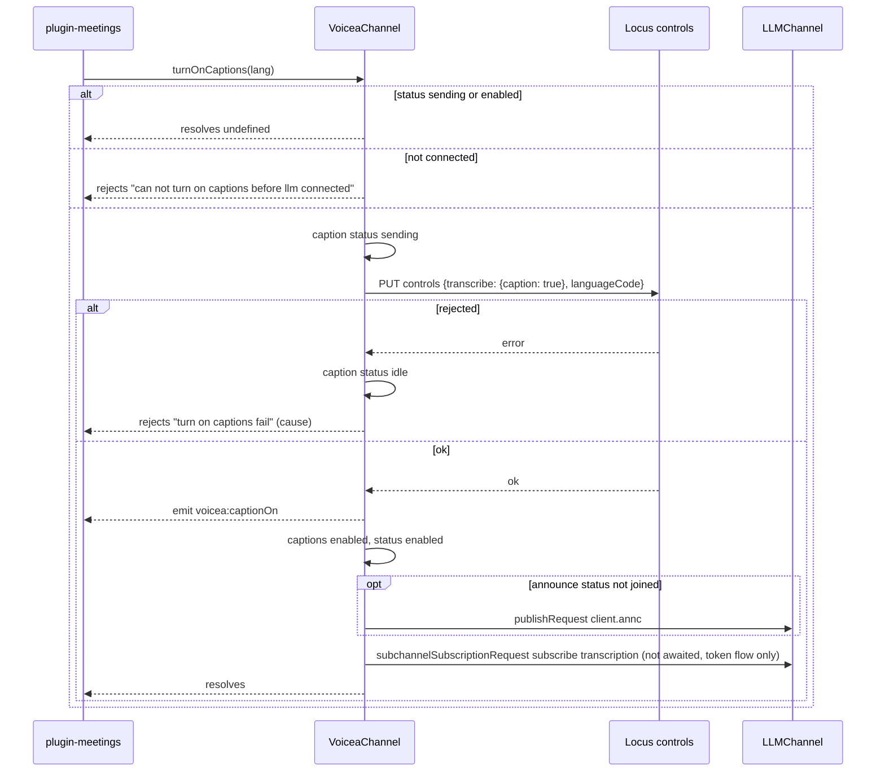
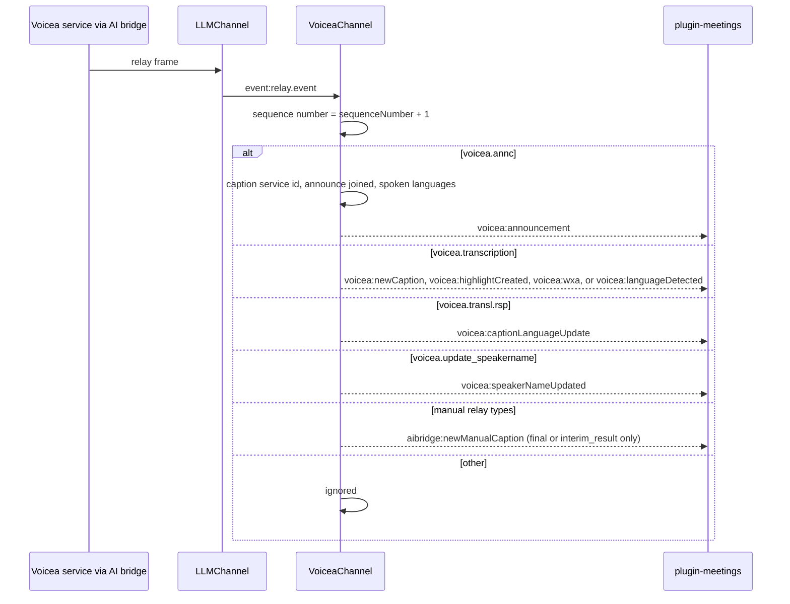
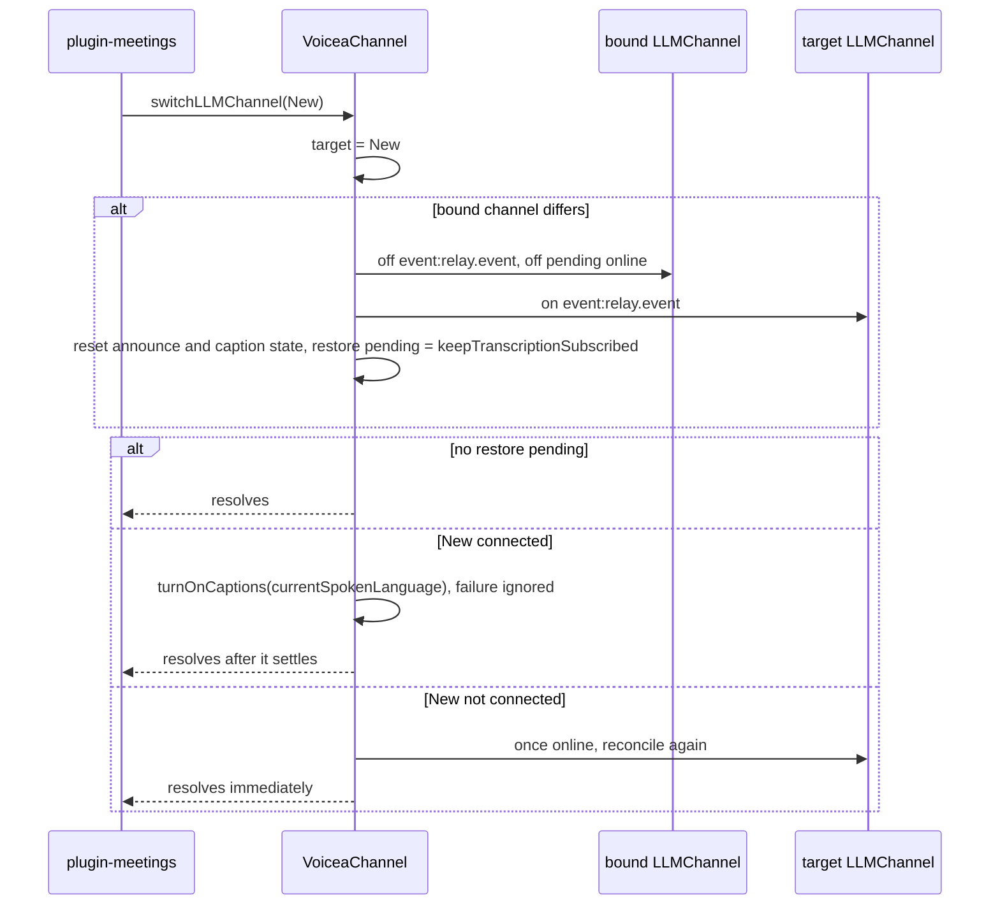
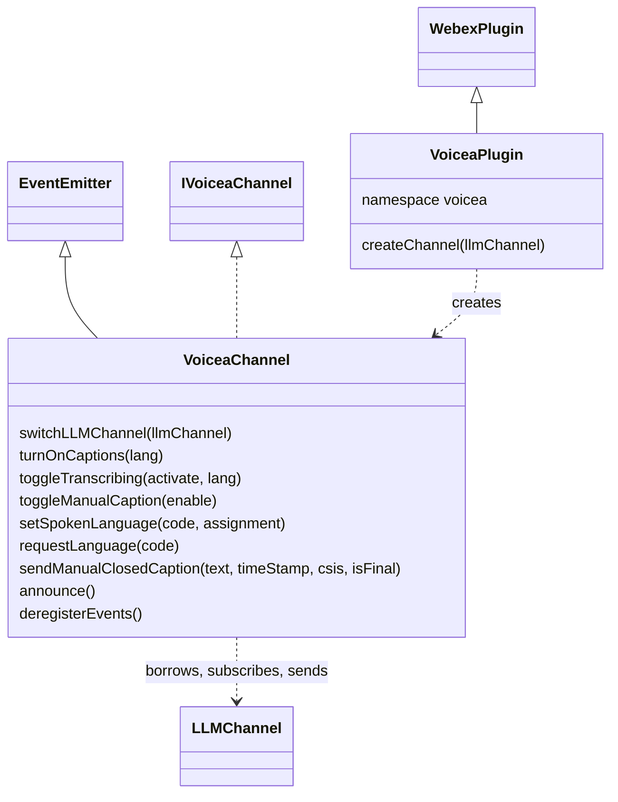
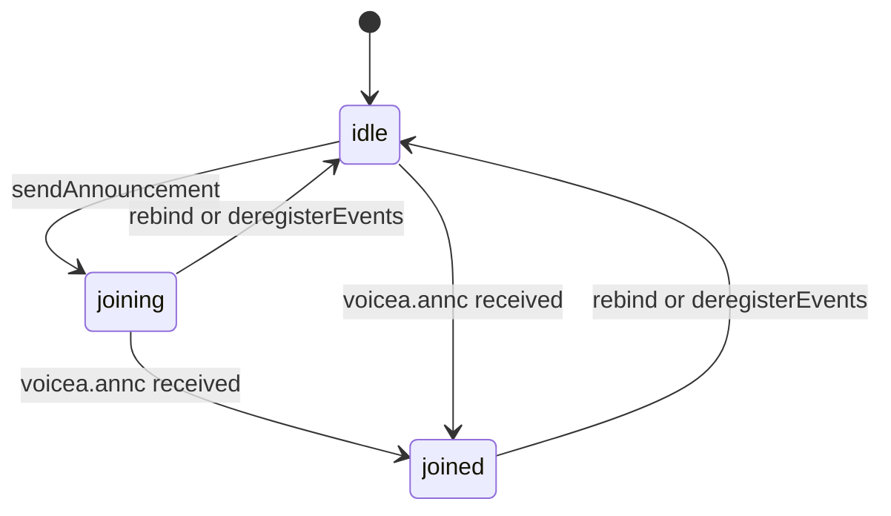
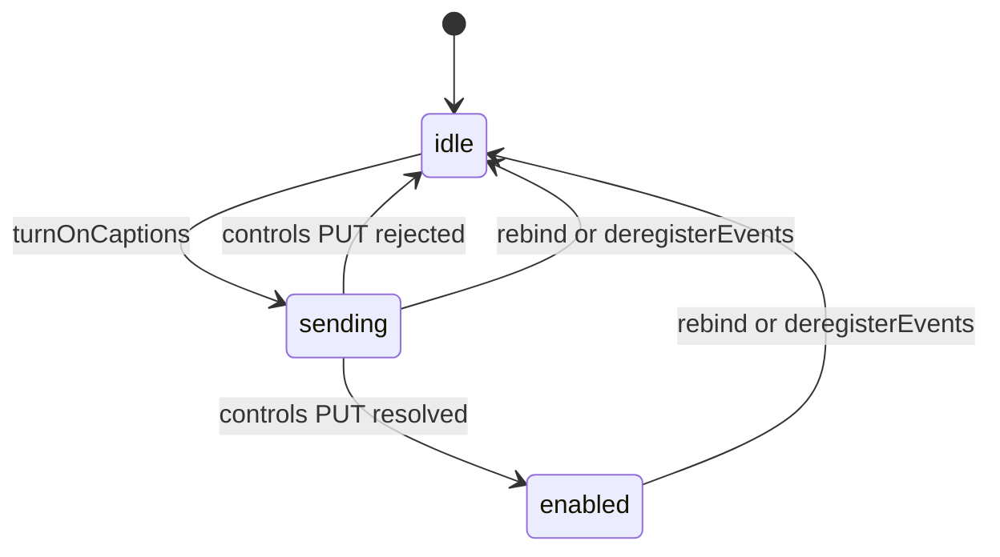

<!-- sdd-generated-metadata
doc_kind: module-spec
generated_from: module-spec@0.3.0
generated_by: claude-code
approved_by: rarajes2@cisco.com
updated_at: 2026-11-12T09:22:36Z
validation_status: pass-with-warnings
-->

# Voicea caption and transcription channel

This source-local document at `src/docs/README.md` owns the stable specification for **the voicea
plugin**: the internal plugin `webex.internal.voicea`, a factory that creates `VoiceaChannel`
objects, and `VoiceaChannel` itself. A channel turns meeting captions and transcription on through
Locus `controls`, announces the client to the voicea (AI bridge) service over an LLM data channel,
requests caption languages, sends manual captions, and turns inbound relay events into `voicea:*`
events. Ground every claim in package evidence and link to the
[package architecture](../../docs/architecture.md) instead of repeating broader facts. No service
specification exists because this package is a library.

Related context: [documentation index](../../docs/index.md) ·
[package agent instructions](../../AGENTS.md)

## Metadata

| Field             | Value |
| ----------------- | ----- |
| Owner             | @webex/web-client, @webex/web-sdk |
| Source path       | `src` |
| Resource kind     | package |
| Status            | Draft |
| Last verified     | 2026-11-12 at `ecd5af12a1` |
| Module id         | `internal-plugin-voicea` |
| Parent spec       | — |
| Doc kind          | Module spec |
| Coverage score    | 93.3% assessed 2026-11-12 by the generator — 14 of 15 mandatory fields PRESENT, critical 8 of 8; test strategy is WEAK because the plugin registration, the outbound `trackingId` prefix, the `turnOnCaptions` request body, the deferred `online` restore after `deregisterEvents`, and the synchronous throws of the Locus control methods without a channel have no case, although 84 unit cases pass |
| Validation status | Pass with warnings — 2026-11-12; validator runtime 01a1cef2-ab9c-7f50-baf4-643aeae8b469; 0 Blocking, 1 Important finding (accepted command-source warning) |

## Applicability

| Condition ID                         | Status     | Evidence or reason | Owned section |
| ------------------------------------ | ---------- | ------------------ | ------------- |
| `module.has_tiers`                   | N/A        | No tier policy exists in `package.json` or `src/voicea.ts` | Tier |
| `module.has_ui`                      | N/A        | `src/voicea.ts` emits events and sends messages; it renders nothing | UI use-case flow |
| `module.crosses_service_boundaries`  | Applicable | `src/voicea.ts` sends PUT requests to Locus controls and publishes relay messages over the LLM data channel to the voicea service | Cross-boundary use-case flow |
| `module.holds_client_state`          | Applicable | Announce, caption, and manual-caption statuses, the caption service id, languages, and the sequence number are private fields in `src/voicea.ts` | Client state model |
| `module.enforces_domain_rules`       | Applicable | Connected-channel preconditions, one turn-on in flight, and the spoken-language filter for detected languages in `src/voicea.ts` | Business rules and invariants |
| `module.is_concurrent_async`         | Applicable | Promise chains, fire-and-forget subscription updates, and the deferred online listener in `src/voicea.ts` | Concurrency and reactive flow |
| `module.owns_persistence`            | N/A        | `src/voicea.ts` stores nothing outside memory | Data, schema, and migration discipline |
| `module.stateful_transitions`        | Applicable | Announce status idle, joining, joined and caption status idle, sending, enabled in `src/constants.ts` and `src/voicea.ts` | State machine |
| `module.exposes_wire_protocol`       | Applicable | publishRequest and subchannelSubscriptionRequest frames, relay types, and Locus controls bodies in `src/voicea.ts` and `src/constants.ts` | Protocol and wire format |
| `module.ui_multi_screen`             | N/A        | No UI | UI flow |
| `module.large_data_model`            | N/A        | `src/voicea.types.ts` declares payload shapes for a few messages, covered under Protocol and wire format | Data model |
| `module.returns_caller_errors`       | Applicable | Thrown errors and rejected promises from the channel methods in `src/voicea.ts` | Caller-visible failure modes |
| `module.module_specific_conventions` | Applicable | The voicea: and aibridge: event names, the shared sequence number, and the caller-owned LLM channel in `src/voicea.ts` and `src/voicea-plugin.ts` | Module-specific rules |
| `module.published_package`           | Applicable | `package.json` names the package @webex/internal-plugin-voicea and defines deploy:npm | Export stability |
| `module.embedded_in_host`            | N/A        | No host theme or embed API | Host integration and theming |
| `module.has_design_tradeoff`         | Applicable | The caller-owned LLM channel and the reconciler that rebinds it, in `src/voicea-plugin.ts` and `src/voicea.ts` | Key design trade-off |
| `module.has_submodules`              | N/A        | The src directory has no child module | Sub-modules |

## Evidence register

| Evidence | What it establishes |
| -------- | ------------------- |
| `src/index.ts` | `registerInternalPlugin('voicea', Voicea, {})` at import time; exports: default and named `VoiceaPlugin`, `VoiceaChannel`, `EVENT_TRIGGERS`, `TURN_ON_CAPTION_STATUS`, and the types `MeetingTranscriptPayload` and `SpeakerNameUpdatePayload` |
| `src/voicea-plugin.ts` | `VoiceaPlugin` extends `WebexPlugin` in namespace `voicea`; `createChannel(llmChannel?)` returns a new `VoiceaChannel` bound to `webex.request`. Its JSDoc states that the channel does not take ownership of the LLM channel |
| `src/voicea.ts` | `VoiceaChannel`: relay-event dispatch, announcement, caption-language requests, manual captions, Locus controls requests, subchannel subscriptions, the channel reconciler, and teardown. Its JSDoc and inline comments are the only recorded rationale |
| `src/constants.ts` | Event names, relay types, transcription types, status values, `VOICEA`, `DEFAULT_SPOKEN_LANGUAGE` (`en`), and the unused `LANGUAGE_ASSIGNMENT` |
| `src/voicea.types.ts` | Payload and interface declarations, including `IVoiceaChannel`, which `VoiceaChannel` implements |
| `src/utils.ts` | `millisToMinutesAndSeconds`, the `m:ss` formatter for caption and highlight timestamps |
| `package.json` | Name, `main` (`dist/index.js`), `types` (`dist/types/index.d.ts`), `devMain` (`src/index.js`), `engines` (`node >=18`), dependencies, and scripts |
| `test/unit/spec/voicea.js` | 78 unit cases for `VoiceaChannel` with a stub LLM channel and a stub request function |
| `test/unit/spec/voicea-plugin.js` | 5 unit cases: `createChannel` with and without an LLM channel, independent channels, and the namespace |
| `test/unit/spec/utils.js` | 1 unit case: `millisToMinutesAndSeconds(2000)` is `0:02` |
| `README.md` | Retained npm page; context only. Its differences from code are recorded in `docs/adr/0001-retain-product-readme.md` |
| Sibling package webex-core, file src/docs/README.md | Module spec consulted. `registerInternalPlugin` is first-wins and rejects proxies; `WebexPlugin` supplies `webex` and `request`; the named `config` export is the default configuration object with `trackingIdPrefix` `webex-js-sdk` |
| Sibling package internal-plugin-llm, file src/docs/README.md | Module spec consulted and found stale on the points used here: it describes one session-keyed `LLMChannel` registered as `webex.internal.llm` and says this package re-exports `LLM_PRACTICE_SESSION`. Neither holds in code, so the sources below were used as the referee |
| Sibling package internal-plugin-llm, files src/llm-plugin.ts, src/llm.ts, src/llm.types.ts | Source consulted. `webex.internal.llm` is an `LLMPlugin` whose `createChannel()` returns a caller-owned `LLMChannel`; each channel holds one connection, connects without a session id, and exposes `isConnected`, `getBinding`, `getLocusUrl`, `getDatachannelUrl`, `isDataChannelTokenEnabled`, and the inherited Mercury `getSocket`, `on`, `once`, and `off` |
| Sibling package internal-plugin-mercury, file src/docs/README.md | Module spec consulted. Default-session events carry no suffix; `online` fires when the session connects; each inbound envelope is emitted as `event:<namespace>`, so relay events arrive as `event:relay.event` |
| Sibling package plugin-meetings, files src/meeting/index.ts and src/meeting/voicea-meeting.ts | Source consulted (consumer). Each meeting calls `createChannel()` without an LLM channel, calls `switchLLMChannel` after each LLM connection unless a practice session is active, listens to six `voicea:*` events, and calls `deregisterEvents` from `stopTranscription` and on permanent LLM cleanup |
| Sibling package webex, file src/meetings.js | Source consulted. Requires this package for its registration side effect |
| Observation, no stated WHY | Behavior the code shows without stating a reason is recorded once, under Pitfalls and constraints |

## Purpose and boundary

- Responsibility: give a meeting one object that drives its captions and transcription. A channel
  sends Locus `controls` requests to turn captions, transcription, and manual captions on or off and to
  set the spoken language; it announces the client to the voicea service and requests caption
  languages over the meeting's LLM data channel; and it converts inbound relay events into
  `voicea:*` and `aibridge:*` events.
- In scope: `VoiceaPlugin.createChannel`; every public method and event of `VoiceaChannel`; the relay
  and subchannel frames it sends; the Locus `controls` request bodies; switching a channel to another
  LLM channel while keeping caption state; the `m:ss` timestamp formatter.
- Out of scope: creating, registering, connecting, and disconnecting the LLM channel and its token
  handling (the `@webex/internal-plugin-llm` package and the caller); WebSocket transport and event
  naming (the `@webex/internal-plugin-mercury` package, through `LLMChannel`); deciding when to turn
  captions on, reading Locus state, and re-subscribing after an LLM reconnect on the same channel
  (plugin-meetings, which reads `getKeepTranscriptionSubscribed()` and calls
  `updateSubchannelSubscriptions`; this module neither re-announces nor re-subscribes on its own); HTTP transport, retries, and authentication (`webex.request` in webex-core).
- Consumers: plugin-meetings, which owns one channel per meeting; the `webex` package, which requires
  this package so `webex.internal.voicea` exists.

## Structure and key files

| Path | Responsibility |
| ---- | -------------- |
| `src/index.ts` | Registers internal plugin `voicea` and re-exports the public bindings |
| `src/voicea-plugin.ts` | `VoiceaPlugin`, the factory registered as `webex.internal.voicea` |
| `src/voicea.ts` | `VoiceaChannel`, where every flow behavior lives |
| `src/constants.ts` | Event names, relay types, transcription types, and status values |
| `src/voicea.types.ts` | Payload types and the `IVoiceaChannel` interface |
| `src/utils.ts` | `millisToMinutesAndSeconds` |
| `package.json` | Package name, entry points, scripts, and dependencies |
| `babel.config.js`, `jest.config.js` | Re-exports of the legacy Babel and Jest configurations |
| `.eslintrc.js` | Sets `root: true` and extends `@webex/eslint-config-legacy` |
| `tsconfig.json` | Extends the workspace `tsconfig.json` and includes `src` |
| `process` | Package-root file exporting `{browser: true}`; not imported by `src/` |
| `src/docs/README.md` | This module specification; ignored by the build and by lint |
| `test/unit/spec/voicea.js` | Unit spec for `VoiceaChannel` |
| `test/unit/spec/voicea-plugin.js` | Unit spec for `VoiceaPlugin` |
| `test/unit/spec/utils.js` | Unit spec for the formatter |
| dist/ (generated) | Build output of `build:src`, including `dist/types`; ignored by Git and never edited by hand |

## Public surface

| Surface | Consumer | Compatibility commitment | Source |
| ------- | -------- | ------------------------ | ------ |
| Import side effect: internal plugin `voicea` | `webex` (`src/meetings.js`), plugin-meetings | First registration of the name wins | `src/index.ts` |
| `webex.internal.voicea.createChannel(llmChannel?)` | plugin-meetings | Returns a new, independent `VoiceaChannel` each call; the caller owns both channels | `src/voicea-plugin.ts` |
| `VoiceaChannel` LLM binding: `switchLLMChannel(llmChannel)`, `isLLMConnected()`, `deregisterEvents()` | plugin-meetings | `switchLLMChannel` resolves once the binding is updated and any immediate caption restore settles | `src/voicea.ts` |
| `VoiceaChannel` Locus controls: `turnOnCaptions(spokenLanguage?)`, `toggleTranscribing(activate, spokenLanguage?)`, `toggleManualCaption(enable)`, `setSpokenLanguage(languageCode, languageAssignment?)` | plugin-meetings | Promise-returning; failures described under Caller-visible failure modes | `src/voicea.ts` |
| `VoiceaChannel` data-channel sends: `announce()`, `sendAnnouncement()`, `requestLanguage(languageCode)`, `sendManualClosedCaption(text, timeStamp, csis, isFinal)`, `updateSubchannelSubscriptions(options)`, `updateSubchannelSubscriptionsAndSyncCaptionState(options, keepSubscribed)` | plugin-meetings | Frames under Protocol and wire format | `src/voicea.ts` |
| `VoiceaChannel` Locus-driven inputs: `onSpokenLanguageUpdate(languageCode, meetingId)`, `onCaptionServiceIdUpdate(serviceId)` | plugin-meetings, from Locus updates | Emit or re-request as described in `MOD-012` and `MOD-010` | `src/voicea.ts` |
| `VoiceaChannel` getters: `getCaptionStatus()`, `getAnnounceStatus()`, `getKeepTranscriptionSubscribed()` | plugin-meetings | Return the current status strings or flag | `src/voicea.ts` |
| Events on `VoiceaChannel` (an `EventEmitter`): the values of `EVENT_TRIGGERS` | plugin-meetings | Payloads under Protocol and wire format | `src/constants.ts`, `src/voicea.ts` |
| Named exports `EVENT_TRIGGERS`, `TURN_ON_CAPTION_STATUS`; types `MeetingTranscriptPayload`, `SpeakerNameUpdatePayload` | plugin-meetings | Values and shapes are relied on by plugin-meetings | `src/index.ts`, `src/constants.ts`, `src/voicea.types.ts` |

Contract ID `voicea-internal-sdk` is indexed in the
[package architecture](../../docs/architecture.md#public-and-consumer-surfaces) and registered in
`.sdd/manifest.json`. Export stability is under [Export stability](#export-stability).

## Dependencies

| Dependency | Why it is required | Failure behavior |
| ---------- | ------------------ | ---------------- |
| `@webex/webex-core` plugin host (module spec consulted) | `registerInternalPlugin`, `WebexPlugin`, `webex.request` (bound into each channel), and the default `config` export for the `trackingId` prefix | Request rejections reach the channel method's promise |
| `@webex/internal-plugin-llm` `LLMChannel` (spec consulted and stale; code consulted) | The data channel: `getSocket().send`, `getBinding`, `getLocusUrl`, `getDatachannelUrl`, `isConnected`, `isDataChannelTokenEnabled`, and the `event:relay.event` and `online` events. Imported only as a type | No channel: `requireLLMChannel` throws `VoiceaChannel: LLM channel not available`; a disconnected channel makes the data-channel sends no-ops or throws, per method |
| `@webex/internal-plugin-mercury` (module spec consulted; reached through `LLMChannel`) | Event emission, default-session event names, and the socket | A closed socket is the LLM package's concern; voicea checks only `isConnected()` |
| Locus `controls` endpoint (external) | Captions, transcription, manual captions, and spoken language | A rejection is wrapped or passed through, per method |
| Voicea service through the AI bridge relay (external) | Announcement, translation, transcription, speaker-name, and manual-caption relay messages | Silence produces no event; there is no timeout |
| `uuid` | Version 4 values for `trackingId`, translation-request ids, and manual-caption ids | Not applicable |
| Node `events` `EventEmitter` | Base class of `VoiceaChannel` | Not applicable |

`@webex/internal-plugin-mercury` is a declared runtime dependency in `package.json`, but no file in
`src/` imports it; only `test/unit/spec/voicea.js` and `test/unit/spec/voicea-plugin.js` do.

## Requirements

| ID | WHAT | WHY | Source evidence | Test or example evidence | Assumptions or gaps | Confidence |
| -- | ---- | --- | --------------- | ------------------------ | ------------------- | ---------- |
| `MOD-001` | Importing the package registers `VoiceaPlugin` as internal plugin `voicea` with empty options, so `webex.internal.voicea` is the factory. | plugin-meetings reaches the factory through `webex.internal.voicea`, and the `webex` package requires this package for that side effect. | `src/index.ts` | `test/unit/spec/voicea-plugin.js` "has the correct namespace" constructs the class directly | No case imports the package entry or checks the registration | Weak |
| `MOD-002` | `createChannel(llmChannel?)` returns a new `VoiceaChannel` built with the given LLM channel (or none) and `webex.request` bound to the webex instance. Each call returns an independent channel. The channel never connects, disconnects, or cleans up the LLM channel. | The JSDoc: the caller retains ownership of the LLM channel and its lifecycle. plugin-meetings creates the channel before any LLM connection exists. | `src/voicea-plugin.ts` | `test/unit/spec/voicea-plugin.js` four #createChannel cases | None | Present |
| `MOD-003` | A new channel starts with sequence number 1, announce and caption status `idle`, manual-caption status `idle`, spoken language `en`, no caption language, no caption service id, and `keepTranscriptionSubscribed` false. With an LLM channel it subscribes to `event:relay.event`; without one it subscribes to nothing. | The JSDoc: a channel may be created first and attached later with `switchLLMChannel`. | `src/voicea.ts`, `src/constants.ts` | `test/unit/spec/voicea.js` #constructor cases | None | Present |
| `MOD-004` | Every relay event sets the sequence number to the event's `sequenceNumber` plus 1, then dispatches on `data.relayType`: `voicea.annc`, `voicea.transl.rsp`, `voicea.transcription`, `voicea.update_speakername`, `aibridge.manual_transcription`, and `client.manual_transcription`. Other relay types are ignored after the sequence update. | Outbound frames carry the sequence number as `id`, and the data channel's numbering continues from the last inbound frame. | `src/voicea.ts`, `src/constants.ts` | `test/unit/spec/voicea.js` "processes speaker name updates and advances the message sequence" | No case sends an unknown relay type | Present |
| `MOD-005` | On `voicea.annc` the channel takes `headers.from` as the caption service id (`MOD-010`), sets announce status `joined`, stores `ASR.spoken_languages`, and emits `voicea:announcement` with `captionLanguages`, `maxLanguages`, `spokenLanguages`, and `currentSpokenLanguage`, defaulting to `[]`, `0`, and `[]`. | The announcement is how the service reports which caption and spoken languages the meeting may use. | `src/voicea.ts` | `test/unit/spec/voicea.js` "processes voicea announcement events", "processes voicea announcement with empty payload" | None | Present |
| `MOD-006` | On `voicea.transcription` the channel emits: `voicea:newCaption` with `isFinal` false for `transcript_interim_results` and `isFinal` true for `transcript_final_result`, where each final transcript gains `timestamp` (`m:ss` of `end_millis`); `voicea:highlightCreated` for `highlight_created`; `voicea:wxa` with `isListening` true for `eva_wake`, false for `eva_cancel`, and false plus `text` for `eva_thanks`; and `voicea:languageDetected` for `language_detected` only when the language is in the last announced spoken languages. Other types emit nothing. | plugin-meetings renders captions and highlights from these events and reacts to the assistant state; a detected language outside the meeting's spoken languages is not actionable. | `src/voicea.ts`, `src/utils.ts` | `test/unit/spec/voicea.js` transcription, highlight, eva, and language-detected cases | None | Present |
| `MOD-007` | On `voicea.transl.rsp` the channel emits `voicea:captionLanguageUpdate` with `{statusCode: 200}` when `statusCode` is 200, else `{statusCode: errorCode, errorMessage: message}`. | plugin-meetings resolves or rejects its caption-language request from this event. | `src/voicea.ts` | `test/unit/spec/voicea.js` caption language response success and error cases | None | Present |
| `MOD-008` | On `voicea.update_speakername` the channel emits `voicea:speakerNameUpdated` with the payload unchanged. On either manual relay type it emits `aibridge:newManualCaption` with `isFinal`, `transcriptId`, `transcripts`, `sender` (`headers.from`), and `source` (the relay type), but only for `manual_caption_final_result` and `manual_caption_interim_result`. | Manual captions come from a human captioner and are told apart from voicea captions by event name and source. | `src/voicea.ts`, `src/constants.ts` | `test/unit/spec/voicea.js` speaker-name and "processes manual transcription events" cases | The interim manual type is not tested inbound | Present |
| `MOD-009` | `announce()` does nothing when announce status is `joined`, throws `voicea can not announce before llm connected` when the channel is not connected, and otherwise calls `sendAnnouncement()`. `sendAnnouncement()` sets status `joining` and sends a `publishRequest` with relay type `client.annc`, `clientPayload.version` `v2`, `headers.to` set to the caption service id only when one is known, and increments the sequence number. | The service joins a meeting's data channel only after a client announces; the `to` header targets the caption service already in the meeting. | `src/voicea.ts` | `test/unit/spec/voicea.js` #announce and #sendAnnouncement cases | `sendAnnouncement` itself does not check `isConnected` | Present |
| `MOD-010` | `requestLanguage(code)` does nothing while disconnected; otherwise it sends a `publishRequest` with relay type `voicea.transl.req`, `headers.to` the caption service id, and `clientPayload` `{translationLanguage, id}`, records the code as the current caption language, and increments the sequence number. `onCaptionServiceIdUpdate(id)` ignores a falsy id and, when the id changes, stores it and repeats `requestLanguage` with the current caption language if there is one. | A new caption service instance does not know the language the client chose, so the request is replayed to it. | `src/voicea.ts` | `test/unit/spec/voicea.js` #requestLanguage and #onCaptionServiceIdUpdate cases | None | Present |
| `MOD-011` | `sendManualClosedCaption(text, timeStamp, csis, isFinal)` does nothing while disconnected; otherwise it sends a `publishRequest` with relay type `client.manual_transcription` and a `transcriptPayload` of type `manual_caption_final_result` or `manual_caption_interim_result`, one transcript `{text, start_millis, end_millis, csis}` with both times set to `timeStamp`, and fresh `id` and `transcript_id`, then increments the sequence number. | The relay type is the `MANUAL.CAPTIONER` constant: the frame comes from a human captioner, and other clients receive it as `aibridge:newManualCaption` (`MOD-008`). | `src/voicea.ts` | `test/unit/spec/voicea.js` #sendManualClosedCaption cases | None | Present |
| `MOD-012` | `setSpokenLanguage(code, assignment?)` PUTs `<locusUrl>/controls/` with `{transcribe: {spokenLanguage, languageAssignment?}}` and then emits `voicea:spokenLanguageUpdate` with `{languageCode}`. `onSpokenLanguageUpdate(code, meetingId)` emits `voicea:spokenLanguageUpdate` with `{languageCode, meetingId}` and then records the code as the current spoken language. | The host changes the meeting's spoken language through Locus; Locus reports the result back, which is when the channel adopts it. | `src/voicea.ts` | `test/unit/spec/voicea.js` #setSpokenLanguage and #onSpokenLanguageUpdate cases | `setSpokenLanguage` does not change the recorded spoken language | Present |
| `MOD-013` | `turnOnCaptions(lang?)` resolves `undefined` when caption status is `sending` or `enabled`, rejects with `can not turn on captions before llm connected` when disconnected, and otherwise sets status `sending` and PUTs `<locusUrl>/controls/` with `{transcribe: {caption: true}, languageCode}`. On success it emits `voicea:captionOn`, marks captions enabled, sets status `enabled`, calls `announce()`, and starts `updateSubchannelSubscriptionsAndSyncCaptionState({subscribe: ['transcription']}, true)` without awaiting it. On failure it sets status `idle` and rejects with `turn on captions fail` whose `cause` is the original error. | One turn-on request at a time; captions need the service announced and the transcription subchannel subscribed, and the subscription is remembered for restore. | `src/voicea.ts` | `test/unit/spec/voicea.js` #turnOnCaptions cases | The request body is not asserted | Present |
| `MOD-014` | `toggleTranscribing(activate, lang?)` PUTs `<locusUrl>/controls/` with `{transcribe: {transcribing: activate}, spokenLanguage}`; after success, when `activate` is true and captions are not enabled, it returns `turnOnCaptions(lang)`. Turning transcription off does not turn captions off. | No WHY is stated in code; the code ties enabling transcription to the caption turn-on of `MOD-013`. | `src/voicea.ts` | `test/unit/spec/voicea.js` #toggleTranscribing cases | None | Present |
| `MOD-015` | `toggleManualCaption(enable)` returns `undefined` while a previous toggle is `sending`; otherwise it sets `sending`, PUTs `<locusUrl>/controls/` with `{manualCaption: {enable}}`, and resets to `idle` on settle. A failure rejects with `toggle manual captions fail` and drops the original error. | One manual-caption toggle at a time. | `src/voicea.ts` | `test/unit/spec/voicea.js` #toggleManualCaption cases | The original error is not kept as `cause` | Present |
| `MOD-016` | `updateSubchannelSubscriptions({subscribe, unsubscribe})` does nothing while disconnected or when `isDataChannelTokenEnabled()` resolves false; otherwise it sends a `subchannelSubscriptionRequest` with `datachannelUri`, `subscribe`, and `unsubscribe` (both default `[]`) and increments the sequence number. `updateSubchannelSubscriptionsAndSyncCaptionState(options, keep = false)` first sets `keepTranscriptionSubscribed` to `keep`, then delegates. | Subchannel subscriptions exist only in the token-based data-channel flow; the flag lets a reconnect or channel switch restore captions. | `src/voicea.ts` | `test/unit/spec/voicea.js` #updateSubchannelSubscriptions and #updateSubchannelSubscriptionsAndSyncCaptionState cases | None | Present |
| `MOD-017` | `switchLLMChannel(target)` records the target and reconciles: when the bound channel differs it unsubscribes from the old channel, drops any pending `online` listener, subscribes to the target, resets announce and caption state, and marks a caption restore pending when `keepTranscriptionSubscribed` is true. A pending restore runs `turnOnCaptions(currentSpokenLanguage)` immediately when the target is connected, ignoring its failure; otherwise one `once('online')` listener re-runs the reconcile later. Switching to the already bound channel changes nothing unless a restore is pending. | The JSDoc: preserve caption state across the main-meeting and practice-session LLM channels; the reconcile is idempotent so a late `online` callback self-corrects. | `src/voicea.ts` | `test/unit/spec/voicea.js` eleven #switchLLMChannel cases | The deferred restore's own `turnOnCaptions` result is not observed by the `switchLLMChannel` caller | Present |
| `MOD-018` | `deregisterEvents()` clears the captions flag, `keepTranscriptionSubscribed`, the caption service id, the target channel, the pending restore and its `online` listener, the relay subscription, both languages, and resets all three statuses to `idle`. It keeps the LLM channel reference and the sequence number. | plugin-meetings calls it when transcription stops and on permanent cleanup. | `src/voicea.ts` | `test/unit/spec/voicea.js` #deregisterEvents cases and "removes pending online listener when deregisterEvents is called" | None | Present |
| `MOD-019` | `isLLMConnected()` returns the channel's `isConnected()` or `false` without a channel. Every method that needs the channel calls `requireLLMChannel()`, which throws `VoiceaChannel: LLM channel not available` without one. | Methods fail loudly instead of sending to an unbound channel. | `src/voicea.ts` | `test/unit/spec/voicea.js` #isLLMConnected and #requireLLMChannel cases | None | Present |
| `MOD-020` | `millisToMinutesAndSeconds(ms)` returns `<minutes>:<seconds>` with seconds rounded by `toFixed(0)` and zero-padded below 10. | Captions and highlights show a short elapsed time. | `src/utils.ts` | `test/unit/spec/utils.js` | One case only; see Pitfalls for the rounding edge | Present |

## Design overview

`VoiceaPlugin` is a stateless factory. All state lives in `VoiceaChannel`, a Node `EventEmitter`, so
each meeting owns one channel and its events never mix with another meeting's.

A channel uses two transports. Locus `controls` PUTs, sent through the `webex.request` function it
was given, change meeting settings: captions, transcription, manual captions, spoken language. The
LLM data channel, which the caller owns and lends to it, carries the conversation with the voicea
service: the client announcement, caption-language requests, manual captions, subchannel
subscriptions, and every inbound caption or highlight.

The channel can be created without an LLM channel. plugin-meetings does this when a meeting is built
and binds the real channel with `switchLLMChannel` after each LLM connection. That method is an
intent-setter: it records the target and calls a reconciler that compares the bound channel with the
target, rebinds when they differ, and restores captions when the caller had asked for the
transcription subscription to be kept.

## Data flow and sequence coverage

Call style: in-process method calls on a `VoiceaChannel`; outbound HTTPS through the injected
request function; outbound and inbound frames over the caller's `LLMChannel`. Three operation groups
differ in actors, ordering, or outcome, and each has a diagram. The remaining methods are single
sends or emits whose shape is under Protocol and wire format.

| Operation group | Entry and outcome | Diagram or evidence | Failure and recovery coverage |
| --------------- | ----------------- | ------------------- | ----------------------------- |
| Turn captions on | `turnOnCaptions` enables captions, announces, and subscribes | Diagram 1; `src/voicea.ts` | Disconnected rejects; request failure rejects and resets to `idle` |
| Receive relay events | `event:relay.event` becomes a `voicea:*` or `aibridge:*` event | Diagram 2; `src/voicea.ts` | Unknown types are ignored |
| Switch LLM channel | `switchLLMChannel` rebinds and restores captions | Diagram 3; `src/voicea.ts` | Restore failure is swallowed; a disconnected target defers to `online` |
| Single sends and emits | `requestLanguage`, `sendManualClosedCaption`, `setSpokenLanguage`, `toggleTranscribing`, `toggleManualCaption`, `updateSubchannelSubscriptions` | Protocol and wire format; `src/voicea.ts` | Caller-visible failure modes |

Diagram 1 — turn captions on:

Diagram 2 — receive relay events:

Diagram 3 — switch LLM channel:

## Class and component relationships

`VoiceaChannel` holds the LLM channel and the request function it was given; it holds no reference to
the webex instance or the plugin.

## Use cases and flows

| Use case | Actor or caller | Primary steps and outcome | Failure or boundary behavior | Evidence |
| -------- | --------------- | ------------------------- | ---------------------------- | -------- |
| `UC-001` | plugin-meetings building a meeting | `createChannel()` with no LLM channel; `switchLLMChannel` after each LLM connection unless a practice session holds the binding | A disconnected target defers caption restore to `online` | `src/voicea-plugin.ts`, `src/voicea.ts` |
| `UC-002` | A participant starting captions | `turnOnCaptions` or `toggleTranscribing(true)`; the service announces and captions arrive as `voicea:newCaption` | Disconnected rejects; request failure rejects | `src/voicea.ts`, `test/unit/spec/voicea.js` |
| `UC-003` | A participant choosing a caption language | `requestLanguage(code)`; the result arrives as `voicea:captionLanguageUpdate` | No-op while disconnected, so no event follows | `src/voicea.ts`, `test/unit/spec/voicea.js` |
| `UC-004` | A host changing the spoken language | `setSpokenLanguage(code, assignment)`; Locus later reports it through `onSpokenLanguageUpdate` | Request rejection propagates | `src/voicea.ts`, `test/unit/spec/voicea.js` |
| `UC-005` | A captioner | `toggleManualCaption(true)`, then `sendManualClosedCaption` per phrase; others receive `aibridge:newManualCaption` | Disconnected sends are dropped silently | `src/voicea.ts`, `test/unit/spec/voicea.js` |
| `UC-006` | plugin-meetings stopping transcription or leaving | `deregisterEvents()` | The LLM channel reference is kept; see Pitfalls | `src/voicea.ts`, `test/unit/spec/voicea.js` |

### Cross-boundary use-case flow

| Boundary | Transport and ordering | Compatibility | Timeout, retry, and recovery |
| -------- | ---------------------- | ------------- | ---------------------------- |
| Locus `controls` (`UC-002`, `UC-004`, `UC-005`) | HTTPS PUT through the injected `webex.request` to `<locusUrl>/controls/`, where `locusUrl` comes from the bound LLM channel | Bodies under Protocol and wire format | No retry in this module; webex-core interceptors apply |
| LLM data channel, outbound (`UC-002`, `UC-003`, `UC-005`) | `getSocket().send(frame)`; frames numbered by the shared sequence number | Frames under Protocol and wire format | None; disconnected sends are skipped or throw per method |
| LLM data channel, inbound (`UC-002`, `UC-003`) | `event:relay.event` from the bound channel's default session | Relay types under Protocol and wire format | None; a missing announcement leaves status `joining` |

## Client state model

| State or slice | Owner | Initial state | Transition triggers | Reset or persistence boundary |
| -------------- | ----- | ------------- | ------------------- | ----------------------------- |
| Bound `llmChannel` and relay subscription | `VoiceaChannel` | Constructor argument | `switchLLMChannel` when the target differs | `deregisterEvents` drops the subscription; see Pitfalls for the kept reference |
| Target channel and pending restore | `VoiceaChannel` | none, false | `switchLLMChannel` | Cleared by `deregisterEvents`; restore cleared when it runs |
| Pending `online` listener | `VoiceaChannel` | none | Reconcile against a disconnected target | Detached on rebind and by `deregisterEvents` |
| Announce status | `VoiceaChannel` | `idle` | State machine below | Reset on rebind and by `deregisterEvents` |
| Caption status and captions-enabled flag | `VoiceaChannel` | `idle`, false | `turnOnCaptions` | Reset on rebind and by `deregisterEvents` |
| Manual-caption toggle status | `VoiceaChannel` | `idle` | `toggleManualCaption` | Reset by `deregisterEvents`, not on rebind |
| `keepTranscriptionSubscribed` | `VoiceaChannel` | false | `updateSubchannelSubscriptionsAndSyncCaptionState`, set true by a successful turn-on | Cleared by `deregisterEvents`; read by plugin-meetings after an LLM reconnect |
| Caption service id | `VoiceaChannel` | none | `voicea.annc` `headers.from`, `onCaptionServiceIdUpdate` | Reset on rebind and by `deregisterEvents` |
| Current spoken and caption language; announced spoken languages | `VoiceaChannel` | `en`, none, `[]` | `onSpokenLanguageUpdate`, `requestLanguage`, `voicea.annc` | Cleared by `deregisterEvents` (see Pitfalls); the announced list is never cleared |
| Sequence number | `VoiceaChannel` | 1 | Inbound relay events and each outbound frame | Never reset |

## Business rules and invariants

| ID | Invariant | WHY | Enforcement source | Test evidence |
| -- | --------- | --- | ------------------ | ------------- |
| `INV-001` | A channel never connects, disconnects, or tears down the LLM channel it was given. | The JSDoc: the caller owns the LLM channel's lifecycle. | `src/voicea-plugin.ts`, `src/voicea.ts` | `test/unit/spec/voicea-plugin.js` |
| `INV-002` | At most one caption turn-on request is in flight, and none is sent once captions are enabled. | Avoids duplicate Locus requests, including when channel switches race. | `src/voicea.ts` | `test/unit/spec/voicea.js` |
| `INV-003` | Relay events are processed from exactly one LLM channel, the bound one. | Captions from a channel the meeting left must not appear. | `src/voicea.ts` | `test/unit/spec/voicea.js` |
| `INV-004` | `voicea:languageDetected` is emitted only for a language in the last announced spoken languages. | A language the meeting cannot use is not actionable. | `src/voicea.ts` | `test/unit/spec/voicea.js` |
| `INV-005` | Every outbound data-channel frame carries the current sequence number as `id`, and sending advances it by one. | Frames continue the data channel's numbering. | `src/voicea.ts` | `test/unit/spec/voicea.js` |

## Concurrency and reactive flow

- Execution model: one JavaScript event loop; methods return promises or `void`, and inbound events
  arrive as `EventEmitter` callbacks from the LLM channel.
- Ordering guarantees: in `turnOnCaptions`, `voicea:captionOn` is emitted before the announcement and
  subscription frames are sent. `onSpokenLanguageUpdate` emits before it records the language.
- Idempotency and retry: the caption status gate makes `turnOnCaptions` idempotent while `sending` or
  `enabled`, and the toggle status does the same for `toggleManualCaption`. Concurrent
  `switchLLMChannel` calls to the same channel send one turn-on request because the restore flag is
  cleared synchronously before the request starts. No method retries.
- Fire-and-forget work: the subscription update after a turn-on and the reconcile run by the
  deferred `online` listener are not awaited by anyone. The reconcile swallows a failed restore; a
  rejected `isDataChannelTokenEnabled()` in the subscription update is an unhandled rejection.
- Shared-state protection: none beyond the status gates; the sequence number is shared by every
  outbound frame.

## State machine

Announce status. `announce()` sends only when the status is not `joined`, so it re-sends while
`joining`.

Caption status. No transition leaves `enabled` except a rebind or `deregisterEvents`; this module has
no caption-off request.

## Protocol and wire format

| Message or frame | Version | Producer or serializer | Consumer or parser | Compatibility and ordering rule |
| ---------------- | ------- | ---------------------- | ------------------ | ------------------------------- |
| `PUT <locusUrl>/controls/` `{transcribe: {caption: true}, languageCode}` | Unversioned | `turnOnCaptions` | Locus | `languageCode` sits beside `transcribe` |
| `PUT <locusUrl>/controls/` `{transcribe: {transcribing}, spokenLanguage}` | Unversioned | `toggleTranscribing` | Locus | `spokenLanguage` sits beside `transcribe` |
| `PUT <locusUrl>/controls/` `{transcribe: {spokenLanguage, languageAssignment?}}` | Unversioned | `setSpokenLanguage` | Locus | `languageAssignment` is `DEFAULT`, `AUTO`, or `MANUAL` and omitted when absent |
| `PUT <locusUrl>/controls/` `{manualCaption: {enable}}` | Unversioned | `toggleManualCaption` | Locus | — |
| `publishRequest` `{id, recipients: [{route: binding}], headers, data: {eventType: 'relay.event', relayType, ...}, trackingId}` | Unversioned | `sendAnnouncement`, `requestLanguage`, `sendManualClosedCaption` | Voicea service via the AI bridge | `id` is the sequence number as a string; `trackingId` is `<config.trackingIdPrefix>_<uuid>` |
| Announcement `relayType: client.annc`, `clientPayload: {version: 'v2'}`, `headers.to` optional | v2 | `sendAnnouncement` | Voicea service | `to` is the caption service id when known |
| Translation request `relayType: voicea.transl.req`, `clientPayload: {translationLanguage, id}`, `headers.to` | Unversioned | `requestLanguage` | Voicea service | `to` may be `undefined` before an announcement |
| Manual caption `relayType: client.manual_transcription`, `transcriptPayload: {type, id, transcripts: [{text, start_millis, end_millis, csis}], transcript_id}` | Unversioned | `sendManualClosedCaption` | AI bridge, relayed to other clients | `type` is `manual_caption_final_result` or `manual_caption_interim_result` |
| `subchannelSubscriptionRequest` `{id, data: {datachannelUri, subscribe, unsubscribe}, trackingId}` | Unversioned | `updateSubchannelSubscriptions` | LLM data channel | Sent only when the token flow is enabled |
| Inbound relay `{sequenceNumber, headers: {from}, data: {relayType, voiceaPayload or transcriptPayload}}` | Unversioned | Voicea service or AI bridge | Relay-event dispatch | Relay types in `src/constants.ts`; payload shapes in `src/voicea.types.ts` |
| Event `voicea:announcement` `{captionLanguages, maxLanguages, spokenLanguages, currentSpokenLanguage}` | — | `VoiceaChannel` | plugin-meetings | `MOD-005` |
| Event `voicea:newCaption` `{isFinal, transcriptId, transcripts}` | — | `VoiceaChannel` | plugin-meetings (`MeetingTranscriptPayload`) | Final transcripts carry `timestamp` |
| Event `voicea:highlightCreated` `{csis, highlightId, text, highlightLabel, highlightSource, timestamp}` | — | `VoiceaChannel` | Listeners | — |
| Event `voicea:wxa` `{isListening, text?}` | — | `VoiceaChannel` | plugin-meetings | — |
| Event `voicea:languageDetected` `{languageCode}` | — | `VoiceaChannel` | Listeners | `INV-004` |
| Event `voicea:captionLanguageUpdate` `{statusCode, errorMessage?}` | — | `VoiceaChannel` | plugin-meetings | `MOD-007` |
| Event `voicea:spokenLanguageUpdate` `{languageCode, meetingId?}` | — | `VoiceaChannel` | plugin-meetings | `meetingId` only from `onSpokenLanguageUpdate` |
| Event `voicea:speakerNameUpdated` (payload unchanged), `aibridge:newManualCaption` `{isFinal, transcriptId, transcripts, sender, source}`, `voicea:captionOn` (no payload) | — | `VoiceaChannel` | Listeners | `MOD-008`, `MOD-013` |

## Caller-visible failure modes

| Condition | Signal or result | Caller behavior | Retry or recovery | Evidence |
| --------- | ---------------- | --------------- | ----------------- | -------- |
| A Locus control method (`setSpokenLanguage`, `toggleTranscribing`, `toggleManualCaption`) or `sendAnnouncement` with no LLM channel | Synchronous `Error` `VoiceaChannel: LLM channel not available`, not a rejection | Bind a channel first | None | `src/voicea.ts`, `test/unit/spec/voicea.js` |
| `announce()` while disconnected | Synchronous `Error` `voicea can not announce before llm connected` | Wait for the LLM channel | None | `src/voicea.ts`, `test/unit/spec/voicea.js` |
| `turnOnCaptions` while disconnected | Rejection `can not turn on captions before llm connected` | Wait for the LLM channel | `switchLLMChannel` restores when asked | `src/voicea.ts`, `test/unit/spec/voicea.js` |
| Captions PUT fails | Rejection `turn on captions fail` with `cause`; status back to `idle` | Report and allow retry | Call again | `src/voicea.ts`, `test/unit/spec/voicea.js` |
| Manual-caption PUT fails | Rejection `toggle manual captions fail` without the cause | Report and allow retry | Call again | `src/voicea.ts`, `test/unit/spec/voicea.js` |
| `setSpokenLanguage` or `toggleTranscribing` PUT fails | The request rejection, unchanged | Handle the HTTP error | Call again | `src/voicea.ts` |
| `requestLanguage`, `sendManualClosedCaption`, or `updateSubchannelSubscriptions` while disconnected | Nothing is sent and nothing is reported | Check `isLLMConnected()` first | Call again when connected | `src/voicea.ts`, `test/unit/spec/voicea.js` |
| Caption restore during `switchLLMChannel` fails | Swallowed; `switchLLMChannel` still resolves | Inspect `getCaptionStatus()` | Call `turnOnCaptions` | `src/voicea.ts` |

## Pitfalls and constraints

- `deregisterEvents` drops the relay subscription but keeps the LLM channel reference. A later
  `switchLLMChannel` with that same channel finds it already bound and does not subscribe again, so
  relay events stay unprocessed until a different channel is supplied (inferred from code; no test).
- `toggleManualCaption` sets its status to `sending` before `requireLLMChannel` runs. Without a
  channel it throws synchronously and the status stays `sending`, so every later call returns
  `undefined` until `deregisterEvents`.
- The Locus control methods read `getLocusUrl()` without checking it, so a channel without a Locus URL
  sends to `undefined/controls/`.
- `turnOnCaptions` treats a failed `announce()` inside its success path as a request failure: Locus
  has already enabled captions and `voicea:captionOn` was emitted, yet the call rejects and the status
  returns to `idle`.
- `deregisterEvents` sets the spoken language to `undefined`, not `en`. A channel reused afterwards
  restores captions or announces with `currentSpokenLanguage` `undefined` until Locus reports one.
- Outbound `trackingId` uses the module-level default `config` export of webex-core, not
  `webex.config`, so a host's `trackingIdPrefix` setting is not applied.
- `millisToMinutesAndSeconds` can produce `0:60` (for example 59 999 ms), because seconds are rounded
  after the minute is taken (inferred from code; no test).
- `manual_caption_interim_results` (plural) is declared in `src/constants.ts` and the
  `TRANSCRIPTION_TYPES` union but is never emitted; only the singular interim type is.
- `TRANSCRIBING_ON`, `TRANSCRIBING_OFF`, and `LANGUAGE_ASSIGNMENT` are declared but never used.
- `IVoiceaChannel` in `src/voicea.types.ts` lags the class: it declares `setSpokenLanguage` with one
  argument, `spokenLanguage` as required for `toggleTranscribing`, and omits `switchLLMChannel` and
  the data-channel methods. The `TRANSCRIPTION_TYPES` union omits `language_detected`, and
  `MeetingTranscripts` spells its time fields `start_mills` and `end_mills`.
- The final-caption path mutates the inbound transcript objects to add `timestamp`.
- `package.json` `devMain` names `src/index.js`, but the entry is `src/index.ts`.
- `package.json` `test` runs `yarn test:integration`, which this package does not define, and there
  is no `test/integration` directory, so `test` and `test:browser` verify nothing beyond unit tests.

## Module-specific rules

- Do: keep the LLM channel caller-owned; never connect or disconnect it here (`INV-001`).
- Do: route every outbound data-channel frame through the shared sequence number (`INV-005`).
- Do: go through `requireLLMChannel()` for any new method that needs the channel (`MOD-019`), and
  check the channel before changing a status flag (see Pitfalls).
- Do: add new event names to `EVENT_TRIGGERS` with the `voicea:` prefix, or `aibridge:` for manual
  captions, and add relay types to `AIBRIDGE_RELAY_TYPES` (`src/constants.ts`).
- Do not: add per-meeting state to `VoiceaPlugin`; state belongs in `VoiceaChannel` (Design overview).

## Export stability

| Export or entry point | Consumer | Stability | Versioning and deprecation rule | Declaration or API report |
| --------------------- | -------- | --------- | ------------------------------- | ------------------------- |
| Import side effect: internal plugin `voicea` | `webex`, plugin-meetings | Internal | The README states that internal plugins do not strictly follow semantic versioning | `src/index.ts` |
| Default and named `VoiceaPlugin`, `VoiceaChannel` | plugin-meetings | Internal | Same | `src/index.ts`, `src/voicea-plugin.ts`, `src/voicea.ts` |
| `EVENT_TRIGGERS`, `TURN_ON_CAPTION_STATUS` | plugin-meetings | Internal; values relied on | Changing a value breaks plugin-meetings listeners | `src/constants.ts` |
| Types `MeetingTranscriptPayload`, `SpeakerNameUpdatePayload` | plugin-meetings | Internal | Same | `src/voicea.types.ts` |

The build emits TypeScript declarations to `dist/types` (`package.json` `types`); no API report is
kept in the repository.

## Key design trade-off

| Chosen trade-off | Preserved invariant or benefit | Cost or limitation | Decision evidence |
| ---------------- | ------------------------------ | ------------------ | ----------------- |
| A factory that returns caller-owned channels, each borrowing a caller-owned LLM channel | Several meetings, and a meeting's main and practice sessions, keep separate caption state | The caller must bind, switch, and deregister correctly; a forgotten `deregisterEvents` leaves a subscription behind | `src/voicea-plugin.ts`, `src/voicea.ts` |
| An idempotent reconciler behind `switchLLMChannel` | A late `online` callback or a repeated switch converges on the latest target without duplicate requests | A deferred restore's outcome is invisible to the caller | `src/voicea.ts` |

## Verification

| Requirement or invariant | Test level | Positive evidence | Negative or boundary evidence | Gap |
| ------------------------ | ---------- | ----------------- | ----------------------------- | --- |
| `MOD-001` | Unit | `test/unit/spec/voicea-plugin.js` namespace case | None found | Registration through the package entry untested |
| `MOD-002`, `INV-001` | Unit | `test/unit/spec/voicea-plugin.js` #createChannel cases | `test/unit/spec/voicea-plugin.js` cases without an LLM channel | None |
| `MOD-003` | Unit | `test/unit/spec/voicea.js` #constructor | `test/unit/spec/voicea.js` undefined-channel case | None |
| `MOD-004`, `INV-005` | Unit | `test/unit/spec/voicea.js` speaker-name case (sequence) and send cases | None found | Unknown relay type untested |
| `MOD-005` | Unit | `test/unit/spec/voicea.js` announcement case | `test/unit/spec/voicea.js` empty-payload case | None |
| `MOD-006`, `INV-004` | Unit | `test/unit/spec/voicea.js` transcription, highlight, and eva cases | `test/unit/spec/voicea.js` language not in spoken languages | None |
| `MOD-007` | Unit | `test/unit/spec/voicea.js` success case | `test/unit/spec/voicea.js` error case | None |
| `MOD-008` | Unit | `test/unit/spec/voicea.js` speaker-name and manual final cases | None found | Inbound interim manual type untested |
| `MOD-009` | Unit | `test/unit/spec/voicea.js` #announce, #sendAnnouncement | `test/unit/spec/voicea.js` disconnected and already-joined cases | `trackingId` prefix untested |
| `MOD-010` | Unit | `test/unit/spec/voicea.js` #requestLanguage, #onCaptionServiceIdUpdate | `test/unit/spec/voicea.js` disconnected and falsy-id cases | None |
| `MOD-011` | Unit | `test/unit/spec/voicea.js` interim and final cases | `test/unit/spec/voicea.js` disconnected case | None |
| `MOD-012` | Unit | `test/unit/spec/voicea.js` #setSpokenLanguage, #onSpokenLanguageUpdate | None found | Rejection untested |
| `MOD-013`, `INV-002` | Unit | `test/unit/spec/voicea.js` #turnOnCaptions | `test/unit/spec/voicea.js` disconnected, already sending, already enabled, and failure cases | Request body untested |
| `MOD-014` | Unit | `test/unit/spec/voicea.js` #toggleTranscribing | `test/unit/spec/voicea.js` captions-already-enabled case | None |
| `MOD-015` | Unit | `test/unit/spec/voicea.js` #toggleManualCaption | `test/unit/spec/voicea.js` already-sending and failure cases | Missing-channel status leak untested |
| `MOD-016` | Unit | `test/unit/spec/voicea.js` subscription cases | `test/unit/spec/voicea.js` disconnected and token-disabled cases | None |
| `MOD-017`, `INV-003` | Unit | `test/unit/spec/voicea.js` #switchLLMChannel cases | `test/unit/spec/voicea.js` same-channel, deferred, and concurrent cases | Re-binding the same channel after `deregisterEvents` untested |
| `MOD-018` | Unit | `test/unit/spec/voicea.js` #deregisterEvents | `test/unit/spec/voicea.js` undefined-channel case | Kept channel reference not asserted |
| `MOD-019` | Unit | `test/unit/spec/voicea.js` #isLLMConnected, #requireLLMChannel | `test/unit/spec/voicea.js` undefined-channel cases | None |
| `MOD-020` | Unit | `test/unit/spec/utils.js` | None found | Rounding edge untested |

The unit suites (84 cases in three files) passed under Node 22.14 after `build:src` on 2026-11-12. A
module specification is complete only when its public surface, invariants, failure modes, and test
evidence agree with the implementation. Generator-side field measurement is complete (93.3%, assessed 2026-11-12). Independent semantic
validation reran on 2026-11-12 and passed with warnings: 0 Blocking findings and one accepted Important
command-source finding. A characterization baseline and promotion past Partial remain pending.
