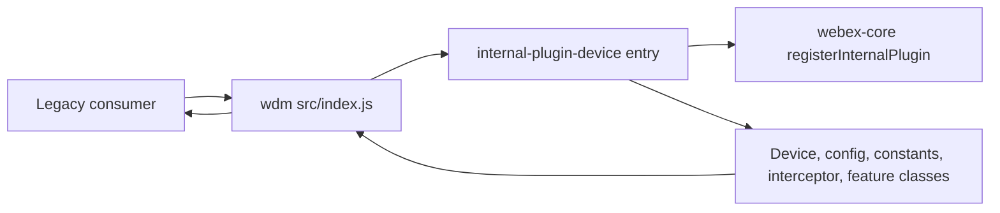
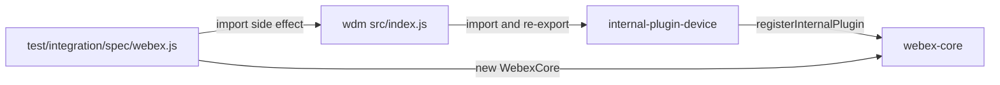

<!-- sdd-generated-metadata
doc_kind: standing-doc
generated_from: architecture@0.3.0
generated_by: claude-code
approved_by: riag@cisco.com
updated_at: 2026-10-28T14:58:37Z
validation_status: pass
-->

# @webex/internal-plugin-wdm architecture

Canonical architecture for the `@webex/internal-plugin-wdm` package, a deprecated alias inside the Webex JS SDK
monorepo. The SDD scope is this package only; the surrounding monorepo is a dependency context, not part of this
document. Owner-local detail lives in the [module specification](../src/docs/README.md); behavior behind the
re-exports lives in the device package's
module specification (the device package's own `src/docs/README.md`, outside this package).

Related context: [specification registry](specs/README.md) ·
[repository agent instructions](../AGENTS.md)

## Applicability

| Condition ID                         | Status     | Evidence or reason                                                                                            | Owned section                       |
| ------------------------------------ | ---------- | ------------------------------------------------------------------------------------------------------------- | ----------------------------------- |
| `repo.owns_datastore`                | N/A        | No store, schema, or migration exists in the src directory                                                              | Repository data and schema          |
| `repo.holds_client_state`            | N/A        | `src/index.js` declares no state; state belongs to the device package                                          | Client state model                  |
| `repo.components_interact`           | Applicable | `src/index.js` imports the device package, whose entry registers the device plugin with the @webex/webex-core host| Dependency and interaction topology |
| `repo.domain_data_across_components` | N/A        | This package owns no domain data                                                                               | Object and data ownership           |
| `repo.caches_data`                   | N/A        | No cache exists in the src directory                                                                                   | Caching catalog                     |
| `repo.observability_convention`      | N/A        | `src/index.js` has no logging, metrics, tracing, or audit code                                                 | Observability patterns              |
| `repo.deploys_to_infra`              | N/A        | A library; `package.json` defines no deployment target other than npm publication                              | Runtime and infrastructure          |
| `repo.shared_base_libs`              | N/A        | No base library stack is inherited by multiple resources inside this package                                   | Shared and base libraries           |
| `repo.is_monorepo`                   | N/A        | The scoped repository is a single package with one module                                                      | Package map and dependencies        |
| `repo.multi_platform`                | Applicable | `process` exports a browser flag; `package.json` has a test:browser script, browserify transforms, and an engines.node field | Platform matrix                     |
| `repo.published_package`             | Applicable | `package.json` declares main and deploy:npm                                                              | Release and versioning              |
| `repo.embedded_in_host`              | N/A        | A plugin alias for the @webex/webex-core host, not mounted into a host UI                                             | Host integration and theming        |
| `repo.exposes_commands_or_artifacts` | N/A        | No CLI, generator, or stable file output; `package.json` scripts are developer tooling                         | Commands and generated artifacts    |
| `repo.cross_repo_deps_material`      | N/A        | All dependencies resolve inside the same workspace                                                             | Cross-repository topology           |
| `repo.security_arch_warranted`       | N/A        | No credential, token, or encryption handling in the src directory                                                       | Security architecture               |

## Design overview

The package exists so the historical name `@webex/internal-plugin-wdm` keeps resolving to a working plugin. WDM
(the web device manager) registration was implemented under another package name, `@webex/internal-plugin-device`,
and this package now only re-exports that package's default export and six named exports. The package `README.md`
states this directly: it "only acts as an alias" and new import lists should use the device plugin instead.

Shape: one 15-line entry module, no helper code, no state, no configuration, and no plugin registration of its own.
Importing it evaluates the device package, whose entry module registers the internal plugin `device`, so a
`WebexCore` instance then exposes `webex.internal.device`. The alias defines no `webex.internal.wdm`.

Key decisions evidenced in the code: the alias adds no behavior (all registration and feature logic stays in the
device package), and its export list is a subset of the device package's, omitting `CatalogDetails` and
`DeviceRegistrationOptions`. The rationale for that omission is not recorded anywhere in the package. Details are in
the module specification.

## Resource inventory and responsibilities

| Resource                        | Kind                            | Responsibility                                                                                  | Owner                                           | Source | Detailed specification |
| ------------------------------- | ------------------------------- | ----------------------------------------------------------------------------------------------- | ----------------------------------------------- | ------ | ---------------------- |
| @webex/internal-plugin-wdm      | package (single module `src`)   | Re-export the device plugin and six named exports under the historical package name             | Cisco Webex for Developers (named in `README.md`) | `src/index.js` | `src/docs/README.md`   |

## Interaction and execution flows

Representative flow: a legacy consumer imports the alias, the device package is loaded and registers the `device`
plugin with the core, and the alias returns the re-exported bindings.

| From                | To                             | Interaction or transport                       | Purpose                                     | Failure or compatibility behavior                                                   |
| ------------------- | ------------------------------ | ---------------------------------------------- | ------------------------------------------- | ----------------------------------------------------------------------------------- |
| Legacy consumer     | `src/index.js`                 | Module import                                  | Obtain the device plugin under the old name | Resolution or evaluation errors propagate unchanged                                 |
| `src/index.js`      | Device package entry           | Module import of one default and six named bindings | Re-export the implementation            | No handling in the alias; the source uses static named imports, so if the device package stopped exporting one of those names, module linkage or the build would fail rather than deliver an `undefined` binding     |
| Device package entry | `@webex/webex-core`           | Function call `registerInternalPlugin('device', …)` at import time | Make `webex.internal.device` available | Owned and specified by the device package                                          |

## Dependency topology

| Dependency                         | Type     | Used by                             | Purpose                                                                         | Version, failure, or fallback policy                                                      |
| ---------------------------------- | -------- | ----------------------------------- | ------------------------------------------------------------------------------- | ----------------------------------------------------------------------------------------- |
| `@webex/internal-plugin-device`    | Internal | `src/index.js`                      | Supplies every re-exported binding and the plugin registration                   | Workspace-linked (`workspace:*` in `package.json`); no fallback                           |
| `@webex/webex-core`                | Internal | Integration test                    | Declared dependency; the test constructs `WebexCore`                             | Workspace-linked; not imported by `src/index.js`                                          |
| `@webex/test-helper-chai`, `@webex/test-helper-test-users` | Internal | Unit and integration tests | Assertions and provisioned test users                          | Workspace-linked; declared under both `dependencies` and `devDependencies`                |
| `@webex/legacy-tools` and shared legacy configs | Internal | Scripts, build, test, lint config | Build, test, and lint tooling                                  | Workspace-linked dev dependencies                                                         |

No dependency cycle exists inside the package. Ordering constraint: none; the alias has a single import. Exact
versions are in `package.json`. Dependency documentation: the device package has a specification and was used for
behavior; `@webex/webex-core` and the test helpers have none, so their source was used.

## Public and consumer surfaces

| Surface                                                                                                                             | Type | Owner                           | Consumers                       | Compatibility policy                                                                                  | Source         |
| ----------------------------------------------------------------------------------------------------------------------------------- | ---- | ------------------------------- | ------------------------------- | ----------------------------------------------------------------------------------------------------- | -------------- |
| `wdm-alias-sdk` (default `Device` and named `config`, `constants`, `DeviceUrlInterceptor`, `FeatureCollection`, `FeatureModel`, `FeaturesModel`) | SDK  | `@webex/internal-plugin-wdm`    | Legacy importers of the package name; no in-monorepo source consumer | Deprecated alias; internal plugin, semantic versioning not strictly followed (`README.md`) | `src/index.js` |

The contract registry with publication state is `contract_catalog` in `.sdd/manifest.json`; the owning module
specification, [Public surface](../src/docs/README.md#public-surface), mirrors this entry. The consumed contracts
`device-plugin-sdk` (device package) and `webex-core-plugin-host` (`@webex/webex-core`) are external to this package.

## Cross-cutting architecture

### Security

- Trust boundaries and identity flow: none in this package; authentication and tokens are handled by
  `@webex/webex-core`, and device identity handling by the device package.
- Sensitive surfaces and data classes: none; `src/index.js` handles no data.
- Encryption and secret boundaries: no secrets or cryptography in this package. The integration test obtains
  credentials from the test-user helper at run time; none are stored here.

### Observability and operations

- Logging and correlation: none in this package.
- Metrics, traces, and audit signals: none in this package; the device package owns its own signals.
- Ownership and operational entry points: no dashboards, alerts, or runbooks are defined in this package.

### Quality attributes

- Compatibility: the alias must keep exporting the seven names listed in the registry above; nothing in the package
  compares them with the device package's exports.
- Footprint: one source file with no logic.
- Verification: the only unit test asserts `true`; the integration test, which needs provisioned users, is the only
  evidence that importing the alias yields a working device plugin. No coverage threshold is enforced for this
  package.

## Dependency and interaction topology

| From                | To                          | Kind   | Purpose                                      | Ordering or failure boundary                                              |
| ------------------- | --------------------------- | ------ | -------------------------------------------- | ------------------------------------------------------------------------- |
| `src/index.js`      | `@webex/internal-plugin-device` | Import | Re-export the device plugin               | Evaluated at import time; errors propagate to the importer                |
| Integration test    | `src/index.js` (package name) | Import | Trigger the plugin registration           | The import precedes constructing `WebexCore`                              |
| Integration test    | `@webex/webex-core`         | Call   | Create an instance and read `webex.internal.device` | Needs a provisioned test user                                      |

## Platform matrix

| Platform | Shared versus platform-specific boundary                                            | Entry or build                                  | Support and compatibility constraints                                                                 |
| -------- | ----------------------------------------------------------------------------------- | ----------------------------------------------- | ----------------------------------------------------------------------------------------------------- |
| Browser  | Same source; the `process` file exports `{browser: true}` and `package.json` declares browserify transforms | `package.json` script `test:browser`            | Platform behavior of the plugin itself is owned by the device package                                  |
| Node     | Same source                                                                         | `package.json` `main` (`dist/index.js`) and `test:unit` | `engines.node` is `>=16`                                                                      |

## Release and versioning

| Artifact                       | Publish target                              | Versioning rule                                                              | Deprecation window                                         | Changelog or migration obligation                                   |
| ------------------------------ | ------------------------------------------- | ---------------------------------------------------------------------------- | ---------------------------------------------------------- | ------------------------------------------------------------------- |
| `@webex/internal-plugin-wdm`   | npm (`deploy:npm` script in `package.json`) | Internal plugin; `README.md` states semantic versioning is not strictly followed. No version is recorded in `package.json` | None defined; the package is already documented as deprecated in `README.md` | None defined in this package; consumers are directed to the device package |

## Domain language

| Term     | Repository-specific meaning                                                                       | Authoritative source                                          |
| -------- | ------------------------------------------------------------------------------------------------- | ------------------------------------------------------------- |
| WDM      | Web device manager: the Webex service that stores device registrations; the alias is named after it | `README.md`                                                   |
| Alias    | This package: it re-exports the device plugin and adds no behavior                                 | `src/index.js`                                                |
| Device plugin | The internal plugin `device` exposed as `webex.internal.device`, implemented in `@webex/internal-plugin-device` | `src/index.js`                                      |

## References and maintenance

- Decisions: [adr/](adr/index.md)
- Instantiated specifications and routing: [specs/README.md](specs/README.md)
- Repository rules and patterns: none approved for this package.
- Update this document in the same change that alters repository boundaries,
  resource ownership, cross-resource interaction, or cross-cutting
  architecture.
