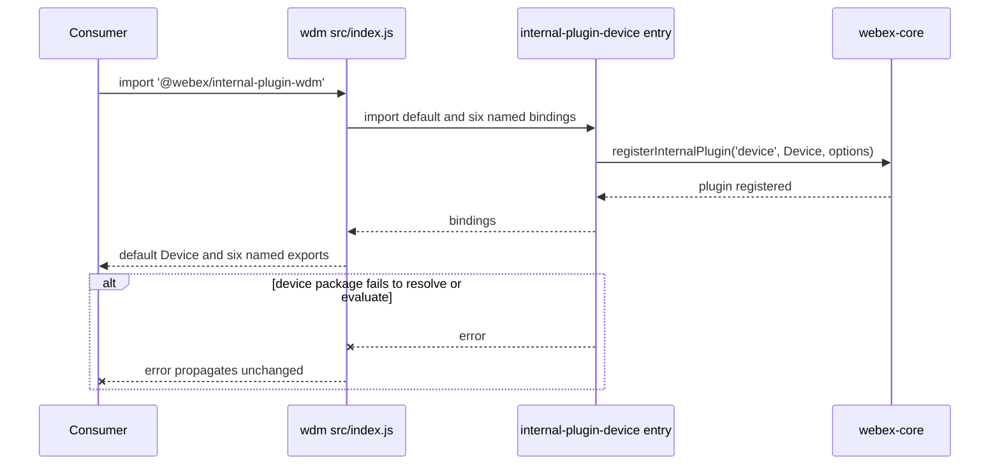
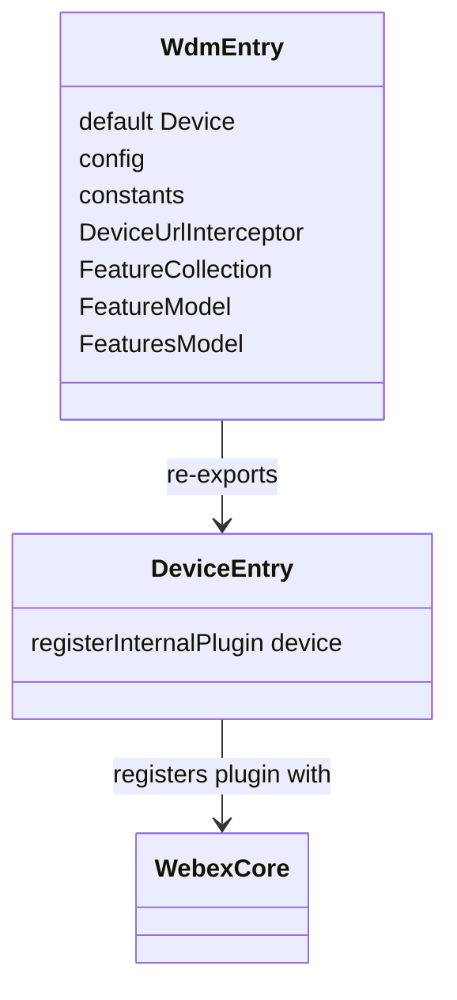

<!-- sdd-generated-metadata
doc_kind: module-spec
generated_from: module-spec@0.3.0
generated_by: claude-code
approved_by: riag@cisco.com
updated_at: 2026-10-12T15:10:04Z
validation_status: pass
-->

# src (deprecated WDM alias entry point)

This source-local document at `src/docs/README.md` owns the stable
specification for **the `src` module** of `@webex/internal-plugin-wdm`. It links to the
[package architecture](../../docs/architecture.md) instead of repeating broader facts. The package has no
deployable service, so no service specification exists.

Related context: [documentation index](../../docs/index.md) ·
[agent instructions](../../AGENTS.md) ·
[specification registry](../../docs/specs/README.md)

## Metadata

| Field             | Value                                                                                                  |
| ----------------- | ------------------------------------------------------------------------------------------------------ |
| Owner             | Cisco Webex for Developers (named as maintainer in `README.md`)                                        |
| Source path       | `src/`                                                                                                 |
| Resource kind     | module (the package's only module; a re-export alias)                                                  |
| Status            | Draft                                                                                                  |
| Last verified     | 2026-10-12 against the working tree (`src/index.js`, `package.json`, `README.md`, `test/`)             |
| Module id         | `src`                                                                                                  |
| Parent spec       | —                                                                                                      |
| Doc kind          | Module spec                                                                                            |
| Coverage score    | 86.7% (13 of 15 mandatory fields; critical 7 of 7) assessed 2026-10-12; weak: tests, WHAT/WHY       |
| Validation status | pass — validator `01a13098-9d6f-7c10-891b-b7207f337f2d`, assessed 2026-10-12; 0 findings |

## Applicability

| Condition ID                         | Status     | Evidence or reason                                                                                          | Owned section                 |
| ------------------------------------ | ---------- | ----------------------------------------------------------------------------------------------------------- | ----------------------------- |
| `module.has_tiers`                   | N/A        | No tier policy is defined in `package.json` or any file of this package                                      | Tier                          |
| `module.has_ui`                      | N/A        | `src/index.js` contains no UI code                                                                           | UI use-case flow              |
| `module.crosses_service_boundaries`  | N/A        | `src/index.js` makes no network, event, or service call; all calls happen in the device package            | Cross-boundary use-case flow  |
| `module.holds_client_state`          | N/A        | `src/index.js` declares no state; state belongs to the Device model in the device package                   | Client state model            |
| `module.enforces_domain_rules`       | N/A        | `src/index.js` holds no entity rules; it only re-exports bindings                                            | Business rules and invariants |
| `module.is_concurrent_async`         | N/A        | `src/index.js` has no asynchronous code                                                                      | Concurrency and reactive flow |
| `module.owns_persistence`            | N/A        | No store, schema, or migration exists in this package                                                        | Data, schema, and migration   |
| `module.stateful_transitions`        | N/A        | `src/index.js` has no states or transitions                                                                  | State machine                 |
| `module.exposes_wire_protocol`       | N/A        | No serialized format or protocol is produced or parsed here                                                  | Protocol and wire format      |
| `module.ui_multi_screen`             | N/A        | No UI                                                                                                        | UI flow                       |
| `module.large_data_model`            | N/A        | No data model is defined here                                                                                | Data model                    |
| `module.returns_caller_errors`       | N/A        | `src/index.js` raises and handles no errors of its own (it contains no throw, try, or catch)          | Caller-visible failure modes  |
| `module.module_specific_conventions` | Applicable | `README.md` declares the package a deprecated alias; changes belong in the device package                    | Module-specific rules         |
| `module.published_package`           | Applicable | `package.json` declares main and deploy:npm                                                              | Export stability              |
| `module.embedded_in_host`            | N/A        | A plugin alias for the @webex/webex-core host, not mounted into a host UI                                           | Host integration and theming  |
| `module.has_design_tradeoff`         | N/A        | No code comment or committed decision record documents a trade-off; the owner has not been asked             | Key design trade-off          |
| `module.has_submodules`              | N/A        | `src/index.js` is the only file under the src directory and no child module exists                                                                    | Sub-modules                   |

## Evidence register

Source basis by category and disposition; no routed legacy spec exists for this module.

| Evidence                                                                 | What it establishes                                                                                                                                  |
| ------------------------------------------------------------------------ | ---------------------------------------------------------------------------------------------------------------------------------------------------- |
| `src/index.js`                                                           | The complete runtime behavior: one default and six named re-exports from `@webex/internal-plugin-device`; no plugin registration of its own         |
| `package.json`                                                           | Entry points (`main`, `devMain`), scripts, declared dependencies, Node engine floor, and browserify transforms                                       |
| `README.md`                                                              | Deprecation statement (alias of the device plugin), install and usage text, and the maintainer statement; its usage snippet is stale (see Pitfalls) |
| `process`                                                                | A one-line module exporting `{browser: true}`                                                                                                        |
| `test/unit/spec/device.js`                                               | A placeholder suite asserting `true`; no behavior is exercised                                                                                       |
| `test/integration/spec/webex.js`                                         | Importing the package makes `webex.internal.device` defined and exposing eleven named methods (needs provisioned test users)                         |
| Device package source (the entry module of the @webex/internal-plugin-device package) | The re-exported bindings exist, and importing the device package calls `registerInternalPlugin('device', …)`                                    |
| Device package specification (the module spec of the @webex/internal-plugin-device package, beside its source) | Behavior, public surface, and export stability of the delegated implementation; used in place of re-reading its source for behavior |
| Core package source (the index and core modules of the @webex/webex-core package) | `registerInternalPlugin` and the default `WebexCore` export used by the integration test; no specification exists for that package |
| `jest.config.js`, `package.json` at the monorepo root                    | The package is listed in the root jest project list and in the `@legacy` script scope; no source file in the monorepo imports it                      |
| `babel.config.js`, `jest.config.js`, `.eslintrc.js` in this package      | Build, test, and lint configuration are delegated to the shared legacy configs                                                                       |

## Purpose and boundary

- Responsibility: keep the historical `@webex/internal-plugin-wdm` package name importable by re-exporting the
  device plugin's default export and six named exports from `@webex/internal-plugin-device`. Importing it
  therefore loads the device plugin and its registration side effect.
- In scope: the entry file `src/index.js`, the package manifest, the test files, and the deprecation notice in
  `README.md`.
- Out of scope: all registration, refresh, unregister, feature-toggle, inactivity, interceptor, and network-detection
  behavior. That is owned by `@webex/internal-plugin-device` and specified in its module specification. This
  package registers no plugin named `wdm` and defines no `webex.internal.wdm` property.
- Consumers: code that still imports `@webex/internal-plugin-wdm`. No source file in this monorepo does (the only
  references are the root jest and `@legacy` script package lists and this package's own integration test).

## Structure and key files

| Path                                  | Responsibility                                                                                                                           |
| ------------------------------------- | ---------------------------------------------------------------------------------------------------------------------------------------- |
| `src/index.js`                        | The only source file: imports from the device package and re-exports them                                                                |
| `package.json`                        | Package identity, `main: dist/index.js`, `devMain: src/index.js`, scripts, dependencies, `engines.node >=16`, browserify transforms      |
| `process`                             | Exports `{browser: true}` (the consumer of this flag is tooling outside this package)                                                    |
| `babel.config.js`, `jest.config.js`, `.eslintrc.js` | Re-export the shared `@webex/babel-config-legacy`, `@webex/jest-config-legacy`, and `@webex/eslint-config-legacy` configs  |
| `test/unit/spec/device.js`            | Placeholder unit suite                                                                                                                   |
| `test/integration/spec/webex.js`      | Integration suite that imports the package and inspects `webex.internal.device`                                                          |
| `README.md`                           | Consumer-facing deprecation notice, install, and usage text                                                                              |
| dist directory (ignored by git)              | Build output of `build:src`; never edited by hand                                                                                         |

## Public surface

Exact declarations stay in the native source `src/index.js`; contract IDs resolve in `.sdd/manifest.json`.

| Surface                                                                                                               | Consumer                                  | Compatibility commitment                                                                                          | Source           |
| --------------------------------------------------------------------------------------------------------------------- | ----------------------------------------- | ----------------------------------------------------------------------------------------------------------------- | ---------------- |
| `wdm-alias-sdk`: default export `Device` and named exports `config`, `constants`, `DeviceUrlInterceptor`, `FeatureCollection`, `FeatureModel`, `FeaturesModel` | Legacy importers of the package name | Deprecated alias; mirrors the device package; internal plugin, semantic versioning not strictly followed (`README.md`) | `src/index.js`   |

The repository-wide index of contracts is `Public and consumer surfaces` in the
[package architecture](../../docs/architecture.md). The behavior behind each binding is specified by the device
package; see the `Public surface` and `Export stability` sections of the device
package's module specification (`@webex/internal-plugin-device`, `src/docs/README.md` inside that package). The device package's
`CatalogDetails` and `DeviceRegistrationOptions` exports are not re-exported here.

## Dependencies

| Dependency                                                      | Why it is required                                                                                                                                            | Failure behavior                                                                                                     |
| --------------------------------------------------------------- | ------------------------------------------------------------------------------------------------------------------------------------------------------------- | -------------------------------------------------------------------------------------------------------------------- |
| @webex/internal-plugin-device (module spec present: used for behavior; its source for the re-exported bindings) | Provides every re-exported binding, and its entry module registers the `device` internal plugin (its requirement `MOD-001`)                     | Not handled here: `src/index.js` has no `try`/`catch`, so a resolution or load failure propagates to the importer    |
| @webex/webex-core (source; no specification)                  | Declared in `dependencies`; imported only by `test/integration/spec/webex.js` (`WebexCore`). Its `registerInternalPlugin` is called by the device package, not here | Not used at runtime by `src/index.js`                                                                                |
| @webex/test-helper-chai (source; no specification)            | Declared in `dependencies` and `devDependencies`; supplies `assert` to both test files                                                                         | Test-only                                                                                                            |
| @webex/test-helper-test-users (source; no specification)      | Declared in `dependencies` and `devDependencies`; `testUsers.create({count: 1})` provisions the integration test user                                         | Test-only; requires network access and credentials from the environment                                              |
| `@webex/legacy-tools`, `@webex/babel-config-legacy`, `@webex/jest-config-legacy`, `@webex/eslint-config-legacy` | Build, test, and lint tooling invoked by the scripts in `package.json`                                                                 | Tooling only                                                                                                         |

## Requirements

| ID        | WHAT                                                                                                                                                                  | WHY                                                                                                             | Source evidence                    | Test or example evidence                                                          | Assumptions or gaps                                                                                                             | Confidence       |
| --------- | --------------------------------------------------------------------------------------------------------------------------------------------------------------------- | --------------------------------------------------------------------------------------------------------------- | ---------------------------------- | --------------------------------------------------------------------------------- | ------------------------------------------------------------------------------------------------------------------------------- | ---------------- |
| `MOD-001` | The package's default export is the default export of `@webex/internal-plugin-device` (`Device`)                                                                      | Importers of the old name keep receiving the device plugin class                                                | `src/index.js`                     | none found                                                                        | No test imports the default binding                                                                                             | Present          |
| `MOD-002` | The package re-exports exactly `config`, `constants`, `DeviceUrlInterceptor`, `FeatureCollection`, `FeatureModel`, and `FeaturesModel` from the device package           | Legacy importers rely on these names; removing one breaks them                                                  | `src/index.js`                     | none found                                                                        | No test asserts the export list                                                                                                 | Present          |
| `MOD-003` | The package does not re-export `CatalogDetails` or `DeviceRegistrationOptions`, both of which the device package exports                                              | Records an observable difference between the alias and its target                                               | `src/index.js`                     | none found                                                                        | Whether the omission is intentional is not stated anywhere in the package; the owner has not been asked                         | Approved unknown |
| `MOD-004` | Importing the package loads the device package, whose entry module registers the internal plugin `device`, so `webex.internal.device` is defined on a `WebexCore` instance | The alias exists so the old import path still produces a working device plugin                                  | `src/index.js`                     | `test/integration/spec/webex.js` (needs provisioned test users and network)       | Behavior is implemented by the device package; the test cannot run without credentials                                          | Present          |
| `MOD-005` | The package registers no plugin of its own: it defines no `webex.internal.wdm` property                                                                                | Prevents a second registration of the same capability under a different name                                     | `src/index.js`                     | none found                                                                        | Absence is evidenced by `src/index.js` containing no `registerInternalPlugin` call and no file elsewhere in the monorepo registering `wdm` | Present          |
| `MOD-006` | The package is published as compiled `dist/index.js` (`main`), with `src/index.js` as `devMain`, built by `build:src`                                                  | Consumers install the compiled entry; monorepo tooling resolves the source entry                                 | `package.json`                     | none found                                                                        | Build output is not tested                                                                                                      | Present          |
| `MOD-007` | The package is documented as deprecated: new imports should use `@webex/internal-plugin-device`                                                                       | Steers consumers to the maintained package                                                                       | `README.md`                        | none found                                                                        | Documentation only; no runtime deprecation warning is emitted (`src/index.js` has none)                                         | Present          |

## Design overview

The module is a pure re-export barrel. `src/index.js` imports one default and six named bindings from
`@webex/internal-plugin-device` and re-exports the same seven names, adding no logic, state, configuration, or
side effect of its own. All behavior, including plugin registration, comes from the device package's entry module
when it is evaluated as a consequence of the import. The ownership of state is therefore entirely outside this
module: the Device model, feature collections, interceptor, and configuration are owned and specified by the
device package.

Internal shape: one source file with no helper functions. Packaging and tooling are delegated: the build is
`webex-legacy-tools build` over `src` into `dist`, and the test and lint configurations re-export shared
workspace configs. The module-level `process` file marks the package as browser-capable for the legacy tooling.

## Data flow and sequence coverage

Call style: in-process module import (ES module syntax compiled by Babel). The module has one operation group, the
import-time re-export, and it is a trivial pass-through, so a single sequence diagram is complete for it. It has
no runtime entry points, requests, or events.

| Operation group        | Entry and outcome                                                                                               | Diagram or evidence                       | Failure and recovery coverage                                                                                    |
| ---------------------- | --------------------------------------------------------------------------------------------------------------- | ----------------------------------------- | ---------------------------------------------------------------------------------------------------------------- |
| Import-time re-export  | Consumer imports the package; the device package is loaded and registered; seven bindings are returned          | Sequence diagram below; `src/index.js`    | No handling in this module: a module resolution or evaluation error in the device package propagates to the importer |

## Class and component relationships

`WdmEntry` is `src/index.js`; `DeviceEntry` is the entry module of `@webex/internal-plugin-device`. Types and
internals behind each binding are described in the device specification.

## Use cases and flows

| Use case | Actor or caller                          | Primary steps and outcome                                                                                                              | Failure or boundary behavior                                                                                  | Evidence                                                             |
| -------- | ---------------------------------------- | -------------------------------------------------------------------------------------------------------------------------------------- | ------------------------------------------------------------------------------------------------------------- | -------------------------------------------------------------------- |
| `UC-001` | Legacy SDK consumer, import for effect   | `import '@webex/internal-plugin-wdm'`, create a `WebexCore`, read `webex.internal.device`; the device plugin and its methods are present | Not-registered or load errors come from the device package and propagate unchanged                            | `src/index.js`, `test/integration/spec/webex.js`                     |
| `UC-002` | Legacy SDK consumer, named import        | Import `Device`, `config`, `constants`, `DeviceUrlInterceptor`, `FeatureCollection`, `FeatureModel`, or `FeaturesModel` from the alias | The alias does not export `CatalogDetails` or `DeviceRegistrationOptions` (see `MOD-003`), so a consumer's static named import of either fails at module linkage or build under ES-module semantics | `src/index.js`                                                       |
| `UC-003` | Maintainer migrating a consumer          | Replace the import path with `@webex/internal-plugin-device`; every alias export keeps its name there                                   | None: the target package exports a superset of the alias                                                      | `README.md`, `src/index.js`                                          |

## Pitfalls and constraints

- The `README.md` usage snippet ends with `webex.internal.wdm.WHATEVER`, but no code in the monorepo registers a
  `wdm` plugin, so `webex.internal.wdm` is not defined by this package; use `webex.internal.device`. Evidence:
  `src/index.js`, `README.md`, `test/integration/spec/webex.js`. The README is a retained, separately owned
  document and was not edited.
- The unit test `test/unit/spec/device.js` asserts `true` and exercises nothing; a passing `test:unit` run says
  nothing about the alias behavior. Only the credential-requiring integration suite observes the re-export effect.
- `package.json` `scripts.test` chains `test:integration`, which the package does not define, so the aggregate
  `test` script cannot complete; use the individual `test:unit`, `test:style`, and `test:browser` scripts.
- `@webex/test-helper-chai` and `@webex/test-helper-test-users` appear under `dependencies` as well as
  `devDependencies`, although only test files use them (`package.json`, `test/`). Treat that as a packaging
  inconsistency to confirm with the owner before changing it.
- Any change to the alias surface must match the device package, otherwise the two entry points diverge silently:
  nothing in this package compares the two export lists.

## Module-specific rules

- Do: put every behavior change in `@webex/internal-plugin-device`, and keep this module a pure re-export
  (`README.md`: the plugin only acts as an alias).
- Do: update `MOD-002`, `MOD-003`, and the public surface in this document in the same change if the export list of
  `src/index.js` changes.
- Do not: add logic, state, or a `registerInternalPlugin` call here; a second registration would conflict with the
  device plugin's registration under another name.
- Do not: create new imports of `@webex/internal-plugin-wdm` in the monorepo; the README directs new imports to the
  device package.

## Export stability

| Export or entry point                                                              | Consumer                      | Stability                                         | Versioning and deprecation rule                                                                                       | Declaration or API report |
| ---------------------------------------------------------------------------------- | ----------------------------- | ------------------------------------------------- | --------------------------------------------------------------------------------------------------------------------- | ------------------------- |
| Default export `Device`                                                            | Legacy importers              | Deprecated alias; internal plugin                 | `README.md`: deprecated, alias of the device plugin; semantic versioning is not strictly followed                      | `src/index.js`            |
| `config`, `constants`, `DeviceUrlInterceptor`, `FeatureCollection`, `FeatureModel`, `FeaturesModel` | Legacy importers | Deprecated alias; stability follows the device package | Same; stability of each binding is specified by the device package's `Export stability` section                 | `src/index.js`            |

No API report or generated declaration is committed; `package.json` and `src/index.js` are the native artifacts.
The package version is not recorded in `package.json`.

## Verification

| Requirement or invariant | Test level  | Positive evidence                                                              | Negative or boundary evidence | Gap                                                                                                 |
| ------------------------ | ----------- | ------------------------------------------------------------------------------ | ----------------------------- | --------------------------------------------------------------------------------------------------- |
| `MOD-001`                | none        | none found                                                                     | none found                    | No test imports or asserts the default binding                                                      |
| `MOD-002`                | none        | none found                                                                     | none found                    | No test asserts the named export list                                                               |
| `MOD-003`                | none        | none found                                                                     | none found                    | No test records the omission                                                                         |
| `MOD-004`                | Integration | `test/integration/spec/webex.js` (defines the device plugin and eleven methods)  | none found                    | Requires provisioned test users and network; not runnable in unit CI; no negative case               |
| `MOD-005`                | none        | none found                                                                     | none found                    | No test asserts `webex.internal.wdm` is undefined                                                    |
| `MOD-006`                | none        | none found                                                                     | none found                    | The build output and entry points are not tested                                                     |
| `MOD-007`                | none        | none found                                                                     | none found                    | Documentation-only claim                                                                             |

`test/unit/spec/device.js` is not counted as coverage: it asserts `true` and invokes no behavior. Gap summary: the
module has no behavioral unit test, so no requirement has automated evidence except `MOD-004`, which depends on
credentials. Follow-up: add a unit test that imports `src/index.js` and asserts the seven re-exports equal the
device package's bindings, and decide whether the alias should also re-export `CatalogDetails` and
`DeviceRegistrationOptions`. A module specification is complete only when its public surface and test evidence
agree with the implementation.
