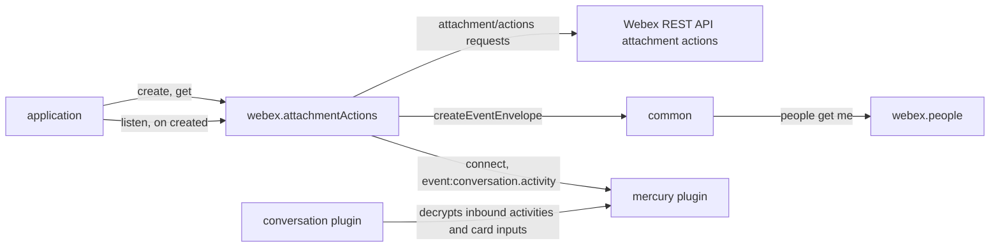
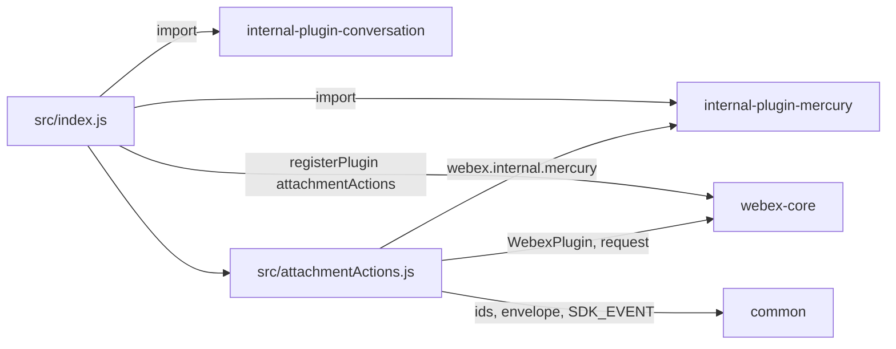
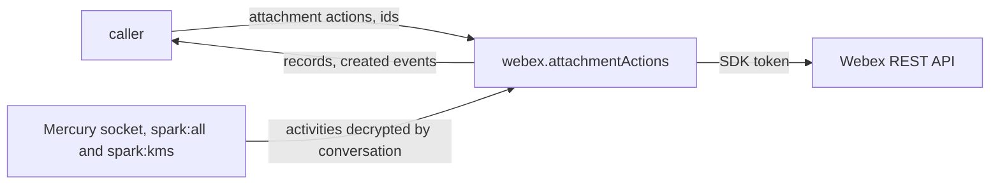

<!-- sdd-generated-metadata
doc_kind: standing-doc
generated_from: architecture@0.3.0
generated_by: claude-code
approved_by: rarajes2@cisco.com
updated_at: 2026-11-13T02:56:49Z
validation_status: pass-with-warnings
-->

# @webex/plugin-attachment-actions architecture

Canonical architecture for this package. Flow behavior lives in the
[Attachment actions plugin specification](../src/docs/README.md). This page owns package boundaries,
the plugin registration, the contract index, and how the package meets the rest of the SDK.

Related context: [specification registry](specs/README.md) ·
[package agent instructions](../AGENTS.md)

## Applicability

| Condition ID                         | Status     | Evidence or reason | Owned section |
| ------------------------------------ | ---------- | ------------------ | ------------- |
| `repo.owns_datastore`                | N/A        | No database, file store, or migration in `src/attachmentActions.js` | Repository data and schema |
| `repo.holds_client_state`            | N/A        | `src/attachmentActions.js` caches no record; the stored event envelope is described in the module specification | Client state model |
| `repo.components_interact`           | Applicable | `src/index.js` registers the conversation and Mercury plugins that `src/attachmentActions.js` relies on | Dependency and interaction topology |
| `repo.domain_data_across_components` | Applicable | Attachment action records and events pass from Hydra and Mercury through `src/attachmentActions.js` to callers | Object and data ownership |
| `repo.caches_data`                   | N/A        | Nothing is kept after a call settles in `src/attachmentActions.js` | Caching catalog |
| `repo.observability_convention`      | N/A        | One error log line and one debug trace in `src/attachmentActions.js`; no metric or trace convention | Observability patterns |
| `repo.deploys_to_infra`              | N/A        | Library published to npm (`package.json`). No service runtime | Runtime and infrastructure |
| `repo.shared_base_libs`              | Applicable | Extends WebexPlugin and uses the legacy build and lint stack (`babel.config.js`, `.eslintrc.js`) | Shared and base libraries |
| `repo.is_monorepo`                   | N/A        | This SDD root is one package. The workspace around it is out of scope | Package map and inter-package dependencies |
| `repo.multi_platform`                | N/A        | `src/attachmentActions.js` has no platform branch; `process` declares {browser: true} and is not imported | Platform matrix |
| `repo.published_package`             | Applicable | `package.json` name is @webex/plugin-attachment-actions and deploy:npm publishes it | Release and versioning |
| `repo.embedded_in_host`              | N/A        | No host theme or embed API in `src/attachmentActions.js` | Host integration and theming |
| `repo.exposes_commands_or_artifacts` | Applicable | build:src in `package.json` writes dist | Commands and generated artifacts |
| `repo.cross_repo_deps_material`      | Applicable | Behavior depends on the Webex REST API attachment actions resource and the Mercury socket (`src/attachmentActions.js`) | Cross-repository topology |
| `repo.security_arch_warranted`       | Applicable | `listen()` needs the spark:all and spark:kms scopes, and decrypted card inputs pass through `src/attachmentActions.js` | Security architecture |

## Design overview

`@webex/plugin-attachment-actions` is a published JavaScript library with one module. Importing it
registers the internal `conversation` and `mercury` plugins and then `AttachmentActions` as the public
plugin `attachmentActions`, reached as `webex.attachmentActions`. The `webex` and `webex-node` bundles
import it to register it.

An attachment action is the record of a user pressing an `Action.Submit` button on an adaptive card
attached to a Webex message, together with the card's input values. The Webex REST API serves these
records as the `attachment/actions` resource, which the SDK reaches as catalog service `hydra`. The
plugin answers two questions: "submit or read one" (post and get through Hydra) and "who submitted
what" (Mercury `cardAction` activities turned into webhook-shaped `created` events after `listen()`).

The package serves no routes, caches nothing, and persists nothing.

## Resource inventory and responsibilities

| Resource | Kind | Responsibility | Owner | Source | Detailed specification |
| -------- | ---- | -------------- | ----- | ------ | ---------------------- |
| Attachment actions plugin | package (one module) | Registration; attachment action records; attachment action events | @webex/web-sdk | src | [`src/docs/README.md`](../src/docs/README.md) |

## Interaction and execution flows

Representative end-to-end flow: a bot sends a card through the messages plugin and listens for the
submits that people make on it.

| From | To | Interaction or transport | Purpose | Failure or compatibility behavior |
| ---- | -- | ------------------------ | ------- | --------------------------------- |
| Application | `webex.attachmentActions` | In-process calls; `on` for events | Records, events | Rejections propagate |
| `AttachmentActions` | Webex REST API | HTTPS through `webex.request`, service `hydra` | Attachment action records | No retry here |
| `AttachmentActions` | `webex.internal.mercury` | `connect()` and `listenTo` | Attachment action events | A connect failure rejects `listen()` |
| `webex.internal.conversation` | Mercury activities | Payload transformer registered at import | Decrypted activities and inputs | Not called by this package |
| `AttachmentActions` | `@webex/common` | Import | Ids, envelope, event vocabulary | A failed identity lookup leaves the envelope `undefined` |

## Dependency topology

| Dependency | Type | Used by | Purpose | Version, failure, or fallback policy |
| ---------- | ---- | ------- | ------- | ------------------------------------ |
| `@webex/webex-core` | Internal | `src/index.js`, `src/attachmentActions.js` | Registration, plugin base, `webex.request`, services | `workspace:*` in `package.json` |
| `@webex/common` | Internal | `src/attachmentActions.js` | Hydra ids, cluster string, event envelope, `SDK_EVENT` | `workspace:*` |
| `@webex/internal-plugin-conversation` | Internal | `src/index.js` (import only) | Decrypts socket activities | `workspace:*` |
| `@webex/internal-plugin-mercury` | Internal | `src/index.js` (import), `src/attachmentActions.js` (calls) | Attachment action events | `workspace:*` |
| `@webex/plugin-people`, `@webex/plugin-logger`, `@webex/plugin-messages` | Internal peer | Reached at run time through `webex.people` and `webex.logger`; messages only in the integration spec | Current user for the envelope; logging; sending test cards | Peer dependencies; not imported by `src/` |
| `lodash` | External library | `src/attachmentActions.js` | `cloneDeep` | `^4.17.21` |
| `debug` | External library | `src/attachmentActions.js` | Trace of each created event | `^4.3.4` |
| Webex REST API attachment actions resource | External service | `src/attachmentActions.js` | Attachment action records | Resolved through the service catalog |

No import cycle exists: none of the internal dependencies imports this package. `@webex/common` reads
`webex.people` at run time without importing it.

## Public and consumer surfaces

| Surface | Type | Owner | Consumers | Compatibility policy | Source |
| ------- | ---- | ----- | --------- | -------------------- | ------ |
| `attachment-actions-public-sdk` — package @webex/plugin-attachment-actions, `webex.attachmentActions` with `create`, `get`, `listen`, and the `created` event | SDK, published to npm, public | Attachment actions plugin | `webex`, `webex-node` (registration); applications and the workspace socket sample (calls) | No versioning or deprecation rule is declared in the package | `package.json`, `src/index.js`, `src/attachmentActions.js` |

The attachment actions requests and the event shape are a protocol this package speaks, described
under *Protocol and wire format* in the
[module specification](../src/docs/README.md#protocol-and-wire-format). The other contracts this
package requires are registered in `.sdd/manifest.json` `contract_catalog`.

## Cross-cutting architecture

### Security

- Trust boundaries, scopes, and identity flow: see [Security architecture](#security-architecture).
- Sensitive surfaces and data classes: card input values, which hold whatever a user typed into the
  card, and attachment action, message, room, and person ids.

### Observability and operations

- Logging and correlation: a failed event conversion logs one fixed `webex.logger.error` line with the
  event type and the error message, and no activity content. A `debug('attachmentActions')` trace
  prints each created event in full, card inputs included, when the `DEBUG` environment variable enables
  that namespace. Request tracking comes from the webex-core interceptors.
- Metrics, traces, and audit signals: none.
- Ownership and operational entry points: `.github/CODEOWNERS` at the workspace root has no line for
  `packages/@webex/plugin-attachment-actions`, so its default rule assigns the package to
  `@webex/web-sdk`. No dashboards or runbooks are recorded in this package.

### Quality attributes

- Compatibility: callers rely on the registered name `attachmentActions`, the Hydra attachment action
  object, and the event name `created` with its `data` fields.
- Latency: an event costs no request; it is triggered as the activity arrives.
- Test confidence: the package has no unit tests, and no working script runs its integration spec. No
  coverage threshold is enforced.

## Dependency and interaction topology

| From | To | Kind | Purpose | Ordering or failure boundary |
| ---- | -- | ---- | ------- | ---------------------------- |
| `src/index.js` | conversation and Mercury plugins | Import at load | Register `webex.internal.conversation` and `webex.internal.mercury` | Before `attachmentActions` is registered |
| `src/index.js` | webex-core | Call at import | Register `attachmentActions` | First registration wins |
| `src/attachmentActions.js` | common | Import | Ids, envelope, vocabulary | Conversion errors are caught and logged inside the plugin |

## Object and data ownership

| Object or state | System of record | May write | May read | Movement or lifecycle |
| --------------- | ---------------- | --------- | -------- | --------------------- |
| Attachment action record (`id`, `type`, `messageId`, `inputs`, `personId`, `roomId`, `created`) | Webex REST API | Callers, through `create` | Callers, through `get`, and `created` listeners | Fetched per call; never kept here |
| Card on the parent message | Webex REST API, through the messages plugin | The application that sent the message | Clients that render it | Not handled by this package |
| Event envelope | This plugin instance, built by `@webex/common` | `listen()` | `getattachmentActionEvent` | Replaced by each `listen()` |

## Shared and base libraries

| Library | Inherited responsibility | Consumers | Version floor | Compatibility rule |
| ------- | ------------------------ | --------- | ------------- | ------------------ |
| `@webex/webex-core` `WebexPlugin` | `webex`, `request`, `logger`, and the event methods | `AttachmentActions` | `workspace:*` | Keep the registered name `attachmentActions` |
| `@webex/babel-config-legacy`, `@webex/eslint-config-legacy`, `@webex/jest-config-legacy`, `@webex/legacy-tools` | Build, lint, and test stack through one-line config files | Package tooling | `workspace:*` | Do not fork the config locally |

## Release and versioning

| Artifact | Publish target | Versioning rule | Deprecation window | Changelog or migration obligation |
| -------- | -------------- | --------------- | ------------------ | --------------------------------- |
| @webex/plugin-attachment-actions | npm through `deploy:npm` | None declared in the package | None declared | None declared in the package; the workspace owns changelog generation |

## Commands and generated artifacts

| Command or artifact | Owner | Inputs | Output or side effect | Compatibility boundary |
| ------------------- | ----- | ------ | --------------------- | ---------------------- |
| `yarn build:src` | Package scripts | `src` | Writes `dist/` (JavaScript and source maps) through `webex-legacy-tools` | `dist/` is generated and never edited by hand |
| `yarn build` | Package scripts | `src` | Runs `build:src` | Same output |
| `yarn test:style` | Package scripts | `src` | ESLint run | The shared config ignores `docs/**` and `*.md` |

## Cross-repository topology

| Repository or external system | Relationship | Exchanged contract or artifact | Owner | Sequencing constraint |
| ----------------------------- | ------------- | ------------------------------ | ----- | --------------------- |
| `@webex/webex-core` (workspace sibling; module spec consulted) | Consumes | `registerPlugin`, `WebexPlugin`, `request`, services | @webex/web-client, @webex/web-sdk | Registered before the first instance |
| `@webex/common` (workspace sibling; module spec consulted) | Consumes | Hydra ids, `createEventEnvelope`, `SDK_EVENT` | @webex/web-client, @webex/web-sdk | None |
| `@webex/internal-plugin-conversation` (workspace sibling; no spec, code consulted) | Consumes | Decryption of inbound activities and card inputs | @webex/web-client, @webex/web-sdk | Registered before Mercury events arrive |
| `@webex/internal-plugin-mercury` (workspace sibling; module spec consulted, stale on sessions) | Consumes | `connect`, `event:conversation.activity` | @webex/web-client, @webex/web-sdk | Connected before events flow |
| `webex`, `webex-node` (workspace siblings) | Consumed by | The plugin registration | @webex/web-sdk | None |
| Webex REST API attachment actions resource | Consumes | Attachment action records | Not recorded in this repository | None |

## Security architecture

- This package holds no credential and no key. Every request carries the SDK authorization added by
  webex-core; the `listen()` JSDoc states that `listen()` needs the `spark:all` and `spark:kms` scopes
  and that enabling `spark:all` for an application also enables `spark:kms`.
- Socket activities are encrypted; the conversation plugin, registered by this package's import,
  decrypts them before this package reads them, card inputs included. When the inputs cannot be
  decrypted, the event carries the conversation plugin's failure string in their place (module
  specification, Caller-visible failure modes).
- Ids go into request paths. The package's logging is described under
  [Observability and operations](#observability-and-operations); the `debug` trace is the one place
  inputs can reach a log.
- What a caller may submit or read is decided by Hydra for the authorized user; the package passes
  records through and keeps no copy.

## Domain language

| Term | Repository-specific meaning | Authoritative source |
| ---- | --------------------------- | -------------------- |
| Attachment action | The record of an `Action.Submit` press on a card attached to a message, with the card's inputs | `src/attachmentActions.js` |
| Card | An adaptive card (`application/vnd.microsoft.card.adaptive`) sent as a message attachment | `test/integration/spec/attachmentActions.js` |
| Inputs | The values of the card's input fields, keyed by input id | `src/attachmentActions.js` |
| Hydra | The Webex REST API, reached as catalog service `hydra` | `src/attachmentActions.js` |
| Hydra attachment action id | base64url of `ciscospark://<cluster>/ATTACHMENT_ACTION/<uuid>` | `src/attachmentActions.js` |
| `cardAction` | The activity verb Mercury delivers for a card submit | `src/attachmentActions.js` |
| Event envelope | Webhook-shaped wrapper built once by `listen()` and cloned per event | `src/attachmentActions.js` |

## References and maintenance

- Decisions: [adr/](adr/index.md)
- Instantiated specifications and routing: [specs/README.md](specs/README.md)
- Repository rules and patterns: [package agent instructions](../AGENTS.md)
- Update this document in the same change that alters package boundaries, resource ownership,
  cross-resource interaction, or cross-cutting architecture.
