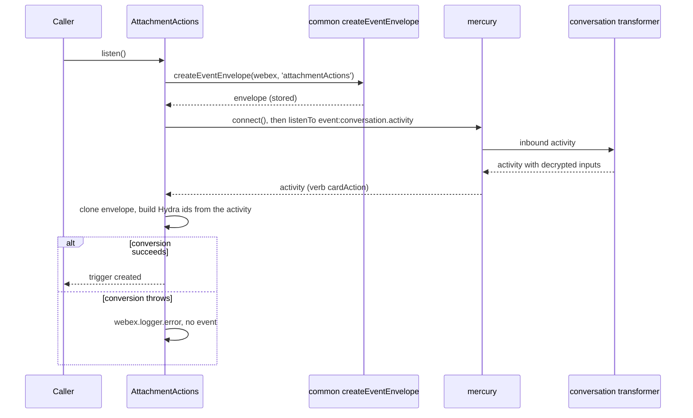
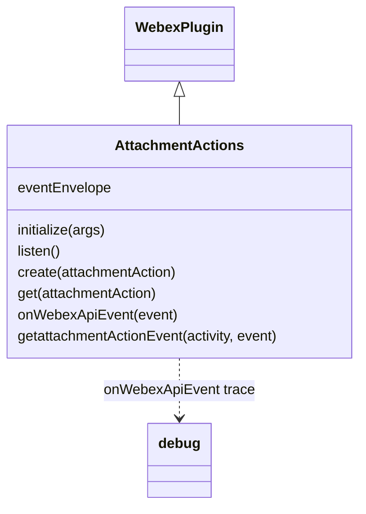

<!-- sdd-generated-metadata
doc_kind: module-spec
generated_from: module-spec@0.3.0
generated_by: claude-code
approved_by: rarajes2@cisco.com
updated_at: 2026-11-13T02:56:49Z
validation_status: pass-with-warnings
-->

# Attachment actions plugin

This source-local document at `src/docs/README.md` owns the stable specification for **the Attachment
actions plugin**: the public plugin `webex.attachmentActions`. An attachment action is what a user
produces by pressing an `Action.Submit` button on an adaptive card attached to a Webex message. The
plugin posts and reads attachment actions through the `attachment/actions` resource of the Webex REST
API (catalog service `hydra`), and, once `listen()` is called, it turns `cardAction` activities from
the Mercury socket into webhook-shaped `created` events. Ground every claim in package evidence and
link to the [package architecture](../../docs/architecture.md) instead of repeating broader facts. No
service specification exists because this package is a library.

Related context: [documentation index](../../docs/index.md) ·
[package agent instructions](../../AGENTS.md)

## Metadata

| Field             | Value |
| ----------------- | ----- |
| Owner             | @webex/web-sdk |
| Source path       | `src` |
| Resource kind     | package |
| Status            | Draft |
| Last verified     | 2026-11-13 at `c22331c97b` |
| Module id         | `plugin-attachment-actions` |
| Parent spec       | — |
| Doc kind          | Module spec |
| Coverage score    | 100% assessed 2026-11-13 by the generator — 13 of 13 mandatory fields PRESENT, critical 7 of 7; the package has no unit tests and no `test:unit` script, so no requirement has running test evidence; `test/integration/spec/attachmentActions.js` holds 2 live-service cases that no package script runs |
| Validation status | Pass-with-warnings — 0 Blocking, 2 Important; assessed 2026-11-13 by validator runtime 01a1d2c4-c928-7fc0-bc29-9bf787bf37bc. Prior F-001 is fixed; F-002 and F-003 remain Important findings. |

## Applicability

| Condition ID                         | Status     | Evidence or reason | Owned section |
| ------------------------------------ | ---------- | ------------------ | ------------- |
| `module.has_tiers`                   | N/A        | No tier policy exists in `package.json` or `src/attachmentActions.js` | Tier |
| `module.has_ui`                      | N/A        | `src/attachmentActions.js` returns records and emits events; it renders nothing | UI use-case flow |
| `module.crosses_service_boundaries`  | Applicable | `src/attachmentActions.js` calls the Webex REST API attachment actions resource and listens on the Mercury socket | Cross-boundary use-case flow |
| `module.holds_client_state`          | N/A        | The only instance property `src/attachmentActions.js` sets is the event envelope, recorded under Business rules and invariants; no record is cached | Client state model |
| `module.enforces_domain_rules`       | Applicable | The cardAction-only mapping, the Hydra id construction, and the conditional inputs field in `src/attachmentActions.js` | Business rules and invariants |
| `module.is_concurrent_async`         | Applicable | `src/attachmentActions.js` returns promises and handles socket activities as they arrive | Concurrency and reactive flow |
| `module.owns_persistence`            | N/A        | Nothing is stored; `src/attachmentActions.js` resolves what Hydra returns | Data, schema, and migration discipline |
| `module.stateful_transitions`        | N/A        | No entity moves through states in `src/attachmentActions.js` | State machine |
| `module.exposes_wire_protocol`       | Applicable | The attachment actions requests and the webhook-shaped event built in `src/attachmentActions.js` | Protocol and wire format |
| `module.ui_multi_screen`             | N/A        | No UI | UI flow |
| `module.large_data_model`            | N/A        | One shape, the attachment action object, typed only by the JSDoc AttachmentActionObject in `src/attachmentActions.js`; covered under Protocol and wire format | Data model |
| `module.returns_caller_errors`       | Applicable | Request failures reject, and a failed event conversion is logged and dropped in `src/attachmentActions.js` | Caller-visible failure modes |
| `module.module_specific_conventions` | Applicable | Hydra attachment action, message, person, and room ids and the webhook-shaped event envelope in `src/attachmentActions.js` | Module-specific rules |
| `module.published_package`           | Applicable | `package.json` names the package @webex/plugin-attachment-actions and defines deploy:npm | Export stability |
| `module.embedded_in_host`            | N/A        | No host theme or embed API | Host integration and theming |
| `module.has_design_tradeoff`         | Applicable | Events from the Mercury socket, built from the activity alone without a Hydra fetch, in `src/attachmentActions.js` | Key design trade-off |
| `module.has_submodules`              | N/A        | The src directory has no child module | Sub-modules |

## Evidence register

| Evidence | What it establishes |
| -------- | ------------------- |
| `src/index.js` | Imports `@webex/internal-plugin-conversation` (code comment: "decrypt mercury activities") and `@webex/internal-plugin-mercury` for their registration side effects, then `registerPlugin('attachmentActions', AttachmentActions)` with no options; re-exports only the default `AttachmentActions` |
| `src/attachmentActions.js` | `AttachmentActions` extends `WebexPlugin` with `initialize`, `listen`, `create`, `get`, and the JSDoc-`@private` `onWebexApiEvent` and `getattachmentActionEvent`; a module-level `debug('attachmentActions')` logger; the `AttachmentActionObject` typedef. Its JSDoc and code comments are the only recorded rationale |
| `package.json` | Name, `main` (`dist/index.js`), `devMain` (`src/index.js`), `engines` (`node >=16`), dependencies, peer dependencies on `@webex/plugin-logger`, `@webex/plugin-messages`, and `@webex/plugin-people`, and scripts; `build`, `build:src`, `test:style`, `test:browser:broken`, `deploy:npm`, and `test` exist, and `test:unit`, `test:integration`, and `test:browser` do not |
| `test/integration/spec/attachmentActions.js` | 2 live-service cases: `create` by a second user on a card the first user sent, checking the returned record and the `created` event the first user receives; and `get` of that record. The event checks name the envelope fields and the `data` fields. No case runs (see Verification) |
| `README.md` | Retained npm page; context only. It holds no usage example; see `docs/adr/0001-retain-product-readme.md` |
| Sibling package common, file src/docs/README.md | Module spec consulted, agrees with code. Hydra ids are base64url of `ciscospark://<cluster>/<TYPE>/<id>` and `PEOPLE` ids always use cluster `us` (MOD-006, INV-001); the internal US clusters normalise to `us` (INV-005); `createEventEnvelope` resolves `undefined` when the identity lookup fails (MOD-011). The code was read for the `SDK_EVENT` values the plugin uses (verb `cardAction`, Mercury event `event:conversation.activity`, resource `attachmentActions`, event `created`), for `hydraTypes`, `constructHydraId`, and `getHydraClusterString`, which throws below three cluster parts, and for `ensureMyIdIsAvailable`, which caches the current user as `webex.internal.me` |
| Sibling package webex-core, file src/docs/README.md | Module spec consulted, agrees with code. `registerPlugin` keeps the first registration of a name (MOD-013) and adds `webex.<name>` to later instances (MOD-014); `WebexPlugin` is an ampersand-state base supplying `webex`, `logger`, request, and the ampersand event methods. The spec is silent on the service catalog, so `src/lib/services/services.js` was the referee for `getClusterId` |
| Sibling package internal-plugin-mercury, file src/docs/README.md | Module spec consulted, agrees with code on what this package uses. Importing the package registers internal plugin `mercury` (MOD-001); `connect()` shares a connect in flight and resolves at once when connected (MOD-002); an inbound envelope with event type `conversation.activity` is emitted as `event:conversation.activity` (MOD-009). Its code was read to confirm that `_emit` catches and logs a listener error. The spec's description of sessions is stale against `src/mercury.js`, but this package passes no argument to `connect()` |
| Sibling package internal-plugin-conversation, files src/index.js and src/decryption-transforms.js | No module spec exists, so the code is the referee. Importing it registers internal plugin `conversation` with payload-transformer predicates, one of which transforms (decrypts) any inbound event that has an `activity`; `decryptSubmit` decrypts `object.inputs` of a submit object and, when that fails, logs a warning and replaces `inputs` with the configured `decryptionFailureMessage`. This plugin calls no conversation method |
| Observation, no stated WHY | Behavior the code shows without stating a reason is recorded once, under Pitfalls and constraints or Caller-visible failure modes |

## Purpose and boundary

- Responsibility: give applications the submit actions of adaptive cards as Hydra-style records — post
  one on behalf of the current user, read one by id — plus webhook-shaped `created` events over the
  existing Mercury socket when anyone submits a card in a space the user can see.
- In scope: registration of `attachmentActions`; `create`, `get`, and `listen`; turning `cardAction`
  activities into `created` events.
- Out of scope: the request pipeline, authorization, and service-catalog resolution
  (`@webex/webex-core`); Hydra id encoding, the event envelope, and the event vocabulary
  (`@webex/common`); the socket connection (`@webex/internal-plugin-mercury`); decrypting activities and
  card inputs (`@webex/internal-plugin-conversation`); sending the card itself (the messages plugin);
  listing, updating, or deleting attachment actions, which this plugin does not offer; caching records;
  what Hydra stores or returns.
- Consumers: in this repository the `webex` and `webex-node` packages import the package to register
  it (workspace-root files `packages/webex/src/webex.js` and `packages/webex-node/src/webex-node.js`),
  and the workspace sample `docs/samples/browser-socket/app.js` uses `listen()` and the `created`
  event. No other package calls it. Applications reach the plugin as `webex.attachmentActions`.

## Structure and key files

| Path | Responsibility |
| ---- | -------------- |
| `src/index.js` | Registers the conversation and Mercury internal plugins by import, registers public plugin `attachmentActions`, and re-exports the class as default |
| `src/attachmentActions.js` | `AttachmentActions` and the `debug` trace logger |
| `package.json` | Package name, entry points, scripts, dependencies, and peer dependencies |
| `babel.config.js`, `jest.config.js` | Re-exports of the legacy Babel and Jest configurations; no unit spec uses the Jest one |
| `.eslintrc.js` | Sets `root: true` and extends `@webex/eslint-config-legacy` |
| `process` | Package-root file exporting `{browser: true}`; not imported by `src/` |
| `src/docs/README.md` | This module specification; ignored by the build and by lint |
| `test/integration/spec/attachmentActions.js` | Live-service cases that no package script runs |
| dist/ (generated) | Build output of `build:src`; ignored by Git and never edited by hand |

## Public surface

| Surface | Consumer | Compatibility commitment | Source |
| ------- | -------- | ------------------------ | ------ |
| Import side effect: public plugin `attachmentActions`, and internal plugins `conversation` and `mercury` | `webex`, `webex-node` | First registration of the name wins; reached as `webex.attachmentActions` | `src/index.js` |
| `create(attachmentAction)`, `get(attachmentAction)` | Applications | Hydra attachment action records | `src/attachmentActions.js` |
| `listen()` and the `created` event | Applications; the socket sample | Webhook-shaped events triggered on `webex.attachmentActions`; removed with the inherited `off` and `stopListening` | `src/attachmentActions.js` |
| `onWebexApiEvent(event)`, `getattachmentActionEvent(activity, event)` | The Mercury listener | Marked `@private`; the JSDoc says external users should not call them | `src/attachmentActions.js` |
| Default export `AttachmentActions` | Hosts that mount the class themselves | The entry exports nothing else | `src/index.js` |

Contract ID `attachment-actions-public-sdk` is indexed in the
[package architecture](../../docs/architecture.md#public-and-consumer-surfaces) and registered in
`.sdd/manifest.json`. Export stability is under [Export stability](#export-stability).

## Dependencies

| Dependency | Why it is required | Failure behavior |
| ---------- | ------------------ | ---------------- |
| `@webex/webex-core` plugin host (module spec consulted) | `registerPlugin` and `WebexPlugin` (`webex`, `request`, `logger`, and the event methods `on`, `off`, `trigger`, `listenTo`, `stopListening`) | A request rejection rejects the method |
| `@webex/webex-core` services (code consulted) | Resolves `service: 'hydra'`; `getClusterId` for cluster strings | An unknown cluster makes `getHydraClusterString` throw; see Caller-visible failure modes |
| `@webex/common` (module spec consulted; code consulted for `SDK_EVENT` and `hydraTypes`) | `createEventEnvelope`, `constructHydraId`, `getHydraClusterString`, `hydraTypes`, and `SDK_EVENT` | See Caller-visible failure modes |
| `@webex/internal-plugin-conversation` (no spec; code consulted) | Registered by import; its inbound payload transformer decrypts socket activities, card inputs included | Not called directly |
| `@webex/internal-plugin-mercury` (module spec consulted, stale on sessions; code consulted) | Registered by import; `mercury.connect()` and the `event:conversation.activity` event | A connect failure rejects `listen()` |
| `@webex/plugin-people` (peer dependency) | `createEventEnvelope` calls `webex.people.get('me')` once per instance to fill the envelope | The envelope comes back `undefined`; see Caller-visible failure modes |
| `@webex/plugin-logger` (peer dependency) | Supplies `webex.logger` used when a conversion fails | Not imported by `src/` |
| `@webex/plugin-messages` (peer dependency) | Not imported by `src/`; the integration spec sends the card with it | — |
| `lodash` | `cloneDeep` of the event envelope | — |
| `debug` | The `attachmentActions` trace line for each created event | — |
| Webex REST API attachment actions resource (external) | Attachment action records | Errors propagate |

## Requirements

| ID | WHAT | WHY | Source evidence | Test or example evidence | Assumptions or gaps | Confidence |
| -- | ---- | --- | --------------- | ------------------------ | ------------------- | ---------- |
| `MOD-001` | Importing the package first imports `@webex/internal-plugin-conversation` and `@webex/internal-plugin-mercury`, registering both internal plugins, then registers `AttachmentActions` as public plugin `attachmentActions` with no config or other options. The entry re-exports only the default `AttachmentActions`. | The code comment: the conversation import is there to decrypt Mercury activities; `listen()` needs `webex.internal.mercury` (inferred from that call); applications reach the plugin as `webex.attachmentActions`. | `src/index.js` | `test/integration/spec/attachmentActions.js` imports the package and relies on it (not run) | WHY of the Mercury import inferred | Present |
| `MOD-002` | `create(attachmentAction)` sends `POST attachment/actions` to service `hydra` through `this.request` with the caller's object as the JSON `body`, unchanged and unvalidated, and resolves the response body. | The JSDoc: post a new attachment action for a message with an attachment; the caller supplies `type` (for example `submit`), `messageId`, and `inputs`, and Hydra fills `id`, `personId`, `roomId`, and `created`. | `src/attachmentActions.js` | `test/integration/spec/attachmentActions.js` #create() checks `id`, `created`, `type`, `messageId`, `inputs`, and `personId` (not run) | — | Present |
| `MOD-003` | `get(attachmentAction)` takes `attachmentAction.id`, else `attachmentAction`, as the id, sends `GET attachment/actions/<id>` to service `hydra`, and resolves `res.body.items` when present, else `res.body`. | The JSDoc: returns a single attachment action. | `src/attachmentActions.js` | `test/integration/spec/attachmentActions.js` #get() passes the record from `create` (not run) | Why `items` is checked is not stated | Present |
| `MOD-004` | `listen()` resolves `createEventEnvelope(webex, 'attachmentActions')`, stores it as `this.eventEnvelope`, calls `webex.internal.mercury.connect()`, and then listens on Mercury for `event:conversation.activity`, passing each event to `onWebexApiEvent`. It resolves `undefined`. | The JSDoc: an alternative to attachmentAction webhooks with webhook-like payloads that omit webhook-only fields (name, secret, url) and can add `inputs`; it needs the `spark:all` and `spark:kms` scopes. | `src/attachmentActions.js` | `test/integration/spec/attachmentActions.js` waits for `created` after `listen()` (not run) | No guard against a second `listen()`; see Pitfalls | Present |
| `MOD-005` | `onWebexApiEvent(event)` reads `event.data.activity`. When `activity.verb` is `cardAction` it builds the event with `getattachmentActionEvent(activity, 'created')` and, when that returns a value, writes a `debug` trace of it and triggers `created` on `webex.attachmentActions` with it. Every other verb is ignored. | The JSDoc: called when an internal Mercury event fires after `listen()`; external users should not call it. A card submit arrives as a `cardAction` activity (common `SDK_EVENT`; the conversation plugin's `cardAction` builder uses the same verb). | `src/attachmentActions.js` | None found | — | Present |
| `MOD-006` | `getattachmentActionEvent(activity, event)` deep-clones the envelope, sets `event`, and, with the cluster of `activity.target.url`, sets `data.created` to `activity.published`; `actorId` and `data.personId` to the Hydra person id of `activity.actor.entryUUID`; `data.roomId` to the Hydra room id of `activity.target.id`; `data.messageId` to the Hydra message id of `activity.parent.id`; `data.id` to the Hydra attachment action id of `activity.id`; `data.inputs` to `activity.object.inputs` only when that is truthy; and `data.type` to `activity.object.objectType`. It sends no request and returns the event. | The JSDoc: adhere to Hydra's webhook data structure. The code comment: `personEmail` would be useful but is not in the Hydra webhook, so it is left out. | `src/attachmentActions.js` | `test/integration/spec/attachmentActions.js` compares `actorId`, `data.id`, `data.roomId`, `data.personId`, and `data.inputs` with the created record (not run) | — | Present |
| `MOD-007` | When building the event throws for any reason, `getattachmentActionEvent` logs one `webex.logger.error` line naming the event type and the error message and returns `null`, so `onWebexApiEvent` triggers nothing. | The JSDoc marks it as an internal builder; the catch keeps a malformed activity from reaching the listener (inferred). | `src/attachmentActions.js` | None found | — | Present |

## Design overview

`AttachmentActions` is a `WebexPlugin` with two paths. The record path sends one Hydra request per call
to the `attachment/actions` resource and resolves what Hydra returns: `create` posts the caller's
object, and `get` reads one record by id. The plugin offers no list, update, or delete.

The event path starts with `listen()`. It builds one webhook-style envelope for the current user,
connects the Mercury socket, and listens for conversation activities, which the conversation plugin
decrypts on the way in, card inputs included. A `cardAction` activity becomes a `created` event built
from the activity alone: every id is re-encoded as a Hydra id, and the submitted inputs are copied when
present. Other verbs are ignored. A conversion failure is logged and the event is dropped. Nothing is
cached; every record call reaches Hydra.

## Data flow and sequence coverage

Call style: in-process method calls on `webex.attachmentActions`; outbound HTTPS through
`webex.request` to catalog service `hydra`; inbound events from the Mercury socket. Two operation groups
differ in actors and outcome. The event group crosses several components and has a diagram; the record
group is one request per call.

| Operation group | Entry and outcome | Diagram or evidence | Failure and recovery coverage |
| --------------- | ----------------- | ------------------- | ----------------------------- |
| Attachment action records | `create`, `get`; one Hydra request each | `src/attachmentActions.js` | The request error rejects; nothing is retried |
| Attachment action events | `listen()`; Mercury `cardAction` activities become `created` events | Diagram 1; `src/attachmentActions.js` | A connect failure rejects `listen()`; a conversion error is logged and drops the event |

Diagram 1 — attachment action events:

## Class and component relationships

## Use cases and flows

| Use case | Actor or caller | Primary steps and outcome | Failure or boundary behavior | Evidence |
| -------- | --------------- | ------------------------- | ---------------------------- | -------- |
| `UC-001` | Application submitting a card for its user | `create({type: 'submit', messageId, inputs})` resolves the Hydra record | The Hydra error rejects | `src/attachmentActions.js` |
| `UC-002` | Application reading a submit | `get(id)` or `get(record)` | The request error rejects | `src/attachmentActions.js` |
| `UC-003` | Bot or application replacing attachmentAction webhooks | `listen()`, then `on('created')`; `stopListening()` and `off('created')` to stop | Needs `spark:all` and `spark:kms`; a connect failure rejects `listen()` | `src/attachmentActions.js` |

### Cross-boundary use-case flow

| Boundary | Transport and ordering | Compatibility | Timeout, retry, and recovery |
| -------- | ---------------------- | ------------- | ---------------------------- |
| Webex REST API attachment actions resource (`UC-001`, `UC-002`) | HTTPS through `webex.request`, catalog service `hydra`, one per call | Requests under Protocol and wire format | No retry or timeout in this module; webex-core interceptors apply |
| Mercury socket (`UC-003`) | `mercury.connect()`, then events in socket order | The activity fields read by `getattachmentActionEvent` | Reconnects are Mercury's (internal-plugin-mercury MOD-005); events during a disconnect are not replayed here |

## Business rules and invariants

| ID | Invariant | WHY | Enforcement source | Test evidence |
| -- | --------- | --- | ------------------ | ------------- |
| `INV-001` | Only the verb `cardAction` produces an event, and the only event is `created`. | A `cardAction` activity records a submit, which is a new attachment action (inferred from the single `switch` case); `SDK_EVENT` also defines `updated` and `deleted`, and the code uses neither. | `src/attachmentActions.js` | None found |
| `INV-002` | Event ids are Hydra ids built with the cluster of `activity.target.url`, so they have the form the attachment actions resource returns; person ids always use cluster `us`. | Callers match events to records, messages, and rooms by id (inferred); common MOD-006 and INV-001. | `src/attachmentActions.js` | Only `test/integration/spec/attachmentActions.js`, which compares event ids with the created record and is not run |
| `INV-003` | Every event is built from a deep clone of the one envelope stored by `listen()`, so one event's fields never leak into the next. | The envelope is shared across events (inferred from `cloneDeep`). | `src/attachmentActions.js` | None found |
| `INV-004` | A failure while building an event never reaches the caller as an exception or a partial event: it becomes one error log line and no event. | The `try`/`catch` and the `null` check in `onWebexApiEvent` (`MOD-007`). | `src/attachmentActions.js` | None found |

## Concurrency and reactive flow

- Execution model: one JavaScript event loop; `create`, `get`, and `listen` return promises.
  `onWebexApiEvent` and `getattachmentActionEvent` are synchronous, so each `created` event is
  triggered while Mercury is still delivering its activity.
- Ordering guarantees: events are triggered in the order Mercury emits the activities, because no
  event waits for a request.
- Parallel work: none inside the plugin; record calls are independent.
- Idempotency and retry: `get` is a read and safe to repeat; `create` posts a new attachment action
  each time. Nothing is retried here.
- Fire-and-forget work: none; the event path starts no promise.
- Shared-state protection: `this.eventEnvelope` is replaced by each `listen()` and read by each event;
  both run on the one event loop.

## Protocol and wire format

| Message or frame | Version | Producer or serializer | Consumer or parser | Compatibility and ordering rule |
| ---------------- | ------- | ---------------------- | ------------------ | ------------------------------- |
| `POST <hydra>/attachment/actions` with the attachment action as JSON body | Unversioned path under the catalog URL | `create` | Webex REST API | The caller's object as given; the JSDoc names `type`, `messageId`, and `inputs` |
| `GET <hydra>/attachment/actions/<id>` | Unversioned | `get` | Webex REST API | The id is interpolated without URL encoding |
| Attachment action object | — | Webex REST API | Callers | The JSDoc typedef names `id`, `messageId`, `type`, `inputs`, `personId`, `roomId`, and `created` |
| Socket activity `{id, verb, published, actor.entryUUID, object.objectType, object.inputs, parent.id, target.id, target.url}` | — | Mercury, decrypted by the conversation transformer | `getattachmentActionEvent` | Only `verb` `cardAction` is read further |
| Event `{createdBy, orgId, resource, ownedBy, status, created, data, event, actorId}` | — | `createEventEnvelope` plus `getattachmentActionEvent` | `on('created')` listeners | `resource` is `attachmentActions`, `ownedBy` `creator`, `status` `active`, `event` `created`; `data` holds `id`, `messageId`, `personId`, `roomId`, `created`, `type`, and `inputs` when present; it holds no `personEmail` |

## Caller-visible failure modes

| Condition | Signal or result | Caller behavior | Retry or recovery | Evidence |
| --------- | ---------------- | --------------- | ----------------- | -------- |
| A Hydra request fails | `create` or `get` rejects with the webex-core request error | Handle the error | Call again | `src/attachmentActions.js` |
| `get` is called with `undefined` or `null` | Throws a `TypeError` synchronously when it reads `.id`, before any promise exists | Pass a record or an id | — | `src/attachmentActions.js` |
| `mercury.connect()` rejects | `listen()` rejects | Handle the error | Call `listen()` again | `src/attachmentActions.js` |
| The current-user lookup inside `createEventEnvelope` fails | The envelope resolves `undefined` (common MOD-011) and `listen()` still resolves; every later `cardAction` activity fails to build, logs the conversion error line, and triggers no event | No signal reaches the caller; watch the logger | Call `listen()` again once `webex.people.get('me')` succeeds | `src/attachmentActions.js` |
| An activity lacks `actor`, `object`, `parent`, or `target`, or the target URL has no known cluster | `webex.logger.error` logs `Unable to generate SDK event from mercury 'socket activity for attachmentAction:created event: <message>`; no event | No signal reaches the caller; watch the logger | — | `src/attachmentActions.js` |
| An event has no `data.activity` | `onWebexApiEvent` throws a `TypeError` outside the catch; Mercury's `_emit` catches and logs it | — | — | `src/attachmentActions.js` |
| The conversation plugin cannot decrypt the card inputs | The event is triggered with `data.inputs` set to the conversation plugin's `decryptionFailureMessage` string instead of an object; the conversation plugin logs a warning | Check the type of `data.inputs` | — | `src/attachmentActions.js`; internal-plugin-conversation src/decryption-transforms.js |

## Pitfalls and constraints

- Each `listen()` call adds another Mercury listener, so calling it twice triggers every event twice.
  `stopListening()` with no arguments, inherited from the ampersand event model, removes every listener
  the plugin registered; it does not disconnect Mercury. The `listen` JSDoc example and the integration
  spec call it with `off('created')`.
- The top-level `created` of an event is the time `listen()` built the envelope, shared by every event;
  the time of the submit is `data.created`.
- The `debug` trace in `onWebexApiEvent` prints the whole event, card inputs included, whenever the
  `DEBUG` environment variable enables `attachmentActions`.
- `create` passes the caller's object to Hydra unchecked; a missing `messageId` or `type` is reported
  only by the Hydra error.
- JSDoc drift: `listen` is filed under `@memberof Messages` and the private methods under
  `AttachmentAction`; `get` types its argument as `{string}` while it also takes a record; the `create` and `get`
  examples call `webex.rooms`, which this package does not declare, and the `create` example has
  syntax errors.
- The integration spec's `before` hook does not return the inner `people.get('me')` chain, so
  `buttonPusher` and `messageSender` may still be unset when the first case starts.
- `test:style` reports one warning, `@typescript-eslint/no-var-requires` for the `debug` require in
  `src/attachmentActions.js`, and prints "File ignored" for this specification.

## Module-specific rules

- Do: send every attachment action request to service `hydra` through `this.request` so webex-core
  interceptors and the catalog apply.
- Do: build ids only with `constructHydraId` and the cluster from `getHydraClusterString`, so
  `INV-002` holds.
- Do: keep every field assignment of an event inside the `try` of `getattachmentActionEvent`
  (`INV-004`).
- Do not: add fields to an event without deep-cloning the stored envelope first (`INV-003`).
- Do not: change the event name `created`, the `resource` `attachmentActions`, or the registered name;
  listeners and the socket sample rely on them.
- Do not: log card inputs, ids, or email addresses through `webex.logger`; only the fixed conversion
  error line is logged today.

## Export stability

| Export or entry point | Consumer | Stability | Versioning and deprecation rule | Declaration or API report |
| --------------------- | -------- | --------- | ------------------------------- | ------------------------- |
| Import side effect: public plugin `attachmentActions` | `webex`, `webex-node` | Public | No rule is declared in the package | `src/index.js` |
| Default export `AttachmentActions`, `create`, `get`, `listen`, and the `created` event | Applications | Public | Same | `src/index.js`, `src/attachmentActions.js` |

The build writes JavaScript only; `package.json` has no `types` entry, so no declarations or API
report are published.

## Key design trade-off

| Chosen trade-off | Preserved invariant or benefit | Cost or limitation | Decision evidence |
| ---------------- | ------------------------------ | ------------------ | ----------------- |
| Events from the Mercury socket instead of webhooks | No public endpoint needed; webhook-shaped payloads (`INV-001`, `INV-003`) that can carry `inputs` | Needs `spark:all` and `spark:kms`; a failed envelope turns every event into a log line | `src/attachmentActions.js` JSDoc of listen |
| Events built from the activity alone, with no Hydra fetch | No extra request per event; events keep socket order (`INV-002`) | The event has no `personEmail` and none of the fields a Hydra read would add | `src/attachmentActions.js` comment in getattachmentActionEvent |

## Verification

| Requirement or invariant | Test level | Positive evidence | Negative or boundary evidence | Gap |
| ------------------------ | ---------- | ----------------- | ----------------------------- | --- |
| `MOD-001` | None run | `test/integration/spec/attachmentActions.js` (not run) | None found | No unit case |
| `MOD-002`, `MOD-003` | None run | `test/integration/spec/attachmentActions.js` #create() and #get() (not run) | None found | The request options and the `items` branch of `get` have no case |
| `MOD-004` to `MOD-006`, `INV-001` to `INV-003` | None run | `test/integration/spec/attachmentActions.js` created-event checks (not run) | None found | The verb filter, the id construction, and the conditional `inputs` have no case |
| `MOD-007`, `INV-004` | None run | None found | None found | The conversion error path has no case |

The package has no unit tests: `package.json` defines no `test:unit` script and there is no
`test/unit` directory. It defines no `test:integration` script either, so mocha never runs
`test/integration/spec/attachmentActions.js`. `test:browser:broken` runs that spec through karma and
reported 0 tests on 2026-11-13 under Node 22.14, because the karma bundle failed to parse `isbot`,
while still exiting 0. The aggregate `test` script exits 1 at the missing `test:unit`. `build:src`,
`build`, and `test:style` exit 0. A module specification is complete only when its public surface,
invariants, failure modes, and test evidence agree with the implementation. Generator-side field
measurement is complete (100%, assessed 2026-11-13); independent validation passed with warnings
(0 Blocking, 2 Important). The module stays Partial pending the command-role and unit-test follow-ups,
a unit suite, and a characterization baseline.
