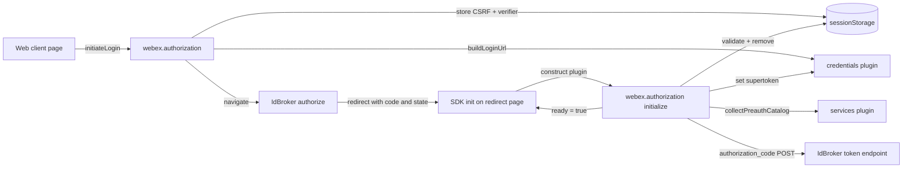
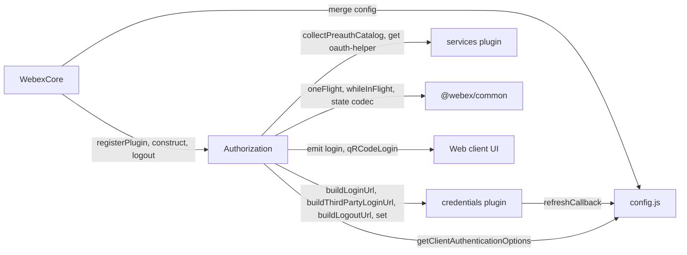
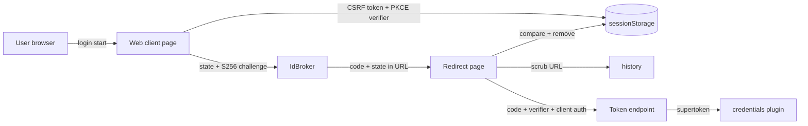

<!-- sdd-generated-metadata
doc_kind: standing-doc
generated_from: architecture@0.3.0
generated_by: claude-code
approved_by: pending
updated_at: 2026-10-14T13:20:00Z
validation_status: not-run
-->

# @webex/plugin-authorization-browser-first-party architecture

Canonical package-wide architecture. This document owns facts that span the package's module, its
host page, and the Webex JS SDK packages and services it depends on. Behavior detail lives in the
[module specification](../src/docs/README.md); native contract sources are linked, not copied.

Related context: [specification registry](specs/README.md) ·
[package agent instructions](../AGENTS.md)

## Applicability

| Condition ID                         | Status     | Evidence or reason | Owned section |
| ------------------------------------ | ---------- | ------------------ | ------------- |
| `repo.owns_datastore`                | N/A        | No datastore; only two transient sessionStorage keys per login round-trip in `src/authorization.js` | Repository data and schema |
| `repo.holds_client_state`            | Applicable | Session properties, QR polling timers, and the event emitter in `src/authorization.js` | Client state model |
| `repo.components_interact`           | Applicable | The plugin calls the credentials and services plugins and is called by WebexCore; see `src/authorization.js` and `src/index.js` | Dependency and interaction topology |
| `repo.domain_data_across_components` | N/A        | The token bundle is owned by the credentials plugin; this package only hands it over | Object and data ownership |
| `repo.caches_data`                   | N/A        | No cache; the preauth catalog is cached by the services plugin, not here | Caching catalog |
| `repo.observability_convention`      | Applicable | authorization: and credentials: log prefixes and the login/qRCodeLogin event stream in `src/authorization.js` | Observability patterns |
| `repo.deploys_to_infra`              | N/A        | npm library; `package.json` has no deployment descriptor | Runtime and infrastructure |
| `repo.shared_base_libs`              | Applicable | @webex/webex-core, @webex/common, and the legacy build, lint, and test configs in `package.json` | Shared and base libraries |
| `repo.is_monorepo`                   | N/A        | The SDD root is one package with one build root, `package.json` | Package map and dependencies |
| `repo.multi_platform`                | N/A        | Browser only: `process` exports {browser: true}, `package.json` declares browserify transforms, and the code requires window APIs | Platform matrix |
| `repo.published_package`             | Applicable | `package.json` defines deploy:npm | Release and versioning |
| `repo.embedded_in_host`              | Applicable | Runs inside the Webex Web Client page and drives its window; confirmed in the bootstrap questionnaire | Host integration and theming |
| `repo.exposes_commands_or_artifacts` | N/A        | No CLI, generator, or stable file output; dist/ is ordinary build output | Commands and generated artifacts |
| `repo.cross_repo_deps_material`      | Applicable | IdBroker and the oauth-helper service define the OAuth and device endpoints used in `src/authorization.js` and `src/config.js` | Cross-repository topology |
| `repo.security_arch_warranted`       | Applicable | CSRF, PKCE, URL scrubbing, client secrets, and token hand-off in `src/authorization.js` and `src/config.js` | Security architecture |

## Design overview

The package is a single WebexCore plugin that replaces the default browser authorization plugin for
the first-party Webex Web Client. Importing it registers `Authorization` under the plugin name
`authorization`; WebexCore keeps the first registration of a name, which is why the `webex`
first-party entry point (packages/webex/src/webex-first-party.js) requires this package before the
standard bundle.

The design splits sign-in into a navigation half and a completion half that run on different page
loads. Login methods store a CSRF token and PKCE verifier in the host page's sessionStorage and
navigate to IdBroker. When IdBroker redirects back, SDK initialization constructs the plugin again;
its constructor reads the callback URL, validates and consumes the stored values, scrubs the URL, and
exchanges the code without any further application call. A third flow, Device Authorization, runs
inside one page and reports progress only through events. Token storage, refresh scheduling, and URL
construction stay in webex-core's credentials plugin; this package supplies the client-authentication
choice (`src/config.js`) that both the code exchange and the refresh callback use.

The only module is [`src`](../src/docs/README.md).

## Resource inventory and responsibilities

| Resource | Kind | Responsibility | Owner | Source | Detailed specification |
| -------- | ---- | -------------- | ----- | ------ | ---------------------- |
| First-party browser authorization plugin | module | OAuth sign-in redirects and callbacks, token exchange, QR device flow, client authentication | @webex/web-client | `src/authorization.js` | `src/docs/README.md` |
| Package entry and config | module part | Plugin registration, proxies, exports, config defaults, refresh callback | @webex/web-client | `src/index.js` | `src/docs/README.md` |

## Interaction and execution flows

Representative flow: a user signs in through the Authorization Code + PKCE redirect, and the SDK on
the redirect page finishes the exchange.

| From | To | Interaction or transport | Purpose | Failure or compatibility behavior |
| ---- | -- | ------------------------ | ------- | --------------------------------- |
| Web client | `webex.authorization` | Method call | Start login, third-party login, QR login, or handle a callback | Synchronous throws for invalid input; QR failures arrive as events |
| `webex.authorization` | Host window | `location` assignment, `open`, `history.replaceState` | Navigate to IdBroker and scrub callback URLs | Cleanup is skipped when `history.replaceState` is absent |
| `webex.authorization` | IdBroker token endpoint | HTTPS form POST through `webex.request` | Exchange the code | 400 maps to a grant error; other failures propagate; init failure only sets the outcome |
| `webex.authorization` | oauth-helper | HTTPS form POST through `webex.request` | Device code and token polling | Failure events; timeout after `expires_in` |
| Credentials plugin | `config.credentials.refreshCallback` | Function call | Refresh the access token | Errors propagate to credentials |
| WebexCore | `webex.authorization.logout` | Method call after storage clear | Navigate to IdBroker logout | Skipped with `noRedirect` |

## Dependency topology

| Dependency | Type | Used by | Purpose | Version, failure, or fallback policy |
| ---------- | ---- | ------- | ------- | ------------------------------------ |
| `@webex/webex-core` | Internal | `src` | Plugin base, registration, credentials and services plugins, grant errors | `workspace:*` in `package.json` |
| `@webex/common` | Internal | `src` | `oneFlight`, `whileInFlight`, `encodeState`, `decodeState` | `workspace:*`; behavior per its module spec |
| `@webex/storage-adapter-local-storage` | Internal | `test/automation/fixtures/app.js` | Bounded storage for the automation fixture | Declared as a runtime dependency but not imported by `src/` |
| `@webex/test-helper-*` | Internal | Tests | chai, mocha, mock webex, test users, automation | Also declared under `dependencies` in `package.json` |
| `crypto-js` | External | `src` | SHA-256 and base64url | `^4.1.1` per `package.json` |
| `uuid` | External | `src` | CSRF token | `^3.3.2` per `package.json` |
| `lodash` | External | `src` | `cloneDeep`, `isEmpty`, `omit`, `isObject` | `^4.17.21` per `package.json` |
| IdBroker | External service | `src` | Authorize, token, logout, third-party login | No fallback in this package |
| oauth-helper | External service | `src` | Device authorization | No fallback in this package |

Ordering constraint: this package must load before any other package registers `authorization`.
There are no dependency cycles inside the package.

## Public and consumer surfaces

| Surface | Type | Owner | Consumers | Compatibility policy | Source |
| ------- | ---- | ----- | --------- | -------------------- | ------ |
| `authz-bfp-sdk` — npm package, `webex.authorization` API, exports `default`, `Events`, `InitialAuthorizationCodeGrantOutcomes`, `config` | SDK | `src` | `webex` first-party bundle, recipe-private-web-client, Webex Web Client | Published; semver through the workspace release | `package.json` |
| `authz-bfp-events` — `login` and `qRCodeLogin` events on `eventEmitter` | Event | `src` | Web client UI | Published; event names and `eventType` strings are stable | `src/authorization.js` |
| `authz-bfp-redirect-protocol` — state encoding, sessionStorage keys, callback parameters, token forms | RPC | `src` | The plugin itself across page loads; IdBroker | Internal; both sides ship in the same package | `src/authorization.js` |
| `webex-core-plugin-host` | SDK | @webex/webex-core | `src` | Required; external | `package.json` |
| `webex-common-js-api` | SDK | @webex/common | `src` | Required; external | `package.json` |
| `idbroker-oauth` | API | IdBroker | `src` | Required; external | `src/config.js` |
| `oauth-helper-device-authorization` | API | oauth-helper | `src` | Required; external | `src/authorization.js` |

No OpenAPI document applies: the package serves no HTTP routes.

## Client state model

The package's state is per plugin instance, except the event emitter, which is shared by every
instance in the page. The full slice table is in the
[module specification](../src/docs/README.md#client-state-model).

| State or slice | Owner | Transition triggers | Persistence or reset boundary |
| -------------- | ----- | ------------------- | ----------------------------- |
| Readiness and in-flight flags | `src` | SDK init, login and exchange calls | Instance lifetime |
| Initial grant outcome | `src` | Settling of the init exchange | Instance lifetime; not reset by logout |
| QR polling cycle | `src` | `initQRCodeLogin`, poll responses, timeout, cancel | Cleared on cancel or completion |
| Login round-trip secrets | Host page sessionStorage | Written at login, removed at callback | Browser tab session |

## Cross-cutting architecture

### Security

- Trust boundaries and identity flow: the browser page is untrusted input at callback time. Codes and
  states arrive in the URL and are accepted only after the CSRF check; tokens move from IdBroker to the
  credentials plugin and are never stored by this package. See [Security architecture](#security-architecture).
- Sensitive surfaces and data classes: authorization codes, `id_token`, refresh and access tokens,
  `client_secret` (confidential clients and the device flow), user email (hashed before use).
- Encryption and secret boundaries: all calls are HTTPS through `webex.request`; the PKCE verifier and
  CSRF token never leave sessionStorage except in the token request and state.

### Observability and operations

- Logging and correlation: `this.logger` with `authorization:` and `credentials:` message prefixes;
  init-exchange failures log at `warn`. No correlation id is added by this package.
- Metrics, traces, and audit signals: none emitted. Consumers observe progress through the event
  stream.
- Ownership and operational entry points: @webex/web-client owns the package per CODEOWNERS. No
  dashboards or runbooks exist in the package.

### Quality attributes

- SDK compatibility: the published exports and event strings are relied on by the web client; changes
  to them are breaking.
- Footprint: runtime dependencies are `crypto-js`, `uuid`, and `lodash` plus workspace packages
  (`package.json`). No performance targets are defined in committed sources.

## Dependency and interaction topology

| From | To | Kind | Purpose | Ordering or failure boundary |
| ---- | -- | ---- | ------- | ---------------------------- |
| WebexCore | `Authorization` | Call | Construct during init; `logout` after storage clear | Construction throws on error redirects and CSRF failures |
| `Authorization` | Credentials plugin | Call | URL building and supertoken storage | Builder throws propagate |
| Credentials plugin | `src/config.js` | Call | Refresh grant | Errors propagate |
| `Authorization` | Services plugin | Call | Preauth catalog and oauth-helper URL | Catalog rejection ignored |
| `Authorization` | `@webex/common` | Import | Decorators and state codec | `decodeState` throws on malformed state |
| `Authorization` | Web client UI | Event | Login and QR progress | Listeners are shared across instances |

## Observability patterns

| Signal | Convention or required fields | Propagation or naming rule | Primary evidence |
| ------ | ----------------------------- | -------------------------- | ---------------- |
| Logs | `authorization:` prefix followed by the action, at info; init exchange failure at warn with the error | Uses the SDK logger from `this.logger`; never logs tokens or codes | `src/authorization.js` |
| Metrics | None emitted | — | `src/authorization.js` |
| Traces | None emitted | — | `src/authorization.js` |
| Audit | `login` events `initiateLogin` and `redirectToLoginUrl`; `qRCodeLogin` lifecycle events | Event name plus `eventType`; payload in `data` or `userData` | `src/authorization.js` |

## Shared and base libraries

| Library | Inherited responsibility | Consumers | Version floor | Compatibility rule |
| ------- | ------------------------ | --------- | ------------- | ------------------ |
| `@webex/webex-core` | WebexPlugin base, plugin registry, credentials, services, grant errors | `src` | `workspace:*` | Follows the workspace version |
| `@webex/common` | Method decorators and OAuth state codec | `src` | `workspace:*` | Follows the workspace version |
| `@webex/babel-config-legacy`, `@webex/eslint-config-legacy`, `@webex/jest-config-legacy`, `@webex/legacy-tools` | Build, lint, and test configuration and runner | Package scripts | `workspace:*` | Change through the shared config packages, not locally |

## Release and versioning

| Artifact | Publish target | Versioning rule | Deprecation window | Changelog or migration obligation |
| -------- | -------------- | --------------- | ------------------ | --------------------------------- |
| `@webex/plugin-authorization-browser-first-party` | npm via `deploy:npm` (`yarn npm publish`) | Workspace-managed version; no version field in `package.json` | Not defined in committed sources | Workspace changelog; this package has none |

## Host integration and theming

| Host or integration | Mount or entry contract | Required providers or peers | Theming and accessibility constraints |
| ------------------- | ----------------------- | --------------------------- | ------------------------------------- |
| Webex Web Client page | Import before the `webex` bundle; plugin constructed by `Webex.init()` on every page load, including the `redirect_uri` page | `window.location`, `history.replaceState`, `sessionStorage`, `crypto.getRandomValues`, `URL`, `open` | No rendering; popup defaults to 600 × 800; QR and error UI belong to the host |

## Cross-repository topology

| Repository or external system | Relationship | Exchanged contract or artifact | Owner | Sequencing constraint |
| ----------------------------- | ------------ | ------------------------------ | ----- | --------------------- |
| IdBroker | Consumes | `idbroker-oauth`: authorize, token, logout, third-party login | Identity service | Redirect URI and client registration must match the configured `redirect_uri` and `client_id` |
| oauth-helper | Consumes | `oauth-helper-device-authorization` | Webex service owners | Must be present in the service catalog for the QR flow |
| web.webex.com device page | Provides a deep link to | `https://web.webex.com/deviceAuth?usercode=…&oauthhelper=…` | Webex Web Client | The page must accept `usercode` and `oauthhelper` parameters |

## Security architecture

- CSRF: a UUID v4 in `state.csrf_token` is compared with the stored token on return. The code-grant
  path tolerates a missing stored token; the third-party callback does not.
- PKCE: a 128-character verifier from `crypto.getRandomValues`, S256 challenge, removed on use.
- URL hygiene: `code`, `id_token`, `email`, and `csrf_token` are removed from the history entry.
- Client authentication: public clients send `client_id` only; confidential clients use HTTP Basic
  with `client_secret`; the device flow always uses Basic.
- PII: the raw email is replaced with its SHA-256 hash before the login URL is built.

The workspace security policy at the repository root governs reporting; this package adds no policy.

## Domain language

| Term | Repository-specific meaning | Authoritative source |
| ---- | --------------------------- | -------------------- |
| Supertoken | The access + refresh token bundle stored on `webex.credentials` | `src/authorization.js` |
| First party | The Webex Web Client itself, the only intended consumer | `src/authorization.js` |
| Preauth catalog | Service catalog fetched before tokens exist, hinted by `emailhash` or `orgId` | `src/authorization.js` |
| Initial authorization-code grant outcome | Retained result of the exchange run during plugin initialization only | `src/authorization.js` |
| Public client | `clientType: 'public'`: no client secret, `client_id` sent in the form | `src/config.js` |
| QR code login | OAuth Device Authorization grant through oauth-helper | `src/authorization.js` |

## References and maintenance

- Decisions: [adr/](adr/index.md)
- Instantiated specifications and routing: [specs/README.md](specs/README.md)
- Repository rules and patterns: [module-specific rules](../src/docs/README.md#module-specific-rules)
- Update this document in the same change that alters package boundaries, published surfaces,
  cross-package interaction, or the security architecture.
