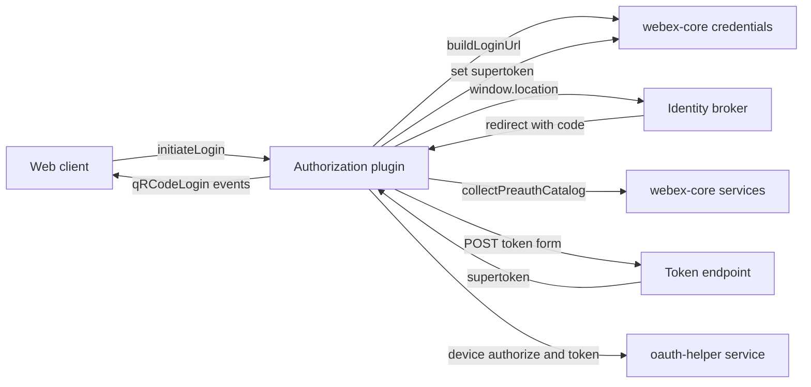
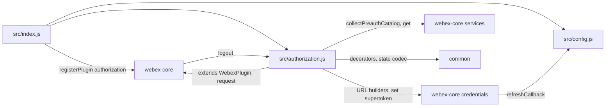
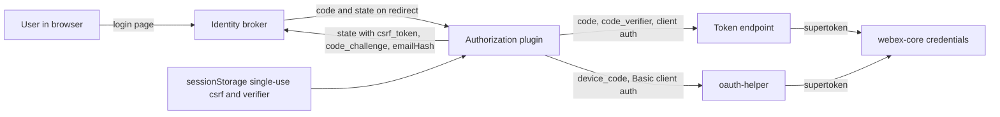

<!-- sdd-generated-metadata
doc_kind: standing-doc
generated_from: architecture@0.3.0
generated_by: claude-code
approved_by: rarajes2@cisco.com
updated_at: 2026-11-03T06:25:15Z
validation_status: pass
-->

# @webex/plugin-authorization-browser-first-party architecture

Canonical architecture for this package. Flow behavior lives in the
[first-party browser authorization plugin specification](../src/docs/README.md). This page owns
package boundaries, the plugin registration, the contract index, and how the package meets the rest of
the SDK.

Related context: [specification registry](specs/README.md) ·
[package agent instructions](../AGENTS.md)

## Applicability

| Condition ID                         | Status     | Evidence or reason | Owned section |
| ------------------------------------ | ---------- | ------------------ | ------------- |
| `repo.owns_datastore`                | N/A        | No database, file store, or migration in `src/authorization.js`; two transient sessionStorage keys are client state | Repository data and schema |
| `repo.holds_client_state`            | Applicable | Session properties, polling timers, and sessionStorage secrets in `src/authorization.js` | Client state model |
| `repo.components_interact`           | Applicable | `src/authorization.js` calls webex-core credentials and services, and webex-core calls its logout method | Dependency and interaction topology |
| `repo.domain_data_across_components` | Applicable | Token responses obtained in `src/authorization.js` are stored by webex-core credentials | Object and data ownership |
| `repo.caches_data`                   | N/A        | `src/authorization.js` keeps no cache | Caching catalog |
| `repo.observability_convention`      | Applicable | `src/authorization.js` logs with an authorization: prefix and emits login events | Observability patterns |
| `repo.deploys_to_infra`              | N/A        | Library published to npm (`package.json`). No service runtime | Runtime and infrastructure |
| `repo.shared_base_libs`              | Applicable | Extends WebexPlugin from webex-core and uses the legacy build, lint, and test stack (`babel.config.js`, `jest.config.js`, `.eslintrc.js`) | Shared and base libraries |
| `repo.is_monorepo`                   | N/A        | This SDD root is one package. The workspace around it is out of scope | Package map and inter-package dependencies |
| `repo.multi_platform`                | N/A        | Browser only: `src/authorization.js` uses window, history, sessionStorage, and crypto; `process` exports {browser: true} | Platform matrix |
| `repo.published_package`             | Applicable | `package.json` name is @webex/plugin-authorization-browser-first-party and deploy:npm publishes it | Release and versioning |
| `repo.embedded_in_host`              | N/A        | No host theme or embed API in `src/authorization.js` | Host integration and theming |
| `repo.exposes_commands_or_artifacts` | Applicable | build:src in `package.json` writes dist | Commands and generated artifacts |
| `repo.cross_repo_deps_material`      | Applicable | Behavior depends on webex-core credentials, services, and the identity broker and oauth-helper services (`src/authorization.js`) | Cross-repository topology |
| `repo.security_arch_warranted`       | Applicable | OAuth codes, PKCE, CSRF tokens, client secrets, and supertokens pass through `src/authorization.js` and `src/config.js` | Security architecture |

## Design overview

`@webex/plugin-authorization-browser-first-party` is a published browser library with one module.
Importing it registers `Authorization` as the public plugin `authorization`, which replaces the
standard browser authorization plugin when it is imported first, as `webex-first-party.js` in the
`webex` package does. The plugin starts logins, finishes authorization-code logins automatically when
the page loads with `?code=`, runs device (QR) login, handles the third-party login callback, and
redirects on logout.

The plugin owns flows, not tokens. Every successful flow ends with
`webex.credentials.set({supertoken})`, and URL builders, token refresh scheduling, and OAuth error
classes stay in webex-core credentials. The package adds the browser `refreshCallback` and the
`clientType` default to the shared `credentials` configuration.

The package makes outbound HTTP calls and browser navigations only. It serves no routes and persists
nothing beyond two single-use `sessionStorage` entries.

## Resource inventory and responsibilities

| Resource | Kind | Responsibility | Owner | Source | Detailed specification |
| -------- | ---- | -------------- | ----- | ------ | ---------------------- |
| First-party browser authorization plugin | package (one module) | Code login with PKCE and CSRF, startup completion, token exchange and refresh callback, third-party callback, QR device login, logout redirect | @webex/web-client | `src` | [`src/docs/README.md`](../src/docs/README.md) |

## Interaction and execution flows

Representative end-to-end flow: the web client starts a login, the identity broker redirects back with
a code, the plugin exchanges it on the next page load, and credentials hold the supertoken.

| From | To | Interaction or transport | Purpose | Failure or compatibility behavior |
| ---- | -- | ------------------------ | ------- | --------------------------------- |
| Web client | Authorization plugin | In-process calls and `eventEmitter` events | Start logins, observe QR progress | Redirect and CSRF failures throw during `initialize` |
| Authorization plugin | Identity broker | Browser navigation | Login and logout pages | No retry; user restarts login |
| Authorization plugin | Token endpoint | HTTPS POST form through `webex.request` | Code exchange and refresh | 400 maps to grant errors; others propagate |
| Authorization plugin | `oauth-helper` service | HTTPS POST form, timer polling | Device authorization | Reported through `qRCodeLogin` events |
| Authorization plugin | webex-core services | In-process call | Preauth catalog before the exchange | Failure ignored |
| webex-core | Authorization plugin | `logout()` call | Logout redirect | `noRedirect` skips navigation |

## Dependency topology

| Dependency | Type | Used by | Purpose | Version, failure, or fallback policy |
| ---------- | ---- | ------- | ------- | ------------------------------------ |
| `@webex/webex-core` | Internal | `src/index.js`, `src/authorization.js` | Plugin base, registration, request, credentials, services, grant errors | Workspace version (`workspace:*` in `package.json`) |
| `@webex/common` | Internal | `src/authorization.js` | `oneFlight`, `whileInFlight`, `encodeState`, `decodeState` | Workspace version |
| `crypto-js` | External | `src/authorization.js` | SHA-256 and base64url | `^4.1.1` in `package.json` |
| `uuid` | External | `src/authorization.js` | CSRF token | `^3.3.2` in `package.json` |
| `lodash` | External | `src/authorization.js` | Object helpers | `^4.17.21` in `package.json` |
| Identity broker and token endpoint | External service | `src/authorization.js`, `src/config.js` | Login pages and token grants | URLs come from credentials config |
| `oauth-helper` service | External service | `src/authorization.js` | Device authorization | Reached by service name through the services catalog |

`package.json` also lists `@webex/storage-adapter-local-storage` and several `@webex/test-helper-*`
packages under `dependencies`; `src/` imports none of them. No import cycle exists: this package
imports webex-core and common, and webex-core reaches this plugin only through the registered child.

## Public and consumer surfaces

| Surface | Type | Owner | Consumers | Compatibility policy | Source |
| ------- | ---- | ----- | --------- | -------------------- | ------ |
| `authorization-browser-first-party-sdk` — package @webex/plugin-authorization-browser-first-party, the `webex.authorization` API, and the `credentials` config defaults | SDK, published to npm, internal by intent | First-party browser authorization plugin | `webex` first-party entry, `recipe-private-web-client`, Webex web client | Class JSDoc marks it private and discourages other use; no versioning rule in the package | `package.json`, `src/index.js`, `src/authorization.js`, `src/config.js` |
| `authorization-plugin-events` — `login` and `qRCodeLogin` on `webex.authorization.eventEmitter` | Event | First-party browser authorization plugin | Webex web client | Hosts switch on `eventType` | `src/authorization.js` |

The token-endpoint and `oauth-helper` requests are internal protocols, described under *Protocol and
wire format* in the [module specification](../src/docs/README.md#protocol-and-wire-format), not
published contracts of this package.

## Client state model

| State or slice | Owner | Transition triggers | Persistence or reset boundary |
| -------------- | ----- | ------------------- | ----------------------------- |
| `isAuthorizing`, `ready`, `initialAuthorizationCodeGrantOutcome` | Authorization plugin | Login initiation, code exchange, startup completion | In memory for the instance; the outcome is not reset by logout |
| QR polling timers and poll id | Authorization plugin | `initQRCodeLogin`, poll responses, timeout, cancel | In memory |
| `oauth2-csrf-token`, `oauth2-code-verifier` | Authorization plugin | Written at login initiation; removed on first read | Browser `sessionStorage`; single use |
| Supertoken | webex-core credentials | Set by this plugin after a code exchange or device poll | Owned by credentials |

## Cross-cutting architecture

### Security

- Trust boundaries and identity flow: see [Security architecture](#security-architecture). The plugin
  builds requests and navigations; credentials stores tokens, and webex-core adds transport.
- Sensitive surfaces and data classes: authorization codes, PKCE verifiers, CSRF tokens, client
  secrets, supertokens, and email addresses (hashed before use).
- Encryption and secret boundaries: secrets in flight are limited to the token-endpoint and
  `oauth-helper` forms; the raw email is replaced by its SHA-256 in `initiateLogin`.

### Observability and operations

- Logging and correlation: `this.logger.info` messages prefixed `authorization:` and one
  `this.logger.warn` when the startup exchange fails.
- Metrics, traces, and audit signals: none emitted here; the `login` events give hosts a hook.
- Ownership and operational entry points: `.github/CODEOWNERS` at the workspace root routes the package
  to `@webex/web-client`. No dashboards or runbooks are recorded in this package.

### Quality attributes

- Compatibility: the web client relies on method names, the `eventType` vocabulary, and the
  `sessionStorage` key names across page loads.
- Footprint: three source files; runtime imports are webex-core, common, crypto-js, uuid, and lodash.
- Test confidence: one unit spec covers most flows; registration, the 400 mapping, and the logout
  redirect are untested. No coverage threshold is enforced.

## Dependency and interaction topology

| From | To | Kind | Purpose | Ordering or failure boundary |
| ---- | -- | ---- | ------- | ---------------------------- |
| `src/index.js` | `src/authorization.js`, `src/config.js` | Import | Build and register the plugin | Registration happens at import time; first registration wins |
| `src/authorization.js` | webex-core credentials | Call | URLs, token storage, grant errors | Builder throws propagate |
| `src/authorization.js` | webex-core services | Call | Preauth catalog, `oauth-helper` URL | Catalog failure ignored |
| `src/authorization.js` | `@webex/common` | Import | Decorators and state encoding | Malformed state throws |
| webex-core credentials | `src/config.js` | Call | Browser token refresh | Rejection propagates to credentials |
| webex-core | `src/authorization.js` | Call | `logout` at the end of `WebexCore#logout` | Runs after credentials are invalidated |

## Object and data ownership

| Object or state | System of record | May write | May read | Movement or lifecycle |
| --------------- | ---------------- | --------- | -------- | --------------------- |
| Supertoken (access and refresh token bundle) | webex-core credentials | This plugin (after an exchange or device poll), credentials (refresh) | Credentials and every plugin through it | Created here, refreshed through `refreshCallback`, invalidated on logout |
| CSRF token and PKCE verifier | Browser `sessionStorage` | This plugin | This plugin | Written at initiation, removed at the next read |
| OAuth `state` payload | The authorize URL and the redirect URL | This plugin through credentials `buildLoginUrl` | This plugin on return | base64url JSON; `csrf_token` removed from the URL after use |

## Observability patterns

| Signal  | Convention or required fields | Propagation or naming rule | Primary evidence |
| ------- | ----------------------------- | -------------------------- | ---------------- |
| Logs    | `info` messages describe the step; the failed startup exchange logs `warn` with the error | Messages start with `authorization:` (the exchange logs `credentials:`); no token values are logged | `src/authorization.js` |
| Metrics | None | N/A | `src/authorization.js` |
| Traces  | None | N/A | `src/authorization.js` |
| Audit   | `login` events `initiateLogin` and `redirectToLoginUrl` on `eventEmitter` | `{eventType, data}`; `initiateLogin` carries booleans only, not the email | `src/authorization.js` |

## Shared and base libraries

| Library | Inherited responsibility | Consumers | Version floor | Compatibility rule |
| ------- | ------------------------ | --------- | ------------- | ------------------ |
| `@webex/webex-core` `WebexPlugin` | `webex`, `request`, namespaced `config`, `logger`, `initialize` hook, session and derived props | `Authorization` | `workspace:*` | Keep `initialize` delegating to `WebexPlugin.prototype.initialize` first |
| `@webex/common` decorators | `oneFlight`, `whileInFlight` | `Authorization` | `workspace:*` | Keep decorator order on `requestAuthorizationCodeGrant` |
| `@webex/babel-config-legacy`, `@webex/eslint-config-legacy`, `@webex/jest-config-legacy`, `@webex/legacy-tools` | Build, lint, and test stack through one-line config files | Package tooling | `workspace:*` | Do not fork the config locally |

## Release and versioning

| Artifact | Publish target | Versioning rule | Deprecation window | Changelog or migration obligation |
| -------- | -------------- | --------------- | ------------------ | --------------------------------- |
| @webex/plugin-authorization-browser-first-party | npm through `deploy:npm` | None declared in the package; the README and class JSDoc describe it as internal to the Webex web client | None declared | None declared in the package; the workspace owns changelog generation |

## Commands and generated artifacts

| Command or artifact | Owner | Inputs | Output or side effect | Compatibility boundary |
| ------------------- | ----- | ------ | --------------------- | ---------------------- |
| `yarn workspace @webex/plugin-authorization-browser-first-party build:src` | Package scripts | `src` | Writes `dist/` through `webex-legacy-tools` (JavaScript, TypeScript, source maps) | `dist/` is generated and never edited by hand; unit tests load it |
| `yarn workspace @webex/plugin-authorization-browser-first-party test:unit` | Package scripts | `test/unit/spec` | Jest run | Requires a current `dist/` |
| `yarn workspace @webex/plugin-authorization-browser-first-party test:style` | Package scripts | `src` | ESLint run | Markdown under `src/` is ignored by the root `.eslintignore` |

## Cross-repository topology

| Repository or external system | Relationship | Exchanged contract or artifact | Owner | Sequencing constraint |
| ----------------------------- | ------------ | ------------------------------ | ----- | --------------------- |
| `@webex/webex-core` (workspace sibling; module specs consulted) | Consumes | `WebexPlugin`, `registerPlugin`, credentials, services, grant errors | @webex/web-sdk | Registration before any other `authorization` plugin |
| `@webex/common` (workspace sibling; module spec consulted) | Consumes | Decorators and OAuth state codec | @webex/web-sdk | None |
| `webex` and `recipe-private-web-client` (workspace siblings) | Provides to | Import side effect registering `authorization` | @webex/web-client | `webex-first-party.js` imports this package before `./webex` |
| Identity broker and token endpoint | Consumes | Authorize, logout, and token endpoints from credentials config | Not recorded in this repository | Redirect URI must match `redirect_uri` |
| `oauth-helper` service | Consumes | `/actions/device/authorize` and `/actions/device/token` | Not recorded in this repository | Catalog must resolve `oauth-helper` |

## Security architecture

- The browser tab is the trust boundary for the CSRF token and the PKCE verifier. Both stay in
  `sessionStorage`, are removed when first read, and never appear in a request except the verifier in
  the token form.
- The redirect is checked against the stored CSRF token when one exists; the third-party callback
  requires one. The authorization code, `id_token`, email, and CSRF token are scrubbed from the visible
  URL afterwards.
- Client authentication is public (`client_id` in the form) by default and HTTP Basic for confidential
  clients; the device flow always uses HTTP Basic with `client_secret`.
- Tokens leave this module only through `webex.credentials.set`. The authoritative credential policy is
  the webex-core credentials specification.

## Domain language

| Term | Repository-specific meaning | Authoritative source |
| ---- | --------------------------- | -------------------- |
| First party | The Webex web client, the only intended consumer | `src/authorization.js` |
| Supertoken | The access and refresh token bundle stored by credentials | webex-core credentials (sibling package) |
| Startup completion | The automatic code exchange in `initialize` when the page URL has `code` | `src/authorization.js` |
| Initial authorization-code grant outcome | The retained `not_attempted`, `success`, or `failure` of startup completion | `src/authorization.js` |
| Preauth catalog | A limited service catalog fetched with an `emailhash` or `orgId` hint before the exchange | `src/authorization.js` |
| QR code login | The OAuth device authorization flow through `oauth-helper` | `src/authorization.js` |
| Client type | `public` (client id in the form) or any other value (HTTP Basic with secret) | `src/config.js` |

## References and maintenance

- Decisions: [adr/](adr/index.md)
- Instantiated specifications and routing: [specs/README.md](specs/README.md)
- Repository rules and patterns: [package agent instructions](../AGENTS.md)
- Update this document in the same change that alters package boundaries, resource ownership,
  cross-resource interaction, or cross-cutting architecture.
