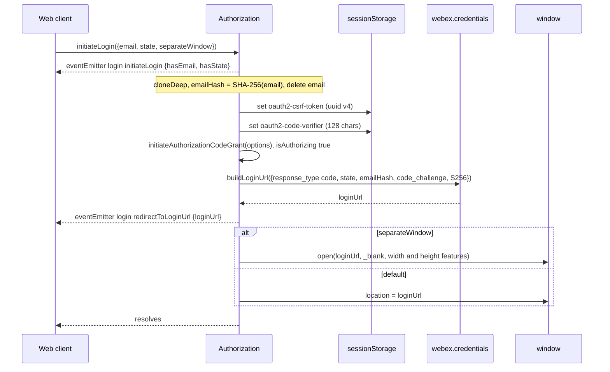
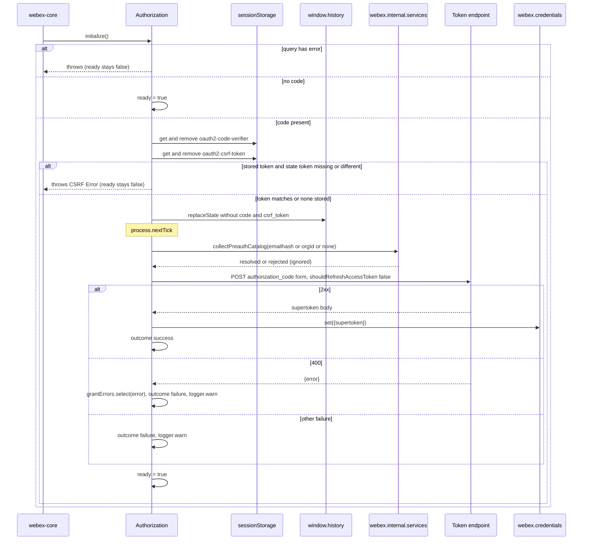
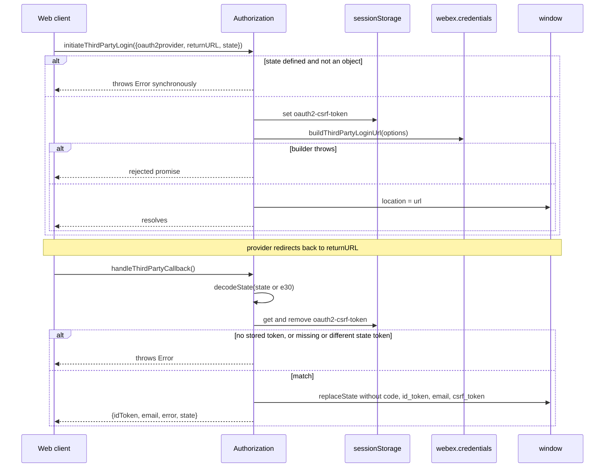
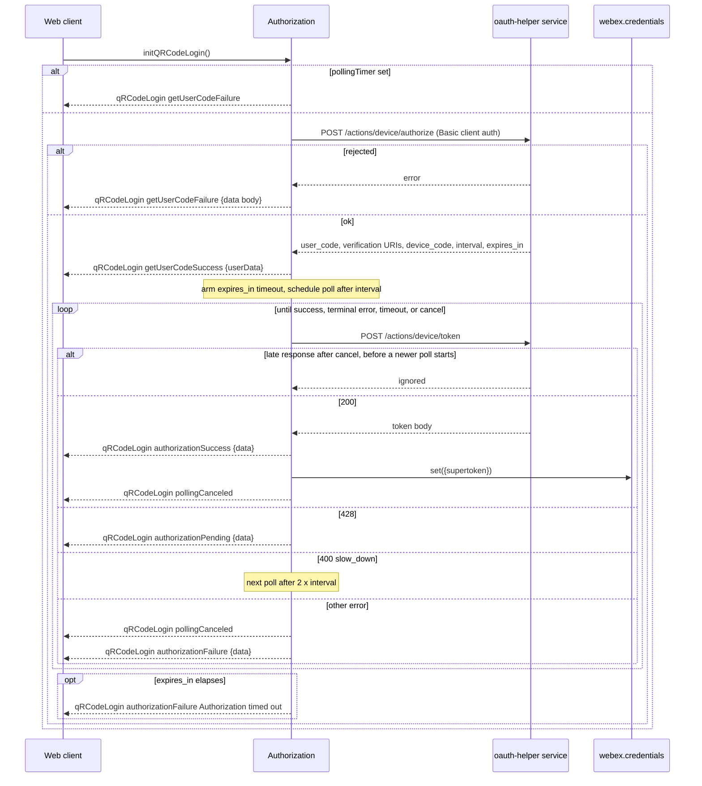
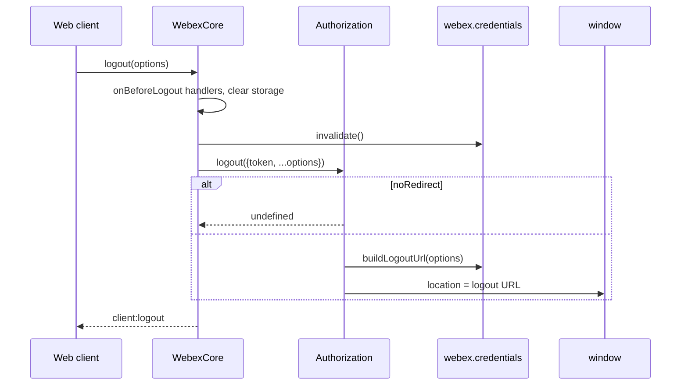
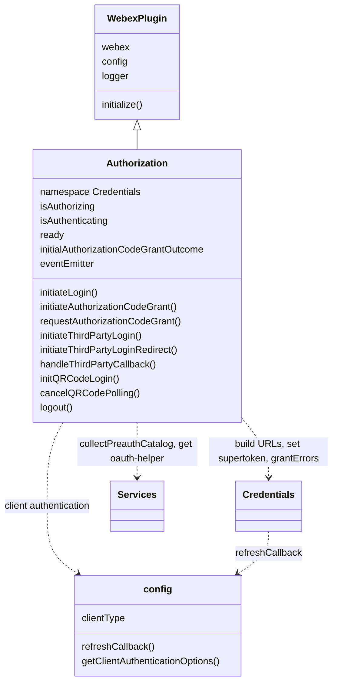
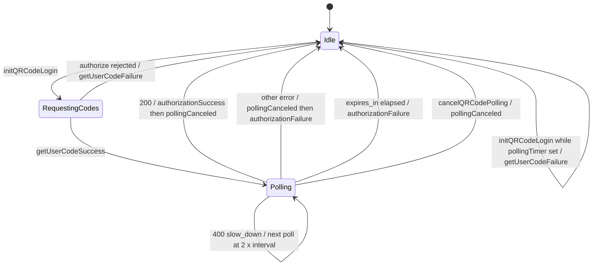

<!-- sdd-generated-metadata
doc_kind: module-spec
generated_from: module-spec@0.3.0
generated_by: claude-code
approved_by: rarajes2@cisco.com
updated_at: 2026-11-03T06:25:15Z
validation_status: pass
-->

# First-party browser authorization plugin

This source-local document at `src/docs/README.md` owns the stable specification for **the first-party
browser authorization plugin**: the `webex.authorization` plugin used by the Webex web client for the
OAuth authorization-code flow with PKCE and CSRF state, the third-party (social provider) login
callback, device (QR code) login, and logout. Ground every claim in package evidence and link to the
[package architecture](../../docs/architecture.md) instead of repeating broader facts. No service
specification exists because this package is a library.

Related context: [documentation index](../../docs/index.md) ·
[package agent instructions](../../AGENTS.md)

## Metadata

| Field             | Value |
| ----------------- | ----- |
| Owner             | @webex/web-client |
| Source path       | `src` |
| Resource kind     | package |
| Status            | Draft |
| Last verified     | 2026-11-03 at `108f963a6d` |
| Module id         | `plugin-authorization-browser-first-party` |
| Parent spec       | — |
| Doc kind          | Module spec |
| Coverage score    | 93.3% assessed 2026-11-03 — 14 of 15 mandatory fields PRESENT, critical 8 of 8; test strategy is WEAK because registration, the 400 grant-error mapping, the missing-code rejection, and the logout redirect are untested, the redirect-error case pins a `TypeError`, and the automation suite is skipped |
| Validation status | Pass — independent validation by Codex Desktop on 2026-11-03 |

## Applicability

| Condition ID                         | Status     | Evidence or reason | Owned section |
| ------------------------------------ | ---------- | ------------------ | ------------- |
| `module.has_tiers`                   | N/A        | No tier policy exists in this package or its `package.json` | Tier |
| `module.has_ui`                      | N/A        | `src/authorization.js` assigns window.location or calls window.open; it renders no view | UI use-case flow |
| `module.crosses_service_boundaries`  | Applicable | `src/authorization.js` and `src/config.js` POST to the identity broker token URL and to the oauth-helper service, and ask the services plugin for a preauth catalog | Cross-boundary use-case flow |
| `module.holds_client_state`          | Applicable | Session properties isAuthorizing, ready, and the initial-grant outcome, the QR polling timers, and two sessionStorage keys, all in `src/authorization.js` | Client state model |
| `module.enforces_domain_rules`       | Applicable | CSRF state checks, single-use PKCE verifier, raw-email removal, and client-authentication selection in `src/authorization.js` and `src/config.js` | Business rules and invariants |
| `module.is_concurrent_async`         | Applicable | oneFlight and whileInFlight decorators, a process.nextTick startup exchange, and timer-driven polling in `src/authorization.js` | Concurrency and reactive flow |
| `module.owns_persistence`            | N/A        | The only stored values in `src/authorization.js` are two transient sessionStorage keys removed on first read; they are covered under Client state model | Data, schema, and migration discipline |
| `module.stateful_transitions`        | Applicable | The QR polling lifecycle and the initial-grant outcome in `src/authorization.js` | State machine |
| `module.exposes_wire_protocol`       | Applicable | Authorize-URL query, token-endpoint forms, device-flow forms and responses, and event payloads in `src/authorization.js` and `src/config.js` | Protocol and wire format |
| `module.ui_multi_screen`             | N/A        | No UI | UI flow |
| `module.large_data_model`            | N/A        | The module defines no entity types; the supertoken shape belongs to webex-core credentials | Data model |
| `module.returns_caller_errors`       | Applicable | Thrown CSRF and redirect errors, rejected token exchanges, mapped grant errors, and failure events in `src/authorization.js` | Caller-visible failure modes |
| `module.module_specific_conventions` | Applicable | Event envelope {eventType, data}, the sessionStorage key names, and the Credentials config namespace in `src/authorization.js` | Module-specific rules |
| `module.published_package`           | Applicable | `package.json` names the package @webex/plugin-authorization-browser-first-party and defines deploy:npm | Export stability |
| `module.embedded_in_host`            | N/A        | No host theme or embed API | Host integration and theming |
| `module.has_design_tradeoff`         | Applicable | Lenient CSRF on the code redirect versus strict CSRF on the third-party callback, a non-fatal preauth catalog, and readiness regardless of exchange outcome | Key design trade-off |
| `module.has_submodules`              | N/A        | The src directory has no child module | Sub-modules |

## Evidence register

| Evidence | What it establishes |
| -------- | ------------------- |
| `src/index.js` | Public plugin registration as `authorization` with `config` and the `isAuthorizing` and `isAuthenticating` proxies; re-exports of the default class, `Events`, `InitialAuthorizationCodeGrantOutcomes`, and `config` |
| `src/authorization.js` | The `Authorization` plugin: startup code completion, login initiation, token exchange, third-party login and callback, logout, QR device login, and the CSRF, PKCE, and URL-cleanup helpers. Its JSDoc and inline comments are the only recorded rationale |
| `src/config.js` | `credentials.clientType` default `'public'`, `getClientAuthenticationOptions`, and the browser `refreshCallback` |
| `package.json` | Name, `main` (`dist/index.js`), `devMain` (`src/index.js`), `engines`, dependencies, and scripts |
| `process` | Package-root module exporting `{browser: true}`; nothing in `src/` imports it |
| `test/unit/spec/authorization.js` | Unit cases for startup completion, the initial-grant outcome, client authentication, login initiation, popup login, third-party login and callback, CSRF, PKCE, URL cleanup, org-id extraction, and the QR device flow. It imports the package by name, so it loads `dist/` |
| `test/automation/spec/authorization-code-grant.js` | Browser automation suite for the code grant; its only case group is `describe.skip`, and no package script runs it |
| `README.md` | Retained npm page; it is not the behavioral authority, and its differences from code are recorded in `docs/adr/0001-retain-product-readme.md` |
| Sibling package webex-core, file src/lib/credentials/docs/README.md | Module spec consulted. `buildLoginUrl`, `buildLogoutUrl`, and `buildThirdPartyLoginUrl` are pure string builders; `grantErrors.select` maps OAuth error strings to subclasses; a browser token refreshes through `config.refreshCallback` |
| Sibling package webex-core, file src/lib/services/docs/README.md | Module spec consulted. `collectPreauthCatalog` fetches a limited catalog for an unauthenticated client; `get(name)` returns a catalog URL |
| Sibling package webex-core, file src/docs/README.md | Module spec consulted. `registerPlugin` is first-wins and supports `proxies`; `WebexPlugin` supplies `webex`, `request`, namespaced `config`, and `logger` |
| Sibling package webex-core, file src/webex-core.js | Source consulted. `logout()` runs `onBeforeLogout` handlers, clears storage, invalidates credentials, then calls `authorization.logout(options)` with `token` defaulted from the supertoken |
| Sibling package common, file src/docs/README.md | Module spec consulted. `oneFlight` shares one in-flight promise, `whileInFlight` toggles a boolean for a promise's duration, and `encodeState`/`decodeState` round-trip JSON through base64url |
| Sibling package webex, file src/webex-first-party.js | Source consulted. Imports this package before `./webex`, so its `authorization` registration wins |
| Observation, no stated WHY | initialize does not scrub the `error` query parameter, and `logout` returns `undefined` although its JSDoc says `Promise<void>` |

## Purpose and boundary

- Responsibility: complete and initiate first-party OAuth logins in a browser. That means building the
  authorization-code login with CSRF state and PKCE, finishing it automatically when the page loads with
  `?code=`, exchanging codes for a supertoken, supplying the browser token-refresh callback, handling the
  third-party login callback, running device (QR code) login, and redirecting on logout.
- In scope: the `authorization` plugin API and session state; the `qRCodeLogin` and `login` events on
  `eventEmitter`; the token-endpoint and `oauth-helper` request shapes; the `oauth2-csrf-token` and
  `oauth2-code-verifier` `sessionStorage` keys; URL scrubbing after a redirect.
- Out of scope: building the authorize, logout, and third-party URLs, storing and refreshing tokens, and
  mapping OAuth error strings (webex-core credentials); catalog lookups and URL resolution (webex-core
  services); request transport (webex-core); rendering a QR code or any UI (the host application).
- Consumers: the `webex` package's first-party entry (`webex-first-party.js`), the
  `recipe-private-web-client` package, and the Webex web client that calls `webex.authorization`.

## Structure and key files

| Path | Responsibility |
| ---- | -------------- |
| `src/index.js` | Calls `registerPlugin('authorization', Authorization, {config, proxies})` and re-exports `Authorization` (default), `Events`, `InitialAuthorizationCodeGrantOutcomes`, and `config` |
| `src/authorization.js` | The `Authorization` class, built with `WebexPlugin.extend` in namespace `Credentials`; the only place where flow behavior lives |
| `src/config.js` | Default export `{credentials: {clientType, refreshCallback}}` and the named export `getClientAuthenticationOptions` |
| `process` | Package-root file exporting `{browser: true}`; not imported by `src/` |
| `package.json` | Package name, entry points, scripts, and dependencies |
| `babel.config.js`, `jest.config.js`, `.eslintrc.js` | One-line re-exports of the legacy Babel, Jest, and ESLint configurations |
| `test/unit/spec/authorization.js` | Unit spec run by Jest through `webex-legacy-tools` |
| `test/automation/spec/authorization-code-grant.js` | Skipped browser automation suite with fixtures in `test/automation/fixtures/app.js` |
| dist/ (generated) | Build output of `build:src`; ignored by Git and never edited by hand |

## Public surface

| Surface | Consumer | Compatibility commitment | Source |
| ------- | -------- | ------------------------ | ------ |
| Import side effect: public plugin `authorization` with proxies `isAuthorizing`, `isAuthenticating` | `webex` first-party entry, `recipe-private-web-client` | First registration of the name wins, so this package must be imported before another authorization plugin | `src/index.js` |
| Named exports `Events` (`login`, `qRCodeLogin`) and `InitialAuthorizationCodeGrantOutcomes` (`failure`, `not_attempted`, `success`) | Web client code | String values are compared by callers | `src/authorization.js` |
| Named export `config` and the `credentials` defaults `clientType: 'public'` and `refreshCallback` | webex-core config merge | Merged into `webex.config.credentials` | `src/config.js` |
| `webex.authorization.initiateLogin(options)` and `initiateAuthorizationCodeGrant(options)` | Web client login screen | Resolve after navigation is started; options are cloned, except in `initiateAuthorizationCodeGrant` | `src/authorization.js` |
| `webex.authorization.requestAuthorizationCodeGrant({code, codeVerifier})` | Startup completion; callers holding a code | Resolves with no value after storing the supertoken; rejects with a grant error on 400 | `src/authorization.js` |
| `webex.authorization.initiateThirdPartyLogin(options)`, `initiateThirdPartyLoginRedirect(options)`, `handleThirdPartyCallback()` | Web client social-provider login | Redirect may be overridden; the callback returns synchronously | `src/authorization.js` |
| `webex.authorization.initQRCodeLogin()` and `cancelQRCodePolling(withCancelEvent)` | Web client QR login | Progress is reported only through `qRCodeLogin` events | `src/authorization.js` |
| `webex.authorization.logout(options)` | `WebexCore#logout` | Navigates to the logout URL unless `noRedirect` | `src/authorization.js` |
| Properties `isAuthorizing`, `isAuthenticating`, `ready`, `initialAuthorizationCodeGrantOutcome`, `eventEmitter` | Web client code | `initialAuthorizationCodeGrantOutcome` is readonly | `src/authorization.js` |

Contract IDs `authorization-browser-first-party-sdk` and `authorization-plugin-events` are indexed in
the [package architecture](../../docs/architecture.md#public-and-consumer-surfaces) and registered in
`.sdd/manifest.json`. Export stability is under [Export stability](#export-stability).

## Dependencies

| Dependency | Why it is required | Failure behavior |
| ---------- | ------------------ | ---------------- |
| `@webex/webex-core` credentials (module spec consulted) | `buildLoginUrl`, `buildThirdPartyLoginUrl`, `buildLogoutUrl`, `credentials.set({supertoken})`, `tokenUrl`, and `grantErrors` | A builder throw rejects `initiateThirdPartyLoginRedirect` and, through the `whileInFlight` promise executor, `initiateAuthorizationCodeGrant` and `initiateLogin`, leaving `isAuthorizing` `true`; it propagates synchronously from `logout` |
| `@webex/webex-core` services (module spec consulted) | `collectPreauthCatalog` before the startup exchange; `get('oauth-helper')` for the QR verification URL | Catalog failure is swallowed; the exchange still runs |
| `@webex/webex-core` plugin host (module spec consulted) | `WebexPlugin`, `registerPlugin`, `this.webex.request`, `getWindow()`, namespaced `config`, and `logger` | Request rejections are handled per flow (see Caller-visible failure modes) |
| `@webex/common` (module spec consulted) | `oneFlight`, `whileInFlight`, `encodeState`, `decodeState` | A malformed `state` makes `decodeState` throw |
| Identity broker token endpoint (external) | Authorization-code exchange and refresh-token grant at `config.tokenUrl` | Non-400 rejections propagate unchanged; 400 maps to a grant error |
| `oauth-helper` service (external) | Device authorization and device token polling | Failures become `getUserCodeFailure` or `authorizationFailure` events |
| Browser window (`location`, `history`, `sessionStorage`, `crypto`, `open`) | Navigation, URL scrubbing, single-use secrets, and the PKCE random source | No fallback for `sessionStorage` or `crypto`; URL scrubbing is skipped when `history.replaceState` is missing |
| `crypto-js` | SHA-256 of the email and of the PKCE verifier, base64url encoding | Not applicable |
| `uuid` | Version 4 CSRF tokens | Not applicable |
| `lodash` | `cloneDeep`, `isEmpty`, `omit`, `isObject` | Not applicable |

## Requirements

| ID | WHAT | WHY | Source evidence | Test or example evidence | Assumptions or gaps | Confidence |
| -- | ---- | --- | --------------- | ------------------------ | ------------------- | ---------- |
| `MOD-001` | Importing the package registers public plugin `authorization` with the package config and proxies `isAuthorizing` and `isAuthenticating` onto the webex instance. | The first-party entry swaps this plugin in for the standard browser plugin, and hosts read the in-flight flag from the instance. | `src/index.js` | `test/unit/spec/authorization.js` builds the plugin through MockWebex children, not through registration | No unit case exercises `registerPlugin` or the proxies | Weak |
| `MOD-002` | When the page URL has no `code`, `initialize` sets `ready` to `true` synchronously and does nothing else. | The JSDoc says there is nothing to complete. | `src/authorization.js` | `test/unit/spec/authorization.js` "sets ready" | None | Present |
| `MOD-003` | When the page URL has an `error` query parameter, `initialize` throws before reading `code`, and `ready` stays `false`. | The JSDoc of `_checkForErrors` says an OAuth error in the redirect must raise a mapped grant error. | `src/authorization.js` | `test/unit/spec/authorization.js` "throws a grant error" pins that the thrown error is a TypeError with message "Cannot convert object to primitive value", not a grant-error instance | The mapped error is never constructed successfully from the parsed query; see Pitfalls | Present |
| `MOD-004` | With a `code` present, `initialize` decodes `state` (or uses `{}`), reads and removes the PKCE verifier, verifies the CSRF token, and scrubs the URL, all synchronously and in that order. | The inline comments: remove the verifier "to minimize exposure", and clean the URL to avoid leaking the code. | `src/authorization.js` | `test/unit/spec/authorization.js` "validates the csrf token", "removes the oauth parameters from the url" | A CSRF failure throws after the verifier is already removed | Present |
| `MOD-005` | The startup exchange passes `{emailhash}` from state to `collectPreauthCatalog` when present, else `{orgId}` from the code's third underscore-delimited segment, else no argument. | The JSDoc: a best-effort preauth catalog fetch uses the hint before the exchange. | `src/authorization.js` | `test/unit/spec/authorization.js` "collects the preauth catalog when emailhash is present in the state" and the two no-emailhash cases | None | Present |
| `MOD-006` | On the next tick, `initialize` runs `collectPreauthCatalog` (rejection ignored), then `requestAuthorizationCodeGrant({code, codeVerifier})`, records `success` or `failure`, logs a warning on failure, and finally sets `ready` to `true`. | The comments: defer in case the credentials plugin is not ready; the catalog is non-fatal; ready is marked regardless of outcome. | `src/authorization.js` | `test/unit/spec/authorization.js` "exchanges it for an access token and sets ready", "handles an error when exchanging an authorization code and becomes ready", "passes codeVerifier to requestAuthorizationCodeGrant" | None | Present |
| `MOD-007` | `initialAuthorizationCodeGrantOutcome` is a readonly derived value that starts `not_attempted`, changes only from the startup exchange, and is not reset by logout or by later exchanges. | The JSDoc defines it as the retained result of the automatic exchange only. | `src/authorization.js` | `test/unit/spec/authorization.js` "exposes the initial authorization code grant outcome as readonly", "retains the initialization exchange outcome after logout", "does not treat a later authorization-code grant as the initialization exchange" | None | Present |
| `MOD-008` | `initiateLogin` emits `login` `initiateLogin` with `{hasEmail, hasState}`, clones the options, replaces `email` with its SHA-256 as `emailHash` and `state.emailhash`, adds `state.csrf_token` and an S256 `code_challenge`, and calls `initiateAuthorizationCodeGrant`. | The comments: keep the raw email from propagating; the catalog reads `emailhash` and the redirect service reads `emailHash`. | `src/authorization.js` | `test/unit/spec/authorization.js` "adds a csrf_token to the login url and sessionStorage", "adds a pkce code challenge", "adds emailHash", and the three event cases | None | Present |
| `MOD-009` | `initiateAuthorizationCodeGrant` builds the login URL from `{response_type: 'code', ...options}`, emits `login` `redirectToLoginUrl` with `{loginUrl}`, then opens a `_blank` window with `width=600,height=800` merged with an object `separateWindow`, or assigns `window.location`. | The JSDoc: navigation is either a same-tab redirect or a popup. | `src/authorization.js` | `test/unit/spec/authorization.js` "redirects to the login page in the same window by default", "opens login page in a new window with custom dimensions", "Emits an event containing the login url" | `separateWindow` itself is serialized into the authorize URL | Present |
| `MOD-010` | `requestAuthorizationCodeGrant` rejects without `code`; otherwise it POSTs an `authorization_code` form with `redirect_uri`, `code`, `self_contained_token: true`, and an optional `code_verifier` to `config.tokenUrl` with `shouldRefreshAccessToken: false`, then sets the response body as the supertoken. | The comments: request the combined access and refresh response; this call is token acquisition itself. | `src/authorization.js` | `test/unit/spec/authorization.js` "uses the client ID in the form for a public client", "uses HTTP Basic authentication for a confidential client" | The missing-code rejection is untested | Present |
| `MOD-011` | A 400 response from the code exchange rejects with `grantErrors.select(body.error)` built from the response; every other rejection propagates unchanged. | The JSDoc: map standard OAuth errors to typed error classes. | `src/authorization.js` | None found | No unit case covers either branch | Weak |
| `MOD-012` | Client authentication for the code exchange and the refresh callback follows `config.clientType`: `public` sends `client_id` in the form with `addAuthHeader: false`; any other value sends HTTP Basic `client_id`/`client_secret`. The default is `public`. | The `clientType` JSDoc states the public and confidential behaviors. | `src/config.js`, `src/authorization.js` | `test/unit/spec/authorization.js` "uses the client ID in the form for a public client" and "uses HTTP Basic authentication for a confidential client" under both the exchange and `refreshCallback()` | None | Present |
| `MOD-013` | `credentials.refreshCallback(webex, token)` POSTs a `refresh_token` grant with `redirect_uri` and `refresh_token` to `token.config.tokenUrl` and resolves with the response body. | Without a refresh callback a browser token cannot refresh (webex-core credentials spec). | `src/config.js` | `test/unit/spec/authorization.js` "refreshCallback()" cases | None | Present |
| `MOD-014` | `initiateThirdPartyLogin` throws synchronously when `state` is defined but not an object; otherwise it clones the options, adds `state.csrf_token`, and calls `initiateThirdPartyLoginRedirect`. | The JSDoc: the caller state is merged with the generated token. | `src/authorization.js` | `test/unit/spec/authorization.js` "throws (before generating a csrf_token) when state is supplied but is not an object", "merges generated csrf_token into caller-supplied state without mutating the caller object" | None | Present |
| `MOD-015` | `initiateThirdPartyLoginRedirect` assigns `buildThirdPartyLoginUrl(options)` to `window.location` and resolves; a builder throw becomes a rejected promise. | The JSDoc: consumers may override it for custom navigation, for example postMessage in iframes. | `src/authorization.js` | `test/unit/spec/authorization.js` "builds the third-party login URL and assigns it to getWindow().location", "returns a rejected promise if buildThirdPartyLoginUrl throws" | None | Present |
| `MOD-016` | `handleThirdPartyCallback` decodes `state` (default `e30`, the encoding of `{}`), requires a stored CSRF token that matches, scrubs `code`, `id_token`, `email`, and the CSRF token from the URL, and returns `{idToken, email, error, state}` without `csrf_token`. | The JSDoc: `idToken` is single-use and parsed out of the URL exactly once. | `src/authorization.js` | `test/unit/spec/authorization.js` "CSRF round-trip succeeds, scrubs sensitive params, and resolves with payload" and six failure cases | None | Present |
| `MOD-017` | `logout(options)` assigns `credentials.buildLogoutUrl(options)` to `window.location` unless `options.noRedirect` is truthy. `WebexCore#logout` calls it last with `token` defaulted to the refresh token, else the access token, and `buildLogoutUrl` spreads `options` into the query, so that token is in the navigated URL. | The JSDoc: navigating away ensures server-side session termination. | `src/authorization.js` | `test/unit/spec/authorization.js` calls `logout({noRedirect: true})` only | The redirect branch is untested | Weak |
| `MOD-018` | `initQRCodeLogin` emits `getUserCodeFailure` when a polling timer exists; otherwise it POSTs `client_id` and `scope` to `oauth-helper` `/actions/device/authorize` with HTTP Basic client credentials, emits `getUserCodeSuccess` with `userCode`, `verificationUri`, and the rewritten `verificationUriComplete`, and starts polling; a rejection emits `getUserCodeFailure` with the response body. The guard checks only `pollingTimer`, so a second call while the first authorize request is in flight sends another authorize request and emits another `getUserCodeSuccess`. | The JSDoc: obtain codes for the QR display, then poll. | `src/authorization.js` | `test/unit/spec/authorization.js` "should prevent concurrent request if there is already a polling request", "should send correct request parameters to the API", "should emit getUserCodeFailure event" | Device flow uses Basic auth regardless of `clientType`; the in-flight authorize window is untested | Present |
| `MOD-019` | A verification URI carrying a `userCode` parameter is rewritten to `https://web.webex.com/deviceAuth?usercode=<code>&oauthhelper=<oauth-helper URL>`; otherwise it is returned unchanged. | The JSDoc: scanning the QR code deep-links into Webex web with the user code and helper base URL. | `src/authorization.js` | `test/unit/spec/authorization.js` "should generate a QR code URL when a userCode is present", "should return the original verificationUrl when userCode is not present" | Host is hard-coded | Present |
| `MOD-020` | `_startQRCodePolling` emits `authorizationFailure` without `device_code` or when already polling; otherwise it arms an `expires_in` (default 300 s) timeout and polls `/actions/device/token` every `interval` (default 2 s). | The JSDoc: interval from the server, global timeout for the attempt. | `src/authorization.js` | `test/unit/spec/authorization.js` "requires a deviceCode", "should respect polling interval", "should timeout after expires_in seconds", "should prevent concurrent polling attempts if this is already a polling request" | None | Present |
| `MOD-021` | A poll success emits `authorizationSuccess`, sets the supertoken, then cancels (emitting `pollingCanceled`). A 400 with `body.message === 'slow_down'` schedules only the next poll at twice the base interval. A 428 emits `authorizationPending` and polls again. Any other rejection cancels (emitting `pollingCanceled`) and then emits `authorizationFailure`. A timeout cancels without `pollingCanceled` and emits `authorizationFailure` "Authorization timed out". If an `authorizationSuccess` listener throws, the `.catch` receives that error: the supertoken is not set, and the poll cancels (emitting `pollingCanceled`) and emits `authorizationFailure` with `data` `undefined`. | The JSDoc lists the polling behavior; `slow_down` "doubles interval once". | `src/authorization.js` | `test/unit/spec/authorization.js` "should send correct request parameters to the API", "should skip a interval when server ask for slow_down", "should timeout after expires_in seconds" | Terminal non-428 failure ordering and the throwing-listener path are not asserted | Present |
| `MOD-022` | A poll response that settles after `cancelQRCodePolling` is ignored until a newer poll request starts. The check compares the shared `currentPollingId` and `pollingId`, not an id captured per request, so an old response that settles after a replacement poll has sent its first request is processed as current: it can emit `authorizationSuccess`, set its token, and cancel the replacement. | The JSDoc of `pollingId`: safely ignore late poll responses after a cancel or reset. | `src/authorization.js` | `test/unit/spec/authorization.js` "should ignore the response from the previous polling" (the old response settles before the replacement's first request), "should stop polling after cancellation" | The delayed-response case is untested, and the JSDoc goal is not met for it | Present |
| `MOD-023` | `cancelQRCodePolling(withCancelEvent = true)` emits `pollingCanceled` only when a polling timer is set and the flag is true, then clears both timers and the current poll id. | Callers need a cancel signal, and the timeout path suppresses it. | `src/authorization.js` | `test/unit/spec/authorization.js` "should clear interval and reset polling request", "should handle cancellation when no polling is in progress" | None | Present |
| `MOD-024` | `_generateCodeChallenge` fills 128 bytes from `window.crypto.getRandomValues`, maps each into the 64-character base64url alphabet, stores the 128-character verifier in `oauth2-code-verifier`, and returns its SHA-256 base64url challenge. | The JSDoc cites RFC 7636 and a cryptographically secure random source. | `src/authorization.js` | `test/unit/spec/authorization.js` "uses a 128-byte CSPRNG and does not use insecure random generators", "generates a 128-character verifier from the base64url-safe alphabet", "stores the verifier and returns its SHA-256 base64url challenge" | None | Present |
| `MOD-025` | `_verifySecurityToken` reads and removes `oauth2-csrf-token`; with no stored token it returns unless `requireMatch`, in which case it throws; otherwise it throws when `state.csrf_token` is missing or different. | The JSDoc: a user who navigated directly has no stored token. | `src/authorization.js` | `test/unit/spec/authorization.js` "silently returns undefined when no stored token and requireMatch is false", "throws when no stored token and requireMatch is true", "validates the csrf token" | None | Present |
| `MOD-026` | `_cleanUrl`, when `history.replaceState` exists, removes `code`, `id_token`, and `email`, drops `state` when only `csrf_token` remained or re-encodes it without `csrf_token`, and replaces the history entry. | The JSDoc: avoid leaking parameters through history, copy and paste, and referrer headers. | `src/authorization.js` | `test/unit/spec/authorization.js` "removes the state parameter when it has no keys", "keeps the parameter when it has keys", "strips id_token and email from the query string" | Other query parameters, including `error`, are kept | Present |

## Design overview

`Authorization` extends `WebexPlugin` in namespace `Credentials`, so `this.config` is
`webex.config.credentials`, the same configuration the webex-core credentials plugin reads. That is why
`src/config.js` contributes `clientType` and `refreshCallback` under `credentials` rather than a key of
its own. The plugin owns the flows; credentials owns the tokens. Every flow ends by handing a response
body to `webex.credentials.set({supertoken})`.

The authorization-code flow spans two page loads. `initiateLogin` adds the security material: the CSRF
token and PKCE verifier go to `sessionStorage`, and the token, challenge, and email hash go into the
login URL. It then navigates. When the identity broker redirects back with `?code=`, the next
`initialize` finds the code, consumes both secrets, scrubs the URL, and on the next tick exchanges the
code. The exchange is decorated with `oneFlight` and `whileInFlight('isAuthorizing')`.

The device flow stays on one page and is event-driven. `initQRCodeLogin` obtains codes from
`oauth-helper`, emits them for the host to render, and `_startQRCodePolling` polls the device token
endpoint on timers. A poll id guards against late responses, and an expiration timer bounds the attempt.
Progress reaches the host only through `qRCodeLogin` events on `eventEmitter`. A successful poll also
passes the token body, after the `authorizationSuccess` event, to `webex.credentials.set`.

The third-party flow mirrors the code flow without PKCE or a token exchange. The callback returns the
parsed `id_token` to the caller, who exchanges it elsewhere.

## Data flow and sequence coverage

Call style: in-process calls on `webex.authorization`; browser navigation through `window.location` or
`window.open`; outbound HTTPS through `webex.request`; Node `EventEmitter` events for login and QR
progress. Five operation groups differ in actors, ordering, or outcome and each has a diagram. The
refresh callback shares the token-endpoint actors with the startup exchange and is described in
Protocol and wire format.

| Operation group | Entry and outcome | Diagram or evidence | Failure and recovery coverage |
| --------------- | ----------------- | ------------------- | ----------------------------- |
| Start a code login | `initiateLogin` navigates to the authorize URL | Login-initiation diagram; `src/authorization.js` | A builder throw propagates; no retry |
| Complete a code login on startup | `initialize` sees `?code=` and exchanges it; `ready` becomes `true` | Startup-completion diagram; `src/authorization.js` | Redirect error and CSRF failure throw synchronously; catalog failure ignored; exchange failure recorded and logged |
| Exchange a code directly | `requestAuthorizationCodeGrant` stores the supertoken | Startup-completion diagram (exchange part); `src/authorization.js` | Missing code rejects; 400 maps to a grant error; other errors propagate |
| Third-party login | `initiateThirdPartyLogin` navigates; `handleThirdPartyCallback` returns the payload | Third-party diagram; `src/authorization.js` | Invalid state throws; builder throw rejects; CSRF failures throw |
| Device (QR) login | `initQRCodeLogin` emits codes and polls to success | QR diagram; `src/authorization.js` | Pending, slow-down, terminal error, timeout, and cancel are drawn |
| Logout | `WebexCore#logout` calls `logout` | Logout diagram; `src/authorization.js` | `noRedirect` skips navigation |

### Start a code login

### Complete a code login on startup

### Third-party login

### Device (QR) login

### Logout

## Class and component relationships

`Authorization` reaches credentials and services through `this.webex` at call time. `eventEmitter` is
defined in the `extend` definition, so it lives on the prototype and is shared by every instance.

## Use cases and flows

| Use case | Actor or caller | Primary steps and outcome | Failure or boundary behavior | Evidence |
| -------- | --------------- | ------------------------- | ---------------------------- | -------- |
| `UC-001` | Web client login screen | Calls `initiateLogin({email, state})`; the tab navigates to the identity broker | A login-URL builder throw propagates | `src/authorization.js`, `test/unit/spec/authorization.js` |
| `UC-002` | Web client login in a popup | Calls `initiateLogin({separateWindow: true})` or an object of window features | The current tab stays; the popup completes the redirect | `src/authorization.js`, `test/unit/spec/authorization.js` |
| `UC-003` | Page loaded at the redirect URI | `Webex.init` constructs the plugin, which exchanges the code; the host waits for `ready` and reads `initialAuthorizationCodeGrantOutcome` | Redirect errors and CSRF failures throw during construction | `src/authorization.js`, `test/unit/spec/authorization.js` |
| `UC-004` | Integrator choosing client type | Sets `credentials.clientType` to `public` (default) or `confidential` with `client_secret` | Device flow always uses Basic auth | `src/config.js`, `test/unit/spec/authorization.js` |
| `UC-005` | Web client QR login | Subscribes to `Events.qRCodeLogin`, calls `initQRCodeLogin`, renders the code, and receives `authorizationSuccess` | Pending, slow-down, failure, timeout | `src/authorization.js`, `test/unit/spec/authorization.js` |
| `UC-006` | Web client cancelling QR login | Calls `cancelQRCodePolling()` | `pollingCanceled` only when a timer was set | `src/authorization.js`, `test/unit/spec/authorization.js` |
| `UC-007` | Web client social login | Calls `initiateThirdPartyLogin`, then `handleThirdPartyCallback` on return and exchanges the `idToken` | CSRF errors throw | `src/authorization.js`, `test/unit/spec/authorization.js` |
| `UC-008` | Host signing out | Calls `webex.logout()`; core calls `authorization.logout` | `noRedirect` keeps the page | `src/authorization.js` |

### Cross-boundary use-case flow

| Boundary | Transport and ordering | Compatibility | Timeout, retry, and recovery |
| -------- | ---------------------- | ------------- | ---------------------------- |
| Identity broker authorize page (`UC-001`, `UC-002`, `UC-007`) | Browser navigation; the response returns on a later page load | Query parameters listed under Protocol and wire format; `state` is base64url JSON | None; a user can restart the login |
| Identity broker token endpoint (`UC-003`, `UC-004`) | HTTPS POST form through `webex.request` with `shouldRefreshAccessToken: false` | OAuth form fields; `self_contained_token: true` | No retry; `oneFlight` collapses simultaneous calls |
| Services catalog (`UC-003`) | In-process call to `collectPreauthCatalog` before the exchange | Hint keys `emailhash` and `orgId` | Rejection ignored |
| `oauth-helper` device endpoints (`UC-005`) | HTTPS POST form, then timer-driven polling | Device-code URN grant type; 428 means pending; 400 with `message: 'slow_down'` means back off | Bounded by `expires_in`; slow-down doubles only the next interval |

## Client state model

| State or slice | Owner | Initial state | Transition triggers | Reset or persistence boundary |
| -------------- | ----- | ------------- | ------------------- | ----------------------------- |
| `isAuthorizing` (session) and `isAuthenticating` (derived alias) | Authorization | `false` | `whileInFlight` around `initiateAuthorizationCodeGrant` and `requestAuthorizationCodeGrant` | Cleared when the wrapped promise settles; proxied onto the webex instance |
| `ready` (session) | Authorization | `false` | Set `true` immediately with no code, or after the startup exchange settles | Never reset by this module |
| `_initialAuthorizationCodeGrantOutcome` and `initialAuthorizationCodeGrantOutcome` | Authorization | `not_attempted` | Startup exchange fulfilled or rejected | Retained for the instance lifetime; not reset by logout |
| `pollingTimer`, `pollingExpirationTimer` | Authorization | `null` | Set by `_startQRCodePolling`; cleared by `cancelQRCodePolling` | `pollingTimer` keeps the last timer id after it fires until cancelled |
| `pollingId`, `currentPollingId` | Authorization | `0`, `null` | Each poll increments `pollingId` and copies it; cancel sets `currentPollingId` to `null` | In memory only |
| `sessionStorage` `oauth2-csrf-token` | Authorization | absent | Written by `_generateSecurityToken`; removed by `_verifySecurityToken` | Browser tab session; single use |
| `sessionStorage` `oauth2-code-verifier` | Authorization | absent | Written by `_generateCodeChallenge`; removed by `initialize` | Browser tab session; single use |
| `webex.credentials.supertoken` | webex-core credentials | per credentials | Set after a successful code exchange or device token poll | Owned and persisted by credentials |

## Business rules and invariants

| ID | Invariant | WHY | Enforcement source | Test evidence |
| -- | --------- | --- | ------------------ | ------------- |
| `INV-001` | The CSRF token and the PKCE verifier are removed from `sessionStorage` on first read, before any comparison or exchange. | The inline comment: minimize exposure; the README security table calls them single-use. | `src/authorization.js` | `test/unit/spec/authorization.js` |
| `INV-002` | The raw email never leaves `initiateLogin`; only its SHA-256 is sent. | The inline comment: ensure the raw email is not propagated. | `src/authorization.js` | `test/unit/spec/authorization.js` |
| `INV-003` | After a code redirect or a third-party callback passes its CSRF check, `code`, `id_token`, `email`, and `csrf_token` are removed from the visible URL when `history.replaceState` exists. A failed check or malformed `state` throws first and leaves them in place. | The `_cleanUrl` JSDoc lists history, copy and paste, and referrer leakage. | `src/authorization.js` | `test/unit/spec/authorization.js` |
| `INV-004` | Once the startup exchange starts, `ready` becomes `true` whether it succeeds or fails. | The inline comment: mark ready regardless of the exchange result. | `src/authorization.js` | `test/unit/spec/authorization.js` |
| `INV-005` | At most one QR polling cycle is scheduled at a time, and a response from a cancelled poll changes nothing while no newer poll request has started (see `MOD-022` for the gap). | The JSDoc of `pollingId` and the duplicate guards. | `src/authorization.js` | `test/unit/spec/authorization.js` |
| `INV-006` | The third-party callback rejects a missing stored CSRF token; the code redirect tolerates it. | The `_verifySecurityToken` JSDoc: direct navigation has no stored token, and `requireMatch` treats absence as failure. | `src/authorization.js` | `test/unit/spec/authorization.js` |
| `INV-007` | Token-endpoint requests from this module never trigger an access-token refresh. | The inline comment: the request is token acquisition itself. | `src/authorization.js`, `src/config.js` | `test/unit/spec/authorization.js` |

## Concurrency and reactive flow

- Execution model: single browser event loop. The startup exchange runs on `process.nextTick` after
  `initialize` returns; QR polling runs on `setTimeout`; events are emitted synchronously on a Node
  `EventEmitter`.
- Ordering guarantees: during startup, the catalog request settles before the exchange starts. During
  polling, each poll is scheduled only after the previous response, so polls never overlap. On success
  `authorizationSuccess` precedes `pollingCanceled`; on terminal failure `pollingCanceled` precedes
  `authorizationFailure`.
- Idempotency and retry: `oneFlight` makes simultaneous `requestAuthorizationCodeGrant` calls share one
  request. No retry exists for the exchange, the device authorization, or the redirect.
- Shared-state protection: the `pollingTimer` guard rejects a second QR attempt only once polling is
  scheduled; during the authorize request it is still `null`. The poll id discards a late response only
  until a newer poll request starts, because it compares shared fields. `eventEmitter` is shared by all
  instances in the page.
- Blocking restrictions: `initialize` does its URL, storage, and CSRF work synchronously so a forged or
  failed redirect throws before `ready`; network work is deferred.

## State machine

QR device login, per plugin instance:

Initial authorization-code grant outcome: `not_attempted` is initial; `success` and `failure` are
terminal and set only by the startup exchange. A redirect error or CSRF failure throws before the
exchange, so the outcome stays `not_attempted` and `ready` stays `false`.

## Protocol and wire format

| Message or frame | Version | Producer or serializer | Consumer or parser | Compatibility and ordering rule |
| ---------------- | ------- | ---------------------- | ------------------ | ------------------------------- |
| Authorize URL query: `response_type=code`, `client_id`, `redirect_uri`, `scope`, `state`, `emailHash`, `code_challenge`, `code_challenge_method=S256`, plus any other option such as `separateWindow` | OAuth 2.0 with PKCE | `initiateLogin` and `initiateAuthorizationCodeGrant` through credentials `buildLoginUrl` | Identity broker | `state` is base64url JSON with `csrf_token`, `emailhash`, and caller fields; `client_id`, `redirect_uri`, `scope` come from config |
| Redirect query: `code`, `state`, `error`; third-party adds `id_token`, `email` | OAuth 2.0 | Identity broker or provider | `initialize`, `handleThirdPartyCallback` | An authorization code may carry an org id as its third `_` segment |
| Code exchange form: `grant_type=authorization_code`, `redirect_uri`, `code`, `self_contained_token=true`, optional `code_verifier`, plus `client_id` for public clients | OAuth 2.0 | `requestAuthorizationCodeGrant` | Token endpoint at `config.tokenUrl` | Response body is the supertoken; 400 body `{error}` maps through `grantErrors` |
| Refresh form: `grant_type=refresh_token`, `redirect_uri`, `refresh_token`, plus `client_id` for public clients | OAuth 2.0 | `credentials.refreshCallback` | Token endpoint at `token.config.tokenUrl` | Resolves the response body |
| Device authorize form `{client_id, scope}`; response `user_code`, `verification_uri`, `verification_uri_complete`, `device_code`, `interval`, `expires_in` | OAuth device grant | `initQRCodeLogin` | `oauth-helper` `/actions/device/authorize` | HTTP Basic `client_id`/`client_secret` |
| Device token form `{grant_type: urn:ietf:params:oauth:grant-type:device_code, device_code, client_id}` | OAuth device grant | `_startQRCodePolling` | `oauth-helper` `/actions/device/token` | 200 is the token body; 428 pending; 400 with `message: 'slow_down'` backs off |
| QR verification URL `https://web.webex.com/deviceAuth?usercode=...&oauthhelper=...` | Unversioned | `_generateQRCodeVerificationUrl` | Webex web on the scanning device | Produced only when the URI has a `userCode` parameter |
| Events on `eventEmitter`: `login` `{eventType: initiateLogin, data: {hasEmail, hasState}}` and `{eventType: redirectToLoginUrl, data: {loginUrl}}`; `qRCodeLogin` `{eventType, userData?, data?}` | Unversioned | `src/authorization.js` | Web client | `eventType` values: `getUserCodeSuccess`, `getUserCodeFailure`, `authorizationPending`, `authorizationSuccess`, `authorizationFailure`, `pollingCanceled` |

## Caller-visible failure modes

| Condition | Signal or result | Caller behavior | Retry or recovery | Evidence |
| --------- | ---------------- | --------------- | ----------------- | -------- |
| Redirect URL contains `error` | `initialize` throws during construction; the current test pins a `TypeError` "Cannot convert object to primitive value" | Catch around `Webex.init` | Restart login | `src/authorization.js`, `test/unit/spec/authorization.js` |
| Stored CSRF token and `state.csrf_token` missing or different | `initialize` throws `Error` naming the expected or mismatched token | Treat as a forged or stale redirect | Restart login | `src/authorization.js`, `test/unit/spec/authorization.js` |
| Startup exchange fails | `initialAuthorizationCodeGrantOutcome` is `failure`, a warning is logged, `ready` becomes `true` | Read the outcome after `ready` | Restart login | `src/authorization.js`, `test/unit/spec/authorization.js` |
| `requestAuthorizationCodeGrant` without `code` | Rejected `Error` "`options.code` is required" | Fix the argument | None | `src/authorization.js` |
| Token endpoint 400 | Rejected grant error from `grantErrors.select(body.error)` | Branch on the error class | Restart login | `src/authorization.js` |
| Token endpoint other failure | The `webex.request` rejection, unchanged | Handle the HTTP error | Caller may retry | `src/authorization.js` |
| `initiateThirdPartyLogin` with a non-object `state` | Synchronous `Error` | Fix the argument | None | `src/authorization.js`, `test/unit/spec/authorization.js` |
| `buildThirdPartyLoginUrl` throws | Rejected promise from `initiateThirdPartyLoginRedirect` | Handle the rejection | Fix the options | `src/authorization.js`, `test/unit/spec/authorization.js` |
| Third-party callback without a stored token, with a mismatched token, or with malformed `state` | Synchronous `Error` ("CSRF token missing from session storage", mismatch message, or the native decode error) | Treat as a failed login | Restart login | `src/authorization.js`, `test/unit/spec/authorization.js` |
| QR attempt while polling | `getUserCodeFailure` or `authorizationFailure` with "There is already a polling request" | Cancel first | Call again after cancel | `src/authorization.js`, `test/unit/spec/authorization.js` |
| Device authorization rejected | `getUserCodeFailure` with the response body | Show an error | Call again | `src/authorization.js`, `test/unit/spec/authorization.js` |
| Device token terminal error or timeout | `authorizationFailure` with the body or "Authorization timed out" | Show an error | Call `initQRCodeLogin` again | `src/authorization.js`, `test/unit/spec/authorization.js` |

## Pitfalls and constraints

- The redirect-error path does not deliver a grant error today. `_checkForErrors` passes the parsed
  query object to the error constructor, and `test/unit/spec/authorization.js` "throws a grant error"
  asserts the resulting message "Cannot convert object to primitive value". The README claims mapped
  grant errors. This is pinned behavior, not fixed here.
- `eventEmitter` is created once in the `extend` definition, so it is shared by every `Authorization`
  instance in the page; listeners see events from all instances.
- `separateWindow` is not removed before `buildLoginUrl`, so it appears in the authorize URL query
  (pinned by "preserves other options when using separateWindow").
- The `slow_down` branch reads `res.body.message`, doubles only the next poll interval, and emits no
  event. The README describes it as exponential. A 400 rejection without a body throws inside the
  catch handler, and polling stalls until the expiration timer fires.
- The `authorizationSuccess` event carries the device token response body as `data` and is emitted
  before `credentials.set`, so every listener on the shared `eventEmitter` receives the token.
- A redirect or third-party callback that fails its CSRF check, or has a malformed `state`, throws
  before `_cleanUrl`, so the code, `id_token`, or email stays in the URL.
- A cancelled poll's response that settles after a replacement poll has started is not ignored (see
  `MOD-022`).
- Calling `initQRCodeLogin` again while its authorize request is in flight is not rejected; it issues a
  second authorize request and a second user code.
- `handleThirdPartyCallback` returns the raw `idToken` and `email` to its caller; they do not pass
  through `credentials.set` and are not hashed.
- `pollingCanceled` also fires after `authorizationSuccess` and before a terminal
  `authorizationFailure`, because `pollingTimer` still holds the fired timer id. It does not fire on
  timeout.
- Device authorization and polling always send HTTP Basic `client_id`/`client_secret`, whatever
  `clientType` is. With the default `public` client type and no secret, the password is `undefined`.
- `clientType` defaults to `'public'` in `src/config.js`. A configuration that sets `client_secret`
  without `clientType` still uses public form authentication for the code exchange and refresh.
- `isAuthorizing` around `initiateAuthorizationCodeGrant` is true only until its already-resolved
  promise settles, not until the redirect completes. If `buildLoginUrl` throws, the call rejects
  instead of throwing, and `isAuthorizing` stays `true` because the throw precedes the decorator's
  cleanup.
- A `qRCodeLogin` listener that throws on `authorizationSuccess` prevents `credentials.set`, and the
  same poll then emits `pollingCanceled` and `authorizationFailure`.
- `_cleanUrl` keeps every other query parameter, including `error`.
- `logout` returns `undefined` although its JSDoc says `Promise<void>`.
- The QR verification host `https://web.webex.com/deviceAuth` is hard-coded.
- `test/unit/spec/authorization.js` imports the package by name, which loads `dist/`. Run `build:src`
  before `test:unit`, or the tests run against stale output.
- `yarn test` chains `test:integration`, which is undefined, and `test:browser` finds no
  `test/integration/spec` directory. The automation suite is skipped.

## Module-specific rules

- Do: keep both `sessionStorage` key names (`oauth2-csrf-token`, `oauth2-code-verifier`); a login
  started by one build is completed by the next page load (`src/authorization.js`).
- Do: report QR progress only through `eventEmitter` with `{eventType, data}` or `{eventType, userData}`
  envelopes; hosts switch on `eventType` (`src/authorization.js`).
- Do: route token-endpoint client authentication through `getClientAuthenticationOptions` so the
  exchange and refresh stay consistent (`src/config.js`).
- Do: keep `requestAuthorizationCodeGrant` decorated with `whileInFlight('isAuthorizing')` and
  `oneFlight` (`INV-007`, Concurrency and reactive flow).
- Do not: send the caller's raw email from `initiateLogin` or its preauth state (`INV-002`); the
  third-party callback's returned `email` is a separate, supported field.
- Do not: relax `requireMatch` on the third-party callback (`INV-006`).

## Export stability

| Export or entry point | Consumer | Stability | Versioning and deprecation rule | Declaration or API report |
| --------------------- | -------- | --------- | ------------------------------- | ------------------------- |
| Default export `Authorization`, named `Events`, `InitialAuthorizationCodeGrantOutcomes`, `config` | `webex` first-party entry, `recipe-private-web-client`, Webex web client | Internal by intent | The class JSDoc is marked `@private` and discourages use outside the Webex web client; no deprecation window is declared | `src/index.js` |
| Import side effect: public plugin `authorization` | Packages that import the barrel | Internal | Same | `src/index.js`, `package.json` |
| Plugin API `webex.authorization.*` and `eventEmitter` events | Webex web client | Internal | Same | `src/authorization.js` |

No TypeScript declaration or API report is shipped; `package.json` has no `types` field and the
source is JavaScript.

## Key design trade-off

| Chosen trade-off | Preserved invariant or benefit | Cost or limitation | Decision evidence |
| ---------------- | ------------------------------ | ------------------ | ----------------- |
| The code redirect skips CSRF when no token is stored, but the third-party callback requires one | A user who opens the redirect URI directly can still complete a code login | A code redirect with no stored token is accepted without CSRF proof | `src/authorization.js` |
| Preauth catalog collection is best-effort | Login completes even when the catalog is unavailable | Service URLs may be default ones for the exchange | `src/authorization.js` |
| `ready` becomes `true` regardless of the exchange result, with the result retained separately | Hosts never wait forever on startup | Hosts must read `initialAuthorizationCodeGrantOutcome` to know whether login worked | `src/authorization.js` |

## Verification

| Requirement or invariant | Test level | Positive evidence | Negative or boundary evidence | Gap |
| ------------------------ | ---------- | ----------------- | ----------------------------- | --- |
| `MOD-001` | Unit | None found | None found | Registration and proxies untested |
| `MOD-002` | Unit | `test/unit/spec/authorization.js` "sets ready" | None found | None |
| `MOD-003` | Unit | None found | `test/unit/spec/authorization.js` "throws a grant error" | Pins a `TypeError`, not a grant error |
| `MOD-004`, `INV-001`, `INV-003` | Unit | `test/unit/spec/authorization.js` "removes the oauth parameters from the url" | `test/unit/spec/authorization.js` "validates the csrf token" | None |
| `MOD-005` | Unit | `test/unit/spec/authorization.js` preauth catalog cases | `test/unit/spec/authorization.js` no emailhash and no orgId case | None |
| `MOD-006`, `INV-004` | Unit | `test/unit/spec/authorization.js` "exchanges it for an access token and sets ready" | `test/unit/spec/authorization.js` "handles an error when exchanging an authorization code and becomes ready" | Catalog rejection path not asserted |
| `MOD-007` | Unit | `test/unit/spec/authorization.js` outcome cases | `test/unit/spec/authorization.js` later-grant case | None |
| `MOD-008`, `INV-002` | Unit | `test/unit/spec/authorization.js` "adds emailHash", "adds a pkce code challenge" | None found | No assertion that `email` is absent from the URL |
| `MOD-009` | Unit | `test/unit/spec/authorization.js` popup and redirect cases | None found | None |
| `MOD-010`, `MOD-012`, `INV-007` | Unit | `test/unit/spec/authorization.js` public and confidential cases | None found | Missing-code rejection untested |
| `MOD-011` | Unit | None found | None found | 400 mapping and passthrough untested |
| `MOD-013` | Unit | `test/unit/spec/authorization.js` "refreshCallback()" cases | None found | None |
| `MOD-014`, `MOD-015` | Unit | `test/unit/spec/authorization.js` third-party login cases | `test/unit/spec/authorization.js` non-object state and builder-throw cases | None |
| `MOD-016`, `MOD-025`, `INV-006` | Unit | `test/unit/spec/authorization.js` CSRF round-trip case | `test/unit/spec/authorization.js` six callback failure cases and requireMatch cases | None |
| `MOD-017` | Unit | None found | None found | Redirect branch untested |
| `MOD-018`, `MOD-019` | Unit | `test/unit/spec/authorization.js` initQRCodeLogin and verification-URL cases | `test/unit/spec/authorization.js` getUserCodeFailure cases | None |
| `MOD-020`, `MOD-021` | Unit | `test/unit/spec/authorization.js` polling cases | `test/unit/spec/authorization.js` timeout and slow_down cases | Terminal non-428 error ordering unasserted |
| `MOD-022`, `MOD-023`, `INV-005` | Unit | `test/unit/spec/authorization.js` cancellation cases | `test/unit/spec/authorization.js` stale-response case | An old response settling after the replacement's first request; a second `initQRCodeLogin` during the authorize request |
| `MOD-024` | Unit | `test/unit/spec/authorization.js` code-challenge cases | `test/unit/spec/authorization.js` insecure-random case | None |
| `MOD-026` | Unit | `test/unit/spec/authorization.js` cleanUrl cases | None found | None |

Coverage gaps are recorded above. The automation suite in `test/automation/spec/authorization-code-grant.js`
is skipped and no package script runs it, so it is not coverage evidence. A module specification is
complete only when its public surface, invariants, failure modes, and test evidence agree with the
implementation. Generator-side field measurement is complete (93.3%, assessed 2026-11-03). Independent
semantic validation by runtime Codex Desktop, session `01a1a00a-3708-7d11-9bad-6309010d8dfb`, passed on
2026-11-03 with no findings; drift recording, a characterization baseline, and promotion past Partial
remain pending.
