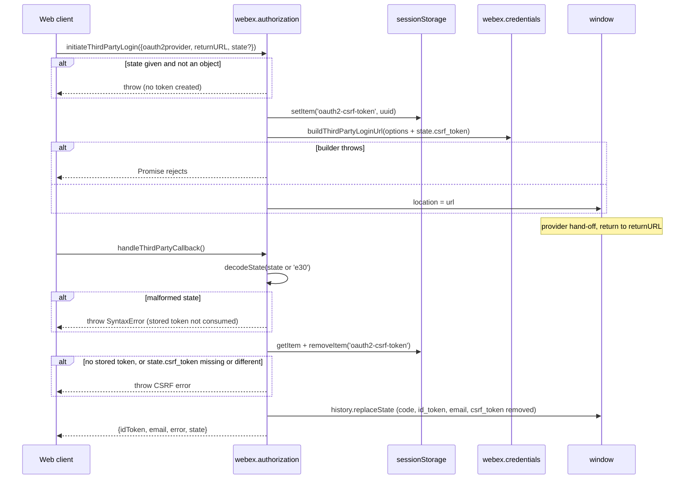
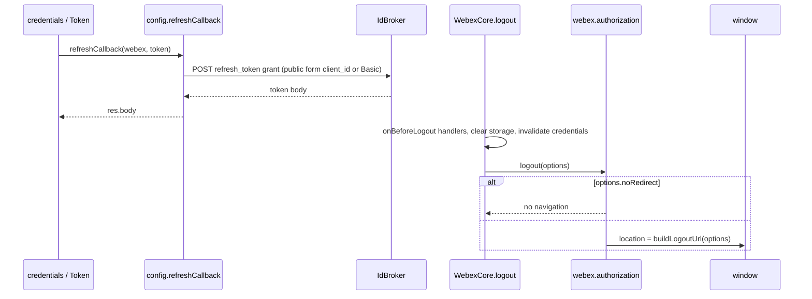
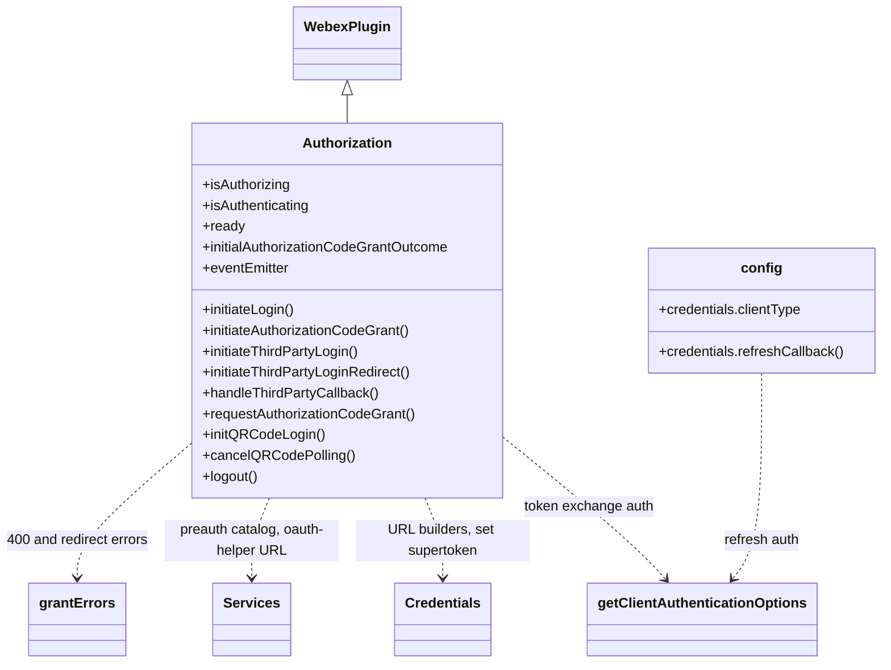
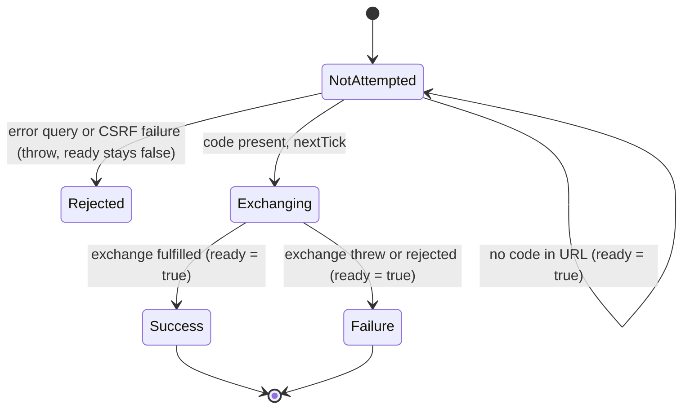
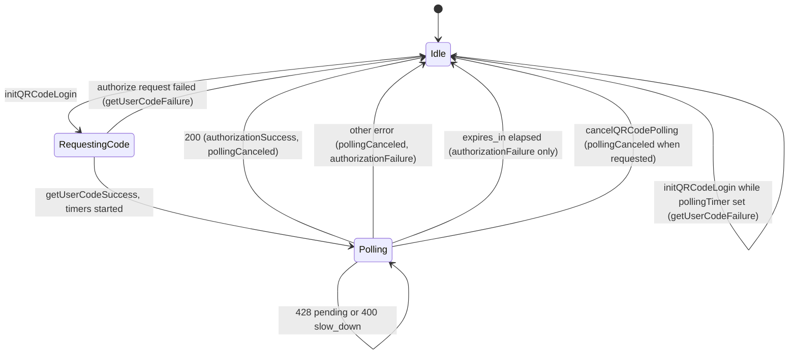

<!-- sdd-generated-metadata
doc_kind: module-spec
generated_from: module-spec@0.3.0
generated_by: claude-code
approved_by: pending
updated_at: 2026-10-14T13:20:00Z
validation_status: not-run
-->

# First-party browser authorization plugin

This source-local document at `src/docs/README.md` owns the stable specification for **the
first-party browser authorization plugin**: the `webex.authorization` plugin that the Webex Web
Client uses to sign users in. Ground every claim in package evidence and link to the
[package architecture](../../docs/architecture.md) instead of repeating broader facts. No service
specification exists because this package is a library.

Related context: [documentation index](../../docs/index.md) ·
[package agent instructions](../../AGENTS.md)

## Metadata

| Field             | Value |
| ----------------- | ----- |
| Owner             | @webex/web-client |
| Source path       | `src` |
| Resource kind     | package |
| Status            | Draft |
| Last verified     | 2026-10-14 at `c6e70764c1` |
| Module id         | `plugin-authorization-browser-first-party` |
| Parent spec       | — |
| Doc kind          | Module spec |
| Coverage score    | 93.3% assessed 2026-10-14 — 14 of 15 mandatory fields PRESENT, critical 8 of 8; test strategy is WEAK because registration, 400 grant-error mapping, the logout redirect, and the shared event emitter are untested, the unit suite depends on a fresh `dist` build, the browser suite is skipped, and no characterization baseline exists |
| Validation status | not-run |

## Applicability

| Condition ID                         | Status     | Evidence or reason | Owned section |
| ------------------------------------ | ---------- | ------------------ | ------------- |
| `module.has_tiers`                   | N/A        | No tier policy exists in this package or its `package.json` | Tier |
| `module.has_ui`                      | N/A        | Nothing is rendered. The plugin navigates or opens browser windows but owns no screen; see `src/authorization.js` | UI use-case flow |
| `module.crosses_service_boundaries`  | Applicable | Token exchange, refresh, and device-authorization requests go through webex.request in `src/authorization.js` and `src/config.js` | Cross-boundary use-case flow |
| `module.holds_client_state`          | Applicable | Session properties isAuthorizing, ready, and the initial grant outcome, plus QR polling timers and ids, in `src/authorization.js` | Client state model |
| `module.enforces_domain_rules`       | Applicable | CSRF state check, single-use PKCE verifier, URL scrubbing, and raw-email removal in `src/authorization.js` | Business rules and invariants |
| `module.is_concurrent_async`         | Applicable | process.nextTick exchange, oneFlight and whileInFlight decorators, and timer-driven QR polling in `src/authorization.js` | Concurrency and reactive flow |
| `module.owns_persistence`            | N/A        | Only two transient sessionStorage keys are written and removed in the same login round-trip; no store, schema, or migration exists | Data, schema, and migration discipline |
| `module.stateful_transitions`        | Applicable | Initialization outcome (not_attempted, success, failure) and the QR polling lifecycle in `src/authorization.js` | State machine |
| `module.exposes_wire_protocol`       | Applicable | Redirect state encoding, sessionStorage keys, callback query parameters, and token-request forms in `src/authorization.js` and `src/config.js` | Protocol and wire format |
| `module.ui_multi_screen`             | N/A        | No UI | UI flow |
| `module.large_data_model`            | N/A        | No owned entities; token bundles belong to the credentials plugin | Data model |
| `module.returns_caller_errors`       | Applicable | Synchronous throws during initialization and callback handling, rejected promises from the token exchange, and failure events from the QR flow in `src/authorization.js` | Caller-visible failure modes |
| `module.module_specific_conventions` | Applicable | Legacy decorators inside an object literal, @ts-nocheck, the authorization: log prefix, and the Credentials namespace in `src/authorization.js` | Module-specific rules |
| `module.published_package`           | Applicable | `package.json` names the package and deploy:npm publishes it | Export stability |
| `module.embedded_in_host`            | Applicable | The plugin drives the host page's window (location, history, sessionStorage, crypto, open) and must be imported before the webex bundle registers its default authorization plugin; see `src/authorization.js` and `src/index.js` | Host integration and theming |
| `module.has_design_tradeoff`         | Applicable | ready becomes true even when the initial exchange fails, and a missing stored CSRF token is tolerated on the code-grant callback; see `src/authorization.js` | Key design trade-off |
| `module.has_submodules`              | N/A        | Computed false by the Repo Annotation module_tree.py script: src has no child module | Sub-modules |

## Evidence register

| Evidence | What it establishes |
| -------- | ------------------- |
| `src/index.js` | Public plugin registration as `authorization` with `config` and the `isAuthorizing`/`isAuthenticating` proxies, and the barrel exports |
| `src/authorization.js` | The plugin: `Events`, `InitialAuthorizationCodeGrantOutcomes`, session and derived properties, initialization redirect completion, login and third-party redirects, callback handling, logout, token exchange, QR device flow, URL cleanup, PKCE, and CSRF helpers; in-code JSDoc is the recorded rationale |
| `src/config.js` | `getClientAuthenticationOptions` (public versus confidential client authentication), the `clientType: 'public'` default, and `refreshCallback` |
| `package.json` | Name, entry points (`main` dist, `devMain` src), dependencies, and scripts |
| `jest.config.js` | Unit tests run with the shared legacy jest config, which has no module mapping, so a package-name import resolves to `main` |
| `test/unit/spec/authorization.js` | 73 unit cases covering initialization, token exchange, refresh callback, login, third-party login and callback, QR flow, PKCE, URL cleanup, and orgId extraction |
| `test/automation/spec/authorization-code-grant.js` | Browser automation suite; its only Authorization Code Grant block is `describe.skip` |
| `test/automation/fixtures/app.js` | Automation fixture app; sets `clientType` to `confidential` before `initiateLogin` |
| `process` | Package-root module exporting `{browser: true}`; nothing in `src/` imports it |
| `README.md` | Product guide retained under keep-separate; context only, with divergences listed in Pitfalls and constraints |
| Sibling package webex-core: src/lib/webex-plugin.js, src/lib/webex-core-plugin-mixin.js, src/lib/credentials/credentials.js, src/lib/credentials/grant-errors.js, src/lib/services/services.js, src/webex-core.js | Plugin host behavior this module relies on: config namespace lookup, first-wins registration, URL builders, grant error mapping, preauth catalog collection, and logout ordering (no SDD spec exists for webex-core, so its code is the evidence) |
| Sibling package common: src/docs/README.md | Specified behavior of `oneFlight`, `whileInFlight`, `encodeState`, `decodeState`, and `Exception` |
| Sibling package webex: src/webex-first-party.js | Consumer that requires this package before the `webex` bundle so this plugin wins the `authorization` registration |

## Purpose and boundary

- Responsibility: browser-side OAuth 2.0 sign-in for the first-party Webex Web Client. It completes
  the Authorization Code + PKCE redirect automatically during SDK initialization, starts first-party
  and third-party (social provider) login redirects, validates their callbacks, runs the Device
  Authorization (QR code) grant, and chooses public or confidential client authentication for the
  token exchange and refresh calls.
- In scope: CSRF token and PKCE verifier generation, storage, and single-use consumption; callback
  URL scrubbing; preauth catalog hinting from `emailhash` or the orgId segment of the code; the
  authorization-code token request and its error mapping; the logout redirect; QR polling with
  interval, slow-down, pending, timeout, and cancellation handling; the login and QR event stream.
- Out of scope: token storage, refresh scheduling, and `canAuthorize` (credentials plugin in
  webex-core); login, third-party, and logout URL construction (credentials plugin); service catalog
  fetching (services plugin); JWT and guest token flows, which this plugin does not implement.
- Consumers: the Webex Web Client through the `webex` first-party bundle
  (packages/webex/src/webex-first-party.js) and `@webex/recipe-private-web-client`. The JSDoc in
  `src/authorization.js` says use for anything other than the Webex Web Client is discouraged.

## Structure and key files

| Path | Responsibility |
| ---- | -------------- |
| `src/index.js` | Registers the plugin under the name `authorization` with `config` and the two proxies, then re-exports the default class, `Events`, `InitialAuthorizationCodeGrantOutcomes`, and `config` |
| `src/authorization.js` | The `Authorization` WebexPlugin definition and its two exported constant objects. All flows and helpers live here |
| `src/config.js` | Plugin config merged into `webex.config.credentials`: `clientType` default and `refreshCallback`, plus the exported `getClientAuthenticationOptions` helper shared with the token exchange |
| `test/unit/spec/authorization.js` | The only unit spec; builds a MockWebex with a stub window per case |
| `test/automation/spec/authorization-code-grant.js` | Skipped browser automation suite; fixture page and app under test/automation/fixtures |
| `process` | `{browser: true}` marker module at the package root; not imported by `src/` |
| dist (generated, git-ignored) | Build output of `build:src`; never edit by hand. The unit suite imports the default export from here (see Pitfalls) |

## Public surface

The authoritative package surface is `package.json` with the `src/index.js` barrel (contract
`authz-bfp-sdk`), and the event stream in `src/authorization.js` (contract `authz-bfp-events`). The
redirect round-trip format (contract `authz-bfp-redirect-protocol`) is internal. All three are
indexed in the [package architecture](../../docs/architecture.md).

| Surface | Consumer | Compatibility commitment | Source |
| ------- | -------- | ------------------------ | ------ |
| Default export (`Authorization` plugin class) and registration as `webex.authorization` | Webex Web Client, `webex` first-party bundle | Published; name `authorization` and proxies are relied on by WebexCore | `src/index.js` |
| `Events` (`login`, `qRCodeLogin`) | UI code subscribing to `eventEmitter` | Published; event names and `eventType` strings are matched by consumers | `src/authorization.js` |
| `InitialAuthorizationCodeGrantOutcomes` (`success`, `not_attempted`, `failure`) | Callers reading `initialAuthorizationCodeGrantOutcome` | Published | `src/authorization.js` |
| `config` export (`credentials.clientType`, `credentials.refreshCallback`) | WebexCore config merge | Published; `clientType` defaults to `public` | `src/config.js` |
| `initiateLogin(options)` | Web client sign-in | Returns a promise; adds CSRF, PKCE S256, and email hash; `options.separateWindow` opens a popup | `src/authorization.js` |
| `initiateAuthorizationCodeGrant(options)` | Lower-level navigation step | Builds the login URL with `response_type=code` and navigates or opens a window | `src/authorization.js` |
| `initiateThirdPartyLogin(options)`, `initiateThirdPartyLoginRedirect(options)` | Social-provider sign-in | Requires `oauth2provider` and `returnURL` (validated by the credentials URL builder); the redirect step may be overridden by consumers | `src/authorization.js` |
| `handleThirdPartyCallback()` | Social-provider return page | Synchronous; returns `{idToken, email, error, state}` with `csrf_token` removed | `src/authorization.js` |
| `requestAuthorizationCodeGrant({code, codeVerifier})` | Initialization and callers | Returns a promise; stores the supertoken on success | `src/authorization.js` |
| `initQRCodeLogin()`, `cancelQRCodePolling(withCancelEvent = true)` | QR login UI | Fire-and-forget; progress is reported only through `qRCodeLogin` events | `src/authorization.js` |
| `logout(options)` | `WebexCore.logout` | Navigates to the logout URL unless `options.noRedirect` | `src/authorization.js` |
| Properties `isAuthorizing`, `isAuthenticating`, `ready`, `initialAuthorizationCodeGrantOutcome`, `eventEmitter` | Web client and WebexCore readiness | `initialAuthorizationCodeGrantOutcome` is read-only; `isAuthenticating` aliases `isAuthorizing` | `src/authorization.js` |

## Dependencies

| Dependency | Why it is required | Failure behavior |
| ---------- | ------------------ | ---------------- |
| `@webex/webex-core` WebexPlugin, `registerPlugin`, `grantErrors` | Plugin base (config, logger, request), registration, and OAuth error classes | Registration is first-wins: an `authorization` plugin registered earlier wins and this one is silently ignored |
| Credentials plugin (`webex.credentials`) | Builds login, third-party, and logout URLs; stores the supertoken via `set` | URL builder throws propagate synchronously, except in `initiateThirdPartyLoginRedirect`, which converts them to a rejection |
| Services plugin (`webex.internal.services`) | `collectPreauthCatalog` before the initial exchange; `get('oauth-helper')` for the QR verification URL | Catalog failure is swallowed; the exchange still runs |
| `@webex/common` `oneFlight`, `whileInFlight`, `encodeState`, `decodeState` | Request de-duplication, the `isAuthorizing` flag, and the state codec | `decodeState` throws on malformed state; the error is not wrapped |
| IdBroker OAuth endpoints (`idbroker-oauth`) | Authorization, token, logout, and third-party login hand-off | Non-400 token errors propagate as-is; 400 errors map to a grant error class |
| oauth-helper device endpoints (`oauth-helper-device-authorization`) | Device code issue and token polling | Reported only as `getUserCodeFailure` or `authorizationFailure` events |
| Browser window (`webex.getWindow()`) | location, history.replaceState, sessionStorage, crypto.getRandomValues, open | Missing `history.replaceState` skips URL cleanup silently; missing sessionStorage or crypto throws |
| `crypto-js`, `uuid`, `lodash`, Node `url`/`querystring`/`events` | SHA-256 and base64url, CSRF token, object helpers, URL parsing, EventEmitter | Library errors propagate |

## Requirements

| ID | WHAT | WHY | Source evidence | Test or example evidence | Assumptions or gaps | Confidence |
| -- | ---- | --- | --------------- | ------------------------ | ------------------- | ---------- |
| `MOD-001` | Importing the package registers the plugin as public plugin `authorization` with `config` and proxies `isAuthorizing` and `isAuthenticating` onto the webex instance | WebexCore discovers authorization through this name and derives readiness and proxies from it | `src/index.js` | `test/automation/fixtures/app.js` | No unit test asserts the registration or proxies | Weak |
| `MOD-002` | During initialization with no `code` in the window URL, `ready` becomes true synchronously and the outcome stays `not_attempted` | Nothing remains to complete, so SDK readiness must not wait | `src/authorization.js` | `test/unit/spec/authorization.js` | none | Present |
| `MOD-003` | With a `code` in the URL, initialization decodes `state`, reads then removes the PKCE verifier, verifies the CSRF token, scrubs the URL, and on the next tick collects the preauth catalog and exchanges the code | The JSDoc defines this as seamless redirect completion: no extra call after `Webex.init()` | `src/authorization.js` | `test/unit/spec/authorization.js` | none | Present |
| `MOD-004` | The preauth catalog hint is `{emailhash}` from state when present, else `{orgId}` from the third underscore segment of the code, else none; catalog failure never blocks the exchange | Pre-fetching the right catalog before tokens exist; the code comment marks it non-fatal | `src/authorization.js` | `test/unit/spec/authorization.js` | Code format is undocumented per JSDoc | Present |
| `MOD-005` | After the initialization exchange settles, `ready` becomes true regardless of outcome, the outcome is `success` or `failure`, and a failure is logged with `logger.warn` | Readiness must not hang on a failed exchange; the retained outcome lets callers tell the cases apart | `src/authorization.js` | `test/unit/spec/authorization.js` | none | Present |
| `MOD-006` | `initialAuthorizationCodeGrantOutcome` is read-only, describes only the initialization exchange, and is not reset by logout or by later `requestAuthorizationCodeGrant` calls | JSDoc defines it as a historical value, not current authorization state | `src/authorization.js` | `test/unit/spec/authorization.js` | none | Present |
| `MOD-007` | An `error` query parameter on the redirect makes initialization throw before any exchange | OAuth redirect errors must surface instead of a silent ready state | `src/authorization.js` | `test/unit/spec/authorization.js` | In the Node test environment the thrown error is a TypeError, not a grant error (see Pitfalls) | Present |
| `MOD-008` | `initiateLogin` emits `login`/`initiateLogin` with `hasEmail` and `hasState`, replaces `email` with its SHA-256 `emailHash`, adds `state.csrf_token`, `state.emailhash`, and an S256 `code_challenge`, then calls `initiateAuthorizationCodeGrant` | CSRF and PKCE protection, and keeping the raw email out of the URL, per the JSDoc and inline comments | `src/authorization.js` | `test/unit/spec/authorization.js` | none | Present |
| `MOD-009` | `initiateAuthorizationCodeGrant` builds the login URL with `response_type: 'code'`, emits `login`/`redirectToLoginUrl`, and either assigns `window.location` or opens `_blank` with `width=600,height=800` merged with object-valued `separateWindow` | Same-tab redirect by default; popup for embedded sign-in | `src/authorization.js` | `test/unit/spec/authorization.js` | none | Present |
| `MOD-010` | `requestAuthorizationCodeGrant` rejects without `code`; otherwise posts `grant_type=authorization_code`, `redirect_uri`, `code`, `self_contained_token: true`, optional `code_verifier`, with client authentication from `getClientAuthenticationOptions` and `shouldRefreshAccessToken: false`, then stores `{supertoken: res.body}` | This call acquires the token, so it must not trigger a refresh itself | `src/authorization.js` | `test/unit/spec/authorization.js` | none | Present |
| `MOD-011` | A public client (`clientType: 'public'`, the default) sends `client_id` in the form with `addAuthHeader: false`; any other value uses HTTP Basic with `client_id`/`client_secret`; `refreshCallback` applies the same rule to the refresh grant | Public clients have no secret; confidential clients keep Basic authentication | `src/config.js` | `test/unit/spec/authorization.js` | Device-flow requests always use Basic authentication | Present |
| `MOD-012` | Token-exchange 400 responses reject with `grantErrors.select(body.error)` built from `res._res` or `res`; other failures reject unchanged | Callers can branch on typed OAuth errors | `src/authorization.js` | none found | No unit test covers the 400 mapping or pass-through | Weak |
| `MOD-013` | `initiateThirdPartyLogin` throws synchronously on non-object `state` before creating a token, otherwise deep-clones options, merges a new `csrf_token` into `state`, and delegates to `initiateThirdPartyLoginRedirect` | Caller objects are never mutated and invalid input never leaves a dangling CSRF token | `src/authorization.js` | `test/unit/spec/authorization.js` | none | Present |
| `MOD-014` | `initiateThirdPartyLoginRedirect` assigns the third-party login URL to `window.location` and converts a URL-builder throw into a rejected promise | Mirrors the authorize flow; JSDoc allows consumers to override it, for example postMessage in iframes | `src/authorization.js` | `test/unit/spec/authorization.js` | none | Present |
| `MOD-015` | `handleThirdPartyCallback` requires a stored CSRF token that matches `state.csrf_token`, scrubs `code`, `id_token`, and `email`, and returns `{idToken, email, error, state}` without `csrf_token`; `error` stays in the URL | `idToken` is single-use and must leave the URL; a callback without matching state is not trusted | `src/authorization.js` | `test/unit/spec/authorization.js` | none | Present |
| `MOD-016` | `logout` assigns `buildLogoutUrl(options)` to `window.location` unless `options.noRedirect`; it does not cancel an in-flight initialization exchange | Ends the server-side session; called by WebexCore after storage is cleared | `src/authorization.js` | `test/unit/spec/authorization.js` | The redirecting branch has no unit test | Weak |
| `MOD-017` | `initQRCodeLogin` refuses while a polling timer exists, otherwise requests a device code, emits `getUserCodeSuccess` with `userCode`, `verificationUri`, and the rewritten `verificationUriComplete`, then starts polling; request failure emits `getUserCodeFailure` | QR UI needs the codes before the user scans; one attempt at a time | `src/authorization.js` | `test/unit/spec/authorization.js` | none | Present |
| `MOD-018` | When the verification URI carries `userCode`, it is rewritten to `https://web.webex.com/deviceAuth?usercode=...&oauthhelper=<oauth-helper URL>`; otherwise returned unchanged | The JSDoc says scanning deep-links into Webex web to continue login | `src/authorization.js` | `test/unit/spec/authorization.js` | none | Present |
| `MOD-019` | Polling posts the device-code grant every `interval` seconds (default 2), doubles the next delay once on `400 slow_down`, emits `authorizationPending` on 428, and stops with `authorizationSuccess` (credentials set) or `authorizationFailure`; the whole attempt times out after `expires_in` seconds (default 300) | Server-driven pacing and a bounded attempt | `src/authorization.js` | `test/unit/spec/authorization.js` | none | Present |
| `MOD-020` | `cancelQRCodePolling` clears both timers and the current polling id, emitting `pollingCanceled` only when a polling timer existed and `withCancelEvent` is true; responses from a cancelled cycle are ignored | Late responses after cancel or reset must not change credentials or emit events | `src/authorization.js` | `test/unit/spec/authorization.js` | none | Present |
| `MOD-021` | The PKCE verifier is 128 characters from the base64url-safe alphabet drawn from `window.crypto.getRandomValues`, stored as `oauth2-code-verifier`; the challenge is its SHA-256 base64url | RFC 7636 S256 with a CSPRNG source, per the JSDoc | `src/authorization.js` | `test/unit/spec/authorization.js` | none | Present |
| `MOD-022` | The CSRF token is a UUID v4 stored as `oauth2-csrf-token` and removed on every verification attempt | One-time state binding of the redirect | `src/authorization.js` | `test/unit/spec/authorization.js` | none | Present |

## Design overview

`Authorization` is one `WebexPlugin.extend` definition with namespace `Credentials`, so `this.config`
resolves to `webex.config.credentials` (webex-core src/lib/webex-plugin.js) and the plugin reads
`client_id`, `client_secret`, `redirect_uri`, `scope`, `tokenUrl`, and `clientType` from the same
object the credentials plugin uses. `src/index.js` merges `src/config.js` into that config at
registration time, which is how `clientType: 'public'` and `refreshCallback` become defaults.

Three entry styles share the helpers. Initialization runs inside the plugin constructor and either
returns immediately or schedules the exchange on `process.nextTick`; the inline comment says the
deferral exists in case the credentials plugin is not ready yet. The login methods are explicit calls
that end in a navigation. The QR flow is fire-and-forget: it never returns a promise to the caller and
reports every outcome on `eventEmitter`.

Security state lives in the host page's `sessionStorage` only for one round-trip: the login side writes
`oauth2-csrf-token` and `oauth2-code-verifier`; the callback side reads and removes them before using
them. `_cleanUrl` then replaces the history entry so `code`, `id_token`, `email`, and `csrf_token` do not
remain in history, copy-paste, or referrers (JSDoc of `_cleanUrl`).

The token exchange is decorated with `whileInFlight('isAuthorizing')` and `oneFlight`; the login
navigation step with `whileInFlight('isAuthorizing')` only. Client authentication is centralized in
`getClientAuthenticationOptions` so the exchange and `refreshCallback` cannot diverge.

## Data flow and sequence coverage

Transport: in-process method calls, browser navigation (`window.location` assignment, `window.open`,
`history.replaceState`), and HTTPS form posts through `webex.request` to IdBroker and the oauth-helper
service. Five operation groups have different actors or outcomes, so each has its own diagram.

| Operation group | Entry and outcome | Diagram or evidence | Failure and recovery coverage |
| --------------- | ----------------- | ------------------- | ----------------------------- |
| Login initiation | `initiateLogin` → CSRF, PKCE, email hash → navigate or popup | Diagram 1; `src/authorization.js` | Synchronous throws from the URL builder propagate |
| Redirect completion at initialization | Constructor → state/CSRF check → URL scrub → preauth → exchange → `ready` | Diagram 2; `src/authorization.js` | Error query and CSRF failures throw; catalog failure ignored; exchange failure recorded and logged |
| Third-party login and callback | `initiateThirdPartyLogin` → navigate; return page → `handleThirdPartyCallback` | Diagram 3; `src/authorization.js` | Invalid state, missing or mismatched CSRF token throw; builder throw becomes a rejection |
| Device authorization (QR) | `initQRCodeLogin` → device code → polling loop → success, failure, timeout, or cancel | Diagram 4 and State machine; `src/authorization.js` | Pending, slow_down, terminal error, timeout, cancel, stale responses |
| Token refresh and logout | Credentials refresh → `refreshCallback`; `WebexCore.logout` → `logout` | Diagram 5; `src/config.js` | Refresh errors propagate to the credentials plugin; `noRedirect` skips navigation |

Diagram 1 — login initiation:

```mermaid
sequenceDiagram
  participant App as Web client
  participant Auth as webex.authorization
  participant SS as sessionStorage
  participant Cred as webex.credentials
  participant Win as window
  App->>Auth: initiateLogin({email?, state?, separateWindow?})
  Auth-->>App: eventEmitter 'login' initiateLogin {hasEmail, hasState}
  Auth->>Auth: emailHash = SHA256(email); delete email
  Auth->>SS: setItem('oauth2-csrf-token', uuid)
  Auth->>SS: setItem('oauth2-code-verifier', verifier)
  Auth->>Auth: initiateAuthorizationCodeGrant (isAuthorizing = true)
  Auth->>Cred: buildLoginUrl({response_type: 'code', state, code_challenge, ...})
  Auth-->>App: eventEmitter 'login' redirectToLoginUrl {loginUrl}
  alt separateWindow set
    Auth->>Win: open(loginUrl, '_blank', 'width=600,height=800,...')
  else default
    Auth->>Win: location = loginUrl
  end
  Auth-->>App: Promise resolves (isAuthorizing = false)
```

Diagram 2 — redirect completion during initialization:

```mermaid
sequenceDiagram
  participant Core as WebexCore init
  participant Auth as Authorization.initialize
  participant SS as sessionStorage
  participant Hist as window.history
  participant Svc as services
  participant IdB as IdBroker token endpoint
  participant Cred as credentials
  Core->>Auth: construct plugin
  Auth->>Auth: parse window.location.href
  alt query.error present
    Auth-->>Core: throw (before ready)
  else no code
    Auth->>Auth: ready = true (outcome not_attempted)
  else code present
    Auth->>Auth: decodeState(state) or {}
    Auth->>SS: getItem + removeItem('oauth2-code-verifier')
    Auth->>SS: getItem + removeItem('oauth2-csrf-token')
    alt stored token and state.csrf_token missing or different
      Auth-->>Core: throw CSRF error (before ready)
    end
    Auth->>Hist: replaceState (code and csrf_token removed)
    Note over Auth: process.nextTick
    Auth->>Svc: collectPreauthCatalog({emailhash} | {orgId} | undefined)
    Svc-->>Auth: resolved or rejected (rejection ignored)
    Auth->>IdB: POST authorization_code (+ code_verifier)
    alt success
      IdB-->>Auth: token bundle
      Auth->>Cred: set({supertoken})
      Auth->>Auth: outcome = success
    else failure
      Auth->>Auth: outcome = failure; logger.warn
    end
    Auth->>Auth: ready = true
  end
```

Diagram 3 — third-party login and callback:



Diagram 4 — device authorization (QR):

```mermaid
sequenceDiagram
  participant UI as QR UI
  participant Auth as webex.authorization
  participant OH as oauth-helper
  participant Cred as credentials
  UI->>Auth: initQRCodeLogin()
  alt pollingTimer set
    Auth-->>UI: qRCodeLogin getUserCodeFailure (already polling)
  else
    Auth->>OH: POST /actions/device/authorize (Basic auth)
    alt request fails
      Auth-->>UI: qRCodeLogin getUserCodeFailure (res.body)
    else
      OH-->>Auth: device_code, user_code, verification URIs, interval, expires_in
      Auth-->>UI: qRCodeLogin getUserCodeSuccess {userData}
      Note over Auth: start expires_in timer; schedule poll after interval
      loop each poll
        Auth->>OH: POST /actions/device/token (device_code grant)
        alt cancelled or superseded cycle
          Auth->>Auth: ignore response
        else 200
          Auth-->>UI: authorizationSuccess (tokens)
          Auth->>Cred: set({supertoken})
          Auth-->>UI: pollingCanceled
        else 400 slow_down
          Auth->>Auth: next poll after 2 x interval
        else 428
          Auth-->>UI: authorizationPending; next poll after interval
        else other error
          Auth-->>UI: pollingCanceled, then authorizationFailure
        end
      end
      opt expires_in elapses
        Auth-->>UI: authorizationFailure 'Authorization timed out' (no pollingCanceled)
      end
    end
  end
```

Diagram 5 — refresh and logout:



## Class and component relationships



`src/index.js` registers `Authorization` with `config`; WebexCore owns the instance. `Credentials`,
`Services`, and `grantErrors` are webex-core types reached through `this.webex`, never imported as
instances.

## Use cases and flows

| Use case | Actor or caller | Primary steps and outcome | Failure or boundary behavior | Evidence |
| -------- | --------------- | ------------------------- | ---------------------------- | -------- |
| `UC-001` | Web client sign-in | `initiateLogin({email, state})` → browser goes to IdBroker with CSRF state and PKCE challenge | URL builder throws synchronously on non-object `state` | `src/authorization.js`, `test/unit/spec/authorization.js` |
| `UC-002` | SDK initialization on the redirect page | `Webex.init()` → plugin sees `?code=` → URL scrubbed → token stored → `ready` | Error or CSRF failure throws from init; exchange failure gives outcome `failure` with `ready` true | `src/authorization.js`, `test/unit/spec/authorization.js` |
| `UC-003` | Embedded sign-in | `initiateLogin({separateWindow: {...}})` → popup with merged window features | The popup's own redirect page completes the exchange | `src/authorization.js`, `test/unit/spec/authorization.js` |
| `UC-004` | Social-provider sign-in | `initiateThirdPartyLogin({oauth2provider, returnURL})` → return page calls `handleThirdPartyCallback()` → app exchanges `idToken` | Missing or mismatched CSRF token throws; `error` is returned, not thrown | `src/authorization.js`, `test/unit/spec/authorization.js` |
| `UC-005` | QR login | Subscribe to `qRCodeLogin`, call `initQRCodeLogin()`, render `verificationUriComplete`, wait for `authorizationSuccess` | Timeout, terminal error, or `cancelQRCodePolling()` | `src/authorization.js`, `test/unit/spec/authorization.js` |
| `UC-006` | Token refresh | Credentials calls `refreshCallback` → refresh grant with the configured client authentication | Errors propagate to the credentials plugin | `src/config.js`, `test/unit/spec/authorization.js` |
| `UC-007` | Sign-out | `webex.logout()` → storage cleared → `logout` navigates to IdBroker logout | `noRedirect: true` keeps the page; an in-flight init exchange is not cancelled | `src/authorization.js`, `test/unit/spec/authorization.js` |

### Cross-boundary use-case flow

| Boundary | Transport | Ordering | Compatibility | Timeout and retry | Recovery |
| -------- | --------- | -------- | ------------- | ----------------- | -------- |
| IdBroker authorize and third-party login | Top-level navigation or popup | CSRF and verifier are stored before navigation | `response_type=code`, `code_challenge_method=S256`, base64url-JSON `state` | None in this module | User retries login; stored values are overwritten |
| IdBroker token endpoint | HTTPS form POST via `webex.request` to `config.tokenUrl`, `shouldRefreshAccessToken: false` | Preauth catalog attempt first, then exchange | `self_contained_token: true`; public or Basic client auth | None; `oneFlight` collapses concurrent calls | Outcome `failure`; caller may call `requestAuthorizationCodeGrant` again with a fresh code |
| Services preauth catalog | In-process call to the services plugin, which issues the catalog request | Before the exchange | `{emailhash}`, `{orgId}`, or no query | Owned by the services plugin | Rejection ignored |
| oauth-helper device endpoints | HTTPS form POST with `service: 'oauth-helper'` and Basic auth | Authorize once, then serial polls | `grant_type=urn:ietf:params:oauth:grant-type:device_code` | Server `interval` (default 2 s), one doubled delay on `slow_down`, overall `expires_in` (default 300 s) | Failure events; caller restarts with `initQRCodeLogin` |

## Client state model

| State or slice | Owner | Initial state | Transition triggers | Reset or persistence boundary |
| -------------- | ----- | ------------- | ------------------- | ----------------------------- |
| `isAuthorizing` (session) | `whileInFlight` decorator | `false` | True while `initiateAuthorizationCodeGrant` or `requestAuthorizationCodeGrant` is pending | Instance lifetime; proxied to webex |
| `isAuthenticating` (derived) | `Authorization` | `false` | Mirrors `isAuthorizing` | Derived |
| `ready` (session) | `initialize` | `false` | True immediately without a code, or after the exchange settles | Instance lifetime; WebexCore `ready` depends on it |
| `_initialAuthorizationCodeGrantOutcome` / `initialAuthorizationCodeGrantOutcome` | `initialize` | `not_attempted` | `success` or `failure` when the init exchange settles | Never reset, including by logout |
| `pollingTimer`, `pollingExpirationTimer` | QR flow | `null` | Set by `_startQRCodePolling` and each schedule | Cleared by `cancelQRCodePolling` |
| `pollingId`, `currentPollingId` | QR flow | `0`, `null` | `pollingId` increments per poll; `currentPollingId` snapshots it | `currentPollingId` cleared on cancel so late responses are ignored |
| `eventEmitter` | Plugin definition | One `EventEmitter` | Listeners added by consumers | Defined in the `extend` definition, so shared by every instance in the page (see Pitfalls) |
| sessionStorage `oauth2-csrf-token`, `oauth2-code-verifier` | Host page | absent | Written at login start, removed at callback | Browser session; single round-trip |

## Business rules and invariants

| ID | Invariant | WHY | Enforcement source | Test evidence |
| -- | --------- | --- | ------------------ | ------------- |
| `INV-001` | When a CSRF token is stored, a code-grant callback whose `state.csrf_token` is missing or different throws before any exchange | Prevents forged redirect responses | `src/authorization.js` | `test/unit/spec/authorization.js` |
| `INV-002` | `handleThirdPartyCallback` treats a missing stored token as a CSRF failure (`requireMatch: true`) | A social-provider callback without a prior login start is not trusted | `src/authorization.js` | `test/unit/spec/authorization.js` |
| `INV-003` | The stored CSRF token and PKCE verifier are removed when read, so each is used at most once | Single-use storage minimizes exposure | `src/authorization.js` | `test/unit/spec/authorization.js` |
| `INV-004` | After a callback is processed, `code`, `id_token`, `email`, and `csrf_token` are absent from the current URL; other state fields are re-encoded and `state` is dropped when only `csrf_token` remained | Avoids leaking secrets through history, copy-paste, and referrers | `src/authorization.js` | `test/unit/spec/authorization.js` |
| `INV-005` | A raw email passed to `initiateLogin` never reaches the login URL; only its SHA-256 hash does | Reduces PII propagation | `src/authorization.js` | `test/unit/spec/authorization.js` |
| `INV-006` | The PKCE verifier comes only from `window.crypto.getRandomValues`, never `Math.random` or lodash `random` | A predictable verifier defeats PKCE | `src/authorization.js` | `test/unit/spec/authorization.js` |
| `INV-007` | At most one QR polling cycle is active; a response from a cancelled or superseded cycle never sets credentials or emits events | Prevents stale tokens and duplicate success events | `src/authorization.js` | `test/unit/spec/authorization.js` |
| `INV-008` | Caller-supplied option objects are deep-cloned before mutation in `initiateLogin` and `initiateThirdPartyLogin` | Callers reuse option objects | `src/authorization.js` | `test/unit/spec/authorization.js` |

## Concurrency and reactive flow

- Execution model: single browser event loop. Initialization defers the exchange with
  `process.nextTick`; QR polling uses `setTimeout` for both the poll schedule and the overall timeout.
- Ordering guarantees: the preauth catalog attempt always settles before the initialization exchange
  starts. Within a QR cycle, each poll is scheduled only after the previous response is handled, so
  polls never overlap.
- Idempotency and retry: `requestAuthorizationCodeGrant` is `@oneFlight` keyed by method name only
  (per the `@webex/common` spec), so concurrent calls share one request even with different codes.
  QR polling retries only on 428 and `slow_down`; the module never retries a token exchange.
- Shared-state protection: `pollingId`/`currentPollingId` act as a cycle token; responses whose
  snapshot no longer matches are dropped. `whileInFlight` clears `isAuthorizing` on both settle paths.
- Blocking restrictions: `initialize` must not await network work, because it runs inside plugin
  construction; that is why the exchange is deferred and `ready` signals completion.

## State machine

Two state machines are owned here: the initialization outcome and the QR polling lifecycle.





Rejected transitions: `_startQRCodePolling` without `device_code`, or while a polling timer exists,
emits `authorizationFailure` and changes nothing.

## Protocol and wire format

| Message or frame | Version | Producer or serializer | Consumer or parser | Compatibility and ordering rule |
| ---------------- | ------- | ---------------------- | ------------------ | ------------------------------- |
| Login `state` (base64url JSON with `csrf_token`, `emailhash`, caller fields) | unversioned | `initiateLogin` via credentials `buildLoginUrl` / `encodeState` | `initialize` via `decodeState` | Lower-case `emailhash` in state is read by the preauth catalog; `emailHash` is also sent as a top-level query parameter |
| Authorize query additions | RFC 7636 | `initiateLogin` | IdBroker | `code_challenge` with `code_challenge_method=S256`; `response_type=code` |
| Callback query | unversioned | IdBroker | `initialize`, `handleThirdPartyCallback` | Reads `code`, `state`, `error`, `id_token`, `email`; orgId is the third `_` segment of `code` |
| sessionStorage keys | unversioned | `_generateSecurityToken`, `_generateCodeChallenge` | `_verifySecurityToken`, `initialize` | Key names `oauth2-csrf-token` and `oauth2-code-verifier` must match on both sides of the redirect |
| Token exchange form | OAuth 2.0 | `requestAuthorizationCodeGrant` | IdBroker token endpoint | `grant_type`, `redirect_uri`, `code`, `self_contained_token`, optional `code_verifier`, public `client_id` |
| Refresh form | OAuth 2.0 | `refreshCallback` in `src/config.js` | IdBroker token endpoint | `grant_type=refresh_token`, `redirect_uri`, `refresh_token`, public `client_id` |
| Device authorize and token forms | RFC 8628 | `initQRCodeLogin`, `_startQRCodePolling` | oauth-helper | `client_id`, `scope`; then `grant_type`, `device_code`, `client_id`; 428 pending, 400 `slow_down` in `body.message` |

## Caller-visible failure modes

| Condition | Signal or result | Caller behavior | Retry or recovery | Evidence |
| --------- | ---------------- | --------------- | ----------------- | -------- |
| Redirect carries `error` | Synchronous throw from plugin construction | Handle around SDK init | Start a new login | `src/authorization.js` |
| CSRF mismatch or missing state on code callback | `Error` "CSRF token ... does not match stored token ..." or "Expected CSRF token ..., but not found in redirect query" thrown from construction | Treat as a forged or stale callback | Start a new login | `src/authorization.js` |
| Init exchange fails | `ready` true, `initialAuthorizationCodeGrantOutcome` `failure`, `logger.warn` | Read the outcome after `ready` | Start a new login | `src/authorization.js` |
| `requestAuthorizationCodeGrant` without `code` | Rejects with `options.code is required` | Fix the call | — | `src/authorization.js` |
| Token endpoint 400 | Rejects with a grant error class (for example `InvalidGrantError`) | Branch on `err.name` or class | New code required | `src/authorization.js` |
| Token endpoint non-400 | Rejects with the raw response or error | Treat as transport failure | Caller decides | `src/authorization.js` |
| Non-object `state` for third-party login | Synchronous throw | Fix the call | — | `src/authorization.js` |
| Third-party URL builder throws | Rejected promise | Fix `oauth2provider` or `returnURL` | — | `src/authorization.js` |
| Third-party callback without or with wrong CSRF token | Synchronous throw | Treat as untrusted | Start a new third-party login | `src/authorization.js` |
| Malformed callback `state` | `SyntaxError` from `decodeState`, unwrapped | Treat as untrusted | Start a new login | `src/authorization.js` |
| QR failures | `getUserCodeFailure` or `authorizationFailure` event with `data` | Listen on `qRCodeLogin` | Call `initQRCodeLogin` again | `src/authorization.js` |

## Pitfalls and constraints

- **The unit suite tests the built default export.** `test/unit/spec/authorization.js` imports the
  plugin class by package name, and the shared jest config has no module mapping, so it loads
  `main: dist/index.js`, while `Events`, `InitialAuthorizationCodeGrantOutcomes`, and `config` come from
  `src/`. With a stale `dist/`, the public-client exchange case failed (1 of 73) on 2026-10-14; after
  `build:src` all 73 passed. Run `build:src` before `test:unit` when `src/authorization.js` changes.
- **OAuth error redirects throw a TypeError under Node.** `_checkForErrors` passes the parsed query to a
  grant error constructor. `url.parse(..., true)` in Node returns a null-prototype query, and the
  `Exception` base class in `@webex/common` passes it to `Error`, which throws "Cannot convert object to
  primitive value". The unit test pins that message. The browser-bundle behavior depends on the
  bundler's `url`/`querystring` polyfill and is not covered by any test.
- **`requestAuthorizationCodeGrant` de-duplicates by method name only.** Two concurrent calls with
  different codes resolve with the first call's result.
- **One event emitter for every instance.** `eventEmitter: new EventEmitter()` sits in the `extend`
  definition, so all `Authorization` instances in a page share it; listeners added for one SDK instance
  receive the other instance's events and are never removed by logout.
- **QR event order differs from the README.** `pollingCanceled` follows `authorizationSuccess`, and
  precedes `authorizationFailure` on a terminal error. The overall timeout emits only
  `authorizationFailure`. `slow_down` doubles one delay rather than backing off exponentially.
- **`webex.authorization.Events` is undefined.** `Events` is a module export, not an instance property,
  although the README example reads it from the instance.
- **`separateWindow` leaks into the login URL.** It is passed through to `buildLoginUrl`, so the
  authorize URL carries a `separateWindow=` parameter (pinned by the unit test).
- **`logout` returns `undefined`.** The JSDoc declares a void promise, but the method returns nothing;
  WebexCore tolerates this.
- **No JWT support.** webex-core credentials `refresh` calls `webex.authorization.requestAccessTokenFromJwt`
  when `jwtRefreshCallback` is configured; this plugin does not implement it.
- **Device flow always uses Basic authentication** with `client_secret`, even when `clientType` is
  `public`.
- **A 400 polling response without a body** makes the polling catch handler throw on `res.body.message`;
  the timers stay set until the overall timeout fires.

## Module-specific rules

- Do: keep `@whileInFlight` and `@oneFlight` decorators directly above the method's JSDoc inside the
  `WebexPlugin.extend` object literal; the file header explains that `@ts-nocheck` exists because this
  legacy decorator syntax is transformed by Babel (`src/authorization.js`).
- Do: route every new token request through `getClientAuthenticationOptions` so public and confidential
  clients stay consistent (`src/config.js`).
- Do: prefix log lines with `authorization:` as the existing info and warn messages do.
- Do: read and remove a sessionStorage security value in the same step, before validating it.
- Do not: add a field to `_cleanUrl`'s scrub list without a callback test that parses the cleaned URL.
- Do not: change `Events`, `eventType` strings, or `InitialAuthorizationCodeGrantOutcomes` values
  without treating it as a breaking change for the web client.

## Export stability

| Export or entry point | Consumer | Stability | Versioning and deprecation rule | Declaration or API report |
| --------------------- | -------- | --------- | ------------------------------- | ------------------------- |
| Package main `dist/index.js`, devMain `src/index.js` | `webex` first-party bundle, recipe-private-web-client | Published | Semver through the workspace release; no API report exists | `package.json` |
| Default export `Authorization` and plugin name `authorization` | WebexCore | Published | Renaming the plugin is breaking | `src/index.js` |
| `Events`, `InitialAuthorizationCodeGrantOutcomes` | Web client | Published | Adding values is additive; renaming or removing is breaking | `src/authorization.js` |
| `config` | WebexCore config merge | Published | Changing the `clientType` default changes token-request authentication | `src/config.js` |

## Host integration and theming

- Mount or entry contract: import the package before the `webex` bundle so its `authorization`
  registration wins (WebexCore ignores a later `registerPlugin('authorization', ...)` without
  `replace`, as packages/webex/src/webex-first-party.js relies on); WebexCore then constructs the plugin during `Webex.init()` and the plugin inspects
  `webex.getWindow().location.href` immediately.
- Required providers, peers, or host versions: a browser window with `location`, `history.replaceState`
  (optional; cleanup is skipped without it), `sessionStorage`, `crypto.getRandomValues`, global `URL` and
  `URLSearchParams`, and `open` for popup login. The host must serve the configured `redirect_uri` and
  load the SDK there so initialization can complete the exchange.
- Theme and design-token contract: none; the plugin renders nothing.
- Accessibility and lifecycle obligations: popup sizing defaults to 600 × 800 and accepts caller window
  features; the host owns any UI for QR codes and failure messages, driven by `qRCodeLogin` events.

## Key design trade-off

| Chosen trade-off | Preserved invariant or benefit | Cost or limitation | Decision evidence |
| ---------------- | -------------------------------- | ------------------ | ----------------- |
| `ready` becomes true whether the initialization exchange succeeds or fails | SDK readiness never hangs on IdBroker | Callers must read `initialAuthorizationCodeGrantOutcome` to know whether sign-in completed | `src/authorization.js` |
| The code-grant callback skips CSRF validation when no token is stored | Codes from flows started elsewhere still complete | Weaker protection for callbacks without a stored token; third-party callbacks require the match | `src/authorization.js` |
| Preauth catalog failure is ignored | Token exchange is not blocked by catalog issues | Post-auth requests may start against a default catalog | `src/authorization.js` |
| QR progress is event-only, with no returned promise | UI can react to every intermediate state | Callers cannot `await` the QR flow and must manage listeners | `src/authorization.js` |

## Verification

Unit tests run with `yarn workspace @webex/plugin-authorization-browser-first-party test:unit` after
`build:src`. The browser automation suite in `test/automation/` is skipped, and `test:browser` passes
`--integration` with no `test/integration/` directory, so no browser-level verification runs today.

| Requirement or invariant | Test level | Positive evidence | Negative or boundary evidence | Gap |
| ------------------------ | ---------- | ----------------- | ----------------------------- | --- |
| `MOD-001` | Unit | none found | none found | No test of registration name, config merge, or proxies |
| `MOD-002`, `MOD-006` | Unit | `test/unit/spec/authorization.js` | `test/unit/spec/authorization.js` | none |
| `MOD-003`, `MOD-004` | Unit | `test/unit/spec/authorization.js` | `test/unit/spec/authorization.js` | `process.nextTick` ordering is not asserted directly |
| `MOD-005` | Unit | `test/unit/spec/authorization.js` | `test/unit/spec/authorization.js` | none |
| `MOD-007` | Unit | none found | `test/unit/spec/authorization.js` | Only the Node TypeError is pinned; no grant-error mapping test |
| `MOD-008`, `MOD-009` | Unit | `test/unit/spec/authorization.js` | `test/unit/spec/authorization.js` | Several cases pass their config as the PKCE-verifier argument, so `clientType: 'confidential'` is never applied there |
| `MOD-010`, `MOD-011` | Unit | `test/unit/spec/authorization.js` | `test/unit/spec/authorization.js` | Exchange cases depend on a fresh `dist/` |
| `MOD-012` | Unit | none found | none found | No 400 mapping or non-400 pass-through test |
| `MOD-013`, `MOD-014`, `MOD-015` | Unit | `test/unit/spec/authorization.js` | `test/unit/spec/authorization.js` | none |
| `MOD-016` | Unit | `test/unit/spec/authorization.js` | none found | Redirecting branch and logout URL are untested |
| `MOD-017`, `MOD-018`, `MOD-019`, `MOD-020` | Unit | `test/unit/spec/authorization.js` | `test/unit/spec/authorization.js` | 400 without body and double `initQRCodeLogin` race are untested |
| `MOD-021`, `MOD-022` | Unit | `test/unit/spec/authorization.js` | `test/unit/spec/authorization.js` | none |
| `INV-001` … `INV-008` | Unit | `test/unit/spec/authorization.js` | `test/unit/spec/authorization.js` | `INV-005` asserts the hash and removal but not the final URL |
| Shared `eventEmitter` across instances | — | none found | none found | Not tested |

Generator-side field measurement is complete (93.3%, assessed 2026-10-14). No characterization baseline
exists, and independent validation and a spec-drift record are still pending. A module specification is complete only when its public surface,
invariants, failure modes, and test evidence agree with the implementation.
