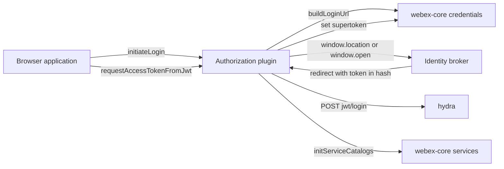
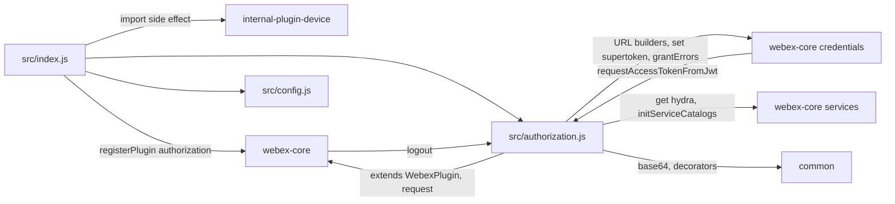
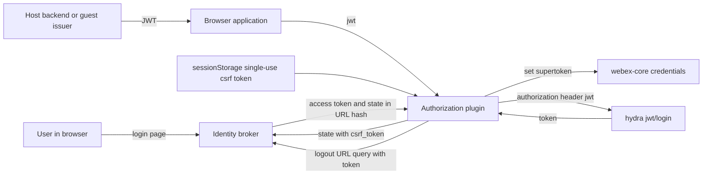

<!-- sdd-generated-metadata
doc_kind: standing-doc
generated_from: architecture@0.3.0
generated_by: claude-code
approved_by: rarajes2@cisco.com
updated_at: 2026-11-04T08:54:29Z
validation_status: pass-with-warnings
-->

# @webex/plugin-authorization-browser architecture

Canonical architecture for this package. Flow behavior lives in the
[browser authorization plugin specification](../src/docs/README.md). This page owns package
boundaries, the plugin registration, the contract index, and how the package meets the rest of the
SDK.

Related context: [specification registry](specs/README.md) ·
[package agent instructions](../AGENTS.md)

## Applicability

| Condition ID                         | Status     | Evidence or reason | Owned section |
| ------------------------------------ | ---------- | ------------------ | ------------- |
| `repo.owns_datastore`                | N/A        | No database, file store, or migration in `src/authorization.js`; one transient sessionStorage key is client state | Repository data and schema |
| `repo.holds_client_state`            | Applicable | Session properties and the sessionStorage CSRF token in `src/authorization.js` | Client state model |
| `repo.components_interact`           | Applicable | `src/authorization.js` calls webex-core credentials and services, and webex-core calls its logout and requestAccessTokenFromJwt methods | Dependency and interaction topology |
| `repo.domain_data_across_components` | Applicable | Tokens obtained in `src/authorization.js` are stored by webex-core credentials | Object and data ownership |
| `repo.caches_data`                   | N/A        | `src/authorization.js` keeps no cache | Caching catalog |
| `repo.observability_convention`      | Applicable | `src/authorization.js` logs with an authorization: prefix | Observability patterns |
| `repo.deploys_to_infra`              | N/A        | Library published to npm (`package.json`). No service runtime | Runtime and infrastructure |
| `repo.shared_base_libs`              | Applicable | Extends WebexPlugin from webex-core and uses the legacy build, lint, and test stack (`babel.config.js`, `jest.config.js`, `.eslintrc.js`) | Shared and base libraries |
| `repo.is_monorepo`                   | N/A        | This SDD root is one package. The workspace around it is out of scope | Package map and inter-package dependencies |
| `repo.multi_platform`                | N/A        | Browser only: `src/authorization.js` uses window, history, and sessionStorage; `process` exports {browser: true}; the Node counterpart is a separate package | Platform matrix |
| `repo.published_package`             | Applicable | `package.json` name is @webex/plugin-authorization-browser and deploy:npm publishes it | Release and versioning |
| `repo.embedded_in_host`              | N/A        | No host theme or embed API in `src/authorization.js` | Host integration and theming |
| `repo.exposes_commands_or_artifacts` | Applicable | build:src in `package.json` writes dist | Commands and generated artifacts |
| `repo.cross_repo_deps_material`      | Applicable | Behavior depends on webex-core credentials and services, the identity broker, and the hydra jwt/login endpoint (`src/authorization.js`) | Cross-repository topology |
| `repo.security_arch_warranted`       | Applicable | Access tokens, refresh tokens, CSRF tokens, host JWTs, and guest issuer secrets pass through `src/authorization.js` | Security architecture |

## Design overview

`@webex/plugin-authorization-browser` is a published browser library with one module. Importing it
registers `Authorization` as the public plugin `authorization` and, as a side effect, the internal
`device` plugin. The browser entry of `@webex/plugin-authorization` re-exports this package, and the
`webex` package requires `@webex/plugin-authorization`, so the public browser build gets its
`webex.authorization` from here. The first-party package
`@webex/plugin-authorization-browser-first-party` registers the same name and wins when it is imported
first.

The plugin owns browser flows, not tokens. It starts implicit-grant or authorization-code logins with
a CSRF token. When the page loads with a token in the URL hash, it parses and stores it. It exchanges a
host JWT through hydra, mints guest JWTs, and redirects on logout. URL builders, token storage and
refresh, and OAuth error classes stay in webex-core credentials. An authorization code returned to a
confidential client is not exchanged in this package.

The package makes outbound HTTP calls and browser navigations only. It serves no routes and persists
nothing beyond one single-use `sessionStorage` entry.

## Resource inventory and responsibilities

| Resource | Kind | Responsibility | Owner | Source | Detailed specification |
| -------- | ---- | -------------- | ----- | ------ | ---------------------- |
| Browser authorization plugin | package (one module) | Implicit and code login initiation with CSRF, hash-token completion on startup, JWT exchange, guest JWT creation, logout redirect | @webex/web-sdk | `src` | [`src/docs/README.md`](../src/docs/README.md) |

## Interaction and execution flows

Representative end-to-end flow: a public client starts a login, the identity broker redirects back
with a token in the hash, and the plugin hands the token to credentials during construction on the
next page load.

| From | To | Interaction or transport | Purpose | Failure or compatibility behavior |
| ---- | -- | ------------------------ | ------- | --------------------------------- |
| Browser application | Authorization plugin | In-process calls | Start logins, exchange JWTs, read flags | Redirect and CSRF failures throw during construction |
| Authorization plugin | Identity broker | Browser navigation | Login and logout pages | No retry; user restarts login |
| Authorization plugin | Hydra `jwt/login` | HTTPS POST through `webex.request` | JWT exchange | Rejection propagates |
| Authorization plugin | webex-core services | In-process calls | Hydra URL, catalog initialization after a JWT exchange | Catalog rejection propagates after the token is set |
| webex-core credentials | Authorization plugin | `requestAccessTokenFromJwt` call | JWT-mode refresh | Rejection fails the refresh |
| webex-core | Authorization plugin | `logout()` call | Logout redirect | `noRedirect` skips navigation |

## Dependency topology

| Dependency | Type | Used by | Purpose | Version, failure, or fallback policy |
| ---------- | ---- | ------- | ------- | ------------------------------------ |
| `@webex/webex-core` | Internal | `src/index.js`, `src/authorization.js` | Plugin base, registration, request, credentials, services, grant errors | Workspace version (`workspace:*` in `package.json`) |
| `@webex/common` | Internal | `src/authorization.js` | `base64`, `oneFlight`, `whileInFlight` | Workspace version |
| `@webex/internal-plugin-device` | Internal | `src/index.js` | Import side effect registering internal plugin `device` | Workspace version |
| `jsonwebtoken` | External | `src/authorization.js` | HS256 signing for guest JWTs | `^9.0.2` in `package.json` |
| `uuid` | External | `src/authorization.js` | CSRF token and guest subject | `^3.3.2` in `package.json` |
| `lodash` | External | `src/authorization.js` | Object helpers | `^4.17.21` in `package.json` |
| Identity broker | External service | `src/authorization.js` | Login and logout pages | URLs come from credentials config |
| Hydra | External service | `src/authorization.js` | `jwt/login` | Catalog URL, else `HYDRA_SERVICE_URL`, else a hard-coded default |

`package.json` also lists `@webex/plugin-authorization-node`, `@webex/storage-adapter-local-storage`,
and `@webex/storage-adapter-spec` under `dependencies`; `src/` imports none of them. The integration
spec imports `@webex/plugin-authorization-node`, and the automation fixture uses the local-storage
adapter. No import cycle exists: this package imports webex-core, common, and device, and webex-core
reaches this plugin only through the registered child.

## Public and consumer surfaces

| Surface | Type | Owner | Consumers | Compatibility policy | Source |
| ------- | ---- | ----- | --------- | -------------------- | ------ |
| `authorization-browser-sdk` — package @webex/plugin-authorization-browser, the `webex.authorization` API, and the `credentials.clientType` default | SDK, published to npm | Browser authorization plugin | `@webex/plugin-authorization` browser entry, the `webex` browser build, webex-core credentials (JWT refresh), browser applications | No versioning or deprecation rule is declared in the package | `package.json`, `src/index.js`, `src/authorization.js`, `src/config.js` |

The authorize-URL, redirect-hash, hydra `jwt/login`, and logout-URL shapes are protocols this package
consumes, described under *Protocol and wire format* in the
[module specification](../src/docs/README.md#protocol-and-wire-format), not published contracts of this
package.

## Client state model

| State or slice | Owner | Transition triggers | Persistence or reset boundary |
| -------------- | ----- | ------------------- | ----------------------------- |
| `isAuthorizing`, `isAuthenticating`, `ready` | Authorization plugin | Login initiation, startup URL parsing | In memory for the instance |
| `oauth2-csrf-token` | Authorization plugin | Written at login initiation; removed on the next hash parse | Browser `sessionStorage`; single use |
| Supertoken | webex-core credentials | Set by this plugin from the hash token or the JWT exchange | Owned by credentials |

## Cross-cutting architecture

### Security

- Trust boundaries and identity flow: see [Security architecture](#security-architecture). The plugin
  builds requests and navigations; credentials stores tokens, and webex-core adds transport.
- Sensitive surfaces and data classes: access and refresh tokens in the redirect hash, CSRF tokens,
  host JWTs, guest issuer secrets, and supertokens.
- Encryption and secret boundaries: the CSRF token travels in the `state` of the authorize URL and
  returns in the hash. Implicit-grant tokens appear in the URL hash until `_cleanUrl` removes them.
  The host JWT travels in the `authorization` header to hydra. `createJwt` uses a base64 issuer secret
  supplied by the caller in the browser. The logout URL carries the token that `WebexCore#logout`
  places in `options.token`.

### Observability and operations

- Logging and correlation: `this.logger.info` messages prefixed `authorization:`.
- Metrics, traces, and audit signals: none emitted here.
- Ownership and operational entry points: `.github/CODEOWNERS` at the workspace root has no entry for
  this package, so the default rule routes it to `@webex/web-sdk`. No dashboards or runbooks are
  recorded in this package.

### Quality attributes

- Compatibility: browser applications rely on method names, the `clientType` default, and the
  `sessionStorage` key name across page loads.
- Footprint: three source files; runtime imports are webex-core, common, the device plugin,
  jsonwebtoken, uuid, lodash, and the Node `url` and `querystring` modules.
- Test confidence: 22 unit cases cover URL parsing, CSRF, cleanup, and initiation; registration,
  `createJwt`, `logout`, and the JWT exchange have no unit case. No coverage threshold is enforced.

## Dependency and interaction topology

| From | To | Kind | Purpose | Ordering or failure boundary |
| ---- | -- | ---- | ------- | ---------------------------- |
| `src/index.js` | `src/authorization.js`, `src/config.js`, device plugin | Import | Build and register the plugin | Registration happens at import time; first registration wins |
| `src/authorization.js` | webex-core credentials | Call | URLs, token storage, grant errors | Builder throws propagate |
| `src/authorization.js` | webex-core services | Call | Hydra URL, catalog initialization | Catalog rejection propagates |
| `src/authorization.js` | `@webex/common` | Import | State decoding and decorators | Malformed state throws |
| webex-core credentials | `src/authorization.js` | Call | JWT-mode refresh | Rejection fails the refresh |
| webex-core | `src/authorization.js` | Call | `logout` at the end of `WebexCore#logout` | Runs after credentials are invalidated |

## Object and data ownership

| Object or state | System of record | May write | May read | Movement or lifecycle |
| --------------- | ---------------- | --------- | -------- | --------------------- |
| Supertoken (access and refresh token bundle) | webex-core credentials | This plugin (hash token or JWT exchange), credentials (refresh) | Credentials and every plugin through it | Created here, refreshed by credentials, invalidated on logout |
| CSRF token | Browser `sessionStorage` | This plugin | This plugin | Written at initiation, removed at the next hash parse |
| OAuth `state` payload | The authorize URL and the redirect hash | This plugin through credentials `buildLoginUrl` | This plugin on return | base64url JSON; `csrf_token` removed from the URL after use |

## Observability patterns

| Signal  | Convention or required fields | Propagation or naming rule | Primary evidence |
| ------- | ----------------------------- | -------------------------- | ---------------- |
| Logs    | `info` messages describe the step | Messages start with `authorization:`; no token values are logged | `src/authorization.js` |
| Metrics | None | N/A | `src/authorization.js` |
| Traces  | None | N/A | `src/authorization.js` |
| Audit   | None | N/A | `src/authorization.js` |

## Shared and base libraries

| Library | Inherited responsibility | Consumers | Version floor | Compatibility rule |
| ------- | ------------------------ | --------- | ------------- | ------------------ |
| `@webex/webex-core` `WebexPlugin` | `webex`, `request`, namespaced `config`, `logger`, `initialize` hook, session and derived props | `Authorization` | `workspace:*` | Keep `initialize` delegating to `WebexPlugin.prototype.initialize` first |
| `@webex/common` decorators | `oneFlight`, `whileInFlight` | `Authorization` | `workspace:*` | Keep `oneFlight` on `requestAccessTokenFromJwt` |
| `@webex/babel-config-legacy`, `@webex/eslint-config-legacy`, `@webex/jest-config-legacy`, `@webex/legacy-tools` | Build, lint, and test stack through one-line config files | Package tooling | `workspace:*` | Do not fork the config locally |

## Release and versioning

| Artifact | Publish target | Versioning rule | Deprecation window | Changelog or migration obligation |
| -------- | -------------- | --------------- | ------------------ | --------------------------------- |
| @webex/plugin-authorization-browser | npm through `deploy:npm` | None declared in the package | None declared | None declared in the package; the workspace owns changelog generation |

## Commands and generated artifacts

| Command or artifact | Owner | Inputs | Output or side effect | Compatibility boundary |
| ------------------- | ----- | ------ | --------------------- | ---------------------- |
| `yarn workspace @webex/plugin-authorization-browser build:src` | Package scripts | `src` | Writes `dist/` through `webex-legacy-tools` (JavaScript, TypeScript, source maps) | `dist/` is generated and never edited by hand; unit tests load it |
| `yarn workspace @webex/plugin-authorization-browser test:unit` | Package scripts | `test/unit/spec` | Jest run | Requires a current `dist/` |
| `yarn workspace @webex/plugin-authorization-browser test:style` | Package scripts | `src` | ESLint run | Markdown under `src/` is ignored by the root `.eslintignore` |

## Cross-repository topology

| Repository or external system | Relationship | Exchanged contract or artifact | Owner | Sequencing constraint |
| ----------------------------- | ------------ | ------------------------------ | ----- | --------------------- |
| `@webex/webex-core` (workspace sibling; module specs consulted) | Consumes and is called by | `WebexPlugin`, `registerPlugin`, credentials, services, grant errors; calls `logout` and `requestAccessTokenFromJwt` | @webex/web-client, @webex/web-sdk | None beyond plugin registration |
| `@webex/common` (workspace sibling; module spec consulted) | Consumes | `base64` and decorators | @webex/web-client, @webex/web-sdk | None |
| `@webex/internal-plugin-device` (workspace sibling; module spec consulted) | Consumes | Import side effect registering internal plugin `device` | @webex/web-client, @webex/web-sdk | Imported before the `authorization` registration |
| `@webex/plugin-authorization` and `webex` (workspace siblings, no spec) | Provides to | Browser entry re-export and import side effect registering `authorization` | @webex/web-sdk | The first-party package wins when imported first |
| Identity broker | Consumes | Authorize and logout pages from credentials config | Not recorded in this repository | Redirect URI must match `redirect_uri` |
| Hydra | Consumes | `jwt/login` | Not recorded in this repository | Catalog should resolve `hydra`; otherwise fallbacks apply |

## Security architecture

- The browser tab holds the stored copy of the CSRF token in `sessionStorage`, removed when the next
  hash is parsed. The token also travels in the base64url `state` of the authorize URL and returns in
  the redirect hash.
- The redirect hash is checked against the stored CSRF token when one exists. With no stored token the
  hash is accepted without CSRF proof. A missing or mismatched token, or a malformed `state`, throws
  during construction before anything reaches credentials.
- Implicit-grant tokens are in the URL hash until `_cleanUrl` removes the token fields and the CSRF
  token through `history.replaceState`. Without `replaceState` they stay in the URL, and other hash
  keys such as `scope` are always kept.
- The public client type sends no secret. A confidential client gets an authorization code, which this
  package does not exchange, so the secret stays with the host backend.
- `createJwt` signs with an issuer secret supplied to the browser by the caller. The authoritative
  credential policy is the webex-core credentials specification.
- On logout without `noRedirect`, the token that `WebexCore#logout` defaults into `options.token`
  (refresh token, else access token) is spread into the logout URL query by `buildLogoutUrl` and sent to
  the identity broker as a browser navigation.

## Domain language

| Term | Repository-specific meaning | Authoritative source |
| ---- | --------------------------- | -------------------- |
| Supertoken | The access and refresh token bundle stored by credentials | webex-core credentials (sibling package) |
| Implicit grant | Public-client login whose access token returns in the URL hash | `src/authorization.js` |
| Authorization code grant | Confidential-client login whose code returns in the query and is exchanged outside this package | `src/authorization.js` |
| Client type | `confidential`, or any other value, treated as public | `src/config.js` |
| Guest JWT | An HS256 JWT minted by `createJwt` from a guest issuer and secret | `src/authorization.js` |
| Hydra | The Webex public API host whose `jwt/login` exchanges a JWT for an access token | `src/authorization.js` |

## References and maintenance

- Decisions: [adr/](adr/index.md)
- Instantiated specifications and routing: [specs/README.md](specs/README.md)
- Repository rules and patterns: [package agent instructions](../AGENTS.md)
- Update this document in the same change that alters package boundaries, resource ownership,
  cross-resource interaction, or cross-cutting architecture.
