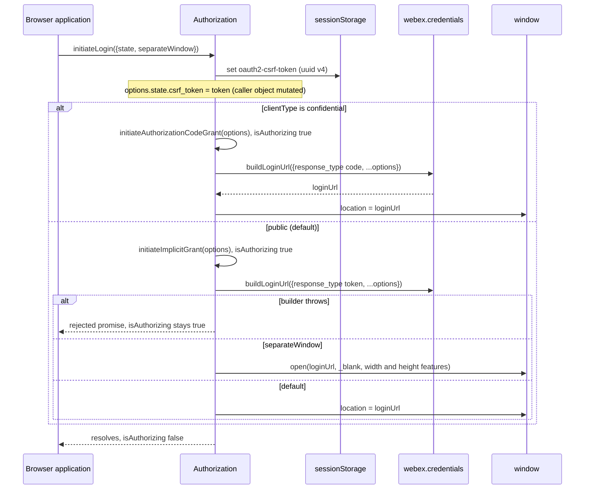
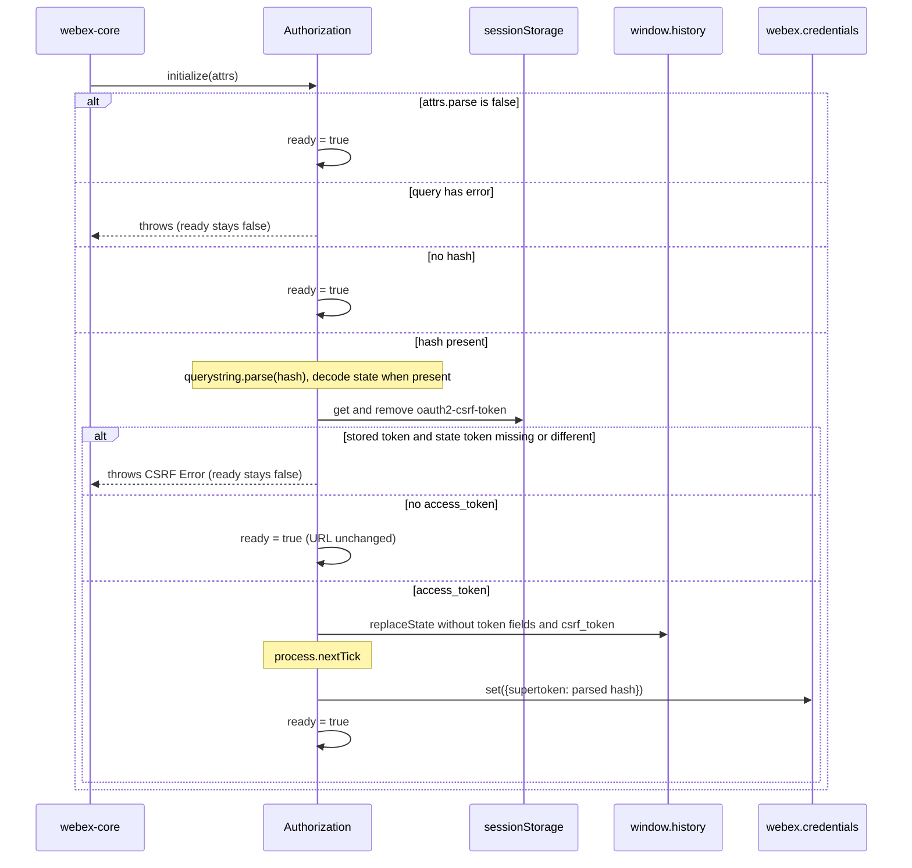
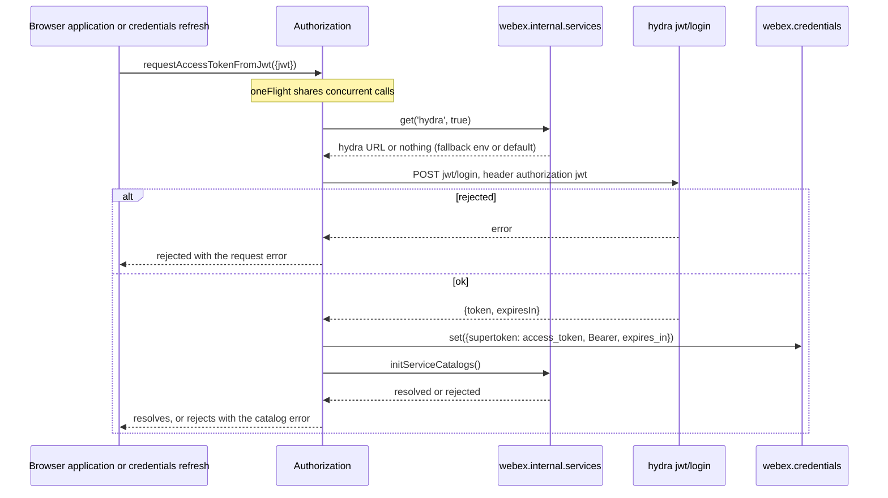
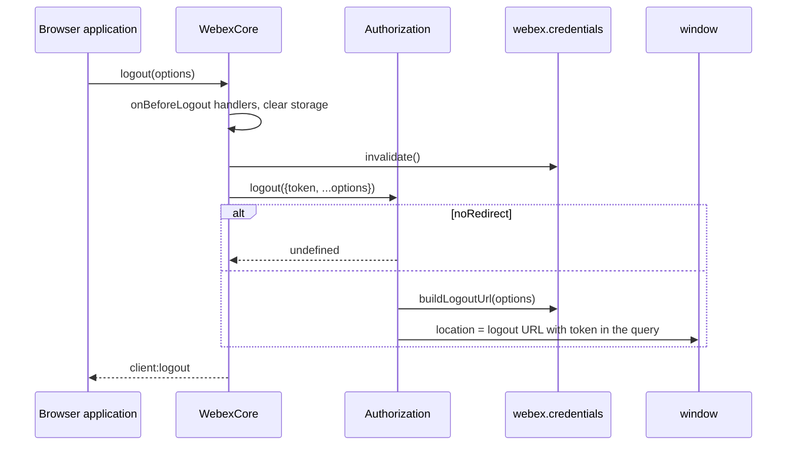
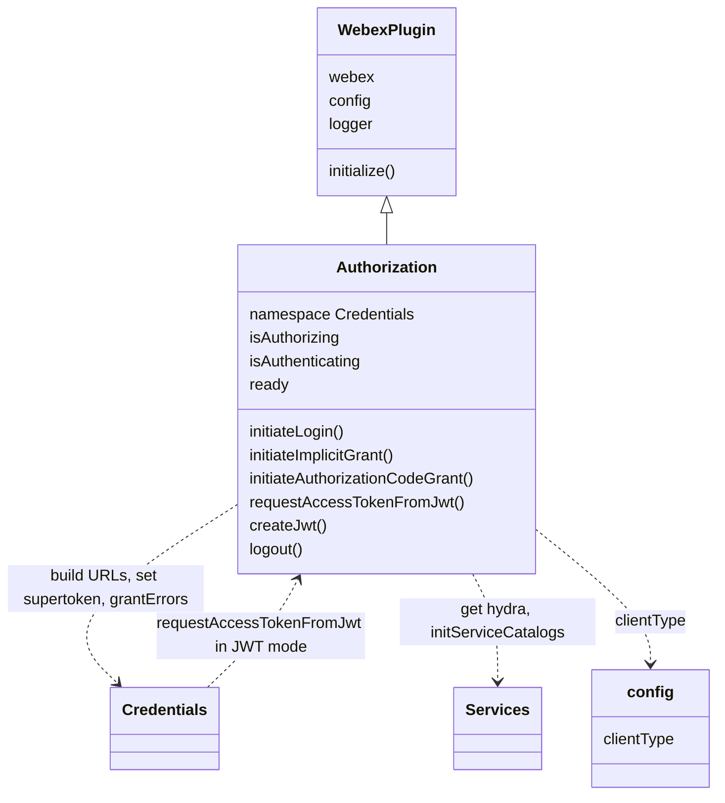

<!-- sdd-generated-metadata
doc_kind: module-spec
generated_from: module-spec@0.3.0
generated_by: claude-code
approved_by: rarajes2@cisco.com
updated_at: 2026-11-04T08:54:29Z
validation_status: pass-with-warnings
-->

# Browser authorization plugin

This source-local document at `src/docs/README.md` owns the stable specification for **the browser
authorization plugin**: the `webex.authorization` plugin that the public browser build of the SDK
uses. It starts OAuth implicit-grant and authorization-code logins with a CSRF token. On page load it
parses an implicit-grant access token from the URL hash and stores it. It also exchanges a
caller-supplied JWT for an access token, mints guest JWTs, and redirects on logout. Ground every claim
in package evidence and link to the [package architecture](../../docs/architecture.md) instead of
repeating broader facts. No service specification exists because this package is a library.

Related context: [documentation index](../../docs/index.md) ·
[package agent instructions](../../AGENTS.md)

## Metadata

| Field             | Value |
| ----------------- | ----- |
| Owner             | @webex/web-sdk |
| Source path       | `src` |
| Resource kind     | package |
| Status            | Draft |
| Last verified     | 2026-11-04 at `6b61acf37a` |
| Module id         | `plugin-authorization-browser` |
| Parent spec       | — |
| Doc kind          | Module spec |
| Coverage score    | 93.3% assessed 2026-11-04 — 14 of 15 mandatory fields PRESENT, critical 8 of 8; test strategy is WEAK because registration, `requestAccessTokenFromJwt`, `createJwt`, and `logout` have no unit case, the redirect-error case pins a `TypeError`, and both automation suites are skipped |
| Validation status | Pass-with-warnings — 2026-11-04, validator runtime `01a1a557-67e4-7fe3-8b88-0a3848d9da25`; 0 Blocking, 1 Important finding |

## Applicability

| Condition ID                         | Status     | Evidence or reason | Owned section |
| ------------------------------------ | ---------- | ------------------ | ------------- |
| `module.has_tiers`                   | N/A        | No tier policy exists in this package or its `package.json` | Tier |
| `module.has_ui`                      | N/A        | `src/authorization.js` assigns window.location or calls window.open; it renders no view | UI use-case flow |
| `module.crosses_service_boundaries`  | Applicable | `src/authorization.js` POSTs to the hydra jwt/login endpoint and navigates the browser to the identity broker authorize and logout pages | Cross-boundary use-case flow |
| `module.holds_client_state`          | Applicable | Session properties isAuthorizing and ready, the derived isAuthenticating, and the oauth2-csrf-token sessionStorage key in `src/authorization.js` | Client state model |
| `module.enforces_domain_rules`       | Applicable | CSRF state verification, single-use CSRF token, and URL scrubbing in `src/authorization.js`; client-type selection in `src/config.js` | Business rules and invariants |
| `module.is_concurrent_async`         | Applicable | oneFlight and whileInFlight decorators and a process.nextTick token hand-off in `src/authorization.js` | Concurrency and reactive flow |
| `module.owns_persistence`            | N/A        | The only stored value in `src/authorization.js` is one transient sessionStorage key removed on first read; it is covered under Client state model | Data, schema, and migration discipline |
| `module.stateful_transitions`        | N/A        | ready is a one-way false-to-true flag and isAuthorizing a promise-scoped boolean in `src/authorization.js`; both are covered under Client state model | State machine |
| `module.exposes_wire_protocol`       | Applicable | Authorize-URL query, redirect-hash fields, the jwt/login request and response, guest JWT claims, and the logout URL in `src/authorization.js` | Protocol and wire format |
| `module.ui_multi_screen`             | N/A        | No UI | UI flow |
| `module.large_data_model`            | N/A        | The module defines no entity types; the supertoken shape belongs to webex-core credentials | Data model |
| `module.returns_caller_errors`       | Applicable | Errors thrown from initialize for redirect errors and CSRF failures, and rejected promises from requestAccessTokenFromJwt and createJwt, in `src/authorization.js` | Caller-visible failure modes |
| `module.module_specific_conventions` | Applicable | The oauth2-csrf-token key name, the Credentials config namespace, and the authorization: log prefix in `src/authorization.js` | Module-specific rules |
| `module.published_package`           | Applicable | `package.json` names the package @webex/plugin-authorization-browser and defines deploy:npm | Export stability |
| `module.embedded_in_host`            | N/A        | No host theme or embed API | Host integration and theming |
| `module.has_design_tradeoff`         | Applicable | Lenient CSRF when no token is stored, synchronous throws during construction with a deferred token hand-off, and public client type as the default, in `src/authorization.js` and `src/config.js` | Key design trade-off |
| `module.has_submodules`              | N/A        | The src directory has no child module | Sub-modules |

## Evidence register

| Evidence | What it establishes |
| -------- | ------------------- |
| `src/index.js` | Side-effect import of `@webex/internal-plugin-device`; public plugin registration as `authorization` with `config` and the `isAuthorizing` and `isAuthenticating` proxies; re-exports of the default class and `config` |
| `src/authorization.js` | The `Authorization` plugin: URL parsing in `initialize`, `initiateLogin`, `initiateImplicitGrant`, `initiateAuthorizationCodeGrant`, `requestAccessTokenFromJwt`, `createJwt`, `logout`, and the CSRF and URL-cleanup helpers. Its JSDoc and inline comments are the only recorded rationale |
| `src/config.js` | `credentials.clientType` default `'public'`, with the JSDoc rule that any value other than `'confidential'` is treated as public |
| `package.json` | Name, `main` (`dist/index.js`), `devMain` (`src/index.js`), `engines` (`node >=18`), dependencies, and scripts |
| `process` | Package-root module exporting `{browser: true}`; nothing in `src/` imports it |
| `test/unit/spec/authorization.js` | 22 unit cases for URL parsing, CSRF, URL cleanup, login initiation, popup login, and the in-flight flags. It imports the package by name, so it loads `dist/` |
| `test/integration/spec/authorization.js` | `browserOnly` cases for `requestAccessTokenFromJwt` against live services with a test app user; the refresh case is `describe.skip`. No package script runs this directory except `test:browser:broken` |
| `test/automation/spec/implicit-grant.js` | Implicit-grant browser automation; its case group is `describe.skip`, and no package script runs it |
| `test/automation/spec/authorization-code-grant.js` | Authorization-code browser automation; its case group is `describe.skip`, and no package script runs it |
| `test/automation/fixtures/app.js` | Example host page that calls `initiateLogin`, switches `clientType` to `confidential`, supplies a `refreshCallback`, and calls `webex.logout()` |
| `README.md` | Retained npm page; context only. Its differences from code are recorded in `docs/adr/0001-keep-existing-docs-separate.md` |
| `BROWSER-OAUTH-FLOW-GUIDE.md` | Retained technical guide; context only. Its differences from code are recorded in `docs/adr/0001-keep-existing-docs-separate.md` |
| Sibling package webex-core, file src/lib/credentials/docs/README.md | Module spec consulted. `buildLoginUrl` forces `client_id`, `redirect_uri`, and `scope` from config, requires an object `state`, base64url-encodes a non-empty state, and omits an empty one; `buildLogoutUrl` appends `cisService` and `goto` and lets caller options override them; `grantErrors.select` maps OAuth error strings; in JWT mode `refresh()` calls `jwtRefreshCallback` and then this plugin's `requestAccessTokenFromJwt`; a browser token refreshes only through a host `config.refreshCallback` |
| Sibling package webex-core, file src/lib/services/docs/README.md | Module spec consulted. `get(name, true)` returns the priority host URL or the default; `initServiceCatalogs` collects preauth and, when authorized, postauth catalogs |
| Sibling package webex-core, file src/docs/README.md | Module spec consulted. `registerPlugin` is first-wins and supports `proxies`; `WebexPlugin` supplies `webex`, `request`, namespaced `config`, and `logger` |
| Sibling package webex-core, file src/webex-core.js | Source consulted. `logout()` runs `onBeforeLogout` handlers, clears storage, invalidates credentials, then calls `authorization.logout(options)` with `token` defaulted to the refresh token, else the access token |
| Sibling package common, file src/docs/README.md | Module spec consulted. `base64` is base64url over `urlsafe-base64`; `oneFlight` shares one in-flight promise; `whileInFlight` sets a boolean for a promise's duration |
| Sibling package internal-plugin-device, file src/docs/README.md | Module spec consulted. Importing that package registers internal plugin `device` and its `onBeforeLogout` unregister hook |
| Sibling package plugin-authorization, file src/index.browser.js | Source consulted (no spec). The browser entry of `@webex/plugin-authorization` re-exports this package, and the `webex` package's `src/webex.js` requires `@webex/plugin-authorization` |
| Observation, no stated WHY | `initiateAuthorizationCodeGrant` ignores `separateWindow`; `initiateLogin` mutates the caller's options; `logout` returns `undefined` although its JSDoc says `Promise`; `createJwt` declares an unused `alg` constant; a redirect hash that has no access token is left in the URL |

## Purpose and boundary

- Responsibility: run browser OAuth login from the SDK. That means adding a CSRF token and navigating to
  the identity broker (implicit grant for public clients, authorization code for confidential ones).
  On construction it reads an implicit-grant token from the redirect URL hash, verifies the CSRF token,
  scrubs the URL, and hands the token to credentials. It also exchanges a host-supplied JWT for an
  access token through hydra, mints a guest JWT from an issuer and secret, and navigates to the logout
  page.
- In scope: the `authorization` plugin API and session state; the `oauth2-csrf-token` `sessionStorage`
  key; the authorize-URL and redirect-hash shapes this module adds or reads; the hydra `jwt/login`
  request; the guest JWT claims; URL scrubbing after a redirect.
- Out of scope: building the authorize and logout URLs, storing, scheduling, and refreshing tokens, and
  OAuth error classes (webex-core credentials); catalog lookups and `initServiceCatalogs` (webex-core
  services); request transport (webex-core); exchanging an authorization code for tokens (no code in
  this package does it, so a confidential client's backend must); device registration (the
  `@webex/internal-plugin-device` package, imported only for its side effect).
- Consumers: the browser entry of `@webex/plugin-authorization`, which the `webex` package requires;
  webex-core credentials in JWT mode, which calls `requestAccessTokenFromJwt`; `WebexCore#logout`,
  which calls `logout`; and browser applications that call `webex.authorization`.

## Structure and key files

| Path | Responsibility |
| ---- | -------------- |
| `src/index.js` | Imports `@webex/internal-plugin-device`, calls `registerPlugin('authorization', Authorization, {config, proxies})`, and re-exports `Authorization` (default) and `config` |
| `src/authorization.js` | The `Authorization` class, built with `WebexPlugin.extend` in namespace `Credentials`; the only place where flow behavior lives |
| `src/config.js` | Default export `{credentials: {clientType: 'public'}}` |
| `process` | Package-root file exporting `{browser: true}`; not imported by `src/` |
| `package.json` | Package name, entry points, scripts, and dependencies |
| `babel.config.js`, `jest.config.js`, `.eslintrc.js` | One-line re-exports of the legacy Babel, Jest, and ESLint configurations |
| `test/unit/spec/authorization.js` | Unit spec run by Jest through `webex-legacy-tools` |
| `test/integration/spec/authorization.js` | Browser-only JWT exchange cases against live services |
| `test/automation/spec/implicit-grant.js`, `test/automation/spec/authorization-code-grant.js` | Skipped browser automation suites with fixtures in `test/automation/fixtures/app.js` and `test/automation/fixtures/index.html` |
| dist/ (generated) | Build output of `build:src`; ignored by Git and never edited by hand |

## Public surface

| Surface | Consumer | Compatibility commitment | Source |
| ------- | -------- | ------------------------ | ------ |
| Import side effect: public plugin `authorization` with proxies `isAuthorizing`, `isAuthenticating`, plus internal plugin `device` | `@webex/plugin-authorization` browser entry, `webex` browser build | First registration of the name wins, so another authorization plugin imported earlier takes `authorization` | `src/index.js` |
| Default export `Authorization` and named export `config` (`credentials.clientType: 'public'`) | `@webex/plugin-authorization` browser entry; webex-core config merge | `config` is merged into `webex.config.credentials` | `src/index.js`, `src/config.js` |
| `webex.authorization.initiateLogin(options)` | Browser applications | Resolves once navigation starts; picks implicit or code grant from `clientType` | `src/authorization.js` |
| `webex.authorization.initiateImplicitGrant(options)` and `initiateAuthorizationCodeGrant(options)` | `initiateLogin`; applications calling them directly | Resolve once navigation starts; neither adds a CSRF token | `src/authorization.js` |
| `webex.authorization.requestAccessTokenFromJwt({jwt})` | Applications with guest or app-user JWTs; webex-core credentials in JWT mode | Resolves with no value after storing the supertoken and initializing the service catalogs | `src/authorization.js` |
| `webex.authorization.createJwt({issuer, secretId, displayName, expiresIn})` | Applications minting guest JWTs | Resolves `{jwt}`; rejects when signing fails | `src/authorization.js` |
| `webex.authorization.logout(options)` | `WebexCore#logout` | Navigates to the logout URL unless `noRedirect` | `src/authorization.js` |
| Properties `isAuthorizing`, `isAuthenticating`, `ready` | Applications and the webex instance proxies | `isAuthenticating` is a derived alias of `isAuthorizing` | `src/authorization.js` |

Contract ID `authorization-browser-sdk` is indexed in the
[package architecture](../../docs/architecture.md#public-and-consumer-surfaces) and registered in
`.sdd/manifest.json`. Export stability is under [Export stability](#export-stability).

## Dependencies

| Dependency | Why it is required | Failure behavior |
| ---------- | ------------------ | ---------------- |
| `@webex/webex-core` credentials (module spec consulted) | `buildLoginUrl`, `buildLogoutUrl`, `credentials.set({supertoken})`, and `grantErrors` | A `buildLoginUrl` throw inside the `whileInFlight` promise rejects the initiate call and leaves `isAuthorizing` `true`; it propagates synchronously from `logout` |
| `@webex/webex-core` services (module spec consulted) | `get('hydra', true)` for the JWT exchange URL; `initServiceCatalogs()` after the exchange | A rejected `initServiceCatalogs` rejects `requestAccessTokenFromJwt` after the supertoken is already set |
| `@webex/webex-core` plugin host (module spec consulted) | `WebexPlugin`, `registerPlugin`, `this.webex.request`, `getWindow()`, namespaced `config`, and `logger` | Request rejections propagate unchanged |
| `@webex/common` (module spec consulted) | `base64` for the `state` hash value, `oneFlight`, `whileInFlight` | A malformed `state` makes decoding or `JSON.parse` throw from `initialize` |
| `@webex/internal-plugin-device` (module spec consulted) | Imported for its side effect: registering internal plugin `device` | Not applicable |
| Identity broker (external) | Authorize and logout pages reached by browser navigation | No retry; the user restarts login |
| Hydra `jwt/login` (external) | Exchange of a host JWT for an access token | The `webex.request` rejection propagates unchanged |
| Browser window (`location`, `history`, `sessionStorage`, `open`) | Navigation, URL scrubbing, and the single-use CSRF token | No fallback for `sessionStorage`; URL scrubbing is skipped when `history.replaceState` is missing |
| `jsonwebtoken` | `jwt.sign` with HS256 for guest JWTs | A sign error, including a missing `expiresIn`, rejects `createJwt` |
| `uuid` | Version 4 values for the CSRF token and the guest subject and default name | Not applicable |
| `lodash` | `cloneDeep`, `isEmpty`, `omit` | Not applicable |
| Node `url` and `querystring` modules | Parsing and formatting the page URL and its hash | Bundler-supplied in the browser build |

## Requirements

| ID | WHAT | WHY | Source evidence | Test or example evidence | Assumptions or gaps | Confidence |
| -- | ---- | --- | --------------- | ------------------------ | ------------------- | ---------- |
| `MOD-001` | Importing the package imports `@webex/internal-plugin-device`, then registers public plugin `authorization` with the package config and proxies `isAuthorizing` and `isAuthenticating` onto the webex instance. | The `@webex/plugin-authorization` browser entry re-exports this package, so the public browser build gets `webex.authorization` from it, and hosts read the in-flight flag from the instance. | `src/index.js` | `test/unit/spec/authorization.js` builds the plugin through MockWebex children, not through registration | No unit case exercises `registerPlugin`, the proxies, or the device import | Weak |
| `MOD-002` | When constructed with `parse: false`, `initialize` sets `ready` to `true` synchronously and reads nothing from the URL. | The JSDoc: `attrs.parse` controls whether the URL is parsed for an access token. | `src/authorization.js` | `test/unit/spec/authorization.js` "when url parsing is disabled sets ready" | None | Present |
| `MOD-003` | Otherwise `initialize` parses the page URL synchronously, and when the query has an `error` parameter it throws before reading the hash, leaving `ready` `false`. | The inline comment: parsing cannot wait for config, which is available only on the next tick, because errors found in the URL must be thrown. | `src/authorization.js` | `test/unit/spec/authorization.js` "throws a grant error when the url contains one" pins that the thrown error is a TypeError with message "Cannot convert object to primitive value", not a grant-error instance | The mapped error is never constructed successfully from the parsed query; see Pitfalls | Present |
| `MOD-004` | When the URL has no hash, `initialize` sets `ready` to `true` synchronously. | The class JSDoc: the plugin parses the hash for an access token, so with no hash there is nothing to parse. | `src/authorization.js` | `test/unit/spec/authorization.js` "when there is nothing in the url sets ready" | None | Present |
| `MOD-005` | With a hash, `initialize` strips the leading `#`, parses it as a query string, base64url-decodes and JSON-parses `state` when present, and verifies the CSRF token (`MOD-008`). With no `access_token` it then sets `ready` to `true` and leaves the URL unchanged. | The `_parseHash` JSDoc: the hash is parsed into an access-token object. | `src/authorization.js` | `test/unit/spec/authorization.js` "validates the csrf token" | The no-`access_token` branch has no unit case | Present |
| `MOD-006` | With an `access_token`, `expires_in` and `refresh_token_expires_in` are parsed as base-10 integers, the URL is scrubbed (`MOD-009`), and on the next tick the whole parsed hash, including `state`, is passed to `webex.credentials.set({supertoken})` and `ready` becomes `true`. | The inline comment: wait until the next tick in case credentials has not initialized yet. | `src/authorization.js` | `test/unit/spec/authorization.js` "sets the token and sets ready", "sets the token, refresh token and sets ready" | That `state` and other hash keys reach the supertoken is not asserted | Present |
| `MOD-007` | `initiateLogin` sets `options.state` to the caller's state or `{}`, adds `state.csrf_token` from `_generateSecurityToken`, and calls `initiateAuthorizationCodeGrant` when `config.clientType` is `'confidential'`, otherwise `initiateImplicitGrant`. It mutates the caller's `options` and `state`. | The JSDoc: the flow follows the client type, and a CSRF token is added to the state automatically. `src/config.js` says any value other than `'confidential'` is public. | `src/authorization.js`, `src/config.js` | `test/unit/spec/authorization.js` "calls #initiateImplicitGrant()", "calls #initiateAuthorizationCodeGrant()", and both "adds a csrf_token to the login url and sessionStorage" cases | Mutation of the caller's object is not asserted | Present |
| `MOD-008` | `_generateSecurityToken` stores a uuid v4 under `sessionStorage` key `oauth2-csrf-token`. `_verifySecurityToken` reads and removes that key; with none stored it returns; otherwise it throws when `state` or `state.csrf_token` is missing ("Expected CSRF token ..., but not found in redirect hash") or different ("CSRF token ... does not match stored token ..."). | The JSDoc: compare the CSRF token in `sessionStorage` with the one returned in the URL. | `src/authorization.js` | `test/unit/spec/authorization.js` "validates the csrf token", "adds a csrf_token to the login url and sessionStorage" | None | Present |
| `MOD-009` | `_cleanUrl`, when `history.replaceState` exists, removes `access_token`, `token_type`, `expires_in`, `refresh_token`, and `refresh_token_expires_in` from the hash, drops `state` when it is empty after removing `csrf_token` or re-encodes it without `csrf_token`, and replaces the history entry. | The JSDoc: remove no-longer-needed values such as the access token and CSRF token from the URL. | `src/authorization.js` | `test/unit/spec/authorization.js` "removes the oauth parameters from the url", "removes the state parameter when it is empty", "removes the state parameter when only token is present", "keeps the state parameter when it has keys" | Other hash keys, such as `scope`, are kept | Present |
| `MOD-010` | `initiateImplicitGrant` builds the login URL from `{response_type: 'token', ...options}`, then opens a `_blank` window with `width=600,height=800` merged with an object `separateWindow`, or assigns `window.location`, and resolves. | The JSDoc: the login URL opens in a new window or in the current window based on the options. | `src/authorization.js` | `test/unit/spec/authorization.js` "redirects to the login page in the same window by default", "opens login page in a new window when separateWindow is true", "opens login page in a new window with custom dimensions", "preserves other options when using separateWindow" | `separateWindow` itself is serialized into the authorize URL (pinned) | Present |
| `MOD-011` | `initiateAuthorizationCodeGrant` builds the login URL from `{response_type: 'code', ...options}`, always assigns `window.location`, and resolves. It does not exchange the returned code. | The JSDoc: kicks off the code grant flow, typically through `initiateLogin`. | `src/authorization.js` | `test/unit/spec/authorization.js` "redirects to the login page with response_type=code" | `separateWindow` is ignored on this path; see Pitfalls | Present |
| `MOD-012` | `isAuthorizing` is `true` from the call to `initiateImplicitGrant` or `initiateAuthorizationCodeGrant` until its promise settles, and `isAuthenticating` mirrors it. | The JSDoc: `isAuthorizing` indicates an exchange in flight, and `isAuthenticating` is its alias. | `src/authorization.js` | `test/unit/spec/authorization.js` "sets #isAuthorizing", "sets #isAuthenticating" | The flag clears when navigation starts, not when login completes | Present |
| `MOD-013` | `requestAccessTokenFromJwt({jwt})` POSTs to `<hydra>jwt/login` with header `authorization: <jwt>`. The hydra URL comes from `services.get('hydra', true)`, given a trailing `/`, else `process.env.HYDRA_SERVICE_URL`, else `https://api.ciscospark.com/v1/`. It stores `{access_token: body.token, token_type: 'Bearer', expires_in: body.expiresIn}` as the supertoken, then calls `initServiceCatalogs()`. Concurrent calls share one flight. | The JSDoc: request a Webex access token for a user already authenticated into the host product; the inline comment adds the `/` so the catalog URL matches the environment format. | `src/authorization.js` | `test/integration/spec/authorization.js` "exchanges a JWT for an appid access token", "should call services#initServiceCatalogs()" (browser-only, live services) | No unit case; the integration suite needs live services and a test app user | Weak |
| `MOD-014` | `createJwt({issuer, secretId, displayName, expiresIn})` signs `{sub: guest-user-<uuid>, iss: issuer, name: displayName or "Guest User - <uuid>"}` with HS256 using the base64-decoded `secretId` and `{expiresIn}`, and resolves `{jwt}`; a signing error rejects. | The JSDoc: create a JWT user token from a guest issuer and secret. | `src/authorization.js` | None found in this package | No test. A missing `expiresIn` rejects because `jsonwebtoken` 9 rejects an undefined `expiresIn` option | Weak |
| `MOD-015` | `logout(options)` assigns `credentials.buildLogoutUrl(options)` to `window.location` unless `options.noRedirect` is truthy, and returns `undefined`. `WebexCore#logout` calls it last with `token` defaulted to the refresh token, else the access token, and `buildLogoutUrl` spreads `options` into the query, so that token is in the navigated URL. | The JSDoc: called by `WebexCore#logout`; redirects to the logout page. | `src/authorization.js` | `test/automation/spec/implicit-grant.js` "logs out a user" (skipped) | No runnable test covers either branch | Weak |

## Design overview

`Authorization` extends `WebexPlugin` in namespace `Credentials`, so `this.config` is
`webex.config.credentials`, the same configuration the webex-core credentials plugin reads. That is why
`src/config.js` contributes `clientType` under `credentials`. The plugin owns the browser flows;
credentials owns the tokens. Every token path ends with `webex.credentials.set({supertoken})`.

Login spans two page loads. `initiateLogin` writes a CSRF token to `sessionStorage`, puts it in the
`state`, and navigates. The identity broker returns to the redirect URI: implicit grant puts the
token in the URL hash, and the code grant puts a code in the query. On the next page load the webex
instance constructs this plugin. `initialize` does all URL, storage, and CSRF work synchronously so
that a forged or failed redirect throws during construction. It then defers the hand-off to
credentials by one tick. Tokens are read only from the hash; the query is checked only for an OAuth
`error`. A code in the query is left to the host's backend, because this package has no code exchange.

JWT login stays on one page: the host obtains a JWT (or mints a guest one with `createJwt`) and
`requestAccessTokenFromJwt` exchanges it with hydra. Credentials also reuses that method when JWT mode
refreshes through `jwtRefreshCallback`.

## Data flow and sequence coverage

Call style: in-process calls on `webex.authorization`; browser navigation through `window.location` or
`window.open`; outbound HTTPS through `webex.request`; ampersand `change:ready` events for readiness.
Four operation groups differ in actors, ordering, or outcome and each has a diagram. `createJwt` is a
local computation with no other actor and is described in Protocol and wire format.

| Operation group | Entry and outcome | Diagram or evidence | Failure and recovery coverage |
| --------------- | ----------------- | ------------------- | ----------------------------- |
| Start a login | `initiateLogin` navigates to the authorize URL | Login-initiation diagram; `src/authorization.js` | Builder throw rejects; no retry |
| Complete an implicit login on startup | `initialize` reads the hash and stores the supertoken; `ready` becomes `true` | Startup diagram; `src/authorization.js` | Redirect error, CSRF failure, and malformed `state` throw synchronously |
| Exchange a JWT | `requestAccessTokenFromJwt` stores the supertoken and initializes catalogs | JWT diagram; `src/authorization.js` | Request or catalog rejection propagates |
| Logout | `WebexCore#logout` calls `logout` | Logout diagram; `src/authorization.js` | `noRedirect` skips navigation |

### Start a login

### Complete an implicit login on startup

### Exchange a JWT

### Logout

## Class and component relationships

`Authorization` reaches credentials and services through `this.webex` at call time, so it holds no
references of its own.

## Use cases and flows

| Use case | Actor or caller | Primary steps and outcome | Failure or boundary behavior | Evidence |
| -------- | --------------- | ------------------------- | ---------------------------- | -------- |
| `UC-001` | Single-page application (public client) | Calls `initiateLogin({state})`; the tab navigates; on return `Webex.init` constructs the plugin, which stores the hash token; the app waits for `ready` | Redirect errors and CSRF failures throw during construction | `src/authorization.js`, `test/unit/spec/authorization.js`, `test/automation/fixtures/app.js` |
| `UC-002` | Public client using a popup | Calls `initiateLogin({separateWindow: true})` or an object of window features | The popup completes the redirect; the opener is not notified by this module | `src/authorization.js`, `test/unit/spec/authorization.js` |
| `UC-003` | Confidential client | Sets `credentials.clientType` to `confidential` and calls `initiateLogin`; the tab navigates with `response_type=code` | The returned code is not exchanged by this package; the host backend must exchange it | `src/authorization.js`, `src/config.js`, `test/automation/fixtures/app.js` |
| `UC-004` | Application with an app-user or guest JWT | Calls `requestAccessTokenFromJwt({jwt})`, optionally after `createJwt` | Request rejection propagates | `src/authorization.js`, `test/integration/spec/authorization.js` |
| `UC-005` | JWT-mode refresh | Credentials calls `jwtRefreshCallback`, then `requestAccessTokenFromJwt` with the new JWT | Rejection fails the refresh | `src/authorization.js` |
| `UC-006` | Application signing out | Calls `webex.logout()`; core calls `authorization.logout` | `noRedirect` keeps the page | `src/authorization.js`, `test/automation/fixtures/app.js` |

### Cross-boundary use-case flow

| Boundary | Transport and ordering | Compatibility | Timeout, retry, and recovery |
| -------- | ---------------------- | ------------- | ---------------------------- |
| Identity broker authorize page (`UC-001`, `UC-002`, `UC-003`) | Browser navigation; the response returns on a later page load | Query parameters listed under Protocol and wire format; `state` is base64url JSON | None; the user restarts login |
| Hydra `jwt/login` (`UC-004`, `UC-005`) | HTTPS POST through `webex.request` with the JWT in the `authorization` header | Response fields `token` and `expiresIn` | No retry; `oneFlight` collapses simultaneous calls |
| Identity broker logout page (`UC-006`) | Browser navigation after credentials are invalidated | `buildLogoutUrl` query, including `token` | None |

## Client state model

| State or slice | Owner | Initial state | Transition triggers | Reset or persistence boundary |
| -------------- | ----- | ------------- | ------------------- | ----------------------------- |
| `isAuthorizing` (session) and `isAuthenticating` (derived alias) | Authorization | `false` | `whileInFlight` around `initiateImplicitGrant` and `initiateAuthorizationCodeGrant` | Cleared when the wrapped promise settles; stays `true` if `buildLoginUrl` throws; proxied onto the webex instance |
| `ready` (session) | Authorization | `false` | Set `true` synchronously when parsing is disabled, no hash exists, or the hash has no token; set on the next tick after a hash token is stored | Never reset by this module; stays `false` when `initialize` throws |
| `sessionStorage` `oauth2-csrf-token` | Authorization | absent | Written by `_generateSecurityToken`; removed by `_verifySecurityToken` on every hash parse | Browser tab session; single use |
| `webex.credentials.supertoken` | webex-core credentials | per credentials | Set from the hash token or the JWT exchange | Owned and persisted by credentials |

## Business rules and invariants

| ID | Invariant | WHY | Enforcement source | Test evidence |
| -- | --------- | --- | ------------------ | ------------- |
| `INV-001` | The stored CSRF token is removed from `sessionStorage` whenever a hash is parsed, before it is compared. | The JSDoc: the token stored at initiation is checked against the one returned in the URL; removal makes it single use. | `src/authorization.js` | `test/unit/spec/authorization.js` |
| `INV-002` | When a CSRF token is stored, a redirect hash without a matching `state.csrf_token` makes construction throw, and no token is stored. | The `_verifySecurityToken` JSDoc: the stored and returned tokens must be the same. | `src/authorization.js` | `test/unit/spec/authorization.js` |
| `INV-003` | After a hash token is accepted, the token fields and `csrf_token` are removed from the visible URL when `history.replaceState` exists. | The `_cleanUrl` JSDoc: remove no-longer-needed values such as the access token and CSRF token. | `src/authorization.js` | `test/unit/spec/authorization.js` |
| `INV-004` | Redirect errors, CSRF failures, and malformed `state` are raised synchronously during construction, before any token reaches credentials. | The inline comment: errors found in the URL must be thrown, so parsing cannot wait for config. | `src/authorization.js` | `test/unit/spec/authorization.js` |
| `INV-005` | `initiateLogin` always adds a fresh CSRF token to `state` before navigating. | The JSDoc: a CSRF token is generated and added to the state automatically. | `src/authorization.js` | `test/unit/spec/authorization.js` |

## Concurrency and reactive flow

- Execution model: single browser event loop. The hash-token hand-off runs on `process.nextTick` after
  `initialize` returns; everything else in `initialize` is synchronous.
- Ordering guarantees: the URL is scrubbed before the supertoken is set, and `ready` becomes `true`
  after the set. In `requestAccessTokenFromJwt` the supertoken is set before `initServiceCatalogs`
  starts.
- Idempotency and retry: `oneFlight` makes simultaneous `requestAccessTokenFromJwt` calls share one
  request. No retry exists for any request or redirect.
- Shared-state protection: `whileInFlight('isAuthorizing')` toggles the flag for the two initiate
  methods; because both resolve immediately after starting navigation, the flag only marks the
  synchronous start of navigation.
- Blocking restrictions: `initialize` must stay synchronous up to the hand-off so construction can
  throw; network work is not started from `initialize`.

## Protocol and wire format

| Message or frame | Version | Producer or serializer | Consumer or parser | Compatibility and ordering rule |
| ---------------- | ------- | ---------------------- | ------------------ | ------------------------------- |
| Authorize URL query: `response_type` (`token` or `code`), `client_id`, `redirect_uri`, `scope`, `state`, plus any other option such as `separateWindow` | OAuth 2.0 | `initiateImplicitGrant` and `initiateAuthorizationCodeGrant` through credentials `buildLoginUrl` | Identity broker | `state` is base64url JSON with `csrf_token` and caller fields; `client_id`, `redirect_uri`, and `scope` come from config |
| Redirect hash: `access_token`, `token_type`, `expires_in`, optional `refresh_token`, `refresh_token_expires_in`, `state`, and any other key | OAuth 2.0 implicit grant | Identity broker | `initialize` | Numeric fields are parsed base 10; every key, including `state`, is passed to `credentials.set` |
| Redirect query `error` (and `error_description`) | OAuth 2.0 | Identity broker | `initialize` | Presence makes construction throw |
| `POST <hydra>jwt/login`, header `authorization: <jwt>`; response `{token, expiresIn}` | Unversioned | `requestAccessTokenFromJwt` | Hydra | Mapped to `{access_token, token_type: 'Bearer', expires_in}` |
| Guest JWT: header `alg: HS256`; claims `sub: guest-user-<uuid>`, `iss`, `name`, plus `iat` and `exp` (from `expiresIn`) added by `jsonwebtoken` | JWT | `createJwt` | Hydra, through `requestAccessTokenFromJwt` | Signed with the base64-decoded `secretId` |
| Logout URL query: `cisService`, `goto`, overridden or extended by caller options such as `token` and `goto` | Unversioned | `logout` through credentials `buildLogoutUrl` | Identity broker | `token` comes from `WebexCore#logout` |

## Caller-visible failure modes

| Condition | Signal or result | Caller behavior | Retry or recovery | Evidence |
| --------- | ---------------- | --------------- | ----------------- | -------- |
| Redirect URL query contains `error` | Construction throws; the current test pins a `TypeError` "Cannot convert object to primitive value" | Catch around `Webex.init` | Restart login | `src/authorization.js`, `test/unit/spec/authorization.js` |
| Stored CSRF token and `state.csrf_token` missing or different | Construction throws `Error` naming the expected or mismatched token | Treat as a forged or stale redirect | Restart login | `src/authorization.js`, `test/unit/spec/authorization.js` |
| Redirect hash `state` is not base64url JSON | Construction throws the native decode or `JSON.parse` error | Treat as a failed login | Restart login | `src/authorization.js` |
| `initiateLogin` with a non-object truthy `state` | Synchronous `TypeError` when `csrf_token` is assigned | Fix the argument | None | `src/authorization.js` |
| `buildLoginUrl` throws inside an initiate method | Rejected promise; `isAuthorizing` stays `true` | Handle the rejection | Fix the options | `src/authorization.js` |
| Hydra `jwt/login` fails | The `webex.request` rejection, unchanged | Handle the HTTP error | Caller may retry | `src/authorization.js`, `test/integration/spec/authorization.js` |
| `initServiceCatalogs` fails after the JWT exchange | Rejected promise, though the supertoken is already set | Check `canAuthorize` before retrying | Caller may retry catalog initialization | `src/authorization.js` |
| `createJwt` cannot sign (for example `expiresIn` omitted or `secretId` missing) | Rejected promise with the signing or decoding error | Fix the arguments | None | `src/authorization.js` |

## Pitfalls and constraints

- The redirect-error path does not deliver a grant error today. `_checkForErrors` passes the parsed
  query object to the error constructor, and `test/unit/spec/authorization.js` "throws a grant error
  when the url contains one" asserts the resulting message "Cannot convert object to primitive
  value". `README.md` describes an `OAuthError`. This is pinned behavior, not fixed here.
- Tokens are read only from the URL hash; the query is checked only for `error` (`MOD-003`). A
  `?code=` returned to a confidential client is ignored: `initialize` finds no hash and sets `ready`. No code exchange exists in this package, so the host backend must
  exchange the code.
- `initiateAuthorizationCodeGrant` ignores `separateWindow` and always navigates the current tab, so
  popup login works only for public clients.
- `separateWindow` is not removed before `buildLoginUrl`, so it appears in the authorize URL query
  (pinned by "preserves other options when using separateWindow").
- `initiateLogin` mutates the caller's `options` and `state`, adding `csrf_token`; calling
  `initiateImplicitGrant` or `initiateAuthorizationCodeGrant` directly adds no CSRF token.
- Any hash is parsed while a CSRF token is stored. A hash-routed application that reloads with a
  route hash after starting a login, before the redirect completes, throws "Expected CSRF token" during
  construction.
- A hash with no `access_token` is not scrubbed, and `_cleanUrl` keeps other hash keys, such as `scope`.
- The whole parsed hash, including the decoded `state` object, is passed to `credentials.set` as the
  supertoken.
- `isAuthorizing` is `true` only until navigation starts, not until login completes. If `buildLoginUrl`
  throws, the call rejects and `isAuthorizing` stays `true`.
- `requestAccessTokenFromJwt` falls back to `process.env.HYDRA_SERVICE_URL` and then to
  `https://api.ciscospark.com/v1/` when the catalog has no `hydra` entry.
- `createJwt` signs with a client-held issuer secret. `secretId` must be base64; a missing `expiresIn`
  rejects. The unused `alg` constant does not affect signing, because HS256 is the `jsonwebtoken`
  default for a secret.
- `logout` returns `undefined` although its JSDoc says `Promise`, and the logout URL carries the token
  that `WebexCore#logout` supplies.
- `src/config.js` provides no `refreshCallback`. Under the webex-core credentials specification a
  browser token refreshes only when the host configures one, as `test/automation/fixtures/app.js` does.
- `test/unit/spec/authorization.js` imports the package by name, which loads `dist/`. Run `build:src`
  before `test:unit`, or the tests run against stale output.
- `yarn test` chains `test:integration` and `test:browser`, neither of which is defined. The automation
  suites are skipped, and the integration suite runs only through `test:browser:broken` with live
  services.

## Module-specific rules

- Do: keep the `sessionStorage` key name `oauth2-csrf-token`; a login started by one page load is
  checked on the next (`src/authorization.js`).
- Do: keep URL, storage, and CSRF work in `initialize` synchronous and the credentials hand-off on the
  next tick (`INV-004`, Concurrency and reactive flow).
- Do: log through `this.logger` with the `authorization:` prefix and never log token or JWT values
  (`src/authorization.js`).
- Do: keep `requestAccessTokenFromJwt` decorated with `oneFlight`; credentials refresh relies on it
  (Concurrency and reactive flow).
- Do not: drop the CSRF token from `initiateLogin` or skip `_verifySecurityToken` on hash parsing
  (`INV-001`, `INV-005`).

## Export stability

| Export or entry point | Consumer | Stability | Versioning and deprecation rule | Declaration or API report |
| --------------------- | -------- | --------- | ------------------------------- | ------------------------- |
| Default export `Authorization`, named `config` | `@webex/plugin-authorization` browser entry | Public | No versioning or deprecation rule is declared in the package | `src/index.js` |
| Import side effect: public plugin `authorization` | Packages that import the barrel | Public | Same | `src/index.js`, `package.json` |
| Plugin API `webex.authorization.*` and its properties | Browser applications, webex-core credentials, `WebexCore#logout` | Public | Same | `src/authorization.js` |

No TypeScript declaration or API report is shipped; `package.json` has no `types` field and the
source is JavaScript.

## Key design trade-off

| Chosen trade-off | Preserved invariant or benefit | Cost or limitation | Decision evidence |
| ---------------- | ------------------------------ | ------------------ | ----------------- |
| The hash is accepted without CSRF proof when no token is stored | A user who opens the redirect URI directly can still complete a login | A token-bearing hash with no stored token is accepted without CSRF proof | `src/authorization.js` |
| URL errors throw synchronously from construction while the token hand-off waits one tick | Forged or failed redirects never reach credentials | Hosts must wrap `Webex.init` to catch redirect errors | `src/authorization.js` |
| Any client type other than `confidential` is public, and public means implicit grant | No `client_secret` is needed in the browser | The access token travels in the URL hash and is exposed until `_cleanUrl` runs | `src/config.js`, `src/authorization.js` |

## Verification

| Requirement or invariant | Test level | Positive evidence | Negative or boundary evidence | Gap |
| ------------------------ | ---------- | ----------------- | ----------------------------- | --- |
| `MOD-001` | Unit | None found | None found | Registration, proxies, and the device import untested |
| `MOD-002` | Unit | `test/unit/spec/authorization.js` "when url parsing is disabled sets ready" | None found | None |
| `MOD-003`, `INV-004` | Unit | None found | `test/unit/spec/authorization.js` "throws a grant error when the url contains one" | Pins a TypeError, not a grant error |
| `MOD-004` | Unit | `test/unit/spec/authorization.js` "when there is nothing in the url sets ready" | None found | None |
| `MOD-005`, `MOD-008`, `INV-001`, `INV-002` | Unit | `test/unit/spec/authorization.js` "validates the csrf token" (matching token) | `test/unit/spec/authorization.js` "validates the csrf token" (mismatch, empty state, missing state) | No-`access_token` hash and malformed `state` untested |
| `MOD-006` | Unit | `test/unit/spec/authorization.js` "sets the token and sets ready", "sets the token, refresh token and sets ready" | None found | Supertoken contents beyond canAuthorize and canRefresh not asserted |
| `MOD-007`, `INV-005` | Unit | `test/unit/spec/authorization.js` "calls #initiateImplicitGrant()", "calls #initiateAuthorizationCodeGrant()", "adds a csrf_token to the login url and sessionStorage" | None found | Caller-object mutation not asserted |
| `MOD-009`, `INV-003` | Unit | `test/unit/spec/authorization.js` "removes the oauth parameters from the url", "keeps the state parameter when it has keys" | `test/unit/spec/authorization.js` "removes the state parameter when it is empty", "removes the state parameter when only token is present" | Missing `history.replaceState` untested |
| `MOD-010` | Unit | `test/unit/spec/authorization.js` popup and same-window cases | `test/unit/spec/authorization.js` "preserves other options when using separateWindow" | None |
| `MOD-011` | Unit | `test/unit/spec/authorization.js` "redirects to the login page with response_type=code" | None found | Ignored `separateWindow` untested |
| `MOD-012` | Unit | `test/unit/spec/authorization.js` "sets #isAuthorizing", "sets #isAuthenticating" | None found | Builder-throw path untested |
| `MOD-013` | Integration | `test/integration/spec/authorization.js` JWT exchange cases (browser-only, live services) | None found | No unit case; hydra fallback and catalog rejection untested |
| `MOD-014` | Unit | None found | None found | No test |
| `MOD-015` | Automation | `test/automation/spec/implicit-grant.js` "logs out a user" (skipped) | None found | No runnable test |

Coverage gaps are recorded above. The automation suites in `test/automation/spec/implicit-grant.js` and
`test/automation/spec/authorization-code-grant.js` are skipped and no package script runs them, so they
are not coverage evidence. A module specification is complete only when its public surface,
invariants, failure modes, and test evidence agree with the implementation. Generator-side field
measurement is complete (93.3%, assessed 2026-11-04). Independent semantic validation passed with
warnings on 2026-11-04 (0 Blocking, 1 Important) using validator runtime
`01a1a557-67e4-7fe3-8b88-0a3848d9da25`. Drift recording, a characterization baseline, and promotion
past Partial remain pending.
