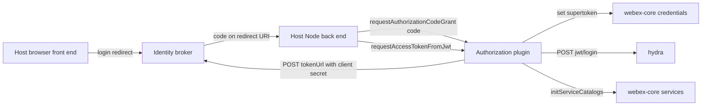
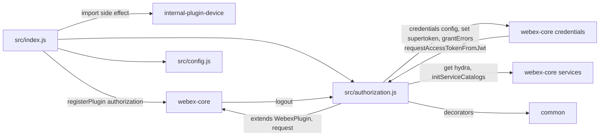

<!-- sdd-generated-metadata
doc_kind: standing-doc
generated_from: architecture@0.3.0
generated_by: claude-code
approved_by: rarajes2@cisco.com
updated_at: 2026-11-11T09:32:15Z
validation_status: pass-with-warnings
-->

# @webex/plugin-authorization-node architecture

Canonical architecture for this package. Flow behavior lives in the
[Node authorization plugin specification](../src/docs/README.md). This page owns package boundaries,
the plugin registration, the contract index, and how the package meets the rest of the SDK.

Related context: [specification registry](specs/README.md) ·
[package agent instructions](../AGENTS.md)

## Applicability

| Condition ID                         | Status     | Evidence or reason | Owned section |
| ------------------------------------ | ---------- | ------------------ | ------------- |
| `repo.owns_datastore`                | N/A        | No database, file store, or migration in `src/authorization.js` | Repository data and schema |
| `repo.holds_client_state`            | Applicable | Session property isAuthorizing and its derived alias in `src/authorization.js` | Client state model |
| `repo.components_interact`           | Applicable | `src/authorization.js` calls webex-core credentials and services, and webex-core calls its logout and requestAccessTokenFromJwt methods | Dependency and interaction topology |
| `repo.domain_data_across_components` | Applicable | Tokens obtained in `src/authorization.js` are stored by webex-core credentials | Object and data ownership |
| `repo.caches_data`                   | N/A        | `src/authorization.js` keeps no cache | Caching catalog |
| `repo.observability_convention`      | Applicable | `src/authorization.js` logs with a credentials: prefix | Observability patterns |
| `repo.deploys_to_infra`              | N/A        | Library published to npm (`package.json`). No service runtime | Runtime and infrastructure |
| `repo.shared_base_libs`              | Applicable | Extends WebexPlugin from webex-core and uses the legacy build, lint, and test stack (`babel.config.js`, `jest.config.js`, `.eslintrc.js`) | Shared and base libraries |
| `repo.is_monorepo`                   | N/A        | This SDD root is one package. The workspace around it is out of scope | Package map and inter-package dependencies |
| `repo.multi_platform`                | N/A        | Node only: the unit and integration suites are nodeOnly in `test/unit/spec/authorization.js` and `test/integration/spec/authorization.js`, and the browser counterpart is a separate package | Platform matrix |
| `repo.published_package`             | Applicable | `package.json` name is @webex/plugin-authorization-node and deploy:npm publishes it | Release and versioning |
| `repo.embedded_in_host`              | N/A        | No host theme or embed API in `src/authorization.js` | Host integration and theming |
| `repo.exposes_commands_or_artifacts` | Applicable | build:src in `package.json` writes dist | Commands and generated artifacts |
| `repo.cross_repo_deps_material`      | Applicable | Behavior depends on webex-core credentials and services, the identity broker token and logout endpoints, and the hydra jwt/login endpoint (`src/authorization.js`) | Cross-repository topology |
| `repo.security_arch_warranted`       | Applicable | Authorization codes, the confidential client secret, access and refresh tokens, host JWTs, and guest issuer secrets pass through `src/authorization.js` | Security architecture |

## Design overview

`@webex/plugin-authorization-node` is a published Node library with one module. Importing it
registers `Authorization` as the public plugin `authorization` and, as a side effect, the internal
`device` plugin. The Node entry of `@webex/plugin-authorization` re-exports this package, and
`webex-node` and `webex` require `@webex/plugin-authorization`, so their Node builds get
`webex.authorization` from here. `@webex/webex-server` imports this package directly. Browser builds
resolve `@webex/plugin-authorization` to its browser entry and never load this package.

The plugin owns server-side requests, not tokens. It exchanges an authorization code with the
confidential client credentials, exchanges a host JWT through hydra, mints guest JWTs, and sends the
broker logout request. Broker URLs, token storage and refresh, and OAuth error classes stay in
webex-core credentials. Obtaining the code and checking the OAuth `state` happen in the host
application, outside this package.

The package makes outbound HTTP calls only. It serves no routes and persists nothing.

## Resource inventory and responsibilities

| Resource | Kind | Responsibility | Owner | Source | Detailed specification |
| -------- | ---- | -------------- | ----- | ------ | ---------------------- |
| Node authorization plugin | package (one module) | Authorization-code exchange, JWT exchange, guest JWT creation, logout request | @webex/web-sdk | `src` | [`src/docs/README.md`](../src/docs/README.md) |

## Interaction and execution flows

Representative end-to-end flow: the host's browser front end obtains an authorization code, the
host's Node back end hands it to the plugin, and the plugin stores the resulting supertoken.

| From | To | Interaction or transport | Purpose | Failure or compatibility behavior |
| ---- | -- | ------------------------ | ------- | --------------------------------- |
| Node application | Authorization plugin | In-process calls | Exchange codes and JWTs, mint guest JWTs, read flags | Rejections propagate; HTTP 400 on the code grant becomes a grant error |
| Authorization plugin | Identity broker token endpoint | HTTPS POST through `webex.request` | Authorization-code grant | No retry |
| Authorization plugin | Hydra `jwt/login` | HTTPS POST through `webex.request` | JWT exchange | Rejection propagates |
| Authorization plugin | webex-core services | In-process calls | Hydra URL, catalog initialization after a JWT exchange | Catalog rejection propagates after the token is set |
| Authorization plugin | Identity broker logout endpoint | HTTPS POST through `webex.request`, not awaited | Logout | Failure is not observed |
| webex-core credentials | Authorization plugin | `requestAccessTokenFromJwt` call | JWT-mode refresh | Rejection fails the refresh |
| webex-core | Authorization plugin | `logout()` call | Logout request | Runs after credentials are invalidated |

## Dependency topology

| Dependency | Type | Used by | Purpose | Version, failure, or fallback policy |
| ---------- | ---- | ------- | ------- | ------------------------------------ |
| `@webex/webex-core` | Internal | `src/index.js`, `src/authorization.js` | Plugin base, registration, request, credentials config, services, grant errors | Workspace version (`workspace:*` in `package.json`) |
| `@webex/common` | Internal | `src/authorization.js` | `oneFlight`, `whileInFlight` | Workspace version |
| `@webex/internal-plugin-device` | Internal | `src/index.js` | Import side effect registering internal plugin `device` | Workspace version |
| `jsonwebtoken` | External | `src/authorization.js` | HS256 signing for guest JWTs | `^9.0.0` in `package.json` |
| `uuid` | External | `src/authorization.js` | Guest subject and default name | `^3.3.2` in `package.json` |
| Identity broker | External service | `src/authorization.js` | Token and logout endpoints | URLs come from credentials config |
| Hydra | External service | `src/authorization.js` | `jwt/login` | Catalog URL, else `HYDRA_SERVICE_URL`, else a hard-coded default |

Every runtime dependency in `package.json` is imported by `src/`. No import cycle exists: this package
imports webex-core, common, and device, and webex-core reaches this plugin only through the
registered child. The sibling `@webex/plugin-authorization-browser` lists this package as a dependency
and imports it in its integration spec.

## Public and consumer surfaces

| Surface | Type | Owner | Consumers | Compatibility policy | Source |
| ------- | ---- | ----- | --------- | -------------------- | ------ |
| `authorization-node-sdk` — package @webex/plugin-authorization-node and the `webex.authorization` API | SDK, published to npm | Node authorization plugin | `@webex/plugin-authorization` Node entry, `webex-node`, `webex` in Node, `@webex/webex-server`, webex-core credentials (JWT refresh), `WebexCore#logout`, Node applications | No versioning or deprecation rule is declared in the package | `package.json`, `src/index.js`, `src/authorization.js`, `src/config.js` |

The token-endpoint form, the hydra `jwt/login`, and the logout-request shapes are protocols this
package consumes, described under *Protocol and wire format* in the
[module specification](../src/docs/README.md#protocol-and-wire-format), not published contracts of this
package.

## Client state model

| State or slice | Owner | Transition triggers | Persistence or reset boundary |
| -------------- | ----- | ------------------- | ----------------------------- |
| `isAuthorizing`, `isAuthenticating` | Authorization plugin | `requestAuthorizationCodeGrant` in flight | In memory for the instance |
| `ready` | `WebexPlugin` default (`true`) | None in this package | In memory for the instance |
| Supertoken | webex-core credentials | Set by this plugin from the code-grant response or the JWT exchange | Owned by credentials |

## Cross-cutting architecture

### Security

- Trust boundaries and identity flow: see [Security architecture](#security-architecture). The plugin
  builds requests; credentials stores tokens, and webex-core adds transport.
- Sensitive surfaces and data classes: authorization codes, the confidential client secret, access and
  refresh tokens, host JWTs, guest issuer secrets, and supertokens.
- Encryption and secret boundaries: the client id and secret travel as HTTP Basic credentials to the
  token endpoint. The host JWT travels in the `authorization` header to hydra. `createJwt` uses a base64
  issuer secret supplied by the caller. The logout request body carries the token that
  `WebexCore#logout` places in `options.token`.

### Observability and operations

- Logging and correlation: one `this.logger.info` message, `credentials: requesting authorization
  code grant`.
- Metrics, traces, and audit signals: none emitted here.
- Ownership and operational entry points: `.github/CODEOWNERS` at the workspace root has no entry for
  this package, so the default rule routes it to `@webex/web-sdk`. No dashboards or runbooks are
  recorded in this package.

### Quality attributes

- Compatibility: Node applications and webex-core rely on the method names, the `{code}` and `{jwt}`
  argument shapes, and `requestAccessTokenFromJwt` for JWT-mode refresh.
- Footprint: three source files; runtime imports are webex-core, common, the device plugin,
  jsonwebtoken, and uuid.
- Test confidence: 4 unit cases cover the code grant; registration, the grant-error mapping, the JWT
  exchange, `createJwt`, and `logout` have no unit case. No coverage threshold is enforced, and the
  shared lint config skips `src/authorization.js`.

## Dependency and interaction topology

| From | To | Kind | Purpose | Ordering or failure boundary |
| ---- | -- | ---- | ------- | ---------------------------- |
| `src/index.js` | `src/authorization.js`, `src/config.js`, device plugin | Import | Build and register the plugin | Registration happens at import time; first registration wins |
| `src/authorization.js` | webex-core credentials | Call and config | Broker URLs, client credentials, token storage, grant errors | HTTP 400 maps to a grant error |
| `src/authorization.js` | webex-core services | Call | Hydra URL, catalog initialization | Catalog rejection propagates |
| `src/authorization.js` | `@webex/common` | Import | Decorators | None |
| webex-core credentials | `src/authorization.js` | Call | JWT-mode refresh | Rejection fails the refresh |
| webex-core | `src/authorization.js` | Call | `logout` at the end of `WebexCore#logout` | Runs after credentials are invalidated; not awaited |

## Object and data ownership

| Object or state | System of record | May write | May read | Movement or lifecycle |
| --------------- | ---------------- | --------- | -------- | --------------------- |
| Supertoken (access and refresh token bundle) | webex-core credentials | This plugin (code grant or JWT exchange), credentials (refresh) | Credentials and every plugin through it | Created here, refreshed by credentials, invalidated on logout |
| Authorization code | The host application | The host | This plugin, for one request | Passed in, sent once, not stored |
| Client id and secret | `webex.config.credentials` | The host configuration or environment | Credentials and this plugin | Read on each code grant |

## Observability patterns

| Signal  | Convention or required fields | Propagation or naming rule | Primary evidence |
| ------- | ----------------------------- | -------------------------- | ---------------- |
| Logs    | One `info` message for the code grant | Message starts with `credentials:`; no code, secret, or token values are logged | `src/authorization.js` |
| Metrics | None | N/A | `src/authorization.js` |
| Traces  | None | N/A | `src/authorization.js` |
| Audit   | None | N/A | `src/authorization.js` |

## Shared and base libraries

| Library | Inherited responsibility | Consumers | Version floor | Compatibility rule |
| ------- | ------------------------ | --------- | ------------- | ------------------ |
| `@webex/webex-core` `WebexPlugin` | `webex`, `request`, namespaced `config`, `logger`, `ready`, session and derived props | `Authorization` | `workspace:*` | Keep namespace `Credentials`; read only keys `CredentialsConfig` declares |
| `@webex/common` decorators | `oneFlight`, `whileInFlight` | `Authorization` | `workspace:*` | Keep `oneFlight` on `requestAccessTokenFromJwt` |
| `@webex/babel-config-legacy`, `@webex/eslint-config-legacy`, `@webex/jest-config-legacy`, `@webex/legacy-tools` | Build, lint, and test stack through one-line config files | Package tooling | `workspace:*` | Do not fork the config locally |

## Release and versioning

| Artifact | Publish target | Versioning rule | Deprecation window | Changelog or migration obligation |
| -------- | -------------- | --------------- | ------------------ | --------------------------------- |
| @webex/plugin-authorization-node | npm through `deploy:npm` | None declared in the package | None declared | None declared in the package; the workspace owns changelog generation |

## Commands and generated artifacts

| Command or artifact | Owner | Inputs | Output or side effect | Compatibility boundary |
| ------------------- | ----- | ------ | --------------------- | ---------------------- |
| `yarn workspace @webex/plugin-authorization-node build:src` | Package scripts | `src` | Writes `dist/` through `webex-legacy-tools` (JavaScript, TypeScript, source maps) | `dist/` is generated and never edited by hand; unit tests load it |
| `yarn workspace @webex/plugin-authorization-node test:unit` | Package scripts | `test/unit/spec` | Jest run | Requires a current `dist/` |
| `yarn workspace @webex/plugin-authorization-node test:style` | Package scripts | `src` | ESLint run | The shared config ignores `authorization.js`, `docs/**`, and `*.md` |
| `yarn workspace @webex/plugin-authorization-node test:integration` | Package scripts | `test/integration/spec` | Mocha run against live services | Needs test-user credentials; not a routine verification command |

## Cross-repository topology

| Repository or external system | Relationship | Exchanged contract or artifact | Owner | Sequencing constraint |
| ----------------------------- | ------------ | ------------------------------ | ----- | --------------------- |
| `@webex/webex-core` (workspace sibling; module specs consulted) | Consumes and is called by | `WebexPlugin`, `registerPlugin`, credentials config, services, grant errors; calls `logout` and `requestAccessTokenFromJwt` | @webex/web-client, @webex/web-sdk | None beyond plugin registration |
| `@webex/http-core` (workspace sibling; module spec consulted) | Consumes through `webex.request` | `form` and `auth` request options handled by the Node transport | @webex/web-client, @webex/web-sdk | None |
| `@webex/common` (workspace sibling; module spec consulted) | Consumes | Decorators | @webex/web-client, @webex/web-sdk | None |
| `@webex/internal-plugin-device` (workspace sibling; module spec consulted) | Consumes | Import side effect registering internal plugin `device` | @webex/web-client, @webex/web-sdk | Imported before the `authorization` registration |
| `@webex/plugin-authorization`, `webex-node`, `webex`, `@webex/webex-server` (workspace siblings, no spec) | Provides to | Node entry re-export and import side effect registering `authorization` | @webex/web-sdk | Browser builds resolve the browser entry instead |
| Identity broker | Consumes | Token and logout endpoints from credentials config | Not recorded in this repository | Redirect URI must match the one used to obtain the code |
| Hydra | Consumes | `jwt/login` | Not recorded in this repository | Catalog should resolve `hydra`; otherwise fallbacks apply |

## Security architecture

```mermaid
flowchart LR
  Front[Host browser front end] -->|code and state| Back[Host Node back end]
  Back -->|validates state, passes code| Auth[Authorization plugin]
  Cfg[credentials config client_id and client_secret] --> Auth
  Auth -->|Basic client credentials and code| IdB[Identity broker token endpoint]
  IdB -->|token response| Auth
  Auth -->|set supertoken| Cred[webex-core credentials]
  Issuer[Host or guest issuer] -->|JWT| Back
  Back -->|jwt| Auth
  Auth -->|authorization header jwt| Hydra[hydra jwt/login]
  Auth -->|body token| Logout[Identity broker logout endpoint]
```

- The confidential client secret is read from `webex.config.credentials.client_secret` (configuration
  or environment) and sent as HTTP Basic credentials only to the token endpoint. This is why the code
  exchange runs in Node and never in the browser package.
- This package receives only the `code`. The OAuth `state` and any CSRF check stay with the host's
  redirect handler.
- `createJwt` signs with an issuer secret supplied by the caller. Keep that secret on the server.
- The logout request body carries the token that `WebexCore#logout` defaults into `options.token`
  (refresh token, else access token). The request is not awaited, so the caller cannot confirm the
  broker received it.
- The authoritative credential policy is the webex-core credentials specification.

## Domain language

| Term | Repository-specific meaning | Authoritative source |
| ---- | --------------------------- | -------------------- |
| Supertoken | The access and refresh token bundle stored by credentials | webex-core credentials (sibling package) |
| Authorization code grant | Confidential-client login whose code is exchanged here with the client secret | `src/authorization.js` |
| Grant error | A webex-core credentials error class chosen from the OAuth `error` string of an HTTP 400 | `src/authorization.js` |
| Guest JWT | An HS256 JWT minted by `createJwt` from a guest issuer and secret | `src/authorization.js` |
| Hydra | The Webex public API host whose `jwt/login` exchanges a JWT for an access token | `src/authorization.js` |

## References and maintenance

- Decisions: [adr/](adr/index.md)
- Instantiated specifications and routing: [specs/README.md](specs/README.md)
- Repository rules and patterns: [package agent instructions](../AGENTS.md)
- Update this document in the same change that alters package boundaries, resource ownership,
  cross-resource interaction, or cross-cutting architecture.
