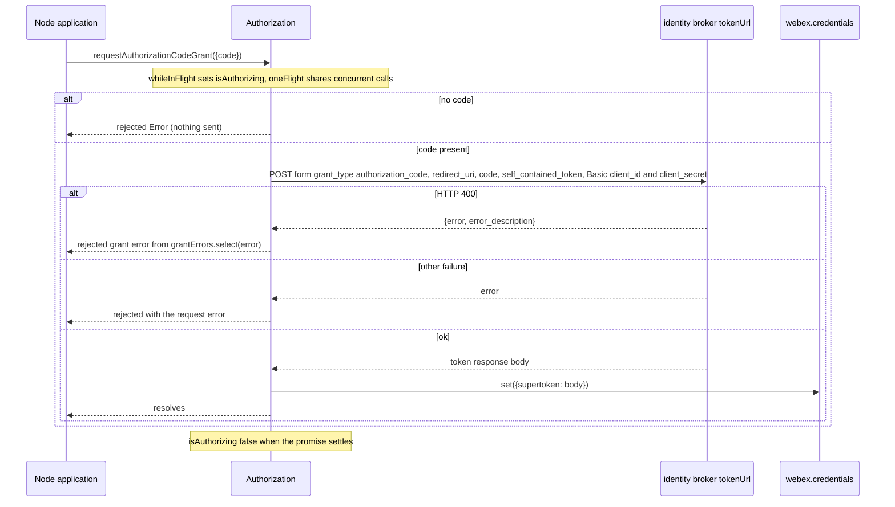
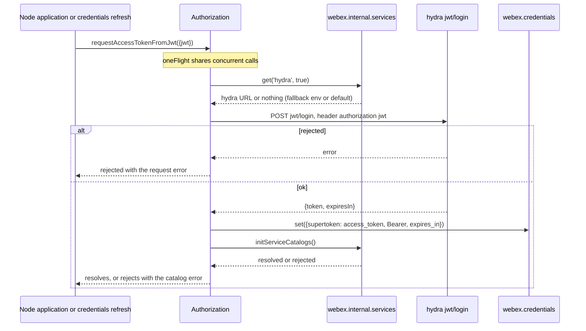
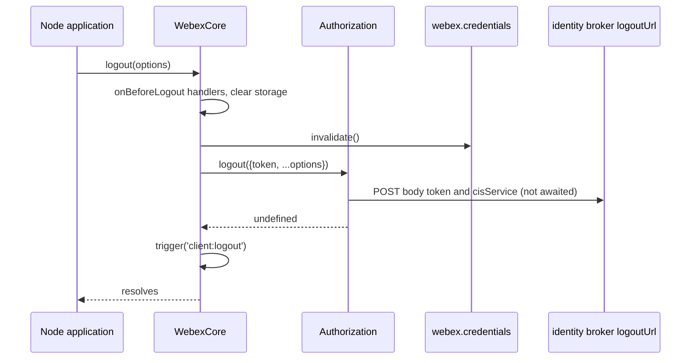
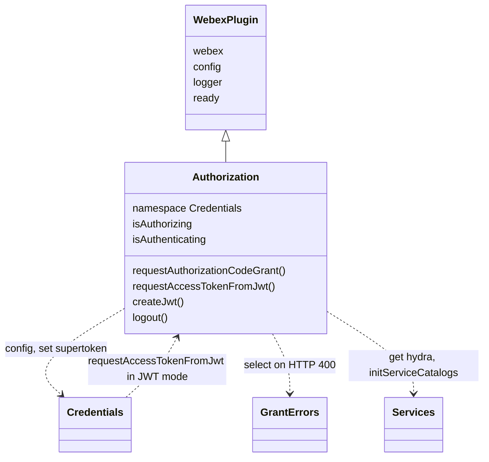

<!-- sdd-generated-metadata
doc_kind: module-spec
generated_from: module-spec@0.3.0
generated_by: claude-code
approved_by: rarajes2@cisco.com
updated_at: 2026-11-11T10:02:07Z
validation_status: pass-with-warnings
-->

# Node authorization plugin

This source-local document at `src/docs/README.md` owns the stable specification for **the Node
authorization plugin**: the `webex.authorization` plugin that the Node builds of the SDK use. It
exchanges an OAuth authorization code for a supertoken with the confidential client credentials,
exchanges a caller-supplied JWT for an access token through hydra, mints guest JWTs, and posts a
logout request to the identity broker. Ground every claim in package evidence and link to the
[package architecture](../../docs/architecture.md) instead of repeating broader facts. No service
specification exists because this package is a library.

Related context: [documentation index](../../docs/index.md) ·
[package agent instructions](../../AGENTS.md)

## Metadata

| Field             | Value |
| ----------------- | ----- |
| Owner             | @webex/web-sdk |
| Source path       | `src` |
| Resource kind     | package |
| Status            | Draft |
| Last verified     | 2026-11-11 at `2e7b9d76e2` |
| Module id         | `plugin-authorization-node` |
| Parent spec       | — |
| Doc kind          | Module spec |
| Coverage score    | 93.3% assessed 2026-11-11 — 14 of 15 mandatory fields PRESENT, critical 8 of 8; test strategy is WEAK because only `requestAuthorizationCodeGrant` has unit cases (4), and registration, the grant-error mapping, `requestAccessTokenFromJwt`, `createJwt`, and `logout` have none |
| Validation status | Pass with warnings — validator 01a1c9cd-55f4-7613-abca-abe80cb94018 assessed 2026-11-11; one Important test-strategy warning remains; the module stays Partial |

## Applicability

| Condition ID                         | Status     | Evidence or reason | Owned section |
| ------------------------------------ | ---------- | ------------------ | ------------- |
| `module.has_tiers`                   | N/A        | No tier policy exists in this package or its `package.json` | Tier |
| `module.has_ui`                      | N/A        | `src/authorization.js` makes HTTP requests only; it renders nothing and never navigates | UI use-case flow |
| `module.crosses_service_boundaries`  | Applicable | `src/authorization.js` POSTs to the identity broker token and logout endpoints and to the hydra jwt/login endpoint | Cross-boundary use-case flow |
| `module.holds_client_state`          | Applicable | Session property isAuthorizing and derived alias isAuthenticating in `src/authorization.js`, proxied onto the webex instance by `src/index.js` | Client state model |
| `module.enforces_domain_rules`       | Applicable | The required authorization code, the HTTP 400 to grant-error mapping, and the guest JWT claim rules in `src/authorization.js` | Business rules and invariants |
| `module.is_concurrent_async`         | Applicable | oneFlight and whileInFlight decorators and the fire-and-forget logout request in `src/authorization.js` | Concurrency and reactive flow |
| `module.owns_persistence`            | N/A        | `src/authorization.js` stores nothing; every token is handed to webex-core credentials | Data, schema, and migration discipline |
| `module.stateful_transitions`        | N/A        | isAuthorizing is a promise-scoped boolean in `src/authorization.js`, covered under Client state model | State machine |
| `module.exposes_wire_protocol`       | Applicable | The authorization-code grant form, the jwt/login request and response, the guest JWT claims, and the logout body in `src/authorization.js` | Protocol and wire format |
| `module.ui_multi_screen`             | N/A        | No UI | UI flow |
| `module.large_data_model`            | N/A        | The module defines no entity types; the supertoken shape belongs to webex-core credentials | Data model |
| `module.returns_caller_errors`       | Applicable | Rejected promises and synchronous throws from requestAuthorizationCodeGrant, requestAccessTokenFromJwt, and createJwt in `src/authorization.js` | Caller-visible failure modes |
| `module.module_specific_conventions` | Applicable | The Credentials config namespace, the credentials: log prefix, and the decorator order in `src/authorization.js` | Module-specific rules |
| `module.published_package`           | Applicable | `package.json` names the package @webex/plugin-authorization-node and defines deploy:npm | Export stability |
| `module.embedded_in_host`            | N/A        | No host theme or embed API | Host integration and theming |
| `module.has_design_tradeoff`         | Applicable | A logout that is not awaited, oneFlight keyed by method name only, and the config namespace shared with credentials, in `src/authorization.js` | Key design trade-off |
| `module.has_submodules`              | N/A        | The src directory has no child module | Sub-modules |

## Evidence register

| Evidence | What it establishes |
| -------- | ------------------- |
| `src/index.js` | Side-effect import of `@webex/internal-plugin-device`; public plugin registration as `authorization` with `config` and the `isAuthorizing` and `isAuthenticating` proxies; re-exports of the default class and `config` |
| `src/authorization.js` | The `Authorization` plugin: `requestAuthorizationCodeGrant`, `requestAccessTokenFromJwt`, `createJwt`, `logout`, and the `isAuthorizing` and `isAuthenticating` properties. Its JSDoc and inline comments are the only recorded rationale |
| `src/config.js` | Default export `{credentials: {}}`; the package contributes no configuration value |
| `package.json` | Name, `main` (`dist/index.js`), `devMain` (`src/index.js`), `engines` (`node >=16`), an empty `browser` field, dependencies, and scripts |
| `process` | Package-root module exporting `{browser: true}`; nothing in `src/` imports it and no package script names it |
| `test/unit/spec/authorization.js` | 4 `nodeOnly` unit cases for `requestAuthorizationCodeGrant`: the missing-code rejection, the supertoken set from the response, and both in-flight flags. A `browserOnly` placeholder case keeps the suite from crashing under karma. It imports the package by name, so it loads `dist/` |
| `test/integration/spec/authorization.js` | `nodeOnly` cases against live services: `logout` reached through `webex.logout()`, `requestAccessTokenFromJwt` with an app-user JWT, and `requestAuthorizationCodeGrant` with auth-code-only test users with and without the webex entitlement. The JWT refresh case is `describe.skip` |
| `README.md` | Retained npm page; context only. Its differences from code are recorded in `docs/adr/0001-keep-existing-docs-separate.md` |
| `NODE-OAUTH-FLOW-GUIDE.md` | Retained technical guide; context only. Its differences from code are recorded in `docs/adr/0001-keep-existing-docs-separate.md` |
| Sibling package webex-core, file src/lib/credentials/docs/README.md | Module spec consulted. `tokenUrl` and `logoutUrl` derive from `idbroker.url` (`TOKEN_URL` overrides `tokenUrl`); `client_id`, `client_secret`, and `redirect_uri` come from configuration or environment; `client_secret` is the Node-only secret sent as Basic credentials; `credentials.set({supertoken})` stores tokens; `grantErrors.select` maps OAuth error strings and falls back to `OAuthError`; in JWT mode `refresh()` calls `jwtRefreshCallback` and then this plugin's `requestAccessTokenFromJwt`; `CredentialsConfig` declares `cisService` but no `service` key |
| Sibling package webex-core, file src/lib/services/docs/README.md | Module spec consulted. `get(name, true)` returns the priority host URL or the default; `initServiceCatalogs` collects the preauth and, when authorized, postauth catalogs, and rejects when the org id or preauth collection fails |
| Sibling package webex-core, file src/docs/README.md | Module spec consulted. `registerPlugin` is first-wins and supports `proxies`; `WebexPlugin` supplies `webex`, `request`, namespaced `config`, `logger`, and a `ready` property that defaults to `true`; `logout` clears storage, invalidates credentials, then calls `authorization.logout(options)` with `token` defaulted to the refresh token, else the access token |
| Sibling package webex-core, file src/lib/credentials/grant-errors.js | Source consulted. `OAuthError.parse` reads `error`, `error_description`, and `error_uri` from `res.body`, else from the argument itself |
| Sibling package http-core, file src/request/docs/README.md | Module spec consulted. The Node transport hands the options to the `request` library, which serializes `form` as urlencoded and builds Basic auth from `auth`; `json: true` is the default |
| Sibling package common, file src/docs/README.md | Module spec consulted. `oneFlight` shares one in-flight promise per key, where the key is the method name unless a `keyFactory` is given; `whileInFlight` sets a boolean for a promise's duration and clears it on settle |
| Sibling package internal-plugin-device, file src/docs/README.md | Module spec consulted. Importing that package registers internal plugin `device` and its `onBeforeLogout` unregister hook |
| Sibling package plugin-authorization, file src/index.js | Source consulted (no spec). The Node entry of `@webex/plugin-authorization` re-exports this package; its `package.json` `browser` field maps browser builds to the browser entry instead. `webex-node` and `webex` require `@webex/plugin-authorization`, and `@webex/webex-server` imports this package directly |
| Sibling package eslint-config-legacy, file static/ignore-patterns.js | Source consulted. The shared lint config ignores every file named `authorization.js` (listed under "Files with decorator"), `docs/**`, and `*.md` |
| Observation, no stated WHY | `logout` neither returns nor awaits its request, although `WebexCore#logout` chains on its return value; `logout` reads `config.service`, which `CredentialsConfig` does not declare; `createJwt` decodes `secretId` outside its `try`, so a missing secret throws synchronously; without `displayName`, `sub` and `name` use two different uuids; the log prefix is `credentials:`, not `authorization:` |

## Purpose and boundary

- Responsibility: run the server-side OAuth steps of the SDK in Node. That means exchanging an
  authorization code at the identity broker token endpoint with the configured client id and secret,
  exchanging a host-supplied JWT for an access token through hydra, minting a guest JWT from an issuer
  and secret, and posting a logout request with the token `WebexCore#logout` supplies.
- In scope: the `authorization` plugin API and its in-flight flags; the authorization-code grant
  request and its HTTP 400 error mapping; the hydra `jwt/login` request and response mapping; the
  guest JWT claims; the logout request body.
- Out of scope: obtaining the authorization code (the host's browser front end and the identity
  broker); CSRF `state` checks (the host's redirect handler; this module receives only `code`);
  deriving `tokenUrl` and `logoutUrl`, storing, scheduling, refreshing, and revoking tokens, and the
  OAuth error classes (webex-core credentials); catalog lookups and `initServiceCatalogs` (webex-core
  services); request transport (webex-core and http-core); device registration (the
  `@webex/internal-plugin-device` package, imported only for its side effect); browser login flows (the
  separate `@webex/plugin-authorization-browser` package).
- Consumers: the Node entry of `@webex/plugin-authorization`, which `webex-node` and `webex` require;
  `@webex/webex-server`, which imports this package directly; webex-core credentials in JWT mode,
  which calls `requestAccessTokenFromJwt`; `WebexCore#logout`, which calls `logout`; and Node
  applications that call `webex.authorization`.

## Structure and key files

| Path | Responsibility |
| ---- | -------------- |
| `src/index.js` | Imports `@webex/internal-plugin-device`, calls `registerPlugin('authorization', Authorization, {config, proxies})`, and re-exports `Authorization` (default) and `config` |
| `src/authorization.js` | The `Authorization` class, built with `WebexPlugin.extend` in namespace `Credentials`; the only place where flow behavior lives |
| `src/config.js` | Default export `{credentials: {}}` |
| `process` | Package-root file exporting `{browser: true}`; not imported by `src/` |
| `package.json` | Package name, entry points, scripts, and dependencies |
| `babel.config.js`, `jest.config.js` | Re-exports of the legacy Babel and Jest configurations |
| `.eslintrc.js` | Sets `root: true` and extends `@webex/eslint-config-legacy` |
| `src/docs/README.md` | This module specification; ignored by the build and by lint |
| `test/unit/spec/authorization.js` | Unit spec run by Jest through `webex-legacy-tools` |
| `test/integration/spec/authorization.js` | Node-only cases against live services, run by `test:integration` |
| dist/ (generated) | Build output of `build:src`; ignored by Git and never edited by hand |

## Public surface

| Surface | Consumer | Compatibility commitment | Source |
| ------- | -------- | ------------------------ | ------ |
| Import side effect: public plugin `authorization` with proxies `isAuthorizing`, `isAuthenticating`, plus internal plugin `device` | `@webex/plugin-authorization` Node entry, `webex-node`, `webex` in Node, `@webex/webex-server` | First registration of the name wins, so another authorization plugin imported earlier takes `authorization` | `src/index.js` |
| Default export `Authorization` and named export `config` (`{credentials: {}}`) | `@webex/plugin-authorization` Node entry; webex-core config merge | `config` adds no credentials key | `src/index.js`, `src/config.js` |
| `webex.authorization.requestAuthorizationCodeGrant({code})` | Node applications holding a code from their redirect handler | Resolves with no value after storing the supertoken; rejects with a grant error on HTTP 400 | `src/authorization.js` |
| `webex.authorization.requestAccessTokenFromJwt({jwt})` | Applications with guest or app-user JWTs; webex-core credentials in JWT mode | Resolves with no value after storing the supertoken and initializing the service catalogs | `src/authorization.js` |
| `webex.authorization.createJwt({issuer, secretId, displayName, expiresIn})` | Applications minting guest JWTs | Resolves `{jwt}`; rejects when signing fails | `src/authorization.js` |
| `webex.authorization.logout(options)` | `WebexCore#logout` | Sends the logout request and returns `undefined` without waiting for it | `src/authorization.js` |
| Properties `isAuthorizing`, `isAuthenticating`, and the inherited `ready` | Applications and the webex instance proxies | `isAuthenticating` is a derived alias of `isAuthorizing`; `ready` keeps the `WebexPlugin` default `true` | `src/authorization.js` |

Contract ID `authorization-node-sdk` is indexed in the
[package architecture](../../docs/architecture.md#public-and-consumer-surfaces) and registered in
`.sdd/manifest.json`. Export stability is under [Export stability](#export-stability).

## Dependencies

| Dependency | Why it is required | Failure behavior |
| ---------- | ------------------ | ---------------- |
| `@webex/webex-core` credentials (module spec consulted) | `tokenUrl`, `logoutUrl`, `client_id`, `client_secret`, and `redirect_uri` through the shared `credentials` config; `credentials.set({supertoken})`; `grantErrors` | An unset `client_id` makes the `request` library fail before sending ("no auth mechanism defined"), and the caller gets that `statusCode: 0` rejection unchanged; an unset `client_secret` sends Basic `client_id:` with an empty password, and the broker's error becomes a grant error only if it is HTTP 400 |
| `@webex/webex-core` services (module spec consulted) | `get('hydra', true)` for the JWT exchange URL; `initServiceCatalogs()` after the exchange | A rejected `initServiceCatalogs` rejects `requestAccessTokenFromJwt` after the supertoken is already set; a missing services plugin throws a `TypeError` |
| `@webex/webex-core` plugin host (module spec consulted) | `WebexPlugin`, `registerPlugin`, `this.webex.request`, namespaced `config`, and `logger` | Request rejections propagate, except HTTP 400 on the code grant |
| `@webex/http-core` request transport (module spec consulted; reached through `webex.request`) | The `request` library handles the `form` body and the `auth` Basic credentials on the code grant | Transport failures arrive as rejections |
| `@webex/common` (module spec consulted) | `oneFlight`, `whileInFlight` | Not applicable |
| `@webex/internal-plugin-device` (module spec consulted) | Imported for its side effect: registering internal plugin `device` | Not applicable |
| Identity broker token endpoint (external) | Authorization-code grant | HTTP 400 maps to a grant error; other failures propagate unchanged |
| Identity broker logout endpoint (external) | Logout request | Not observed by the caller; see Pitfalls |
| Hydra `jwt/login` (external) | Exchange of a host JWT for an access token | The `webex.request` rejection propagates unchanged |
| `jsonwebtoken` | `jwt.sign` with the default HS256 for guest JWTs | A sign error, including a missing `expiresIn`, rejects `createJwt` |
| `uuid` | Version 4 values for the guest subject and default name | Not applicable |
| Node `Buffer` | Base64 decoding of `secretId` | A missing `secretId` throws synchronously from `createJwt` |

## Requirements

| ID | WHAT | WHY | Source evidence | Test or example evidence | Assumptions or gaps | Confidence |
| -- | ---- | --- | --------------- | ------------------------ | ------------------- | ---------- |
| `MOD-001` | Importing the package imports `@webex/internal-plugin-device`, then registers public plugin `authorization` with the package config and proxies `isAuthorizing` and `isAuthenticating` onto the webex instance. | The Node entry of `@webex/plugin-authorization` re-exports this package, so Node builds get `webex.authorization` from it, and hosts read the in-flight flag from the instance. | `src/index.js` | `test/integration/spec/authorization.js` imports the package and calls `webex.authorization` on a real `WebexCore`; the unit spec builds the plugin through MockWebex children instead | No unit case exercises `registerPlugin`, the proxies, or the device import | Weak |
| `MOD-002` | `Authorization` extends `WebexPlugin` in namespace `Credentials`, so `this.config` is `webex.config.credentials`. It overrides no `initialize` and defines no `ready`, so the inherited `ready` stays `true`. `src/config.js` contributes `{credentials: {}}`. | The JSDoc names the class "NodeJS support for OAuth2": every value it sends (`tokenUrl`, `client_id`, `client_secret`, `redirect_uri`, `logoutUrl`) is credentials configuration, so it reads that namespace instead of keeping its own. | `src/authorization.js`, `src/config.js` | `test/unit/spec/authorization.js` mounts the Credentials plugin so `webex.credentials.set` stores the supertoken; its `config.credentials` comes from the MockWebex mock config, which also sets `service` | The shared-namespace read is exercised only against mock values | Present |
| `MOD-003` | `requestAuthorizationCodeGrant(options)` logs `credentials: requesting authorization code grant` at `info`, then rejects with an `Error` whose message is ``` `options.code` is required ``` when `options.code` is falsy, sending nothing. | The JSDoc: the method exchanges an authorization code, so without a code there is nothing to exchange. | `src/authorization.js` | `test/unit/spec/authorization.js` missing-code case | None | Present |
| `MOD-004` | With a code, it POSTs to `config.tokenUrl` the form `{grant_type: 'authorization_code', redirect_uri, code, self_contained_token: true}` with Basic auth `client_id` and `client_secret` (`sendImmediately: true`) and `shouldRefreshAccessToken: false`, then calls `webex.credentials.set({supertoken: res.body})` and resolves with no value. | The JSDoc: exchange an authorization code for an access token. The confidential client authenticates with its secret, which is why the exchange runs in Node; webex-core credentials uses the same Basic-plus-`shouldRefreshAccessToken: false` pattern for every client-authenticated token call. | `src/authorization.js` | `test/unit/spec/authorization.js` "exchanges an authorization code for an access token"; `test/integration/spec/authorization.js` both `#requestAuthorizationCodeGrant()` cases | The unit case asserts only `supertoken.access_token`, not the request form or auth | Present |
| `MOD-005` | When the request rejects with `statusCode` 400, it rejects with `new (grantErrors.select(res.body.error))(res._res \|\| res)`; any other rejection is passed through unchanged. | The 400 response carries the OAuth `error` string, which the credentials grant-error classes are keyed by, so callers can branch on the error class. | `src/authorization.js` | None found in this package | No test covers either branch; `res.body.error` is read without a guard | Weak |
| `MOD-006` | `isAuthorizing` is `true` from the call to `requestAuthorizationCodeGrant` until its promise settles, and `isAuthenticating` mirrors it. Concurrent calls share one flight. | The JSDoc: `isAuthorizing` indicates an authorization-code exchange is in flight, and `isAuthenticating` is its alias. | `src/authorization.js` | `test/unit/spec/authorization.js` "sets #isAuthorizing", "sets #isAuthenticating" | Sharing the flight is not tested; see Pitfalls for its key | Present |
| `MOD-007` | `requestAccessTokenFromJwt({jwt})` POSTs to `<hydra>jwt/login` with header `authorization: <jwt>`. The hydra URL comes from `services.get('hydra', true)`, given a trailing `/`, else `process.env.HYDRA_SERVICE_URL`, else `https://api.ciscospark.com/v1/`. It stores `{access_token: body.token, token_type: 'Bearer', expires_in: body.expiresIn}` as the supertoken, then calls `initServiceCatalogs()`. Concurrent calls share one flight. | The JSDoc: request a Webex access token for a user already authenticated into the host product; the inline comment adds the `/` so the catalog URL matches the environment format. | `src/authorization.js` | `test/integration/spec/authorization.js` "exchanges a JWT for an appid access token", "should call services#initServiceCatalogs()" (Node-only, live services) | No unit case; the hydra fallbacks and a catalog rejection are untested | Weak |
| `MOD-008` | `requestAccessTokenFromJwt` keeps its name, its `{jwt}` argument, and its `oneFlight` decorator. | The JSDoc: a `jwtRefreshCallback` of the form `Promise<jwt> = jwtRefreshCallback(webex)` is needed for automatic token refresh, and webex-core credentials calls this method with that JWT. | `src/authorization.js` | `test/integration/spec/authorization.js` "refreshes the access token" (skipped with describe.skip) | The refresh path has no runnable test in this package | Weak |
| `MOD-009` | `createJwt({issuer, secretId, displayName, expiresIn})` signs `{sub: guest-user-<uuid>, iss: issuer, name: displayName or "Guest User - <uuid>"}` with the base64-decoded `secretId` and `{expiresIn}`, using the `jsonwebtoken` default HS256, and resolves `{jwt}`; a signing error rejects. | The JSDoc: create a JWT user token from a guest issuer ID and secret, with an optional display name. | `src/authorization.js` | None found in this package | No test. A missing `expiresIn` rejects because `jsonwebtoken` 9 rejects an undefined `expiresIn` option | Weak |
| `MOD-010` | `logout(options = {})` POSTs to `config.logoutUrl` the body `{token: options.token, cisService: config.service}` and returns `undefined`; it neither returns nor awaits the request. `WebexCore#logout` calls it last with `token` defaulted to the refresh token, else the access token. | No WHY is stated in code; `WebexCore#logout` calls it after credentials are invalidated, so the token must come from `options`. | `src/authorization.js` | `test/integration/spec/authorization.js` "invalidates all of the use's tokens" asserts only that `webex.authorization.logout` was called | The request body and its outcome are untested | Weak |

## Design overview

`Authorization` extends `WebexPlugin` in namespace `Credentials`, so `this.config` is
`webex.config.credentials`, the same configuration the webex-core credentials plugin reads. The
plugin builds requests; credentials owns the tokens. Every successful token path ends with
`webex.credentials.set({supertoken})`.

The authorization-code grant spans two parts of a host application. A browser front end sends the
user to the identity broker, and the broker returns a `code` to the host's redirect URI. The host's
Node back end then calls `requestAuthorizationCodeGrant({code})`. This module sends the code with
the confidential client id and secret and stores the response body as the supertoken. Obtaining the
code and checking any CSRF `state` happen outside this package.

JWT login needs no redirect: the host obtains a JWT (or mints a guest one with `createJwt`) and
`requestAccessTokenFromJwt` exchanges it with hydra. Credentials also reuses that method when JWT mode
refreshes through `jwtRefreshCallback`.

Logout is the last step of `WebexCore#logout`. This module only sends the broker logout request.

## Data flow and sequence coverage

Call style: in-process calls on `webex.authorization`; outbound HTTPS through `webex.request`.
Three operation groups differ in actors, ordering, or outcome, and each has a diagram. `createJwt` is
a local computation with no other actor and is described in Protocol and wire format.

| Operation group | Entry and outcome | Diagram or evidence | Failure and recovery coverage |
| --------------- | ----------------- | ------------------- | ----------------------------- |
| Exchange an authorization code | `requestAuthorizationCodeGrant` stores the supertoken | Code-grant diagram; `src/authorization.js` | Missing code rejects; HTTP 400 maps to a grant error; others propagate |
| Exchange a JWT | `requestAccessTokenFromJwt` stores the supertoken and initializes catalogs | JWT diagram; `src/authorization.js` | Request or catalog rejection propagates |
| Logout | `WebexCore#logout` calls `logout` | Logout diagram; `src/authorization.js` | The request outcome is not observed |

### Exchange an authorization code



### Exchange a JWT



### Logout



## Class and component relationships



`Authorization` reaches credentials and services through `this.webex` at call time, so it holds no
references of its own.

## Use cases and flows

| Use case | Actor or caller | Primary steps and outcome | Failure or boundary behavior | Evidence |
| -------- | --------------- | ------------------------- | ---------------------------- | -------- |
| `UC-001` | Node back end of a confidential client | Receives `code` on its redirect handler and calls `requestAuthorizationCodeGrant({code})`; the supertoken is stored | HTTP 400 rejects with a grant error; the host validates `state` itself | `src/authorization.js`, `test/integration/spec/authorization.js` |
| `UC-002` | Node application with an app-user or guest JWT | Calls `requestAccessTokenFromJwt({jwt})`, optionally after `createJwt` | Request rejection propagates | `src/authorization.js`, `test/integration/spec/authorization.js` |
| `UC-003` | JWT-mode refresh | Credentials calls `jwtRefreshCallback`, then `requestAccessTokenFromJwt` with the new JWT | Rejection fails the refresh | `src/authorization.js` |
| `UC-004` | Node application signing out | Calls `webex.logout()`; core calls `authorization.logout` | The logout request outcome is not reported | `src/authorization.js`, `test/integration/spec/authorization.js` |

### Cross-boundary use-case flow

| Boundary | Transport and ordering | Compatibility | Timeout, retry, and recovery |
| -------- | ---------------------- | ------------- | ---------------------------- |
| Identity broker token endpoint (`UC-001`) | HTTPS POST through `webex.request`, urlencoded form, Basic client credentials | Form fields under Protocol and wire format; error body `error` | No retry; `oneFlight` collapses simultaneous calls |
| Hydra `jwt/login` (`UC-002`, `UC-003`) | HTTPS POST through `webex.request` with the JWT in the `authorization` header | Response fields `token` and `expiresIn` | No plugin-local retry; `oneFlight` collapses simultaneous calls. The request does not set `shouldRefreshAccessToken: false`, so on HTTP 401 the webex-core `AuthInterceptor` refreshes credentials when `canRefresh` and replays it (at most `maxAuthenticationReplays`, default 1) |
| Identity broker logout endpoint (`UC-004`) | HTTPS POST through `webex.request` after credentials are invalidated; not awaited | Body `token` and `cisService` | None; a failure is not observed |

## Client state model

| State or slice | Owner | Initial state | Transition triggers | Reset or persistence boundary |
| -------------- | ----- | ------------- | ------------------- | ----------------------------- |
| `isAuthorizing` (session) and `isAuthenticating` (derived alias) | Authorization | `false` | `whileInFlight` around `requestAuthorizationCodeGrant` | Cleared when the wrapped promise settles; proxied onto the webex instance. As ampersand properties they fire `change:isAuthorizing` and `change:isAuthenticating`, the only events tied to this module |
| `ready` (inherited session property) | `WebexPlugin` | `true` | None in this module | Never changed here |
| `webex.credentials.supertoken` | webex-core credentials | per credentials | Set from the code-grant response body or the JWT exchange | Owned and persisted by credentials |

## Business rules and invariants

| ID | Invariant | WHY | Enforcement source | Test evidence |
| -- | --------- | --- | ------------------ | ------------- |
| `INV-001` | No token request is sent without an authorization code. | The JSDoc: the method exchanges an authorization code, and `options.code` is required. | `src/authorization.js` | `test/unit/spec/authorization.js` |
| `INV-002` | The code grant authenticates with the configured client id and secret and never triggers an access-token refresh. | The confidential client proves itself with its secret; `shouldRefreshAccessToken: false` keeps a failing grant from recursing into refresh, the pattern webex-core credentials uses for client-authenticated calls. | `src/authorization.js` | `test/integration/spec/authorization.js` |
| `INV-003` | A token reaches the SDK only through `webex.credentials.set({supertoken})`. | The design keeps token storage, scheduling, and refresh in credentials. | `src/authorization.js` | `test/unit/spec/authorization.js` |
| `INV-004` | An HTTP 400 from the token endpoint becomes a grant-error instance chosen by the OAuth `error` string. | Callers can branch on the error class instead of parsing the body. | `src/authorization.js` | None found |

## Concurrency and reactive flow

- Execution model: single Node event loop; every method is promise-based except `logout`, which
  returns `undefined`.
- Ordering guarantees: in `requestAccessTokenFromJwt` the supertoken is set before
  `initServiceCatalogs` starts. In `WebexCore#logout`, `logout` runs after credentials are
  invalidated, and `client:logout` fires without waiting for the logout request.
- Idempotency and retry: `oneFlight` makes simultaneous calls of the same method share one request.
  Its key is the method name, so a second concurrent call with a different `code` or `jwt` receives
  the first call's result. This module adds no retry. The webex-core `AuthInterceptor` still applies
  its HTTP 401 refresh-and-replay to every request that does not set `shouldRefreshAccessToken:
  false`: the JWT exchange and the logout request, but not the code grant.
- Shared-state protection: `whileInFlight('isAuthorizing')` wraps the `oneFlight`-wrapped
  `requestAuthorizationCodeGrant`, so every concurrent caller raises the flag and each clears it when
  the shared promise settles.
- Blocking restrictions: none in this module; the host must not rely on `logout` completing before
  `client:logout`.

## Protocol and wire format

| Message or frame | Version | Producer or serializer | Consumer or parser | Compatibility and ordering rule |
| ---------------- | ------- | ---------------------- | ------------------ | ------------------------------- |
| `POST <tokenUrl>`, urlencoded form `grant_type=authorization_code`, `redirect_uri`, `code`, `self_contained_token=true`; Basic auth `client_id:client_secret` | OAuth 2.0 | `requestAuthorizationCodeGrant` | Identity broker | The whole response body is stored as the supertoken |
| Token endpoint HTTP 400 body `error`, `error_description`, `error_uri` | OAuth 2.0 | Identity broker | `requestAuthorizationCodeGrant`, then `OAuthError.parse` | `error` selects the grant-error class |
| `POST <hydra>jwt/login`, header `authorization: <jwt>`; response `{token, expiresIn}` | Unversioned | `requestAccessTokenFromJwt` | Hydra | Mapped to `{access_token, token_type: 'Bearer', expires_in}` |
| Guest JWT: header `alg: HS256`; claims `sub: guest-user-<uuid>`, `iss`, `name`, plus `iat` and `exp` (from `expiresIn`) added by `jsonwebtoken` | JWT | `createJwt` | Hydra, through `requestAccessTokenFromJwt` | Signed with the base64-decoded `secretId` |
| `POST <logoutUrl>`, JSON body `{token, cisService}` | Unversioned | `logout` | Identity broker | `token` comes from `WebexCore#logout`; `cisService` is `config.service` |

## Caller-visible failure modes

| Condition | Signal or result | Caller behavior | Retry or recovery | Evidence |
| --------- | ---------------- | --------------- | ----------------- | -------- |
| `requestAuthorizationCodeGrant` without `code` | Rejected `Error` with message ``` `options.code` is required ``` | Pass the code from the redirect | None | `src/authorization.js`, `test/unit/spec/authorization.js` |
| Token endpoint returns HTTP 400 | Rejected grant error (`InvalidGrantError`, `InvalidClientError`, and so on, else `OAuthError`) | Branch on the class or `error` | Obtain a new code | `src/authorization.js` |
| Token endpoint fails otherwise | The `webex.request` rejection, unchanged | Handle the HTTP error | Caller may retry with the same code if the broker allows | `src/authorization.js` |
| `requestAccessTokenFromJwt()` with no argument | Synchronous `TypeError` from destructuring | Pass `{jwt}` | None | `src/authorization.js` |
| Hydra `jwt/login` fails | The `webex.request` rejection, unchanged; an HTTP 401 is first refreshed and replayed by the webex-core `AuthInterceptor` when credentials can refresh | Handle the HTTP error | Caller may retry | `src/authorization.js`, `test/integration/spec/authorization.js` |
| `initServiceCatalogs` fails after the JWT exchange | Rejected promise, though the supertoken is already set | Check `canAuthorize` before retrying | Caller may retry catalog initialization | `src/authorization.js` |
| `createJwt` without `secretId`, or with no argument | Synchronous `TypeError` (from `Buffer.from` or destructuring), not a rejection | Fix the arguments | None | `src/authorization.js` |
| `createJwt` cannot sign (for example `expiresIn` omitted) | Rejected promise with the `jsonwebtoken` error | Fix the arguments | None | `src/authorization.js` |
| Logout request fails | Not reported to the caller | None available | None | `src/authorization.js` |

## Pitfalls and constraints

- `logout` does not return its request promise. `WebexCore#logout` therefore resolves and triggers
  `client:logout` before the broker logout request finishes, and a failure of that request is not
  observed by the caller.
- `logout` sends `cisService: this.config.service`, but `CredentialsConfig` declares `cisService`
  (default `webex`) and no `service` key, so with default configuration `cisService` is undefined. The
  webex-core credentials specification records the same mismatch for `buildLogoutUrl`.
- `oneFlight` keys on the method name only. While one `requestAuthorizationCodeGrant` or
  `requestAccessTokenFromJwt` call is in flight, a second call with a different `code` or `jwt`
  resolves or rejects with the first call's result and its argument is never sent.
- `@whileInFlight('isAuthorizing')` sits outside `@oneFlight` on `requestAuthorizationCodeGrant`, the
  reverse of the order the webex-core credentials specification recommends; each caller toggles the
  flag around the shared promise.
- The code grant stores the whole response body as the supertoken without mapping its fields.
- A non-400 failure on the code grant is passed through raw, while a 400 is wrapped. `res.body.error`
  is read without a guard, so a 400 without a body rejects with a `TypeError` instead of a grant
  error.
- No CSRF or `state` check exists in this package; the host's redirect handler must verify `state`
  before calling `requestAuthorizationCodeGrant`.
- The code grant sends `credentials.redirect_uri` with the code, so the host must configure the same
  redirect URI it used to obtain the code; configuring only `client_id` and `client_secret` is not
  enough.
- `requestAccessTokenFromJwt` falls back to `process.env.HYDRA_SERVICE_URL` and then to
  `https://api.ciscospark.com/v1/` when the catalog has no `hydra` entry, and it requires
  `webex.internal.services`.
- A `jwt/login` HTTP 401 is not always one request. When `credentials.canRefresh` is true (always, in
  JWT mode), the webex-core `AuthInterceptor` calls `credentials.refresh()`, deletes the
  `authorization` header, and replays the request, so the replay does not carry the original JWT. In
  JWT mode that refresh calls `requestAccessTokenFromJwt` again, which `oneFlight` joins to the
  pending call (inferred from code; not exercised by a test).
- `createJwt` decodes `secretId` before its `try`, so a missing secret, or one `Buffer.from` cannot
  accept (for example a number), throws synchronously instead of rejecting. A missing `expiresIn` rejects. Without `displayName`, `sub` and
  `name` carry two different uuids.
- The `credentials:` log prefix is shared with the webex-core credentials plugin, so this module's log
  line is indistinguishable by prefix.
- `src/config.js` sets no `clientType`; nothing in this module reads `clientType`.
- The shared lint config ignores every file named `authorization.js`, so `test:style` lints only
  `src/index.js` and `src/config.js`.
- `test/unit/spec/authorization.js` imports the package by name, which loads `dist/`. Run `build:src`
  before `test:unit`, or the tests run against stale output.
- `test:browser` runs the specs through karma, where every `nodeOnly` suite is skipped; only the
  placeholder case runs, so it verifies no behavior.
- `package.json` declares `engines.node` `>=16`, lower than the sibling browser package's `>=18`, and
  an empty `browser` field.

## Module-specific rules

- Do: hand every token to `webex.credentials.set({supertoken})` and keep token storage out of this
  module (`INV-003`).
- Do: keep `shouldRefreshAccessToken: false` and the Basic client credentials on the code grant
  (`INV-002`).
- Do: keep `requestAccessTokenFromJwt` decorated with `oneFlight` and keep its `{jwt}` argument;
  credentials refresh relies on it (`MOD-008`).
- Do: log through `this.logger` and never log the code, the client secret, a token, or a JWT
  (`src/authorization.js`).
- Do not: add a `state` or CSRF check here without a design change; the code arrives through the
  host's redirect handler (Purpose and boundary).

## Export stability

| Export or entry point | Consumer | Stability | Versioning and deprecation rule | Declaration or API report |
| --------------------- | -------- | --------- | ------------------------------- | ------------------------- |
| Default export `Authorization`, named `config` | `@webex/plugin-authorization` Node entry | Public | No versioning or deprecation rule is declared in the package | `src/index.js` |
| Import side effect: public plugin `authorization` | `@webex/webex-server` and packages that import the barrel | Public | Same | `src/index.js`, `package.json` |
| Plugin API `webex.authorization.*` and its properties | Node applications, webex-core credentials, `WebexCore#logout` | Public | Same | `src/authorization.js` |

No TypeScript declaration or API report is shipped; `package.json` has no `types` field and the
source is JavaScript.

## Key design trade-off

| Chosen trade-off | Preserved invariant or benefit | Cost or limitation | Decision evidence |
| ---------------- | ------------------------------ | ------------------ | ----------------- |
| The plugin reads the shared `credentials` config namespace instead of its own | One configuration (`client_id`, `client_secret`, broker URLs) serves credentials and this plugin | `src/config.js` contributes nothing, and a key read here must exist in `CredentialsConfig` or it is silently undefined (`service`) | `src/authorization.js`, `src/config.js` |
| `oneFlight` keyed by method name | Simultaneous refresh-driven and caller-driven exchanges never race each other | Concurrent calls with different arguments get the first result | `src/authorization.js` |
| `logout` sends its request without returning it | `WebexCore#logout` is never blocked by the broker | Logout failures are invisible to the caller | `src/authorization.js` |

## Verification

| Requirement or invariant | Test level | Positive evidence | Negative or boundary evidence | Gap |
| ------------------------ | ---------- | ----------------- | ----------------------------- | --- |
| `MOD-001` | Integration | `test/integration/spec/authorization.js` (registration through import, live services) | None found | No unit case for registration, proxies, or the device import |
| `MOD-002` | Unit | `test/unit/spec/authorization.js` (config from the MockWebex mock credentials block) | None found | Inherited `ready` not asserted; the mock sets `service`, so it would hide the `cisService` mismatch in a logout case |
| `MOD-003`, `INV-001` | Unit | None found | `test/unit/spec/authorization.js` missing-code case | None |
| `MOD-004`, `INV-002`, `INV-003` | Unit, integration | `test/unit/spec/authorization.js` "exchanges an authorization code for an access token"; `test/integration/spec/authorization.js` code-grant cases | None found | Request form and Basic auth not asserted |
| `MOD-005`, `INV-004` | Unit | None found | None found | No test of the 400 mapping or the pass-through |
| `MOD-006` | Unit | `test/unit/spec/authorization.js` "sets #isAuthorizing", "sets #isAuthenticating" | None found | Shared flight not tested |
| `MOD-007` | Integration | `test/integration/spec/authorization.js` JWT exchange cases (Node-only, live services) | None found | No unit case; hydra fallback and catalog rejection untested |
| `MOD-008` | Integration | `test/integration/spec/authorization.js` refresh case (skipped with describe.skip) | None found | No runnable test |
| `MOD-009` | Unit | None found | None found | No test |
| `MOD-010` | Integration | `test/integration/spec/authorization.js` "invalidates all of the use's tokens" (call only) | None found | Body and outcome untested |

Coverage gaps are recorded above. The integration suite needs live Webex services and test users, so
it is not routine coverage evidence. A module specification is complete only when its public surface,
invariants, failure modes, and test evidence agree with the implementation. Generator-side field
measurement is complete (93.3%, assessed 2026-11-11). Independent semantic validation passed with one Important test-strategy warning on 2026-11-11. A full spec-drift scan on 2026-11-11 found no Blocking drift, and its
documentation findings are corrected. A characterization baseline and promotion past
Partial remain pending.
