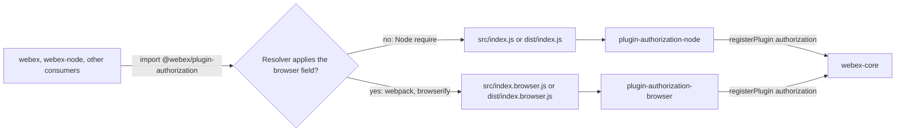
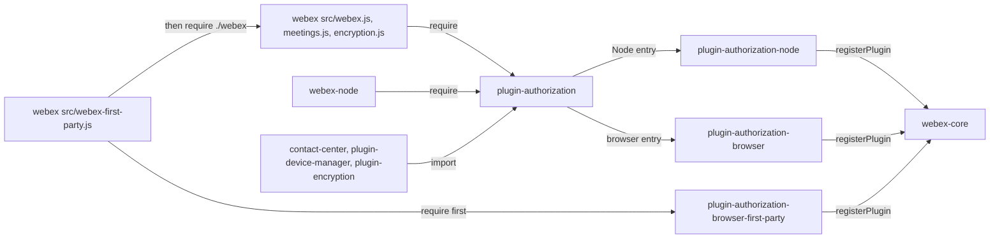

<!-- sdd-generated-metadata
doc_kind: standing-doc
generated_from: architecture@0.3.0
generated_by: claude-code
approved_by: rarajes2@cisco.com
updated_at: 2026-11-12T05:35:41Z
validation_status: pass
-->

# @webex/plugin-authorization architecture

Canonical architecture for this package. Entry-selection behavior lives in the
[module specification](../src/docs/README.md). This page owns package boundaries, the contract
index, the platform split, and how the package meets the rest of the SDK.

Related context: [specification registry](specs/README.md) ·
[package agent instructions](../AGENTS.md)

## Applicability

| Condition ID                         | Status     | Evidence or reason | Owned section |
| ------------------------------------ | ---------- | ------------------ | ------------- |
| `repo.owns_datastore`                | N/A        | No store or migration in `src/index.js` or `src/index.browser.js` | Repository data and schema |
| `repo.holds_client_state`            | N/A        | `src/index.js` and `src/index.browser.js` define no state; the in-flight flags belong to the sibling plugins | Client state model |
| `repo.components_interact`           | Applicable | `src/index.js` and `src/index.browser.js` import the sibling plugins, and workspace consumers import this package | Dependency and interaction topology |
| `repo.domain_data_across_components` | N/A        | The package owns no domain data; `src/index.js` only re-exports | Object and data ownership |
| `repo.caches_data`                   | N/A        | No cache in `src/index.js` | Caching catalog |
| `repo.observability_convention`      | N/A        | No logging, metrics, or tracing in `src/index.js` or `src/index.browser.js` | Observability patterns |
| `repo.deploys_to_infra`              | N/A        | Library published to npm (`package.json`); no service runtime | Runtime and infrastructure |
| `repo.shared_base_libs`              | Applicable | The legacy build, lint, and test stack through `babel.config.js`, `jest.config.js`, and `.eslintrc.js` | Shared and base libraries |
| `repo.is_monorepo`                   | N/A        | This SDD root is one package. The workspace around it is out of scope | Package map and inter-package dependencies |
| `repo.multi_platform`                | Applicable | A Node entry `src/index.js` and a browser entry `src/index.browser.js`, routed by the browser field in `package.json` | Platform matrix |
| `repo.published_package`             | Applicable | `package.json` name is @webex/plugin-authorization and deploy:npm publishes it | Release and versioning |
| `repo.embedded_in_host`              | N/A        | No host theme or embed API in `src/index.js` | Host integration and theming |
| `repo.exposes_commands_or_artifacts` | Applicable | build:src in `package.json` writes dist | Commands and generated artifacts |
| `repo.cross_repo_deps_material`      | Applicable | Every behavior comes from the two sibling plugins listed in `package.json` dependencies | Cross-repository topology |
| `repo.security_arch_warranted`       | N/A        | No credential, token, or secret passes through `src/index.js` or `src/index.browser.js`; the sibling plugins own those trust boundaries | Security architecture |

## Design overview

`@webex/plugin-authorization` is a published library with one module and no behavior of its own. It
gives the SDK a single import name for `webex.authorization` across Node and browser builds:

- the Node entry, `src/index.js` (`main` after build, `devMain` in source), re-exports
  `@webex/plugin-authorization-node`;
- the browser entry, `src/index.browser.js`, re-exports `@webex/plugin-authorization-browser`, and the
  `package.json` `browser` field maps both the built and the source Node entry to it.

The choice is made by the consumer's module resolver, not at run time. Importing the package
imports the selected sibling, and that sibling registers itself as the public plugin
`authorization`. `webex`, `webex-node`, `@webex/contact-center`, `@webex/plugin-device-manager`, and
`@webex/plugin-encryption` all obtain `webex.authorization` this way. `webex-first-party` registers the
first-party browser plugin before this package loads, so registration being first-wins keeps the
first-party plugin.

The package makes no requests, holds no state, and persists nothing.

## Resource inventory and responsibilities

| Resource | Kind | Responsibility | Owner | Source | Detailed specification |
| -------- | ---- | -------------- | ----- | ------ | ---------------------- |
| Environment-selecting authorization entry | package (one module) | Route Node resolvers to the Node authorization plugin and `browser`-field resolvers to the browser authorization plugin | @webex/web-sdk | `src` | [`src/docs/README.md`](../src/docs/README.md) |

## Interaction and execution flows

Representative flow: a consumer imports the package, the resolver picks an entry, and the selected
sibling registers `authorization`.

| From | To | Interaction or transport | Purpose | Failure or compatibility behavior |
| ---- | -- | ------------------------ | ------- | --------------------------------- |
| Workspace consumers and applications | This package | Module import | Obtain `webex.authorization` | The method set depends on the selected entry |
| Node resolver | `src/index.js` / `dist/index.js` | `main` or `devMain` | Node builds | `dist/` must be built for `main` |
| Bundler | `src/index.browser.js` / `dist/index.browser.js` | `browser` field mapping | Browser builds | A resolver that ignores the field bundles the Node plugin |
| Entry file | Sibling plugin | ES module re-export | Deliver `default` and `config` | Import errors propagate |
| Sibling plugin | webex-core | `registerPlugin('authorization', …)` at import | Register the plugin | First registration of the name wins; later ones are ignored |

## Dependency topology

| Dependency | Type | Used by | Purpose | Version, failure, or fallback policy |
| ---------- | ---- | ------- | ------- | ------------------------------------ |
| `@webex/plugin-authorization-node` | Internal | `src/index.js` | Node implementation | Workspace version (`workspace:*` in `package.json`) |
| `@webex/plugin-authorization-browser` | Internal | `src/index.browser.js` | Browser implementation | Workspace version (`workspace:*` in `package.json`) |
| `@webex/webex-core` | Internal, transitive | Both siblings | Plugin registration | Reached only through the siblings; not declared here |
| `@babel/runtime-corejs2` | External, undeclared | `dist/index.js`, `dist/index.browser.js` | Babel runtime helpers added by `@webex/babel-config-legacy` | Not in this package's `package.json`; resolves from the workspace root `devDependencies` |

Both siblings are installed for every consumer, although a build uses one. No import cycle exists:
neither sibling imports this package, and the browser sibling's `src/` does not import the Node
sibling although its `package.json` lists it.

## Public and consumer surfaces

| Surface | Type | Owner | Consumers | Compatibility policy | Source |
| ------- | ---- | ----- | --------- | -------------------- | ------ |
| `authorization-sdk` — package @webex/plugin-authorization: `default`, `config`, and the `main`, `devMain`, and `browser` routing | SDK, published to npm | Environment-selecting authorization entry | `webex` (Node and browser builds), `webex-node`, `@webex/contact-center`, `@webex/plugin-device-manager`, `@webex/plugin-encryption`, applications | No versioning or deprecation rule is declared in the package; the exports mirror the selected sibling | `package.json`, `src/index.js`, `src/index.browser.js` |

The `webex.authorization` API is not defined here. It is `authorization-node-sdk` (owned by
`@webex/plugin-authorization-node`) under Node resolution and `authorization-browser-sdk` (owned by
`@webex/plugin-authorization-browser`) under the `browser` field. Both are registered as consumed
contracts in `.sdd/manifest.json`.

## Cross-cutting architecture

### Security

- Trust boundaries and identity flow: none in this package. The selection matters for security
  because it decides which implementation handles credentials: the Node plugin exchanges codes with
  the confidential client secret, and the browser plugin parses tokens from the URL hash and checks a
  CSRF token in `sessionStorage`.
- Sensitive surfaces and data classes: none handled here; see the sibling packages.
- Encryption and secret boundaries: a browser bundle built by a resolver that ignores the `browser`
  field would contain the Node plugin, whose code grant expects `client_secret` in configuration.
  Keep the `browser` mappings so browser bundles never carry the secret-bearing exchange.

### Observability and operations

- Logging and correlation: none emitted by this package; the siblings log.
- Metrics, traces, and audit signals: none.
- Ownership and operational entry points: `.github/CODEOWNERS` at the workspace root has no entry for
  this package, so the default rule routes it to `@webex/web-sdk`. No dashboards or runbooks exist for
  this package.

### Quality attributes

- Compatibility: every consumer relies on the export names `default` and `config` and on both
  `browser` mappings.
- Footprint: two one-line source files; each build contains exactly one sibling implementation.
- Test confidence: the package has no tests and no `test:unit` script; `test:style` lints the two
  entry files. No coverage threshold applies.

## Dependency and interaction topology

| From | To | Kind | Purpose | Ordering or failure boundary |
| ---- | -- | ---- | ------- | ---------------------------- |
| Workspace consumers | This package | Import | Obtain `webex.authorization` | Imported once, before or among other plugins |
| `webex-first-party.js` | First-party browser plugin, then this package | Import | Swap in the first-party plugin | Must import the first-party plugin first; first-wins registration then ignores this package's selection |
| `src/index.js` | Node plugin | Import | Re-export | None |
| `src/index.browser.js` | Browser plugin | Import | Re-export | None |
| Each sibling | webex-core | Call at import | `registerPlugin('authorization', …)` | First registration wins |

## Shared and base libraries

| Library | Inherited responsibility | Consumers | Version floor | Compatibility rule |
| ------- | ------------------------ | --------- | ------------- | ------------------ |
| `@webex/babel-config-legacy` | Babel transform, including the runtime helpers in `dist/` | `babel.config.js` | `workspace:*` | Do not fork the config locally |
| `@webex/eslint-config-legacy` | Lint rules and ignore patterns (`docs/**`, `*.md`) | `.eslintrc.js` | `workspace:*` | Keep `root: true` and the single `extends` |
| `@webex/jest-config-legacy` | Jest configuration | `jest.config.js` | `workspace:*` | No tests use it today |
| `@webex/legacy-tools` | `webex-legacy-tools build` and `test` runners | `package.json` scripts | `workspace:*` | `build:src` writes `dist/` |

## Platform matrix

| Platform | Shared versus platform-specific boundary | Entry or build | Support and compatibility constraints |
| -------- | ---------------------------------------- | -------------- | ------------------------------------- |
| Node | Everything is platform-specific: the Node entry re-exports the Node plugin | `src/index.js` (`devMain`), `dist/index.js` (`main`) | `engines.node` `>=18`; the workspace requires Node 22.14 for development; `webex.authorization` has the Node API (`requestAuthorizationCodeGrant`, `requestAccessTokenFromJwt`, `createJwt`, `logout`) |
| Browser | Everything is platform-specific: the browser entry re-exports the browser plugin | `src/index.browser.js`, `dist/index.browser.js` through the `browser` field | Needs a resolver that applies the `browser` field (webpack, browserify); `webex.authorization` has the browser API (`initiateLogin`, `initiateImplicitGrant`, `initiateAuthorizationCodeGrant`, `requestAccessTokenFromJwt`, `createJwt`, `logout`) |

Shared across both: the export names `default` and `config`, the registered name `authorization`, and
the `isAuthorizing` and `isAuthenticating` proxies that both siblings register.

## Release and versioning

| Artifact | Publish target | Versioning rule | Deprecation window | Changelog or migration obligation |
| -------- | -------------- | --------------- | ------------------ | --------------------------------- |
| @webex/plugin-authorization | npm through `deploy:npm` | None declared in the package; dependencies on the siblings are `workspace:*` | None declared | None declared in the package; the workspace owns changelog generation |

## Commands and generated artifacts

| Command or artifact | Owner | Inputs | Output or side effect | Compatibility boundary |
| ------------------- | ----- | ------ | --------------------- | ---------------------- |
| `yarn workspace @webex/plugin-authorization build:src` | Package scripts | `src` | Writes `dist/index.js`, `dist/index.browser.js`, and source maps through `webex-legacy-tools` | `dist/` is generated and never edited by hand; Node consumers in the workspace load it |
| `yarn workspace @webex/plugin-authorization test:style` | Package scripts | `src` | ESLint run over the two entry files | `docs/**` and `*.md` are ignored |
| `yarn workspace @webex/plugin-authorization test:browser` | Package scripts | none (no `test/` directory) | Karma integration run with no spec files | Verifies nothing today |
| `yarn workspace @webex/plugin-authorization deploy:npm` | Package scripts | `dist/`, `package.json` | `yarn npm publish` | Release step |

The aggregate `test` script chains `test:unit` and `test:integration`, which `package.json` does not
define, so it fails and is not a verification command.

## Cross-repository topology

| Repository or external system | Relationship | Exchanged contract or artifact | Owner | Sequencing constraint |
| ----------------------------- | ------------ | ------------------------------ | ----- | --------------------- |
| `@webex/plugin-authorization-node` (workspace sibling; module spec consulted) | Consumes | `authorization-node-sdk`: Node `Authorization` and `config`, registration side effect | @webex/web-sdk | None |
| `@webex/plugin-authorization-browser` (workspace sibling; no spec, code consulted) | Consumes | `authorization-browser-sdk`: browser `Authorization` and `config`, registration side effect | @webex/web-sdk | None |
| `@webex/webex-core` (workspace sibling; module spec consulted) | Consumes through the siblings | `webex-core-plugin-host`: first-wins `registerPlugin` | @webex/web-sdk | Earlier registration keeps `authorization` |
| Workspace webpack build and consumer bundlers | Consumed by | `package-browser-field-resolution`: the `browser` field mapping | Workspace owners | Must apply the `browser` field |
| `webex`, `webex-node`, `@webex/contact-center`, `@webex/plugin-device-manager`, `@webex/plugin-encryption` (workspace siblings) | Provides to | `authorization-sdk` | @webex/web-sdk and package owners | `webex-first-party` loads the first-party plugin first |

## Domain language

| Term | Repository-specific meaning | Authoritative source |
| ---- | --------------------------- | -------------------- |
| Node entry | `src/index.js`, built to `dist/index.js`; re-exports the Node plugin | `src/index.js` |
| Browser entry | `src/index.browser.js`, built to `dist/index.browser.js`; re-exports the browser plugin | `src/index.browser.js` |
| `browser` field | The `package.json` mapping that bundlers apply to swap the Node entry for the browser entry | `package.json` |
| First-wins registration | webex-core ignores a second `registerPlugin` call for a name already registered | webex-core module specification (sibling package) |
| Selected plugin | The sibling plugin that a given build resolves to and that becomes `webex.authorization` | `package.json` |

## References and maintenance

- Decisions: [adr/](adr/index.md)
- Instantiated specifications and routing: [specs/README.md](specs/README.md)
- Repository rules and patterns: [package agent instructions](../AGENTS.md)
- Update this document in the same change that alters package boundaries, resource ownership,
  cross-resource interaction, or cross-cutting architecture.
