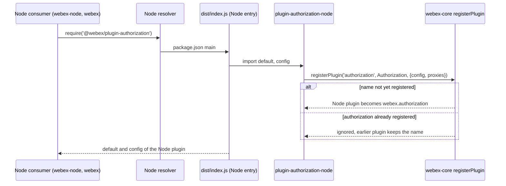
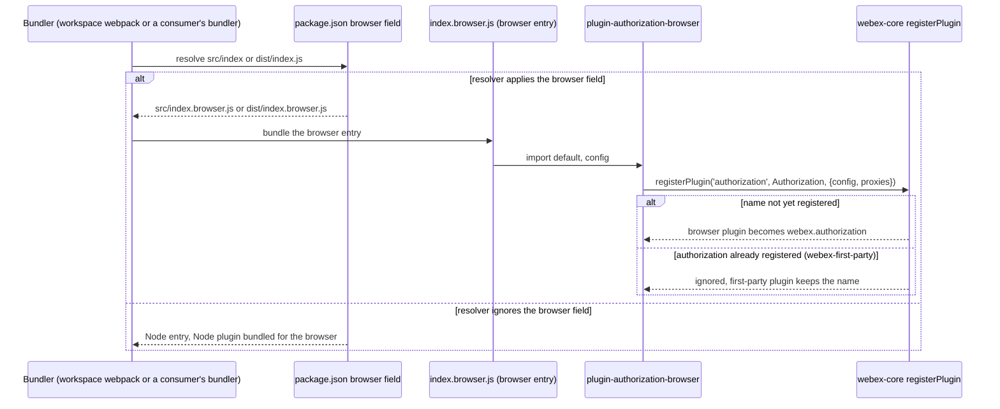
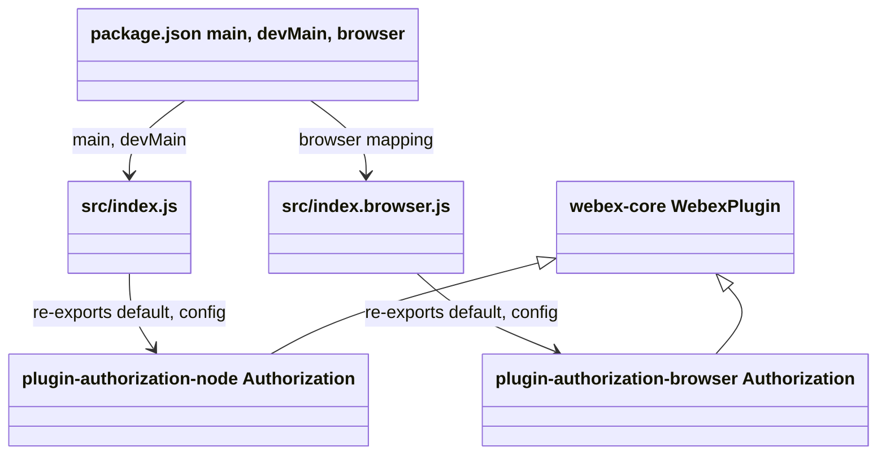

<!-- sdd-generated-metadata
doc_kind: module-spec
generated_from: module-spec@0.3.0
generated_by: claude-code
approved_by: rarajes2@cisco.com
updated_at: 2026-11-12T05:35:41Z
validation_status: pass
-->

# Environment-selecting authorization entry

This source-local document at `src/docs/README.md` owns the stable specification for **the
environment-selecting authorization entry**: the two entry files of `@webex/plugin-authorization`.
The Node entry re-exports `@webex/plugin-authorization-node` and the browser entry re-exports
`@webex/plugin-authorization-browser`. The `package.json` `browser` field decides which one a resolver
loads. The package adds no behavior of its own: importing it registers whichever plugin was selected
as `webex.authorization`. Ground every claim in package evidence and link to the
[package architecture](../../docs/architecture.md) instead of repeating broader facts. No service
specification exists because this package is a library.

Related context: [documentation index](../../docs/index.md) ·
[package agent instructions](../../AGENTS.md)

## Metadata

| Field             | Value |
| ----------------- | ----- |
| Owner             | @webex/web-sdk |
| Source path       | `src` |
| Resource kind     | package |
| Status            | Draft |
| Last verified     | 2026-11-12 at `ecd5af12a1` |
| Module id         | `plugin-authorization` |
| Parent spec       | — |
| Doc kind          | Module spec |
| Coverage score    | 93.3% assessed 2026-11-12 — 14 of 15 mandatory fields PRESENT, critical 8 of 8; test strategy is WEAK because the package has no tests and no `test:unit` script |
| Validation status | pass — independently validated 2026-11-12 by runtime `01a1ce37-eca0-7270-afda-0ea567c81b36`; 0 findings |

## Applicability

| Condition ID                         | Status     | Evidence or reason | Owned section |
| ------------------------------------ | ---------- | ------------------ | ------------- |
| `module.has_tiers`                   | N/A        | No tier policy exists in this package or its `package.json` | Tier |
| `module.has_ui`                      | N/A        | `src/index.js` and `src/index.browser.js` only re-export; they render nothing | UI use-case flow |
| `module.crosses_service_boundaries`  | N/A        | Neither `src/index.js` nor `src/index.browser.js` makes a request; every network call belongs to the re-exported sibling plugin | Cross-boundary use-case flow |
| `module.holds_client_state`          | N/A        | `src/index.js` and `src/index.browser.js` define no state; the in-flight flags live in the sibling plugins | Client state model |
| `module.enforces_domain_rules`       | N/A        | No rule logic in `src/index.js` or `src/index.browser.js`; the export-parity rule is recorded under Module-specific rules | Business rules and invariants |
| `module.is_concurrent_async`         | N/A        | Re-export at import time is synchronous in `src/index.js` and `src/index.browser.js` | Concurrency and reactive flow |
| `module.owns_persistence`            | N/A        | Nothing is stored by `src/index.js` or `src/index.browser.js` | Data, schema, and migration discipline |
| `module.stateful_transitions`        | N/A        | No state in `src/index.js` | State machine |
| `module.exposes_wire_protocol`       | N/A        | No serialized format in `src/index.js` or `src/index.browser.js` | Protocol and wire format |
| `module.ui_multi_screen`             | N/A        | No UI | UI flow |
| `module.large_data_model`            | N/A        | No entity type in `src/index.js` | Data model |
| `module.returns_caller_errors`       | Applicable | The two entries deliver different method sets (`src/index.js`, `src/index.browser.js`), selected by the browser field in `package.json`, so a call to the other environment's method fails | Caller-visible failure modes |
| `module.module_specific_conventions` | Applicable | Both entries must stay pure re-exports with the same export names, and `package.json` must map both the dist and the src Node entry | Module-specific rules |
| `module.published_package`           | Applicable | `package.json` names the package @webex/plugin-authorization and defines deploy:npm | Export stability |
| `module.embedded_in_host`            | N/A        | No host theme or embed API in `src/index.js` | Host integration and theming |
| `module.has_design_tradeoff`         | Applicable | Selection at module resolution through the browser field in `package.json` instead of a runtime check | Key design trade-off |
| `module.has_submodules`              | N/A        | The src directory has no child module | Sub-modules |

## Evidence register

| Evidence | What it establishes |
| -------- | ------------------- |
| `src/index.js` | The Node entry: `export {default, config} from '@webex/plugin-authorization-node'`. No other statement |
| `src/index.browser.js` | The browser entry: `export {default, config} from '@webex/plugin-authorization-browser'`. No other statement |
| `package.json` | `main` `dist/index.js`, `devMain` `src/index.js`, and a `browser` field mapping `./dist/index.js` to `./dist/index.browser.js` and `./src/index.js` to `./src/index.browser.js`; `engines.node` `>=18`; runtime dependencies are only the two sibling plugins; scripts `build`, `build:src`, `deploy:npm`, `test`, `test:browser`, `test:style` — `test:unit` and `test:integration` are not defined |
| `process` | Package-root module exporting `{browser: true}`; nothing in `src/` imports it and no package script names it |
| `babel.config.js`, `jest.config.js`, `.eslintrc.js` | One-line re-exports of the legacy Babel and Jest configurations; ESLint sets `root: true` and extends `@webex/eslint-config-legacy` |
| `README.md` | Retained npm page; context only. Its differences from code are recorded in `docs/adr/0001-keep-existing-docs-separate.md` |
| `OAUTH-FLOW-GUIDE.md` | Retained OAuth overview; context only. Its differences from code are recorded in `docs/adr/0001-keep-existing-docs-separate.md` |
| Sibling package plugin-authorization-node, file src/docs/README.md | Module spec consulted. Importing that package imports `@webex/internal-plugin-device` and registers public plugin `authorization` with proxies `isAuthorizing` and `isAuthenticating` and `config` `{credentials: {}}`; its API is `requestAuthorizationCodeGrant`, `requestAccessTokenFromJwt`, `createJwt`, and `logout`. Its architecture states that browser builds resolve this package to its browser entry and never load the Node plugin |
| Sibling package plugin-authorization-browser, files src/index.js, src/config.js, src/authorization.js | Source consulted (no spec). Importing that package imports `@webex/internal-plugin-device` and registers public plugin `authorization` with the same proxies and `config` `{credentials: {clientType: 'public'}}`. Its API is `initiateLogin`, `initiateImplicitGrant`, `initiateAuthorizationCodeGrant`, `requestAccessTokenFromJwt`, `createJwt`, and `logout`; on initialization it parses the URL hash for a token and checks the CSRF token held in `sessionStorage` |
| Sibling package webex-core, file src/docs/README.md | Module spec consulted (MOD-013). `registerPlugin(name, ctor, options)` returns without changing anything when `name` is already registered, unless `options.replace` is set |
| Workspace consumers: packages/webex/src/webex.js, packages/webex/src/meetings.js, packages/webex/src/encryption.js, packages/webex-node/src/webex-node.js, packages/@webex/contact-center/src/webex.js, packages/@webex/plugin-device-manager/webex.js, packages/@webex/plugin-encryption/src/webex.js | Source consulted. Each requires or imports `@webex/plugin-authorization` once and imports no other authorization plugin |
| Workspace consumer packages/webex/src/webex-first-party.js | Source consulted. Its comment says it "reuses webex.js but swaps in the first-party authorization plugin": it requires `@webex/plugin-authorization-browser-first-party` before requiring `./webex`, which then requires this package |
| Workspace root webpack.config.js | Source consulted. `resolve.alias` maps every workspace package name to `packages/<name>/src/index`, so the UMD build resolves this package to `src/index.js`, and no `target` is set |
| Committed bundle packages/webex/umd/webex.min.js | Generated artifact consulted. It contains the browser plugin (`initiateImplicitGrant`, `oauth2-csrf-token`) and no `requestAuthorizationCodeGrant`, so the `src` mapping of the `browser` field is applied by the workspace build |
| Sibling package eslint-config-legacy, file static/ignore-patterns.js | Source consulted. The shared lint config ignores `docs/**` and `*.md`; `index.js` and `index.browser.js` are linted |
| Observation, no stated WHY | The package-root `process` file is unused by `src/` and by every package script. The built `dist/index.js` requires `@babel/runtime-corejs2` (added by `@webex/babel-config-legacy`), which this package's `package.json` does not declare; it resolves from the workspace root `devDependencies`. The `test` script chains `test:unit` and `test:integration`, which are not defined, so `yarn workspace @webex/plugin-authorization test` stops at `test:unit` |

## Purpose and boundary

- Responsibility: give the SDK one import name, `@webex/plugin-authorization`, that resolves to the
  Node authorization plugin under Node resolution and to the browser authorization plugin under a
  resolver that applies the `package.json` `browser` field.
- In scope: the two entry files, the export names they re-export (`default` and `config`), the
  `main`, `devMain`, and `browser` fields that route resolvers to them, and the package's build and
  publish scripts.
- Out of scope: every authorization method and property, the plugin registration, the device plugin
  side effect, CSRF and URL-hash handling, token exchange and storage, and configuration defaults.
  These belong to `@webex/plugin-authorization-node`, `@webex/plugin-authorization-browser`, and
  webex-core. The first-party browser plugin, `@webex/plugin-authorization-browser-first-party`, is a
  separate package that this package never loads. Bundler configuration belongs to the workspace
  build.
- Consumers: `webex` (`src/webex.js`, `src/meetings.js`, `src/encryption.js`), `webex-node`,
  `@webex/contact-center`, `@webex/plugin-device-manager`, and `@webex/plugin-encryption`, each of which
  imports this package once to obtain `webex.authorization`; and applications that import it
  directly.

## Structure and key files

| Path | Responsibility |
| ---- | -------------- |
| `src/index.js` | Node entry; `main` (after build) and `devMain` point here; re-exports `default` and `config` from `@webex/plugin-authorization-node` |
| `src/index.browser.js` | Browser entry; reached only through the `browser` field; re-exports `default` and `config` from `@webex/plugin-authorization-browser` |
| `package.json` | Entry routing (`main`, `devMain`, `browser`), the two sibling dependencies, `browserify` transforms, and scripts |
| `process` | Package-root file exporting `{browser: true}`; not imported by `src/` |
| `babel.config.js`, `jest.config.js` | Re-exports of the legacy Babel and Jest configurations |
| `.eslintrc.js` | Sets `root: true` and extends `@webex/eslint-config-legacy` |
| `src/docs/README.md` | This module specification; ignored by the build and by lint |
| dist/ (generated) | Output of `build:src`: `index.js` and `index.browser.js` plus source maps; ignored by Git and never edited by hand |

The package has no `test/` directory.

## Public surface

| Surface | Consumer | Compatibility commitment | Source |
| ------- | -------- | ------------------------ | ------ |
| Import side effect: `webex.authorization` registered by the selected sibling plugin | `webex`, `webex-node`, `@webex/contact-center`, `@webex/plugin-device-manager`, `@webex/plugin-encryption`, applications | Under Node resolution the Node plugin registers; under a resolver that applies the `browser` field the browser plugin registers. A plugin already registered as `authorization` keeps the name | `src/index.js`, `src/index.browser.js`, `package.json` |
| Default export | Callers that import the class | The selected sibling's `Authorization` class, re-exported unchanged | `src/index.js`, `src/index.browser.js` |
| Named export `config` | webex-core config merge through the sibling registration; callers | The selected sibling's `config`: `{credentials: {}}` in Node, `{credentials: {clientType: 'public'}}` in the browser | `src/index.js`, `src/index.browser.js` |
| Entry routing fields `main`, `devMain`, `browser` | Node `require`, webpack, browserify | `browser` maps both `./dist/index.js` and `./src/index.js`; `devMain` names the source Node entry | `package.json` |

Contract ID `authorization-sdk` is indexed in the
[package architecture](../../docs/architecture.md#public-and-consumer-surfaces) and registered in
`.sdd/manifest.json`. The `webex.authorization` methods are the contracts `authorization-node-sdk` and
`authorization-browser-sdk` of the sibling packages.

## Dependencies

| Dependency | Why it is required | Failure behavior |
| ---------- | ------------------ | ---------------- |
| `@webex/plugin-authorization-node` (contract `authorization-node-sdk`) | Supplies the Node `default` and `config` and, on import, registers the Node plugin | An import failure propagates to the importer of this package |
| `@webex/plugin-authorization-browser` (contract `authorization-browser-sdk`) | Supplies the browser `default` and `config` and, on import, registers the browser plugin | An import failure propagates to the importer of this package |
| webex-core `registerPlugin` (contract `webex-core-plugin-host`, reached through the siblings) | First-wins registration decides which plugin holds `authorization` | A second registration of the name is ignored without error |
| A resolver that applies the `browser` field (contract `package-browser-field-resolution`) | Routes browser bundles to `src/index.browser.js` or `dist/index.browser.js` | A resolver that ignores the field loads the Node entry in a browser bundle |

## Requirements

| ID | WHAT | WHY | Source evidence | Test or example evidence | Assumptions or gaps | Confidence |
| -- | ---- | --- | --------------- | ------------------------ | ------------------- | ---------- |
| `PA-001` | Node resolution (`main` `dist/index.js`, `devMain` `src/index.js`) loads the Node entry, which re-exports `default` and `config` from `@webex/plugin-authorization-node`, so importing the package registers the Node `authorization` plugin | `webex-node` and `webex` in Node get `webex.authorization` only from their single `require('@webex/plugin-authorization')`; they import no other authorization plugin | `src/index.js`, `package.json` | None in this package. Local Node 22.14 probe: the exports are config and default, both identical to the Node plugin's, and initiateLogin is undefined | No automated test observes the selection | Present |
| `PA-002` | The `browser` field maps `./dist/index.js` to `./dist/index.browser.js` and `./src/index.js` to `./src/index.browser.js`, so a resolver that applies it loads the browser entry, which re-exports from `@webex/plugin-authorization-browser` | Published consumers resolve `main` (`dist/index.js`), while the workspace webpack build aliases this package to `src/index`; each path needs its own mapping for the browser plugin to be bundled. The committed `webex` UMD bundle contains only the browser plugin | `package.json`, `src/index.browser.js` | None in this package. The committed webex UMD bundle has initiateImplicitGrant and no requestAuthorizationCodeGrant | No automated test observes the selection | Present |
| `PA-003` | Both entries export exactly the names `default` and `config` | Every consumer imports this package with the same code for both environments (for example `packages/webex/src/webex.js`, used by the Node and browser builds of `webex`); a name exported by one entry only would be undefined in the other environment | `src/index.js`, `src/index.browser.js` | None | No check compares the two export lists | Present |
| `PA-004` | The package registers nothing itself; registration is the import side effect of the selected sibling, and a plugin registered earlier as `authorization` keeps the name | `webex-first-party.js` requires `@webex/plugin-authorization-browser-first-party` first and then `./webex`, which requires this package; the first-party plugin stays `webex.authorization` only because the second registration is ignored (webex-core MOD-013) | `src/index.js`, `src/index.browser.js` | None in this package | Relies on webex-core first-wins registration; not asserted by a test | Present |
| `PA-005` | The exported `config` is the selected sibling's object: `{credentials: {}}` under Node, `{credentials: {clientType: 'public'}}` in the browser | The browser plugin's `initiateLogin` reads `config.clientType` and treats anything other than `'confidential'` as public; the Node plugin reads no `clientType` | `src/index.js`, `src/index.browser.js` | None | None | Present |

## Design overview

The package is two one-line entry files and a routing table in `package.json`. It contains no
behavior. All authorization behavior, the `authorization` registration, and the device-plugin side
effect happen in the sibling package that the resolver selects.

Selection happens when the module is resolved, not when it runs:

- Node `require` and other resolvers that ignore the `browser` field read `main` (`dist/index.js`),
  or `devMain` (`src/index.js`) in tools that use it, and load the Node plugin.
- webpack and browserify apply the `browser` field. The workspace webpack build aliases every
  workspace package to `src/index`, so it relies on the `./src/index.js` mapping. Published consumers
  resolve `dist/index.js`, so they rely on the `./dist/index.js` mapping.

Each build therefore contains exactly one implementation, and the method set of
`webex.authorization` differs between Node and browser builds (see
[Caller-visible failure modes](#caller-visible-failure-modes)).

The package declares only the two sibling plugins as runtime dependencies, so installing it installs
both, whichever one a build uses.

## Data flow and sequence coverage

The transport is an in-process ES module re-export, resolved by the consumer's module resolver. There
are two operation groups with different actors: Node resolution and browser bundle resolution.
Registration conflicts are an `alt` branch of both.

| Operation group | Entry and outcome | Diagram or evidence | Failure and recovery coverage |
| --------------- | ----------------- | ------------------- | ----------------------------- |
| Node resolution | A Node consumer requires the package; `dist/index.js` loads the Node plugin, which registers `authorization` | Node resolution diagram below; `src/index.js`, `package.json` | Name already registered; stale or missing `dist/` |
| Browser bundle resolution | A bundler applies the `browser` field; `index.browser.js` loads the browser plugin, which registers `authorization` | Browser resolution diagram below; `src/index.browser.js`, `package.json` | Name already registered; resolver ignores the field |

Node resolution:

Browser bundle resolution:

## Class and component relationships

Both sibling classes extend `WebexPlugin` in namespace `Credentials` and are registered under the
same name with the same proxies; this package composes them, it does not wrap them.

## Use cases and flows

| Use case | Actor or caller | Primary steps and outcome | Failure or boundary behavior | Evidence |
| -------- | --------------- | ------------------------- | ---------------------------- | -------- |
| `UC-001` | `webex-node` in Node | `require('@webex/plugin-authorization')` → `dist/index.js` → Node plugin registers; `webex.authorization.requestAuthorizationCodeGrant` is available | Without a built `dist/`, `main` cannot be resolved | `src/index.js`, `package.json` |
| `UC-002` | Workspace UMD build of `webex` | webpack aliases the package to `src/index`; the `browser` field maps it to `src/index.browser.js`; the browser plugin is bundled and registers; `initiateLogin` is available | A resolver that ignores the field bundles the Node plugin instead | `src/index.browser.js`, `package.json` |
| `UC-003` | `webex-first-party` build | The first-party plugin registers `authorization` first; this package's selected plugin is then ignored by `registerPlugin` | Reordering the two requires would make this package's plugin win | `src/index.browser.js` |
| `UC-004` | Application code written for one environment | Calls a method that only the other environment's plugin has, such as `initiateLogin` in Node | `TypeError`: the property is undefined on `webex.authorization` | `src/index.js`, `src/index.browser.js` |

## Caller-visible failure modes

| Condition | Signal or result | Caller behavior | Retry or recovery | Evidence |
| --------- | ---------------- | --------------- | ----------------- | -------- |
| A Node build calls `initiateLogin`, `initiateImplicitGrant`, or `initiateAuthorizationCodeGrant` | `TypeError` (not a function); the Node plugin defines none of them | Use the Node API: `requestAuthorizationCodeGrant` with a code obtained by the host | None; change the call | `src/index.js` |
| A browser build calls `requestAuthorizationCodeGrant` | `TypeError` (not a function); the browser plugin does not define it | Exchange the code on a server with the Node plugin | None; change the call | `src/index.browser.js` |
| A resolver ignores the `browser` field in a browser bundle | The Node plugin is bundled: no URL-hash token parsing, no CSRF check, no `initiateLogin`; the `config` has no `clientType` | Configure the bundler to apply the `browser` field, or import `@webex/plugin-authorization-browser` directly | Rebuild the bundle | `package.json` |
| `authorization` is already registered when this package is imported | The earlier plugin stays `webex.authorization`; no error | Import the intended plugin first, or import it directly | Reorder imports | `src/index.js`, `src/index.browser.js` |
| Methods of the selected plugin reject or throw | Errors pass through this package unchanged | Handle them per the sibling's specification (Node) or code (browser) | Per the sibling | `src/index.js`, `src/index.browser.js` |

## Pitfalls and constraints

- `README.md` and `OAUTH-FLOW-GUIDE.md` describe environment detection at run time ("Detects: `window`
  object presence"). The code selects at module resolution through the `browser` field. Do not add a
  runtime check to make the documents true; see
  [ADR-0001](../../docs/adr/0001-keep-existing-docs-separate.md).
- `README.md` lists `getClientToken` under the Node methods. Neither plugin defines it; it is a
  webex-core credentials method (`webex.credentials.getClientToken`).
- The method set of `webex.authorization` depends on the build. Code shared between Node and browser
  must not assume an environment-specific method exists.
- Keep both `browser` mappings. Removing the `./src/index.js` mapping breaks the workspace UMD build,
  which aliases packages to `src/index`; removing the `./dist/index.js` mapping breaks published
  consumers.
- Node consumers in the workspace load `dist/index.js`. Run `build:src` after changing an entry file,
  or they keep the stale build.
- `yarn workspace @webex/plugin-authorization test` fails: it chains `test:unit` and
  `test:integration`, which `package.json` does not define. The package has no tests, and
  `test:browser` has no spec files to run.
- `dist/index.js` requires `@babel/runtime-corejs2`, which `package.json` does not declare; it resolves
  from the workspace root. Do not rely on that outside the workspace without checking the published
  dependency tree.
- Changing behavior of `webex.authorization` is a change to a sibling package, not to this one.

## Module-specific rules

- Do: keep `src/index.js` and `src/index.browser.js` as pure re-exports with identical export names
  (`default`, `config`). Evidence: `src/index.js`, `src/index.browser.js`.
- Do: add a browser counterpart and a `browser` mapping for both its `dist` and `src` paths if a new
  entry file is ever added. Evidence: `package.json`.
- Do not: put logic, configuration, or a registration call in this package; the selected sibling
  registers itself, and a second registration here would be ignored by first-wins registration.
- Do not: import both sibling plugins from one entry; whichever imports first would take
  `authorization` in both environments.

## Export stability

| Export or entry point | Consumer | Stability | Versioning and deprecation rule | Declaration or API report |
| --------------------- | -------- | --------- | ------------------------------- | ------------------------- |
| `default` (selected `Authorization` class) | Callers importing the class | Mirrors the selected sibling | No rule declared in the package | `src/index.js`, `src/index.browser.js` |
| `config` | webex-core config merge; callers | Mirrors the selected sibling | No rule declared in the package | `src/index.js`, `src/index.browser.js` |
| `main`, `devMain`, `browser` routing | Node, webpack, browserify | Load-bearing for every consumer | No rule declared in the package | `package.json` |

The package ships no `.d.ts` file and no API report; `package.json` is the native contract source.

## Key design trade-off

| Chosen trade-off | Preserved invariant or benefit | Cost or limitation | Decision evidence |
| ---------------- | ------------------------------ | ------------------ | ----------------- |
| Select the implementation at module resolution through the `package.json` `browser` field, not with a run-time environment check | One import name for every consumer; each bundle contains one implementation, so browser bundles carry no Node code-exchange path and Node never loads the URL-hash and `sessionStorage` handling | `webex.authorization` has different methods per build; correctness depends on the resolver applying the field; both siblings are installed as dependencies either way | `package.json` |

## Verification

| Requirement or invariant | Test level | Positive evidence | Negative or boundary evidence | Gap |
| ------------------------ | ---------- | ----------------- | ----------------------------- | --- |
| `PA-001` | None | none found | none found | No test requires the package under Node and checks the exports or the registered plugin |
| `PA-002` | None | none found | none found | No test bundles the package for the browser and checks the selected plugin |
| `PA-003` | None | none found | none found | No test compares the export names of the two entries |
| `PA-004` | None | none found | none found | No test imports another authorization plugin first and checks which one keeps the name |
| `PA-005` | None | none found | none found | No test reads `config` from either entry |

The package has no `test/` directory and no `test:unit` script. The only automated check is
`test:style`, which lints the two entry files. The local evidence for `PA-001` and `PA-002` is a
manual Node probe and the committed UMD bundle; neither is a test.
