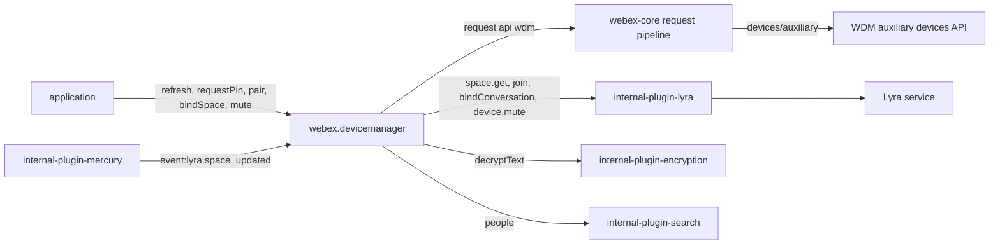
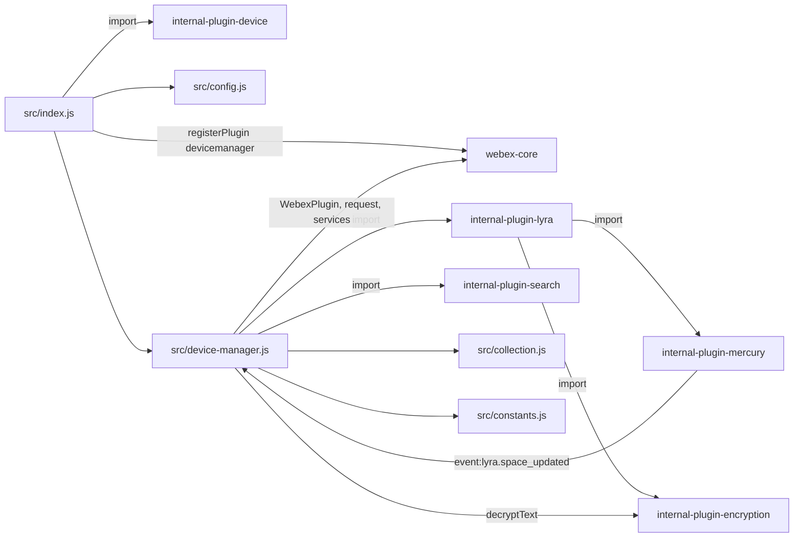
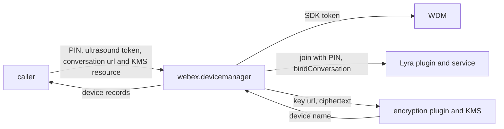

<!-- sdd-generated-metadata
doc_kind: standing-doc
generated_from: architecture@0.3.0
generated_by: claude-code
approved_by: rarajes2@cisco.com
updated_at: 2026-11-13T03:13:49Z
validation_status: pass
-->

# @webex/plugin-device-manager architecture

Canonical architecture for this package. Flow behavior lives in the
[Device Manager plugin specification](../src/docs/README.md). This page owns package boundaries, the
plugin registration, the contract index, and how the package meets the rest of the SDK.

Related context: [specification registry](specs/README.md) ·
[package agent instructions](../AGENTS.md)

## Applicability

| Condition ID                         | Status     | Evidence or reason | Owned section |
| ------------------------------------ | ---------- | ------------------ | ------------- |
| `repo.owns_datastore`                | N/A        | No database, file store, or migration; `src/collection.js` is in memory | Repository data and schema |
| `repo.holds_client_state`            | Applicable | `src/device-manager.js` keeps the pairing state and `src/collection.js` the device list | Client state model |
| `repo.components_interact`           | Applicable | `src/index.js` registers the class from `src/device-manager.js`, which uses `src/collection.js` and `src/constants.js` | Dependency and interaction topology |
| `repo.domain_data_across_components` | Applicable | Device records pass from WDM and Lyra through `src/device-manager.js` into `src/collection.js` and to callers | Object and data ownership |
| `repo.caches_data`                   | Applicable | `src/collection.js` keeps the recent-device list between calls | Caching catalog |
| `repo.observability_convention`      | Applicable | Every log line in `src/device-manager.js` but one uses the DeviceManager#method prefix through this.logger | Observability patterns |
| `repo.deploys_to_infra`              | N/A        | Library published to npm (`package.json`). No service runtime | Runtime and infrastructure |
| `repo.shared_base_libs`              | Applicable | Extends WebexPlugin and uses the legacy build, lint, and test stack (`babel.config.js`, `.eslintrc.js`, `jest.config.js`) | Shared and base libraries |
| `repo.is_monorepo`                   | N/A        | This SDD root is one package. The workspace around it is out of scope | Package map and inter-package dependencies |
| `repo.multi_platform`                | N/A        | `src/device-manager.js` has no platform branch; `process` declares {browser: true} and is not imported | Platform matrix |
| `repo.published_package`             | Applicable | `package.json` name is @webex/plugin-device-manager and deploy:npm publishes it | Release and versioning |
| `repo.embedded_in_host`              | N/A        | No host theme or embed API in `src/device-manager.js` | Host integration and theming |
| `repo.exposes_commands_or_artifacts` | Applicable | build:src in `package.json` writes dist | Commands and generated artifacts |
| `repo.cross_repo_deps_material`      | Applicable | Behavior depends on the WDM auxiliary devices API and the Lyra service (`src/device-manager.js`) | Cross-repository topology |
| `repo.security_arch_warranted`       | Applicable | PINs, KMS-encrypted device names, and conversation KMS resources pass through `src/device-manager.js` | Security architecture |

## Design overview

`@webex/plugin-device-manager` is a published JavaScript library with one module. Importing it
registers `DeviceManager` as the public plugin `devicemanager`, reached as `webex.devicemanager`, and
also registers the internal `device`, `lyra`, and `search` plugins it imports. The `webex` and
`webex-node` bundles import it to register it; no other workspace package calls it from its source.

The plugin is a client-side coordinator for Webex room devices and Lyra spaces. It reads and edits
the user's recent auxiliary devices on WDM, searches for devices, pairs with one device through a Lyra
PIN challenge, binds a conversation to it, and changes its audio. Lyra, search, and KMS work is
delegated to the internal plugins; only the three WDM requests are its own.

It keeps client state: the device list in a module-level collection and the pairing state on the
plugin instance. Neither is persisted. Lyra `space_updated` events from Mercury update both.

## Resource inventory and responsibilities

| Resource | Kind | Responsibility | Owner | Source | Detailed specification |
| -------- | ---- | -------------- | ----- | ------ | ---------------------- |
| Device Manager plugin | package (one module) | Registration; recent devices, search, PIN pairing, binding, audio | @webex/web-client, @webex/web-sdk | src | [`src/docs/README.md`](../src/docs/README.md) |

## Interaction and execution flows

Representative end-to-end flow: an application refreshes the recent devices, pairs with one by PIN,
binds the current conversation to it, and mutes it.

| From | To | Interaction or transport | Purpose | Failure or compatibility behavior |
| ---- | -- | ------------------------ | ------- | --------------------------------- |
| Application | `webex.devicemanager` | In-process calls | Devices, pairing, binding, audio | Guards and dependency errors reject; `refresh` resolves `undefined` on failure |
| `DeviceManager` | WDM | HTTPS through `webex.request`, `api: 'wdm'` | Recent-device list | No retry here |
| `DeviceManager` | Lyra plugin | In-process calls | Spaces, PIN, bindings, audio | Endpoint, PIN, unpair, and binding failures are logged and rejected; audio failures reject unlogged; failed reads in `refresh` and the Mercury handler are logged and do not reject |
| `DeviceManager` | Search plugin | In-process call | Device search | Logged and rethrown |
| `DeviceManager` | Encryption plugin | In-process call | Device-name decryption | A failure drops the device |
| Mercury | `DeviceManager` | Event `event:lyra.space_updated` | Pairing and product-name updates | Errors logged; never surfaced |

## Dependency topology

| Dependency | Type | Used by | Purpose | Version, failure, or fallback policy |
| ---------- | ---- | ------- | ------- | ------------------------------------ |
| `@webex/webex-core` | Internal | `src/index.js`, `src/device-manager.js` | Registration, plugin base, logger, `webex.request`, service catalog | `workspace:*` in `package.json` |
| `@webex/internal-plugin-lyra` | Internal | `src/device-manager.js` | Spaces, PIN pairing, bindings, audio; its import registers mercury and encryption | `workspace:*` |
| `@webex/internal-plugin-search` | Internal | `src/device-manager.js` | Device search | `workspace:*` |
| `@webex/internal-plugin-device` | Internal | `src/index.js` | Registers `webex.internal.device`, whose URL Lyra joins with | `workspace:*` |
| `@webex/internal-plugin-mercury`, `@webex/internal-plugin-encryption` | Internal, undeclared | `src/device-manager.js` | Lyra events and name decryption | Not in `package.json`; reached through the Lyra plugin's imports |
| `@webex/internal-plugin-calendar`, `@webex/plugin-authorization`, `@webex/plugin-logger`, `@webex/test-helper-chai` | Internal | The package-root `webex.js` and the unit spec only | Browser harness and assertions | `workspace:*` runtime dependencies that `src/` does not import |
| `lodash`, `uuid` | External | `src/device-manager.js`, `src/collection.js` | Deep copy and merge; search ids | `^4.17.21`, `^3.3.2` |
| WDM auxiliary devices API, Lyra service | External service | `src/device-manager.js` | Device records and pairing | Resolved through the service catalog |

No import cycle exists: none of these packages imports this one.

## Public and consumer surfaces

| Surface | Type | Owner | Consumers | Compatibility policy | Source |
| ------- | ---- | ----- | --------- | -------------------- | ------ |
| `device-manager-public-sdk` — package @webex/plugin-device-manager, `webex.devicemanager` with its public methods | SDK, published to npm, public | Device Manager plugin | `webex`, `webex-node` (registration); applications (calls) | No versioning rule is declared; the README warns that breaking changes will happen | `package.json`, `src/index.js`, `src/device-manager.js` |

The WDM requests, Lyra and search payloads, and the Mercury event are a protocol this package speaks,
described under *Protocol and wire format* in the
[module specification](../src/docs/README.md#protocol-and-wire-format). The other contracts this
package requires are registered in `.sdd/manifest.json` `contract_catalog`.

## Client state model

| State or slice | Owner | Transition triggers | Persistence or reset boundary |
| -------------- | ----- | ------------------- | ----------------------------- |
| Recent-device list | `DeviceCollection` (`src/collection.js`) | `refresh`, `upsert`, Lyra updates | In memory, one per loaded module; see the Caching catalog |
| Pairing state: pending PIN device, paired device, bound conversation | `DeviceManager` instance | `requestPin`, `pair`, `upsert`, `bindSpace`, `unbindSpace`, Lyra updates | In memory per instance; never persisted |
| Paired method label | `DeviceManager` instance | `setPairedMethod` | In memory per instance; default `Manual` |

Transitions, guards, and the paths that change pairing unexpectedly are specified in the module
specification's [State machine](../src/docs/README.md#state-machine).

## Cross-cutting architecture

### Security

- Trust boundaries and identity flow: see [Security architecture](#security-architecture).
- Sensitive surfaces and data classes: PINs, user-assigned device names (KMS-encrypted at rest), KMS
  key and resource URLs, conversation URLs, ultrasound tokens, and device and space ids.
- Encryption and secret boundaries: see [Security architecture](#security-architecture).

### Observability and operations

- Logging and correlation: see [Observability patterns](#observability-patterns). Request tracking
  comes from the webex-core interceptors.
- Metrics, traces, and audit signals: none.
- Ownership and operational entry points: the workspace `.github/CODEOWNERS` line for
  `packages/@webex/plugin-device-manager` assigns `@webex/web-client` and `@webex/web-sdk`. No
  dashboards or runbooks are recorded in this package.

### Quality attributes

- Compatibility: callers rely on the registered name `devicemanager`, the method names and their
  option names, the `DeviceManager#<method>:` error messages, and `refresh` resolving the device array.
- Latency: `refresh` is one WDM request plus a catalog wait and one KMS decryption per encrypted
  device, run in parallel; `getAll` answers from memory.
- Test confidence: 14 unit cases cover only `getPairedDevice` and the paired-method accessors; no
  integration spec exists. No coverage threshold is enforced.

## Dependency and interaction topology

| From | To | Kind | Purpose | Ordering or failure boundary |
| ---- | -- | ---- | ------- | ---------------------------- |
| `src/index.js` | webex-core | Call at import | Register `devicemanager` | First registration wins |
| `src/device-manager.js` | `src/collection.js` | Import | The shared device list | One object per loaded module |
| `src/device-manager.js` | Lyra plugin | Call | Spaces, PIN, bindings, audio | Logged and rejected, except audio (rejected unlogged) and the reads in `refresh` and the Mercury handler (logged, not rejected) |
| Mercury plugin | `src/device-manager.js` | Event | `lyra.space_updated` | Subscribed in `initialize`; never removed |

## Object and data ownership

| Object or state | System of record | May write | May read | Movement or lifecycle |
| --------------- | ---------------- | --------- | -------- | --------------------- |
| Recent auxiliary device | WDM (the JSDoc says Redis-backed) | `upsert` (add), `remove` (delete) | `refresh` | Fetched by `refresh`; copied into the device list |
| Lyra space, its occupants, PIN challenge, and bindings | Lyra service | Lyra, through `requestPin`, `pair`, `unpair`, `bindSpace`, `unbindSpace` | `requestPin`, `get`, Lyra updates | Read per call; the space object is kept as the pending or paired device |
| User-assigned device name | WDM metadata, encrypted with a KMS key | Not written here | `_decryptDeviceName` | Decrypted per device on a copy |
| Pairing state | This package (instance memory) | `DeviceManager` | Callers through `getPairedDevice` | Lost when the instance ends |

## Caching catalog

| Cache | Owner | Backend | Contents | TTL or bound | Invalidation trigger | Failure behavior |
| ----- | ----- | ------- | -------- | ------------ | -------------------- | ---------------- |
| Recent-device list | `DeviceCollection` (`src/collection.js`) | In-memory object keyed by device id, one per loaded module | WDM device records as returned, merged with later `upsert` arguments and Lyra `productName` updates | No TTL and no size bound | `refresh` empties it first; `remove` does not touch it | A failed `refresh` leaves it empty (Caller-visible failure modes in the module specification) |

## Observability patterns

| Signal  | Convention or required fields | Propagation or naming rule | Primary evidence |
| ------- | ----------------------------- | -------------------------- | ---------------- |
| Logs    | `this.logger.error` for guard failures and for dependency errors outside the audio methods, mostly with the error object as the second argument; `this.logger.info` for PIN capability, lost pairing, and no paired device. No PIN, device name, key URL, or search query is logged; one info line names a device id | Messages start `DeviceManager#<method>:` (one starts `DeviceCollection#_decryptDeviceName:`); a guard's log message equals its rejected `Error` message, except the `bindSpace` url guard, which logs a `DeviceManager#pair:` message | `src/device-manager.js` |
| Metrics | None | — | `src/device-manager.js` |
| Traces  | None in the package; webex-core adds request tracking ids | — | `src/device-manager.js` |
| Audit   | None | — | `src/device-manager.js` |

## Shared and base libraries

| Library | Inherited responsibility | Consumers | Version floor | Compatibility rule |
| ------- | ------------------------ | --------- | ------------- | ------------------ |
| `@webex/webex-core` `WebexPlugin` | `webex`, `logger`, `config` (by namespace), and `request` | `DeviceManager` | `workspace:*` | Keep the registered name `devicemanager` and the namespace `DeviceManager` |
| `@webex/babel-config-legacy`, `@webex/eslint-config-legacy`, `@webex/jest-config-legacy`, `@webex/legacy-tools` | Build, lint, and test stack through one-line config files | Package tooling | `workspace:*` | Do not fork the config locally |

## Release and versioning

| Artifact | Publish target | Versioning rule | Deprecation window | Changelog or migration obligation |
| -------- | -------------- | --------------- | ------------------ | --------------------------------- |
| @webex/plugin-device-manager | npm through `deploy:npm` | None declared in the package; the README says breaking changes can happen | None declared | None declared in the package; the workspace owns changelog generation |

## Commands and generated artifacts

| Command or artifact | Owner | Inputs | Output or side effect | Compatibility boundary |
| ------------------- | ----- | ------ | --------------------- | ---------------------- |
| `yarn build:src` | Package scripts | `src` | Writes `dist/` (JavaScript and source maps) through `webex-legacy-tools` | `dist/` is generated and never edited by hand |
| `yarn build` | Package scripts | `src` | Runs `build:src` | Same output |
| `yarn test:unit` | Package scripts | `test/unit/spec` | Jest run through `webex-legacy-tools` | Loads `src/` by relative import |
| `yarn test:style` | Package scripts | `src` | ESLint run | The shared config ignores `docs/**` and `*.md` |

## Cross-repository topology

| Repository or external system | Relationship | Exchanged contract or artifact | Owner | Sequencing constraint |
| ----------------------------- | ------------- | ------------------------------ | ----- | --------------------- |
| `@webex/webex-core` (workspace sibling; module specs consulted) | Consumes | `registerPlugin`, `WebexPlugin`, `request`, services | @webex/web-client, @webex/web-sdk | Registered before the first instance |
| `@webex/internal-plugin-lyra` (workspace sibling; module spec consulted) | Consumes | Space, PIN, binding, and audio methods | @webex/web-sdk | Imported before use |
| `@webex/internal-plugin-search` (workspace sibling; module spec consulted) | Consumes | `people` | @webex/web-sdk | None |
| `@webex/internal-plugin-mercury` (workspace sibling; module spec consulted for the emit scheme) | Consumes | `event:lyra.space_updated` | @webex/web-client, @webex/web-sdk | Registered before the plugin is constructed |
| `@webex/internal-plugin-encryption` (workspace sibling; no spec, code consulted) | Consumes | `decryptText` | @webex/web-sdk | None |
| `webex`, `webex-node` (workspace siblings) | Consumed by | The plugin registration | @webex/web-sdk | None |
| WDM auxiliary devices API and Lyra service | Consumes | Device records, spaces, PIN challenge, bindings, audio | Not recorded in this repository | None |

## Security architecture

- This package holds no credential and no key. WDM requests carry the SDK authorization added by
  webex-core; the Lyra, search, and encryption plugins authorize their own requests.
- The PIN goes to Lyra only, as the `PIN_ANSWER` join data; Lyra decides whether it is right.
- User-assigned device names arrive encrypted; the plugin decrypts them through the encryption plugin
  with the key URL in the device metadata, on a copy that `refresh` then discards
  ([Pitfalls](../src/docs/README.md#pitfalls-and-constraints)).
- `bindSpace` passes the conversation's KMS resource object URL to Lyra, which grants the space a KMS
  authorization on it (lyra MOD-010).
- Logging is described under [Observability patterns](#observability-patterns).

## Domain language

| Term | Repository-specific meaning | Authoritative source |
| ---- | --------------------------- | -------------------- |
| Auxiliary device | A device the user has used, listed by WDM under `devices/auxiliary` | `src/device-manager.js` |
| Lyra space | The Lyra representation of a room device, with occupants and bindings | `src/device-manager.js` |
| PIN challenge | A Lyra join that makes the device display a PIN the user then answers | `src/device-manager.js` |
| Paired device | The space this instance last paired with; gates `unpair`, binding, and every audio method except `putAudioState` | `src/device-manager.js` |
| Bound space | The conversation bound to the paired device (`_boundSpace`) | `src/device-manager.js` |
| uc-cloud | A device class whose id is prefixed with the WDM URL | `src/constants.js` |

## References and maintenance

- Decisions: [adr/](adr/index.md)
- Instantiated specifications and routing: [specs/README.md](specs/README.md)
- Repository rules and patterns: [package agent instructions](../AGENTS.md)
- Update this document in the same change that alters package boundaries, resource ownership,
  cross-resource interaction, or cross-cutting architecture.
