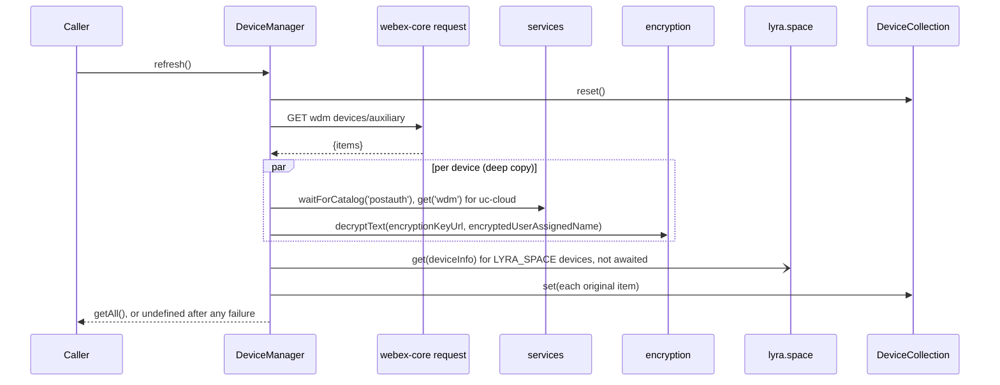
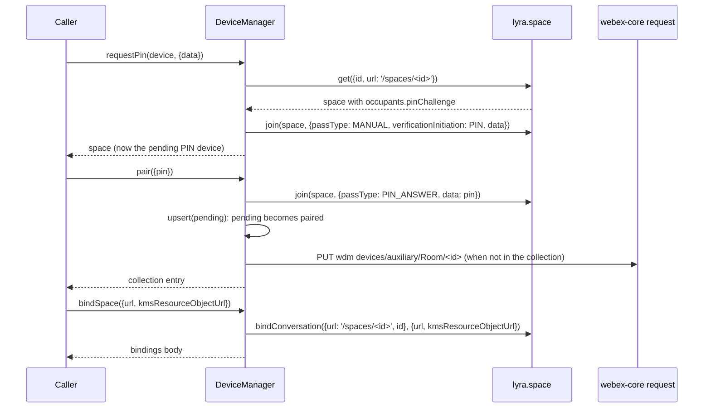
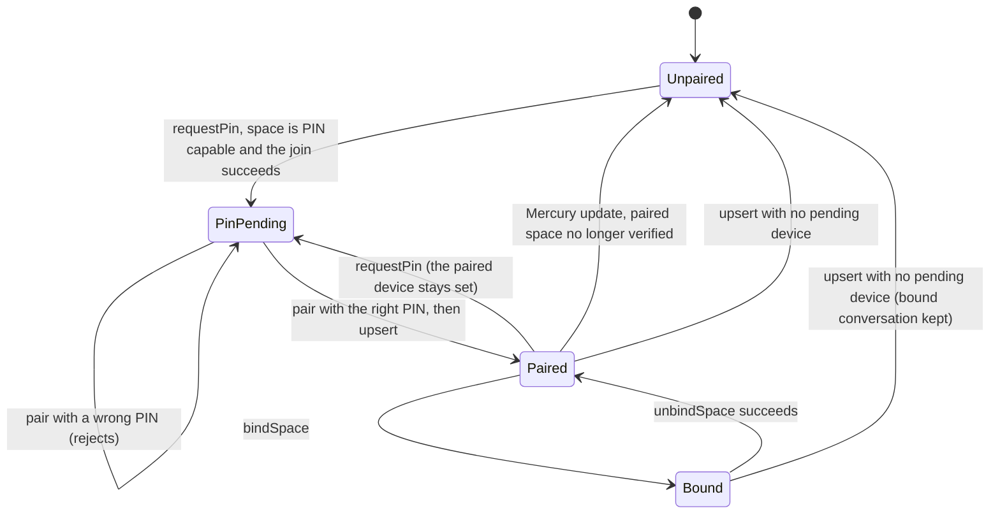

<!-- sdd-generated-metadata
doc_kind: module-spec
generated_from: module-spec@0.3.0
generated_by: claude-code
approved_by: rarajes2@cisco.com
updated_at: 2026-11-13T03:13:49Z
validation_status: pass
-->

# Device Manager plugin

This source-local document at `src/docs/README.md` owns the stable specification for **the Device
Manager plugin**: the public plugin `webex.devicemanager`. It lists the user's recent auxiliary
devices (Webex room devices and Lyra spaces) from WDM, finds devices by name through the directory
search, pairs with one device through a Lyra PIN challenge, binds a conversation to the paired device,
and controls its audio. The paired device, a pending PIN challenge, and the bound conversation are kept
on the plugin instance, and the device list is kept in a module-level collection. Ground every claim in
package evidence and link to the [package architecture](../../docs/architecture.md) instead of
repeating broader facts. No service specification exists because this package is a library.

Related context: [documentation index](../../docs/index.md) ·
[package agent instructions](../../AGENTS.md)

## Metadata

| Field             | Value |
| ----------------- | ----- |
| Owner             | @webex/web-client, @webex/web-sdk |
| Source path       | `src` |
| Resource kind     | package |
| Status            | Draft |
| Last verified     | 2026-11-13 at `c22331c97b` |
| Module id         | `plugin-device-manager` |
| Parent spec       | — |
| Doc kind          | Module spec |
| Coverage score    | 100% assessed 2026-11-13 by the generator — 15 of 15 mandatory fields PRESENT, critical 7 of 7; `test:unit` runs 14 passing cases in `test/unit/spec/index.js`, which cover only `getPairedDevice` and the paired-method accessors; no unit case covers registration, the WDM requests, search, the PIN flow, binding, audio, or the mercury handler |
| Validation status | Pass — 2026-11-13; validator runtime `01a1d2c4-873e-7eb1-bbd2-4e40457e8616`; 0 Blocking, 0 Important, 0 Medium, 0 Minor findings |

## Applicability

| Condition ID                         | Status     | Evidence or reason | Owned section |
| ------------------------------------ | ---------- | ------------------ | ------------- |
| `module.has_tiers`                   | N/A        | No tier policy exists in `package.json` or `src/device-manager.js` | Tier |
| `module.has_ui`                      | N/A        | `src/device-manager.js` returns device records and promises; the browser page in `sample/index.html` is not part of the module and nothing builds it | UI use-case flow |
| `module.crosses_service_boundaries`  | Applicable | `src/device-manager.js` calls WDM, Lyra (through the Lyra plugin), the directory search, KMS (through the encryption plugin), and listens to Mercury | Cross-boundary use-case flow |
| `module.holds_client_state`          | Applicable | `src/device-manager.js` keeps the paired device, the pending PIN challenge, the bound conversation, and the paired method; `src/collection.js` keeps the device list | Client state model |
| `module.enforces_domain_rules`       | Applicable | Pairing guards, the device id rule, and the pending-to-paired rule in `src/device-manager.js` | Business rules and invariants |
| `module.is_concurrent_async`         | Applicable | Every network method returns a promise; refresh fans out per device; a Mercury listener runs between calls (`src/device-manager.js`) | Concurrency and reactive flow |
| `module.owns_persistence`            | N/A        | Nothing is written to storage; the WDM device list is the service's record, and `src/collection.js` is in memory only | Data, schema, and migration discipline |
| `module.stateful_transitions`        | Applicable | requestPin, pair, upsert, bindSpace, unbindSpace, and the Mercury handler move the plugin between unpaired, PIN-pending, paired, and bound (`src/device-manager.js`) | State machine |
| `module.exposes_wire_protocol`       | Applicable | The WDM devices/auxiliary requests and the Lyra and search payloads built in `src/device-manager.js` | Protocol and wire format |
| `module.ui_multi_screen`             | N/A        | No UI | UI flow |
| `module.large_data_model`            | N/A        | The device and space fields read are few and listed under Protocol and wire format; no typedef exists in `src/device-manager.js` | Data model |
| `module.returns_caller_errors`       | Applicable | Argument and pairing guards reject; Lyra, search, and WDM failures are logged and rejected, except that audio failures reject unlogged and refresh logs and resolves undefined, in `src/device-manager.js` | Caller-visible failure modes |
| `module.module_specific_conventions` | Applicable | The DeviceManager#method log and error prefix, WDM requests through api wdm, and the relative Lyra space URLs in `src/device-manager.js` | Module-specific rules |
| `module.published_package`           | Applicable | `package.json` names the package @webex/plugin-device-manager and defines deploy:npm | Export stability |
| `module.embedded_in_host`            | N/A        | No host theme or embed API | Host integration and theming |
| `module.has_design_tradeoff`         | Applicable | Pairing state is kept on the client and only partly reconciled with Lyra, in `src/device-manager.js` | Key design trade-off |
| `module.has_submodules`              | N/A        | The src directory has no child module | Sub-modules |

## Evidence register

| Evidence | What it establishes |
| -------- | ------------------- |
| `src/index.js` | Imports `@webex/internal-plugin-device`; `registerPlugin('devicemanager', DeviceManager, {config})`; re-exports the default `DeviceManager` and the named `config` |
| `src/device-manager.js` | `DeviceManager` extends `WebexPlugin` in namespace `DeviceManager`; imports `@webex/internal-plugin-lyra` and `@webex/internal-plugin-search`; every public method, the three underscore-prefixed helpers, and the Mercury subscription. Its JSDoc and a few code comments are the only recorded rationale |
| `src/collection.js` | `DeviceCollection`, a module-level object with `devices`, `get`, `set` (lodash `merge` into an existing entry), `reset`, and `getAll` |
| `src/constants.js` | `LYRA_SPACE`, `UC_CLOUD` (`uc-cloud`), and `DEFAULT_PRODUCT_NAME` (`default`) |
| `src/config.js` | The plugin config is the empty object `{}` |
| `package.json` | Name, `main` (`dist/index.js`), `devMain` (`src/index.js`), `engines` (`node >=16`), dependencies, and scripts; `build`, `build:src`, `test:unit`, `test:style`, `test:browser`, `deploy:npm`, and `test` exist, and `test:integration` does not |
| `test/unit/spec/index.js` | 14 jest cases with sinon over `getPairedDevice` (10) and `getPairedMethod` and `setPairedMethod` (4). It imports `src/device-manager.js` and `src/collection.js` relatively, so it tests source, not `dist/`, and builds the plugin with a parent whose `internal.mercury.on` is a stub |
| `README.md` | Retained npm page; context only. Its sample script and chained usage do not run; see `docs/adr/0001-retain-product-readme.md` |
| `sample/app.js`, `sample/index.html` | A browser page that calls `refresh`, `requestPin`, `unpair`, `getAudioState`, and `bindSpace`; it loads `../webex.min.js`, which nothing in the package or workspace builds |
| `webex.js` | Package-root browser script that requires authorization, device, calendar, logger, and this plugin and sets `window.webex`; nothing imports or builds it |
| Sibling package internal-plugin-lyra, file src/docs/README.md | Module spec consulted, agrees with code. `getAdvertisedEndpoint` resolves the proximity endpoint (MOD-003); `space.get` takes `id` else `identity.id` (MOD-005); `join` builds the pass body and adds `verificationInitiation` (MOD-006); `leave` names this device unless `removeAllDevices` (MOD-007); bindings (MOD-010, MOD-012); audio (MOD-014, MOD-015); relative versus absolute space URLs (INV-001). Its Purpose and Public surface name this package as the in-repo caller |
| Sibling package internal-plugin-search, file src/docs/README.md | Module spec consulted, agrees with code. `people(options)` POSTs the options to `argonaut` `directory` and resolves the body (MOD-004); its UC-001 is this package's device search |
| Sibling package internal-plugin-mercury, files src/docs/README.md and src/mercury.js | Module spec consulted for the emit scheme, which agrees with `src/mercury.js`: an envelope whose `data.eventType` has a dot is emitted as `event:<eventType>` (MOD-009). The spec is stale on sessions, which this package does not use |
| Sibling package internal-plugin-encryption, file src/encryption.js | No module spec exists, so the code is the referee. `decryptText(key, ciphertext, options)` fetches the KMS key and resolves the plaintext string |
| Sibling package webex-core, files src/docs/README.md and src/lib/services/docs/README.md | Module specs consulted, agree with code. `registerPlugin` keeps the first registration (MOD-013) and adds `webex.<name>` to later instances (MOD-014); one request function carries plugin HTTP traffic (MOD-028); `WebexPlugin.logger` falls back to `console` (`src/lib/webex-plugin.js`); `waitForCatalog` rejects after 60 seconds by default (services SVC-012); a request with a `resource` is joined to the catalog URL (services SVC-022) |
| Sibling package internal-plugin-device, file src/docs/README.md | Module spec consulted. Importing it registers internal plugin `device` (MOD-001); the Lyra plugin reads `webex.internal.device.url` when it joins and leaves |
| Observation, no stated WHY | Behavior the code shows without stating a reason is recorded once, under State machine, Pitfalls and constraints, or Caller-visible failure modes |

## Purpose and boundary

- Responsibility: let a Webex client find and remember the user's room devices and Lyra spaces, pair
  with one of them by PIN, bind a conversation to the paired device, and change its audio.
- In scope: registration of `devicemanager`; the recent-device list (`refresh`, `getAll`, `upsert`,
  `remove`); device search (`search`); endpoint lookup from an ultrasound token (`get`); the PIN flow
  (`requestPin`, `pair`); `unpair`; conversation binding (`bindSpace`, `unbindSpace`); audio
  (`getAudioState`, `putAudioState`, `mute`, `unmute`, `increaseVolume`, `decreaseVolume`,
  `setVolume`); the paired-device and paired-method accessors; the `lyra.space_updated` Mercury
  handler; decryption of user-assigned device names.
- Out of scope: Lyra requests and their URLs (`@webex/internal-plugin-lyra`); the directory request
  (`@webex/internal-plugin-search`); KMS keys and decryption (`@webex/internal-plugin-encryption`);
  the socket and event emission (`@webex/internal-plugin-mercury`); device registration
  (`@webex/internal-plugin-device`); the request pipeline and the service catalog
  (`@webex/webex-core`); decoding the ultrasound token; what WDM and Lyra store and decide.
- Consumers: in this repository `webex` (`src/webex.js`) and `webex-node` (`src/webex-node.js`)
  import the package to register it. No file under another package's `src/` and no workspace sample
  calls `webex.devicemanager`; the package's own `sample/app.js` does. Applications reach the plugin as
  `webex.devicemanager`.

## Structure and key files

| Path | Responsibility |
| ---- | -------------- |
| `src/index.js` | Imports the device plugin, registers public plugin `devicemanager` with its config, and re-exports the class and config |
| `src/device-manager.js` | `DeviceManager`: public methods, client state, the Mercury handler, and the metadata helpers |
| `src/collection.js` | `DeviceCollection`, the in-memory device list shared by every instance |
| `src/constants.js` | Machine type, device class, and default product name constants |
| `src/config.js` | The empty plugin config |
| `package.json` | Package name, entry points, scripts, and dependencies |
| `babel.config.js`, `jest.config.js` | Re-exports of the legacy Babel and Jest configurations |
| `.eslintrc.js` | Sets `root: true` and extends `@webex/eslint-config-legacy` |
| `process` | Package-root file exporting `{browser: true}`; not imported by `src/` |
| `webex.js`, `sample/app.js`, `sample/index.html` | A browser harness and page for manual trials; nothing builds or runs them |
| `src/docs/README.md` | This module specification; ignored by the build and by lint |
| `test/unit/spec/index.js` | Unit cases for the paired-device and paired-method accessors |
| dist/ (generated) | Build output of `build:src`; ignored by Git and never edited by hand |

## Public surface

| Surface | Consumer | Compatibility commitment | Source |
| ------- | -------- | ------------------------ | ------ |
| Import side effect: public plugin `devicemanager` with config `{}`, and internal plugins `device`, `lyra`, and `search` | `webex`, `webex-node` | First registration of the name wins; reached as `webex.devicemanager` | `src/index.js`, `src/device-manager.js` |
| `getAll()`, `refresh()`, `upsert(device)`, `remove(deviceId)` | Applications | The recent-device list; `getAll` returns an array synchronously | `src/device-manager.js` |
| `search({searchQuery})`, `get(token)` | Applications | Directory results; the Lyra endpoint for an ultrasound token | `src/device-manager.js` |
| `requestPin(device, {data})`, `pair({pin})`, `unpair({removeAllDevices})` | Applications | The PIN pairing flow and leaving the space | `src/device-manager.js` |
| `bindSpace({url, kmsResourceObjectUrl})`, `unbindSpace()` | Applications | Bind or unbind a conversation on the paired device | `src/device-manager.js` |
| `getAudioState()`, `mute()`, `unmute()`, `increaseVolume()`, `decreaseVolume()`, `setVolume(level)` | Applications | The paired device's audio, through the Lyra device API; reject without a paired device | `src/device-manager.js` |
| `putAudioState(space, audioState)` | Applications | Passes the caller's `space` and `audioState` to the Lyra device API; needs no paired device | `src/device-manager.js` |
| `getPairedDevice()`, `getPairedMethod()`, `setPairedMethod(method)` | Applications | The current paired device and a caller-set pairing label | `src/device-manager.js` |
| Default export `DeviceManager`, named export `config` | Hosts that mount the class themselves | The entry exports nothing else | `src/index.js` |
| `_updateDeviceMetadata`, `_decryptDeviceName`, `_receiveDeviceUpdates` | The plugin itself | Underscore-prefixed; reachable on the instance but not a supported entry | `src/device-manager.js` |

Contract ID `device-manager-public-sdk` is indexed in the
[package architecture](../../docs/architecture.md#public-and-consumer-surfaces) and registered in
`.sdd/manifest.json`. Export stability is under [Export stability](#export-stability).

## Dependencies

| Dependency | Why it is required | Failure behavior |
| ---------- | ------------------ | ---------------- |
| `@webex/webex-core` (module specs consulted) | `registerPlugin`, `WebexPlugin` (`webex`, `logger`, `request`), `webex.request` with `api: 'wdm'`, and `webex.internal.services` (`waitForCatalog('postauth')`, `get('wdm')`) | Request rejections reject the method, except in `refresh`; a catalog wait rejects after 60 seconds (services SVC-012) |
| `@webex/internal-plugin-lyra` (module spec consulted) | Imported by `src/device-manager.js`; `getAdvertisedEndpoint`, `space.get`, `space.join`, `space.leave`, `space.bindConversation`, `space.unbindConversation`, and the `device` audio methods. Its import also registers mercury and encryption | Lyra rejections are logged and rejected, except in the audio methods, which reject unlogged, and in `refresh` and the Mercury handler, which log and resolve |
| `@webex/internal-plugin-search` (module spec consulted) | Imported by `src/device-manager.js`; `people` performs the device search | Logged and rethrown |
| `@webex/internal-plugin-mercury` (module spec and code consulted) | `webex.internal.mercury.on('event:lyra.space_updated', …)` in `initialize`. Not declared in `package.json`; registered through the Lyra plugin's import | Without it, constructing the plugin throws while reading `mercury.on` |
| `@webex/internal-plugin-encryption` (no spec; code consulted) | `webex.internal.encryption.decryptText` for user-assigned device names. Not declared in `package.json`; registered through the Lyra plugin's import | A decryption failure is logged and the device becomes `undefined` (see Caller-visible failure modes) |
| `@webex/internal-plugin-device` (module spec consulted) | Imported by `src/index.js`; the Lyra plugin reads `webex.internal.device.url` when joining and leaving | — |
| `lodash` (`cloneDeep`, `merge`), `uuid` (`v4`) | Copying devices before changing them, merging device updates, and a fresh `searchId` per search | — |
| `@webex/internal-plugin-calendar`, `@webex/plugin-authorization`, `@webex/plugin-logger` | Listed in `dependencies`, but no file under `src/` imports them; only the package-root `webex.js` requires them | — |
| `@webex/test-helper-chai` | Listed in both `dependencies` and `devDependencies`; only `test/unit/spec/index.js` imports it | — |
| WDM auxiliary devices API and Lyra service (external) | The recent-device list and pairing decisions | Errors propagate as described per method |

## Requirements

| ID | WHAT | WHY | Source evidence | Test or example evidence | Assumptions or gaps | Confidence |
| -- | ---- | --- | --------------- | ------------------------ | ------------------- | ---------- |
| `MOD-001` | Importing the package imports `@webex/internal-plugin-device` and registers `DeviceManager` as public plugin `devicemanager` with `config` `{}`; importing `src/device-manager.js` also imports the Lyra and search plugins. The entry re-exports the default `DeviceManager` and the named `config`. | Applications reach the plugin as `webex.devicemanager`, and the `webex` and `webex-node` bundles register it by import (inferred from `registerPlugin` and those imports; webex-core MOD-013, MOD-014). | `src/index.js`, `src/device-manager.js` | None found | WHY inferred | Weak |
| `MOD-002` | `initialize` sets `_pairedMethod` to `Manual` and subscribes to `event:lyra.space_updated` on `webex.internal.mercury`, passing the envelope's `data` to `_receiveDeviceUpdates`. | Device updates arrive as Lyra events on Mercury (code comment "Lyra mercury events listener"; mercury MOD-009 emits dotted event types). | `src/device-manager.js` | `test/unit/spec/index.js` default paired-method case | The subscription is not asserted | Present |
| `MOD-003` | `getAll()` returns the values of the device collection as an array, synchronously. | The JSDoc: the list of recent devices associated with the user. | `src/device-manager.js`, `src/collection.js` | None found | The JSDoc says it returns a promise | Present |
| `MOD-004` | `refresh()` empties the collection, then GETs `devices/auxiliary` from service `wdm`. With a body it runs `_updateDeviceMetadata(res.body.items)`, calls `lyra.space.get(device.deviceInfo)` without waiting for each processed device whose `deviceInfo.machineType` is `LYRA_SPACE`, adds every original `res.body.items` entry to the collection, and resolves `getAll()`. | The JSDoc: recent devices are populated from Redis on the service side; `refresh` re-reads them. | `src/device-manager.js` | None found | What is stored, and what failures resolve, are under Pitfalls and Caller-visible failure modes | Present |
| `MOD-005` | `search(options)` rejects without `options.searchQuery`; otherwise it calls `webex.internal.search.people({searchId: uuid.v4(), searchType: 'DEVICE_SEARCH', searchEntity: 'device', includePeople: false, includeRooms: true, queryString: options.searchQuery})` and resolves its result. | The JSDoc: search for a device by name (search UC-001). | `src/device-manager.js` | None found | The result shape is owned by the directory service | Present |
| `MOD-006` | `upsert(device)` takes the id from `device.id`, else `device.identity.id`, and rejects without one. It then makes the pending PIN device the paired device and clears the pending one. If the id is in the collection it merges `device` into that entry and resolves it; otherwise it PUTs `devices/auxiliary/Room/<id>` to service `wdm`, decrypts the name of the response body, adds it, and resolves the collection entry for the id. | The JSDoc: cache the device and register it on the service for later fetches; the code comment: a new device is added to WDM for subsequent retrievals. | `src/device-manager.js` | None found | Why `upsert` changes pairing is not stated (see State machine) | Present |
| `MOD-007` | `get(token)` rejects without `token`; otherwise it resolves `lyra.getAdvertisedEndpoint(token)` after copying `identity.displayName` of `lyra.space.get({id: advertiser.id})`, when present, to `advertiser.displayName`. | The code comment: the endpoint lacks a proper display name, and search needs one. | `src/device-manager.js` | None found | — | Present |
| `MOD-008` | `remove(deviceId)` rejects without `deviceId`; otherwise it DELETEs `devices/auxiliary/<deviceId>` from service `wdm` and resolves the response. It changes neither the collection nor the pairing. | The JSDoc: unregister the device on the service so later loads do not fetch it, like `space.deleteBinding()`. | `src/device-manager.js` | None found | — | Present |
| `MOD-009` | `requestPin(device, options = {})` takes the id like `upsert` and rejects without one. It reads `lyra.space.get({id, url: '/spaces/<id>'})`. When `occupants.pinChallenge` is truthy it joins that space with `{passType: 'MANUAL', verificationInitiation: 'PIN', data: options.data}`, records the space as the pending PIN device, and resolves it; otherwise it logs at info level, reads the space again, and resolves the first read. | The JSDoc: ask the device to display a PIN; the code comments: the device is returned so it can be upserted after a successful PIN exchange, and a space that is not PIN capable is probably occupied already. | `src/device-manager.js` | None found | Why the space is read a second time is not stated | Present |
| `MOD-010` | `pair(options = {})` rejects without `options.pin`, and rejects with `no device to pair` without a pending PIN device. Otherwise it joins `{id, url: '/spaces/<id>'}` of the pending device with `{passType: 'PIN_ANSWER', data: options.pin}` and then resolves `upsert(pending device)`. | The JSDoc: manual pairing of the device with the user, which also adds it to the recent list, like `space.join()`. | `src/device-manager.js` | None found | — | Present |
| `MOD-011` | `unpair(options = {})` rejects without a paired device; otherwise it resolves `lyra.space.leave({url: '/spaces/<id>'}, options)`, where `options.removeAllDevices` leaves for every device of the user. | The JSDoc: unpair but keep the device in the recent list, like `space.leave()`. | `src/device-manager.js` | None found | What local state `unpair` keeps is under State machine | Present |
| `MOD-012` | `bindSpace(options = {})` rejects, in this order, without `options.url`, without `options.kmsResourceObjectUrl`, and without a paired device. Otherwise it records `{kmsResourceObjectUrl, url}` as the bound conversation and resolves `lyra.space.bindConversation({url: '/spaces/<id>', id}, bound conversation)`. | The JSDoc: bind the conversation to the paired device if supported, like `space.bindConversation()`. | `src/device-manager.js` | `sample/app.js` calls it with a conversation's url and kmsResourceObjectUrl | — | Present |
| `MOD-013` | `unbindSpace()` rejects without both a paired device and a bound conversation; otherwise it calls `lyra.space.unbindConversation({url: '/spaces/<id>', id}, bound conversation)`, clears the bound conversation, and resolves the response. | The JSDoc: unbind the conversation from the paired device, like `space.unbindConversation()`. | `src/device-manager.js` | None found | — | Present |
| `MOD-014` | `getAudioState()`, `mute()`, `unmute()`, `increaseVolume()`, `decreaseVolume()`, and `setVolume(level = 0)` reject without a paired device; otherwise each resolves the Lyra `device` method of the same name called with the paired device (and `level`). `putAudioState(space, audioState = {})` has no guard and resolves `lyra.device.putAudioState(space, audioState)`. | The JSDoc of each, which names the Lyra method; `putAudioState` should be called every 10 minutes or when the microphone or volume changes, and `setVolume` should give way to increase and decrease. | `src/device-manager.js` | `sample/app.js` calls getAudioState | Lyra MOD-014 rejects `putAudioState` without `audioState.deviceUrl` | Present |
| `MOD-015` | `_receiveDeviceUpdates(data)` acts only when `data.spaceUrl` is set and its last path segment is an id in the collection. It then reads `lyra.space.get({id})`; when the space has `occupants` and `occupants.self` is missing or not `verified`, it sets the entry's `productName` to `devices[0].productName`, else `default`. If the id is the paired device's, it clears the paired device and logs at info level; otherwise, when the pending PIN device has another id, it resolves `upsert(entry)`. Every path resolves. | The code comments: only updates for registered devices matter; an unverified PIN challenge means the paired device lost pairing; the pending PIN device must not be reset. | `src/device-manager.js` | None found | See State machine and Pitfalls for the upsert branch | Present |
| `MOD-016` | `getPairedDevice()` logs at info level and returns `undefined` without a paired device; otherwise it returns the collection entry for the paired device's `id`, else `identity.id`. | The JSDoc: the currently paired device info, if paired. | `src/device-manager.js` | `test/unit/spec/index.js` ten getPairedDevice cases, including id precedence and missing entries | — | Present |
| `MOD-017` | `getPairedMethod()` returns `_pairedMethod`, or `Manual` when it is falsy; `setPairedMethod(method)` stores any value. Nothing else in the package reads it. | The JSDoc: the paired method, defaulting to "Manual"; the unit cases set `Ultrasonic` and `QR`. | `src/device-manager.js` | `test/unit/spec/index.js` four paired-method cases | What sets it in an application is not recorded in this repository | Present |
| `MOD-018` | `_updateDeviceMetadata(devices)` resolves `[]` for an empty array; otherwise it deep-copies the array and, per device, waits for the `postauth` catalog, prefixes the `id` of a `uc-cloud` device with the `wdm` service URL and `/`, and replaces the device with `_decryptDeviceName(device)`. `_decryptDeviceName(device)` deep-copies the device; when `metadata.encryptedUserAssignedName` and `metadata.encryptionKeyUrl` are set it resolves the copy with the decrypted `userAssignedName` and `encryptedUserAssignedName` unset, and on a decryption error unsets the ciphertext, logs, and resolves `undefined`. | The JSDoc: put the decrypted device name on the device object; the code comment: the ciphertext is not needed once decrypted. | `src/device-manager.js` | None found | Why `uc-cloud` ids get the WDM URL is not stated | Present |

## Design overview

`DeviceManager` is a `WebexPlugin` that composes other plugins rather than speaking to most services
itself. It sends three WDM requests (`devices/auxiliary` list, add, and delete) through
`webex.request`; everything about spaces, pairing, bindings, and audio goes through
`webex.internal.lyra`; device search goes through `webex.internal.search`; name decryption goes
through `webex.internal.encryption`.

Two kinds of client state exist. The device list lives in `DeviceCollection`, one object for the
whole JavaScript module. The pairing state — the pending PIN device, the paired device, and the bound
conversation — lives on the plugin instance and gates `unpair`, the binding methods, and every audio
method except `putAudioState` (`INV-001`). Lyra sends
`lyra.space_updated` events over Mercury, and the plugin uses them to drop a pairing that Lyra no
longer verifies.

Fifteen public methods guard an argument or the pairing state, log a failed guard, and reject it with
an `Error` whose message starts with `DeviceManager#<method>:`; `getAll`, `refresh`, `putAudioState`, and
the paired-device and paired-method accessors have no guard (`INV-006`).

## Data flow and sequence coverage

Call style: in-process method calls on `webex.devicemanager`; outbound HTTPS through `webex.request`
(WDM) and through the Lyra, search, and encryption plugins; inbound Mercury events.

| Operation group | Entry and outcome | Diagram or evidence | Failure and recovery coverage |
| --------------- | ----------------- | ------------------- | ----------------------------- |
| Recent devices | `refresh`, `getAll`, `upsert`, `remove`; the WDM list and the collection | Diagram 1; `src/device-manager.js`, `src/collection.js` | `refresh` logs and resolves `undefined`; the others reject |
| Discovery | `search` and `get`; directory results and the Lyra endpoint | `src/device-manager.js` (one dependency call each, MOD-005, MOD-007) | Logged and rejected |
| PIN pairing and binding | `requestPin`, `pair`, `unpair`, `bindSpace`, `unbindSpace` | Diagram 2; State machine | Guards reject first; Lyra errors are logged and rejected |
| Audio | `getAudioState`, `putAudioState`, mute and volume methods | `src/device-manager.js` (one Lyra call each, MOD-014) | The pairing guard rejects, except in `putAudioState`, which has none; Lyra errors reject unlogged |
| Lyra updates | Mercury `event:lyra.space_updated` to `_receiveDeviceUpdates` | Diagram 3 | Errors are logged; the handler always resolves |

Diagram 1 — refreshing the recent-device list:



Diagram 2 — PIN pairing, then binding a conversation:



Diagram 3 — a Lyra space update:

```mermaid
sequenceDiagram
  participant M as Mercury
  participant D as DeviceManager
  participant L as lyra.space
  M->>D: event:lyra.space_updated {data: {spaceUrl}}
  D->>D: id = last segment of spaceUrl; ignore unless in the collection
  D->>L: get({id})
  L-->>D: space
  alt self missing or not verified
    D->>D: set productName
    alt id is the paired device
      D->>D: clear the paired device
    else pending PIN device has another id
      D->>D: upsert(entry)
    end
  end
```

## Class and component relationships

```mermaid
classDiagram
  class WebexPlugin
  class DeviceManager {
    getAll()
    refresh()
    search(options)
    upsert(device)
    get(token)
    remove(deviceId)
    requestPin(device, options)
    pair(options)
    unpair(options)
    bindSpace(options)
    unbindSpace()
    getAudioState()
    putAudioState(space, audioState)
    mute()
    unmute()
    increaseVolume()
    decreaseVolume()
    setVolume(level)
    getPairedDevice()
    getPairedMethod()
    setPairedMethod(method)
  }
  class DeviceCollection {
    devices
    get(deviceId)
    set(device)
    reset()
    getAll()
  }
  WebexPlugin <|-- DeviceManager
  DeviceManager ..> DeviceCollection : module import
  DeviceManager ..> Lyra : webex.internal.lyra
  DeviceManager ..> Search : webex.internal.search
  DeviceManager ..> Encryption : webex.internal.encryption
  DeviceManager ..> Mercury : event:lyra.space_updated
```

## Use cases and flows

| Use case | Actor or caller | Primary steps and outcome | Failure or boundary behavior | Evidence |
| -------- | --------------- | ------------------------- | ---------------------------- | -------- |
| `UC-001` | Client showing recent devices | `refresh()` resolves the list; later `getAll()` reads it without a request | `refresh` resolves `undefined` on any failure | `src/device-manager.js`, `sample/app.js` |
| `UC-002` | Client finding a device by name | `search({searchQuery})` resolves directory results | Rejects without a query; the search error rejects | `src/device-manager.js` |
| `UC-003` | Client near a device that broadcasts ultrasound | Decode the token, then `get(token)` resolves the endpoint with the space's display name | Lyra errors reject | `src/device-manager.js` |
| `UC-004` | Client pairing by PIN | `requestPin(device)`; the device shows a PIN; `pair({pin})` resolves the paired device | A wrong PIN rejects and the device stays pending | `src/device-manager.js`, `sample/app.js` |
| `UC-005` | Paired client in a meeting | `bindSpace({url, kmsResourceObjectUrl})`, later `unbindSpace()` | Rejects without a paired device or bound conversation | `src/device-manager.js`, `sample/app.js` |
| `UC-006` | Paired client controlling audio | `getAudioState()`, `mute()`, `unmute()`, `increaseVolume()`, `decreaseVolume()`, `setVolume(level)` | Rejects without a paired device | `src/device-manager.js`, `sample/app.js` |
| `UC-007` | Client leaving or forgetting a device | `unpair({removeAllDevices})` leaves the space; `remove(deviceId)` drops it from the WDM list | Rejects without a paired device or id | `src/device-manager.js` |

### Cross-boundary use-case flow

| Boundary | Transport and ordering | Compatibility | Timeout, retry, and recovery |
| -------- | ---------------------- | ------------- | ---------------------------- |
| WDM auxiliary devices API (`UC-001`, `UC-007`, and the add in `UC-004`) | HTTPS through `webex.request`, `api: 'wdm'`, one request per call | Requests under Protocol and wire format | No retry here; the `postauth` catalog wait times out after 60 seconds |
| Lyra service, through `@webex/internal-plugin-lyra` (`UC-003` to `UC-007`) | HTTPS issued by the Lyra plugin; `requestPin` and `pair` issue their requests in sequence | Relative `/spaces/<id>` URLs for join, leave, and bindings (`INV-005`) | No retry here; a `MANUAL` join stays alive only if repeated (Lyra MOD-006), which this plugin does not do |
| Directory search, through `@webex/internal-plugin-search` (`UC-002`) | One `argonaut` `directory` request | Search options under Protocol and wire format | No retry |
| KMS, through `@webex/internal-plugin-encryption` (`UC-001`, `UC-004`) | Key fetch and decryption per encrypted device name | — | A failure drops the device (see Caller-visible failure modes) |
| Mercury (Lyra updates) | Inbound `lyra.space_updated` events, handled one at a time as they arrive | Only `data.spaceUrl` is read | Handler errors are logged; nothing is retried |

## Client state model

| State or slice | Owner      | Initial state | Transition triggers | Reset or persistence boundary |
| -------------- | ---------- | ------------- | ------------------- | ----------------------------- |
| Device list (`DeviceCollection.devices`) | `src/collection.js` | `{}` | `refresh`, `upsert`, the Mercury handler (`productName`) | Module scope, shared by every instance in the process (`INV-004`); emptied only by `refresh`; never persisted |
| Pending PIN device (`_devicePendingPinChallenge`) | `DeviceManager` instance | `null` | `requestPin` sets it; `upsert` clears it | Instance memory; see State machine |
| Paired device (`_pairedDevice`) | `DeviceManager` instance | `null` | `upsert` sets it; the Mercury handler clears it | Instance memory; see State machine |
| Bound conversation (`_boundSpace`) | `DeviceManager` instance | `null` | `bindSpace` sets it; `unbindSpace` clears it | Instance memory; see State machine |
| Paired method (`_pairedMethod`) | `DeviceManager` instance | `Manual` | `setPairedMethod` | Instance memory; read only by `getPairedMethod` |

## Business rules and invariants

| ID | Invariant | WHY | Enforcement source | Test evidence |
| -- | --------- | --- | ------------------ | ------------- |
| `INV-001` | `unpair`, `bindSpace`, `unbindSpace`, `getAudioState`, `mute`, `unmute`, `increaseVolume`, `decreaseVolume`, and `setVolume` send no request without a paired device; they reject instead. `putAudioState` is the exception. | The JSDoc of each method speaks of the paired device; the Lyra calls need its space (inferred). | `src/device-manager.js` | None found |
| `INV-002` | A device's id is `device.id` when truthy, else `device.identity.id`, in `upsert`, `requestPin`, `getPairedDevice`, the Mercury handler's paired-id check, and `DeviceCollection.set`; the Mercury handler takes the id from the last segment of `spaceUrl`. | WDM devices carry `id` and Lyra spaces carry `identity.id` (inferred from the fallback and lyra MOD-005). | `src/device-manager.js`, `src/collection.js` | `test/unit/spec/index.js` getPairedDevice cases for id, identity.id, and id precedence |
| `INV-003` | Only `upsert` sets the paired device, and it always sets it to the pending PIN device and clears the pending one; only `requestPin` sets the pending device, and only after the PIN join succeeds. | The code comment: the device is returned so it can be upserted on a successful PIN exchange. | `src/device-manager.js` | None found |
| `INV-004` | One `DeviceCollection` object exists per loaded module, so every `DeviceManager` instance in a process reads and writes the same device list. | `src/collection.js` exports an object literal, not a class (inferred; no comment states it). | `src/collection.js` | `test/unit/spec/index.js` stubs DeviceCollection.get on the shared object |
| `INV-005` | `requestPin`, `pair`, `unpair`, `bindSpace`, and `unbindSpace` pass Lyra a space whose `url` is the relative `/spaces/<id>`; `getAudioState` and the mute and volume methods pass the paired device, which is the space object Lyra returned; `putAudioState` passes the caller's `space` unchanged. | Lyra sends the first group's URL as a catalog resource and the audio methods' URL as an absolute request URI (lyra INV-001). | `src/device-manager.js` | None found |
| `INV-006` | Fifteen public methods guard an argument or the pairing state: `search`, `upsert`, `get`, `remove`, `requestPin`, `pair`, `unpair`, `bindSpace`, `unbindSpace`, `getAudioState`, `mute`, `unmute`, `increaseVolume`, `decreaseVolume`, and `setVolume`. A failed guard logs through `this.logger.error` and returns a rejected promise with an `Error` whose message starts with `DeviceManager#<method>:`. A dependency failure is then logged and rejected unchanged in the first nine, and rejected unlogged in the six audio methods. `getAll`, `refresh`, `putAudioState`, `getPairedDevice`, `getPairedMethod`, and `setPairedMethod` have no guard (`MOD-003`, `MOD-004`, `MOD-014`, `MOD-016`, `MOD-017`); `refresh` and the Mercury handler log failures and resolve. | Callers get one error style, and failures are visible in the SDK log (inferred). | `src/device-manager.js` | `test/unit/spec/index.js` asserts the info message of getPairedDevice |

## Concurrency and reactive flow

- Execution model: one JavaScript event loop; every network method returns a promise.
- Ordering guarantees: `refresh` empties the collection before its request, so a `getAll` during a
  refresh returns `[]`; `requestPin` and `pair` run their Lyra calls in sequence; nothing orders
  calls across methods.
- Parallel work: `_updateDeviceMetadata` processes every device at once with `Promise.all`; the
  `LYRA_SPACE` reads in `refresh` run without being awaited.
- Reactive input: the Mercury listener added in `initialize` stays for the life of the instance and
  can change the device list and the pairing between any two caller calls.
- Idempotency and retry: `refresh`, `getAll`, `search`, `get`, `getAudioState`, and the accessors are
  reads; `upsert` of a known id only merges; `requestPin` and `pair` repeat their joins; nothing is
  retried here.
- Shared-state protection: none. Concurrent `refresh` calls, or instances in the same process, share
  one collection (`INV-004`), and concurrent `requestPin` calls race for the one pending PIN device
  (see State machine).

## State machine

Pairing moves through four states held on the instance. The device list is not part of it.



- Guards: `pair` needs a pending device; `unpair`, `bindSpace`, and every audio method except
  `putAudioState` need a paired device; `unbindSpace` needs a paired device and a bound conversation
  (`INV-001`). `putAudioState` is outside the state machine (`INV-005`).
- `upsert` is a public method and always replaces the paired device with the pending one
  (`INV-003`). Called by an application with no PIN pending, it clears the pairing. Called by the
  Mercury handler while a PIN is pending for another device, it makes that pending device paired
  without a PIN answer.
- `unpair` leaves the space but changes no local state, so `getPairedDevice`, the binding methods,
  and the guarded audio methods still act on the device afterwards.
- `bindSpace` records the bound conversation before the Lyra call, so it stays recorded when the call
  fails.
- When the Mercury handler or `upsert` clears the pairing, the bound conversation stays recorded;
  `unbindSpace` still rejects, because it also needs a paired device.
- No state is terminal, and nothing is restored after the page or process ends.

## Protocol and wire format

| Message or frame | Version | Producer or serializer | Consumer or parser | Compatibility and ordering rule |
| ---------------- | ------- | ---------------------- | ------------------ | ------------------------------- |
| `GET <wdm>/devices/auxiliary` | Unversioned path under the catalog URL | `refresh` | WDM | Response body `{items: [device]}`; a response without a body counts as a failure |
| `PUT <wdm>/devices/auxiliary/Room/<id>` | Unversioned | `upsert` | WDM | No body; the response body is the added device |
| `DELETE <wdm>/devices/auxiliary/<id>` | Unversioned | `remove` | WDM | The id is interpolated without URL encoding |
| Device record fields read: `id`, `identity.id`, `identity.displayName`, `deviceClass` (`uc-cloud`), `deviceInfo.machineType` (`LYRA_SPACE`), `metadata.encryptedUserAssignedName`, `metadata.encryptionKeyUrl`; fields written: `metadata.userAssignedName`, `productName` | — | WDM, Lyra | `DeviceManager` | No typedef exists; the field names are read from `src/device-manager.js` |
| Lyra space fields read: `occupants.pinChallenge`, `occupants.self.verified`, `devices[0].productName`, `identity.id`, `identity.displayName` | — | Lyra | `DeviceManager` | Read from the `space.get` result |
| Lyra join options `{passType: 'MANUAL', verificationInitiation: 'PIN', data}` and `{passType: 'PIN_ANSWER', data: pin}` | — | `requestPin`, `pair` | Lyra plugin, which builds `{pass: {type, data}, deviceUrl, verificationInitiation}` (lyra MOD-006) | `data` of the first call is whatever the caller passes as `options.data` |
| Directory search options `{searchId, searchType: 'DEVICE_SEARCH', searchEntity: 'device', includePeople: false, includeRooms: true, queryString}` | — | `search` | Search plugin, sent as the `argonaut` `directory` body (search MOD-004) | `searchId` is a new v4 UUID per call |
| Mercury event `lyra.space_updated` with `data.spaceUrl` | — | Lyra service, through Mercury | `_receiveDeviceUpdates` | Only the last path segment of `spaceUrl` is used |

## Caller-visible failure modes

| Condition | Signal or result | Caller behavior | Retry or recovery | Evidence |
| --------- | ---------------- | --------------- | ----------------- | -------- |
| A required argument is missing (`search`, `upsert`, `get`, `remove`, `requestPin`, `pair`, `bindSpace`) | Rejects with `Error('DeviceManager#<method>: … is required')` and logs it | Pass the argument | Call again | `src/device-manager.js` |
| No paired device for a guarded method, no pending device for `pair`, or no bound conversation for `unbindSpace` | Rejects with `Error('DeviceManager#<method>: …')` naming the missing pairing | Pair, or bind, first | Call again | `src/device-manager.js` |
| `upsert` or `requestPin` is called with `null` or `undefined` | Reading `device.id` throws a `TypeError` synchronously; no promise is returned | Pass a device | — | `src/device-manager.js` |
| Any step of `refresh` fails: the WDM request, a missing body, a catalog timeout, a decryption failure, or the collection update | Logs `failed to fetch recent devices` and resolves `undefined`; the collection stays empty | Treat `undefined` as a failure | Call `refresh` again | `src/device-manager.js` |
| The WDM, Lyra, or search request of `upsert`, `get`, `remove`, `search`, `requestPin`, `pair`, `unpair`, `bindSpace`, or `unbindSpace` fails | The method logs and rejects with the dependency's error; a failed PIN answer logs `incorrect PIN` | Handle the error | Call again; a failed `pair` keeps the device pending | `src/device-manager.js` |
| A Lyra audio request fails | Rejects with the Lyra error, unlogged | Handle the error | Call again | `src/device-manager.js` |
| Decrypting a new device's name in `upsert` fails | `_decryptDeviceName` resolves `undefined`, the collection update throws a `TypeError`, and `upsert` rejects with it after the pairing has already changed | Handle the error | — | `src/device-manager.js` |
| The `upsert` response's id differs from the id passed in | Resolves `undefined`: the entry is stored under the response's id and read back under the caller's | — | — | `src/device-manager.js`, `src/collection.js` |

## Pitfalls and constraints

- `refresh` computes decrypted names and `uc-cloud` ids on a deep copy and then stores the original
  items, so the collection never receives them; the `LYRA_SPACE` reads it starts are discarded too.
- The JSDoc of `getAll` says it returns a promise, and the JSDoc of `upsert` says it returns
  `deviceInfo`; `getAll` returns an array and `upsert` returns a promise.
- When `options.url` is missing, `bindSpace` logs `DeviceManager#pair: options.url is required` while
  rejecting with `DeviceManager#bindSpace: …`. The `bindSpace` and `unbindSpace` request-failure logs
  omit the error object.
- The decryption failure log names `DeviceCollection#_decryptDeviceName`, although the method is on
  `DeviceManager`.
- The Mercury handler reads `_devicePendingPinChallenge.identity.id` without a null check; with no
  pending device that throws, and the error is logged as `failed to receive updates for Lyra space`.
- `test/unit/spec/index.js` imports `@webex/internal-plugin-mercury`, `@webex/webex-core`, and
  `@webex/test-helper-mock-webex` without using them.
- `test:style` reports 5 `require-jsdoc` warnings (four in `src/collection.js`, one on
  `initialize`) and 0 errors, plus "File ignored" for this specification.

## Module-specific rules

- Do: in the fifteen guarded methods, keep each guard at the top, log it through
  `this.logger.error`, and reject with an `Error` prefixed `DeviceManager#<method>:` (`INV-001`,
  `INV-006`).
- Do not: add a guard, a log line, or a rejection to `getAll`, `refresh`, `putAudioState`,
  `getPairedDevice`, `getPairedMethod`, or `setPairedMethod` without a change request; their current
  results are part of the public surface (`INV-006`).
- Do: build Lyra spaces as `{url: '/spaces/<id>', id}` for join, leave, and bindings, pass the paired
  device (the Lyra-returned space) to the guarded audio methods, and pass the caller's `space` through
  in `putAudioState` (`INV-005`).
- Do: resolve ids with `device.id || device.identity.id` (`INV-002`).
- Do: send WDM requests through `this.webex.request` with `api: 'wdm'` so the catalog and
  authorization apply.
- Do not: change when `upsert` moves the pending device to paired without a change request; `pair`
  relies on it (`INV-003`).
- Do not: give each instance its own device list, or reset it outside `refresh`, without a change
  request (`INV-004`).
- Do not: log PINs, decrypted device names, KMS key URLs, or search queries; the plugin logs only
  messages, error objects, and, once, a device id.
- Do not: change the registered name `devicemanager`; `webex` and `webex-node` register it by import.

## Export stability

| Export or entry point | Consumer | Stability | Versioning and deprecation rule | Declaration or API report |
| --------------------- | -------- | --------- | ------------------------------- | ------------------------- |
| Import side effect: public plugin `devicemanager` | `webex`, `webex-node` | Public | No rule is declared in the package; the README warns that the plugin is under active development and that breaking changes will happen | `src/index.js`, `README.md` |
| Default export `DeviceManager`, its public methods, and named export `config` | Applications | Public | Same | `src/index.js`, `src/device-manager.js` |

The build writes JavaScript only; `package.json` has no `types` entry, so no declarations or API
report are published.

## Key design trade-off

| Chosen trade-off | Preserved invariant or benefit | Cost or limitation | Decision evidence |
| ---------------- | ------------------------------ | ------------------ | ----------------- |
| Pairing state lives on the client instance and gates binding and the paired-device audio methods, and is reconciled with Lyra only through `lyra.space_updated` events | Binding and paired-device audio calls need no Lyra read first, and a call without a pairing fails before any request (`INV-001`, `INV-003`) | Local state can disagree with Lyra: `unpair` keeps it, `upsert` rewrites it, and it is lost when the instance ends | `src/device-manager.js` |
| The device list is one module-level object rather than per-instance state | `getAll` answers without a request after one `refresh` (`INV-004`) | Every instance in a process shares and resets the same list | `src/collection.js` |

## Verification

| Requirement or invariant | Test level | Positive evidence | Negative or boundary evidence | Gap |
| ------------------------ | ---------- | ----------------- | ----------------------------- | --- |
| `MOD-016` | Unit | `test/unit/spec/index.js` paired-device cases for id, identity.id, and a complex device | `test/unit/spec/index.js` cases for no pairing, missing entries, and empty or null identity | — |
| `MOD-017` | Unit | `test/unit/spec/index.js` four paired-method cases | `test/unit/spec/index.js` default Manual | — |
| `MOD-002` | Unit (partial) | `test/unit/spec/index.js` default paired-method case | None found | The Mercury subscription is stubbed, not asserted |
| `INV-002` | Unit (partial) | `test/unit/spec/index.js` getPairedDevice id cases | None found | The rule in `upsert`, `requestPin`, and `src/collection.js` is untested |
| `MOD-001`, `MOD-003` to `MOD-015`, `MOD-018` | None | None found | None found | No unit case for registration, WDM requests, search, the PIN flow, binding, audio, the Mercury handler, or name decryption |
| `INV-001`, `INV-003` to `INV-006` | None | None found | None found | No case for the guards, the pending-to-paired rule, the shared list, the space URLs, or the error style |

`test:unit` runs the 14 cases above and passes; it loads source through relative imports, so it does
not depend on a fresh `dist/`. The package has no `test/integration` directory, so `test:browser`
finds no spec file and exits 0 without starting karma, and the aggregate `test` script exits 1 at the
missing `test:integration`. `build:src` and `test:style` exit 0. A module specification is complete
only when its public surface, invariants, failure modes, and test evidence agree with the
implementation. Generator-side field measurement is complete (100%, assessed 2026-11-13). The latest
independent validation, on 2026-11-13, confirmed the corrected paired-device and audio-logging claims
and was blocked on the guard and error guidance, which now follows `src/device-manager.js`;
revalidation is pending. The module stays Partial
until validation passes and unit cases for the untested requirements, a characterization baseline,
and promotion review are complete.
