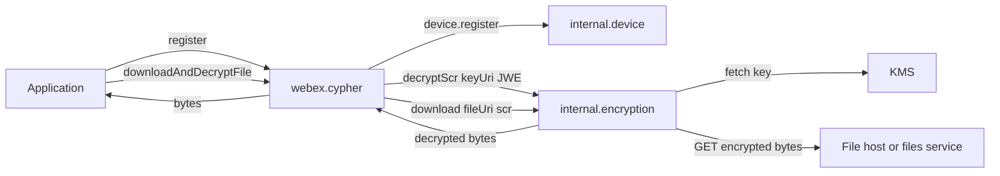
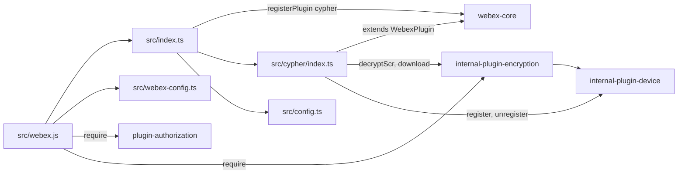
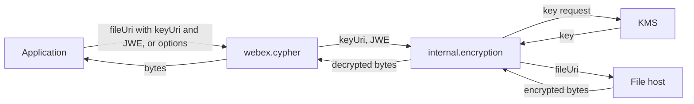

<!-- sdd-generated-metadata
doc_kind: standing-doc
generated_from: architecture@0.3.0
generated_by: claude-code
approved_by: riag@cisco.com
updated_at: 2026-11-05T16:10:55Z
validation_status: pass
-->

# @webex/plugin-encryption architecture

Canonical architecture for this package. Behavior lives in the
[Cypher encryption plugin specification](../src/docs/README.md). This page owns package boundaries, the
plugin registration, the contract index, and how the package meets the rest of the SDK.

Related context: [specification registry](specs/README.md) ·
[package agent instructions](../AGENTS.md)

## Applicability

| Condition ID                         | Status     | Evidence or reason | Owned section |
| ------------------------------------ | ---------- | ------------------ | ------------- |
| `repo.owns_datastore`                | N/A        | No database, file store, or migration in `src/`; `src/webex-config.ts` selects in-memory storage adapters | Repository data and schema |
| `repo.holds_client_state`            | Applicable | The `registered` flag in `src/cypher/index.ts` | Client state model |
| `repo.components_interact`           | Applicable | `src/cypher/index.ts` calls `internal.encryption` and `internal.device`; `src/webex.js` loads sibling plugins | Dependency and interaction topology |
| `repo.domain_data_across_components` | Applicable | The SCR key and decrypted bytes pass between this plugin and the internal encryption plugin (`src/cypher/index.ts`) | Object and data ownership |
| `repo.caches_data`                   | N/A        | `src/` keeps no cache | Caching catalog |
| `repo.observability_convention`      | Applicable | `src/cypher/index.ts` logs through `webex.logger` with a `Cypher:` prefix on most lines | Observability patterns |
| `repo.deploys_to_infra`              | N/A        | Library published to npm (`package.json`); no service runtime | Runtime and infrastructure |
| `repo.shared_base_libs`              | Applicable | Extends `WebexPlugin`; uses the legacy build, lint, and test stack (`babel.config.js`, `jest.config.js`, `.eslintrc.js`) | Shared and base libraries |
| `repo.is_monorepo`                   | N/A        | This SDD root is one package; the workspace around it is out of scope | Package map and inter-package dependencies |
| `repo.multi_platform`                | N/A        | No platform-specific source branches; `process` exports `{browser: true}` and `src/index.ts` sets `eslint-env browser`, but the code uses only `URL` | Platform matrix |
| `repo.published_package`             | Applicable | `package.json` name, `exports`, `types`, and `deploy:npm` | Release and versioning |
| `repo.embedded_in_host`              | N/A        | No host theme or embed API | Host integration and theming |
| `repo.exposes_commands_or_artifacts` | Applicable | `build:src` and `build` write `dist/` and `dist/types` | Commands and generated artifacts |
| `repo.cross_repo_deps_material`      | Applicable | Behavior depends on KMS and the file host, reached through the internal encryption plugin | Cross-repository topology |
| `repo.security_arch_warranted`       | Applicable | Handles encryption key URIs, JWE strings, and decrypted content (`src/cypher/index.ts`) | Security architecture |

## Design overview

`@webex/plugin-encryption` is a published library with one module. Importing `src/index.ts` registers
`Cypher` as the public plugin `cypher`. The package `main` is a different file, `src/webex.js`, which
also loads `@webex/plugin-authorization` and `@webex/internal-plugin-encryption` and exports a `Webex`
class whose `init` merges the `src/webex-config.ts` module exports under the caller's config; because of how the file is required, they land under `config.default` (see the module spec, MOD-013).

The plugin owns orchestration, not cryptography. `downloadAndDecryptFile` resolves a key URI and a JWE
from the file URI or the options, then asks the internal encryption plugin to decrypt the SCR and to
download and decrypt the file. `register` and `deregister` wrap `internal.device.register` and
`unregister` behind a `registered` flag. The package makes no network calls of its own and serves no
routes.

## Resource inventory and responsibilities

| Resource | Kind | Responsibility | Owner | Source | Detailed specification |
| -------- | ---- | -------------- | ----- | ------ | ---------------------- |
| Cypher encryption plugin | package (one module) | `webex.cypher`: download-and-decrypt, device register and deregister, and the `webex` bundle entry | @webex/web-sdk | `src` | [`src/docs/README.md`](../src/docs/README.md) |

## Interaction and execution flows

Representative flow: an application registers the device, then asks `webex.cypher` to open an attachment.

## Dependency topology

| Dependency | Type | Used by | Purpose | Version, failure, or fallback policy |
| ---------- | ---- | ------- | ------- | ------------------------------------ |
| `@webex/webex-core` (spec: [`../../webex-core/src/docs/README.md`](../../webex-core/src/docs/README.md)) | Internal | `src/index.ts`, `src/cypher/index.ts`, `src/webex.js`, `src/webex-config.ts` | Plugin base, registration, `WebexCore`, `MemoryStoreAdapter` | `workspace:*` |
| `@webex/internal-plugin-encryption` | Internal | `src/cypher/index.ts` (at runtime through `webex.internal.encryption`), `src/webex.js` | KMS key retrieval, SCR decrypt, file download and decrypt | `workspace:*`; no specification exists, so its code is the reference |
| `@webex/internal-plugin-device` (spec: [`../../internal-plugin-device/src/docs/README.md`](../../internal-plugin-device/src/docs/README.md)) | Internal, transitive | `src/cypher/index.ts` through `webex.internal.device` | Device registration | Imported by the internal encryption plugin; not declared here |
| `@webex/plugin-authorization` | Internal, undeclared | `src/webex.js` | Token handling for the bundle | Resolves through workspace hoisting; absent from `package.json` `dependencies` |
| `@babel/polyfill`, `lodash` | External, undeclared | `src/webex.js` | Polyfill and `merge` | Resolve through hoisting; absent from `package.json` `dependencies` |
| KMS, file host or files service | External services | Internal encryption plugin | Key material and encrypted bytes | URLs come from the SDK service catalog and the caller's `fileUri` |

No import cycle exists: this package imports webex-core and the internal plugin, and neither imports it.

## Public and consumer surfaces

| Surface | Type | Owner | Consumers | Compatibility policy | Source |
| ------- | ---- | ----- | --------- | -------------------- | ------ |
| `cypher-encryption-sdk` — package `@webex/plugin-encryption`, the `webex.cypher` API, and the `Webex` bundle | SDK, published to npm | Cypher encryption plugin | Applications, the CDN script, `docs/samples/plugin-encryption` | No versioning rule in the package; workspace release process applies | `package.json`, `src/index.ts`, `src/cypher/index.ts`, `src/cypher/types.ts`, `src/webex.js` |

No events are emitted. The internal KMS and file-host protocols are described by the internal plugin
and are not contracts of this package.

## Client state model

| State or slice | Owner | Transition triggers | Persistence or reset boundary |
| -------------- | ----- | ------------------- | ----------------------------- |
| `registered` | `Cypher` instance | Successful `register()` and `deregister()` | In memory for the instance |

## Cross-cutting architecture

### Security

See [Security architecture](#security-architecture).

### Observability and operations

Logging only; see [Observability patterns](#observability-patterns).

### Quality attributes

| Attribute | Target or constraint | Evidence |
| --------- | -------------------- | -------- |
| Test coverage | `jest.config.js` sets `collectCoverage: true` and an 85% global threshold for lines, functions, branches, and statements | `jest.config.js` |
| Compatibility | Node `>=16` | `package.json` `engines` |

## Dependency and interaction topology

| From | To | Kind | Purpose | Ordering or failure boundary |
| ---- | -- | ---- | ------- | ---------------------------- |
| `src/index.ts` | `src/cypher/index.ts`, `src/config.ts` | Import | Build and register the plugin | Registration happens at import time |
| `src/cypher/index.ts` | `internal.encryption` | Call | Decrypt SCR, download and decrypt | `decryptScr` rejection wrapped; `download` rejection raw |
| `src/cypher/index.ts` | `internal.device` | Call | Register and unregister | Rejection logged and rethrown |
| `src/webex.js` | sibling plugins | `require` | Assemble the `Webex` bundle | Load order: authorization, internal encryption, `./index` |

## Object and data ownership

| Object or state | System of record | May write | May read | Movement or lifecycle |
| --------------- | ---------------- | --------- | -------- | --------------------- |
| Key URI and JWE | The caller's `fileUri` or options | Caller | This plugin | Read per call, passed to `decryptScr`, not stored |
| SCR (content key) | Internal encryption plugin | Internal plugin | This plugin (passes it through) | Lives for one call |
| Decrypted bytes | Internal encryption plugin | Internal plugin | Caller | Returned to the caller; not retained here |
| `registered` | `Cypher` instance | `register`, `deregister` | Caller, tests | Instance lifetime |

## Observability patterns

| Signal  | Convention or required fields | Propagation or naming rule | Primary evidence |
| ------- | ----------------------------- | -------------------------- | ---------------- |
| Logs    | `info` for register and deregister outcomes; `error` for failures | Most messages start with `Cypher:`; the failure lines read `Error occurred during device.register() <error>` | `src/cypher/index.ts` |
| Metrics | None | N/A | `src/cypher/index.ts` |
| Traces  | None | N/A | `src/cypher/index.ts` |
| Audit   | None | N/A | `src/cypher/index.ts` |

## Shared and base libraries

| Library | Inherited responsibility | Consumers | Version floor | Compatibility rule |
| ------- | ------------------------ | --------- | ------------- | ------------------ |
| `@webex/webex-core` `WebexPlugin` | `webex`, `logger`, plugin lifecycle | `Cypher` | `workspace:*` | Keep `super(...args)` in the constructor |
| `@webex/babel-config-legacy`, `@webex/eslint-config-legacy`, `@webex/jest-config-legacy`, `@webex/legacy-tools` | Build, lint, and test stack through small config files | Package tooling | `workspace:*` | Do not fork the config locally |

## Release and versioning

| Artifact | Publish target | Versioning rule | Deprecation window | Changelog or migration obligation |
| -------- | -------------- | --------------- | ------------------ | --------------------------------- |
| `@webex/plugin-encryption` | npm through `deploy:npm` | None declared in the package | None declared | None declared in the package; the workspace owns changelog generation |

## Commands and generated artifacts

| Command or artifact | Owner | Inputs | Output or side effect | Compatibility boundary |
| ------------------- | ----- | ------ | --------------------- | ---------------------- |
| `yarn workspace @webex/plugin-encryption build:src` | Package scripts | `src` | Writes `dist/` through `webex-legacy-tools`, then runs `build` | `dist/` is generated and never edited by hand |
| `yarn workspace @webex/plugin-encryption build` | Package scripts | `src`, `tsconfig.json` | Writes declarations to `dist/types` | `types` points at `dist/types/index.d.ts` |
| `yarn workspace @webex/plugin-encryption build:docs` | Package scripts | `src/index.ts`, `tsconfig.json` | typedoc output under `docs/plugin-encryption` at the repository root | Feeds the published website |
| `yarn workspace @webex/plugin-encryption test:unit` | Package scripts | `test/unit/spec` | Jest run with coverage | Coverage threshold 85% |

## Cross-repository topology

| Repository or external system | Relationship | Exchanged contract or artifact | Owner | Sequencing constraint |
| ----------------------------- | ------------ | ------------------------------ | ----- | --------------------- |
| `@webex/webex-core` (workspace sibling; module spec consulted: `packages/@webex/webex-core/src/docs/README.md`) | Consumes | `WebexPlugin`, `registerPlugin` (first registration of a name wins), `WebexCore` | Not recorded | Plugin registered before use |
| `@webex/internal-plugin-device` (workspace sibling; module spec consulted: `packages/@webex/internal-plugin-device/src/docs/README.md`) | Consumes | `register`, `unregister` on `webex.internal.device`; `register` on a registered device refreshes | Not recorded | Token and `wdm` catalog available |
| `@webex/internal-plugin-encryption` (workspace sibling; no specification, code consulted) | Consumes | `decryptScr`, `download` | Not recorded | `ready` event before use |
| KMS and file host | Consumes, indirectly | Key retrieval, encrypted bytes | Not recorded in this repository | Valid token with KMS access |

## Security architecture

- The plugin never stores or logs the key URI, JWE, SCR, or file bytes. The only log lines it writes
  carry fixed text, the `fileUri` parse error message, and device-registration errors.
- Error messages embed `error.stack` for wrapped failures, so callers that display them expose internal
  paths.
- KMS certificate-chain validation is configured on the internal plugin
  (`config.encryption.shouldValidateKMSCertificate`, default `false` in
  `../internal-plugin-encryption/src/config.js`) and is not set by this package.
- With the default `useFileService: false`, the internal plugin accepts only `https://` file URIs
  (outside its non-production `localhost` bypass). With `useFileService: true` it asks the files service
  for a download URL and falls back to the original URI on failure.
- Authorization depends on a valid access token with KMS access, obtained outside this package.

## Domain language

| Term | Repository-specific meaning | Authoritative source |
| ---- | --------------------------- | -------------------- |
| Cypher | This package's public plugin name and namespace (`webex.cypher`) | `src/cypher/constants.ts` |
| KMS | Webex Key Management Service holding the key behind a `keyUri` | `src/cypher/index.ts` comments; internal plugin |
| `keyUri` | A `kms://` URI identifying the key for one attachment | `src/cypher/index.ts` |
| JWE | JSON Web Encryption string that decrypts to the SCR | `src/cypher/index.ts` |
| SCR | The content key used to decrypt the file bytes | `src/cypher/index.ts`; internal plugin |

## References and maintenance

- Decisions: [adr/](adr/index.md)
- Instantiated specifications and routing: [specs/README.md](specs/README.md)
- Repository rules and patterns: [package agent instructions](../AGENTS.md)
- Update this document in the same change that alters package boundaries, resource ownership, or the
  contract index.
