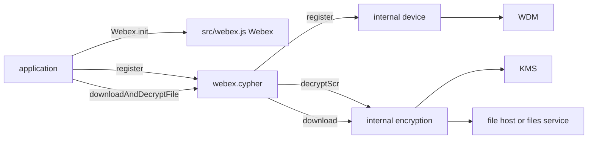
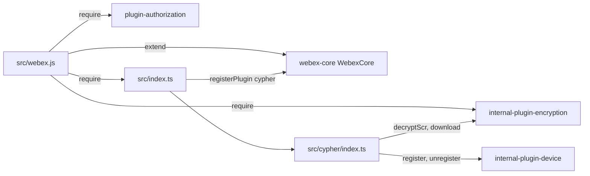
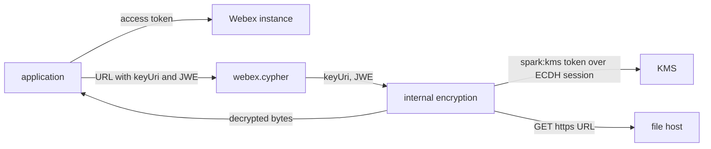

<!-- sdd-generated-metadata
doc_kind: standing-doc
generated_from: architecture@0.3.0
generated_by: claude-code
approved_by: rarajes2@cisco.com
updated_at: 2026-11-16T07:57:20Z
validation_status: pass
-->

# @webex/plugin-encryption architecture

Canonical architecture for this package. Flow behavior lives in the
[Cypher plugin specification](../src/docs/README.md). This page owns package boundaries, the entry
points, the contract index, and how the package meets the rest of the SDK.

Related context: [specification registry](specs/README.md) ·
[package agent instructions](../AGENTS.md)

## Applicability

| Condition ID                         | Status     | Evidence or reason | Owned section |
| ------------------------------------ | ---------- | ------------------ | ------------- |
| `repo.owns_datastore`                | N/A        | Nothing under src writes storage; cached keys belong to internal-plugin-encryption | Repository data and schema |
| `repo.holds_client_state`            | Applicable | `src/cypher/index.ts` keeps the registered flag per instance | Client state model |
| `repo.components_interact`           | Applicable | `src/webex.js` requires `src/index.ts`, which registers `src/cypher/index.ts`; the plugin calls the internal encryption and device plugins | Dependency and interaction topology |
| `repo.domain_data_across_components` | N/A        | The key URI, JWE, and SCR pass straight through to internal-plugin-encryption; no package-owned data spans resources | Object and data ownership |
| `repo.caches_data`                   | N/A        | No cache under src | Caching catalog |
| `repo.observability_convention`      | Applicable | Cypher: log prefix and logged error messages in `src/cypher/index.ts` | Observability patterns |
| `repo.deploys_to_infra`              | N/A        | Library published to npm (`package.json`); no service runtime | Runtime and infrastructure |
| `repo.shared_base_libs`              | Applicable | Extends WebexPlugin and WebexCore and uses the legacy build, lint, and test stack (`babel.config.js`, `.eslintrc.js`, `jest.config.js`) | Shared and base libraries |
| `repo.is_monorepo`                   | N/A        | This SDD root is one package; the workspace around it is out of scope | Package map and inter-package dependencies |
| `repo.multi_platform`                | N/A        | `package.json` has no browser field and src has no platform branch; Node and the browser UMD bundle run the same code | Platform matrix |
| `repo.published_package`             | Applicable | `package.json` name is @webex/plugin-encryption and deploy:npm publishes it | Release and versioning |
| `repo.embedded_in_host`              | N/A        | No host theme or embed API | Host integration and theming |
| `repo.exposes_commands_or_artifacts` | Applicable | build, build:src, and build:docs in `package.json`; `src/webex.js` is the workspace UMD entry | Commands and generated artifacts |
| `repo.cross_repo_deps_material`      | Applicable | KMS, WDM, and the file host or files service decide every result of `src/cypher/index.ts` | Cross-repository topology |
| `repo.security_arch_warranted`       | Applicable | Access tokens, KMS key URIs, encrypted SCRs, and decrypted file bytes pass through `src/cypher/index.ts` | Security architecture |

## Design overview

`@webex/plugin-encryption` is a published TypeScript library with one module. It registers the public
plugin `cypher`, reached as `webex.cypher`, which applications call to register the SDK device and to
turn an encrypted Webex attachment URL into decrypted bytes. The plugin holds no keys and does no
cryptography: `webex.internal.encryption` fetches the key, decrypts the SCR, downloads, and decrypts.

The package `main`, `src/webex.js`, is a small `Webex` constructor that loads only the authorization
plugin, the internal encryption plugin, and `cypher`. The workspace builds the same file as the UMD
`encryption` bundle, and the `webex` and `webex-node` packages require the package so their instances
carry `webex.cypher`.

Its only client state is one registered flag per plugin instance.

## Resource inventory and responsibilities

| Resource | Kind | Responsibility | Owner | Source | Detailed specification |
| -------- | ---- | -------------- | ----- | ------ | ---------------------- |
| Cypher plugin | package (one module) | Registration of `cypher`; device registration; encrypted file download and decryption; the standalone constructor | @webex/web-sdk | src | [`src/docs/README.md`](../src/docs/README.md) |

## Interaction and execution flows

Representative end-to-end flow: an application decrypts an attachment with the standalone constructor.

| From | To | Interaction or transport | Purpose | Failure or compatibility behavior |
| ---- | -- | ------------------------ | ------- | --------------------------------- |
| Application | `webex.cypher` | In-process calls | Register, deregister, download and decrypt | Rejections described in the module specification |
| `webex.cypher` | `webex.internal.encryption` | In-process calls | SCR decryption with the KMS key; download and byte decryption | Error shapes in the module specification (MOD-008) |
| `webex.cypher` | `webex.internal.device` | In-process calls | WDM registration | Errors logged and rethrown |
| `webex` and `webex-node` packages | This package | `require` at load | Add `webex.cypher` to their instances | First registration of `cypher` wins |
| Workspace webpack | `src/webex.js` | UMD build entry `encryption` | Script-tag `Webex` | Built and shipped by the `webex` package |

## Dependency topology

| Dependency | Type | Used by | Purpose | Version, failure, or fallback policy |
| ---------- | ---- | ------- | ------- | ------------------------------------ |
| `@webex/internal-plugin-encryption` | Internal | `src/webex.js`, `src/cypher/index.ts` | Key, SCR, download, and decryption | `workspace:*`; module spec consulted |
| `@webex/webex-core` | Internal | `src/index.ts`, `src/cypher/index.ts`, `src/webex.js`, `src/webex-config.ts` | Registration, plugin base, constructor base, memory storage adapter | `workspace:*`; module spec consulted |
| `@webex/plugin-authorization` | Internal, undeclared | `src/webex.js` | Authorization plugin for the constructor | Resolved through workspace hoisting; module spec consulted |
| `@webex/internal-plugin-device` | Internal, undeclared, transitive | `src/cypher/index.ts` through `webex.internal.device` | WDM registration | Registered by the authorization and encryption plugins; module spec consulted |
| `@babel/polyfill`, `lodash` | External, undeclared | `src/webex.js` | Polyfill; `merge` in `Webex.init` | Resolved through workspace hoisting |
| KMS, WDM, file hosts, Webex files service | External service | The internal plugins above | Keys, device registration, file bytes | Reached only through the internal plugins |

No import cycle exists: the internal plugins this package uses do not import it.

## Public and consumer surfaces

| Surface | Type | Owner | Consumers | Compatibility policy | Source |
| ------- | ---- | ----- | --------- | -------------------- | ------ |
| `plugin-encryption-sdk` — package @webex/plugin-encryption: the `Webex` constructor (`main`), `webex.cypher` and its methods, and the declared types | SDK, published to npm | Cypher plugin | Applications; the `webex` and `webex-node` packages; the encryption sample app | Public; no package versioning policy recorded; `types` and `main` disagree on the default export (a known defect in the module spec's Evidence register) | `package.json`, `src/webex.js`, `src/index.ts`, `src/cypher/index.ts` |
| `encryption-umd-entry` — UMD `encryption` bundle, global `Webex` | File, published in the `webex` package | Cypher plugin | Script-tag pages | Built by the workspace from this source | `src/webex.js` |
| `encrypted-attachment-url` — `keyUri` and `JWE` query parameters of a file URL | HTTP URL format, internal | Cypher plugin | Applications passing attachment URLs | Case-sensitive names; the whole URL is downloaded | `src/cypher/index.ts` |

The attachment URL format and the options object are described under *Protocol and wire format* in
the [module specification](../src/docs/README.md#protocol-and-wire-format). The contracts this package
requires are registered in `.sdd/manifest.json` `contract_catalog`.

## Client state model

| State or slice | Owner | Transition triggers | Persistence or reset boundary |
| -------------- | ----- | ------------------- | ----------------------------- |
| Registered flag | `Cypher` instance | Successful `register` and `deregister`, or a caller assigning the public field | Memory; see the module [Client state model](../src/docs/README.md#client-state-model) |

## Cross-cutting architecture

### Security

- Trust boundaries and identity flow: see [Security architecture](#security-architecture).
- Sensitive surfaces and data classes: the access token, KMS key URIs, the JWE of each SCR (the SCR
  holds the file key), and decrypted file bytes returned to the caller.
- Encryption and secret boundaries: see [Security architecture](#security-architecture).

### Observability and operations

- Logging, metrics, and correlation: see [Observability patterns](#observability-patterns).
- Ownership and operational entry points: the workspace `.github/CODEOWNERS` default rule assigns
  `@webex/web-sdk`; no line names this package. No dashboards or runbooks are recorded in this
  package.

### Quality attributes

- Compatibility: callers rely on the plugin name `cypher`, the three method names, the
  `FileDownloadOptions` fields, the `keyUri` and `JWE` query names, and the `Webex.init` entry.
- Latency: a first download waits for the KMS key (Mercury and an ECDH session in the internal
  plugin) before the file GET starts; later calls reuse the internal key cache.
- Test confidence: 11 unit cases with an enforced 85% coverage threshold cover the plugin class; the
  constructor, the registration entry, and the published entries have no test.

## Dependency and interaction topology

| From | To | Kind | Purpose | Ordering or failure boundary |
| ---- | -- | ---- | ------- | ---------------------------- |
| `src/webex.js` | `src/index.ts` and the two plugins | `require` at load | Register plugins before `WebexCore.extend` | Plugins registered after `extend` would be missing from instances (webex package INV-002) |
| `src/index.ts` | webex-core | Call at import | Register `cypher` | First registration wins |
| `src/cypher/index.ts` | Internal plugins | Calls through the parent `webex` | Delegated work | Their errors reach the caller |

## Observability patterns

| Signal  | Convention or required fields | Propagation or naming rule | Primary evidence |
| ------- | ----------------------------- | -------------------------- | ---------------- |
| Logs    | `webex.logger` info for registration outcomes and error for failures; error lines carry the error message only | Prefix `Cypher:`, except the two failure lines, which start `Error occurred during device.` | `src/cypher/index.ts` |
| Metrics | None emitted here | — | `src/cypher/index.ts` |
| Traces  | None | Tracking ids come from the internal plugins' requests | `src/cypher/index.ts` |
| Audit   | None | — | `src/cypher/index.ts` |

## Shared and base libraries

| Library | Inherited responsibility | Consumers | Version floor | Compatibility rule |
| ------- | ------------------------ | --------- | ------------- | ------------------ |
| `@webex/webex-core` `WebexPlugin`, `WebexCore`, `registerPlugin` | Parent `webex`, logger, namespace config; constructor; registration | `Cypher`, `Webex` | `workspace:*` | Keep the namespace `cypher` |
| `@webex/babel-config-legacy`, `@webex/eslint-config-legacy`, `@webex/jest-config-legacy`, `@webex/legacy-tools` | Build, lint, and test stack, plus the package-version Babel plugin | Package tooling | `workspace:*` | Extend, do not fork, the configs; the local `jest.config.js` adds the coverage threshold |

## Release and versioning

| Artifact | Publish target | Versioning rule | Deprecation window | Changelog or migration obligation |
| -------- | -------------- | --------------- | ------------------ | --------------------------------- |
| @webex/plugin-encryption, including dist/types | npm through `deploy:npm` | Workspace release process; no package policy recorded | None declared | None in the package; the workspace owns changelogs |
| UMD `encryption.min.js` | Shipped by the `webex` package | Follows the `webex` package release | None declared | Owned by the `webex` package |

## Commands and generated artifacts

| Command or artifact | Owner | Inputs | Output or side effect | Compatibility boundary |
| ------------------- | ----- | ------ | --------------------- | ---------------------- |
| `yarn build:src` | Package scripts | `src` | Writes JavaScript and maps to `dist/` through `webex-legacy-tools`, then runs `build` | `dist/` is generated |
| `yarn build` | Package scripts | `src`, `tsconfig.json` | Declarations in dist/types | `types` points at them |
| `yarn build:docs` | Package scripts | `src/index.ts` through typedoc | Writes the workspace `docs/plugin-encryption` API reference | Output lives outside this package |
| `yarn test:unit` | Package scripts | `test/unit/spec`, sibling `dist/` | Jest run with the coverage threshold; writes `coverage/` and `junit.xml` (ignored by Git) | Fails below 85% |
| `yarn test:style` | Package scripts | `src` | ESLint run | Skips `docs/**` and `*.md` |
| `yarn test:browser` | Package scripts | No integration files | Nothing | Runs no test |

## Cross-repository topology

| Repository or external system | Relationship | Exchanged contract or artifact | Owner | Sequencing constraint |
| ----------------------------- | ------------- | ------------------------------ | ----- | --------------------- |
| `@webex/internal-plugin-encryption` (workspace sibling; spec consulted) | Consumes | `decryptScr`, `download` | @webex/web-sdk | Required before `cypher` runs |
| `@webex/internal-plugin-device`, `@webex/webex-core`, `@webex/plugin-authorization` (workspace siblings; specs consulted) | Consumes | Device registration; plugin host; authorization | @webex/web-sdk | Registered before `WebexCore.extend` |
| `webex` and `webex-node` packages (workspace siblings; specs consulted) | Consumed by | `webex.cypher`; the UMD `encryption` bundle | @webex/web-sdk | Require this package at load |
| KMS, WDM, file hosts, Webex files service | Consumes, through the internal plugins | Keys, device registration, file bytes | Not recorded in this repository | — |

## Security architecture

- The access token is the application's; this package never reads it. The internal plugin uses it
  with the `spark:kms` scope to fetch the key.
- The JWE in an attachment URL holds the file's SCR encrypted with the KMS key; only a user KMS
  authorizes for that key URI can decrypt it.
- By default the file is fetched straight from the given URL, and the internal plugin rejects a URL
  that is not HTTPS (outside production, a URL containing `localhost` skips that check); with `useFileService` the files service maps the URL first.
- Decrypted bytes go only to the caller; the plugin does not store them.
- Logging rules are under [Observability patterns](#observability-patterns); the module spec's
  `INV-003` lists what is never logged.

## Domain language

| Term | Repository-specific meaning | Authoritative source |
| ---- | --------------------------- | -------------------- |
| Cypher | This package's public plugin, `webex.cypher` | `src/cypher/index.ts` |
| SCR | Secure content resource: the key, IV, and location of an encrypted file | `src/cypher/index.ts` |
| JWE | Compact JSON Web Encryption; here the SCR encrypted with the KMS key | `src/cypher/types.ts` |
| Key URI | The KMS URI of the key that encrypts the SCR | `src/cypher/types.ts` |
| Files service | Webex service that maps a file URL to a download URL (`useFileService`) | `src/cypher/types.ts` |
| WDM | The device registration service reached through `webex.internal.device` | `src/cypher/index.ts` |

## References and maintenance

- Decisions: [adr/](adr/index.md)
- Instantiated specifications and routing: [specs/README.md](specs/README.md)
- Repository rules and patterns: [package agent instructions](../AGENTS.md)
- Update this document in the same change that alters package boundaries, resource ownership,
  cross-resource interaction, or cross-cutting architecture.
