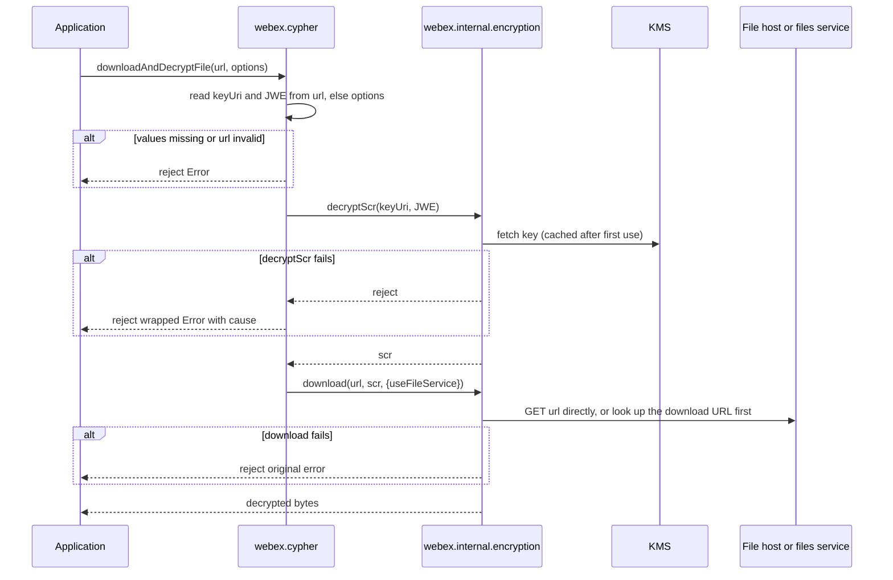
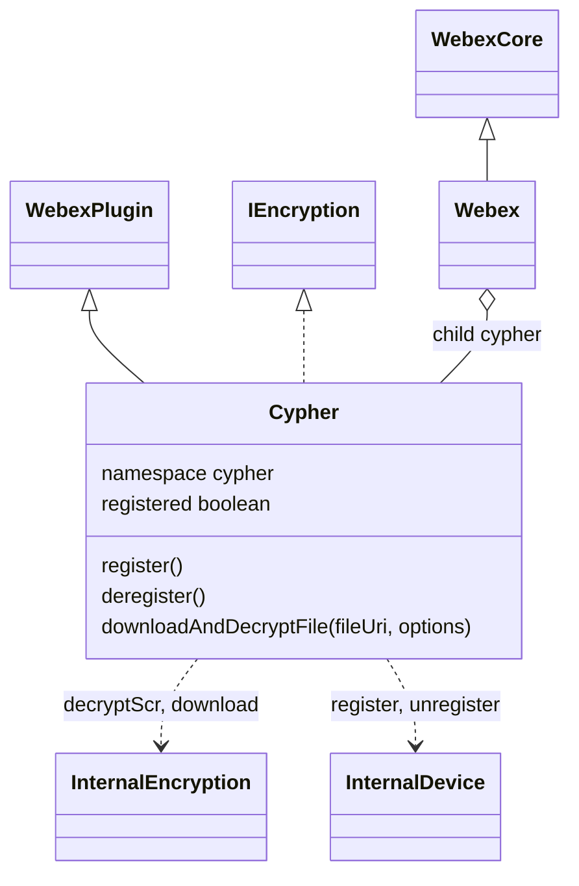
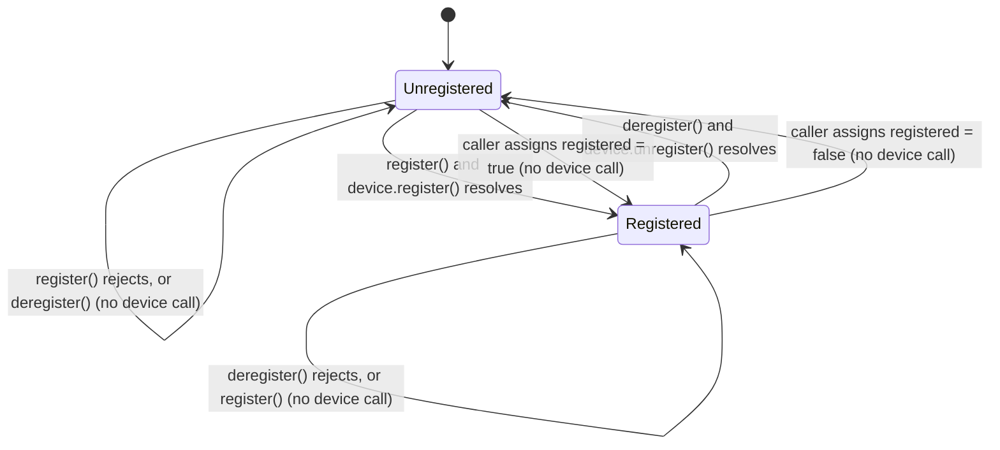

<!-- sdd-generated-metadata
doc_kind: module-spec
generated_from: module-spec@0.3.0
generated_by: claude-code
approved_by: rarajes2@cisco.com
updated_at: 2026-11-16T07:57:20Z
validation_status: pass
-->

# Cypher plugin

This source-local document at `src/docs/README.md` owns the stable specification for **the Cypher
plugin**: the public plugin `webex.cypher` of `@webex/plugin-encryption`, and the package's standalone
`Webex` constructor. `webex.cypher` registers the SDK as a device and downloads and decrypts an
encrypted Webex file from its URL, with the key URI and JWE taken from the URL or from the options.
The cryptography, the KMS session, and the download itself belong to `webex.internal.encryption`.
Ground every claim in package evidence and link to the
[package architecture](../../docs/architecture.md) instead of repeating broader facts. No service
specification exists because this package is a library.

Related context: [documentation index](../../docs/index.md) ·
[package agent instructions](../../AGENTS.md)

## Metadata

| Field             | Value |
| ----------------- | ----- |
| Owner             | @webex/web-sdk |
| Source path       | `src` |
| Resource kind     | package |
| Status            | Draft |
| Last verified     | 2026-11-16 at `d5b58d84f1` |
| Module id         | `plugin-encryption` |
| Parent spec       | — |
| Doc kind          | Module spec |
| Coverage score    | 100% assessed 2026-11-16 by the generator — 16 of 16 applicable fields PRESENT (data and schema discipline not applicable), critical 7 of 7; `test:unit` holds 11 jest cases in one file, and all 11 pass |
| Validation status | Pass — assessed 2026-11-16 by validator runtime 01a1e332-5dfd-75c0-a6ab-fce7e722caa5; 0 Blocking, 0 findings. |

## Applicability

| Condition ID                         | Status     | Evidence or reason | Owned section |
| ------------------------------------ | ---------- | ------------------ | ------------- |
| `module.has_tiers`                   | N/A        | No tier policy exists in `package.json` or under src | Tier |
| `module.has_ui`                      | N/A        | Every method returns a promise; the plugin renders nothing. The browser sample app lives outside this package | UI use-case flow |
| `module.crosses_service_boundaries`  | Applicable | `src/cypher/index.ts` calls the internal device plugin (WDM) and the internal encryption plugin (KMS, the file host, or the files service) | Cross-boundary use-case flow |
| `module.holds_client_state`          | Applicable | `src/cypher/index.ts` keeps a public registered flag per instance | Client state model |
| `module.enforces_domain_rules`       | Applicable | The key URI and JWE pairing rule and the registration guards in `src/cypher/index.ts` | Business rules and invariants |
| `module.is_concurrent_async`         | Applicable | The three methods in `src/cypher/index.ts` are async and chain dependency promises | Concurrency and reactive flow |
| `module.owns_persistence`            | N/A        | Nothing under src writes storage; `src/webex-config.ts` names storage adapters, and keys are cached by internal-plugin-encryption | Data, schema, and migration discipline |
| `module.stateful_transitions`        | Applicable | In `src/cypher/index.ts`, register() and deregister() move the registered flag between false and true only on a successful device call, with no-op guards; callers can also assign the public flag directly | State machine |
| `module.exposes_wire_protocol`       | Applicable | Callers build attachment URLs whose keyUri and JWE query parameters `src/cypher/index.ts` parses | Protocol and wire format |
| `module.ui_multi_screen`             | N/A        | No UI | UI flow |
| `module.large_data_model`            | N/A        | The only data types are the three-field options type and the one-method interface in `src/cypher/types.ts` | Data model |
| `module.returns_caller_errors`       | Applicable | `src/cypher/index.ts` rejects with plain Error objects and rethrows dependency errors | Caller-visible failure modes |
| `module.module_specific_conventions` | Applicable | The Cypher: log prefix and the error-message shapes in `src/cypher/index.ts` | Module-specific rules |
| `module.published_package`           | Applicable | `package.json` names the package @webex/plugin-encryption, publishes main and types entries, and defines deploy:npm | Export stability |
| `module.embedded_in_host`            | N/A        | No host theme or embed API | Host integration and theming |
| `module.has_design_tradeoff`         | Applicable | `src/webex.js` ships a CommonJS constructor that loads only authorization and encryption, with an in-code reason | Key design trade-off |
| `module.has_submodules`              | N/A        | The src directory has no child module (the plugin's module_tree.py reports one module) | Sub-modules |

## Evidence register

| Evidence | What it establishes |
| -------- | ------------------- |
| `src/index.ts` | `registerPlugin('cypher', Cypher, {config})`; exports the default `Cypher` and the types `FileDownloadOptions` and `IEncryption` |
| `src/cypher/index.ts` | `Cypher` extends `WebexPlugin` with namespace `cypher`; `register`, `deregister`, and `downloadAndDecryptFile`; the step comments and the JSDoc are the recorded rationale |
| `src/cypher/types.ts` | `FileDownloadOptions` (`useFileService`, `jwe`, `keyUri`) and `IEncryption` with their JSDoc |
| `src/cypher/constants.ts` | `CYPHER` and the four `DECRYPTION*` constants (see Pitfalls and constraints) |
| `src/types.ts` | The `WebexSDK` shape `Cypher` reads `webex` through (see Pitfalls and constraints) |
| `src/config.ts` | The registered plugin config `{cypher: {}}` |
| `src/webex.js` | The package `main`: polyfill guard, side-effect requires of `@webex/plugin-authorization`, `@webex/internal-plugin-encryption`, and `./index`, `WebexCore.extend`, and `Webex.init`. Its header comment gives the CommonJS reason |
| `src/webex-config.ts` | The standalone constructor's intended defaults (Hydra URL, device, memory storage), exported as an ES default |
| `package.json` | Name, `main` `dist/webex.js`, `devMain`, `exports`, `types` `dist/types/index.d.ts`, the declared dependencies (only internal-plugin-encryption and webex-core), and the scripts |
| `tsconfig.json`, `babel.config.js`, `jest.config.js`, `.eslintrc.js` | Typedoc entry, Babel presets with the package-version plugin, the Jest configuration with its 85% global coverage threshold, and the legacy ESLint config |
| `test/unit/spec/cypher/index.ts` | 11 jest cases over `downloadAndDecryptFile`, `register`, and `deregister`, run against src with the internal encryption and device methods stubbed |
| `README.md`, `developer-quickstart.md` | Retained npm page and sample-app guide; context only (`docs/adr/0001-retain-product-docs.md`) |
| Sibling package internal-plugin-encryption, file src/docs/README.md | Module spec consulted, agrees with code: `decryptScr(key, cipherScr)` resolves the key through `getKey` (MOD-007, MOD-009); `download(fileUrl, scr, options)` defaults `useFileService` to true, rejects a direct URL that is not HTTPS, falls back to the original URL when the files-service lookup fails, and emits `progress` events on its promise (MOD-010) |
| Sibling package internal-plugin-device, file src/docs/README.md | Module spec consulted, agrees with code: `register()` on a registered device refreshes it (MOD-005); `unregister()` resolves at once when unregistered and rejects on a 404 after clearing local state (MOD-011); logout calls `unregister()` (MOD-001) |
| Sibling package webex-core, file src/docs/README.md | Module spec consulted, agrees with code: the first registration of a name wins (MOD-013); registration `config` merges into the default config (MOD-008); `WebexPlugin.config` reads the lowercased namespace key (MOD-044); default memory storage adapters (MOD-009) |
| Sibling package plugin-authorization, file src/docs/README.md | Module spec consulted: importing it selects the Node or browser authorization plugin and registers public plugin `authorization` |
| Sibling package webex, file src/docs/README.md; workspace webpack.config.js | Spec consulted, agrees with code: the UMD `encryption` bundle is built from this package's src/webex.js with library name `Webex` (webex MOD-019); webex src/encryption.js and webex-node src/webex-node.js also require this package |
| Sibling package test-helper-mock-webex, file src/index.js | No spec; code consulted: `cypher` is in its list of public plugin names |
| Generator probes against the built dist | Recorded with their output in the bootstrap run records; they establish the config object of MOD-001, MOD-006, MOD-008, the URL-versus-options cases of MOD-005, the concurrent `register` behavior, and the four known defects below |
| `src/cypher/index.ts` (download step) | Known defect, verified by generator probe: the method returns the `download` promise from inside the `try` without awaiting it, so a `download` rejection skips the `catch` and reaches the caller as the original error, without the wrapped message or `cause` of MOD-008 |
| `src/cypher/index.ts` (returned promise) | Known defect, verified by generator probe: the async method returns its own promise, so the `progress` events that internal `download` attaches to its promise cannot be observed by the caller |
| `package.json`, `src/index.ts`, `src/webex.js` | Known defect, verified by generator probe: `types` points at the declarations of `src/index.ts` (default `Cypher`, types `FileDownloadOptions` and `IEncryption`), while `main` and `exports['.']` load the built `src/webex.js`, whose CommonJS export is the `Webex` constructor. `IEncryption` declares only `downloadAndDecryptFile` |
| `src/webex.js`, `src/webex-config.ts` | Known defect, verified by generator probe: `Webex.init` merges `require('./webex-config')`, the compiled ES module object `{default: {...}}`, so the defaults land under `config.default` and are not applied. An instance keeps the webex-core and plugin defaults (for example `device.ephemeral` false and no `hydra`), not the Hydra URL, ephemeral device, and memory storage of `src/webex-config.ts`; the UMD bundle was not checked |
| Known defects | The four rows above are behavior the code shows that the owner does not treat as compatibility promises (owner decision, 2026-11-16); none is a requirement, and fixing one changes caller-visible behavior without a deprecation |

## Purpose and boundary

- Responsibility: give applications one public call that turns an encrypted Webex attachment URL into
  decrypted bytes, plus the device registration that the SDK services need, and a small `Webex`
  constructor that loads only what that call requires.
- In scope: registration of the public plugin `cypher`; `register`, `deregister`, and
  `downloadAndDecryptFile`; reading `keyUri` and `JWE` from the URL or the options; the error wrapping
  of those calls; the exported types; the standalone constructor in `src/webex.js` and its
  `src/webex-config.ts` defaults.
- Out of scope: key fetching, SCR decryption, the HTTPS rule for direct URLs, the files-service URL
  lookup, and byte decryption (`@webex/internal-plugin-encryption`); device registration with WDM
  (`@webex/internal-plugin-device`); authorization and tokens (`@webex/plugin-authorization`); plugin
  registration and configuration merging (`@webex/webex-core`); building the UMD bundle (the
  workspace webpack configuration) and the browser sample app.
- Consumers: applications through `webex.cypher`, either from this package's own constructor, the UMD
  `encryption` bundle built from src/webex.js, the `webex` package, or `webex-node`. In this
  repository, the `webex` and `webex-node` packages require this package, the encryption sample app
  calls `webex.cypher`, and test-helper-mock-webex lists `cypher` as a public plugin.

## Structure and key files

| Path | Responsibility |
| ---- | -------------- |
| `src/index.ts` | Registration of `cypher`; the package's typed entry (`devMain`, `types`) |
| `src/cypher/index.ts` | `Cypher`: registration flag, device calls, file download and decryption |
| `src/cypher/types.ts` | `FileDownloadOptions` and `IEncryption` |
| `src/cypher/constants.ts` | `CYPHER` namespace and unused decryption constants |
| `src/types.ts` | `WebexSDK` and `Logger` types for the parent instance |
| `src/config.ts` | Registered plugin config |
| `src/webex.js` | Standalone `Webex` constructor; the package `main` and the UMD `encryption` entry |
| `src/webex-config.ts` | Defaults that `Webex.init` means to merge |
| `package.json` | Package name, entry points, scripts, dependencies |
| `tsconfig.json` | Extends the workspace config (declarations only) and holds the typedoc options |
| `babel.config.js`, `jest.config.js`, `.eslintrc.js` | Build, test, and lint configuration |
| `browsers.js` | Karma browser definitions for `test:browser` |
| `process` | Package-root file exporting `{browser: true}`; not imported by src |
| `src/docs/README.md` | This module specification; ignored by the build and by lint |
| `test/unit/spec/cypher/index.ts` | Unit cases |
| dist/ (generated) | Output of `build:src` (JavaScript, source maps, and dist/types declarations); ignored by Git and never edited by hand |

## Public surface

| Surface | Consumer | Compatibility commitment | Source |
| ------- | -------- | ------------------------ | ------ |
| Import side effect: public plugin `cypher` with config `{cypher: {}}`, registered by `src/index.ts`, which the main requires | Every importer, including the `webex` and `webex-node` packages | First registration of the name wins; reached as `webex.cypher` | `src/index.ts`, `src/config.ts`, `src/webex.js` |
| `webex.cypher.register()`, `webex.cypher.deregister()` | Applications | Resolve `undefined`; reject with the device error | `src/cypher/index.ts` |
| `webex.cypher.downloadAndDecryptFile(fileUri, options)` with `FileDownloadOptions` | Applications | Resolves the decrypted bytes (declared `Promise<ArrayBuffer>`) | `src/cypher/index.ts`, `src/cypher/types.ts` |
| `webex.cypher.registered` | Applications and tests | Public, writable boolean | `src/cypher/index.ts` |
| Type exports `FileDownloadOptions`, `IEncryption`; default export `Cypher` | TypeScript consumers | Declared by `types` `dist/types/index.d.ts`, which disagrees with `main` (known defect, Evidence register) | `src/index.ts`, `package.json` |
| Package `main` and `exports['.']`: `dist/webex.js`, the `Webex` constructor with `Webex.init(attrs)` | Applications installing this package | CommonJS `module.exports = Webex` | `src/webex.js`, `package.json` |
| UMD `encryption` bundle (global `Webex`) | Script-tag pages | Built from src/webex.js by the workspace and shipped in the `webex` package as `umd/encryption.min.js` | `src/webex.js` |

Contract ID `plugin-encryption-sdk` is indexed in the
[package architecture](../../docs/architecture.md#public-and-consumer-surfaces) with the contracts
`encryption-umd-entry` and `encrypted-attachment-url`.

## Dependencies

| Dependency | Why it is required | Failure behavior |
| ---------- | ------------------ | ---------------- |
| `@webex/internal-plugin-encryption` (module spec consulted) | `decryptScr(keyUri, JWE)` and `download(fileUri, scr, {useFileService})`; `src/webex.js` requires it so `webex.internal.encryption` exists | `decryptScr` rejections are wrapped (MOD-008); `download` rejections pass through unchanged (known defect, Evidence register) |
| `@webex/internal-plugin-device` (module spec consulted; not declared here, registered by authorization or encryption) | `register()` and `unregister()` on `webex.internal.device` | Rejections are logged and rethrown (MOD-003, MOD-004) |
| `@webex/webex-core` (module spec consulted) | `registerPlugin`, `WebexPlugin`, `WebexCore.extend`, `MemoryStoreAdapter` | First registration wins; config merge per webex-core MOD-008 |
| `@webex/plugin-authorization` (module spec consulted; not declared in `package.json`) | Required by `src/webex.js` so the constructor can authorize | Resolved through workspace hoisting; a missing install fails at require time |
| `@babel/polyfill`, `lodash` (not declared in `package.json`) | Polyfill when `global._babelPolyfill` is unset; `lodash/merge` in `Webex.init` | Same as above; `test:style` reports these and `@webex/plugin-authorization` as `import/no-extraneous-dependencies` warnings |
| Global `URL` | Parses `fileUri` | A throw becomes the invalid-URL rejection (MOD-006) |
| KMS, WDM, the file host, and the Webex files service (external, reached through the plugins above) | Key, device registration, encrypted bytes, download URL lookup | See Cross-boundary use-case flow |

## Requirements

| ID | WHAT | WHY | Source evidence | Test or example evidence | Assumptions or gaps | Confidence |
| -- | ---- | --- | --------------- | ------------------------ | ------------------- | ---------- |
| `MOD-001` | Importing `src/index.ts` registers `Cypher` as public plugin `cypher` with config `{cypher: {}}`, and the entry exports the default `Cypher` and the types `FileDownloadOptions` and `IEncryption`. `Cypher` reads no config field. | Applications, the README sample code, and the workspace encryption sample app reach the API as `webex.cypher`, and test-helper-mock-webex treats `cypher` as a public plugin. The registration config is merged into the default config (webex-core MOD-008), so `webex.config.cypher` exists and `WebexPlugin.config`, which returns that namespace key (webex-core MOD-044), resolves to an object for this plugin. | `src/index.ts`, `src/config.ts` | Generator probe (an instance's cypher.config is an empty object); the unit spec constructs the class directly | No unit case registers the plugin | Present |
| `MOD-002` | A `Cypher` instance has `namespace` `cypher`, keeps its parent `webex` as a private field, and starts with the public field `registered` set to false. | The constructor remarks: the private field gives typed access to `webex`. | `src/cypher/index.ts`, `src/types.ts` | `test/unit/spec/cypher/index.ts` (every case builds an instance) | — | Present |
| `MOD-003` | `register()` logs `Cypher: webex.internal.device.register already done` at info and resolves when `registered` is true. Otherwise it calls `webex.internal.device.register()`; on success it logs `Cypher: webex.internal.device.register successful` and sets `registered` to true; on failure it logs `Error occurred during device.register() <error>` at error and rejects with the same error. | The JSDoc: registering the device with WDM is required for metrics and other services. | `src/cypher/index.ts` | `test/unit/spec/cypher/index.ts` register cases (call, already registered, failure log) | The failure case does not assert that `registered` stays false | Present |
| `MOD-004` | `deregister()` logs `Cypher: webex.internal.device.deregister already done` and resolves when `registered` is false. Otherwise it calls `webex.internal.device.unregister()`; on success it logs `Cypher: webex.internal.device.deregister successful` and sets `registered` to false; on failure it logs `Error occurred during device.deregister() <error>` and rejects with the same error. | The README sample: deregister at the application's teardown. | `src/cypher/index.ts` | `test/unit/spec/cypher/index.ts` deregister cases (call, failure log, not registered) | The failure case does not assert that `registered` stays true | Present |
| `MOD-005` | `downloadAndDecryptFile(fileUri, options)` reads the `keyUri` and `JWE` query parameters of `new URL(fileUri)`. When either is missing, it replaces both with `options.keyUri` and `options.jwe`. When either is still missing, it rejects with `Error('KeyUri and JWE are required to decrypt the file. Either provide them in the fileUri or in the options.')`. When the URL carries both, the URL values win over the options. | The step comments: parse the URL first, fall back to the options; both values are required to decrypt the SCR. | `src/cypher/index.ts`, `src/cypher/types.ts` | `test/unit/spec/cypher/index.ts` missing-values and options-fallback cases; generator probe for URL-wins and a URL with only one value | The URL-wins and one-value cases are not unit tested | Present |
| `MOD-006` | When `new URL(fileUri)` throws, the method logs `Cypher: Invalid fileUri: <message>` at error and rejects with `Error('Failed to decrypt the JWE: <message>\nStack: <stack>')`. | The step comments make the URL both the first source of the key URI and JWE and the address that is downloaded. A string the URL constructor rejects can provide neither, so the method stops before any KMS or network call and leaves one error log line. | `src/cypher/index.ts` | Generator probe (a relative string) | No unit case. The message says the JWE failed to decrypt although no decryption ran | Present |
| `MOD-007` | With both values, the method calls `webex.internal.encryption.decryptScr(keyUri, JWE)` and returns `webex.internal.encryption.download(fileUri, scr, {useFileService})`. It passes the full original `fileUri`, query included, and `useFileService` defaults to false; no other option is forwarded. | The step comments: decrypt the JWE with the KMS key to get the SCR, then download the file from the fileUri and decrypt it with the SCR. The `useFileService` JSDoc makes a direct download from the URL the behavior for false or undefined, and the method's JSDoc example, the README sample code, and the workspace encryption sample app (whose checkbox says to leave the files service unchecked when unsure) all present the direct download as the default, with the files-service lookup as a per-call opt-in. | `src/cypher/index.ts`, `src/cypher/types.ts` | `test/unit/spec/cypher/index.ts` success and options cases assert both calls with useFileService false | The call without options is shown only by the generator probe | Present |
| `MOD-008` | A `decryptScr` rejection is rethrown as `Error('Failed to decrypt or download the file: <message>\nStack: <stack>')` with `cause` set to the original error. | The code builds the message and then assigns the original error to `cause`, so callers learn from the message which step failed and keep the original key or KMS error, its class included, through `cause`. | `src/cypher/index.ts` | `test/unit/spec/cypher/index.ts` decryption failure case matches a substring; generator probe shows the wrapped message and the cause | The unit case cannot tell the wrapped error from the original | Present |
| `MOD-011` | `src/webex.js` requires `@babel/polyfill` only when `global._babelPolyfill` is falsy, then requires `@webex/plugin-authorization`, `@webex/internal-plugin-encryption`, and `./index`, and only then builds `Webex = WebexCore.extend({webex: true, version: PACKAGE_VERSION})`. `Webex.init(attrs = {})` replaces `attrs.config` with `merge({}, config, attrs.config)` and returns `new Webex(attrs)`. | The header comment: CommonJS simplifies consumption for people less familiar with JavaScript modules. The `required` comment on the encryption require. Plugins registered before `extend` appear on instances (webex INV-002). | `src/webex.js`, `babel.config.js` | Generator probe: an instance has cypher, authorization, and internal.encryption, and a string version | No unit case; the caller's `attrs` object is mutated | Present |

## Design overview

The package is one small public plugin plus a constructor. `Cypher` holds no key material and does no
cryptography. It reads the key URI and the encrypted SCR (the JWE) from the attachment URL or from the
options, asks `webex.internal.encryption` to decrypt the SCR with the KMS key, and asks it to
download and decrypt the file with that SCR (`INV-001`, `INV-003`). Its other job is a guarded pair of
device calls that flip one flag.

`src/webex.js` is a separate entry. It loads the authorization plugin, the internal encryption plugin,
and this plugin, and extends `WebexCore`, so an application gets an SDK with `webex.cypher` and nothing
else. It is the npm `main` and the source of the UMD `encryption` bundle. The `webex` and `webex-node`
packages require this package by name, which loads the same main: they use only its side effect of
registering `cypher` (and the plugins it requires), not the constructor it builds. No workspace
resolver reads `devMain`.

## Data flow and sequence coverage

Call style: in-process promise calls on `webex.cypher`, delegating to `webex.internal.encryption` and
`webex.internal.device`, which make the HTTPS and Mercury calls.

| Operation group | Entry and outcome | Diagram or evidence | Failure and recovery coverage |
| --------------- | ----------------- | ------------------- | ----------------------------- |
| File download and decryption | `downloadAndDecryptFile`; resolves the decrypted bytes | Diagram 1; `src/cypher/index.ts` | Invalid URL, missing values, wrapped `decryptScr` errors, raw `download` errors |
| Device registration | `register`, `deregister`; resolve `undefined` | State machine; `src/cypher/index.ts` | Errors logged and rethrown; flag unchanged |
| Construction | `Webex.init`, `new Webex` | `src/webex.js` | Defaults not applied (known defect, Evidence register) |

Diagram 1 — downloading a file whose URL carries the key URI and JWE:

## Class and component relationships

`Webex` is built in `src/webex.js`; `Cypher` reaches the internal plugins through its parent `webex`.

## Use cases and flows

| Use case | Actor or caller | Primary steps and outcome | Failure or boundary behavior | Evidence |
| -------- | --------------- | ------------------------- | ---------------------------- | -------- |
| `UC-001` | Application with this package's constructor or the UMD bundle | `Webex.init({credentials: {access_token}})`; on `ready`, `webex.cypher.register()`; `downloadAndDecryptFile(url, options)`; `deregister()` at teardown | Missing values, KMS, and download failures reject (Caller-visible failure modes) | `src/webex.js`, `src/cypher/index.ts`, `README.md` |
| `UC-002` | Application on the full `webex` or `webex-node` SDK | Uses `webex.cypher` the same way; the host package required this plugin | Same | `src/index.ts`, `src/cypher/index.ts` |
| `UC-003` | Application holding the key URI and JWE separately | Passes them as `options.keyUri` and `options.jwe` with a URL that lacks one or both | A URL with both values ignores the options (MOD-005) | `src/cypher/index.ts`, `test/unit/spec/cypher/index.ts` |

### Cross-boundary use-case flow

| Boundary | Transport and ordering | Compatibility | Timeout, retry, and recovery |
| -------- | ---------------------- | ------------- | ---------------------------- |
| KMS, through `decryptScr` (`UC-001` to `UC-003`) | Internal plugin call; the key comes from the internal key cache or a KMS request over Mercury | `keyUri` must be a KMS key URI the user may read | Internal KMS timeouts and retries; the final error is wrapped here |
| File host, through `download` with `useFileService` false (default) | One HTTPS GET of `fileUri` after `decryptScr` resolves | The URL must start with `https://`, except that outside production a URL containing `localhost` skips the check (internal MOD-010) | No retry; the error is not wrapped |
| Webex files service, through `download` with `useFileService` true | POST `/v1/download/endpoints` on the file host, then GET | Internal MOD-010 | A failed lookup falls back to the original URL; no retry |
| WDM, through `register` and `deregister` | Internal device calls | Internal device MOD-005, MOD-011 | No retry here; the flag stays as it was |

## Client state model

| State or slice | Owner      | Initial state | Transition triggers | Reset or persistence boundary |
| -------------- | ---------- | ------------- | ------------------- | ----------------------------- |
| `registered` | `Cypher` instance (`src/cypher/index.ts`) | false | Successful `register()` sets true; successful `deregister()` sets false; any caller may assign it | Memory only; not tied to `webex.internal.device` state. Logout unregisters the device (internal device MOD-001) without clearing the flag, so a later `register()` makes no device call; another plugin's registration does not set it |

## Business rules and invariants

| ID | Invariant | WHY | Enforcement source | Test evidence |
| -- | --------- | --- | ------------------ | ------------- |
| `INV-001` | The key URI and the JWE passed to `decryptScr` come from the same source: both from the URL, or both from the options, never one of each. | The step comments treat them as one pair taken from the URL or from the options. | `src/cypher/index.ts` | `test/unit/spec/cypher/index.ts` options-fallback case; the mixed case is shown only by the generator probe |
| `INV-002` | Within `register()` and `deregister()`, `registered` changes only after the device call succeeds; a rejected call leaves it unchanged, and a call that finds the flag already in the target state makes no device call. This binds the two methods only: `registered` is a public writable field, so a caller assignment changes it without any device call (Client state model). | The methods set the flag in the device call's success handler, so after either method it records the outcome of the last completed device call. | `src/cypher/index.ts` | `test/unit/spec/cypher/index.ts` already-registered and not-registered cases |
| `INV-003` | The plugin never stores the key URI, the JWE, the SCR, or the file bytes, and never writes them into its own log text. Its log lines are fixed text plus a device error or the URL constructor's error message, which the JavaScript engine composes (Node 22 gives `Invalid URL`). | The step comments state that the JWE decrypts, with the KMS key the key URI names, to the SCR key that decrypts the attachment, so both are decryption inputs; the plugin only hands them to the internal encryption plugin. | `src/cypher/index.ts` | Generator probe (the only log line for an invalid URL) |

## Concurrency and reactive flow

- Execution model: one JavaScript event loop; every method is `async`.
- Ordering guarantees: `downloadAndDecryptFile` always awaits `decryptScr` before it starts `download`.
- Idempotency and retry: `register` and `deregister` are idempotent only in sequence. The flag is set
  after the device call settles, so two concurrent `register()` calls both reach the device (generator
  probe); how the device plugin handles the overlap is its own behavior (internal device MOD-005
  covers a register on an already-registered device). Nothing here retries.
- Shared-state protection: none beyond the single `registered` field; separate `downloadAndDecryptFile`
  calls share no state.
- Blocking restrictions: none; all I/O is in the internal plugins.

## State machine

- Guards: the flag, not the device, decides whether a device call is made.
- The method transitions follow `INV-002`; the two assignment transitions are open to any caller
  because `registered` is a public writable field, and they make the next method call a no-op or
  a real device call accordingly.
- No terminal state; the cycle can repeat on one instance.
- Rejected transitions keep the current state and pass the device error to the caller.

## Protocol and wire format

| Message or frame | Version | Producer or serializer | Consumer or parser | Compatibility and ordering rule |
| ---------------- | ------- | ---------------------- | ------------------ | ------------------------------- |
| Attachment URL `<https file URL>?keyUri=<KMS key URI>&JWE=<compact JWE of the SCR>` | — | Webex clients and services that share encrypted files | `downloadAndDecryptFile` (`URLSearchParams.get`) | Parameter names are case-sensitive `keyUri` and `JWE`; the whole URL, query included, is then downloaded |
| `FileDownloadOptions` `{useFileService?, jwe?, keyUri?}` | — | Applications | `downloadAndDecryptFile` | Only `useFileService` reaches internal `download` |

## Caller-visible failure modes

| Condition | Signal or result | Caller behavior | Retry or recovery | Evidence |
| --------- | ---------------- | --------------- | ----------------- | -------- |
| `fileUri` is not an absolute URL | Rejects with `Error` starting `Failed to decrypt the JWE:` and logs `Cypher: Invalid fileUri:` | Pass an absolute URL | — | `src/cypher/index.ts` |
| Key URI or JWE missing from both sources, or the URL has only one and the options lack the other | Rejects with `Error` `KeyUri and JWE are required to decrypt the file. …` | Provide both in one source | — | `src/cypher/index.ts` |
| `decryptScr` fails (key fetch, KMS error or timeout, bad JWE) | Rejects with `Error` starting `Failed to decrypt or download the file:` whose `cause` is the original error | Read `cause` for the KMS error class | Internal KMS retries already ran | `src/cypher/index.ts` |
| `download` fails (direct URL not HTTPS, HTTP error, empty or undecryptable body) | Rejects with the original error, not wrapped and without `cause` | Handle both shapes | None | `src/cypher/index.ts` |
| `register` or `deregister` fails | Rejects with the device error after an error log | Retry the call; the flag is unchanged | — | `src/cypher/index.ts` |

## Pitfalls and constraints

- Do not rely on the behaviors the Evidence register lists as known defects: the unwrapped `download`
  error, the unobservable progress events, the `types` and `main` mismatch, and the unapplied
  `src/webex-config.ts` defaults. A fix to any of them changes what callers see.
- The unit case titled "should register the device and connect to Mercury" makes no Mercury call, and
  `src/types.ts` declares `internal.mercury` although nothing uses it.
- `src/cypher/constants.ts` exports `DECRYPTION`, `DECRYPTION_FAILED`, `DECRYPTION_IN_PROGRESS`, and
  `DECRYPTION_SUCCESS`, which no file imports.
- The 85% coverage threshold in `jest.config.js` applies only to files the unit spec loads
  (`src/cypher/index.ts` and `src/cypher/constants.ts`), because no `collectCoverageFrom` is set;
  `src/index.ts`, `src/webex.js`, and `src/webex-config.ts` are never measured.

## Module-specific rules

- Do: keep the key URI and JWE as one pair from one source (`INV-001`).
- Do: in `register()` and `deregister()`, change `registered` only after the device call resolves
  (`INV-002`); do not assume the flag was last set by them, since callers can assign it.
- Do: start log messages with `Cypher:` and keep key URIs, JWEs, SCRs, and file bytes out of logs
  (`INV-003`).
- Do: add any new behavior to `IEncryption` and the exported types in the same change as the method.
- Do not: decrypt, fetch keys, or download in this plugin; call `webex.internal.encryption`.
- Do not: rename `cypher`, the three methods, the `FileDownloadOptions` fields, or the `keyUri` and
  `JWE` query names without a change request; applications and the sample app use them.

## Export stability

| Export or entry point | Consumer | Stability | Versioning and deprecation rule | Declaration or API report |
| --------------------- | -------- | --------- | ------------------------------- | ------------------------- |
| `main` and `exports['.']`: the `Webex` constructor | Applications | Public | Workspace release process; no package policy recorded | `package.json`, `src/webex.js` |
| Public plugin `cypher` and its three methods; `registered` | Applications | Public | Same | `src/cypher/index.ts`, `src/index.ts` |
| Types `FileDownloadOptions`, `IEncryption`, default `Cypher` | TypeScript consumers | Public | Same; the mismatch with `main` is a known defect (Evidence register) | `package.json`, `src/index.ts`, `src/cypher/types.ts` |
| `exports['./package']` | Tooling | Public | Same | `package.json` |

`yarn build` writes the declarations to `dist/types`; no API report exists.

## Key design trade-off

| Chosen trade-off | Preserved invariant or benefit | Cost or limitation | Decision evidence |
| ---------------- | ------------------------------ | ------------------ | ----------------- |
| A CommonJS constructor that loads only authorization, internal encryption, and `cypher` | Applications that only decrypt files get a small SDK and a simple `require` | Its runtime dependencies are undeclared, and its defaults are not applied and its export does not match `types` (known defects, Evidence register) | `src/webex.js` |
| `Cypher` delegates every crypto and network step to the internal plugins | One implementation of key handling and download rules (Design overview) | Errors and events are shaped by the internal plugin (`MOD-008`; the download-error and progress-event defects in the Evidence register) | `src/cypher/index.ts` |

## Verification

| Requirement or invariant | Test level | Positive evidence | Negative or boundary evidence | Gap |
| ------------------------ | ---------- | ----------------- | ----------------------------- | --- |
| `MOD-003`, `MOD-004`, `INV-002` | Unit | `test/unit/spec/cypher/index.ts` register and deregister success cases | `test/unit/spec/cypher/index.ts` failure and already-in-state cases | Flag state after a failure is not asserted |
| `MOD-005`, `MOD-007`, `INV-001` | Unit (partial) | `test/unit/spec/cypher/index.ts` success and options-fallback cases | `test/unit/spec/cypher/index.ts` missing-values case | URL-wins and one-value-in-URL cases untested |
| `MOD-008` | Unit (partial) | `test/unit/spec/cypher/index.ts` decryption failure case | None found | A substring assertion cannot tell the wrapped error from the original |
| `MOD-002` | Unit (incidental) | `test/unit/spec/cypher/index.ts` | None found | — |
| `MOD-001`, `MOD-006`, `MOD-011`, `INV-003` | None | None found | None found | No unit case for registration, the invalid URL, the constructor, or logging; the known defects have no test either |

The unit file holds 11 cases. On 2026-11-16 `build:src` and `test:unit` passed 11 of 11, with
statement coverage of the measured files at 96.95% and branch coverage at 95.65%; `build` and
`test:style` (0 errors; 6 warnings in `src/webex.js`, plus "File ignored" for this file) also exit 0. `test:browser` runs nothing: the package has no
`test/integration` directory. A module specification is complete only when its public surface,
invariants, failure modes, and test evidence agree with the implementation. Generator-side field
measurement is complete (100%, assessed 2026-11-16). Independent validation passed on 2026-11-16 with 0 Blocking findings. The module stays Partial pending unit cases for the untested requirements, a
characterization baseline, and promotion review.
