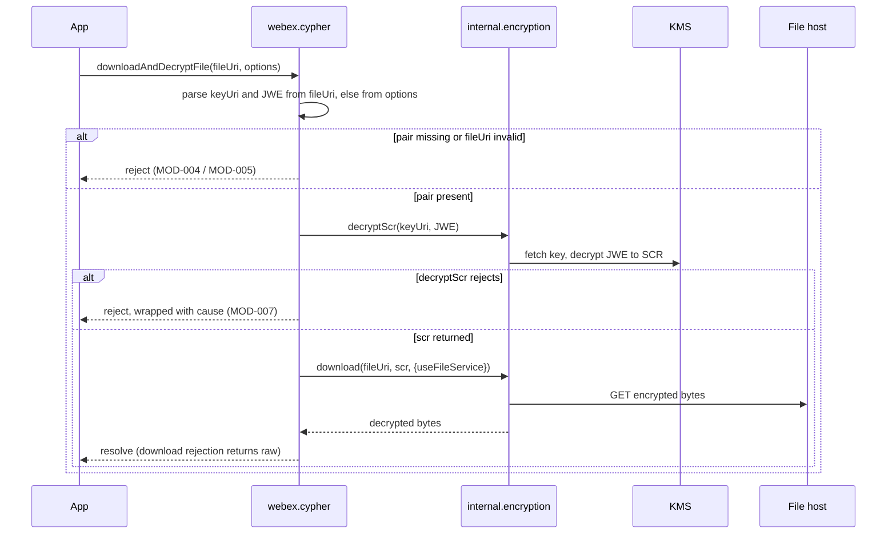
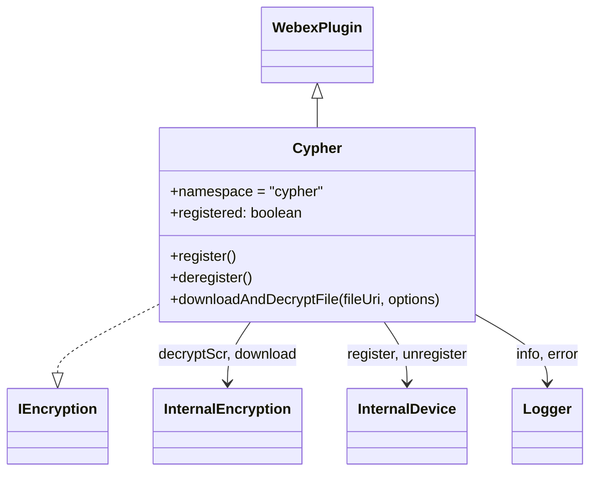
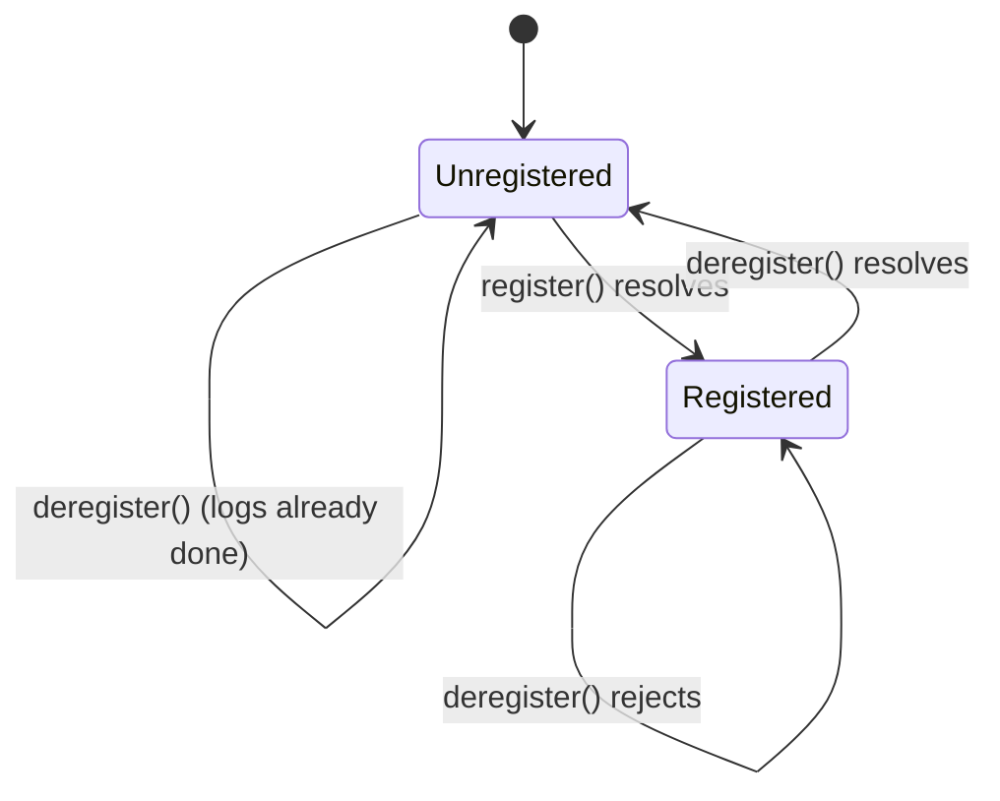

<!-- sdd-generated-metadata
doc_kind: module-spec
generated_from: module-spec@0.3.0
generated_by: claude-code
approved_by: riag@cisco.com
updated_at: 2026-11-05T16:10:55Z
validation_status: pass
-->

# Cypher encryption plugin

This source-local document at `src/docs/README.md` owns the stable specification for **the Cypher
encryption plugin**: the public `webex.cypher` plugin that lets an application download an encrypted
Webex attachment and decrypt it, and that registers and unregisters the device it needs to do so. The
plugin is a thin facade over the internal encryption plugin (`webex.internal.encryption`). Ground every
claim in package evidence and link to the [package architecture](../../docs/architecture.md) instead of
repeating broader facts. No service specification exists because this package is a library.

Related context: [documentation index](../../docs/index.md) ·
[package agent instructions](../../AGENTS.md)

## Metadata

| Field         | Value |
| ------------- | ----- |
| Owner         | @webex/web-sdk (assigned by the root `.github/CODEOWNERS` wildcard) |
| Source path   | `src` |
| Resource kind | package (one module) |
| Status        | Draft |
| Last verified | 2026-11-05 against the working tree |
| Module id     | `src` |
| Parent spec   | — |
| Doc kind      | Module spec |
| Coverage score | 92.9% (13/14 applicable fields) assessed 2026-11-05 by the generator |
| Validation status | pass; validator runtime `codex`, run `01a1ac84-8211-73a1-bad5-41e2bb381d6a`; assessed 2026-11-05; 0 findings; owner is `@webex/web-sdk` under the root `CODEOWNERS` wildcard |

## Applicability

| Condition ID                         | Status     | Evidence or reason | Owned section |
| ------------------------------------ | ---------- | ------------------ | ------------- |
| `module.has_tiers`                   | N/A        | No tier policy appears in `package.json` or any package config | Tier |
| `module.has_ui`                      | N/A        | src/ contains no UI; the eslint-env browser comment in `src/index.ts` only enables browser globals | UI use-case flow |
| `module.crosses_service_boundaries`  | Applicable | `src/cypher/index.ts` calls webex.internal.encryption (KMS key fetch, file download) and webex.internal.device (WDM) | Cross-boundary use-case flow |
| `module.holds_client_state`          | Applicable | registered instance flag in `src/cypher/index.ts` | Client state model |
| `module.enforces_domain_rules`       | Applicable | keyUri/JWE source precedence and required-pair rule in downloadAndDecryptFile | Business rules and invariants |
| `module.is_concurrent_async`         | Applicable | Every public method is async; register and deregister have no in-flight guard | Concurrency and reactive flow |
| `module.owns_persistence`            | N/A        | No store, file, or cache in src/; webex-config.ts selects MemoryStoreAdapter for the bundle | Data, schema, and migration |
| `module.stateful_transitions`        | Applicable | registered toggles in register/deregister | State machine |
| `module.exposes_wire_protocol`       | Applicable | The fileUri query-string contract (keyUri, JWE) that callers must produce | Protocol and wire format |
| `module.ui_multi_screen`             | N/A        | No UI | UI flow |
| `module.large_data_model`            | N/A        | Three small option and interface types in `src/cypher/types.ts` | Data model |
| `module.returns_caller_errors`       | Applicable | Rejections from downloadAndDecryptFile, register, and deregister | Caller-visible failure modes |
| `module.module_specific_conventions` | Applicable | Log prefix, option forwarding, and bundle-entry conventions below | Module-specific rules |
| `module.published_package`           | Applicable | `package.json` exports, main, types, and deploy:npm | Export stability |
| `module.embedded_in_host`            | N/A        | The plugin runs inside a webex instance, not a host UI | Host integration and theming |
| `module.has_design_tradeoff`         | Applicable | Facade over the internal plugin that forwards only useFileService | Key design trade-off |
| `module.has_submodules`              | N/A        | src/cypher is an implementation folder with no separate spec | Sub-modules |

## Evidence register

| Evidence | What it establishes |
| -------- | ------------------- |
| `src/index.ts` | Registers plugin `cypher` with `config` and re-exports the class and two types |
| `src/cypher/index.ts` | The `Cypher` class: register, deregister, downloadAndDecryptFile, and all log and error strings |
| `src/cypher/types.ts` | `FileDownloadOptions` and `IEncryption` |
| `src/cypher/constants.ts` | `CYPHER` namespace string; four `DECRYPTION*` constants that nothing imports |
| `src/types.ts` | `WebexSDK` shape the plugin assumes, including an `IWebexInternal.mercury` member that nothing calls |
| `src/config.ts` | Default plugin config `{cypher: {}}` |
| `src/webex.js`, `src/webex-config.ts` | The main bundle entry: `Webex.init`; its defaults file is merged under a `default` key, not at the top level (MOD-013) |
| `package.json` | Entry points, dependencies, scripts, engines |
| `test/unit/spec/cypher/index.ts` | Unit specs: 11 cases over `downloadAndDecryptFile`, `register`, and `deregister` |
| `jest.config.js` | `collectCoverage: true` with an 85% global threshold |
| ../internal-plugin-encryption/src/encryption.js | `decryptScr` and `download` behavior (dependency has no spec, so its code is the evidence) |
| ../internal-plugin-device/src/docs/README.md (module spec) | `register()` on an already-registered device delegates to `refresh()` (its `MOD-005`); the plugin has its own derived registered and an `onBeforeLogout` hook that calls `unregister()` (its `MOD-001`) |
| ../webex-core/src/docs/README.md (module spec) | `registerPlugin` (first registration of a name wins) and `WebexPlugin` base-class contract |
| ../internal-plugin-encryption/src/config.js, kms.js | `shouldValidateKMSCertificate` default `false`; `reportOnlyAssetsBaseUrl`; `carootsReportOnly` handling |
| `README.md` | Retained npm page: install, CDN, usage, KMS certificate validation, sample code. See [ADR-0001](../../docs/adr/0001-migrate-readme-and-quickstart.md) for how its content was accounted for |
| `developer-quickstart.md` | Retained sample-app guide: token prerequisite, init, and decrypt walk-through |
| ../../../docs/samples/plugin-encryption/ | Hosted sample app (`app.js`, `index.html`, `style.css`) referenced by both documents |

## Purpose and boundary

- Responsibility: expose `webex.cypher`, which (1) downloads an encrypted attachment and returns the
  decrypted bytes, and (2) registers or unregisters the device with WDM so KMS-backed calls work.
- In scope: parsing `keyUri` and `JWE` from the file URI or options, orchestrating
  `decryptScr` then `download`, the `registered` flag, error wrapping, and the `webex` bundle entry.
- Out of scope: KMS key retrieval, SCR and JWE cryptography, file-service URL resolution, and KMS
  certificate validation (all in `@webex/internal-plugin-encryption`); device registration itself
  (`@webex/internal-plugin-device`, reached through `webex.internal.device`); token acquisition
  (`@webex/plugin-authorization`).
- Consumers: applications that embed the Webex JS SDK and need to open encrypted attachments, and the
  hosted sample at `docs/samples/plugin-encryption`.

## Structure and key files

| Path | Responsibility |
| ---- | -------------- |
| `src/index.ts` | Package source entry; `registerPlugin('cypher', Cypher, {config})` |
| `src/cypher/index.ts` | The only behavior in the package |
| `src/cypher/types.ts` | Public option and interface types |
| `src/cypher/constants.ts` | Namespace and unused event-name constants |
| `src/types.ts` | Local structural typing of the webex instance (`WebexSDK`, `Logger`) |
| `src/config.ts` | Plugin config defaults |
| `src/webex.js` | CommonJS bundle entry (main): loads authorization and encryption plugins, builds `Webex` |
| `src/webex-config.ts` | Intended `Webex.init` defaults; currently merged under `config.default` (MOD-013) |
| `test/unit/spec/cypher/index.ts` | Unit spec for `Cypher` |
| `process` | Package-root module exporting `{browser: true}` |
| dist/ | Generated build output; never edited by hand |

## Public surface

| Surface | Consumer | Compatibility commitment | Source |
| ------- | -------- | ------------------------ | ------ |
| `webex.cypher.register()` | Application, after `ready` | Resolves once; idempotent while registered | `src/cypher/index.ts` |
| `webex.cypher.deregister()` | Application teardown | Resolves once; idempotent while not registered | `src/cypher/index.ts` |
| `webex.cypher.downloadAndDecryptFile(fileUri, options?)` | Application | Resolves to the decrypted `ArrayBuffer`-typed body | `src/cypher/index.ts` |
| `webex.cypher.registered` | Application, tests | Public mutable boolean, initially `false` | `src/cypher/index.ts` |
| `FileDownloadOptions`, `IEncryption` types | TypeScript consumers | Type-only exports; `IEncryption.downloadAndDecryptFile` declares `options` as required, while the implementation defaults it to `{}` and the method above treats it as optional | `src/cypher/types.ts`, `src/index.ts` |
| Default export `Cypher` (from `src/index.ts`) | Source consumers, `devMain` | The class | `src/index.ts` |
| `Webex` (CommonJS `module.exports` of main) | `import Webex from '@webex/plugin-encryption'`, CDN script | `Webex.init(attrs)` merges `webex-config` exports under caller config, nested under `default` (MOD-013) | `src/webex.js` |

Exact declarations: [`src/cypher/index.ts`](../cypher/index.ts) and
[`src/cypher/types.ts`](../cypher/types.ts). Consumer configuration for KMS certificate validation
(`config.encryption.shouldValidateKMSCertificate`, `caroots`, `reportOnlyAssetsBaseUrl`) belongs to the
internal plugin and is described in its README; this package passes it through `Webex.init`.

## Dependencies

| Dependency | Why it is required | Failure behavior |
| ---------- | ------------------ | ---------------- |
| `@webex/webex-core` (spec: ../webex-core/src/docs/README.md) | `WebexPlugin` base class, `registerPlugin`, `WebexCore`, MemoryStoreAdapter | Plugin not registered if the import fails |
| `@webex/internal-plugin-encryption` (declared) | `internal.encryption.decryptScr` and `internal.encryption.download`; also required by `src/webex.js` | `decryptScr` rejection is wrapped; `download` rejection propagates unwrapped (see MOD-007) |
| webex.internal.device (`@webex/internal-plugin-device`, spec: ../internal-plugin-device/src/docs/README.md; imported by `@webex/internal-plugin-encryption` in its `src/index.js`; not declared by this package) | register and `unregister` | Rejection is logged and rethrown |
| `webex.logger` | Info and error messages | Throws `TypeError` if absent, since every path logs through it |
| `@webex/plugin-authorization` | Required by `src/webex.js` for the bundle | Not declared in `package.json` `dependencies`; resolves through workspace hoisting |
| `@babel/polyfill`, `lodash/merge` | Required by `src/webex.js` | Not declared in `package.json`; resolve through hoisting |
| KMS and the Webex files service | Reached only through the internal plugin | Errors surface through the internal plugin's promises |

## Requirements

| ID | WHAT | WHY | Source evidence | Test or example evidence | Assumptions or gaps | Confidence |
| -- | ---- | --- | --------------- | ------------------------ | ------------------- | ---------- |
| `MOD-001` | Importing `src/index.ts` registers plugin `cypher` with config `{cypher: {}}`, so `webex.cypher` exists on a webex instance | Callers depend on the namespace name | `src/index.ts`, `src/config.ts`, `src/cypher/constants.ts` | `test/unit/spec/cypher/index.ts` (MockWebex children) | No unit case imports `src/index.ts` or asserts the `registerPlugin` call | Partial |
| `MOD-002` | downloadAndDecryptFile reads keyUri and JWE from the query string of fileUri (parameter names are case-sensitive) | Attachment URLs produced by Webex carry both | `src/cypher/index.ts` | Positive case passes both in the URL | None | Present |
| `MOD-003` | If either keyUri or JWE is missing from the URL, both come from `options.keyUri` and `options.jwe`; a value found in the URL is discarded in that case | Lets callers supply the pair separately | `src/cypher/index.ts` | should use keyUri and JWE from options supplies both through options | No unit case for a URL that carries only one of the two parameters | Partial |
| `MOD-004` | If the pair is still incomplete, the call rejects with `KeyUri and JWE are required to decrypt the file. Either provide them in the fileUri or in the options.` | Fail before any network call | `src/cypher/index.ts` | should throw an error if keyUri and JWE are not present | None | Present |
| `MOD-005` | A fileUri that `new URL` rejects logs `Cypher: Invalid fileUri: <message>` and rejects with `Failed to decrypt the JWE: <message>\nStack: <stack>` | Distinguish a malformed URI from a decrypt failure | `src/cypher/index.ts` | None | No unit case for an invalid fileUri; message wording ("decrypt the JWE") is misleading for a parse error | Partial |
| `MOD-006` | Success path calls `internal.encryption.decryptScr(keyUri, JWE)` then `internal.encryption.download(fileUri, scr, {useFileService})` with the original fileUri unchanged, and resolves to that result | Two-step KMS-then-download contract | `src/cypher/index.ts`, ../internal-plugin-encryption/src/encryption.js | should decrypt and download the file successfully | The resolved type is declared `ArrayBuffer`; the internal plugin returns the output of `decryptBinary`, which this repo's dependency code does not constrain to `ArrayBuffer` | Present |
| `MOD-007` | A `decryptScr` rejection is wrapped as `Failed to decrypt or download the file: <message>\nStack: <stack>` with `cause` set to the original error; a `download` rejection is returned unwrapped because the `try` block returns the promise without `await` | Callers must handle two error shapes | `src/cypher/index.ts` | should throw an error if decryption fails and should throw an error if download fails exercise both failures | The wrapped message, the `cause`, and the raw download error are not asserted | Partial |
| `MOD-008` | Only useFileService is forwarded to `download`, defaulting to `false`; no other option (for example `params.allow`) reaches the internal plugin | Differs from the internal default (`useFileService: true`) | `src/cypher/index.ts`, ../internal-plugin-encryption/src/encryption.js | Tests assert {useFileService: false} with no `useFileService` option given | None | Present |
| `MOD-009` | `register()` calls `internal.device.register()` once while registered is `false`, sets registered to `true`, and logs `Cypher: webex.internal.device.register successful`; when already `true` it logs `... register already done` and resolves | Avoid duplicate registration | `src/cypher/index.ts` | register describe (3 cases) | The registered flag after a successful call is not asserted; concurrent calls are not guarded (MOD-011) | Partial |
| `MOD-010` | `deregister()` mirrors `register()` through `internal.device.unregister()` and resets registered to `false` | Clean teardown | `src/cypher/index.ts` | deregister describe (3 cases) | The registered flag after a successful call is not asserted | Partial |
| `MOD-011` | register and deregister have no in-flight guard: two overlapping `register()` calls while registered is `false` both call `device.register()` | Callers must serialize | `src/cypher/index.ts` | None | No unit case for overlapping `register()` calls | Partial |
| `MOD-012` | On register/deregister failure the error is logged as `Error occurred during device.register() <error>` (or `deregister()`) and rethrown, leaving registered unchanged | Surface failure to the caller | `src/cypher/index.ts` | should log an error if device registration fails and its deregistration counterpart | The failure tests do not guarantee a rejection or an unchanged flag | Partial |
| `MOD-013` | The main bundle (`src/webex.js`) exports a `Webex` class that extends `WebexCore`; `init` deep-merges the exports of `./webex-config` under the caller's `config`. Because that module is TypeScript with a default export and `src/webex.js` requires it without `.default`, the defaults land under `config.default` and the intended top-level defaults (`hydra`, `device.ephemeral`, memory storage) are not applied | Callers and docs assume single-call setup with those defaults | `src/webex.js`, `src/webex-config.ts` | None | No unit case covers `src/webex.js`; the nesting follows from reading the code and is not pinned by a test; whether top-level defaults were intended is for a maintainer to decide | Partial |

## Design overview

`Cypher` extends `WebexPlugin` and keeps one piece of state, the `registered` boolean. The constructor
copies the parent `webex` instance into a private typed alias (`$webex`) so the methods can call
`internal.encryption`, `internal.device`, and `logger` without casts. The plugin owns orchestration
only: all cryptography, KMS access, file-service lookup, and HTTP happens in the internal plugin,
which is why `downloadAndDecryptFile` is about forty lines of argument resolution around two calls.

Two entry points exist. `src/index.ts` registers the plugin on whichever `WebexCore` the host builds;
`src/webex.js` is the `main` bundle that additionally loads `@webex/plugin-authorization` and
`@webex/internal-plugin-encryption`, builds a `Webex` class, and is what `import Webex from '@webex/plugin-encryption'` and the CDN script resolve
to.

## Data flow and sequence coverage

Transport: in-process promise calls into the internal plugin, which performs the HTTPS requests.

| Operation group | Entry and outcome | Diagram or evidence | Failure and recovery coverage |
| --------------- | ----------------- | ------------------- | ----------------------------- |
| Download and decrypt | `downloadAndDecryptFile(fileUri, options)` resolves to the decrypted bytes | Sequence below | Invalid URI, missing pair, decrypt failure, download failure |
| Register device | `register()` resolves after WDM registration | State machine below | Already registered, registration failure |
| Deregister device | `deregister()` resolves after WDM unregistration | State machine below | Not registered, unregistration failure |



## Class and component relationships



## Use cases and flows

| Use case | Actor or caller | Primary steps and outcome | Failure or boundary behavior | Evidence |
| -------- | --------------- | ------------------------- | ---------------------------- | -------- |
| `UC-001` | Application | After `ready`, call `register()`, then `downloadAndDecryptFile(url, options)`, then build a `File` from the bytes | Rejections described in the failure-mode table | `src/cypher/index.ts`; `README.md` and `developer-quickstart.md` sample code |
| `UC-002` | Application | Call `deregister()` at teardown | Rejection if WDM unregister fails | `src/cypher/index.ts`; `test/unit/spec/cypher/index.ts` |
| `UC-003` | Script-tag or plain-JS user | Load the bundle, call `Webex.init({credentials: {access_token}})`, then use `webex.cypher` | Requires a token with KMS access (the quickstart names scope `spark:kms`) | `src/webex.js`; `developer-quickstart.md` |

### Consumer usage and configuration

Content migrated from `README.md` and `developer-quickstart.md` and checked against code; see
[ADR-0001](../../docs/adr/0001-migrate-readme-and-quickstart.md).

**Install.** Install with `npm install --save @webex/plugin-encryption`. In addition to the module
consumption via NPMJS, this module can also be consumed via our CDN with the script
`umd/encryption.min.js` from the `webex` package, for example
`https://unpkg.com/webex@latest/umd/encryption.min.js` or
`https://cdn.jsdelivr.net/npm/webex/umd/encryption.min.js`, loaded with a `script` tag with the
`crossorigin` attribute.

**Usage.** This is a plugin for the Cisco Webex JS SDK. See the developer portal at
`https://developer.webex.com/` and the API reference at
`https://webex.github.io/webex-js-sdk/plugin-encryption/` for full details. The hosted sample app is at
`https://webex.github.io/webex-js-sdk/samples/plugin-encryption/` and its source is
`docs/samples/plugin-encryption`.

**KMS certificate validation.** KMS certificate-chain validation is disabled by default. To enable it,
set `config.encryption.shouldValidateKMSCertificate` to `true`, with trusted CA roots supplied by your
application as `config.encryption.caroots`, an array of raw base64-encoded CA root certificates.
Supplying `caroots` alone does not enable validation. Once enabled, validation fails closed if trusted
roots cannot be loaded or the KMS certificate chain is untrusted. If roots are not supplied, the SDK
loads and verifies its signed CA roots asset. To observe a separate signed root bundle, set
`config.encryption.reportOnlyAssetsBaseUrl` to its asset directory. This option has no default URL. It
starts a background check after mandatory and enforced validation succeed. Download, verification and
chain failures report metrics without delaying or rejecting setup. It works while enforcement is
enabled, including when `caroots` supplies a different enforced root set. The explicit URL is honored in
both browsers and Node. Existing `carootsReportOnly` arrays retain their awaited behavior and take
precedence over the new report-only URL. These options belong to the internal encryption plugin
(config.js and kms.js in packages/@webex/internal-plugin-encryption/src); this package sets none of
them, and that plugin's README covers asset filenames, verification, source caching and offline
deployments.

**Sample flow.** The quickstart needs an access token from the Webex developer portal with the
`spark:kms` scope; the token can also be obtained from the agent desktop by using developer tools and
inspecting the local storage for the access token. To run the sample app: clone the repository, run
`yarn build:local`, then `yarn samples:build && yarn samples:serve`, and navigate to
`https://localhost:8000/samples/plugin-encryption`. Get an access token, select the integration or
production environment, enter the token in the "Access Token" field, and click "Initialize Webex". The
Webex SDK is initialized using the access token provided by the user, and the initialization registers
the Webex JS SDK as a device through `webex.cypher.register()`. To decrypt a file, provide the encrypted
file URL, the desired file name, and the MIME type. To use `webpack-dev-server` to load this package,
run `yarn run samples:serve`; files placed in the `docs/samples/plugin-encryption` folder are served
statically.

```typescript
import Webex from '@webex/plugin-encryption';

const webex = Webex.init({credentials: {access_token}});

webex.once('ready', async () => {
  await webex.cypher.register();
  const attachmentURL = 'https://myfileurl.xyz/zzz/fileid?keyUri=somekeyuri&JWE=somejwe';
  const options = {
    useFileService: false,
    jwe: somejwe, // Provide the JWE here if not already present in the attachmentURL
    keyUri: someKeyUri, // Provide the keyURI here if not already present in the attachmentURL
  };
  const decryptedFileBuf = await webex.cypher.downloadAndDecryptFile(attachmentURL, options);
  const file = new File([decryptedFileBuf], 'my-decrypted-file.jpeg', {type: 'image/jpeg'});
  // Do something with the file, then at your App's teardown:
  await webex.cypher.deregister();
});
```

The quickstart wraps this in two helpers: `initializeWebex(accessToken)` calls `Webex.init` with
`credentials: {access_token: accessToken}`, waits for `webex.once('ready')`, calls `webex.cypher.register()`,
and resolves the `webex` instance; `decryptFile(webex, encryptedFileUrl, options, decryptedFileName, mimeType)`
calls `webex.cypher.downloadAndDecryptFile(encryptedFileUrl, options)`, builds a `File` of the decrypted
buffer with the given name and MIME type, creates an object URL with `window.URL.createObjectURL(file)`,
clicks a hidden anchor `a` with its `download` attribute set to the file name, revokes the URL with
`window.URL.revokeObjectURL`, and logs success or `console.error('Error decrypting file:', error)`.

Differences from the retained documents, where code wins: the README names the source folder
`src/@webex/plugin-encryption`, but the source is `packages/@webex/plugin-encryption/src`; the
documented `Webex` import matches the runtime `main` export but not the `types` entry (see Pitfalls and
constraints); and the README, quickstart, and sample app are not the method or error reference.

### Cross-boundary use-case flow

`UC-001` crosses the plugin boundary into the internal encryption plugin (KMS and file host) and, for
`register`, into WDM through the device plugin. See the sequence diagram above and the
[architecture](../../docs/architecture.md#interaction-and-execution-flows).

## Client state model

| State | Type | Owner | Initial | Changed by |
| ----- | ---- | ----- | ------- | ---------- |
| registered | `boolean`, public, per instance | `Cypher` | `false` | Successful `register()` sets `true`; successful `deregister()` sets `false` |

The flag reflects only calls made through this plugin and is separate from the device plugin's own
derived `registered` property. If the device was registered elsewhere, `registered` stays `false` and
`register()` still calls `internal.device.register()`, which the device specification says refreshes an
already-registered device instead of registering twice (../internal-plugin-device/src/docs/README.md,
`MOD-005`). The device plugin also unregisters on SDK logout through its `onBeforeLogout` hook (`MOD-001`),
which does not reset this flag.

## Business rules and invariants

- `keyUri` and `JWE` travel as a pair: the URL pair is used only when both are present, otherwise the
  options pair is used in full (MOD-003).
- `downloadAndDecryptFile` never calls the internal plugin with an incomplete pair (MOD-004).
- The `fileUri` passed to `download` is the caller's original string, including its `keyUri` and `JWE`
  query parameters (MOD-006).
- `useFileService` defaults to `false` here, so a direct HTTPS download is the default; the internal
  plugin rejects direct non-HTTPS URLs with `Direct file URLs must use HTTPS` unless its non-production
  `localhost` bypass applies (../internal-plugin-encryption/src/encryption.js).

## Concurrency and reactive flow

All three public methods return promises. The plugin holds no timers or event subscriptions and emits
no events. `downloadAndDecryptFile` calls are independent and may overlap. `register` and `deregister`
are not serialized (MOD-011); a caller that can trigger both concurrently must await one before
starting the other.

## State machine



## Protocol and wire format

| Message or frame | Version | Producer or serializer | Consumer or parser | Compatibility and ordering rule |
| ---------------- | ------- | ---------------------- | ------------------ | ------------------------------- |
| fileUri query string | None declared | The Webex client or service that issues attachment URLs (outside this repo) | `new URL(fileUri).searchParams` in `src/cypher/index.ts` | Parameter names keyUri (a `kms://` key URI) and JWE are exact and case-sensitive; both must be present for the URL pair to be used |

## Caller-visible failure modes

| Condition | Signal or result | Caller behavior | Retry or recovery | Evidence |
| --------- | ---------------- | --------------- | ----------------- | -------- |
| fileUri is not a valid URL | `Error`: `Failed to decrypt the JWE: <message>\nStack: <stack>`; error log emitted | Fix the input | Not retryable | `src/cypher/index.ts` |
| Pair missing from URL and options | `Error`: `KeyUri and JWE are required to decrypt the file. ...` | Supply both values | Not retryable | `src/cypher/index.ts`; unit spec |
| `decryptScr` fails (KMS, bad JWE) | `Error`: `Failed to decrypt or download the file: <message>\nStack: <stack>`, `cause` = original | Inspect `cause` | Caller-defined | `src/cypher/index.ts`; unit spec |
| `download` fails (network, non-HTTPS with `useFileService: false`) | The internal plugin's rejection, unwrapped | Handle as the internal plugin's error | Caller-defined | `src/cypher/index.ts`; ../internal-plugin-encryption/src/encryption.js |
| `internal.device.register` or `unregister` rejects | Same error rethrown after an error log | Retry later | registered unchanged, so a retry calls the device plugin again | `src/cypher/index.ts`; unit spec |

## Pitfalls and constraints

- The `main` runtime export is `Webex` (`src/webex.js`), but `types` points at `dist/types/index.d.ts`,
  which declares the default export as `Cypher`. TypeScript consumers of the package root see a
  different type from the one they get at runtime. Verify with `dist/types/index.d.ts` after a build.
- `package.json` `dependencies` lists only `@webex/internal-plugin-encryption` and `@webex/webex-core`;
  `src/webex.js` also requires `@webex/plugin-authorization`, `@babel/polyfill`, and `lodash/merge`.
- `Webex.init` does not apply the defaults in `src/webex-config.ts`: `src/webex.js` requires that TypeScript
  module without `.default`, so they are nested under `config.default` and `hydra`, `device.ephemeral`, and the
  memory storage adapters never take effect (MOD-013, not covered by a unit case).
- `src/cypher/constants.ts` exports four `DECRYPTION*` constants and `src/types.ts` types a `mercury`
  member; no code uses them. Do not assume the plugin emits decryption events or connects Mercury,
  even though the `register` unit-case title says "connect to Mercury".
- A URL that carries only one of `keyUri` or `JWE` loses that value when options supply the pair.
- The error messages embed `error.stack`, so logging or displaying them can expose internal paths.
- Never log or persist `JWE`, `keyUri` values from real attachments, or the decrypted bytes.
- Real attachment URLs and tokens must not appear in tests or docs; the existing fixtures use
  placeholders.

## Module-specific rules

- Do: prefix log lines with `Cypher:` as the existing code does (`register` success and "already done"
  messages). Note the failure messages use `Error occurred during device.register()` without the prefix.
- Do: keep `registered` in step with the device plugin only through successful calls.
- Do not: forward additional options to the internal plugin without updating MOD-008 and the README.
- Do not: edit dist/; it is generated by `build:src`.

## Export stability

| Export or entry point | Consumer | Stability | Versioning and deprecation rule | Declaration or API report |
| --------------------- | -------- | --------- | ------------------------------- | ------------------------- |
| main `dist/webex.js` (`Webex`) | npm and CDN users | Published | No package-level policy found; workspace release process applies | `package.json`, `src/webex.js` |
| types `dist/types/index.d.ts` | TypeScript users | Published | Generated by `yarn build` | `package.json`, `src/index.ts` |
| `devMain` `src/index.ts` | Workspace tooling | Internal | None | `package.json` |
| `./package` export | Tooling | Published | None | `package.json` |

## Key design trade-off

| Chosen trade-off | Preserved invariant or benefit | Cost or limitation | Decision evidence |
| ---------------- | ------------------------------ | ------------------ | ----------------- |
| A narrow facade that forwards only useFileService (default `false`) | Small, stable public API; direct HTTPS download by default | Internal-plugin options such as `params.allow` and `onBehalfOf` are unreachable from `webex.cypher` | `src/cypher/index.ts`, ../internal-plugin-encryption/src/encryption.js |

## Verification

| Requirement or invariant | Test level | Positive evidence | Negative or boundary evidence | Gap |
| ------------------------ | ---------- | ----------------- | ----------------------------- | --- |
| `MOD-001` | Unit | `test/unit/spec/cypher/index.ts` (MockWebex children) | None | No case imports `src/index.ts` |
| `MOD-002`, `MOD-006` | Unit | should decrypt and download the file successfully | None | None |
| `MOD-003` | Unit | should use keyUri and JWE from options | None | One-parameter URL cases |
| `MOD-004` | Unit | should throw an error if keyUri and JWE are not present | Same | None |
| `MOD-005` | None | None | None | Invalid URL case |
| `MOD-007` | Unit | should throw an error if decryption fails | should throw an error if download fails | Wrapped message, `cause`, and raw download error not asserted |
| `MOD-008` | Unit | {useFileService: false} assertions | None | None |
| `MOD-009`, `MOD-010` | Unit | register and deregister describes | "already done" and "not registered" cases | Registered flag after success |
| `MOD-011` | None | None | None | Overlapping registration |
| `MOD-012` | Unit | should log an error if device registration fails and the deregistration counterpart | None | Rejection and unchanged flag not guaranteed |
| `MOD-013` | None | None | None | `src/webex.js` has no unit case |

Run: `yarn workspace @webex/plugin-encryption test:unit`. `jest.config.js` enables coverage with an 85%
global threshold; the only unit spec is `test/unit/spec/cypher/index.ts`.
