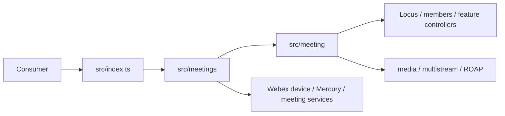

<!-- sdd-generated-metadata
doc_kind: agent-entry
generated_from: agents@0.3.0
generated_by: claude-code
approved_by: rarajes2@cisco.com
updated_at: 2026-11-17T03:14:21Z
validation_status: pass-with-warnings
-->

# AI Agent Instructions

Package-scoped SDD entry for `@webex/plugin-meetings`. `@webex/plugin-meetings` is the Webex
JavaScript SDK plugin for meeting discovery, registration, lifecycle, realtime Locus state,
participants, WebRTC media, and in-meeting capabilities. This file orients agents; the monorepo root
`AGENTS.md` governs workspace-wide setup and test-writing conventions.

What it is:

- A published library package registered as `webex.meetings` inside the Webex SDK host.
- A client-side coordinator over Webex device, Mercury, Locus, meeting-info, media, and feature
  services.

What it is NOT:

- It is not a UI application or a server-side datastore owner.
- It does not own remote Webex service state; its collections and models are client-side
  projections.

## Working Method

- Read the relevant package files before editing. Do not edit blind.
- Understand the task and affected surfaces before writing code.
- Prefer focused edits over rewriting whole files.
- Do not invent commands, paths, exports, events, or request shapes. Verify them from this package's
  source.
- Test or validate before declaring done.
- Keep output concise. If something is uncertain, say so instead of guessing.

## Canonical Repository Documentation

Read this file first, then [`docs/specs/README.md`](docs/specs/README.md) for routing and
[`docs/architecture.md`](docs/architecture.md) for system design. Load only the affected module
specifications. Before changing code or documentation, start with:

- [`docs/index.md`](docs/index.md) for package documentation navigation;
- [`docs/architecture.md`](docs/architecture.md) for package boundaries, interactions, and the
  contract index;
- [`docs/specs/README.md`](docs/specs/README.md) for the manifest-backed module and contract registry;
- the affected module's `src/<module>/docs/README.md`, for example
  [`src/meeting/docs/README.md`](src/meeting/docs/README.md); and
- [`docs/adr/index.md`](docs/adr/index.md) plus applicable concrete ADRs.

Load the owning module spec and the rules in this file; do not load every module document.

Per-module trust lives in `.sdd/manifest.json` and is mirrored in
[`docs/specs/README.md`](docs/specs/README.md). Per-module status is defined there: `Specced` is
authoritative; `Partial` specs are hints that require source cross-checking; `Untracked` modules
require code cross-checking, tests, and a characterization baseline before modification, until
promoted. All 23 manifest modules are `Partial` today.

Follow `.sdd/manifest.json` for each contract's publication state and canonical source. This package
publishes an SDK surface, so its contract artifact is `package.json` (`main` `dist/index.js`, `types`
`dist/types/index.d.ts`, both built from `src/index.ts`). It serves no HTTP routes, so no OpenAPI
applies; its Locus, meeting-info, site-preference, and ROAP requests are internal clients linked to
their request code from the architecture contract index.

## 1. Commands (Run First)

Use only documented commands. Do not invent alternatives when a command is missing. Run every command from the
workspace root: `yarn` to install, and `yarn workspace @webex/plugin-meetings <script>` for the package scripts below, which `package.json` defines.
Fresh-checkout workspace setup (building `webex-legacy-tools` and sibling `dist/`) is owned by the workspace root; see
[Prebuilding](../../../CONTRIBUTING.md#prebuilding).

| Role | Command |
| ---- | ------- |
| Install | `yarn` (workspace root; the deploy workflow runs the same command) |
| Start dev environment | N/A — library package with no start script in `package.json` |
| Build | `yarn workspace @webex/plugin-meetings build:src` (transpiles `src/` to `dist/`, then runs `yarn workspace @webex/plugin-meetings build` for TypeScript declarations and assets) |
| Unit test | `yarn workspace @webex/plugin-meetings test:unit` |
| Browser test | `yarn workspace @webex/plugin-meetings test:browser` (Karma integration suites; needs Webex test-user credentials) |
| Lint | `yarn workspace @webex/plugin-meetings test:style` |
| Build/release artifact | `yarn workspace @webex/plugin-meetings build` (declarations to `dist/types` and assets only; it does not transpile `src/`) |
| Publish | `yarn workspace @webex/plugin-meetings deploy:npm` (ask first) |
| Format code | N/A — no format script; `prettier` is a devDependency used through eslint |

Toolchain and setup: [`docs/getting-started.md`](docs/getting-started.md) · test routing:
[`docs/getting-started.md`](docs/getting-started.md#tests).

Do not use the `test:broken` script: it chains `test:integration`, which this package does not define.

If a required command is unknown, stop and ask for the exact command.

## 2. Agent Persona and Scope

You are the Webex JS SDK meetings engineering assistant for `@webex/plugin-meetings`.

Primary outcomes:

- Deliver production-safe changes with build, lint, and focused unit tests passing.
- Preserve existing behavior unless a change request explicitly requires a behavior change.
- Keep docs and configuration aligned with code changes.

Definition of done:

1. Requested change is implemented.
2. Build, lint, and the focused unit tests pass locally.
3. The owning module spec and the contract index cover new behavior.
4. PR summary includes risks and rollback notes.

## 3. Repository Knowledge

### Tech Stack

| Area             | Tooling | Version |
| ---------------- | ------- | ------- |
| Language runtime | node; TypeScript and JavaScript sources | 22.14 (workspace root `AGENTS.md`; `.nvmrc` `lts/jod`); package `engines` accepts `>=18`; the workspace root `package.json` `engines.node` reads `18.x` |
| Build tool       | yarn workspaces, `@webex/legacy-tools` over babel, and `tsc` for declarations | yarn `3.4.1` (root `packageManager`), `typescript` `^4.7.4`, `@babel/core` `^7.17.10` |
| Test framework   | mocha through `webex-legacy-tools test --unit --runner mocha`, sinon, `@webex/test-helper-chai`; karma for the browser tier | sinon `^9.2.4`; mocha `10.0` and karma `^6.4.3` are declared by `@webex/legacy-tools` (`workspace:*`) |
| Lint/format      | eslint via `@webex/eslint-config-legacy`, prettier | eslint `^8.24.0`, prettier `^2.7.1` |

TypeScript and JavaScript, Node.js 22.14 for this repository, Yarn workspaces, and legacy Webex build
tooling. Mocha, Sinon, and `@webex/test-helper-chai` for unit tests; Karma for browser/integration
tests; ESLint for style checks.

### Project Map



Full architecture: [`docs/architecture.md`](docs/architecture.md).

```text
src/index.ts               — registers webex.meetings with its config and interceptors; package exports
src/meetings/              — registered plugin, discovery, registration, and meeting collection
src/meeting/               — one meeting lifecycle, media, controls, and events
src/meeting-info/          — destination resolution and meeting metadata
src/locus-info/, hashTree/ — realtime Locus normalization and incremental synchronization
src/member/, members/      — participant models, roster, mutations, and events
src/media/, multistream/, roap/, reachability/ — WebRTC setup, negotiation, routing, and probes
src/reconnection-manager/  — bounded recovery and rejoin orchestration
src/breakouts/, interpretation/, annotation/, aiEnableRequest/, webinar/ — in-meeting features
src/recording-controller/, controls-options-manager/, personal-meeting-room/, reactions/ — controls
src/interceptors/, metrics/ — request middleware and behavioral telemetry
src/common/, e2ee/, transcription/ — shared errors, events, logs, and queue; media encryption; transcription (no module spec yet)
test/unit/spec/            — mocha unit suites mirroring src/
test/integration/spec/     — karma browser suites (test:browser)
dist/                      — generated build output; never edit by hand
```

Canonical module routing: [`docs/specs/README.md`](docs/specs/README.md). `README.md`, `UPGRADING.md`,
`internal-README.md`, and the feature READMEs under `src/breakouts/`, `src/interpretation/`, and
`src/aiEnableRequest/` are retained context only.

### Critical Constraints

- Code and mirrored unit tests are the behavioral source of truth; the retained `README.md`,
  `UPGRADING.md`, `internal-README.md`, and feature READMEs are context, not authority when they
  conflict.
- Retained `README.md`, `UPGRADING.md`, and feature READMEs may lag current behavior; verify claims
  against current source and tests.
- Preserve the `webex.meetings` registration and package exports in `src/index.ts`, the public export
  authority; public changes are semver-sensitive.
- Route Webex HTTP calls through existing request/plugin abstractions and preserve interceptor
  behavior (`LocusRetryStatusInterceptor`, `LocusRouteTokenInterceptor`, and
  `DataChannelAuthTokenInterceptor`, registered in `src/index.ts`).
- Preserve event scope, ordering, listener cleanup, and correlation identifiers across async flows;
  expect realtime duplication and out-of-order delivery where current code does.
- Locus full state, deltas, and hash-tree updates are alternate inputs to the same client
  projection; do not apply them as unrelated state.
- Meeting media setup spans permission, local streams, ROAP, remote streams, and reconnection;
  cleanup is part of the contract.
- Treat request credentials, JWTs, route and data-channel tokens, device and participant identity
  (participant PII), meeting URLs and passwords, transcripts, captions, and raw media as sensitive.
  Never add `console.log`, and never log these tokens, identities, participant data, or entire
  service payloads.
- Keep authorization decisions in remote capability, role, and policy gates; do not bypass them
  client-side.
- Validate and normalize external payloads at existing parser/request boundaries, and avoid exposing
  internal response bodies as new public contracts.

### External Source Access

| Provider class | Source / host pattern | Preferred access | If unavailable |
|---|---|---|---|
| source host | github.com/webex/webex-js-sdk | connector, CLI, or repository checkout | Stop before relying on unavailable remote-only evidence |
| developer/API docs | developer.webex.com, generated SDK API site | authenticated/public browser or supplied source | Use current local code for behavior; never guess remote contracts |
| Webex services | device, Mercury, Locus, meeting and media services | configured integration/test environment | Keep unit work mocked; ask before integration claims |

Commit and PR history are excluded from current-behavior evidence by repository-owner decision.

## 4. Testing Workflow

Run checks in this order, from the workspace root:

1. `yarn workspace @webex/plugin-meetings build:src`
2. `yarn workspace @webex/plugin-meetings test:unit`
3. `yarn workspace @webex/plugin-meetings test:style`
4. `yarn workspace @webex/plugin-meetings test:browser`, when a change touches browser, media, or service integration and test-user
   credentials are available

Run `build:src` before `test:unit`, because unit specs import the built `dist/`;
[Getting started](docs/getting-started.md#tests) has the detail and the test-tier table.

Pass `--targets` to `yarn workspace @webex/plugin-meetings test:unit` to run one file or area: `--targets` is relative to
`test/unit/spec/` (for example `meeting/brbState.ts`), so a filename alone or a repository-relative
path selects the wrong target.

Plugin-meetings unit tests are slow, so always run only the tests you care about. To run a single
test or a set of tests for plugin-meetings, always temporarily add `.only` in the test code, for
example:

```javascript
it.only('should do something', () => {
  // test code
});
```

and always remove `.only` once you finish running the tests: temporary `.only` is allowed only
during a focused run on the smallest target.

Testing rules:

- Match `src/{area}/` changes with `test/unit/spec/{area}/` tests that mirror the source area, using
  Sinon and `@webex/test-helper-chai` conventions; prefer `calledOnceWithExactly`, fake timers for
  time, shared helpers, and parameterized tests beyond three similar cases.
- Test happy path, rejection/error, state transition/order, and cleanup for async/event/media work.
- Redact generated evidence and test fixtures; use synthetic values.
- Add or update tests for every behavior change, and do not remove tests to make CI pass.

No coverage gate applies to this package; do not infer one.

## 5. Code Style and Patterns

Coding expectations:

- Follow repository style rules and static analysis output. The local `.eslintrc.js` sets
  `root: true` and extends `@webex/eslint-config-legacy`.
- Reuse constants and typed enums from the owning module. Event constants and raw wire values coexist
  in this legacy package (for example `_LEFT_` and `'LEFT'` in `src/constants.ts`), so searches and
  migrations must include both the typed constant or enum and the raw string form before changing a
  state/event or logical condition or other behavior.
- Preserve established camelCase/PascalCase file and type conventions; do not rename
  consumer-visible values incidentally.
- Use `src/common/logs/logger-proxy.ts` or the established injected logger, with existing
  meeting/correlation context.
- Preserve typed package errors and server rejection details needed by callers.
- Do not swallow promise rejections, turn failure into success, or add unbounded retries; request
  retries are bounded and do not hide terminal server errors. Bound retry/backoff and timer
  lifetimes.
- Cleanup listeners, timers, media objects, data channels, edit locks, and queued work on both
  success and failure; make cleanup idempotent.
- Do not block media/event callbacks with unrelated network work; coordinate shared state through
  existing queues/managers.
- Import through existing package/module boundaries; HTTP through request helpers, media through
  media-core/helpers, and host capabilities through Webex core plugins/services.
- Keep public interfaces stable unless a breaking change is requested.
- Do not import a binding and immediately re-export it, and do not write inline runtime `typeof`
  checks outside descriptively named guards.

Keep these rules code-grounded and mechanically checkable where possible. Pattern examples live in
the subsections below; update this file when package conventions or gates change.

### Defensive error propagation

When to use: when request, parser, token, or feature code encounters an invalid input or remote
failure that affects the caller's operation.

Correct:

```ts
// from src/breakouts/request.ts
return this.request({
  method: HTTP_VERBS.POST,
  uri: `${url}/message`,
  body: {
    message,
    groups: [params],
  },
}).catch((error) => {
  if (error.body && error.body.errorCode === 201409036 && error.statusCode === 409) {
    LoggerProxy.logger.info(`Breakouts#broadcast --> no joined participants`);
  } else {
    throw error;
  }
});
```

Handle only an explicitly understood exception; otherwise propagate the original/typed error. When
parsing a security token, fail conservatively as in `src/interceptors/utils.ts`.

Incorrect:

```ts
return this.request(options).catch(() => undefined);
```

Why wrong: it converts every failure into apparent success, hiding authentication, authorization,
transport, and server errors and leaving callers with stale state.

Where it appears: `src/meetings/request.ts`, `src/meeting/request.ts`, `src/breakouts/request.ts`,
`src/interceptors/dataChannelAuthToken.ts`, `src/interceptors/locusRetry.ts`,
`src/reachability/index.ts`.

Edge cases and exceptions:

- Best-effort reads may intentionally ignore a narrowly scoped optional cache failure, as the
  join-cookie read does; that exception must not hide the primary network operation.
- Error adapters may wrap a service error in a typed package error, but must retain the original
  detail needed for diagnostics/recovery.

### Event-scope emission

When to use: when a module exposes a meeting/media/realtime state change to parent modules or
consumers.

Correct:

```ts
// from src/meeting/connectionStateHandler.ts
this.emit(
  {
    file: 'connectionStateHandler',
    function: 'handleConnectionStateChange',
  },
  ConnectionStateEvent.stateChanged,
  {state: this.mediaConnectionState}
);
```

Extend/use `EventsScope`, emit the declared event constant only after the normalized state changes,
and supply the expected payload.

Incorrect:

```ts
consumer.emit('connection-changed', rawPeerConnection);
```

Why wrong: it invents an event name, bypasses scoped logging, exposes an internal object, and can
emit without a real state transition.

Where it appears: `src/locus-info/index.ts`, `src/meeting/connectionStateHandler.ts`,
`src/multistream/receiveSlot.ts`, `src/multistream/remoteMedia.ts`, `src/reachability/index.ts`.

Edge cases and exceptions:

- Behavioral telemetry uses metrics helpers rather than `EventsScope`.
- Remote Mercury/data-channel events must be parsed and mapped before consumer emission; do not relay
  arbitrary service payloads.

### Source-to-test path mirroring

When to use: when locating or adding package unit tests for a source module.

Correct:

```text
src/locus-info/controlsUtils.ts
test/unit/spec/locus-info/controlsUtils.js

target: locus-info/controlsUtils.js
```

Mirror the source area below `test/unit/spec/`, then pass a target relative to that spec directory.

Incorrect:

```text
target: controlsUtils.js
target: packages/@webex/plugin-meetings/test/unit/spec/locus-info/controlsUtils.js
```

Why wrong: a bare filename loses the subdirectory and a repository-relative path violates the
runner's target-root contract, so the intended test may not run.

Where it appears: `src/meeting/index.ts` ↔ `test/unit/spec/meeting/index.js`,
`src/meetings/request.ts` ↔ `test/unit/spec/meetings/request.js`, `src/breakouts/index.ts` ↔
`test/unit/spec/breakouts/index.ts`, `src/interceptors/dataChannelAuthToken.ts` ↔
`test/unit/spec/interceptors/dataChannelAuthToken.ts`.

Edge cases and exceptions:

- Some legacy test extensions differ from source (`.ts` versus `.js`); mirror the directory and
  behavior, not necessarily the extension.
- Shared fixture/helper files may live under `test/unit/spec/fixture/` or the nearest suite rather
  than mirroring a production file.

### Stateless plugin request classes

When to use: when a meeting capability needs a focused authenticated Webex HTTP boundary that does
not own the feature's domain state.

Correct:

```ts
// from src/meetings/request.ts
export default class MeetingRequest extends StatelessWebexPlugin {
  getActiveMeetings() {
    return this.request({
      api: API.LOCUS,
      resource: RESOURCE.LOCI,
    })
      .then((res) => this.determineRedirections(res.body))
      .catch((error) => {
        LoggerProxy.logger.error(
          `Meetings:request#getActiveMeetings --> failed to get locus details, ${error}`
        );
        throw new Error(error);
      });
  }
}
```

Keep state and event orchestration in the owning controller; the request class builds the request
and returns/rejects its promise.

Incorrect:

```ts
class BreakoutController {
  broadcast(url, body) {
    return fetch(url, {method: 'POST', body: JSON.stringify(body)});
  }
}
```

Why wrong: this bypasses the Webex host request pipeline, credentials, interceptors, service routing,
established errors, and test seams.

Where it appears: `src/meetings/request.ts`, `src/meeting/request.ts`, `src/breakouts/request.ts`,
`src/members/request.ts`, `src/personal-meeting-room/request.ts`, `src/roap/request.ts`.

Edge cases and exceptions:

- A helper may hold an injected Webex object without extending `StatelessWebexPlugin` when existing
  code does so, as in `src/reachability/request.ts`; it must still use `webex.request` and remain
  transport-focused.
- Debounce or a weak meeting reference may live in a request helper when it is required to
  build/serialize requests, but feature state stays in the controller.

### Typed constants and enum wire values

When to use: when declaring a closed set of meeting, event, control, or wire values consumed by
TypeScript code.

Correct:

```ts
// from src/meeting/connectionStateHandler.ts
export const ConnectionStateEvent = {
  stateChanged: 'connectionState:changed',
} as const;

export type ConnectionStateEvent = Enum<typeof ConnectionStateEvent>;
```

Use the established `as const` plus `Enum` type pattern or a string enum when the runtime values are
part of the protocol.

Incorrect:

```ts
function emitState(name: string) {
  this.emit({}, name, {});
}
```

Why wrong: an unconstrained string permits unsupported values and makes refactoring drift from
server/event contracts invisible to TypeScript.

Where it appears: `src/meeting/connectionStateHandler.ts`, `src/meetings/meetings.types.ts`,
`src/annotation/constants.ts`, `src/recording-controller/enums.ts`, `src/reactions/reactions.type.ts`,
`src/controls-options-manager/enums.ts`.

Edge cases and exceptions:

- Incoming server data is still an untrusted string until validated against the declared values.
- Legacy code sometimes uses raw literals; searches and migrations must include both the typed
  constant and raw string form before changing behavior.

## 6. Git Workflow

- Branch naming: no package convention is defined; follow the workspace `CONTRIBUTING.md`.
- Commit format: conventional commits (`feat:`, `fix:`, `docs:`, `refactor:`, `test:`, `chore:`),
  which the workspace `CONTRIBUTING.md` requires for pull requests.
- Keep commits focused and reversible.
- Rebase on the target branch before opening a pull request.

PR checklist:

- What changed and why.
- Tests run and results.
- Risk and impact on applications that call `webex.meetings`, and on the `webex` bundle.
- Rollback approach.

### Review checklist

Core checks (always run):

- [ ] Change scope matches the approved plan and the owning module spec was loaded.
- [ ] Current code and mirrored tests support every behavioral claim; commit/PR history was not used
  for current behavior.
- [ ] Node 22.14 is active, the affected package builds, and build, lint, and focused tests were run
  and their actual result reported.
- [ ] Focused positive, negative, cleanup, and rejection tests pass, using the existing Sinon and
  assertion conventions; broader tests run in proportion to risk.
- [ ] Public exports, methods, events, constants, error shapes, async timing, Locus/media behavior,
  cleanup, and error propagation are preserved, or explicitly specified and approved.
- [ ] No `.only` remains in any test, and no secret, token, credential, participant PII, raw
  transcript or media content, or sensitive URL was committed or logged.
- [ ] When behavior/contracts changed, the affected canonical module spec and contract indexes are
  updated in the same change and merge.

Coverage-conditional checks (run by the touched module's manifest coverage state):

- **Specced:** validate implementation and tests against the authoritative spec; any drift blocks.
- **Partial:** treat the spec as a guide and cross-check each affected behavior in source/tests.
- **Untracked:** code is authoritative; obtain approval and establish characterization coverage
  before risky modification.
- Public/security/performance changes require explicit human approval even when a module is Specced.

Cross-cutting checks (apply at higher risk):

- [ ] Locus full/delta/hash-tree paths remain convergent and ordering assumptions are tested.
- [ ] Timers, queues, media objects, data channels, and event listeners are cleaned up.
- [ ] Request retries are bounded and do not hide terminal server errors.
- [ ] Capability/role/policy gates remain enforced before privileged meeting operations.
- [ ] Source and `test/unit/spec/` paths remain mirrored; target values are relative to the spec
  root.
- [ ] Metric/log changes reuse existing helpers and redact sensitive values.
- [ ] Dependency and package-export changes follow workspace and semver rules.

Core checks always apply. Add state/event checks for `meetings`, `meeting`, `locus-info`, `hashTree`,
`members`, and feature modules; media/retry checks for media-path modules; security checks for
interceptors, identity, AI, transcript, and participant changes; and public-contract checks for
`src/index.ts` or exported objects.

A review should report affected modules, manifest trust state, tests/checks run, contract/security
findings, spec delta, and any unresolved blocker. Draft validation/coverage findings remain local
until the user approves publication.

Blocking drift includes missing/changed public surface, event/error semantics, state transition,
security rule, or required test strategy. No drift checker is configured in `package.json` or the
workspace CI; run one only when explicitly requested, and do not claim it ran otherwise.

## 7. Boundaries and Escalation

### Always

- Prefer existing patterns over introducing new architecture.
- Keep changes minimal for the requested scope.
- Call out assumptions and unknowns explicitly.
- Land code behavior, the spec delta, and the canonical module spec update in the same merge as the
  behavior or contract changes.
- Load the routed manifest, module spec, and the rules in this file before changes, and apply the
  `.sdd/manifest.json` trust state; stop on the first unresolved protected-spec conflict, missing
  approval, unresolved security/contract fact, failed conformance, below-approved coverage, or
  independent-validation blocker.
- No prompt shortcut bypasses correctness, security, test, or spec-currency rules.

### Ask First

- Ask before coding: present the affected contracts, plan, and test scope, then wait for approval.
  This covers code changes, public/event/request contract changes, new dependencies (do not add an
  external dependency without approval, and keep workspace packages as `workspace:*` unless the
  repository release policy says otherwise), security/performance-sensitive work, and modifications
  to Partial/Untracked modules without a baseline.
- Reconcile before changing a protected canonical spec (`spec_policy.protected_specs` in
  `.sdd/manifest.json` lists all 23 module specs); update code and spec deltas together.
- Do not modify remote systems, publish packages (`yarn workspace @webex/plugin-meetings deploy:npm`), deploy, push, or post review
  findings without explicit permission.
- Large refactors, and any destructive data or infrastructure operation.

### Never

- Commit secrets, keys, or credentials, disable quality gates (bypass required checks by disabling
  tests or linters), or overwrite protected specs. Secrets belong in managed/local environment
  configuration, never repository files, examples, logs, snapshots, or metrics.
- Edit `dist/` by hand.
- Rewrite history on shared branches.
- Change unrelated files "while here" without clear need.
- Add a `.sdd/templates` directory or a copy of the templates in this package. The templates live once
  at the monorepo root, `../../../.sdd/templates/repo-standards`, and `.sdd/manifest.json` refers to
  them through `layout.monorepo_package`.
