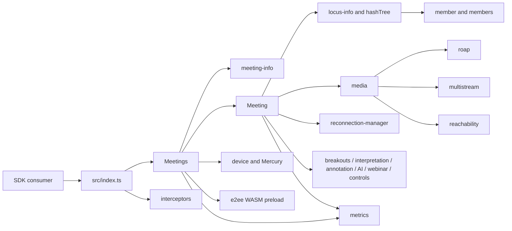
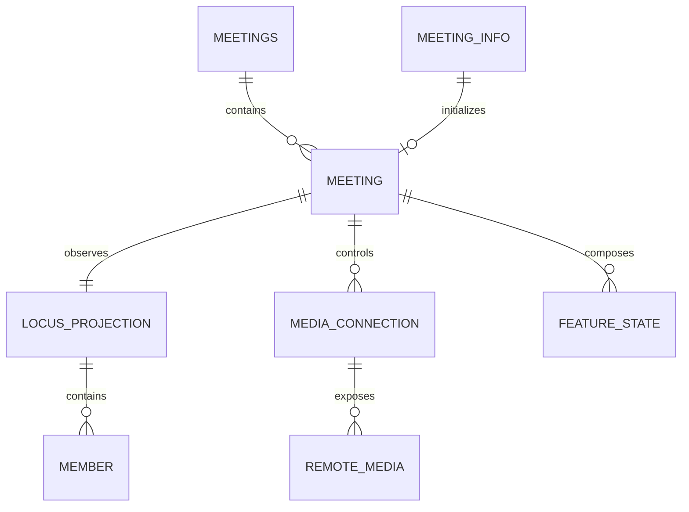
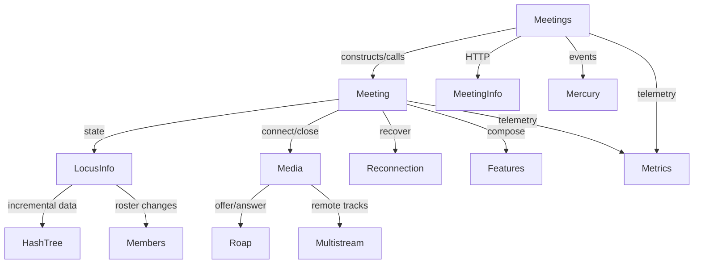
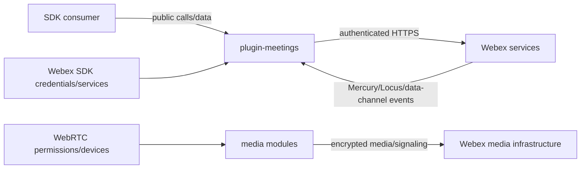

<!-- sdd-generated-metadata
doc_kind: standing-doc
generated_from: architecture@0.3.0
generated_by: claude-code
approved_by: rarajes2@cisco.com
updated_at: 2026-11-17T03:14:21Z
validation_status: pass-with-warnings
-->

# @webex/plugin-meetings architecture

Canonical architecture for this package. This page owns the facts that span its modules: package
boundaries, the plugin registration, cross-module interaction, the contract index, and how the
package meets the rest of the Webex SDK. Each module's behavior lives in its source-local
specification under `src/<module>/docs/README.md`, routed from the
[specification registry](specs/README.md); this page links to them instead of repeating them.

Related context: [specification registry](specs/README.md) ·
[documentation index](index.md) · [package agent instructions](../AGENTS.md)

## Applicability

| Condition ID                         | Status     | Evidence or reason | Owned section |
| ------------------------------------ | ---------- | ------------------ | ------------- |
| `repo.owns_datastore`                | N/A        | No database, schema, or migration. Projections are in memory; the only persisted values are reachability results in host-provided storage (`src/reachability/index.ts`) | Repository data and schema |
| `repo.holds_client_state`            | Applicable | `src/meetings/index.ts` holds the meeting collection and `src/meeting/index.ts` the per-meeting state | Client state model |
| `repo.components_interact`           | Applicable | `src/meetings/index.ts` constructs each Meeting from `src/meeting/index.ts`, which composes the Locus, members, media, and feature modules | Dependency and interaction topology |
| `repo.domain_data_across_components` | Applicable | Locus state projected by `src/locus-info/index.ts` is read by `src/meeting/index.ts`, `src/members/index.ts`, and the feature controllers | Object and data ownership |
| `repo.caches_data`                   | Applicable | `src/meetings/collection.ts`, `src/interceptors/locusRouteToken.ts`, and `src/common/wasm-loader.ts` keep data between calls | Caching catalog |
| `repo.observability_convention`      | Applicable | Modules log through `src/common/logs/logger-proxy.ts` and submit behavioral metrics through `src/metrics/index.ts` | Observability patterns |
| `repo.deploys_to_infra`              | N/A        | Library published to npm (`package.json`); no service runtime, container, or deployment descriptor | Runtime and infrastructure |
| `repo.shared_base_libs`              | Applicable | Plugins extend WebexPlugin from webex-core and use the legacy build, lint, and test stack (`babel.config.js`, `package.json`) | Shared and base libraries |
| `repo.is_monorepo`                   | N/A        | This SDD root is one package; the workspace around it is out of scope (`package.json`) | Package map and inter-package dependencies |
| `repo.multi_platform`                | N/A        | One browser-oriented build; `src/index.ts` has no per-platform entry | Platform matrix |
| `repo.published_package`             | Applicable | `package.json` names @webex/plugin-meetings and deploy:npm publishes it | Release and versioning |
| `repo.embedded_in_host`              | Applicable | `src/index.ts` registers the plugin into the host Webex SDK instance as webex.meetings | Host integration and theming |
| `repo.exposes_commands_or_artifacts` | Applicable | build:src and build:assets in `package.json` write dist and copy the runtime assets | Commands and generated artifacts |
| `repo.cross_repo_deps_material`      | Applicable | Behavior depends on workspace plugins and Webex services declared in `package.json` | Cross-repository topology |
| `repo.security_arch_warranted`       | Applicable | Route and data-channel tokens pass through `src/interceptors/locusRouteToken.ts` and `src/interceptors/dataChannelAuthToken.ts` | Security architecture |

## Design overview

The package is a browser-oriented library embedded in a Webex SDK instance. `src/index.ts` registers `Meetings` as `webex.meetings`, installs request interceptors, and exports the selected public types, helpers, stream factories, and errors. The registered `Meetings` plugin owns discovery, device/Mercury registration, the meeting collection, and construction of `Meeting` objects. Importing the entry also loads `@webex/internal-plugin-identity` for its
registration side effect.

A `Meeting` is the central per-call coordinator. It combines normalized Locus state, members, feature controllers, local and remote media, ROAP negotiation, reachability, reconnection, requests, events, and telemetry. Capability modules remain separate so their state and server contracts can be tested independently, but they are composed by the meeting object and consume the same Webex host and Locus identity.

The package owns no datastore. It maintains in-memory client projections and caches that are
refreshed by Webex HTTP responses, Mercury events, Locus full/delta/hash-tree updates, and media
callbacks; the one persisted value set is the reachability result and join cookie, which it writes
to the host's bounded storage. This split keeps remote services authoritative while making the SDK
responsive to realtime change.

This SDD root is the package directory. Three source folders have no module specification yet:
`src/common/` (shared helpers), `src/e2ee/` (E2EE WASM preload, signaling, and MLS engine), and
`src/transcription/` (the WebSocket transcription class). Code is the source of truth for them.

## Resource inventory and responsibilities

Every resource below is a module of this package under `src/`. All are owned by
`@webex/web-client` and `@webex/web-sdk`, the owners that the workspace `.github/CODEOWNERS` line
for `packages/@webex/plugin-meetings` assigns. The Docs column links each module's canonical
specification.

| Component | Responsibility | Docs |
| --- | --- | --- |
| `src/meetings/` | Plugin registration lifecycle, discovery, and meeting collection | [`src/meetings/docs/README.md`](../src/meetings/docs/README.md) |
| `src/meeting/` | One meeting's lifecycle, controls, media, state, and events | [`src/meeting/docs/README.md`](../src/meeting/docs/README.md) |
| `src/meeting-info/` | Resolve destinations and normalize meeting metadata | [`src/meeting-info/docs/README.md`](../src/meeting-info/docs/README.md) |
| `src/locus-info/` | Convert Locus inputs into scoped client-state callbacks | [`src/locus-info/docs/README.md`](../src/locus-info/docs/README.md) |
| `src/hashTree/` | Reconcile incremental Locus datasets | [`src/hashTree/docs/README.md`](../src/hashTree/docs/README.md) |
| `src/member/`, `src/members/` | Represent one participant and manage the roster | [`src/member/docs/README.md`](../src/member/docs/README.md), [`src/members/docs/README.md`](../src/members/docs/README.md) |
| `src/media/`, `src/multistream/`, `src/roap/` | Construct connections, allocate streams, and negotiate SDP | [`src/media/docs/README.md`](../src/media/docs/README.md), [`src/multistream/docs/README.md`](../src/multistream/docs/README.md), [`src/roap/docs/README.md`](../src/roap/docs/README.md) |
| `src/reachability/`, `src/reconnection-manager/` | Probe routes and recover failed media/meetings | [`src/reachability/docs/README.md`](../src/reachability/docs/README.md), [`src/reconnection-manager/docs/README.md`](../src/reconnection-manager/docs/README.md) |
| `src/breakouts/`, `src/interpretation/`, `src/annotation/`, `src/aiEnableRequest/`, `src/webinar/` | Feature-specific meeting workflows | [`src/breakouts/docs/README.md`](../src/breakouts/docs/README.md), [`src/interpretation/docs/README.md`](../src/interpretation/docs/README.md), [`src/annotation/docs/README.md`](../src/annotation/docs/README.md), [`src/aiEnableRequest/docs/README.md`](../src/aiEnableRequest/docs/README.md), [`src/webinar/docs/README.md`](../src/webinar/docs/README.md) |
| `src/recording-controller/`, `src/controls-options-manager/`, `src/personal-meeting-room/`, `src/reactions/` | Focused meeting controls and data catalogs | [`src/recording-controller/docs/README.md`](../src/recording-controller/docs/README.md), [`src/controls-options-manager/docs/README.md`](../src/controls-options-manager/docs/README.md), [`src/personal-meeting-room/docs/README.md`](../src/personal-meeting-room/docs/README.md), [`src/reactions/docs/README.md`](../src/reactions/docs/README.md) |
| `src/interceptors/`, `src/metrics/` | Request middleware and behavioral telemetry | [`src/interceptors/docs/README.md`](../src/interceptors/docs/README.md), [`src/metrics/docs/README.md`](../src/metrics/docs/README.md) |
| `src/index.ts`, `src/config.ts`, `src/constants.ts` | Package entry and plugin registration, default `meetings` configuration, shared constants and event names | This page, [Public and consumer surfaces](#public-and-consumer-surfaces) |
| `src/common/` | Shared collections, events and `TriggerProxy`, logging, queue, errors, browser detection, static config, and the WASM loader | No module specification; see [Shared and base libraries](#shared-and-base-libraries) |
| `src/e2ee/`, `src/transcription/` | E2EE WASM preload, signaling, and MLS engine; WebSocket transcription class | No module specification yet |

## Interaction and execution flows

Representative end-to-end flow:

Consumers enter through the registered `webex.meetings` plugin or package exports. `Meetings` resolves a destination, creates or finds a `Meeting`, and coordinates registration and Mercury delivery. The meeting applies Locus updates, updates roster and feature projections, negotiates media through ROAP/internal-media-core, emits scoped events, and records behavioral metrics.

1. Importing `src/index.ts` registers the plugin and three request interceptors with `@webex/webex-core`.
2. The SDK initializes `Meetings`, which builds collections/request helpers; `register()` then
   registers the device, connects Mercury, starts reachability, registers the Mercury listeners,
   and, when `enableE2ee` is set, preloads the E2EE WASM module without delaying registration.
3. A consumer creates or receives a meeting; meeting-info resolution supplies Locus/meeting identity and a `Meeting` enters the collection.
4. Join and media operations call Webex services, apply the returned Locus state, negotiate ROAP/SDP, and publish local/remote stream readiness.
5. Mercury/Locus updates flow through `locus-info` and feature controllers; teardown removes listeners, timers, media connections, and collection entries.

Evidence: `src/index.ts`, `src/meetings/index.ts`, `src/meeting/index.ts`, `src/locus-info/index.ts`, `src/media/index.ts`.

Request families: This package owns no endpoint. Current request families are device registration, active meetings/preferences/geo hints, meeting-info/static links, Locus lifecycle and controls, media/ROAP/TURN, member mutations, breakouts, interpretation/AI/webinar/recording, PMR, reachability, and metrics. Exact URLs are resolved by request helpers and Webex service discovery in current source.

Event sources:

- Mercury/Locus events update meeting collections and per-meeting state.
- Meeting events cover lifecycle, media, mute/share, controls, transcription/captions, and feature state.
- Members, breakouts, interpretation, AI approval, annotation, webinar, and data-channel events are meeting scoped.
- Browser/media-core callbacks report permissions, connection/track readiness, degradation, and closure.

Authoritative anchors: `src/constants.ts`, `src/common/events/`, `src/meetings/index.ts`, `src/meeting/index.ts`, and owning feature event/constants files.

Failure and degraded behavior per external dependency:

| Dependency | Purpose | Degraded/failure behavior |
| --- | --- | --- |
| Webex device and Mercury | identity/registration and realtime events | registration stage fails or events stop; unregister remains safe |
| Locus/meeting-info services | meeting identity, state, and mutations | typed/request failure; current projection is not fabricated |
| media infrastructure/internal-media-core | WebRTC negotiation and streams | media errors, bounded recovery/rejoin, cleanup |
| reachability/STUN/TURN | route selection and network characterization | report failure/partial reachability; do not claim success |
| feature services/data channels | breakouts, AI, webinar, interpretation, annotation | capability-gated failure visible to caller/event consumer |

## Dependency topology

| Dependency | Type | How used | Failure / version handling |
| --- | --- | --- | --- |
| `@webex/webex-core` | workspace internal (`dependencies`) | Plugin host, requests, services, interceptors, base classes | Request failures propagate through typed errors/interceptors |
| Device and Mercury plugins | workspace internal | Device identity and realtime event delivery | Registration is staged and failure-aware; teardown unregisters listeners |
| `@webex/internal-media-core` | pinned external | WebRTC media connections and multistream primitives | Media errors/timeouts are surfaced and reconnection is bounded |
| `@webex/media-helpers` | workspace internal | Public local/remote stream factories and types | Public re-exports are semver-sensitive |
| Locus/meeting/webinar/AI services | external Webex services | Meeting state and mutations | HTTP errors are not converted into success; retry only where explicitly implemented |
| `jose`, `jwt-decode` | external libraries | `jose` decodes the data-channel token to check its expiry (`isJwtTokenExpired`); `jwt-decode` decodes the Meeting permission token | Expiry is checked with a 30-second buffer; data-channel token refresh retries once (`MAX_RETRY`) |
| `@webex/internal-plugin-identity` | workspace internal | Imported by `src/index.ts` for its plugin registration side effect | `workspace:*` |
| `@webex/web-capabilities` | external library | WASM capability checks for E2EE preload and browser capability checks | Unsupported WASM skips the preload |
| `xxh3-ts` | external library | Hashing for Locus hash-tree datasets in `src/hashTree/hashTree.ts` | Package manifest range |

- Workspace packages live under repository package globs; this package is the published meetings capability.
- It consumes internal device, Mercury, metrics, user, support, conversation, identity,
  Voicea/LLM, people/rooms, media-helper, common, and core packages listed in `package.json`.
- Workspace dependencies use `workspace:*`; external pinned/ranged dependencies follow the root release process. The package must not introduce cycles through reverse imports.

### Runtime and transport notes

The package has no deployable runtime of its own; these are the runtime categories it relies on.

| Category | In use | Notes |
| --- | --- | --- |
| Datastores | none owned | Client projections are in memory; Webex services own persistence |
| Messaging / streaming | Mercury events, data channels, WebRTC media | Host plugins and internal-media-core provide transport |
| Cloud / platform services | Webex device, Locus, meeting-info, webinar, reachability, metrics | Accessed through Webex core request/service abstractions |

## Public and consumer surfaces

This is the package contract index: one row per contract ID in the `contract_catalog` of
`.sdd/manifest.json`. Type is the contract kind and its publication; Owner is the module whose
manifest `contracts.provides` lists it, and external contracts are dependencies. Exact API, event,
and request definitions stay in their native source and owning module specification.

| Surface | Type | Owner | Consumers | Compatibility policy | Source |
| ------- | ---- | ----- | --------- | -------------------- | ------ |
| `plugin-meetings-sdk` | SDK, published | `src/meetings` | Applications through the package | Semver-sensitive; prefer additive changes (Release and versioning) | `package.json` |
| `meetings-plugin` | SDK, published | `src/meetings` | Applications through the package | Semver-sensitive; prefer additive changes (Release and versioning) | `package.json` |
| `meetings-collection-api` | SDK, published | `src/meetings` | Applications through the package | Semver-sensitive; prefer additive changes (Release and versioning) | `package.json` |
| `meeting-api` | SDK, published | `src/meeting` | Applications through the package, `src/meetings`, `src/reconnection-manager` | Semver-sensitive; prefer additive changes (Release and versioning) | `package.json` |
| `meetings-events` | Event, published | `src/meeting` | Applications through the package | Semver-sensitive; prefer additive changes (Release and versioning) | `src/constants.ts` |
| `meeting-info-api` | SDK, published | `src/meeting-info` | Applications through the package, `src/meetings` | Semver-sensitive; prefer additive changes (Release and versioning) | `package.json` |
| `members-api` | SDK, published | `src/members` | Applications through the package, `src/meeting` | Semver-sensitive; prefer additive changes (Release and versioning) | `package.json` |
| `member-model` | SDK, published | `src/member` | Applications through the package, `src/members` | Semver-sensitive; prefer additive changes (Release and versioning) | `package.json` |
| `remote-media-api` | SDK, published | `src/multistream` | Applications through the package, `src/meeting` | Semver-sensitive; prefer additive changes (Release and versioning) | `package.json` |
| `breakouts-api` | SDK, published | `src/breakouts` | Applications through the package | Semver-sensitive; prefer additive changes (Release and versioning) | `package.json` |
| `interpretation-api` | SDK, published | `src/interpretation` | Applications through the package | Semver-sensitive; prefer additive changes (Release and versioning) | `package.json` |
| `annotation-api` | SDK, published | `src/annotation` | Applications through the package | Semver-sensitive; prefer additive changes (Release and versioning) | `package.json` |
| `ai-enable-request-api` | SDK, published | `src/aiEnableRequest` | Applications through the package | Semver-sensitive; prefer additive changes (Release and versioning) | `package.json` |
| `webinar-api` | SDK, published | `src/webinar` | Applications through the package | Semver-sensitive; prefer additive changes (Release and versioning) | `package.json` |
| `recording-controller-api` | SDK, published | `src/recording-controller` | Applications through the package | Semver-sensitive; prefer additive changes (Release and versioning) | `package.json` |
| `controls-options-api` | SDK, published | `src/controls-options-manager` | Applications through the package | Semver-sensitive; prefer additive changes (Release and versioning) | `package.json` |
| `personal-meeting-room-api` | SDK, published | `src/personal-meeting-room` | Applications through the package | Semver-sensitive; prefer additive changes (Release and versioning) | `package.json` |
| `reactions-catalog` | SDK, published | `src/reactions` | Applications through the package | Semver-sensitive; prefer additive changes (Release and versioning) | `package.json` |
| `locus-http` | HTTP client, internal | `src/meeting` | `src/locus-info`, `src/hashTree`, `src/members`, `src/roap`, `src/breakouts`, `src/interpretation`, `src/annotation`, `src/recording-controller`, `src/controls-options-manager` | Internal; changes land with every consuming module in one change | `src/meeting/request.ts` |
| `site-preferences-http` | HTTP client, internal | `src/meetings` | `src/meetings` only (its own requests) | Internal; changes land with every consuming module in one change | `src/meetings/request.ts` |
| `meeting-info-http` | HTTP client, internal | `src/meeting-info` | `src/meeting-info` only (its own requests) | Internal; changes land with every consuming module in one change | `src/meeting-info/meeting-info-v2.ts` |
| `roap-signaling` | HTTP client, internal | `src/roap` | `src/meeting` | Internal; changes land with every consuming module in one change | `src/roap/request.ts` |
| `locus-info-projection` | SDK, internal | `src/locus-info` | `src/meeting` | Internal; changes land with every consuming module in one change | `src/locus-info/index.ts` |
| `hash-tree-sync` | SDK, internal | `src/hashTree` | `src/locus-info` | Internal; changes land with every consuming module in one change | `src/hashTree/hashTreeParser.ts` |
| `media-connection` | SDK, internal | `src/media` | `src/meeting`, `src/reconnection-manager` | Internal; changes land with every consuming module in one change | `src/media/index.ts` |
| `reachability-service` | SDK, internal | `src/reachability` | `src/meetings`, `src/meeting` | Internal; changes land with every consuming module in one change | `src/reachability/index.ts` |
| `reconnection-manager` | SDK, internal | `src/reconnection-manager` | `src/meeting` | Internal; changes land with every consuming module in one change | `src/reconnection-manager/index.ts` |
| `locus-interceptors` | SDK, internal | `src/interceptors` | The webex-core request pipeline, through the registration in `src/index.ts` | Internal; changes land with every consuming module in one change | `src/interceptors/index.ts` |
| `meetings-metrics` | SDK, internal | `src/metrics` | `src/meetings`, `src/meeting` | Internal; changes land with every consuming module in one change | `src/metrics/index.ts` |
| `webex-core-plugin-host` | SDK, published | External dependency | `src/meetings`, `src/meeting`, `src/meeting-info`, `src/roap`, `src/reachability`, `src/breakouts`, `src/aiEnableRequest`, `src/webinar`, `src/personal-meeting-room`, `src/interceptors` | Version per package.json (`workspace:*`, or the pinned exact version) | @webex/webex-core (workspace package) |
| `internal-plugin-device-registration` | SDK, published | External dependency | `src/meetings` | Version per package.json (`workspace:*`, or the pinned exact version) | @webex/internal-plugin-device (workspace package) |
| `internal-plugin-mercury-events` | Event, published | External dependency | `src/meetings` | Version per package.json (`workspace:*`, or the pinned exact version) | @webex/internal-plugin-mercury (workspace package) |
| `internal-plugin-metrics-api` | SDK, published | External dependency | `src/metrics` | Version per package.json (`workspace:*`, or the pinned exact version) | @webex/internal-plugin-metrics (workspace package) |
| `internal-media-core` | SDK, published | External dependency | `src/meeting`, `src/media`, `src/multistream` | Version per package.json (`workspace:*`, or the pinned exact version) | @webex/internal-media-core (pinned exact version in package.json) |
| `media-helpers-streams` | SDK, published | External dependency | `src/meeting` | Version per package.json (`workspace:*`, or the pinned exact version) | @webex/media-helpers (workspace package) |
| `internal-plugin-llm-channel` | SDK, published | External dependency | `src/meeting`, `src/annotation` | Version per package.json (`workspace:*`, or the pinned exact version) | @webex/internal-plugin-llm (workspace package) |
| `internal-plugin-voicea-transcription` | SDK, published | External dependency | `src/meeting` | Version per package.json (`workspace:*`, or the pinned exact version) | @webex/internal-plugin-voicea (workspace package) |
| `browser-webrtc` | SDK, published | External dependency | `src/media`, `src/reachability` | Browser capability; feature-detected at runtime | W3C WebRTC and Media Capture APIs (browser) |

### Package exports

`src/index.ts` is the package export authority. It registers the default `Meetings` plugin and exports `Meeting`, selected meeting-info/error helpers, constants, reactions, annotation/interpretation types, `RemoteMedia`, `TriggerProxy`, AI approver selection, and media-helper stream factories/types. A symbol existing below `src/` is not public unless it is reachable through this entry point or a documented public object such as `webex.meetings`/`Meeting`.

| Contract ID | Surface | Purpose | Compatibility |
| --- | --- | --- | --- |
| `meetings-plugin` | default `Meetings` | plugin constructor registered as `webex.meetings` | semver-sensitive |
| `meeting-api` | `Meeting` | per-meeting lifecycle/control object | semver-sensitive methods/events |
| `media-helpers-streams` | media-helper stream classes/factories/types re-exported from `@webex/media-helpers` | acquire and represent local/remote media | follows package re-export contract |
| `plugin-meetings-sdk`, `reactions-catalog` | `CONSTANTS`, `REACTIONS`, `sdkAnnotationTypes`, selected enums/types | stable consumer values and payload typing | never silently change wire values |
| `plugin-meetings-sdk`, `meeting-info-api` | join, intent-to-join, join-webinar, captcha, password, permission, reclaim-host, SDP timeout errors | actionable consumer failure branches | preserve class identity and relevant fields |
| `plugin-meetings-sdk`, `meeting-info-api`, `remote-media-api`, `ai-enable-request-api` | `MeetingInfoUtil`, `MeetingInfoV2`, `RemoteMedia`, `TriggerProxy`, `getAIEnablementApprover` | selected advanced integration helpers | semver-sensitive |
| `meetings-collection-api` | `Meetings.fetchSitePreferencesMeViaSite(options?)` | fetch the selected preference sections from a site's `/wbxappapi/v1/users/me/preference` resource, using an explicit site or the preferred site established during registration | semver-sensitive method, option, and response shape |

The retained `README.md` contains extensive usage examples for registration, creating/finding
meetings, joining, media, PMR, members, and events. They are retained consumer guidance, not a
contract surface; validate them against current source before copying into new consumer code.

### Events

Events are emitted in process through package event scopes, with some inputs originating from Mercury, Locus, media, or data channels. Event constants in `src/constants.ts` and feature event files are authoritative.

| Family | Owner | Examples / role | Compatibility rule |
| --- | --- | --- | --- |
| meetings | `src/meetings/` | added/removed, incoming, registration and sync lifecycle | preserve name, payload shape, and timing |
| meeting | `src/meeting/` | state, media ready/stopped, mute, sharing, transcription, controls | preserve scope and cleanup; document payload changes |
| members | `src/members/` | roster added/updated/removed and host/member changes | participant PII restrictions apply |
| breakouts | `src/breakouts/index.ts` | session, roster, broadcast, help, return-to-main changes | stale README implementation notes do not override code |
| interpretation / AI / webinar / annotation | owning modules | approval, handoff, role/status, relay/data-channel changes | capability-gated, meeting-scoped |

Event caveat retained from consumer guidance: do not assume every event is globally emitted or ordered independently of meeting/Locus state. Subscribe through the documented object/scope, tolerate async updates, and remove listeners during teardown.

#### Emitted-event inventory

This table lists the current public emission call sites. Constants, conditional expressions, local
assignments, `TriggerProxy`, inline literals, and thin forwarding wrappers are resolved to the
emitted literal; the table distinguishes the emitted literal, its defining expression, and the file
that emits or forwards it. Private plumbing signals (`BREAKOUTS.EVENTS.LLM_CONNECT_RESPONSE`,
`EVENTS.REQUEST_UPLOAD_LOGS`, `EVENTS.DESTROY_MEETING`, and the `LOCUSINFO.EVENTS` family) are not
public events and remain documented only in their owning module flows. Events of individual
objects (`RemoteMedia`, the remote media manager, receive slots, and the E2EE MLS engine) belong to
their module specifications.

| Event literal | Constant / expression | Emission evidence |
| --- | --- | --- |
| `APPROVAL_REQUEST_ARRIVED` | `AI_ENABLE_REQUEST.EVENTS.APPROVAL_REQUEST_ARRIVED` | `src/aiEnableRequest/index.ts` |
| `ASK_FOR_HELP` | `BREAKOUTS.EVENTS.ASK_FOR_HELP` | `src/breakouts/index.ts` |
| `ASK_RETURN_TO_MAIN` | `BREAKOUTS.EVENTS.ASK_RETURN_TO_MAIN` | `src/breakouts/index.ts` |
| `BREAKOUTS_CLOSING` | `BREAKOUTS.EVENTS.BREAKOUTS_CLOSING` | `src/breakouts/index.ts` |
| `HANDOFF_REQUESTS_ARRIVED` | `INTERPRETATION.EVENTS.HANDOFF_REQUESTS_ARRIVED` | `src/interpretation/index.ts` |
| `LEAVE_BREAKOUT` | `BREAKOUTS.EVENTS.LEAVE_BREAKOUT` | `src/breakouts/index.ts` |
| `annotation:command` | `EVENT_TRIGGERS.ANNOTATION_COMMAND` | `src/annotation/index.ts` |
| `annotation:strokeData` | `EVENT_TRIGGERS.ANNOTATION_STROKE_DATA` | `src/annotation/index.ts` |
| `media:activeSpeakerChanged` | `EVENT_TRIGGERS.ACTIVE_SPEAKER_CHANGED` | `src/meeting/index.ts` |
| `media:codec:loaded` | `EVENT_TRIGGERS.MEDIA_CODEC_LOADED` | `src/meetings/util.ts` |
| `media:codec:missing` | `EVENT_TRIGGERS.MEDIA_CODEC_MISSING` | `src/meetings/util.ts` |
| `media:inboundAudio:issueDetected` | `EVENT_TRIGGERS.MEDIA_INBOUND_AUDIO_ISSUE_DETECTED` | `src/meeting/index.ts` |
| `media:negotiated` | `EVENT_TRIGGERS.MEDIA_NEGOTIATED` | `src/meeting/index.ts` |
| `media:ready` | `EVENT_TRIGGERS.MEDIA_READY` | `src/meeting/index.ts` |
| `media:remoteAudio:created` | `EVENT_TRIGGERS.REMOTE_MEDIA_AUDIO_CREATED` | `src/meeting/index.ts` |
| `media:remoteInterpretationAudio:created` | `EVENT_TRIGGERS.REMOTE_MEDIA_INTERPRETATION_AUDIO_CREATED` | `src/meeting/index.ts` |
| `media:remoteScreenShareAudio:created` | `EVENT_TRIGGERS.REMOTE_MEDIA_SCREEN_SHARE_AUDIO_CREATED` | `src/meeting/index.ts` |
| `media:remoteVideo:layoutChanged` | `EVENT_TRIGGERS.REMOTE_MEDIA_VIDEO_LAYOUT_CHANGED` | `src/meeting/index.ts` |
| `media:remoteAudioSourceCountChanged` | `EVENT_TRIGGERS.REMOTE_AUDIO_SOURCE_COUNT_CHANGED` | `src/meeting/index.ts` |
| `media:remoteVideoSourceCountChanged` | `EVENT_TRIGGERS.REMOTE_VIDEO_SOURCE_COUNT_CHANGED` | `src/meeting/index.ts` |
| `media:stopped` | `EVENT_TRIGGERS.MEDIA_STOPPED` | `src/meeting/index.ts` |
| `meeting:actionsUpdate` | `EVENT_TRIGGERS.MEETING_ACTIONS_UPDATE` | `src/meeting/index.ts` |
| `meeting:added` | `EVENT_TRIGGERS.MEETING_ADDED` | `src/meetings/index.ts` |
| `meeting:breakouts:askForHelp` | `EVENT_TRIGGERS.MEETING_BREAKOUTS_ASK_FOR_HELP` | `src/meeting/index.ts` |
| `meeting:breakouts:askReturnToMain` | `EVENT_TRIGGERS.MEETING_BREAKOUTS_ASK_RETURN_TO_MAIN` | `src/meeting/index.ts` |
| `meeting:breakouts:closing` | `EVENT_TRIGGERS.MEETING_BREAKOUTS_CLOSING` | `src/meeting/index.ts` |
| `meeting:breakouts:leave` | `EVENT_TRIGGERS.MEETING_BREAKOUTS_LEAVE` | `src/meeting/index.ts` |
| `meeting:breakouts:message` | `EVENT_TRIGGERS.MEETING_BREAKOUTS_MESSAGE` | `src/meeting/index.ts` |
| `meeting:breakouts:preAssignmentsUpdate` | `EVENT_TRIGGERS.MEETING_BREAKOUTS_PRE_ASSIGNMENTS_UPDATE` | `src/meeting/index.ts` |
| `meeting:breakouts:update` | `EVENT_TRIGGERS.MEETING_BREAKOUTS_UPDATE` | `src/meeting/index.ts` |
| `meeting:caption-received` | `EVENT_TRIGGERS.MEETING_CAPTION_RECEIVED` | `src/meeting/index.ts` |
| `meeting:controls:ai-summary-notification:updated` | `EVENT_TRIGGERS.MEETING_CONTROLS_AI_SUMMARY_NOTIFICATION_UPDATED` | `src/meeting/index.ts` |
| `meeting:controls:annotation:updated` | `EVENT_TRIGGERS.MEETING_CONTROLS_ANNOTATION_UPDATED` | `src/meeting/index.ts` |
| `meeting:controls:auto-end-meeting-warning:updated` | `EVENT_TRIGGERS.MEETING_CONTROLS_AUTO_END_MEETING_WARNING_UPDATED` | `src/meeting/index.ts` |
| `meeting:controls:disallow-unmute:updated` | `EVENT_TRIGGERS.MEETING_CONTROLS_DISALLOW_UNMUTE_UPDATED` | `src/meeting/index.ts` |
| `meeting:controls:meeting-full:updated` | `EVENT_TRIGGERS.MEETING_CONTROLS_MEETING_FULL_UPDATED` | `src/meeting/index.ts` |
| `meeting:controls:mute-on-entry:updated` | `EVENT_TRIGGERS.MEETING_CONTROLS_MUTE_ON_ENTRY_UPDATED` | `src/meeting/index.ts` |
| `meeting:controls:polling-qa:updated` | `EVENT_TRIGGERS.MEETING_CONTROLS_POLLING_QA_UPDATED` | `src/meeting/index.ts` |
| `meeting:controls:practice-session-status:updated` | `EVENT_TRIGGERS.MEETING_CONTROLS_PRACTICE_SESSION_STATUS_UPDATED` | `src/meeting/index.ts` |
| `meeting:controls:raise-hand:updated` | `EVENT_TRIGGERS.MEETING_CONTROLS_RAISE_HAND_UPDATED` | `src/meeting/index.ts` |
| `meeting:controls:reactions:updated` | `EVENT_TRIGGERS.MEETING_CONTROLS_REACTIONS_UPDATED` | `src/meeting/index.ts` |
| `meeting:controls:remote-desktop-control:updated` | `EVENT_TRIGGERS.MEETING_CONTROLS_REMOTE_DESKTOP_CONTROL_UPDATED` | `src/meeting/index.ts` |
| `meeting:controls:share-control:updated` | `EVENT_TRIGGERS.MEETING_CONTROLS_SHARE_CONTROL_UPDATED` | `src/meeting/index.ts` |
| `meeting:controls:stage-view:updated` | `EVENT_TRIGGERS.MEETING_CONTROLS_STAGE_VIEW_UPDATED` | `src/meeting/index.ts` |
| `meeting:controls:video:updated` | `EVENT_TRIGGERS.MEETING_CONTROLS_VIDEO_UPDATED` | `src/meeting/index.ts` |
| `meeting:controls:view-the-participants-list:updated` | `EVENT_TRIGGERS.MEETING_CONTROLS_VIEW_THE_PARTICIPANTS_LIST_UPDATED` | `src/meeting/index.ts` |
| `meeting:controls:webcast:updated` | `EVENT_TRIGGERS.MEETING_CONTROLS_WEBCAST_UPDATED` | `src/meeting/index.ts` |
| `meeting:embeddedApps:update` | `EVENT_TRIGGERS.MEETING_EMBEDDED_APPS_UPDATE` | `src/meeting/index.ts` |
| `meeting:entryExitTone:update` | `EVENT_TRIGGERS.MEETING_ENTRY_EXIT_TONE_UPDATE` | `src/meeting/index.ts` |
| `meeting:interpretation:handoffRequestsArrived` | `EVENT_TRIGGERS.MEETING_INTERPRETATION_HANDOFF_REQUESTS_ARRIVED` | `src/meeting/index.ts` |
| `meeting:interpretation:supportLanguagesUpdate` | `EVENT_TRIGGERS.MEETING_INTERPRETATION_SUPPORT_LANGUAGES_UPDATE` | `src/meeting/index.ts` |
| `meeting:interpretation:update` | `EVENT_TRIGGERS.MEETING_INTERPRETATION_UPDATE` | `src/meeting/index.ts`, `src/meeting/util.ts` |
| `meeting:layout:update` | `EVENT_TRIGGERS.MEETING_CONTROLS_LAYOUT_UPDATE` | `src/meeting/index.ts` |
| `meeting:locked` | `EVENT_TRIGGERS.MEETING_LOCKED` | `src/meeting/index.ts` |
| `meeting:locus:locusUrl:update` | `EVENT_TRIGGERS.MEETING_LOCUS_URL_UPDATE` | `src/meeting/index.ts` |
| `meeting:logUpload:failure` | `EVENT_TRIGGERS.MEETING_LOG_UPLOAD_FAILURE` | `src/meetings/index.ts` |
| `meeting:logUpload:success` | `EVENT_TRIGGERS.MEETING_LOG_UPLOAD_SUCCESS` | `src/meetings/index.ts` |
| `meeting:manualCaptionControl:updated` | `EVENT_TRIGGERS.MEETING_MANUAL_CAPTION_UPDATED` | `src/meeting/index.ts` |
| `meeting:media:local:start` | `EVENT_TRIGGERS.MEETING_MEDIA_LOCAL_STARTED` | `src/meeting/index.ts` |
| `meeting:media:remote:start` | `EVENT_TRIGGERS.MEETING_MEDIA_REMOTE_STARTED` | `src/meeting/index.ts` |
| `meeting:meetingContainer:update` | `EVENT_TRIGGERS.MEETING_MEETING_CONTAINER_UPDATE` | `src/meeting/index.ts` |
| `meeting:meetingInfoAvailable` | `EVENT_TRIGGERS.MEETING_INFO_AVAILABLE` | `src/meeting/index.ts` |
| `meeting:meetingInfoUpdated` | `EVENT_TRIGGERS.MEETING_INFO_UPDATED` | `src/meeting/index.ts` |
| `meeting:participant-reason-changed` | `EVENT_TRIGGERS.MEETING_PARTICIPANT_REASON_CHANGED` | `src/meeting/index.ts` |
| `meeting:receiveReactions` | `EVENT_TRIGGERS.MEETING_RECEIVE_REACTIONS` | `src/meeting/index.ts` |
| `meeting:receiveTranscription:started` | `EVENT_TRIGGERS.MEETING_STARTED_RECEIVING_TRANSCRIPTION` | `src/meeting/index.ts` |
| `meeting:receiveTranscription:stopped` | `EVENT_TRIGGERS.MEETING_STOPPED_RECEIVING_TRANSCRIPTION` | `src/meeting/index.ts` |
| `meeting:recording:paused` | `EVENT_TRIGGERS.MEETING_PAUSED_RECORDING` | `src/meeting/index.ts` |
| `meeting:recording:resumed` | `EVENT_TRIGGERS.MEETING_RESUMED_RECORDING` | `src/meeting/index.ts` |
| `meeting:recording:started` | `EVENT_TRIGGERS.MEETING_STARTED_RECORDING` | `src/meeting/index.ts` |
| `meeting:recording:stopped` | `EVENT_TRIGGERS.MEETING_STOPPED_RECORDING` | `src/meeting/index.ts` |
| `meeting:removed` | `EVENT_TRIGGERS.MEETING_REMOVED` | `src/meetings/index.ts` |
| `meeting:resourceLinks:update` | `EVENT_TRIGGERS.MEETING_RESOURCE_LINKS_UPDATE` | `src/meeting/index.ts` |
| `meeting:ringing` | `EVENT_TRIGGERS.MEETING_RINGING` | `src/meeting/state.ts` |
| `meeting:ringingStop` | `EVENT_TRIGGERS.MEETING_RINGING_STOP` | `src/meeting/state.ts` |
| `meeting:self:brbUpdate` | `EVENT_TRIGGERS.MEETING_SELF_BRB_UPDATE` | `src/meeting/index.ts` |
| `meeting:self:cannotViewParticipantList` | `EVENT_TRIGGERS.MEETING_SELF_CANNOT_VIEW_PARTICIPANT_LIST` | `src/meeting/index.ts` |
| `meeting:self:guestAdmitted` | `EVENT_TRIGGERS.MEETING_SELF_GUEST_ADMITTED` | `src/meeting/index.ts` |
| `meeting:self:isSharingBlocked` | `EVENT_TRIGGERS.MEETING_SELF_IS_SHARING_BLOCKED` | `src/meeting/index.ts` |
| `meeting:self:left` | `EVENT_TRIGGERS.MEETING_SELF_LEFT` | `src/meeting/index.ts` |
| `meeting:self:lobbyWaiting` | `EVENT_TRIGGERS.MEETING_SELF_LOBBY_WAITING` | `src/meeting/index.ts` |
| `meeting:self:mutedByOthers` | `EVENT_TRIGGERS.MEETING_SELF_MUTED_BY_OTHERS` | `src/meeting/index.ts` |
| `meeting:self:phoneAudioUpdate` | `EVENT_TRIGGERS.MEETING_SELF_PHONE_AUDIO_UPDATE` | `src/meeting/index.ts` |
| `meeting:self:requestedToUnmute` | `EVENT_TRIGGERS.MEETING_SELF_REQUESTED_TO_UNMUTE` | `src/meeting/index.ts` |
| `meeting:self:rolesChanged` | `EVENT_TRIGGERS.MEETING_SELF_ROLES_CHANGED` | `src/meeting/index.ts` |
| `meeting:self:unmutedByOthers` | `EVENT_TRIGGERS.MEETING_SELF_UNMUTED_BY_OTHERS` | `src/meeting/index.ts` |
| `meeting:self:videoMutedByOthers` | `EVENT_TRIGGERS.MEETING_SELF_VIDEO_MUTED_BY_OTHERS` | `src/meeting/index.ts` |
| `meeting:self:videoUnmutedByOthers` | `EVENT_TRIGGERS.MEETING_SELF_VIDEO_UNMUTED_BY_OTHERS` | `src/meeting/index.ts` |
| `meeting:srtpCipher:updated` | `EVENT_TRIGGERS.MEETING_SRTP_CIPHER_UPDATED` | `src/meeting/index.ts` |
| `meeting:startedSharingLocal` | `EVENT_TRIGGERS.MEETING_STARTED_SHARING_LOCAL` | `src/meeting/index.ts` |
| `meeting:startedSharingRemote` | `EVENT_TRIGGERS.MEETING_STARTED_SHARING_REMOTE` | `src/meeting/index.ts` |
| `meeting:startedSharingWhiteboard` | `EVENT_TRIGGERS.MEETING_STARTED_SHARING_WHITEBOARD` | `src/meeting/index.ts` |
| `meeting:stateChange` | `EVENT_TRIGGERS.MEETING_STATE_CHANGE` | `src/meeting/index.ts` |
| `meeting:reconnectionFailure` | `EVENT_TRIGGERS.MEETING_RECONNECTION_FAILURE` | `src/reconnection-manager/index.ts` |
| `meeting:reconnectionStarting` | `EVENT_TRIGGERS.MEETING_RECONNECTION_STARTING` | `src/reconnection-manager/index.ts` |
| `meeting:reconnectionSuccess` | `EVENT_TRIGGERS.MEETING_RECONNECTION_SUCCESS` | `src/reconnection-manager/index.ts` |
| `meeting:stoppedSharingLocal` | `EVENT_TRIGGERS.MEETING_STOPPED_SHARING_LOCAL` | `src/meeting/index.ts`, `src/reconnection-manager/index.ts` |
| `meeting:stoppedSharingRemote` | `EVENT_TRIGGERS.MEETING_STOPPED_SHARING_REMOTE` | `src/meeting/index.ts` |
| `meeting:stoppedSharingWhiteboard` | `EVENT_TRIGGERS.MEETING_STOPPED_SHARING_WHITEBOARD` | `src/meeting/index.ts` |
| `meeting:streamPublishStateChanged` | `EVENT_TRIGGERS.MEETING_STREAM_PUBLISH_STATE_CHANGED` | `src/meeting/index.ts` |
| `meeting:transcription:connected` | `EVENT_TRIGGERS.MEETING_TRANSCRIPTION_CONNECTED` | `src/meeting/index.ts` |
| `meeting:transcription:spokenLanguageUpdate` | `EVENT_TRIGGERS.MEETING_TRANSCRIPTION_SPOKEN_LANGUAGE_UPDATED` | `src/meeting/index.ts` |
| `meeting:unlocked` | `EVENT_TRIGGERS.MEETING_UNLOCKED` | `src/meeting/index.ts` |
| `meeting:updateAnnotationInfo` | `EVENT_TRIGGERS.MEETING_UPDATE_ANNOTATION_INFO` | `src/meeting/index.ts` |
| `meetings:ready` | `EVENT_TRIGGERS.MEETINGS_READY` | `src/meetings/index.ts` |
| `meetings:registered` | `EVENT_TRIGGERS.MEETINGS_REGISTERED` | `src/meetings/index.ts` |
| `meetings:unregistered` | `EVENT_TRIGGERS.MEETINGS_UNREGISTERED` | `src/meetings/index.ts` |
| `MEMBERS_UPDATE` | `BREAKOUTS.EVENTS.MEMBERS_UPDATE` | `src/breakouts/index.ts` |
| `members:clear` | `EVENT_TRIGGERS.MEMBERS_CLEAR` | `src/members/index.ts` |
| `members:content:update` | `EVENT_TRIGGERS.MEMBERS_CONTENT_UPDATE` | `src/members/index.ts` |
| `members:host:update` | `EVENT_TRIGGERS.MEMBERS_HOST_UPDATE` | `src/members/index.ts` |
| `members:self:update` | `EVENT_TRIGGERS.MEMBERS_SELF_UPDATE` | `src/members/index.ts` |
| `members:update` | `EVENT_TRIGGERS.MEMBERS_UPDATE` | `src/members/index.ts` |
| `MESSAGE` | `BREAKOUTS.EVENTS.MESSAGE` | `src/breakouts/index.ts` |
| `network:connected` | `EVENT_TRIGGERS.MEETINGS_NETWORK_CONNECTED` | `src/meeting/index.ts` |
| `network:disconnected` | `EVENT_TRIGGERS.MEETINGS_NETWORK_DISCONNECTED` | `src/meeting/index.ts`, `src/meetings/index.ts` |
| `network:quality` | `EVENT_TRIGGERS.NETWORK_QUALITY` | `src/meeting/index.ts` |
| `PRE_ASSIGNMENTS_UPDATE` | `BREAKOUTS.EVENTS.PRE_ASSIGNMENTS_UPDATE` | `src/breakouts/index.ts` |
| `reachability:done` | inline literal | `src/reachability/index.ts` |
| `reachability:firstResultAvailable` | inline literal | `src/reachability/index.ts` |
| `reachability:stopped` | inline literal | `src/reachability/index.ts` |
| `SUPPORT_LANGUAGES_UPDATE` | `INTERPRETATION.EVENTS.SUPPORT_LANGUAGES_UPDATE` | `src/interpretation/index.ts` |

#### Declared but not emitted

These root constants are consumer-visible declarations in `src/constants.ts`, but current package source has no reachable public emission call for them. They are not part of the emitted-event count and must not be presented as live notifications.

| Declared literal | Constant | Current classification |
| --- | --- | --- |
| `media:quality` | `EVENT_TRIGGERS.MEDIA_QUALITY` | declared but not emitted |
| `media:update` | `EVENT_TRIGGERS.MEDIA_UPDATE` | declared but not emitted |
| `meeting:aiEnableRequest` | `EVENT_TRIGGERS.MEETING_AI_ENABLE_REQUEST` | declared but not emitted |

#### Meetings-scope event catalog

| Event name | Observable meaning retained from consumer guidance |
| --- | --- |
| `meetings:ready` | plugin initialization completed; no payload |
| `meeting:added` | a joinable incoming/outgoing meeting entered the collection; payload identifies meeting and type |
| `meeting:removed` | a meeting left the collection and cannot be rejoined through that object; payload includes `meetingId` and `reason` |
| `media:codec:loaded` | browser H.264 codec became available; no payload |
| `media:codec:missing` | browser H.264 codec appears unavailable; no payload |

Registration lifecycle events, emitted on `webex.meetings`:

| Event name | Observable meaning / payload category |
| --- | --- |
| `meetings:registered` / `meetings:unregistered` | device and websocket registration lifecycle; no payload |

#### Meeting-scope event catalog

| Event name | Observable meaning / payload category |
| --- | --- |
| `media:ready` | local or remote media became available; payload contains media `type` and `stream` |
| `media:stopped` | local or remote media was torn down; payload identifies media `type` |
| `meeting:media:local:start` / `meeting:media:remote:start` | local bytes began sending or remote bytes began arriving |
| `meeting:ringing` / `meeting:ringingStop` | ringing starts/stops; payload identifies meeting `id` and `type`, and on stop the remote answer/decline state |
| `meeting:startedSharingLocal` / `meeting:stoppedSharingLocal` | local share lifecycle; no payload |
| `meeting:startedSharingRemote` / `meeting:stoppedSharingRemote` | remote share lifecycle |
| `meeting:self:lobbyWaiting` / `meeting:self:guestAdmitted` | self lobby/admission transition; payload carries the self projection |
| `meeting:self:mutedByOthers` | self was remotely muted; payload carries the self projection |
| `meeting:reconnectionStarting` | reconnection began; no payload |
| `meeting:reconnectionSuccess` / `meeting:reconnectionFailure` | recovery completed with no payload, or failed with an `error` (`ReconnectionError`) |
| `meeting:unlocked` / `meeting:locked` | host lock state changed; payload carries lock info |
| `meeting:actionsUpdate` | available actions changed, including invite/admit/lock/host/recording/hand controls |
| `meeting:logUpload:success` / `meeting:logUpload:failure` | diagnostic log upload outcome |
| `meeting:recording:started` / `stopped` / `paused` / `resumed` | recording state changed; payload includes state, modifier, modification time, and the modifying service app name and id |
| `meeting:receiveTranscription:started` / `stopped` | transcript reception lifecycle |
| `meeting:meetingContainer:update` | meeting-container URL changed |

#### Members-scope event catalog

| Event name | Observable meaning / payload category |
| --- | --- |
| `members:update` | roster delta (`updated`, `added`) plus full collection and the `isReplace` flag |
| `members:content:update` | active/ended content-sharing member ids |
| `members:host:update` | active/ended host member ids |
| `members:self:update` | active/ended self member ids |

Remote-share caveat: register `media:ready` before join, request `receiveShare` during media setup, and use the `remoteShare` stream plus current `meeting.shareStatus`. A host may start sharing before the participant can attach `meeting:startedSharingRemote`, so the current projection is required in addition to edge-triggered events. Evidence: `README.md`, `src/meeting/index.ts`.

### Consumer operation map

| Consumer goal | Canonical operation family | Owning spec |
| --- | --- | --- |
| register/unregister the device and realtime connection | `Meetings.register()` / `unregister()` lifecycle | [`src/meetings/docs/README.md`](../src/meetings/docs/README.md) |
| create/get/list a meeting from room, person, conversation, SIP, Locus, or active-call data | meeting discovery and collection lookup | [`src/meetings/docs/README.md`](../src/meetings/docs/README.md) |
| join basic, group, incoming, or PMR meetings | staged create → join → optional media | [`src/meeting/docs/README.md`](../src/meeting/docs/README.md) |
| acquire microphone/camera/display streams and attach/update/stop media | media-helper factories plus Meeting media operations | [`src/media/docs/README.md`](../src/media/docs/README.md) and [`src/meeting/docs/README.md`](../src/meeting/docs/README.md) |
| receive realtime transcripts/captions | enable receiving and consume meeting transcript events | [`src/meeting/docs/README.md`](../src/meeting/docs/README.md) |
| mute/unmute, share/unshare, lock/unlock, transfer host, recording, and available-action checks | Meeting/controller mutations gated by Locus capabilities | [`src/meeting/docs/README.md`](../src/meeting/docs/README.md), [`src/members/docs/README.md`](../src/members/docs/README.md), [`src/recording-controller/docs/README.md`](../src/recording-controller/docs/README.md), [`src/controls-options-manager/docs/README.md`](../src/controls-options-manager/docs/README.md) |
| use a paired Webex device, move a meeting, wireless share, or reconnect media | Meeting device/media lifecycle | [`src/meeting/docs/README.md`](../src/meeting/docs/README.md) |
| inspect/mutate members and subscribe to roster events | Members collection/request/event surface | [`src/members/docs/README.md`](../src/members/docs/README.md) |

### Native sources

- Package registration/exports: `src/index.ts`
- Collection and lifecycle APIs: `src/meetings/index.ts`, `src/meeting/index.ts`
- Requests: `src/meetings/request.ts`, `src/meeting/request.ts`, and owning feature request files
- Constants/events: `src/constants.ts`, `src/common/events/`, feature constants/events files
- Consumer examples and upgrade mapping: retained `README.md` and `UPGRADING.md`
- Operation-level contracts: the source-local module specifications listed in the
  [specification registry](specs/README.md)

## Client state model

> The package owns client-side projections only. Remote Webex services remain authoritative.

| Entity | Client owner | Source / lifecycle |
| --- | --- | --- |
| meeting collection | `src/meetings/` | created from discovery/incoming events; removed on teardown |
| meeting | `src/meeting/` | one active/planned call; identity and state derive from meeting-info/Locus |
| meeting info | `src/meeting-info/` | normalized destination lookup response |
| Locus projection | `src/locus-info/`, `src/hashTree/` | full/delta/dataset updates from Locus |
| participant/member roster | `src/member/`, `src/members/` | normalized Locus participants and controls |
| media connection/streams/slots | `src/media/`, `src/multistream/`, `src/roap/` | browser and media-core lifecycle |
| feature state | owning feature controller | derived from Locus/service/data-channel updates |
| route/data-channel token cache | `src/interceptors/` | in-memory request middleware state |
| reachability results and join cookie | `src/reachability/` | written to the host's bounded storage after each reachability run; read by later joins and metrics |

- `Meetings` owns registration state and maps meeting keys/identifiers to `Meeting` instances.
- Each `Meeting` owns its Locus projection, members, feature controllers, media connections/streams, mute/BRB/control state, and timers.
- Locus full state, delta events, and hash-tree datasets converge into the same projection; the remote Locus service remains authoritative.
- Feature modules derive state from meeting/Locus data and clear listeners and collections when the meeting is destroyed.

No durable datastore is owned. In-memory stores include meeting and meeting-info collections,
Locus/member/feature projections, media/slot objects, route-token maps, timers, queues, and metric
setup state. Their lifecycle is SDK/plugin/meeting scoped. The exception is the reachability result
and join cookie, which `Reachability` writes to `webex.boundedStorage` under the `Reachability`
namespace; the `webex` browser bundle backs that storage with localStorage.

## Cross-cutting architecture

### Security

- **Security:** Webex credentials and data-channel tokens enter through the host/request layer; identity, participant data, meeting URLs, media, and transcripts are sensitive. Authorization remains enforced by remote services and capability/policy fields.
- Trust boundaries, token flow, and data classes: see [Security architecture](#security-architecture).

### Observability and operations

- **Observability:** modules use the shared logger proxy and metrics helpers with correlation identifiers. Behavioral and call-analyzer telemetry should describe outcomes without logging tokens or raw sensitive payloads.
- Behavioral metrics are named in `src/metrics/constants.ts` and submitted through `src/metrics/index.ts`.
- Meeting/media modules also submit call-analyzer and quality/outcome telemetry through existing helpers.
- Conventions: see [Observability patterns](#observability-patterns).
- Ownership: the workspace `.github/CODEOWNERS` line for `packages/@webex/plugin-meetings` assigns
  `@webex/web-client` and `@webex/web-sdk`. No dashboards or runbooks are recorded in this package.

### Quality attributes

This is a published client library used in browsers and SDK hosts. Preserve package exports, event names/payloads, async semantics, and browser compatibility. Avoid new runtime dependencies and unbounded timers/listeners; measure performance-critical media or event-path changes rather than inventing targets.

No package-local numeric rate limit or quota is declared. Respect server responses and existing retry/backoff; do not invent retry budgets or add polling without approval. The one package-local retry rule is in `LocusRetryStatusInterceptor`: a Locus 429
or 503 is retried once after `retry-after` (default 2000 ms), and hash-tree and sync requests are
never retried.

- No package-specific numeric SLO or coverage threshold is defined in committed sources. Measure
  latency/quality regressions and preserve bounded retries, timers, and listener counts.

The package follows repository security/privacy rules and Cisco licensing. No package-specific
certification claim exists in committed sources; do not infer one.

## Dependency and interaction topology

| From | To | Kind | Purpose |
| --- | --- | --- | --- |
| SDK consumer | `Meetings`/`Meeting` | call/event | Create, join, control, observe, and leave meetings |
| `Meetings` | device/Mercury/meeting-info | call/event | Register and discover meetings and realtime updates |
| `Meeting` | Locus/member/feature modules | call/event | Apply remote state and expose scoped capability state |
| `Meeting` | media/ROAP/multistream | async call/event | Establish and update WebRTC media |
| media callbacks | reconnection manager | event/call | Start bounded recovery or rejoin |
| core modules | metrics | call | Submit outcome and diagnostic telemetry |
| `Meetings` | e2ee | call | Preload the E2EE WASM module after registration, best effort |

## Object and data ownership

| Domain object | System-of-record / owning component | Read by |
| --- | --- | --- |
| Remote meeting/Locus state | Webex Locus service; projected by `locus-info` | `Meeting`, members, features, consumer events |
| Meeting collection and registration state | `meetings` in memory | SDK consumers and event routing |
| Per-meeting client state | `meeting` in memory | feature/media controllers and consumers |
| Participant projection | `member`/`members` from Locus | meeting, breakouts, interpretation, Voicea/transcription helpers |
| Media connection and slots | `media`/`multistream` | meeting and stream consumers |
| Feature projection | owning feature module | meeting and SDK consumer |

- `Meetings` is the only package component that adds/removes top-level meeting instances.
- `LocusInfo`/hash-tree parsing updates the shared remote-state projection; feature controllers consume derived values rather than inventing server state.
- `Members` owns roster collection mutation and constructs `Member` projections.
- Media modules own media-core connection and stream/slot objects; consumers observe them through meeting/public media surfaces.
- Remote mutations always go through existing request/controller methods so identity, routing, interceptors, and errors remain consistent.

## Caching catalog

| Cache | Backend | What it holds | TTL | Invalidation trigger |
| --- | --- | --- | --- | --- |
| Meeting collection | in-memory collection | active `Meeting` instances by meeting identifiers | meeting lifetime | leave/destroy/unregister and collection removal |
| Meeting-info collection | in-memory collection | resolved metadata, only on the legacy `MeetingInfo` path used when `experimental.enableUnifiedMeetings` is false | process lifetime/explicit replacement | a refreshed response or collection lifecycle |
| Locus route token map | module-level interceptor memory shared by every instance | route tokens keyed by Locus id | process lifetime | a response carrying the route token header replaces it; a `null` token deletes it |
| Feature collections | in-memory collections | breakout, interpretation, webinar, and roster projections | meeting lifetime | Locus update or feature cleanup |
| Deleted-meeting summaries | in-memory `Map` on `Meetings` | basic information about destroyed meetings for `getBasicMeetingInformation` | plugin lifetime | none; entries are not removed |
| Reachability results and join cookie | host `webex.boundedStorage`, namespace `Reachability` | last reachability results and the join cookie | until overwritten | the next reachability run |
| E2EE WASM module cache | in-memory `Map` in `WasmLoader` | loaded WASM modules by URL | plugin lifetime | none; each URL loads at most once |

Caches are bounded by SDK, plugin, or meeting lifetime, except the reachability results and join
cookie, which persist in the host's bounded storage. Meeting and feature teardown invalidates
associated collections, listeners, timers, and media references. No migration mechanism exists in
this package.

## Observability patterns

| Signal  | Convention or required fields | Propagation or naming rule | Primary evidence |
| ------- | ----------------------------- | -------------------------- | ---------------- |
| Logs    | Use the logger proxy and correlation-aware context; do not use console logging or record credentials, tokens, participant PII, raw transcript/media, or full sensitive URLs | Messages start with the class and method scope (for example `Meetings:index#register -->`); `TriggerProxy` logs every public event at debug level as `event#` plus the event name, with the payload when `LoggerConfig.verboseEvents` is set | `src/common/logs/logger-proxy.ts`, `src/common/events/trigger-proxy.ts` |
| Metrics | Use the metrics helper and existing call-analyzer helpers/constants; retain established names and flatten fields predictably | Behavioral metric names come from the metrics constants; call-analyzer events go through `webex.internal.newMetrics` | `src/metrics/index.ts`, `src/metrics/constants.ts` |
| Traces  | None; this package creates no tracing spans | — | `package.json` |
| Audit   | Privileged actions are represented by remote Locus/service mutations and their outcome metrics; the package owns no durable audit store | — | `src/metrics/index.ts` |

## Shared and base libraries

| Library | What modules inherit/use | Version floor |
| --- | --- | --- |
| `@webex/webex-core` | plugin registration, request and service access, base plugin/interceptor classes | workspace version |
| package `src/common/` | collections, events, logging, queue, errors, browser/config helpers, and the WASM loader | package-local |
| `lodash` | guarded collection/object utilities | package manifest range |
| `@webex/internal-media-core` | WebRTC/media primitives | pinned exact version in `package.json` (`dependencies`) |
| `@webex/common` | `deviceType` and `getUmdAssetsBaseUrl` for the default configuration | `workspace:*` |
| `@webex/babel-config-legacy`, `@webex/eslint-config-legacy`, `@webex/jest-config-legacy`, `@webex/legacy-tools` | build, lint, and unit-test stack through package scripts and config files | `workspace:*` |

## Release and versioning

| Artifact | Publish target | Versioning rule | Deprecation window | Changelog or migration obligation |
| -------- | -------------- | --------------- | ------------------ | --------------------------------- |
| @webex/plugin-meetings | npm through `deploy:npm` | Workspace release process; the package manifest declares no version of its own | None declared | See the consumer-contract rule below |

- `@webex/plugin-meetings` builds to `dist/index.js` with declarations under `dist/types`, copies
  its runtime `assets/` to `dist/assets`, and publishes through the repository npm release workflow.
- The default `meetings.assetsBaseUrl` uses `/assets/plugin-meetings/` in development and versionless local builds. SDK releases use `SDK_VERSION` to resolve assets from the matching `webex` UMD package on unpkg. Standalone plugin npm releases fall back to `PACKAGE_VERSION` and resolve assets from that plugin's package.
- Treat `src/index.ts` exports, `webex.meetings`, public `Meetings`/`Meeting` methods and other
  consumer-visible class methods, event names/payloads, types, typed errors and error shapes, and
  documented constants as semver-sensitive consumer contracts. Deprecate before removal and update
  consumer docs/specs and changelog material in the same release change.
- Prefer additive changes. A removal, rename, changed default, wire-value change, or altered event/error timing requires explicit approval, migration guidance, and the repository release process.
- Retain the privacy behavior documented since version `0.109.0`: participant email is not a roster convenience field; consumers resolve identity details through the appropriate People API.
- Spec and implementation changes land together; canonical specs must be reconciled before overwriting.

There is no database schema. Changes to public TypeScript shapes, event payloads, constants/wire values, and normalized Locus/member/media projections are contract migrations: make additive changes when possible, update parsers and tests together, and document consumer transitions before removals.

## Host integration and theming

| Host or integration | Mount or entry contract | Required providers or peers | Theming and accessibility constraints |
| ------------------- | ----------------------- | --------------------------- | ------------------------------------- |
| Webex SDK instance | The host imports the package, after which `registerPlugin('meetings', Meetings, ...)` mounts `webex.meetings` and request interceptors | The host must provide initialized core/device/Mercury/request services and browser media capabilities | This package has no theming or UI-provider contract |
| Host configuration (`webex.config.meetings`) | Configuration defaults live in `src/config.ts` and `src/common/config.ts`; do not duplicate mutable flag names here | Capability and policy fields from Webex/Locus gate meetings, breakouts, interpretation, annotation, webinar, reactions, AI approval, recording, multistream, and media behaviors | None; no UI is rendered |
| Static asset host (`meetings.assetsBaseUrl`) | E2EE loader and WASM files are fetched from this base URL, resolved by `getUmdAssetsBaseUrl` unless the application overrides it | A versioned origin that allows the application with CORS and serves the loader with a JavaScript MIME type | None |

## Commands and generated artifacts

| Command or artifact | Owner      | Inputs                    | Output or side effect | Compatibility boundary |
| ------------------- | ---------- | ------------------------- | --------------------- | ---------------------- |
| `yarn workspace @webex/plugin-meetings build:src` | Package scripts | `src` | Compiles JavaScript and TypeScript to `dist/` with source maps through `webex-legacy-tools`, then runs `yarn workspace @webex/plugin-meetings build` | `dist/` is generated and never edited by hand |
| `yarn workspace @webex/plugin-meetings build` | Package scripts | `src`, `assets` | Emits declarations to `dist/types` with `tsc`, then runs `build:assets` | Same output |
| `yarn workspace @webex/plugin-meetings build:assets` | Package scripts | `assets` | Copies runtime assets to `dist/assets`, excluding dotfiles, `README.md`, and source maps | Asset filenames carry the WASM module version |
| `yarn workspace @webex/plugin-meetings test:unit` | Package scripts | `test/unit/spec` | Mocha run through `webex-legacy-tools` | Some unit specs import the package by name, which loads the built `dist`; run `build:src` first |
| `yarn workspace @webex/plugin-meetings test:style` | Package scripts | `src` | ESLint run | Markdown under `src/` is not linted |
| `yarn workspace @webex/plugin-meetings test:browser` | Package scripts | `test/integration/spec` | Karma run through `webex-legacy-tools` | Needs browser and test-user configuration |
| `yarn workspace @webex/plugin-meetings deploy:npm` | Package scripts | `dist` | Publishes the package to npm | Workspace release workflow only |
| `dist/assets/e2ee-0.0.1.js`, `dist/assets/e2ee-0.0.1.wasm` | `src/e2ee/` | `assets` | E2EE loader and WASM binary served from `meetings.assetsBaseUrl` | The filename version must match the MLS implementation |

## Cross-repository topology

The package exposes no server endpoint or CLI of its own. It calls Webex services through `@webex/webex-core` request/service abstractions; exact route construction remains in request classes rather than this catalog.

| Dependency | What is consumed | Schema / detail link | Availability assumption | Fallback on failure | Version floor |
| --- | --- | --- | --- | --- | --- |
| Webex SDK host | credentialed request, device, Mercury, discovery, logging, metrics | `src/index.ts`, `src/meetings/index.ts` | host initialized before meeting work | staged error/rejection; cleanup listeners | workspace version |
| Webex Locus and meeting services | state, discovery, lifecycle, controls | owning request classes/specs | network service may fail or reject | preserve current projection; bounded retry only where implemented | service-discovered contract |
| browser media and media libraries | WebRTC, streams, media-core negotiation | `src/media/`, `src/roap/`, `src/multistream/` | browser capability/permission dependent | media error and bounded recovery/rejoin | `@webex/internal-media-core` at the exact version pinned in `package.json` |
| workspace feature packages | identity, people/rooms, support, Voicea/LLM and helpers | `package.json` | resolved by Yarn workspace | caller-visible capability absence/error | `workspace:*` |

- **Internal:** Webex SDK workspace packages provide core hosting, identity/device, Mercury, metrics, media helpers, people/rooms, support, Voicea, and LLM integration.
- **Cross-project:** published `@webex/*` and media packages exchange TypeScript/JavaScript APIs and event/request payloads.
- **External read-only:** developer/API documentation and sample application are consumer
  references, not behavior truth; current code and tests are.
- **External services:** Webex Locus, meeting-info, device, webinar, AI approval, reachability, and telemetry services.

## Security architecture

Consumer input, remote service/event payloads, browser media, and host credentials cross distinct trust boundaries. Validate and normalize at existing request/parser/controller boundaries.

The application/SDK host owns authentication and supplies credentialed request access. Interceptors attach or refresh route/data-channel tokens at request boundaries; modules use remote capability and policy fields before privileged actions. TLS/WebRTC transports are supplied by the browser and Webex infrastructure. The package keeps only in-memory projections and must redact identity, tokens, participant data, transcript/media content, and sensitive meeting URLs from diagnostics.

### Authentication and authorization

- The Webex SDK host owns user credentials and authenticated request access; this package must not mint or persist primary credentials.
- Device and participant identity, Locus route tokens, and data-channel auth tokens are attached/refreshed through existing host and interceptor paths.
- Privileged actions such as host controls, breakout management, recording, interpretation, webinar, and AI approval depend on current capability/role/policy state plus server enforcement.

### Secrets and credentials

- Never commit `.env` values, test-user credentials, access/refresh tokens, JWTs, route tokens, data-channel tokens, meeting passwords, or Sauce Labs secrets.
- Do not log raw authorization headers or token bodies. Data-channel token expiry is inspected only
  in `src/interceptors/utils.ts`; `Meeting` decodes the permission token to read user policies and
  its expiry. It keeps both the raw JWT (`permissionToken`, also inside `meetingInfo`) and the
  decoded payload (`permissionTokenPayload`) on the instance; `MeetingUtil.joinMeeting()` sends the
  raw token with the join. `parseMeetingInfo()` always overwrites `permissionToken`, but replaces the
  payload and `selfUserPolicies` only when the new meeting info carries a token; a token-less parse
  leaves the previous payload and policies in place. Neither is cleared on leave.
- Use synthetic fixtures in tests and managed configuration for browser/integration runs.

### Data classification

| Data | Classification | Handling |
| --- | --- | --- |
| credentials/tokens/passwords | secret | memory only; redact from logs, errors, metrics, and docs |
| participant/device identity and meeting URLs | sensitive | minimum needed lifetime; do not expand public exposure |
| transcript/captions, reactions, annotation, media | sensitive content | process only for enabled feature; never emit raw content as telemetry |
| state/capability/quality metrics | operational | use bounded fields/tags; exclude content and identifiers unless existing policy permits |

Participant email removal documented in `README.md` is a privacy constraint; use participant identity and the People API rather than reintroducing email into roster projections.

- Treat credentials, route/data-channel tokens, meeting URLs/passwords, device identity, participant identity, transcripts, captions, media, and diagnostic payloads as sensitive.
- Do not restore participant email as a convenience field; consumer documentation directs identity lookup through the People API.
- Keep sensitive projections in memory only for their operational lifetime and exclude them from logs/metric tags.

### Input validation and output encoding

- Locus/full/delta/hash-tree, service responses, data-channel messages, SDP, and consumer options are external input. Reuse current parsers, typed constants, guards, and error paths.
- Preserve URL/request construction helpers and do not interpolate untrusted values into logs or markup.
- This package renders no UI/HTML; host applications remain responsible for encoding displayed names, transcript, chat, annotation, and error content.

### Transport and headers

- Webex core performs authenticated HTTPS requests; browser/media-core handles WebRTC signaling/media transport.
- `LocusRouteTokenInterceptor` and `DataChannelAuthTokenInterceptor` own their headers. Do not attach those tokens outside the intended request hosts/routes.
- Retry middleware must remain bounded and honor terminal authentication/authorization failures.

### Session posture

The package owns no browser cookie or server session store. Its operational session is the in-memory SDK/meeting lifecycle. Teardown must remove listeners, timers, token references, media objects, and feature state.

### Sensitive areas and review

- Realtime diagnostic payloads can contain participant/meeting details; log summaries, not payloads.
- Captions/transcripts and AI/interpretation workflows handle user content and require feature/policy gates.
- Media permissions and device access are browser-user decisions; do not bypass prompts or retain streams after teardown.
- No package-specific accepted security risk is recorded in committed sources.

Security-sensitive changes require explicit approval, focused negative tests, and review of `src/interceptors/`, request boundaries, capability gates, logs/metrics, and cleanup. Follow the repository security-reporting process; do not publish findings automatically.

## Domain language

| Term | Meaning here | Code anchor |
| --- | --- | --- |
| Meeting | Client object coordinating one Webex meeting lifecycle and media session | `src/meeting/index.ts` |
| Meetings | Registered plugin and collection-level coordinator | `src/meetings/index.ts` |
| Locus | Webex meeting-state service/payload projected into the client | `src/locus-info/index.ts` |
| Member | Normalized participant projection | `src/member/index.ts` |
| ROAP | Offer/answer signaling protocol used during media negotiation | `src/roap/index.ts` |
| multistream | Receive/send slot and remote-media management over a media connection | `src/multistream/` |
| breakout | Main/session-group state and controls for breakout sessions | `src/breakouts/` |
| simultaneous interpretation | Language-channel and interpreter handoff feature | `src/interpretation/` |
| practice session | Webinar state/data-channel flow before public webcast | `src/webinar/index.ts` |
| PMR | Personal Meeting Room resolved/claimed for a user | `src/personal-meeting-room/` |
| hash tree | Incremental Locus synchronization by dataset hash comparison, reconciled into the same projection | `src/hashTree/hashTreeParser.ts` |
| E2EE preload | Best-effort load of the E2EE WASM module after registration when `enableE2ee` is set and WASM is supported | `src/e2ee/E2eeManager.ts` |

| Abbreviation | Expansion / local meaning |
| --- | --- |
| SDK | Software Development Kit; the Webex host that mounts this plugin |
| PMR | Personal Meeting Room |
| ROAP | RTCWeb Offer/Answer Protocol |
| SDP | Session Description Protocol |
| STUN/TURN | WebRTC reachability/relay protocols |
| CSI | Contributing Source Identifier used to associate media and participants |
| BRB | Be right back meeting state |
| LLM | Large-language-model feature/event context in current integrations |
| E2EE | End-to-end encryption of meeting media |
| MLS | Messaging Layer Security, the group key protocol the E2EE WASM module implements |
| WASM | WebAssembly; the E2EE module is loaded from `meetings.assetsBaseUrl` |

Context-specific meanings:

- **register/unregister** can mean SDK device/Mercury registration, not npm package registration.
- **join** means joining meeting state; **add media** is a distinct staged operation and may follow join.
- **leave** exits the local participant; **end for all** is a privileged remote mutation.
- **collection** usually means an in-memory Ampersand/package collection, not persistence.
- **full state**, **delta**, and **hash tree** are alternate Locus synchronization forms for one projection.

Deprecated and renamed terms:

- Consumer docs map older phone-plugin flows to meetings plugin methods in retained `UPGRADING.md`.
- Participant email was removed from participant convenience data; use participant identity with the People API.
- Some legacy docs describe breakout host operations as unimplemented; current `src/breakouts/index.ts` implements create/start/end/update/assignment and lock operations, so the old statement is stale.

## References and maintenance

| Reference | Location | When to read |
| --- | --- | --- |
| Migration decision | [`adr/0001-migrate-existing-docs-into-sdd.md`](adr/0001-migrate-existing-docs-into-sdd.md) | Why the earlier documents were migrated into these canonical specifications |
| Repo patterns | [`../AGENTS.md`](../AGENTS.md) | Before adding requests, event emitters, constants, or tests |
| Enforceable rules | [`../AGENTS.md`](../AGENTS.md) | Before any code or contract change |

- Decisions: [adr/](adr/index.md)
- Instantiated specifications and routing: [specs/README.md](specs/README.md)
- Update this document in the same change that alters package boundaries, resource ownership,
  cross-resource interaction, or cross-cutting architecture.
- Update this index when a public export, event family, request family, command, or dependency boundary changes. Put detailed payload/operation behavior in the owning module spec and cite current source/test paths only.
- Update this document when entity ownership, cache lifetime, or sensitive-data handling changes. Field-level details belong in source types and owning module specs.
- Refresh this document when a service family, event source, store lifetime, rate-limit rule, metric family, or capability gate changes. Put operation detail in the owning module spec.
- Add a term when it has a package-specific meaning that could cause an incorrect implementation.
  Anchor definitions to source paths and record renames/deprecations in
  [Public and consumer surfaces](#public-and-consumer-surfaces) as well.
