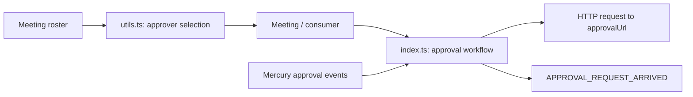
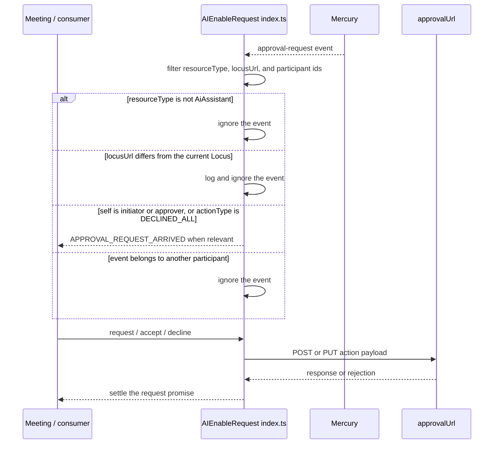
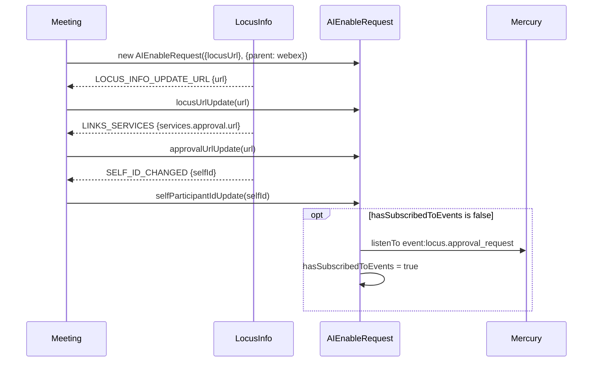
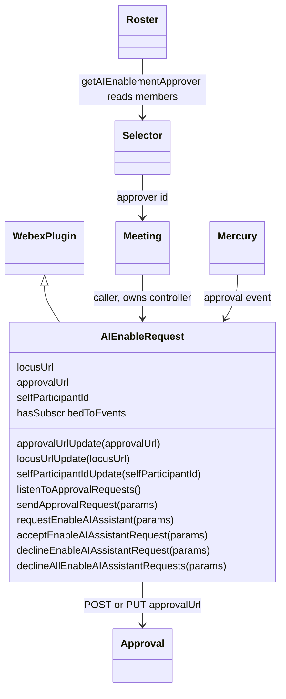

<!-- sdd-generated-metadata
doc_kind: module-spec
generated_from: module-spec@0.3.0
generated_by: claude-code
approved_by: rarajes2@cisco.com
updated_at: 2026-11-16T14:30:00Z
validation_status: not-run
-->

# AI Enable Request

This source-local document at `src/aiEnableRequest/docs/README.md` owns the stable canonical
specification for **AI Enable Request**: `meeting.aiEnableRequest`, the meeting-scoped approval
workflow used when a participant requests host approval to enable AI Assistant, plus the exported
`getAIEnablementApprover` utility. Ground every claim in repository evidence and link to the
[package architecture](../../../docs/architecture.md) instead of repeating broader facts. No service
specification exists because this package is a library.

Start here: root [package agent instructions](../../../AGENTS.md) · router
[documentation index](../../../docs/index.md) · system
[package architecture](../../../docs/architecture.md) · registry
[module registry](../../../docs/specs/README.md).

## Metadata

| Field             | Value |
| ----------------- | ----- |
| Owner             | @webex/web-client, @webex/web-sdk |
| Source path       | `src/aiEnableRequest` |
| Resource kind     | module |
| Status            | Draft |
| Last verified     | 2026-11-16 at `0b8c34db7f` |
| Module id         | `plugin-meetings/aiEnableRequest` |
| Parent spec       | — |
| Doc kind          | Module spec |
| Coverage score    | Pending coverage assessment |
| Validation status | not-run |

## Applicability

| Condition ID                         | Status     | Evidence or reason | Owned section |
| ------------------------------------ | ---------- | ------------------ | ------------- |
| `module.has_tiers`                   | N/A        | No tier policy exists in `package.json` | Tier |
| `module.has_ui`                      | N/A        | `src/aiEnableRequest/index.ts` returns promises and triggers events; it renders nothing | UI use-case flow |
| `module.crosses_service_boundaries`  | Applicable | `src/aiEnableRequest/index.ts` listens to Mercury locus.approval_request events and sends HTTP requests to the Locus approval URL | Cross-boundary use-case flow |
| `module.holds_client_state`          | Applicable | `src/aiEnableRequest/index.ts` keeps locusUrl, approvalUrl, selfParticipantId, and hasSubscribedToEvents | Client state model |
| `module.enforces_domain_rules`       | Applicable | Approver selection in `src/aiEnableRequest/utils.ts` and the event relevance filter in `src/aiEnableRequest/index.ts` | Business rules and invariants |
| `module.is_concurrent_async`         | Applicable | Every approval action returns a promise and the Mercury listener runs between calls (`src/aiEnableRequest/index.ts`) | Concurrency and reactive flow |
| `module.owns_persistence`            | N/A        | Nothing is stored; the approval record is owned by Locus | Data, schema, and migration discipline |
| `module.stateful_transitions`        | N/A        | The only transition is the one-time hasSubscribedToEvents flag in `src/aiEnableRequest/index.ts`; request state lives in Locus | State machine |
| `module.exposes_wire_protocol`       | N/A        | The request body is a fixed four-field object listed under Use cases and flows; no versioned format is owned here | Protocol and wire format |
| `module.ui_multi_screen`             | N/A        | No UI | UI flow |
| `module.large_data_model`            | N/A        | Four instance props in `src/aiEnableRequest/index.ts` | Data model |
| `module.returns_caller_errors`       | Applicable | HTTP rejections propagate from `src/aiEnableRequest/index.ts` | Caller-visible failure modes |
| `module.module_specific_conventions` | Applicable | The selector and transport split between `src/aiEnableRequest/utils.ts` and `src/aiEnableRequest/index.ts` | Module-specific rules |
| `module.published_package`           | N/A        | The package is published, but this module is reached through meeting.aiEnableRequest and the root export in `src/index.ts`; export stability is owned by the package architecture | Export stability |
| `module.embedded_in_host`            | N/A        | No host embedding | Host integration and theming |
| `module.has_design_tradeoff`         | N/A        | No recorded trade-off in `src/aiEnableRequest/index.ts` | Key design trade-off |
| `module.has_submodules`              | N/A        | The directory has no child module | Sub-modules |

## Evidence register

Requirements cite current source and mirrored tests. Current code wins over retained prose when they
conflict; commit and PR history are excluded. Missing evidence stays a gap.

| Evidence | What it establishes |
| -------- | ------------------- |
| `src/aiEnableRequest/index.ts` | `AIEnableRequest` extends `WebexPlugin` in namespace `Meetings`; props, the three setters, the Mercury listener, `sendApprovalRequest`, and the four approval actions |
| `src/aiEnableRequest/utils.ts` | `getAIEnablementApprover(meeting)` approver selection over `meeting.members.membersCollection.members` |
| `src/constants.ts` | `AI_ENABLE_REQUEST` (event `APPROVAL_REQUEST_ARRIVED`, action types `REQUESTED`, `ACCEPTED`, `DECLINED`, `DECLINED_ALL`, resource type `AiAssistant`) and `LOCUSEVENT.APPROVAL_REQUEST` (`locus.approval_request`) |
| `src/meeting/index.ts` | Meeting constructs the instance with its locusUrl and forwards LOCUS_INFO_UPDATE_URL, the LINKS_SERVICES approval URL, and SELF_ID_CHANGED to the setters |
| `src/member/util.ts`, `src/member/index.ts` | `canApproveAIEnablement` is true unless the participant has `attendeeRequestAiAssistantNotAllowed` |
| `src/index.ts` | The package root exports `getAIEnablementApprover` |
| `test/unit/spec/aiEnableRequest/index.ts` | Setters, the one-listener guard, the event filter, and each action's verb, body, resolution, and rejection |
| `test/unit/spec/aiEnableRequest/utils.ts` | Moderator, sorted cohost, no-candidate, and dual-role selection cases |
| `test/unit/spec/meeting/index.js` | Meeting creates `AIEnableRequest` and forwards the locus URL, approval URL, and self id |
| `src/aiEnableRequest/README.md` | Retained human guide; context only. Its event name differs from the code (see Pitfalls and constraints) |

## Purpose and boundary

- Responsibility: owns the meeting-scoped approval workflow used when a participant requests host
  approval to enable AI Assistant.
- In scope: the approval URL, Locus URL, and self participant id setters; the single Mercury
  `locus.approval_request` listener and its relevance filter; the `APPROVAL_REQUEST_ARRIVED` event;
  the `REQUESTED` POST and the `ACCEPTED`, `DECLINED`, and `DECLINED_ALL` PUTs; approver selection.
- Out of scope: the roster and role data (`src/members`, `src/member`); the Locus approval record and
  its policy; enabling AI Assistant itself; UI.
- Consumers: `Meeting` (`src/meeting/index.ts`) creates and feeds the instance; applications call
  `meeting.aiEnableRequest` and the root export `getAIEnablementApprover`.

## Structure and key files

`src/aiEnableRequest/` contains two direct source files (`index.ts`, `utils.ts`) and one retained
reference file (`README.md`), and has two mirrored unit-test files. This spec separates its public
operations, runtime data movement, component ownership, state applicability, and verification
boundary.

| File | Holds |
| ---- | ----- |
| `src/aiEnableRequest/README.md` | retained human guide for the events and initiator/approver methods; context only |
| `src/aiEnableRequest/index.ts` | `AIEnableRequest` plugin: props, setters, the Mercury listener, and the approval actions |
| `src/aiEnableRequest/utils.ts` | `getAIEnablementApprover` approver-selection helper |
| `test/unit/spec/aiEnableRequest/index.ts` and `test/unit/spec/aiEnableRequest/utils.ts` | mirrored unit coverage of the plugin and the selector |
| `src/aiEnableRequest/docs/README.md` | this module specification |

## Public surface

| Contract ID | Type | Surface | Purpose | Compatibility / deprecation | Schema / detail link | Root index |
| ----------- | ---- | ------- | ------- | --------------------------- | -------------------- | ---------- |
| `ai-enable-request-api` | SDK / in-process | `approvalUrlUpdate()`, `locusUrlUpdate()`, and `selfParticipantIdUpdate()` | Keep the listener and outgoing approval actions scoped to the current meeting participant and URLs. | Preserve setter names and the one-listener side effect of the first `selfParticipantIdUpdate()`. | `src/aiEnableRequest/index.ts` | [architecture](../../../docs/architecture.md#public-and-consumer-surfaces) |
| `ai-enable-request-api` | SDK / event | `listenToApprovalRequests()` and `APPROVAL_REQUEST_ARRIVED` | Filter Mercury approval events by resource type, Locus URL, and participant role before exposing them to Meeting consumers. | Preserve the once-only registration guard, the event payload fields, and `DECLINED_ALL` observer behavior. | `src/aiEnableRequest/index.ts` | [architecture](../../../docs/architecture.md#public-and-consumer-surfaces) |
| `ai-enable-request-api` | SDK / remote | `requestEnableAIAssistant({approverId})` and `sendApprovalRequest()` | POST a `REQUESTED` action using the current approval URL and the self participant as initiator. | Preserve HTTP verb, body roles, action value, and returned request promise. | `src/aiEnableRequest/index.ts` | [architecture](../../../docs/architecture.md#public-and-consumer-surfaces) |
| `ai-enable-request-api` | SDK / remote | `acceptEnableAIAssistantRequest()`, `declineEnableAIAssistantRequest()`, and `declineAllEnableAIAssistantRequests()`, each `({url, initiatorId})` | PUT the approver decision to the URL supplied by the incoming approval event, with the self participant as approver. | Preserve all three action values and participant-id placement in the request body. | `src/aiEnableRequest/index.ts` | [architecture](../../../docs/architecture.md#public-and-consumer-surfaces) |
| `ai-enable-request-api` | exported utility | `getAIEnablementApprover(meeting)`, re-exported from the package root | Select the capable moderator, otherwise the lexicographically first capable cohost, or `null`. | The current utility does not exclude the requesting/self participant. | `src/aiEnableRequest/utils.ts`, `src/index.ts` | [architecture](../../../docs/architecture.md#public-and-consumer-surfaces) |

Contract ID `ai-enable-request-api` is indexed in the
[package architecture](../../../docs/architecture.md#public-and-consumer-surfaces) and registered in
`.sdd/manifest.json`; it requires `webex-core-plugin-host`.

Compatibility notes:

- Prefer additive fields/options and preserve current rejection/event semantics. Internal helpers
  are not public merely because they are exported within the source directory; `sendApprovalRequest`
  and `listenToApprovalRequests` are reachable on the instance but are helpers of the actions and the
  setter.

## Dependencies

The module requires Meeting self/host/cohost identity and policy, the Locus and approval URLs,
request access, Mercury approval events, and the WebexPlugin event utilities.

| Dependency | Why it is required | Failure behavior |
| ---------- | ------------------ | ---------------- |
| `@webex/webex-core` `WebexPlugin`, contract `webex-core-plugin-host` | `this.request` for the approval HTTP calls; `listenTo` and `trigger` for the Mercury listener and the emitted event; `webex.logger` | Request rejections propagate unchanged through the returned promise |
| `webex.internal.mercury` | Source of `event:locus.approval_request` | Without Mercury events no `APPROVAL_REQUEST_ARRIVED` is emitted; nothing is retried |
| `Meeting` (`src/meeting/index.ts`) | Supplies the initial locusUrl and forwards LOCUS_INFO_UPDATE_URL, the LINKS_SERVICES approval URL, and SELF_ID_CHANGED | If a setter has not run, the matching value is undefined and requests use it as is |
| `meeting.members.membersCollection` and `MemberUtil.canApproveAIEnablement` (`src/member/util.ts`) | Roster, `roles.moderator`, `roles.cohost`, and `canApproveAIEnablement` for approver selection | An empty roster or no capable member returns `null` |
| `src/constants.ts` | `AI_ENABLE_REQUEST`, `LOCUSEVENT.APPROVAL_REQUEST`, `HTTP_VERBS`, `MEETINGS` | — |

## Requirements

| ID | WHAT | WHY | Source evidence | Test / example evidence | Assumptions / gaps | Confidence |
| --- | ---- | --- | --------------- | ----------------------- | ------------------ | ---------- |
| `MOD-001` | `getAIEnablementApprover` selects the eligible AI-enablement approver: the first member with `roles.moderator` and `canApproveAIEnablement`, else the capable cohost whose id sorts first by `localeCompare`, else `null`. | The meeting-scoped approval workflow needs one participant who is allowed to answer an enablement request; the code comments name the host first and capable cohosts next. | `src/aiEnableRequest/utils.ts` | `test/unit/spec/aiEnableRequest/utils.ts` | requester/self exclusion is not implemented; retain as an explicit product-policy gap | Present |
| `MOD-002` | `requestEnableAIAssistant({approverId})` requests AI Assistant enablement approval: it POSTs to the current `approvalUrl` a body with `actionType: REQUESTED`, `resourceType: AiAssistant`, `initiator.participantId` = self, and `approver.participantId` = `approverId`. | The exact initiator/approver roles and action value determine which participant can respond to the enablement request. | `src/aiEnableRequest/index.ts`, `src/constants.ts` | `test/unit/spec/aiEnableRequest/index.ts` | requester/self exclusion is not implemented by `getAIEnablementApprover`; no guard rejects a missing `approvalUrl` | Present |
| `MOD-003` | HTTP rejections propagate through the returned promise, while unrelated Mercury approval events are ignored and the single listener is installed only once. | The listener must not emit another meeting's approval or multiply registrations, while callers still need the original HTTP failure. | `src/aiEnableRequest/index.ts` | `test/unit/spec/aiEnableRequest/index.ts` | none | Present |
| `MOD-004` | `acceptEnableAIAssistantRequest`, `declineEnableAIAssistantRequest`, and `declineAllEnableAIAssistantRequests` PUT to the caller's `url` with `actionType` `ACCEPTED`, `DECLINED`, or `DECLINED_ALL`, `initiator.participantId` = the caller's `initiatorId`, and `approver.participantId` = self. | The approver answers the specific request URL carried by the incoming event, and Locus needs both roles to match the decision to the original request. | `src/aiEnableRequest/index.ts` | `test/unit/spec/aiEnableRequest/index.ts` | none | Present |
| `MOD-005` | An `APPROVAL_REQUEST_ARRIVED` event is emitted for an `AiAssistant` approval on the current Locus when self is the approver (`receivers[0].participantId`) or the initiator, and for `DECLINED_ALL` regardless of role; the payload is `{actionType, isApprover, isInitiator, initiatorId, approverId, url}`. | The code comment: not just the initiator needs to know about declined all, because all future requests will be rejected while the meeting is in the declined-all state. | `src/aiEnableRequest/index.ts` | `test/unit/spec/aiEnableRequest/index.ts` | none | Present |
| `MOD-006` | `selfParticipantIdUpdate` stores the id and, on its first call only, calls `listenToApprovalRequests()` and sets `hasSubscribedToEvents`; `approvalUrlUpdate` and `locusUrlUpdate` only store their values. | Meeting forwards every SELF_ID_CHANGED, so the guard keeps one listener while later identity updates refresh matching context. | `src/aiEnableRequest/index.ts`, `src/meeting/index.ts` | `test/unit/spec/aiEnableRequest/index.ts`, `test/unit/spec/meeting/index.js` | none | Present |

## Design overview

AIEnableRequest owns one Mercury approval listener and the HTTP writes to the current Locus approval
URL. `utils.ts` only selects an eligible approver from roster data; it is not a transport.

The implementation is TypeScript/JavaScript in the Node 22.14 Yarn workspace, built on the Webex
core/plugin abstractions (`WebexPlugin.extend`) and tested with Mocha/Sinon/`@webex/test-helper-chai`.
`Meeting` constructs the instance as `new AIEnableRequest({locusUrl}, {parent: webex})` and keeps it
current: the locus URL from LOCUS_INFO_UPDATE_URL, the approval URL from the LINKS_SERVICES
`services.approval.url`, and the self participant id from SELF_ID_CHANGED. The first self id starts
the listener. Meeting does not re-emit `APPROVAL_REQUEST_ARRIVED`; consumers subscribe on
`meeting.aiEnableRequest`. Every action funnels through `sendApprovalRequest`, which builds the one
request body shape.

## Data flow and sequence coverage

Call style: in-process method calls on `meeting.aiEnableRequest`; outbound HTTPS through
`WebexPlugin.request` to the Locus approval URL; inbound Mercury `event:locus.approval_request`.

Sequence coverage:

| Operation group | Diagram | Failure coverage |
| --------------- | ------- | ---------------- |
| UC-002…UC-005 — AI approval operation groups (incoming event, request, decisions) | AI approval sequence | Mercury filtering (an event for another resource type or Locus, or one this participant is not party to, except `DECLINED_ALL`) and HTTP action rejection |
| UC-001 — approver selection | `src/aiEnableRequest/utils.ts` (one synchronous call, MOD-001) | returns `null` when no capable moderator or cohost exists |
| UC-002 — context setup and listener registration | Context setup sequence | later self id updates do not register another listener |

### AI approval sequence

### Context setup sequence

## Class and component relationships

The arrows identify ownership and delegation around `src/aiEnableRequest/`: `index.ts` is the
controller and transport, `utils.ts` is the selector over the meeting roster, and `src/constants.ts`
only declares constants and is not presented as a transport.

## Use cases and flows

| Use case | Actor or caller | Primary steps and outcome | Failure or boundary behavior | Evidence |
| -------- | --------------- | ------------------------- | ---------------------------- | -------- |
| `UC-001` | Requesting participant's client | Select a capable moderator or the lexicographically first capable cohost with `getAIEnablementApprover`; return `null` when neither exists | Does not exclude self/requester | `src/aiEnableRequest/utils.ts`, `test/unit/spec/aiEnableRequest/utils.ts` |
| `UC-002` | Meeting | On the first `selfParticipantIdUpdate()`, call `listenToApprovalRequests()` and retain the one-listener guard for later identity updates | Later updates only replace the id | `src/aiEnableRequest/index.ts`, `test/unit/spec/aiEnableRequest/index.ts` |
| `UC-003` | Mercury, then any participant | Filter Mercury approval events to the current Locus and expose only requests relevant to the self initiator, self approver, or all observers of `DECLINED_ALL` | Other events are dropped silently; a different Locus is logged at info level | `src/aiEnableRequest/index.ts`, `test/unit/spec/aiEnableRequest/index.ts` |
| `UC-004` | Requesting participant | POST an enablement request with `requestEnableAIAssistant({approverId})`, using the exact initiator/approver ids required by the action | The HTTP rejection rejects the promise | `src/aiEnableRequest/index.ts`, `test/unit/spec/aiEnableRequest/index.ts` |
| `UC-005` | Approver (host or cohost) | On `APPROVAL_REQUEST_ARRIVED` with `isApprover`, PUT accept, decline, or decline-all decisions with the event's `url` and `initiatorId` | The HTTP rejection rejects the promise | `src/aiEnableRequest/index.ts`, `test/unit/spec/aiEnableRequest/index.ts` |

### Cross-boundary use-case flow

| Boundary | Transport and ordering | Compatibility | Timeout, retry, and recovery |
| -------- | ---------------------- | ------------- | ---------------------------- |
| Locus approval service (`UC-004`, `UC-005`) | HTTPS through `WebexPlugin.request`; one request per call; POST for `REQUESTED`, PUT for decisions | Body `{actionType, resourceType: 'AiAssistant', initiator: {participantId}, approver: {participantId}}` | No retry or timeout here; the request layer's behavior applies |
| Mercury (`UC-003`) | Inbound `event:locus.approval_request`, handled one at a time as it arrives | Reads `data.locusUrl` and `data.approval.{resourceType, receivers, initiator, actionType, url}` | Ignored events are not retried or buffered |

## Client state model

Approval and Locus URLs, self participant id, and the listener registration are meeting scoped: one
instance per Meeting.

| State or slice | Owner      | Initial state | Transition triggers | Reset or persistence boundary |
| -------------- | ---------- | ------------- | ------------------- | ----------------------------- |
| `locusUrl` | `AIEnableRequest` instance | The Meeting's locusUrl at construction | `locusUrlUpdate` | Instance memory; never persisted |
| `approvalUrl` | `AIEnableRequest` instance | undefined | `approvalUrlUpdate` | Instance memory |
| `selfParticipantId` | `AIEnableRequest` instance | undefined | `selfParticipantIdUpdate` | Instance memory |
| `hasSubscribedToEvents` | `AIEnableRequest` instance | undefined (falsy) | Set true by the first `selfParticipantIdUpdate` | Never reset by this module |

## Business rules and invariants

| ID | Invariant | WHY | Enforcement source | Test evidence |
| --- | --------- | --- | ------------------ | ------------- |
| `INV-001` | The selector prefers a capable moderator and otherwise the lexicographically first capable cohost; it does not exclude self/requester. | Only a host or cohost allowed by `canApproveAIEnablement` can answer; a stable sort gives every client the same answer (inferred from the sort). | `src/aiEnableRequest/utils.ts` | `test/unit/spec/aiEnableRequest/utils.ts` |
| `INV-002` | Initiator and approver ids are preserved: requests carry self as initiator, decisions carry self as approver and the event's initiatorId, and decision actions target the supplied approval request URL. | Locus matches the decision to the original request by these ids and URL (MOD-004). | `src/aiEnableRequest/index.ts` | `test/unit/spec/aiEnableRequest/index.ts` |
| `INV-003` | At most one Mercury approval listener exists per instance. | Duplicate listeners would emit each approval more than once (MOD-003). | `src/aiEnableRequest/index.ts` | `test/unit/spec/aiEnableRequest/index.ts` |

## Concurrency and reactive flow

- Execution model: one JavaScript event loop; each approval action returns the request promise.
- Mercury approval events are filtered against the controller's current Locus, self participant,
  initiator, and approver ids before emission. `selfParticipantIdUpdate()` calls
  `listenToApprovalRequests()` only while `hasSubscribedToEvents` is false, so later participant
  updates refresh matching context without registering a duplicate listener.
- Ordering guarantees: none across calls; each event is handled synchronously when it arrives.
- Idempotency and retry: nothing is retried; repeating an action sends another request.
- Shared-state protection: none needed beyond the single-threaded event loop.

## Caller-visible failure modes

| Condition | Signal | Caller recovery |
| --------- | ------ | --------------- |
| An approval action request rejects | The promise returned by `requestEnableAIAssistant`, `acceptEnableAIAssistantRequest`, `declineEnableAIAssistantRequest`, or `declineAllEnableAIAssistantRequests` rejects with the HTTP failure. | Correct the request context or retry under the caller's policy. |
| A Mercury approval event targets another Locus or participant context | The listener ignores it and emits no `APPROVAL_REQUEST_ARRIVED` event; a different Locus is logged at info level. | No caller action; wait for a matching event. |
| An eligible approver is found | `getAIEnablementApprover` returns a capable moderator or the sorted-first capable cohost; it does not exclude self/requester. | Apply any requester-exclusion policy outside this utility if the product requires it. |
| No capable moderator or cohost exists | `getAIEnablementApprover` returns `null`. | Do not send a request without an approver. |

Evidence: `src/aiEnableRequest/index.ts`, `src/aiEnableRequest/utils.ts`, and the request-failure
cases in `test/unit/spec/aiEnableRequest/index.ts`.

## Pitfalls and constraints

- The approver is derived from current meeting roster/roles. Caching it across host/cohost changes
  can send a request to an ineligible participant.
- Verify both typed constants/enums and raw wire values before changing a logical condition in this
  legacy package (`AI_ENABLE_REQUEST` in `src/constants.ts` against the Locus `AiAssistant` and action
  strings).
- The retained `src/aiEnableRequest/README.md` names the event `approval-request-arrived`; the code
  triggers `APPROVAL_REQUEST_ARRIVED`.
- No method removes the Mercury listener, and `hasSubscribedToEvents` is never reset; the listener
  lives as long as the instance.
- No action guards a missing `approvalUrl` or `selfParticipantId`; the request is sent with the
  undefined value.

## Module-specific rules

- Do: preserve this boundary: select a capable moderator or sorted-first capable cohost with
  `getAIEnablementApprover`; do not document requester exclusion unless code adds it.
- Do not: move remote I/O or lifecycle ownership into a passive type, constant, catalog, or
  normalization file such as `utils.ts` or `src/constants.ts`.

## Verification

Use the current mirrored suites: `test/unit/spec/aiEnableRequest/index.ts` and
`test/unit/spec/aiEnableRequest/utils.ts`. Characterize the aiEnableRequest-specific use cases above
and each listed failure condition; add cleanup or transition cases only for resources and state this
module actually owns.

| Behavior / Requirement | Existing test evidence | Gap |
| ---------------------- | ---------------------- | --- |
| `MOD-001`, `INV-001` | `test/unit/spec/aiEnableRequest/utils.ts` covers moderator, sorted cohost, no candidate, empty roster, and dual-role selection | cover a self/requester candidate |
| `MOD-002`, `MOD-004`, `INV-002` | `test/unit/spec/aiEnableRequest/index.ts` asserts each action's POST or PUT verb, action type, and participant roles on success, and that each rejection propagates | add an explicit assertion that each decision method preserves its PUT action and participant roles on request rejection |
| `MOD-003`, `MOD-006`, `INV-003` | `test/unit/spec/aiEnableRequest/index.ts` covers a second selfParticipantIdUpdate() call and proves it does not install another Mercury listener | none |
| `MOD-005` | `test/unit/spec/aiEnableRequest/index.ts` covers approver, initiator, neither, DECLINED_ALL, resource type, Locus URL, and missing ids | none |
| Meeting wiring | `test/unit/spec/meeting/index.js` covers construction and the three forwarded updates | none |

Run them with `yarn workspace @webex/plugin-meetings test:unit --targets aiEnableRequest/index.ts`
and `--targets aiEnableRequest/utils.ts`. Coverage state and the contracts baseline are recorded in
`.sdd/manifest.json`. Coverage measurement is pending; the module stays Partial until coverage review
and independent validation run.
