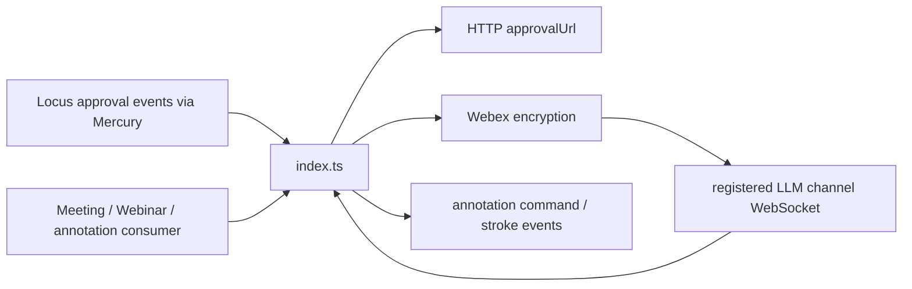
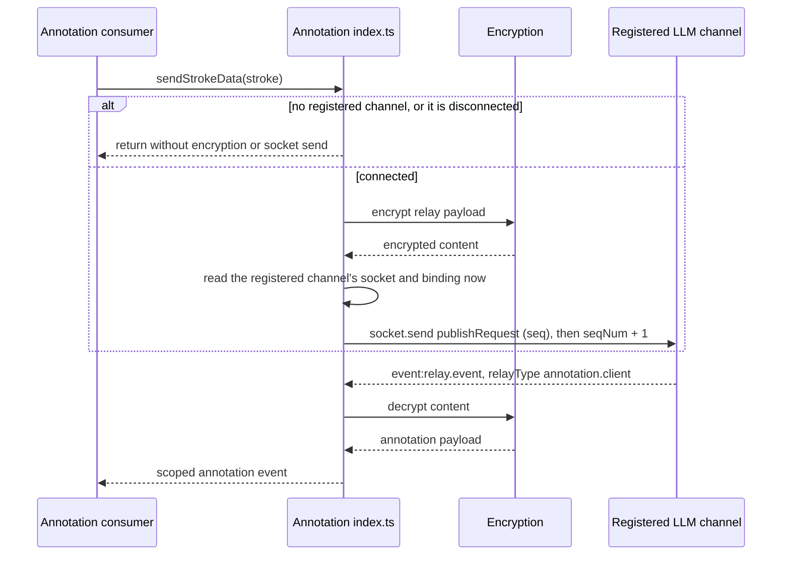
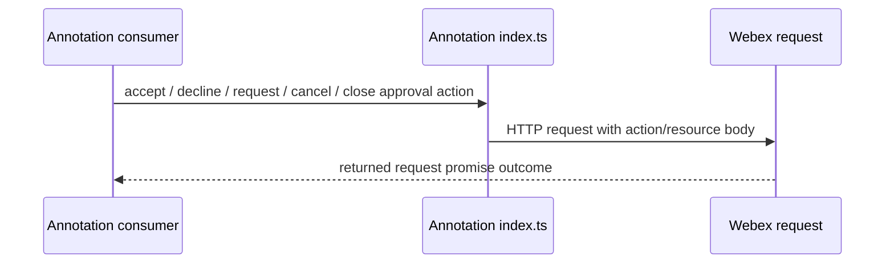
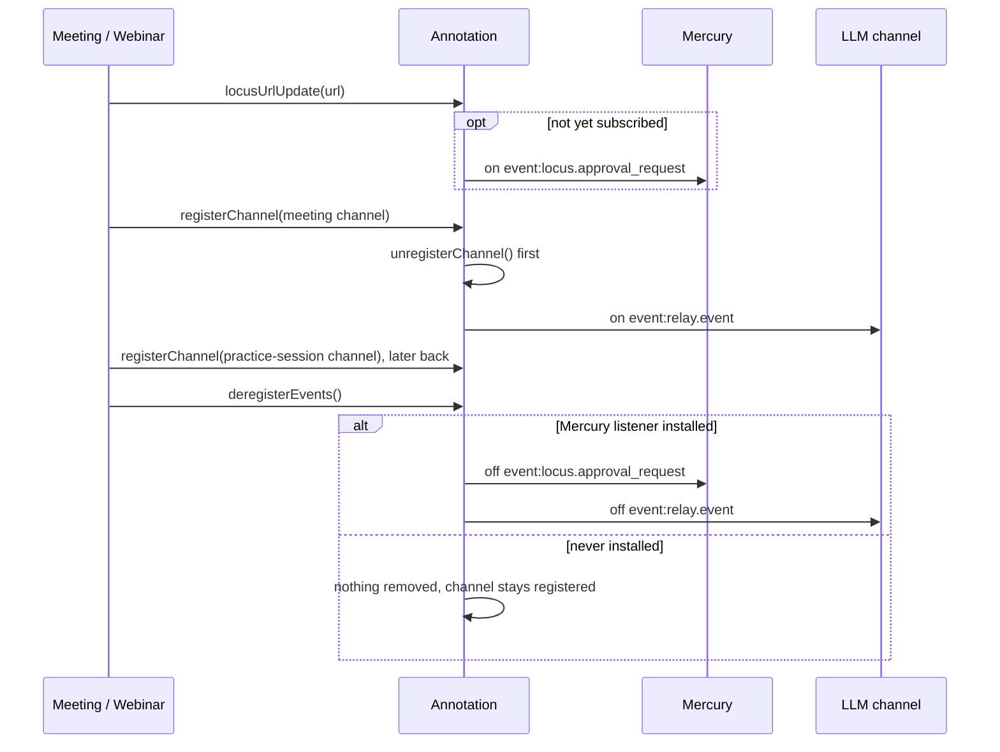
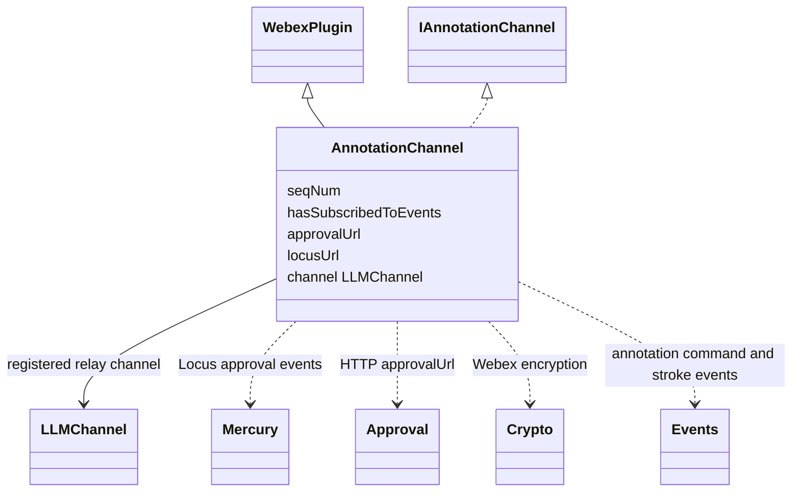

<!-- sdd-generated-metadata
doc_kind: module-spec
generated_from: module-spec@0.3.0
generated_by: claude-code
approved_by: rarajes2@cisco.com
updated_at: 2026-11-17T03:14:21Z
validation_status: pass-with-warnings
-->

# Live annotation

This canonical source-local document at `src/annotation/docs/README.md` owns the stable
specification for **live annotation**: the `meeting.annotation` controller (`AnnotationChannel`, a
`WebexPlugin` in namespace `annotation`). It sends annotation approval actions on a content share to
the approval service, listens to Mercury approval requests, relays encrypted stroke data over the LLM
channel that `Meeting` or `Webinar` registers, and emits annotation command and stroke events. Ground
every claim in package evidence and link to the [package architecture](../../../docs/architecture.md)
instead of repeating broader facts. No service specification exists because this package is a
library.

Related context: [documentation index](../../../docs/index.md) ·
[package agent instructions](../../../AGENTS.md)

## Metadata

| Field | Value |
| ----- | ----- |
| Owner | @webex/web-client, @webex/web-sdk |
| Source path | `src/annotation` |
| Resource kind | module |
| Status | Draft |
| Last verified | 2026-11-16 at `0b8c34db7f` |
| Module id | `plugin-meetings/annotation` |
| Parent spec | — |
| Doc kind | Module spec |
| Coverage score | Pending coverage assessment |
| Validation status | not-run |

## Applicability

| Condition ID                         | Status     | Evidence or reason | Owned section |
| ------------------------------------ | ---------- | ------------------ | ------------- |
| `module.has_tiers`                   | N/A        | No tier policy exists in `package.json` or `src/annotation/index.ts` | Tier |
| `module.has_ui`                      | N/A        | `src/annotation/index.ts` sends and relays data; drawing is the application's | UI use-case flow |
| `module.crosses_service_boundaries`  | Applicable | Approval-service requests, the Mercury listener, the LLM relay, and KMS encryption in `src/annotation/index.ts` | Cross-boundary use-case flow |
| `module.holds_client_state`          | Applicable | Sequence number, subscription flag, URLs, and the registered channel in `src/annotation/index.ts` | Client state model |
| `module.enforces_domain_rules`       | Applicable | Approval resource and action values and the send preconditions in `src/annotation/index.ts` and `src/annotation/constants.ts` | Business rules and invariants |
| `module.is_concurrent_async`         | Applicable | Asynchronous encryption between the connectivity check and the send in `src/annotation/index.ts` | Concurrency and reactive flow |
| `module.owns_persistence`            | N/A        | Nothing is stored (`src/annotation/index.ts`) | Data, schema, and migration discipline |
| `module.stateful_transitions`        | N/A        | Recorded false in `.sdd/manifest.json`; the declared status values in `src/annotation/constants.ts` drive no transition | State machine |
| `module.exposes_wire_protocol`       | Applicable | The approval bodies and the LLM publishRequest envelope built in `src/annotation/index.ts` | Protocol and wire format |
| `module.ui_multi_screen`             | N/A        | No UI | UI flow |
| `module.large_data_model`            | N/A        | Five small types in `src/annotation/annotation.types.ts` | Data model |
| `module.returns_caller_errors`       | Applicable | Approval request rejections and silent stroke failures in `src/annotation/index.ts` | Caller-visible failure modes |
| `module.module_specific_conventions` | N/A        | Recorded false in `.sdd/manifest.json` | Module-specific rules |
| `module.published_package`           | N/A        | `src/index.ts` re-exports only the annotation types; the controller is reached through a meeting | Export stability |
| `module.embedded_in_host`            | N/A        | No host theme or embed API | Host integration and theming |
| `module.has_design_tradeoff`         | N/A        | Recorded false in `.sdd/manifest.json` | Key design trade-off |
| `module.has_submodules`              | N/A        | The annotation directory has no child module (`src/annotation/index.ts`) | Sub-modules |

## Evidence register

Requirements cite current source and mirrored tests under `test/unit/spec/annotation/`. Where
prose and code disagree, current code wins; commit and PR history are not used as evidence. Missing
evidence stays a recorded gap.

| Evidence | What it establishes |
| -------- | ------------------- |
| `src/annotation/index.ts` | `AnnotationChannel` extends `WebexPlugin` and implements `IAnnotationChannel`: channel registration, the Mercury listener, approval requests, encryption, and the stroke envelope |
| `src/annotation/constants.ts` | `EVENT_TRIGGERS` (`annotation:strokeData`, `annotation:command`), `ANNOTATION_RESOURCE_TYPE` (`AnnotationOnShare`), `ANNOTATION_RELAY_TYPES`, `ANNOTATION_STATUS`, `ANNOTATION_POLICY`, `ANNOTATION_REQUEST_TYPE`, `ANNOTATION_ACTION_TYPE`, `ANNOTATION` (`annotation`) |
| `src/annotation/annotation.types.ts` | `StrokeData`, `RequestData`, `CommandRequestBody`, `AnnotationInfo`, `IAnnotationChannel` |
| `src/constants.ts` | `LOCUSEVENT.APPROVAL_REQUEST` (`locus.approval_request`), `EVENT_TRIGGERS.MEETING_UPDATE_ANNOTATION_INFO`, `ANNOTATION.ANNOTATION_ON_SHARE_SUPPORTED` |
| `src/meeting/index.ts` | `Meeting` creates `new Annotation({parent: webex})`, calls `locusUrlUpdate`, `approvalUrlUpdate`, `registerChannel` (outside a practice session), and `deregisterEvents`, and emits `meeting:updateAnnotationInfo` |
| `src/webinar/index.ts` | `Webinar` registers the practice-session LLM channel and switches back to the meeting channel |
| `src/meeting/request.ts` | A join with `liveAnnotationSupported` adds the `ANNOTATION_ON_SHARE_SUPPORTED` device capability |
| `src/index.ts` | Re-exports the annotation types as `sdkAnnotationTypes` |
| `test/unit/spec/annotation/index.ts` | Cases for channel registration, both event processors, encryption, the stroke envelope and its preconditions, every approval request, deregistration, and the URL setters |
| Observation, no stated WHY | `cancelApproveAnnotation` sends no `receivers`, while `approveAnnotation` and `closeAnnotation` add one when `toUserId` is set (`src/annotation/index.ts`) |
| Observation, no stated WHY | The `deviceUrl` property is declared but never assigned (`src/annotation/index.ts`) |

## Purpose and boundary

- Responsibility: Owns annotation approval requests, Mercury/LLM listener registration, encrypted stroke relay, and the emitted annotation command/stroke events.
- In scope: `registerChannel`, `unregisterChannel`, `locusUrlUpdate`, `approvalUrlUpdate`,
  `deregisterEvents`; `approveAnnotation`, `cancelApproveAnnotation`, `closeAnnotation`,
  `acceptRequest`, `declineRequest`; `sendStrokeData` and the relay envelope; decryption of
  received strokes; the `annotation:command` and `annotation:strokeData` events; the annotation
  constants and types.
- Out of scope: the LLM connection and which channel is active (`Meeting`, `Webinar`,
  `@webex/internal-plugin-llm`); the Mercury socket; KMS keys (`webex.internal.encryption`); the
  share's annotation policy and `meeting:updateAnnotationInfo` (`Meeting`); drawing strokes.
- Consumers: `Meeting` and `Webinar` drive it; applications call `meeting.annotation` and listen to
  its events.

## Structure and key files

`src/annotation/` contains 3 direct source files and has 1 mirrored unit-test file,
`test/unit/spec/annotation/index.ts`. This specification separates its public operations, runtime
data movement, component ownership, state, and verification boundary. Sources are TypeScript in the
Node 22.14 Yarn workspace on the Webex core plugin abstraction (`WebexPlugin`); tests run under Mocha
with Sinon and `@webex/test-helper-chai` (`test:unit` in `package.json`).

| File | Holds |
| ---- | ----- |
| `src/annotation/annotation.types.ts` | Module type declarations: stroke, request, command body, annotation info, and the `IAnnotationChannel` interface |
| `src/annotation/constants.ts` | Module constants and wire values: event names, resource, relay, request, and action types, policy, and status |
| `src/annotation/index.ts` | `AnnotationChannel` controller mounted as `meeting.annotation`: module facade/controller and primary (default) export |
| `src/annotation/docs/README.md` | This module specification |
| `test/unit/spec/annotation/index.ts` | Mirrored characterization/unit coverage of the controller |

## Public surface

`meeting.annotation` is the `AnnotationChannel` instance `Meeting` creates; `src/index.ts`
re-exports only the types as `sdkAnnotationTypes`, so applications reach the controller through a
meeting. Every row belongs to contract `annotation-api`, indexed in the
[package architecture](../../../docs/architecture.md#public-and-consumer-surfaces); contract IDs and
coverage state are recorded in `.sdd/manifest.json`.

| Contract ID | Type | Surface | Purpose | Compatibility / deprecation | Schema / detail link | Root index |
|---|---|---|---|---|---|---|
| `annotation-api` | SDK / lifecycle | `registerChannel()`, `unregisterChannel()`, `locusUrlUpdate()`, `approvalUrlUpdate()`, and `deregisterEvents()` | Register one LLM channel for relay events, store Locus/approval URLs, install the Mercury listener from `locusUrlUpdate()`, and remove the Mercury and channel listeners on teardown. | `approvalUrlUpdate()` only assigns `approvalUrl`; preserve the once-only Mercury guard owned by `locusUrlUpdate()`, the two event topics, and the one-channel rule of `registerChannel()`. | `src/annotation/index.ts` | [architecture](../../../docs/architecture.md#public-and-consumer-surfaces) |
| `annotation-api` | SDK / remote | `approveAnnotation()`, `cancelApproveAnnotation()`, and `closeAnnotation()` | POST requested/closed share-annotation actions to `approvalUrl` or PUT cancellation to the approval's url. | Preserve action/resource values, share instance id, and optional receiver routing. | `src/annotation/index.ts`, `src/annotation/annotation.types.ts` | [architecture](../../../docs/architecture.md#public-and-consumer-surfaces) |
| `annotation-api` | SDK / remote | `acceptRequest()` and `declineRequest()` | PUT a presenter decision to the URL carried by an incoming approval. | Preserve the accepted/declined action values and direct request-promise result. | `src/annotation/index.ts` | [architecture](../../../docs/architecture.md#public-and-consumer-surfaces) |
| `annotation-api` | SDK / relay | `sendStrokeData()` and `ANNOTATION_STROKE_DATA` | Encrypt outbound stroke content, publish it on the registered LLM channel's socket, decrypt inbound content, and emit the scoped stroke event. | Preserve sequence increments, relay/message fields, and the no-op without a connected channel, socket, or binding. | `src/annotation/index.ts`, `src/annotation/constants.ts` | [architecture](../../../docs/architecture.md#public-and-consumer-surfaces) |
| `annotation-api` | module constants and exported types | `EVENT_TRIGGERS`, `ANNOTATION_RESOURCE_TYPE`, `ANNOTATION_RELAY_TYPES`, `ANNOTATION_STATUS`, `ANNOTATION_POLICY`, `ANNOTATION_REQUEST_TYPE`, `ANNOTATION_ACTION_TYPE`, `ANNOTATION`, `StrokeData`, `RequestData`, `CommandRequestBody`, `IAnnotationChannel`, and `AnnotationInfo` | Share the exact approval and relay vocabulary used by the controller and consumers; only the types reach applications, as `sdkAnnotationTypes`. | Add fields compatibly; existing raw action, relay, resource, and event values are wire-sensitive. | `src/annotation/constants.ts`, `src/annotation/annotation.types.ts` | [architecture](../../../docs/architecture.md#public-and-consumer-surfaces) |

Current source emits or forwards these observable literals for this operation boundary. Preserve literal values, scope, payload shape, and emission timing; a constant name alone is not a substitute for the consumer-visible value.

| Event literal | Constant / expression | Emission evidence |
|---|---|---|
| `annotation:command` | `EVENT_TRIGGERS.ANNOTATION_COMMAND` | `src/annotation/index.ts` |
| `annotation:strokeData` | `EVENT_TRIGGERS.ANNOTATION_STROKE_DATA` | `src/annotation/index.ts` |
| `meeting:updateAnnotationInfo` | `EVENT_TRIGGERS.MEETING_UPDATE_ANNOTATION_INFO` | `src/meeting/index.ts` |

`annotation:command` carries `{type: approval.actionType, payload: approval}` and
`annotation:strokeData` carries `{payload: data}` with the decrypted content; both are triggered on
`meeting.annotation`. `meeting:updateAnnotationInfo` is triggered on `webex.meetings` with
`{annotationInfo, meetingId, resourceType}` when a content share's annotation info changes.

Compatibility notes:

- Prefer additive fields/options and preserve current rejection/event/cleanup semantics. Internal helpers are not public merely because they are exported within the source directory.

## Dependencies

Requires: Approval and Locus URLs, Mercury, the registered LLM channel's socket and binding, Webex
encryption, annotation constants/types, and participant/device/share identity supplied by callers.

Contracts: provides `annotation-api`; requires `internal-plugin-llm-channel`, `locus-http`,
`internal-plugin-mercury-events`, and `webex-core-plugin-host` (`.sdd/manifest.json`).

| Dependency | Why it is required | Failure behavior |
| ---------- | ------------------ | ---------------- |
| `@webex/webex-core` (`webex-core-plugin-host`) | `WebexPlugin` base class, `this.request`, and `config.trackingIdPrefix` | Approval rejections reach the caller |
| Approval service (`locus-http`) | `approvalUrl` from Locus `services.approval.url`, and each approval's own `url` | No retry |
| LLM data channel (`internal-plugin-llm-channel`) | The registered `LLMChannel`: `on` and `off` for `event:relay.event`, `isConnected`, `getSocket`, `getBinding` | No channel, no connection, no socket, or no binding means nothing is sent |
| `webex.internal.mercury` (`internal-plugin-mercury-events`) | `event:locus.approval_request` | No retry |
| `webex.internal.encryption` | `encryptText` and `decryptText` with the stroke's `encryptionKeyUrl` | A rejection is not caught and reaches no caller |
| `Meeting` and `Webinar` | URLs, channel registration and switching, and deregistration on meeting cleanup | — |
| `uuid` (`v4`) | The relay `trackingId` | — |

## Requirements

| ID | WHAT | WHY | Source Evidence | Test / Example Evidence | Assumptions / Gaps | Confidence |
|---|---|---|---|---|---|---|
| `ANNOTATION-R-001` | `locusUrlUpdate()` assigns `locusUrl` and registers the Mercury approval listener once; `approvalUrlUpdate()` only assigns `approvalUrl`; `registerChannel(channel)` first unregisters any channel, then listens to `event:relay.event` on the new one; `deregisterEvents()` removes the Mercury callback, unregisters the channel, and clears the subscription flag, but only when the Mercury listener was installed. | Duplicate subscriptions would emit the same annotation event more than once, while attributing registration to the approval URL setter invents a side effect; only one channel is registered at a time because its owner switches channels when the context changes, such as a practice session (JSDoc of `registerChannel`). | `src/annotation/index.ts`, `src/webinar/index.ts` | `test/unit/spec/annotation/index.ts` | none | Present |
| `ANNOTATION-R-002` | Approval methods send the declared action/resource body to the supplied approval URL; stroke sends encrypt content, publish on the registered channel's socket to its binding, and increment `seqNum` after publication. | Approval routing and relay sequence fields are service-visible protocol values and must remain stable. | `src/annotation/index.ts`, `src/annotation/annotation.types.ts` | `test/unit/spec/annotation/index.ts` | rejected encryption/decryption promises and a channel switch during encryption need explicit race/error coverage | Present |
| `ANNOTATION-R-003` | Approval methods return their request promises; stroke sends without a connected channel return without work; stroke encryption/decryption uses asynchronous callbacks without a returned caller promise or module retry; deregistration removes the installed Mercury and channel callbacks. | Callers must not assume encryption failures are converted into approval-style promise rejections or that disconnected strokes are queued. | `src/annotation/index.ts` | `test/unit/spec/annotation/index.ts` | none | Present |
| `ANNOTATION-R-004` | A Mercury event emits `annotation:command` only when its `eventType` is `locus.approval_request`, its approval `resourceType` is `AnnotationOnShare`, and an `actionType` is set; a relay event emits `annotation:strokeData` only for `relayType` `annotation.client`, after its content is decrypted. | Approvals for other resources share the Mercury event, and other relay types share the channel (`eventCommandProcessor`, `eventDataProcessor`). | `src/annotation/index.ts`, `src/annotation/constants.ts` | `test/unit/spec/annotation/index.ts` | WHY inferred from the filters | Weak |

## Design overview

The controller subscribes directly to Mercury approval events, receives LLM relay events on the one
channel its owner registers, performs approval HTTP operations, and encrypts/decrypts relay content
before exposing annotation command/stroke events.

`Meeting` registers its LLM channel when the connection comes up, except while the meeting uses a
practice-session data channel; `Webinar` registers the practice-session channel and switches back to
the meeting channel when leaving it. `registerChannel()` always unregisters the previous channel
first, so relay events come from one channel. The Mercury approval listener is separate: it is
installed by the first `locusUrlUpdate()` and removed by `deregisterEvents()`, which `Meeting` calls
when it stops listening for meeting events.

Approval actions are HTTP requests: requests, cancellation, and closing are sent by an attendee or
presenter with the share instance id; accept and decline answer an incoming approval at its url.
Stroke data never goes through HTTP: it is encrypted with the share's key, wrapped in a
`publishRequest` envelope, and sent on the channel's socket.

## Data flow and sequence coverage

Call style: in-process method calls on `meeting.annotation`; outbound HTTPS to the approval service
through `this.request`; outbound and inbound LLM relay messages on the registered channel's
WebSocket; inbound Mercury `locus.approval_request` events; KMS encryption through
`webex.internal.encryption`.

Sequence coverage:

| Operation group | Diagram | Failure coverage |
|---|---|---|
| UC-4 — stroke relay, send and receive | Annotation approval and relay primary sequence (diagram 1) | no registered or connected channel (return without encryption or send), missing or disconnected channel, missing socket or binding, and asynchronous encryption/decryption failure |
| UC-2, UC-3 — annotation approval actions | Annotation approval action sequence (diagram 2), HTTP only with no LLM relay | request rejection through the returned promise |
| UC-1 — listener and channel lifecycle | Diagram 3 | deregistration skipped when the Mercury listener was never installed |

Diagram 1 — annotation approval and relay primary sequence:

Diagram 2 — annotation approval actions:

Diagram 3 — listener and channel lifecycle:

## Class and component relationships

The arrows identify ownership and delegation inside `src/annotation/`; files that only declare types or constants are not presented as transports.

## Use cases and flows

| Use case | Actor or caller | Primary steps and outcome | Failure or boundary behavior | Evidence |
| -------- | --------------- | ------------------------- | ---------------------------- | -------- |
| `UC-1` | `Meeting` and `Webinar` | Register the approval listener once when `locusUrlUpdate()` establishes context and register the active LLM relay channel (default or practice session) with `registerChannel()`; update `approvalUrl` independently without registering listeners, then remove installed listeners with `deregisterEvents()` | Deregistration does nothing when the Mercury listener was never installed | `src/annotation/index.ts`, `src/meeting/index.ts`, `src/webinar/index.ts` |
| `UC-2` | Attendee or presenter | Request, cancel, or close annotation for a share instance, optionally routing the request to a specific participant/device | The request promise rejects with the service error | `src/annotation/index.ts` |
| `UC-3` | Presenter | Accept or decline a presenter approval request by PUTting the exact action to the event-provided URL | The request promise rejects with the service error | `src/annotation/index.ts` |
| `UC-4` | Annotating attendee and presenter | Skip a stroke without a connected registered channel; otherwise encrypt, read the registered channel's socket and binding after encryption, publish with the next sequence, then decrypt and emit received stroke data | Missing socket or binding drops the stroke; encryption errors are silent | `src/annotation/index.ts` |

### Cross-boundary use-case flow

| Boundary | Transport and ordering | Compatibility | Timeout, retry, and recovery |
| -------- | ---------------------- | ------------- | ---------------------------- |
| Approval service (`UC-2`, `UC-3`) | HTTPS POST to `approvalUrl`, PUT to the approval url | Bodies under Protocol and wire format | No retry |
| Mercury (`UC-1`, `UC-3`) | `event:locus.approval_request`, handled as it arrives | `data.eventType`, `data.approval.{resourceType, actionType, url}` | No retry |
| LLM relay (`UC-4`) | `socket.send` of a `publishRequest`; inbound `event:relay.event` | Envelope under Protocol and wire format | A stroke is dropped, not queued |
| KMS (`UC-4`) | `encryptText` and `decryptText` per stroke | `encryptionKeyUrl` carried in the stroke | No retry |

## Client state model

The controller stores `seqNum`, `hasSubscribedToEvents`, `approvalUrl`, `locusUrl`, `channel`, and `channelHandler`; `deviceUrl` is declared but never set. `seqNum` starts at 1 and increments after each published stroke; `hasSubscribedToEvents` only records whether this controller installed its Mercury callback. The module does not transition between `NO_ANNOTATION` and `RUNNING_ANNOTATION`; those constants are not consumed by current source or tests.

| State or slice | Owner      | Initial state | Transition triggers | Reset or persistence boundary |
| -------------- | ---------- | ------------- | ------------------- | ----------------------------- |
| `seqNum` | `AnnotationChannel` | `1` | Each sent stroke | Never reset on the instance |
| `hasSubscribedToEvents` | `AnnotationChannel` | unset | `locusUrlUpdate` sets it; `deregisterEvents` clears it | Per meeting |
| `channel`, `channelHandler` | `AnnotationChannel` | unset | `registerChannel`; `unregisterChannel` and `deregisterEvents` clear them | One channel at a time |
| `approvalUrl`, `locusUrl` | `AnnotationChannel` | unset | `approvalUrlUpdate`, `locusUrlUpdate` | — |

## Business rules and invariants

| ID | Invariant | WHY | Enforcement source | Test evidence |
| -- | --------- | --- | ------------------ | ------------- |
| `INV-001` | Approval calls use their supplied approval URL and declared action/resource values: `resourceType` is always `AnnotationOnShare`. | The approval service routes the action by resource type, and the Mercury filter accepts only that type (`ANNOTATION_RESOURCE_TYPE`). | `src/annotation/index.ts`, `src/annotation/constants.ts` | `test/unit/spec/annotation/index.ts` |
| `INV-002` | Stroke publication is skipped when no registered channel is connected at the initial check, or when the channel, socket, or binding is missing at publication. | A stroke cannot be routed without a socket and binding, and strokes are not queued (`ANNOTATION-R-003`). | `src/annotation/index.ts` | `test/unit/spec/annotation/index.ts` |
| `INV-003` | Relay types and sequence fields use the declared wire values: `id`, `seq`, and `sequenceNumber` all carry the current `seqNum`, which grows by one per sent stroke. | See `ANNOTATION-R-002`. | `src/annotation/index.ts` | `test/unit/spec/annotation/index.ts` |
| `INV-004` | At most one LLM channel delivers relay events. | See `ANNOTATION-R-001`. | `src/annotation/index.ts` | `test/unit/spec/annotation/index.ts` |

## Concurrency and reactive flow

- Execution model: one JavaScript event loop; approval requests return promises; encryption and
  decryption resolve later and are not returned to the caller.
- Send race: Stroke encryption completes asynchronously. `sendStrokeData` checks the registered channel's connectivity before encryption, while `publishEncrypted` reads the then-registered channel's socket and binding when encryption resolves; the controller has no cancellation or supersession guard.
- Ordering guarantees: `seqNum` is assigned when encryption resolves, so strokes whose encryption
  finishes out of order are sent and numbered in that order.
- Idempotency and retry: the Mercury listener is installed once; nothing is retried.
- Shared-state protection: none beyond `registerChannel` unregistering the previous channel.

## Protocol and wire format

- `index.ts` constructs approval bodies and LLM `publishRequest` envelopes from the request/event/channel types and constants under `src/annotation/`. Preserve action/resource/relay values, receiver and route fields, sequence fields, and encryption metadata.

| Message or frame | Version | Producer or serializer | Consumer or parser | Compatibility and ordering rule |
| ---------------- | ------- | ---------------------- | ------------------ | ------------------------------- |
| POST `approvalUrl` `{actionType: 'REQUESTED' or 'CLOSED', resourceType: 'AnnotationOnShare', shareInstanceId, receivers?: [{participantId, deviceUrl}]}` | Unversioned | `approveAnnotation`, `closeAnnotation` | Approval service | `receivers` only when `toUserId` is set |
| PUT `<approval.url>` `{actionType: 'CANCELED', resourceType: 'AnnotationOnShare', shareInstanceId}` | Unversioned | `cancelApproveAnnotation` | Approval service | No receivers |
| PUT `<approval.url>` `{resourceType: 'AnnotationOnShare', actionType: 'ACCEPTED' or 'DECLINED'}` | Unversioned | `acceptRequest`, `declineRequest` | Approval service | The url comes from the incoming approval |
| Mercury `locus.approval_request` with `data.approval.{resourceType, actionType, url}` | — | Locus, through Mercury | `eventCommandProcessor` | Only `AnnotationOnShare` with an `actionType` |
| LLM `publishRequest` `{id, type, recipients: [{route: binding}], headers: {to}, data: {eventType: 'relay.event', relayType: 'annotation.client', request: {value: {type: 'annotation_message', content, deviceId, seq, requesterId, version, shareInstanceId, encryptionKeyUrl}}}, trackingId, timestamp, sequenceNumber, filterMessage: false}` | `version` from the stroke | `publishEncrypted` | Presenter clients, through the LLM relay | `content` is encrypted; `trackingId` is `<trackingIdPrefix>_<uuid>` |
| LLM `relay.event` with `data.relayType` `annotation.client` and `data.request.value.{content, encryptionKeyUrl}` | — | Other clients, through the LLM relay | `eventDataProcessor`, `processStrokeMessage` | Content is decrypted in place before the event |

## Caller-visible failure modes

| Condition | Signal | Caller recovery |
|---|---|---|
| Approval request rejects | The approval method's returned promise rejects with the request failure. | Correct the URL/body or retry under the caller's policy. |
| No registered LLM channel, or it is disconnected, at the initial stroke-send check | `sendStrokeData` returns `undefined` without encryption or socket send. | Reinvoke only after connectivity is restored. |
| Stroke encrypt/decrypt rejects | The controller installs no catch and `sendStrokeData` returns no promise, so the failure is not converted into a caller-facing annotation result. | Observe the owning encryption/runtime failure path; do not assume a module retry. |
| The channel, socket, or binding is missing when encryption resolves | The stroke is dropped silently and `seqNum` does not change. | Resend after the channel is back. |

## Pitfalls and constraints

- `ANNOTATION_STATUS.NO_ANNOTATION` and `RUNNING_ANNOTATION` are declarations only; do not treat them as a live controller lifecycle without a consuming transition path.
- Verify both typed constants/enums and raw wire values before changing a logical condition in this legacy package.
- `deregisterEvents()` unregisters the channel only when `locusUrlUpdate()` installed the Mercury
  listener; a channel registered without a Locus URL stays registered.
- `listenToEvents()` is marked `@deprecated` in its JSDoc but is still the only path that installs
  the Mercury approval listener.
- `src/constants.ts` declares a different `ANNOTATION` object (the device capability) from the
  `ANNOTATION` namespace string in `src/annotation/constants.ts`.
- `ANNOTATION_ACTION_TYPE` is a `const enum`, so it has no runtime object outside TypeScript.

## Verification

Use the current mirrored suites: `test/unit/spec/annotation/index.ts`. Characterize the annotation-specific use cases above and each listed failure condition; add cleanup or transition cases only for resources and state this module actually owns.

| Behavior / Requirement | Existing test evidence | Gap |
|---|---|---|
| `ANNOTATION-R-001` | `test/unit/spec/annotation/index.ts` | registration, replacement, deregistration, and the URL setters are covered; no case registers a channel without a Locus URL and then deregisters |
| `ANNOTATION-R-002` | `test/unit/spec/annotation/index.ts` | cover receiver-absent bodies for requested/closed actions; the receiver-present bodies and the envelope are covered |
| `ANNOTATION-R-003` | `test/unit/spec/annotation/index.ts` | assert that a disconnected stroke performs no encryption; deregistration of both listeners is covered |
| `ANNOTATION-R-004`, `INV-001` | `test/unit/spec/annotation/index.ts` | none |
| `INV-002` to `INV-004` | `test/unit/spec/annotation/index.ts` | no case for a channel switch during encryption |

Every cited case invokes the named behavior. A module specification is complete only when its
public surface, invariants, failure modes, and test evidence agree with the implementation. The
module stays Partial until coverage review and independent validation run on this specification.
