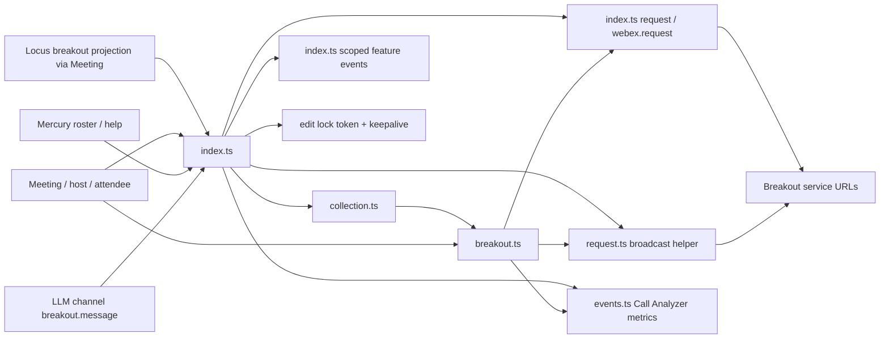
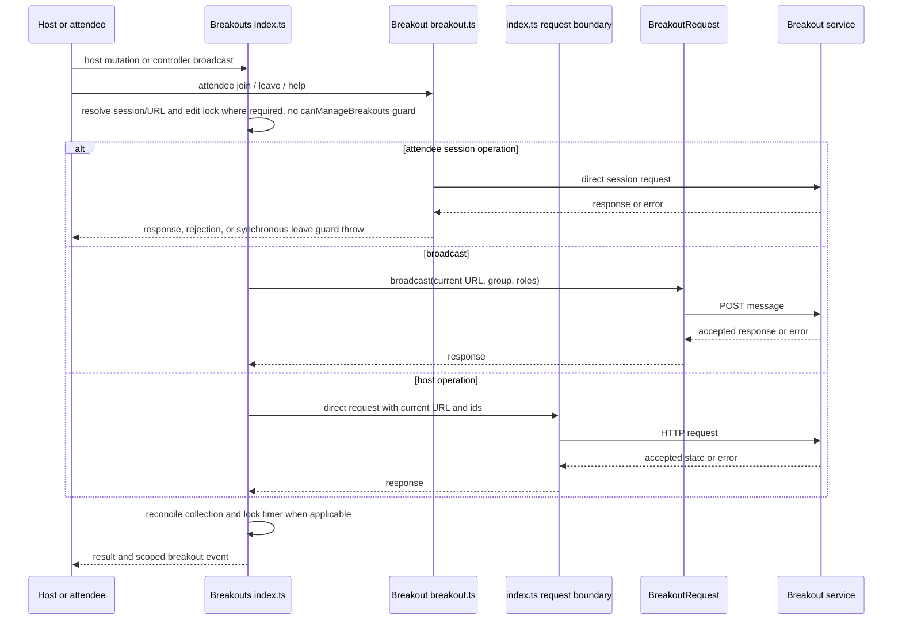
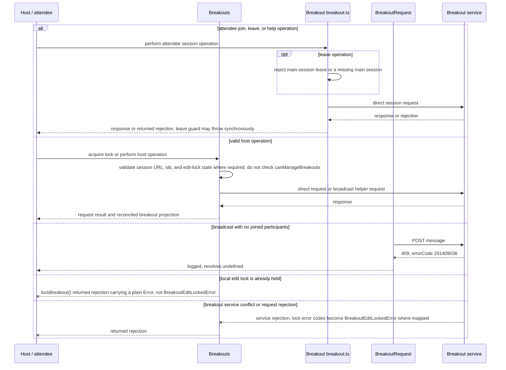
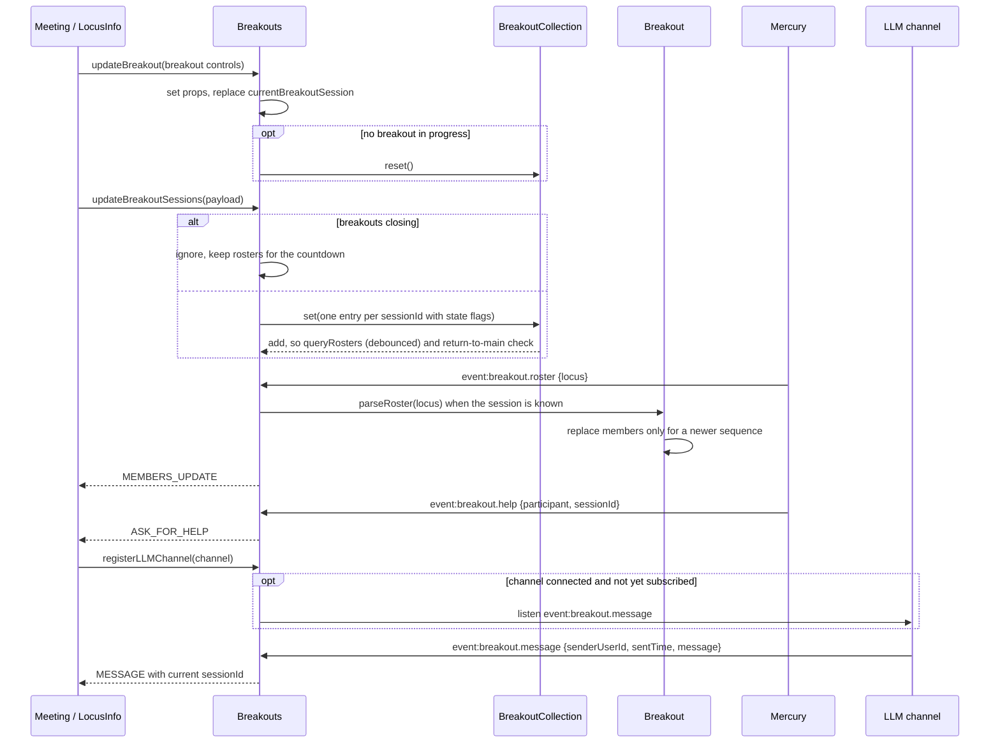
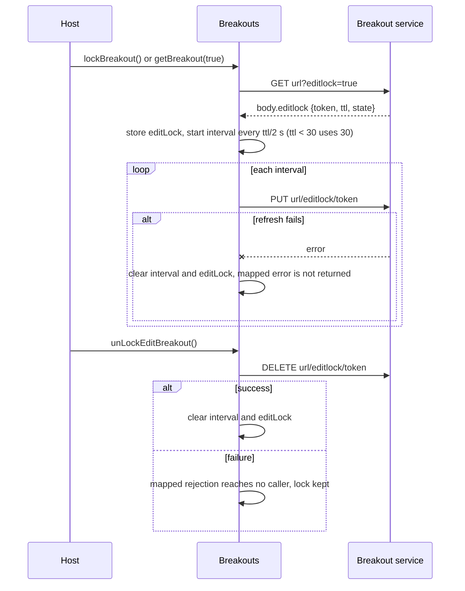
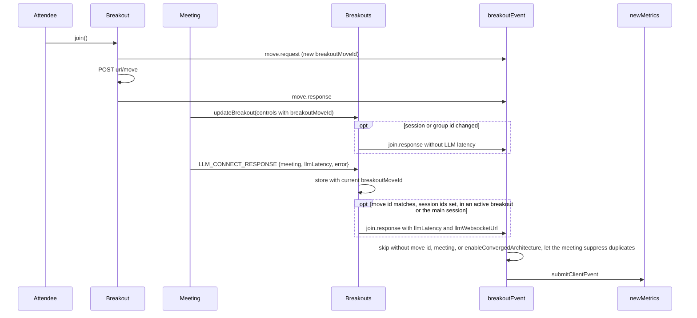
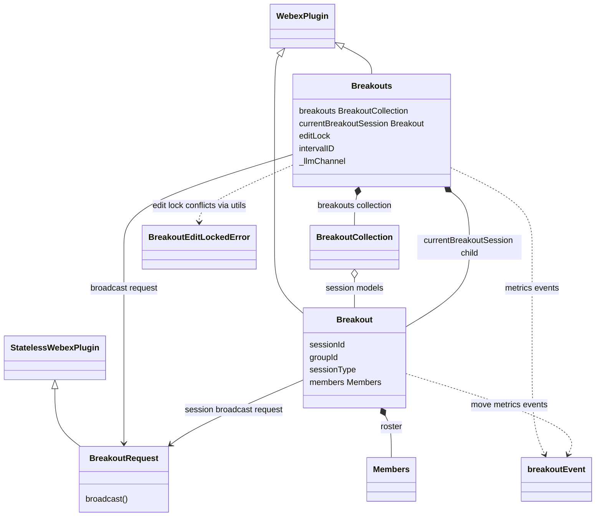
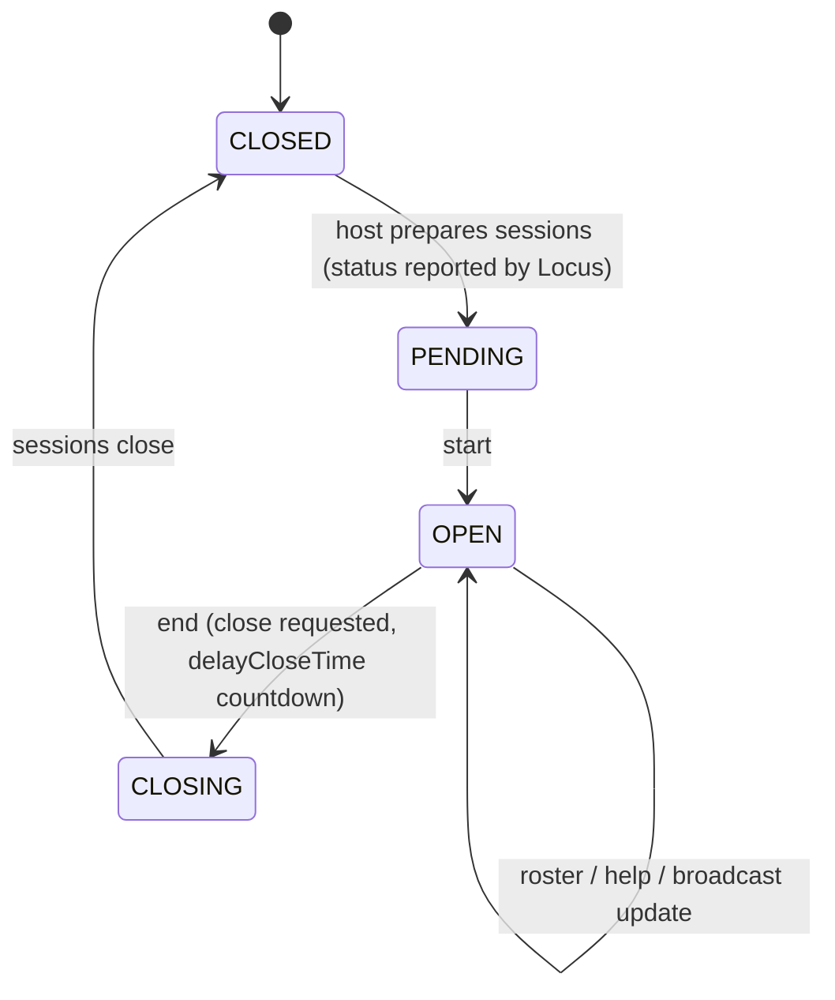
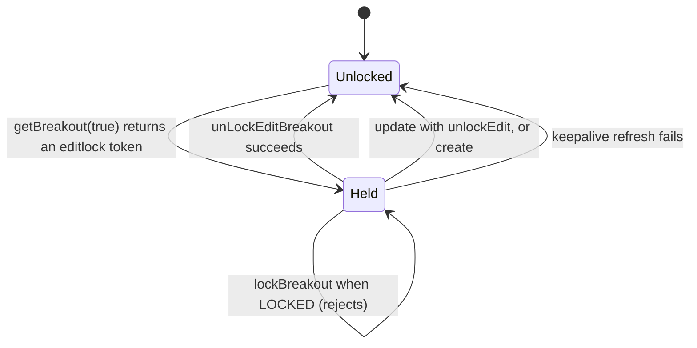

<!-- sdd-generated-metadata
doc_kind: module-spec
generated_from: module-spec@0.3.0
generated_by: claude-code
approved_by: rarajes2@cisco.com
updated_at: 2026-11-16T14:30:00Z
validation_status: not-run
-->

# Breakouts

This canonical source-local document at `src/breakouts/docs/README.md` owns the stable
specification for **breakouts**: the `meeting.breakouts` controller (`Breakouts`, a `WebexPlugin`)
and its per-session `Breakout` objects. The module projects Locus breakout state into a session
collection, runs attendee moves and help requests, host and cohost management, edit locking, and
broadcast against the breakout service, and emits roster, help, message, return, and closing events
that `Meeting` re-emits to applications. Ground every claim in package evidence and link to the
[package architecture](../../../docs/architecture.md) instead of repeating broader facts. No service
specification exists because this package is a library.

Related context: [documentation index](../../../docs/index.md) ·
[package agent instructions](../../../AGENTS.md)

## Metadata

| Field | Value |
| ----- | ----- |
| Owner | @webex/web-client, @webex/web-sdk |
| Source path | `src/breakouts` |
| Resource kind | module |
| Status | Draft |
| Last verified | 2026-11-16 at `0b8c34db7f` |
| Module id | `plugin-meetings/breakouts` |
| Parent spec | — |
| Doc kind | Module spec |
| Coverage score | Pending coverage assessment |
| Validation status | not-run |

## Applicability

| Condition ID                         | Status     | Evidence or reason | Owned section |
| ------------------------------------ | ---------- | ------------------ | ------------- |
| `module.has_tiers`                   | N/A        | No tier policy exists in `package.json` or `src/breakouts/index.ts` | Tier |
| `module.has_ui`                      | N/A        | `src/breakouts/index.ts` and `src/breakouts/breakout.ts` expose state, promises, and events; no UI | UI use-case flow |
| `module.crosses_service_boundaries`  | Applicable | `src/breakouts/index.ts`, `src/breakouts/breakout.ts`, and `src/breakouts/request.ts` call the breakout service; `src/breakouts/index.ts` listens to Mercury and the LLM data channel | Cross-boundary use-case flow |
| `module.holds_client_state`          | Applicable | Breakout projection props, the session collection, the edit lock, and subscription flags in `src/breakouts/index.ts` | Client state model |
| `module.enforces_domain_rules`       | Applicable | Closing freeze, roster sequence check, main-session guards, and edit-lock rules in `src/breakouts/index.ts` and `src/breakouts/breakout.ts` | Business rules and invariants |
| `module.is_concurrent_async`         | Applicable | Promise requests, a debounced roster query, a keepalive interval, and independent LLM and Locus inputs in `src/breakouts/index.ts` | Concurrency and reactive flow |
| `module.owns_persistence`            | N/A        | Nothing is stored; the breakout service and Locus hold the record (`src/breakouts/index.ts`) | Data, schema, and migration discipline |
| `module.stateful_transitions`        | Applicable | Breakout status values in `src/constants.ts` and the edit-lock lifecycle in `src/breakouts/index.ts` | State machine |
| `module.exposes_wire_protocol`       | N/A        | Recorded false in `.sdd/manifest.json`; request bodies are described under Requirements | Protocol and wire format |
| `module.ui_multi_screen`             | N/A        | No UI | UI flow |
| `module.large_data_model`            | N/A        | The props in `src/breakouts/index.ts` and `src/breakouts/breakout.ts` are listed under Client state model | Data model |
| `module.returns_caller_errors`       | Applicable | Synchronous throws, rejected promises, and BreakoutEditLockedError from `src/breakouts/utils.ts` | Caller-visible failure modes |
| `module.module_specific_conventions` | Applicable | Edit-lock body and error-mapping conventions in `src/breakouts/index.ts` | Module-specific rules |
| `module.published_package`           | N/A        | `src/index.ts` exports no breakouts symbol; the surface is reached through meeting.breakouts | Export stability |
| `module.embedded_in_host`            | N/A        | No host theme or embed API | Host integration and theming |
| `module.has_design_tradeoff`         | Applicable | Edit locking and server-side authorization in `src/breakouts/index.ts` | Key design trade-off |
| `module.has_submodules`              | N/A        | The breakouts directory has no child module (`src/breakouts/index.ts`) | Sub-modules |

## Evidence register

Requirements cite current source and mirrored tests under `test/unit/spec/breakouts/`. Where
prose and code disagree, current code wins; commit and PR history are not used as evidence. Missing
evidence stays a recorded gap.

| Evidence | What it establishes |
| -------- | ------------------- |
| `src/breakouts/index.ts` | `Breakouts` extends `WebexPlugin` (namespace `Meetings`): props, derived state, the `breakouts` collection and `currentBreakoutSession` child, every listener, request, edit-lock method, and the join-response metric logic |
| `src/breakouts/breakout.ts` | `Breakout` (`idAttribute: 'sessionId'`): join, leave, help, session broadcast, `Members` creation, and roster sequence checks |
| `src/breakouts/collection.ts` | `BreakoutCollection`, an ampersand collection of `Breakout` with `mainIndex: 'sessionId'` |
| `src/breakouts/request.ts` | `BreakoutRequest` extends `StatelessWebexPlugin`; `broadcast` builds the message body and swallows the no-joined-participants 409 |
| `src/breakouts/utils.ts` | `getBroadcastRoles`, `boServiceErrorHandler` (error codes to `BreakoutEditLockedError`), `isSessionTypeChangedFromSessionToMain` |
| `src/breakouts/edit-lock-error.ts` | `BreakoutEditLockedError` name, message, `sdkMessage`, and code from `ERROR_DICTIONARY.BREAKOUT_EDIT` |
| `src/breakouts/events.ts` | `breakoutEvent` move request, move response, and join response Call Analyzer metrics and their send conditions |
| `src/constants.ts` | `BREAKOUTS` (status, events, session types and states, actions, error codes, edit-lock states, `DEFAULT_TTL` 30), `EVENT_TRIGGERS` `meeting:breakouts:*`, `ERROR_DICTIONARY.BREAKOUT_EDIT` (code 9) |
| `src/meeting/index.ts` | `Meeting` creates `new Breakouts({meetingId}, {parent: webex})`, feeds Locus URL, service URL, roles, breakout controls, and session lists, registers and unregisters the LLM channel, triggers `LLM_CONNECT_RESPONSE`, and re-emits the module events |
| `src/meeting/util.ts` | `MeetingUtil.cleanUp` calls `breakouts.cleanUp()` |
| `src/meeting/request.ts` | A join with `breakoutsSupported` adds the `BREAKOUTS_SUPPORTED` device capability |
| `src/breakouts/README.md` | States that the host operations are not implemented, which `src/breakouts/index.ts` contradicts |
| `test/unit/spec/breakouts/index.ts` | Controller cases: listeners, derived state, updates, LLM channel, every host and assignment request, edit lock, and metrics |
| `test/unit/spec/breakouts/breakout.ts` | Session cases: join with metrics, leave guards, help, session broadcast, roster sequence |
| `test/unit/spec/breakouts/request.ts`, `test/unit/spec/breakouts/utils.js` | Broadcast body and 409 handling; roles, error mapping, session-type predicate |
| `test/unit/spec/breakouts/events.ts`, `test/unit/spec/breakouts/edit-lock-error.ts`, `test/unit/spec/breakouts/collection.ts` | Metric payloads and duplicate suppression; error construction; collection model |
| Observation, no stated WHY | The edit-lock body differs per method: `{token}` for `doToggleBreakout`, `create`, `clearSessions`; `{token, refresh: true}` for `start`, `end`, `assign`; `refresh: !unlockEdit` for `update`; the whole `editLock` object or `null` for `dynamicAssign`; none for `moveToLobby` and `removeFromBreakout` (`src/breakouts/index.ts`) |
| Observation, no stated WHY | `start()` defaults `allowBackToMain` and `allowToJoinLater` to `false`, and `end()` sends the current `delayCloseTime` (`src/breakouts/index.ts`) |
| Observation, no stated WHY | `ASK_RETURN_TO_MAIN` is re-emitted as `meeting:breakouts:askReturnToMain` only while the meeting `isJoined()` (`src/meeting/index.ts`) |

## Purpose and boundary

- Responsibility: Owns breakout-session projections, participant and host workflows, roster/broadcast/help events, edit-lock lifecycle, and server mutations.
- In scope: the `Breakouts` controller and its props and derived state; the `breakouts` collection
  and `currentBreakoutSession`; attendee `join`, `leave`, `askForHelp`; host and cohost enable,
  toggle, create, clear, start, end, update, assign, dynamic assign, move to lobby, remove, ask all
  to return, and broadcast; the edit lock and its keepalive; Mercury roster and help listeners; the
  LLM broadcast-message subscription; per-session `Members` rosters; breakout Call Analyzer metrics.
- Out of scope: parsing Locus into breakout controls and session lists (`src/locus-info`); member
  modelling (`src/members`); the LLM connection and its registration (`Meeting`,
  `@webex/internal-plugin-llm`); the Mercury socket; metric transport (`webex.internal.newMetrics`);
  what the breakout service authorizes and stores.
- Consumers: `Meeting` (`src/meeting/index.ts`) constructs it, feeds it, and re-emits its events;
  applications call `meeting.breakouts` and its `Breakout` models directly.

## Structure and key files

`src/breakouts/` contains 8 direct source and reference files (seven TypeScript files and the
retained `README.md`) and has 7 mirrored unit-test files under `test/unit/spec/breakouts/`. This
specification separates its public operations, runtime data movement, component ownership, state,
and verification boundary. Sources are TypeScript in the Node 22.14 Yarn workspace on Webex core
plugin abstractions (`WebexPlugin`, `StatelessWebexPlugin`) and ampersand collections; tests run
under Mocha with Sinon and `@webex/test-helper-chai` (`test:unit` in `package.json`), and one test
file is JavaScript.

| File | Holds |
| ---- | ----- |
| `src/breakouts/index.ts` | `Breakouts` controller mounted as `meeting.breakouts`: module facade/controller and primary (default) export holding props, derived state, listeners, host requests, edit lock, and metrics |
| `src/breakouts/breakout.ts` | `Breakout` session model: attendee join, leave, help request, session broadcast, and roster parsing for one breakout |
| `src/breakouts/collection.ts` | `BreakoutCollection`, the module-owned collection of `Breakout` models indexed by `sessionId` |
| `src/breakouts/edit-lock-error.ts` | `BreakoutEditLockedError`, the module-specific error type for edit-lock conflicts |
| `src/breakouts/events.ts` | `breakoutEvent` Call Analyzer metric construction/submission helper for move request, move response, and join response; feature events are emitted by `index.ts` |
| `src/breakouts/request.ts` | `BreakoutRequest`, the broadcast-specific request helper |
| `src/breakouts/utils.ts` | Normalization/helper functions: broadcast roles, breakout service error mapping, and the session-type predicate |
| `src/breakouts/README.md` | Retained human feature guide, context only; its host section predates the implemented host operations |
| `src/breakouts/docs/README.md` | This module specification |
| `test/unit/spec/breakouts/index.ts`, `test/unit/spec/breakouts/breakout.ts`, `test/unit/spec/breakouts/collection.ts`, `test/unit/spec/breakouts/edit-lock-error.ts`, `test/unit/spec/breakouts/events.ts`, `test/unit/spec/breakouts/request.ts`, `test/unit/spec/breakouts/utils.js` | Mirrored characterization/unit coverage, one test file per source file |

## Public surface

`meeting.breakouts` is the `Breakouts` instance `Meeting` creates with `{meetingId}`; `src/index.ts`
exports no breakouts symbol, so applications reach the module only through a meeting. Every row
belongs to contract `breakouts-api`, indexed in the
[package architecture](../../../docs/architecture.md#public-and-consumer-surfaces); contract IDs and
coverage state are recorded in `.sdd/manifest.json`.

| Contract ID | Type | Surface | Purpose | Compatibility / deprecation | Schema / detail link | Root index |
|---|---|---|---|---|---|---|
| `breakouts-api` | SDK / lifecycle | `initialize()`, `cleanUp()`, `locusUrlUpdate()`, `updateCanManageBreakouts()`, `breakoutServiceUrlUpdate()`, `updateBreakout()`, `handleRosterUpdate()`, `listenToCurrentSessionTypeChange()`, `registerLLMChannel()`, `unregisterLLMChannel()`, `listenToBroadcastMessages()`, `listenToBreakoutRosters()`, `listenToBreakoutHelp()`, `handleLLMBreakoutJoinResponseMetric()`, `submitLLMBreakoutJoinResponseMetric()`, `updateBreakoutSessions()`, and `clearBreakouts()` | Reconcile meeting-scoped breakout state and owned event subscriptions/metrics from Locus, Mercury, LLM, and service updates; `Meeting` calls these | Preserve session/member ids, listener topics, metric fields, and scoped emitted events. | `src/breakouts/index.ts` | [architecture](../../../docs/architecture.md#public-and-consumer-surfaces) |
| `breakouts-api` | SDK / query | `queryRosters()`, `isBreakoutInProgress()`, `isBreakoutIClosing()`, `getMainSession()`, `getBreakout()`, the derived `isInMainSession`, `isActiveBreakout`, `breakoutGroupId`, `breakoutStatus`, and `shouldQueryPreAssignments`, and the `breakouts` collection and `currentBreakoutSession` | Query and project current breakout sessions, main-session identity, roster, and close state; `getBreakout(true)` also takes the edit lock | Preserve collection identity and current enum/value semantics, including the `isBreakoutIClosing` spelling. | `src/breakouts/index.ts`, `src/breakouts/collection.ts` | [architecture](../../../docs/architecture.md#public-and-consumer-surfaces) |
| `breakouts-api` | attendee session object | `Breakout.initialize()`, `join()`, `leave()`, `askForHelp()`, `initMembers()`, `isNeedHandleRoster()`, `parseRoster()`, and `broadcast()` | Let an attendee act on one breakout and maintain its session-local roster; `broadcast()` here targets this one session. | These methods are owned by `breakout.ts`, not delegated through the controller index. | `src/breakouts/breakout.ts` | [architecture](../../../docs/architecture.md#public-and-consumer-surfaces) |
| `breakouts-api` | SDK / remote | controller `askAllToReturn()`, `broadcast()`, and `triggerReturnToMainEvent()` | Send host return/broadcast actions and expose the corresponding scoped meeting event. | Preserve broadcast roles/content and the return-to-main event, which carries no payload. | `src/breakouts/index.ts`, `src/breakouts/request.ts` | [architecture](../../../docs/architecture.md#public-and-consumer-surfaces) |
| `breakouts-api` | SDK / host remote | `enableBreakouts()`, `toggleBreakout()`, `doToggleBreakout()`, `create()`, `clearSessions()`, `start()`, `end()`, and `update()` | Create and transition the remote breakout configuration and sessions. | Preserve request sequencing, state values, and service rejection mapping. | `src/breakouts/index.ts`, `src/breakouts/utils.ts` | [architecture](../../../docs/architecture.md#public-and-consumer-surfaces) |
| `breakouts-api` | SDK / assignment remote | `assign()`, `queryPreAssignments()`, `dynamicAssign()`, `moveToLobby()`, and `removeFromBreakout()` | Manage pre/dynamic participant assignment and movement between lobby/session contexts. | Preserve participant/session ids and per-operation request bodies. | `src/breakouts/index.ts` | [architecture](../../../docs/architecture.md#public-and-consumer-surfaces) |
| `breakouts-api` | SDK / edit lock | `enableAndLockBreakout()`, `hasBreakoutLocked()`, `lockBreakout()`, `keepEditLockAlive()`, and `unLockEditBreakout()` | Acquire, refresh, inspect, and release the edit token used by protected host mutations. | Service lock conflicts map to `BreakoutEditLockedError`, while a locally held lock rejects with a plain `Error`; keepalive ownership is explicit. | `src/breakouts/index.ts`, `src/breakouts/edit-lock-error.ts` | [architecture](../../../docs/architecture.md#public-and-consumer-surfaces) |
| `breakouts-api` | module helpers and caller-visible error | `BreakoutRequest.broadcast()`, `BreakoutEditLockedError`, `getBroadcastRoles()`, `boServiceErrorHandler()`, and `isSessionTypeChangedFromSessionToMain()` | Provide the direct broadcast adapter, lock error, role selection, service-error mapping, and session-transition predicate; none is exported from `src/index.ts`, and callers meet `BreakoutEditLockedError` only as a rejection value. | Preserve error identity (`name`, `sdkMessage`, code 9), role ordering (`COHOST` before `PRESENTER`), and transition logic. | `src/breakouts/request.ts`, `src/breakouts/edit-lock-error.ts`, `src/breakouts/utils.ts` | [architecture](../../../docs/architecture.md#public-and-consumer-surfaces) |

Current source emits or forwards these observable literals for this operation boundary. Preserve literal values, scope, payload shape, and emission timing; a constant name alone is not a substitute for the consumer-visible value.

| Event literal | Constant / expression | Emission evidence |
|---|---|---|
| `ASK_FOR_HELP` | `BREAKOUTS.EVENTS.ASK_FOR_HELP` | `src/breakouts/index.ts` |
| `ASK_RETURN_TO_MAIN` | `BREAKOUTS.EVENTS.ASK_RETURN_TO_MAIN` | `src/breakouts/index.ts` |
| `BREAKOUTS_CLOSING` | `BREAKOUTS.EVENTS.BREAKOUTS_CLOSING` | `src/breakouts/index.ts` |
| `LEAVE_BREAKOUT` | `BREAKOUTS.EVENTS.LEAVE_BREAKOUT` | `src/breakouts/index.ts` |
| `LLM_CONNECT_RESPONSE` (inbound: `Meeting` triggers it on the controller) | `BREAKOUTS.EVENTS.LLM_CONNECT_RESPONSE` | `src/meeting/index.ts` |
| `meeting:breakouts:askForHelp` | `EVENT_TRIGGERS.MEETING_BREAKOUTS_ASK_FOR_HELP` | `src/meeting/index.ts` |
| `meeting:breakouts:askReturnToMain` | `EVENT_TRIGGERS.MEETING_BREAKOUTS_ASK_RETURN_TO_MAIN` | `src/meeting/index.ts` |
| `meeting:breakouts:closing` | `EVENT_TRIGGERS.MEETING_BREAKOUTS_CLOSING` | `src/meeting/index.ts` |
| `meeting:breakouts:leave` | `EVENT_TRIGGERS.MEETING_BREAKOUTS_LEAVE` | `src/meeting/index.ts` |
| `meeting:breakouts:message` | `EVENT_TRIGGERS.MEETING_BREAKOUTS_MESSAGE` | `src/meeting/index.ts` |
| `meeting:breakouts:preAssignmentsUpdate` | `EVENT_TRIGGERS.MEETING_BREAKOUTS_PRE_ASSIGNMENTS_UPDATE` | `src/meeting/index.ts` |
| `meeting:breakouts:update` | `EVENT_TRIGGERS.MEETING_BREAKOUTS_UPDATE` | `src/meeting/index.ts` |
| `MEMBERS_UPDATE` | `BREAKOUTS.EVENTS.MEMBERS_UPDATE` | `src/breakouts/index.ts` |
| `MESSAGE` | `BREAKOUTS.EVENTS.MESSAGE` | `src/breakouts/index.ts` |
| `PRE_ASSIGNMENTS_UPDATE` | `BREAKOUTS.EVENTS.PRE_ASSIGNMENTS_UPDATE` | `src/breakouts/index.ts` |

`MESSAGE` carries `{senderUserId, sentTime, message, sessionId}` and `ASK_FOR_HELP` carries
`{participant, sessionId}`; `Meeting` passes both payloads through to the `meeting:breakouts:*`
event, and the other events carry none. `meeting:breakouts:update` is also emitted by `Meeting`
after it applies Locus breakout controls or session lists. The literals are defined in
`src/constants.ts`.

Compatibility notes:

- Prefer additive fields/options and preserve current rejection/event/cleanup semantics. Internal helpers are not public merely because they are exported within the source directory.

## Dependencies

Requires: Parent Meeting/Locus state, breakout service URL, request helper, breakout/member
collections, event utilities, timers, role/capability fields, and metrics. Contracts: provides
`breakouts-api`; requires `locus-http`, `webex-core-plugin-host`, `internal-plugin-llm-channel`, and
`internal-plugin-mercury-events` (`.sdd/manifest.json`).

| Dependency | Why it is required | Failure behavior |
| ---------- | ------------------ | ---------------- |
| `@webex/webex-core` (`webex-core-plugin-host`) | `WebexPlugin` and `StatelessWebexPlugin` base classes; `this.request` and `this.webex.request` carry every breakout-service call | Rejections propagate unless the method catches them (see Caller-visible failure modes) |
| Breakout service (`locus-http`) | Resource URL from Locus `services.breakout.url` plus `/breakout/` (`breakoutServiceUrlUpdate`) and the per-meeting breakout `url` from Locus breakout controls (`updateBreakout`) | Lock error codes `201409024` and `201403007` map to `BreakoutEditLockedError`; other errors pass through |
| `Meeting` and `LocusInfo` (`src/meeting/index.ts`) | Locus URL, service URLs, self roles (moderator or cohost sets `canManageBreakouts`), breakout controls, session lists, and the registered LLM channel | Without them the controller holds no URL and requests target `undefined` paths |
| `webex.internal.mercury` (`internal-plugin-mercury-events`) | `event:breakout.roster` and `event:breakout.help` | No retry; a missed roster event waits for the next one |
| LLM data channel (`internal-plugin-llm-channel`: `LLMChannel` from `Meeting`, and `webex.internal.llm`) | `event:breakout.message` broadcasts; `online` re-checks the subscription; `getWebSocketUrl` feeds metrics | No subscription while the channel is missing or disconnected |
| `webex.internal.newMetrics.submitClientEvent` | Breakout move and join Call Analyzer metrics through `breakoutEvent` | Skipped without a move id, a meeting, or `enableConvergedArchitecture` |
| `webex.meetings.getMeetingByType`, `webex.internal.device.url` | Meeting lookup for metrics and `Members`; the device URL in the move body | — |
| `src/members` (`Members`) | Per-breakout member rosters | — |
| `lodash` (`debounce`, `forEach`), `uuid` (`v4`), `ampersand-collection`, `window.setInterval` | Debounced roster query, state-list iteration, move ids, the collection, and the keepalive timer | — |

## Requirements

| ID | WHAT | WHY | Source Evidence | Test / Example Evidence | Assumptions / Gaps | Confidence |
|---|---|---|---|---|---|---|
| `BREAKOUTS-R-001` | initialize/query breakout session and roster state: `initialize()` wires the closing, pre-assignment, roster-query, return-to-main, LLM-connect, session-type, roster, help, and LLM `online` listeners; adding sessions runs `queryRosters()` (debounced, leading edge, 10 ms), which GETs `<url>/roster` with `locusUrl` base64-encoded, passes each roster `locus` to `handleRosterUpdate()`, and emits `MEMBERS_UPDATE`. | A client that joins gets no `breakout.roster` event for rosters that already exist, so the initial roster lists must be queried (code comment on `queryRosters`). | `src/breakouts/index.ts` | `test/unit/spec/breakouts/index.ts` | A failed roster query is only logged | Present |
| `BREAKOUTS-R-002` | Attendee `join()`, `leave()`, and `askForHelp()` execute on the per-session object in `breakout.ts`: `join()` POSTs `<url>/move` with `{breakoutMoveId, deviceUrl, groupId, sessionId}` between the move-request and move-response metrics, `leave()` joins the main session, and `askForHelp()` POSTs `<url>/help`. Controller and session broadcasts delegate to `BreakoutRequest.broadcast()`. | The session object and controller have distinct request ownership, so attributing every attendee operation to `index.ts` hides the actual call boundary. | `src/breakouts/breakout.ts`, `src/breakouts/index.ts`, `src/breakouts/request.ts` | `test/unit/spec/breakouts/breakout.ts`, `test/unit/spec/breakouts/index.ts`, `test/unit/spec/breakouts/request.ts` | none | Present |
| `BREAKOUTS-R-003` | Host and attendee request failures remain caller-visible as rejections and edit-lock conflicts are mapped explicitly; `queryRosters()` and `queryPreAssignments()` only log, and `keepEditLockAlive()` and `unLockEditBreakout()` return nothing, so their mapped rejections reach no caller. `unLockEditBreakout()` clears the keepalive after a successful DELETE, but `cleanUp()` only stops listeners/resets message subscription and does not clear the edit-lock timer. | The timer ownership gap must remain visible so cleanup is not relied on to release an editor that current code leaves active. | `src/breakouts/index.ts`, `src/breakouts/edit-lock-error.ts` | `test/unit/spec/breakouts/index.ts`, `test/unit/spec/breakouts/edit-lock-error.ts` | cleanup does not clear the edit-lock keepalive timer | Present |
| `BREAKOUTS-R-004` | Roster, session type, broadcasts, help requests, and return-to-main updates reconcile into meeting-scoped breakout/session/member projections and events: `updateBreakoutSessions()` rebuilds the collection from the Locus state lists, and `parseRoster()` replaces one session's members only for a newer Locus sequence. | Attendees need current session membership and host messages without consuming raw Locus/service payloads. | `src/breakouts/index.ts`, `src/breakouts/breakout.ts`, `src/breakouts/collection.ts` | `test/unit/spec/breakouts/index.ts`, `test/unit/spec/breakouts/breakout.ts`, `test/unit/spec/breakouts/collection.ts` | duplicate or out-of-order Mercury roster events are not characterized | Present |
| `BREAKOUTS-R-005` | Host create/start/end/update/assign/move/remove operations use current session ids/URLs and direct request calls owned by `index.ts`; `canManageBreakouts` is stored but does not gate these methods (it only feeds `shouldQueryPreAssignments`). | These operations mutate shared server state, and the current absence of a local capability guard must not be replaced with an invented authorization guarantee. | `src/breakouts/index.ts` | `test/unit/spec/breakouts/index.ts` | stored management capability is not enforced by host mutation methods | Present |
| `BREAKOUTS-R-006` | Edit-lock acquire/keepalive/unlock is coordinated around host configuration; `create`, `clearSessions`, `start`, `end`, `update`, the keepalive, and unlock map lock conflicts to `BreakoutEditLockedError` through `boServiceErrorHandler()`, while `assign`, `dynamicAssign`, `moveToLobby`, `removeFromBreakout`, and `doToggleBreakout` pass errors through unmapped; explicit unlock clears the timer. | Multiple hosts can edit breakout configuration, so conflict identity and explicit unlock behavior must remain stable even though general cleanup has a timer gap. | `src/breakouts/index.ts`, `src/breakouts/edit-lock-error.ts`, `src/breakouts/utils.ts` | `test/unit/spec/breakouts/edit-lock-error.ts`, `test/unit/spec/breakouts/utils.js`, `test/unit/spec/breakouts/index.ts` | general cleanup does not clear the timer | Present |
| `BREAKOUTS-R-007` | `listenToBroadcastMessages()` subscribes once to `event:breakout.message` on the registered LLM channel, and only while that channel `isConnected()`; it runs from `locusUrlUpdate()`, `registerLLMChannel()`, and the `webex.internal.llm` `online` event. `registerLLMChannel()` stops listening to a previously subscribed channel first; `unregisterLLMChannel()` stops listening and clears the flag. Each message emits `MESSAGE` with the current session's `sessionId`. | LLM may connect after `locusUrlUpdate` has already run, so the subscription is re-checked on connect (code comment in `initialize`), and a previous channel is cleaned up so one channel delivers messages (code comment in `registerLLMChannel`). | `src/breakouts/index.ts`, `src/meeting/index.ts` | `test/unit/spec/breakouts/index.ts` | The `sessionId` is not checked against the data channel (FIXME in code) | Present |
| `BREAKOUTS-R-008` | `updateBreakout(params)` sets the Locus breakout controls on the controller, unsets `groups`, `startTime`, and `status` when absent, keeps the last non-empty `breakoutMoveId`, replaces `currentBreakoutSession` (`current: true`, every state flag false), clears the collection when no breakout is in progress, and sends a join-response metric when the session or group id changed. | The three values are set manually so they are unset when not included in params, and a changed joined session should report a join response (code comments in `updateBreakout`). | `src/breakouts/index.ts` | `test/unit/spec/breakouts/index.ts` | none | Present |
| `BREAKOUTS-R-009` | `submitLLMBreakoutJoinResponseMetric()` sends `client.breakout-session.join.response` with LLM latency only when the stored LLM connect info carries the current `breakoutMoveId`, the current session has `sessionId` and `groupId`, and the client is in an active breakout or the main session, then clears the stored info. `breakoutEvent` submits only with a move id, a meeting, and `meetingInfo.enableConvergedArchitecture`, and lets the meeting's `shouldEmitBreakoutJoinResponseMetric` suppress duplicates. | The breakout update and the LLM response arrive independently, and the main session is accepted to mirror the desktop client, which reports both directions (JSDoc of `submitLLMBreakoutJoinResponseMetric`). | `src/breakouts/index.ts`, `src/breakouts/events.ts` | `test/unit/spec/breakouts/index.ts`, `test/unit/spec/breakouts/events.ts` | none | Present |
| `BREAKOUTS-R-010` | `enableBreakouts()` POSTs `{locusUrl}` to `breakoutServiceUrl` and rejects without it; `toggleBreakout(enable)` first enables when `enableBreakoutSession` is undefined, applies the response with `updateBreakout()`, and then disables only when `enable` is false; otherwise it PUTs `{enableBreakoutSession}` to `url`. | The first enable provisions the breakout resource and sets the initial data (code comment "first time enable, set the initial data"). | `src/breakouts/index.ts` | `test/unit/spec/breakouts/index.ts` | none | Present |
| `BREAKOUTS-R-011` | `getBreakout(true)` GETs `<url>?editlock=true`, stores the returned `editlock`, and starts `keepEditLockAlive()`, which PUTs `<url>/editlock/<token>` every ttl/2 seconds (a ttl below 30 uses `DEFAULT_TTL` 30) and replaces a running interval; a failed refresh clears the lock. `lockBreakout()` rejects with `Breakout already locked` when the held lock is `LOCKED`. | The service grants the lock for `ttl` seconds, so the holder refreshes it before it lapses (method name `keepEditLockAlive`; inferred from the ttl/2 period). | `src/breakouts/index.ts` | `test/unit/spec/breakouts/index.ts` | WHY inferred | Weak |
| `BREAKOUTS-R-012` | `assign(sessions)` PUTs `groups: [{id: breakoutGroupId, sessions}]` with `assigned` (member ids), `assignedEmails`, and `anyoneCanJoin`; `dynamicAssign()` PUTs `<url>/dynamicAssign` with `{id, participants, targetState}`; `moveToLobby()` PUTs `<url>/dynamicAssign` to the main group and session with `targetState: 'LOBBY'`; `removeFromBreakout()` POSTs `<url>/move` to the main group and session. | `dynamicAssign` is used for admitting participants from the lobby into a breakout directly (its JSDoc), and moving to the lobby or out of a breakout needs the main session as target (the methods' error messages). | `src/breakouts/index.ts` | `test/unit/spec/breakouts/index.ts` | none | Present |
| `BREAKOUTS-R-013` | `queryPreAssignments()` runs when `shouldQueryPreAssignments` (manager, breakouts enabled, pre-assignments exist) becomes true and none are loaded; it GETs `<url>/preassignments` with base64 `locusUrl`, stores `body.groups`, and emits `PRE_ASSIGNMENTS_UPDATE`. | Only a host or cohost of a meeting with pre-assignments needs them (derived `shouldQueryPreAssignments`). | `src/breakouts/index.ts` | `test/unit/spec/breakouts/index.ts` | none | Present |
| `BREAKOUTS-R-014` | `BREAKOUTS_CLOSING` fires when `breakoutStatus` becomes `CLOSING`; `LEAVE_BREAKOUT` fires when `currentBreakoutSession.sessionType` changes from `BREAKOUT` to `MAIN`; `ASK_RETURN_TO_MAIN` fires when a requested main session is added or its `requestedLastModifiedTime` changes. | `Meeting` re-emits them as `meeting:breakouts:closing`, `meeting:breakouts:leave`, and `meeting:breakouts:askReturnToMain` for applications (`src/meeting/index.ts`). | `src/breakouts/index.ts`, `src/breakouts/utils.ts` | `test/unit/spec/breakouts/index.ts`, `test/unit/spec/breakouts/utils.js` | none | Present |
| `BREAKOUTS-R-015` | Controller `broadcast(message, options)` throws without an active `breakoutGroupId`; `BreakoutRequest.broadcast()` POSTs `<url>/message` with `{message, groups: [{id, recipientRoles, sessions}]}`, roles `COHOST` and `PRESENTER` from `options.cohosts` and `options.presenters`, and `sessions` only for a session broadcast; a 409 with errorCode `201409036` is logged and resolves `undefined`. | That 409 means no participants have joined, which is not a failure for the sender (log text "no joined participants"). | `src/breakouts/index.ts`, `src/breakouts/request.ts`, `src/breakouts/utils.ts` | `test/unit/spec/breakouts/index.ts`, `test/unit/spec/breakouts/request.ts`, `test/unit/spec/breakouts/utils.js` | none | Present |

## Design overview

Breakouts projects Locus breakout state into `Breakout` objects and a collection, performs most
server mutations directly from `index.ts`, delegates broadcast delivery to `BreakoutRequest`, lets
each `Breakout` send its own join, leave, and help requests, emits feature events from `index.ts`,
uses `events.ts` for breakout Call Analyzer metrics, subscribes to broadcast messages on the LLM
channel that `Meeting` registers, and owns the edit-lock keepalive timer.

`Meeting` is the only writer of the projection: Locus breakout controls go to `updateBreakout()`
(the current session and the controller props), the Locus session lists go to
`updateBreakoutSessions()` (the collection), and self roles go to `updateCanManageBreakouts()`.
`currentBreakoutSession` is a child model and is not a member of the `breakouts` collection. Each
`Breakout` creates its own `Members` instance the first time a roster arrives and replaces its
members only when the roster's Locus sequence is newer.

Host and cohost operations act on the breakout `url` and the managed group (`breakoutGroupId`, the
first `manageGroups` entry unless it is `CLOSED`); responses refresh `manageGroups`, `mainGroupId`,
and `mainSessionId`. Authorization stays with the breakout service: the client sends the held
edit-lock token, and `boServiceErrorHandler()` turns the service's lock error codes into
`BreakoutEditLockedError`.

## Data flow and sequence coverage

Call style: in-process method calls on `meeting.breakouts` and its `Breakout` models; outbound
HTTPS to the breakout service through `this.request` and `this.webex.request`; inbound Locus
updates through `Meeting`, Mercury `breakout.roster` and `breakout.help` events, and LLM
`breakout.message` events; outbound metrics through `webex.internal.newMetrics`.

Sequence coverage:

| Operation group | Diagram | Failure coverage |
|---|---|---|
| UC-2…UC-5 — attendee session, broadcast, host, and edit-lock request groups | Breakout session and edit-lock primary sequence (diagram 1) | invalid session context, edit-lock conflict, request rejection, and listener/session cleanup |
| UC-2…UC-5 — breakout session and edit-lock alternate/failure paths | Breakout session and edit-lock alternate/failure sequence (diagram 2) | invalid session/lock context, edit-lock conflict, breakout service rejection, no joined participants for a broadcast, or absent local capability enforcement |
| UC-1 — inbound reconciliation from Locus, Mercury, and the LLM channel | Diagram 3 | closing freeze, stale roster sequence, missing session, and a missing or disconnected LLM channel |
| UC-5 — edit-lock keepalive and release | Diagram 4 and the edit-lock state machine | keepalive failure, unlock failure, and cleanup leaving the timer running |
| UC-6 — move and join-response metrics | Diagram 5 | missing move id, meeting, or converged architecture; LLM info for another move; duplicate suppression |

Diagram 1 — breakout session and edit-lock primary sequence:

Diagram 2 — breakout session and edit-lock alternate/failure sequence:

Diagram 3 — inbound reconciliation:

Diagram 4 — edit-lock keepalive and release:

Diagram 5 — move and join-response metrics:

## Class and component relationships

The arrows identify ownership and delegation inside `src/breakouts/`; files that only declare types or constants are not presented as transports.

## Use cases and flows

| Use case | Actor or caller | Primary steps and outcome | Failure or boundary behavior | Evidence |
| -------- | --------------- | ------------------------- | ---------------------------- | -------- |
| `UC-1` | `Meeting` | Reconcile session, roster, help, broadcast, and return-to-main changes into the meeting-scoped controller collection and its events | Closing freezes the collection; unknown sessions and stale rosters are ignored | `src/breakouts/index.ts`, `src/breakouts/collection.ts`, `src/meeting/index.ts` |
| `UC-2` | Attendee | Join, leave, request help, or broadcast on an individual `Breakout` object and maintain that session's member roster | `leave()` throws in the main session or without one; request errors reject | `src/breakouts/breakout.ts` |
| `UC-3` | Host or cohost | Enable, toggle, create, clear, start, end, or update breakout sessions through the host controller request path; ask everyone to return; broadcast | Missing service URL or group id rejects; lock conflicts reject as `BreakoutEditLockedError` | `src/breakouts/index.ts`, `src/breakouts/request.ts` |
| `UC-4` | Host or cohost | Query preassignments, assign, dynamically assign participants, move them to lobby, or remove them from a breakout | Moving or removing without main ids throws; request errors reject unmapped | `src/breakouts/index.ts` |
| `UC-5` | Host or cohost | Acquire and refresh an edit lock before protected host mutations, mapping service conflicts to `BreakoutEditLockedError`, then release it | A held lock rejects `lockBreakout()`; keepalive and unlock failures are silent | `src/breakouts/index.ts`, `src/breakouts/edit-lock-error.ts` |
| `UC-6` | `Meeting` and attendee | A move posts move request and response metrics; the Locus update and the LLM connect response each try the join-response metric | Skipped without converged architecture or a matching move id | `src/breakouts/breakout.ts`, `src/breakouts/index.ts`, `src/breakouts/events.ts` |

### Cross-boundary use-case flow

| Boundary | Transport and ordering | Compatibility | Timeout, retry, and recovery |
| -------- | ---------------------- | ------------- | ---------------------------- |
| Breakout service (`UC-2` to `UC-5`) | HTTPS through `webex.request`; one request per call; `toggleBreakout` enables before it disables | Paths `move`, `help`, `message`, `requestMove`, `roster`, `preassignments`, `dynamicAssign`, and `editlock/<token>` under the breakout `url` | No retry; the keepalive interval is the only repeated request |
| Locus, through `Meeting` (`UC-1`) | In-process calls as Locus deltas are parsed | Breakout controls and session lists | A closing update is ignored; the next update corrects state |
| Mercury (`UC-1`) | `breakout.roster` and `breakout.help` events in arrival order | `data.locus` and `data.{participant, sessionId}` | No retry; a stale roster sequence is dropped |
| LLM data channel (`UC-1`) | `breakout.message` events on the registered channel | `data.{senderUserId, sentTime, message}` | Re-subscribed on `online`, channel registration, and Locus URL updates |
| Metrics (`UC-6`) | `submitClientEvent` | Event names `client.breakout-session.move.request`, `move.response`, `join.response` | Dropped when conditions fail |

## Client state model

Breakout collection, current/main session ids, management capability, edit-lock token/timer, roster state, subscriptions, and pending metric context are meeting scoped.

| State or slice | Owner      | Initial state | Transition triggers | Reset or persistence boundary |
| -------------- | ---------- | ------------- | ------------------- | ----------------------------- |
| Breakout projection (`sessionId`, `groupId`, `sessionType`, `status`, `groups`, `startTime`, `url`, `name`, `delayCloseTime`, `allowBackToMain`, `enableBreakoutSession`, `hasBreakoutPreAssignments`, `breakoutMoveId`) | `Breakouts` | unset | `updateBreakout` from Locus controls; the first `toggleBreakout` enable | Per meeting; `groups`, `startTime`, and `status` unset when absent; never persisted |
| `breakouts` collection | `Breakouts` | empty | `updateBreakoutSessions`; `clearBreakouts` when no breakout is in progress | Frozen while closing |
| `currentBreakoutSession` | `Breakouts` (child) | empty `Breakout` | `updateBreakout` | Replaced on every update |
| Per-session `members` and `breakoutRosterLocus` | `Breakout` | unset and `null` | `parseRoster` | Kept per session model |
| `locusUrl`, `mainLocusUrl`, `breakoutServiceUrl` | `Breakouts` | unset | `locusUrlUpdate`, `breakoutServiceUrlUpdate` | `mainLocusUrl` changes only in the main session or when unset |
| `canManageBreakouts` | `Breakouts` | unset | `updateCanManageBreakouts` on self role changes | Feeds only `shouldQueryPreAssignments` |
| `manageGroups`, `mainGroupId`, `mainSessionId`, `preAssignments` | `Breakouts` | unset | Host responses and `getBreakout`; `queryPreAssignments` | Overwritten only when the response carries them |
| `editLock`, `intervalID` | `Breakouts` | unset | `getBreakout(true)`, `lockBreakout`, keepalive; cleared by unlock, `update(…, true)`, `create`, and keepalive failure | Not cleared by `cleanUp` |
| `_llmChannel`, `hasSubscribedToMessage` | `Breakouts` | unset | `registerLLMChannel`, `listenToBroadcastMessages`, `unregisterLLMChannel` | `cleanUp` resets the flag |
| `llmBreakoutJoinResponseInfo` | `Breakouts` | unset | `handleLLMBreakoutJoinResponseMetric` | Cleared after the metric is sent |

## Business rules and invariants

| ID | Invariant | WHY | Enforcement source | Test evidence |
| -- | --------- | --- | ------------------ | ------------- |
| `INV-001` | The collection holds one `Breakout` per `sessionId`; `updateBreakoutSessions` resets the five state flags (`active`, `assigned`, `allowed`, `assignedCurrent`, `requested`) and sets each flag the session's Locus lists name, plus the controller `url`. | A session can appear in several state lists, and the flags tell an attendee whether it is forced, assigned, allowed, or requested (prop comments in `breakout.ts`). | `src/breakouts/index.ts`, `src/breakouts/breakout.ts`, `src/breakouts/collection.ts` | `test/unit/spec/breakouts/index.ts` |
| `INV-002` | While `isBreakoutIClosing()` is true, `updateBreakoutSessions` leaves the collection unchanged. | Locus sends undefined or only the main session while closing, which would drop the breakout rosters during the countdown (code comment). | `src/breakouts/index.ts` | `test/unit/spec/breakouts/index.ts` |
| `INV-003` | `parseRoster` replaces a session's members only when the Locus sequence is newer than the last one, or when either lacks a sequence. | The breakout roster event carries the full roster, so members are replaced, and an older roster must not overwrite a newer one (code comment and `isNeedHandleRoster`). | `src/breakouts/breakout.ts` | `test/unit/spec/breakouts/breakout.ts` |
| `INV-004` | `mainLocusUrl` follows `locusUrl` only in the main session or while unset. | It must keep the main session's Locus URL while the user is in a breakout (prop comment). | `src/breakouts/index.ts` | None found |
| `INV-005` | Host mutations use the current session/service context and the held edit-lock token where applicable; current code stores `canManageBreakouts` but does not enforce it. | Authorization belongs to the breakout service (`BREAKOUTS-R-005`). | `src/breakouts/index.ts` | `test/unit/spec/breakouts/index.ts` |
| `INV-006` | Collection/session ids remain consistent; `cleanUp()` releases subscriptions but not the edit-lock keepalive. | See `BREAKOUTS-R-003`. | `src/breakouts/index.ts` | `test/unit/spec/breakouts/index.ts` |

## Concurrency and reactive flow

- Execution model: one JavaScript event loop; requests return promises; ampersand change events,
  Mercury events, and LLM events run listeners synchronously; the keepalive uses
  `window.setInterval`.
- Edit-lock ownership: The active edit-lock token and its keepalive timer belong to one host edit session. `unLockEditBreakout()` clears that timer, while `cleanUp()` does not; roster and session updates reconcile by their current session/member ids before scoped breakout events are emitted.
- Ordering guarantees: the roster query is debounced on the leading edge (10 ms), so a burst of
  added sessions sends one query; the Locus update and the LLM connect response may arrive in either
  order, and the join-response metric waits for both (`BREAKOUTS-R-009`).
- Idempotency and retry: `listenToBroadcastMessages` subscribes at most once per channel
  (`hasSubscribedToMessage`); a new keepalive interval replaces the running one; nothing else is
  retried.
- Shared-state protection: none beyond the flags above; concurrent host mutations are arbitrated by
  the service's edit lock.

## State machine

Breakout status values come from Locus and the breakout service; the client does not move between
them itself. `start()` and `end()` request the change, and the next Locus update reports it.

The diagram uses the breakout `CLOSED`, `PENDING`, `OPEN`, and `CLOSING` values declared in
`src/constants.ts`. Code reads only `OPEN` and `CLOSING` (in progress), `CLOSING` (emit
`BREAKOUTS_CLOSING`, freeze the collection), and `CLOSED` (no managed group); no code reads
`PENDING`. When no breakout is in progress, `updateBreakout` clears the collection.

The edit lock has its own lifecycle on the controller:

- `cleanUp()` changes neither state: a held lock keeps its interval running.
- The attendee's session type is a second transition: `currentBreakoutSession.sessionType` moving
  from `BREAKOUT` to `MAIN` emits `LEAVE_BREAKOUT`; other changes emit nothing.

## Caller-visible failure modes

| Condition | Signal | Caller recovery |
|---|---|---|
| Required session/main-session context is absent | `Breakout.leave()`, controller `getMainSession()` (and so `askAllToReturn()`), controller `broadcast()`, `moveToLobby()`, and `removeFromBreakout()` throw synchronously; `update()` without `params.id` and `enableBreakouts()` without `breakoutServiceUrl` return rejected promises. Stored management capability is not a local guard. | Distinguish a direct throw from an async rejection and refresh current breakout state before retrying. |
| Another editor owns the breakout lock | A service lock conflict is mapped to `BreakoutEditLockedError` by `boServiceErrorHandler()`; a lock already held locally instead rejects with a plain `Error('Breakout already locked')` from the `async` `lockBreakout()`. | Wait for the lock owner to release it before retrying, and do not assume every lock failure is a `BreakoutEditLockedError`. |
| A breakout request rejects or the controller is cleaned up | The returned request promise remains rejected; cleanup removes owned listeners but does not cancel the edit-lock keepalive timer. | Handle the asynchronous rejection and explicitly unlock before discarding an edit session. |
| A broadcast reaches no joined participants | `BreakoutRequest.broadcast()` logs `no joined participants` for a 409 with errorCode `201409036` and resolves `undefined`. | Treat `undefined` as delivered to nobody. |
| The roster or pre-assignment query fails | Logged as `Meeting:breakouts#queryRosters failed` or `Meeting:breakouts#queryPreAssignments failed`; no rejection and no event. | Wait for the next roster event or state change. |
| An edit-lock refresh or unlock fails | The refresh clears the lock and its interval; neither method returns its promise, so the mapped error is an unhandled rejection. | Check `hasBreakoutLocked()` before protected edits. |
| `enableBreakouts()` fails | Logs `Meeting:request#touchBreakout --> Error provisioning error` and rethrows. | Handle the rejection; `toggleBreakout()` rejects with it. |

## Pitfalls and constraints

- The retained README says host operations were not implemented, but current code implements create/start/end/update/assignment and edit locking. Do not preserve that stale limitation.
- Verify both typed constants/enums and raw wire values before changing a logical condition in this legacy package.
- `isBreakoutIClosing` is misspelled and public; renaming it breaks callers.
- `unLockEditBreakout()` returns `undefined`, so a caller cannot wait for the release or see its
  failure.
- `MESSAGE` stamps the current session's id; the code does not check that the message came through
  the data channel of that session (FIXME in `listenToBroadcastMessages`).
- A `test/unit/spec/breakouts/index.ts` case stubs `webex.internal.llm.getLocusUrl`, which the code
  no longer reads; it passes because no channel is registered.
- `breakoutServiceUrlUpdate` appends `/breakout/` to the Locus service URL; pass the bare URL.

## Module-specific rules

- Do: preserve this boundary: reconcile session, roster, help, broadcast, and return-to-main changes into the meeting-scoped collection; `Meeting` feeds the Locus updates in.
- Do not: move remote I/O or lifecycle ownership into a passive type, constant, catalog, or normalization file such as `collection.ts`, `utils.ts`, or `edit-lock-error.ts`.
- Do: route a new host mutation's errors through `boServiceErrorHandler()` and send the held
  edit-lock token, so lock conflicts surface as `BreakoutEditLockedError` (`BREAKOUTS-R-006`).
- Do: subscribe to LLM broadcast messages only through `listenToBroadcastMessages()`, which guards
  connection and duplicate subscription (`BREAKOUTS-R-007`).
- Do not: add a local `canManageBreakouts` guard to host mutations without a change request; the
  service authorizes them (`BREAKOUTS-R-005`).

## Key design trade-off

| Chosen trade-off | Preserved invariant or benefit | Cost or limitation | Decision evidence |
| ---------------- | ------------------------------ | ------------------ | ----------------- |
| Edit locking prevents concurrent host configuration conflicts, but requires keepalive, unlock, and failure cleanup around mutations | One host edits the configuration at a time, and a conflicting edit fails with `BreakoutEditLockedError` | The keepalive timer outlives `cleanUp()`, and refresh and unlock failures are silent | `src/breakouts/index.ts`, `src/breakouts/utils.ts` |
| Host permissions are left to the breakout service | The client never refuses an operation the service would allow | A non-host's request is sent and rejected by the service | `src/breakouts/index.ts` |

## Verification

Use the current mirrored suites: `test/unit/spec/breakouts/breakout.ts`, `test/unit/spec/breakouts/collection.ts`, `test/unit/spec/breakouts/edit-lock-error.ts`, `test/unit/spec/breakouts/events.ts`, `test/unit/spec/breakouts/index.ts`, `test/unit/spec/breakouts/request.ts`, `test/unit/spec/breakouts/utils.js`. Characterize the breakouts-specific use cases above and each listed failure condition; add cleanup or transition cases only for resources and state this module actually owns.

| Behavior / Requirement | Existing test evidence | Gap |
|---|---|---|
| `BREAKOUTS-R-001` | `test/unit/spec/breakouts/index.ts` | cover controller reconciliation separately from per-session `Breakout` operations; the listener set of `initialize()` is asserted only in part |
| `BREAKOUTS-R-002` | `test/unit/spec/breakouts/breakout.ts`, `test/unit/spec/breakouts/request.ts` | cover each create/start/end/update/assignment body and its required URL/session context under `BREAKOUTS-R-010` to `BREAKOUTS-R-015`; the attendee bodies and move metrics are covered |
| `BREAKOUTS-R-003` | `test/unit/spec/breakouts/index.ts`, `test/unit/spec/breakouts/breakout.ts` | characterize lock conflict, session-object join/leave/help failures, and listener cleanup as separate outcomes; no case asserts that `cleanUp()` leaves the keepalive running |
| `BREAKOUTS-R-004` | `test/unit/spec/breakouts/index.ts`, `test/unit/spec/breakouts/breakout.ts` | verify duplicate/out-of-order Mercury roster updates |
| `BREAKOUTS-R-005` | `test/unit/spec/breakouts/index.ts` | characterize that host mutations proceed without a local `canManageBreakouts` rejection and leave authorization to the service |
| `BREAKOUTS-R-006` | `test/unit/spec/breakouts/edit-lock-error.ts`, `test/unit/spec/breakouts/utils.js`, `test/unit/spec/breakouts/index.ts` | verify keepalive/unlock cleanup on failure; no case for unmapped errors from `assign` or `dynamicAssign` |
| `BREAKOUTS-R-007` | `test/unit/spec/breakouts/index.ts` | none |
| `BREAKOUTS-R-008`, `BREAKOUTS-R-009` | `test/unit/spec/breakouts/index.ts`, `test/unit/spec/breakouts/events.ts` | none |
| `BREAKOUTS-R-010` to `BREAKOUTS-R-015` | `test/unit/spec/breakouts/index.ts`, `test/unit/spec/breakouts/request.ts`, `test/unit/spec/breakouts/utils.js` | the keepalive period is covered; the `lockBreakout` rejection is covered |
| `INV-001` to `INV-003`, `INV-005`, `INV-006` | `test/unit/spec/breakouts/index.ts`, `test/unit/spec/breakouts/breakout.ts` | none |
| `INV-004` | None found | no case asserts `mainLocusUrl` |

Every cited case invokes the named behavior. A module specification is complete only when its
public surface, invariants, failure modes, and test evidence agree with the implementation. The
module stays Partial until coverage review and independent validation run on this specification.
