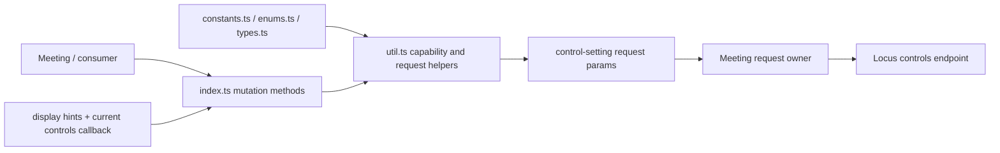
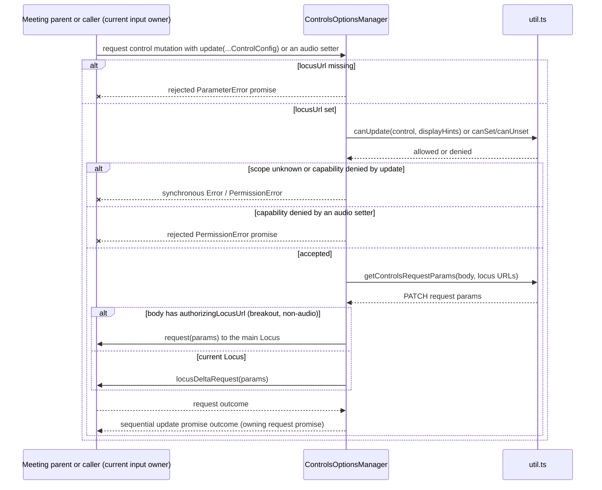
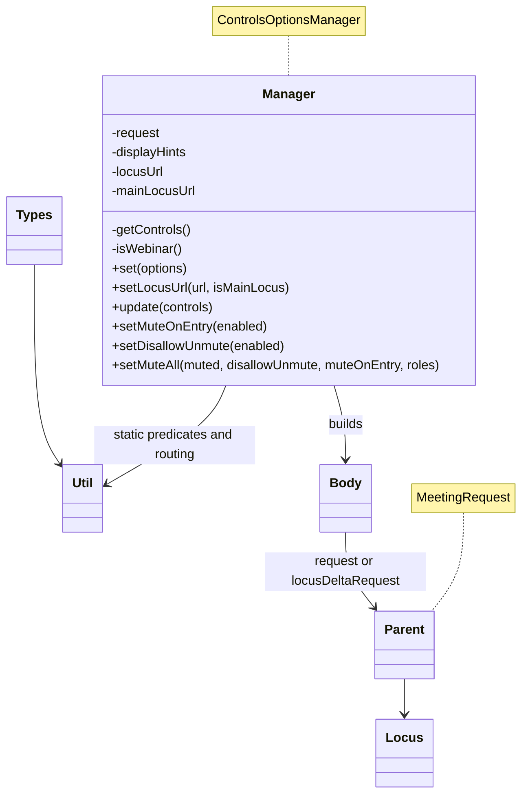

<!-- sdd-generated-metadata
doc_kind: module-spec
generated_from: module-spec@0.3.0
generated_by: claude-code
approved_by: rarajes2@cisco.com
updated_at: 2026-11-16T14:30:00Z
validation_status: not-run
-->

# Controls options manager

This source-local document at `src/controls-options-manager/docs/README.md` owns the stable
canonical specification for the **controls options manager**: `ControlsOptionsManager`, reached as
`meeting.controlsOptionsManager` and behind `meeting.setMuteOnEntry()`, `setDisallowUnmute()`, and
`setMuteAll()`, plus the static `Utils` capability helpers. Ground every claim in repository evidence
and link to the [package architecture](../../../docs/architecture.md) instead of repeating broader
facts. No service specification exists because this package is a library.

Start here: root [package agent instructions](../../../AGENTS.md) · router
[documentation index](../../../docs/index.md) · system
[package architecture](../../../docs/architecture.md) · registry
[module registry](../../../docs/specs/README.md).

## Metadata

| Field             | Value |
| ----------------- | ----- |
| Owner             | @webex/web-client, @webex/web-sdk |
| Source path       | `src/controls-options-manager` |
| Resource kind     | module |
| Status            | Draft |
| Last verified     | 2026-11-16 at `0b8c34db7f` |
| Module id         | `plugin-meetings/controls-options-manager` |
| Parent spec       | — |
| Doc kind          | Module spec |
| Coverage score    | Pending coverage assessment |
| Validation status | not-run |

## Applicability

| Condition ID                         | Status     | Evidence or reason | Owned section |
| ------------------------------------ | ---------- | ------------------ | ------------- |
| `module.has_tiers`                   | N/A        | No tier policy exists in `package.json` | Tier |
| `module.has_ui`                      | N/A        | `src/controls-options-manager/index.ts` returns promises; it renders nothing | UI use-case flow |
| `module.crosses_service_boundaries`  | Applicable | `src/controls-options-manager/index.ts` sends Locus controls PATCH requests, routed to the main Locus from a breakout | Cross-boundary use-case flow |
| `module.holds_client_state`          | Applicable | `src/controls-options-manager/index.ts` keeps the current and main Locus URLs, display hints, and two callbacks | Client state model |
| `module.enforces_domain_rules`       | Applicable | Display-hint capability rules in `src/controls-options-manager/util.ts` | Business rules and invariants |
| `module.is_concurrent_async`         | N/A        | No listener, timer, or shared async state; update chains its own requests (`src/controls-options-manager/index.ts`) | Concurrency and reactive flow |
| `module.owns_persistence`            | N/A        | Nothing is stored; control state is owned by Locus | Data, schema, and migration discipline |
| `module.stateful_transitions`        | N/A        | No control state is held in `src/controls-options-manager/index.ts` | State machine |
| `module.exposes_wire_protocol`       | N/A        | The PATCH bodies are listed under Cross-boundary use-case flow; property shapes are typed in `src/controls-options-manager/types.ts` | Protocol and wire format |
| `module.ui_multi_screen`             | N/A        | No UI | UI flow |
| `module.large_data_model`            | N/A        | Nine small property interfaces in `src/controls-options-manager/types.ts` | Data model |
| `module.returns_caller_errors`       | Applicable | ParameterError and PermissionError rejections and synchronous throws in `src/controls-options-manager/index.ts` | Caller-visible failure modes |
| `module.module_specific_conventions` | N/A        | No convention beyond the package rules in `src/controls-options-manager/index.ts` | Module-specific rules |
| `module.published_package`           | N/A        | Reached through Meeting; export stability is owned by the package architecture (`package.json`) | Export stability |
| `module.embedded_in_host`            | N/A        | No host embedding | Host integration and theming |
| `module.has_design_tradeoff`         | N/A        | No recorded trade-off in `src/controls-options-manager/index.ts` | Key design trade-off |
| `module.has_submodules`              | N/A        | The directory has no child module | Sub-modules |

## Evidence register

Requirements cite current source and mirrored tests. Current code wins over retained prose when they
conflict; commit and PR history are excluded. Missing evidence stays a gap.

| Evidence | What it establishes |
| -------- | ------------------- |
| `src/controls-options-manager/index.ts` | `ControlsOptionsManager` class: context setters and getters, `update`, `setControls`, `sendControlsRequest`, and the three audio setters; its header links Locus mute guides |
| `src/controls-options-manager/util.ts` | `Utils` static predicates, `canUpdate`, `isAudioControl`, `isBreakoutLocusUrl`, and `getControlsRequestParams`, whose JSDoc records the breakout audio routing rationale |
| `src/controls-options-manager/constants.ts` | `ENABLED`, `CAN_SET`, `CAN_UNSET`, and `AUDIO_CONTROL_BODY_KEYS` (`audio`, `muteOnEntry`, `disallowUnmute`) |
| `src/controls-options-manager/enums.ts` | `Control` (nine scopes) and `Setting` (`DisallowUnmute`, `MuteOnEntry`, `Muted`, `Roles`) |
| `src/controls-options-manager/types.ts` | `ControlConfig` and the per-scope property interfaces |
| `src/meeting/index.ts` | Meeting constructs the manager with `getControls` and `isWebinar` callbacks, feeds the Locus URL (with the main-Locus flag) and display hints, delegates its audio setters, and uses `Utils.hasHints` and `hasPolicies` for in-meeting actions |
| `src/constants.ts` | `DISPLAY_HINTS` names, `CONTROLS`, and the `EVENT_TRIGGERS` literals listed under Public surface |
| `src/common/errors/parameter.ts`, `src/common/errors/permission.ts` | `ParameterError` and `PermissionError` |
| `test/unit/spec/controls-options-manager/index.js` | 35 cases over the setters, `update`, breakout routing, the participant-list fill-in, and mute all |
| `test/unit/spec/controls-options-manager/util.js` | 86 cases over every predicate, `canUpdate`, and the routing helpers |
| Observation, no stated WHY | A `ControlConfig` whose properties set none of the checked booleans needs no display hint, because `hasHints` over an empty list is true (`src/controls-options-manager/util.ts`) |
| Observation, no stated WHY | In `setMuteAll`, once the `Muted` setting is processed the remaining settings skip their permission checks, so only `canSetMuted` or `canUnsetMuted` gates the request (`src/controls-options-manager/index.ts`) |
| Observation, no stated WHY | `update` fills missing `viewTheParticipantList` properties from the current Locus controls, and adds `panelistEnabled` and `attendeeCount` only when `isWebinar()` is true (`src/controls-options-manager/index.ts`) |

## Purpose and boundary

- Responsibility: validates requested meeting-control mutations against display hints, builds the
  declared control bodies, and sends them through the owning Meeting request object.
- In scope: the current and main Locus URLs, display hints, the `update` batch API, the mute-on-entry,
  disallow-unmute, and mute-all setters, the static capability predicates, and main-versus-breakout
  request routing.
- Out of scope: the control state itself and its change events (Locus and `LocusInfo`, re-emitted by
  Meeting); computing display hints; the HTTP pipeline and Locus delta handling (`MeetingRequest`).
- Consumers: `Meeting` (`src/meeting/index.ts`) and applications through `meeting.controlsOptionsManager`
  and Meeting's audio setters.

## Structure and key files

`src/controls-options-manager/` contains 5 direct source files and has 2 mirrored unit-test files.
This spec separates its public operations, runtime data movement, component ownership, state
applicability, and verification boundary.

| File | Holds |
| ---- | ----- |
| `src/controls-options-manager/constants.ts` | module constants and body-key wire values |
| `src/controls-options-manager/enums.ts` | declared `Control` scope and `Setting` enum values |
| `src/controls-options-manager/index.ts` | `ControlsOptionsManager` class: context, validation, body building, and request dispatch |
| `src/controls-options-manager/types.ts` | module type declarations for `ControlConfig` and the per-scope properties |
| `src/controls-options-manager/util.ts` | `Utils` capability predicates and request-routing helpers |
| `test/unit/spec/controls-options-manager/index.js` and 1 sibling test file (`util.js`) | mirrored unit coverage |
| `src/controls-options-manager/docs/README.md` | this module specification |

## Public surface

| Contract ID | Type | Surface | Purpose | Compatibility / deprecation | Schema / detail link | Root index |
| ----------- | ---- | ------- | ------- | --------------------------- | -------------------- | ---------- |
| `controls-options-api` | SDK / configuration | `set()`, `setLocusUrl(url, isMainLocus)`, `setDisplayHints()`, `getLocusUrl()`, and `getDisplayHints()` | Hold current/main Locus URLs and display hints used to authorize later control mutations. | Preserve current setter/getter semantics; the main Locus URL changes only when `isMainLocus` is true; no normalized query projection is exposed. | `src/controls-options-manager/index.ts` | [architecture](../../../docs/architecture.md#public-and-consumer-surfaces) |
| `controls-options-api` | SDK / remote | `update(...controls: ControlConfig[])` | Validate each scoped mutation with `Utils.canUpdate()` and send the generated requests sequentially. | Unknown scopes and denied capabilities both throw synchronously while the batch is mapped; preserve request ordering and the returned request promise. | `src/controls-options-manager/index.ts`, `src/controls-options-manager/util.ts` | [architecture](../../../docs/architecture.md#public-and-consumer-surfaces) |
| `controls-options-api` | SDK / remote | `setMuteOnEntry()`, `setDisallowUnmute()`, and `setMuteAll()` | Build the audio-control bodies permitted by current display hints and send them to the current Locus, also from a breakout. | Preserve body keys, capability checks, and that audio bodies never carry `authorizingLocusUrl`. | `src/controls-options-manager/index.ts` | [architecture](../../../docs/architecture.md#public-and-consumer-surfaces) |
| `controls-options-api` | exported predicates | `Utils.canSetMuteOnEntry()`, `canUnsetMuteOnEntry()`, `canSetDisallowUnmute()`, `canUnsetDisallowUnmute()`, `canSetMuted()`, `canUnsetMuted()`, `hasHints()`, `hasPolicies()`, `canUpdateAudio()`, `canUpdateRaiseHand()`, `canUpdateReactions()`, `canUpdateShareControl()`, `canUpdateViewTheParticipantsList()`, `canUpdateVideo()`, `canUpdateAnnotation()`, `canUpdateRemoteDesktopControl()`, and `canUpdatePollingQA()` | Centralize capability interpretation for every supported control family. | These are static utilities (marked `@internal`), not manager instance query APIs; Meeting uses `hasHints` and `hasPolicies` for in-meeting actions. | `src/controls-options-manager/util.ts` | [architecture](../../../docs/architecture.md#public-and-consumer-surfaces) |
| `controls-options-api` | exported routing utilities | `Utils.canUpdate()`, `isAudioControl()`, `isBreakoutLocusUrl()`, and `getControlsRequestParams()` | Select the permitted control family, request URL, and request body for each mutation. | Preserve scope matching and main-versus-breakout routing rules. | `src/controls-options-manager/util.ts` | [architecture](../../../docs/architecture.md#public-and-consumer-surfaces) |
| `controls-options-api` | exported class/constants/types | `ControlsOptionsManager`, `ENABLED`, `CAN_SET`, `CAN_UNSET`, `AUDIO_CONTROL_BODY_KEYS`, `Control`, `Setting`, `ControlProperties`, `AudioProperties`, `RaiseHandProperties`, `ReactionsProperties`, `ShareControlProperties`, `VideoProperties`, `ViewTheParticipantListProperties`, `AnnotationProperties`, `RemoteDesktopControlProperties`, `PollingQAProperties`, `Properties`, and `ControlConfig` | Share the exact configuration vocabulary accepted by `update()`. | Raw control/setting/body-key values and discriminated property shapes are compatibility-sensitive; these are module exports, and the package root does not re-export them. | `src/controls-options-manager/index.ts`, `src/controls-options-manager/constants.ts`, `src/controls-options-manager/enums.ts`, `src/controls-options-manager/types.ts` | [architecture](../../../docs/architecture.md#public-and-consumer-surfaces) |

Contract ID `controls-options-api` is indexed in the
[package architecture](../../../docs/architecture.md#public-and-consumer-surfaces) and registered in
`.sdd/manifest.json`; it requires `locus-http`.

The manager itself emits no events. Meeting emits or forwards these observable literals when Locus
reports the resulting control changes (and `meeting:actionsUpdate` when the in-meeting actions computed
with `Utils.hasHints` and `hasPolicies` change). Preserve literal values, scope, payload shape, and
emission timing; a constant name alone is not a substitute for the consumer-visible value.

| Event literal | Constant / expression | Emission evidence |
| ------------- | --------------------- | ----------------- |
| `meeting:actionsUpdate` | `EVENT_TRIGGERS.MEETING_ACTIONS_UPDATE` | `src/meeting/index.ts` |
| `meeting:controls:ai-summary-notification:updated` | `EVENT_TRIGGERS.MEETING_CONTROLS_AI_SUMMARY_NOTIFICATION_UPDATED` | `src/meeting/index.ts` |
| `meeting:controls:annotation:updated` | `EVENT_TRIGGERS.MEETING_CONTROLS_ANNOTATION_UPDATED` | `src/meeting/index.ts` |
| `meeting:controls:auto-end-meeting-warning:updated` | `EVENT_TRIGGERS.MEETING_CONTROLS_AUTO_END_MEETING_WARNING_UPDATED` | `src/meeting/index.ts` |
| `meeting:controls:disallow-unmute:updated` | `EVENT_TRIGGERS.MEETING_CONTROLS_DISALLOW_UNMUTE_UPDATED` | `src/meeting/index.ts` |
| `meeting:controls:meeting-full:updated` | `EVENT_TRIGGERS.MEETING_CONTROLS_MEETING_FULL_UPDATED` | `src/meeting/index.ts` |
| `meeting:controls:mute-on-entry:updated` | `EVENT_TRIGGERS.MEETING_CONTROLS_MUTE_ON_ENTRY_UPDATED` | `src/meeting/index.ts` |
| `meeting:controls:polling-qa:updated` | `EVENT_TRIGGERS.MEETING_CONTROLS_POLLING_QA_UPDATED` | `src/meeting/index.ts` |
| `meeting:controls:practice-session-status:updated` | `EVENT_TRIGGERS.MEETING_CONTROLS_PRACTICE_SESSION_STATUS_UPDATED` | `src/meeting/index.ts` |
| `meeting:controls:raise-hand:updated` | `EVENT_TRIGGERS.MEETING_CONTROLS_RAISE_HAND_UPDATED` | `src/meeting/index.ts` |
| `meeting:controls:reactions:updated` | `EVENT_TRIGGERS.MEETING_CONTROLS_REACTIONS_UPDATED` | `src/meeting/index.ts` |
| `meeting:controls:remote-desktop-control:updated` | `EVENT_TRIGGERS.MEETING_CONTROLS_REMOTE_DESKTOP_CONTROL_UPDATED` | `src/meeting/index.ts` |
| `meeting:controls:share-control:updated` | `EVENT_TRIGGERS.MEETING_CONTROLS_SHARE_CONTROL_UPDATED` | `src/meeting/index.ts` |
| `meeting:controls:stage-view:updated` | `EVENT_TRIGGERS.MEETING_CONTROLS_STAGE_VIEW_UPDATED` | `src/meeting/index.ts` |
| `meeting:controls:video:updated` | `EVENT_TRIGGERS.MEETING_CONTROLS_VIDEO_UPDATED` | `src/meeting/index.ts` |
| `meeting:controls:view-the-participants-list:updated` | `EVENT_TRIGGERS.MEETING_CONTROLS_VIEW_THE_PARTICIPANTS_LIST_UPDATED` | `src/meeting/index.ts` |
| `meeting:controls:webcast:updated` | `EVENT_TRIGGERS.MEETING_CONTROLS_WEBCAST_UPDATED` | `src/meeting/index.ts` |
| `meeting:layout:update` | `EVENT_TRIGGERS.MEETING_CONTROLS_LAYOUT_UPDATE` | `src/meeting/index.ts` |

Compatibility notes:

- Prefer additive fields/options and preserve current return and rejection semantics. Internal
  helpers are not public merely because they are exported within the source directory; the private
  `setControls` and `sendControlsRequest` methods are internal.

## Dependencies

The module requires Locus controls, control/setting enums, constants, utility normalization, parent
meeting request access, and role/capability state (display hints).

| Dependency | Why it is required | Failure behavior |
| ---------- | ------------------ | ---------------- |
| `MeetingRequest` (`src/meeting/request.ts`), contract `locus-http` | `locusDeltaRequest` for controls PATCHes on the current Locus; `request` for PATCHes that carry `authorizingLocusUrl` | Rejections are returned unchanged |
| `Meeting` (`src/meeting/index.ts`) | Initial Locus URL and `displayHints: []`; LOCUS_INFO_UPDATE_URL with `isMainLocus`; MEETING_INFO_UPDATED display hints; the `getControls` (`locusInfo.controls`) and `isWebinar` (`locusInfo.info.isWebinar`) callbacks | Until updated, the constructor values apply |
| `ParameterError`, `PermissionError`, `LoggerProxy`, lodash `camelCase`, `src/constants.ts` | Error types, the setControls log line, body-key casing, display-hint names | — |

## Requirements

| ID | WHAT | WHY | Source evidence | Test / example evidence | Assumptions / gaps | Confidence |
| --- | ---- | --- | --------------- | ----------------------- | ------------------ | ---------- |
| `MOD-001` | `update` validates each `ControlConfig` scope and display-hint capability, builds one request body per control (`{[scope]: properties}`), and sends them sequentially. | Invalid or unauthorized shared-control mutations must fail before they reach Locus, and accepted mutations must preserve caller order. | `src/controls-options-manager/index.ts`, `src/controls-options-manager/util.ts` | `test/unit/spec/controls-options-manager/index.js` | none | Present |
| `MOD-002` | `ControlsOptionsManager` exposes URL/hint accessors and mutation methods; `canSet*`, `canUnset*`, and `canUpdate*` predicates are static methods of `Utils` in `util.ts`, not instance query APIs or normalized properties. | Consumers must not depend on an availability/current-value surface the manager does not implement. | `src/controls-options-manager/index.ts`, `src/controls-options-manager/util.ts` | `test/unit/spec/controls-options-manager/index.js`, `test/unit/spec/controls-options-manager/util.js` | none | Present |
| `MOD-003` | Missing `locusUrl` returns a rejected `ParameterError` promise, an unknown scope or failed `canUpdate` check throws synchronously in `update`, and legacy audio setters return a rejected `PermissionError` for unauthorized values; the module allocates no listener or timer. | Callers must distinguish validation throws from returned request rejections and must not expect cleanup behavior the module does not own. | `src/controls-options-manager/index.ts` | `test/unit/spec/controls-options-manager/index.js` | none | Present |
| `MOD-004` | In a breakout (a main Locus URL is set and differs from the current one), a body whose keys are all audio keys (`audio`, `muteOnEntry`, `disallowUnmute`) goes to `<locusUrl>/controls`; any other body goes to `<mainLocusUrl>/controls` with `authorizingLocusUrl` set to the current Locus URL and is sent with a plain `request` instead of `locusDeltaRequest`. | The JSDoc: Locus does not support cross-locus authorization for audio controls, so they must target the Locus the user is in; and the response to an authorized request carries the main session Locus DTO, which must not be parsed as a delta for the breakout. | `src/controls-options-manager/util.ts`, `src/controls-options-manager/constants.ts`, `src/controls-options-manager/index.ts` | `test/unit/spec/controls-options-manager/index.js`, `test/unit/spec/controls-options-manager/util.js` | Meeting-wide audio actions across breakouts are not supported | Present |
| `MOD-005` | `setMuteOnEntry(enabled)` sends `{muteOnEntry: {enabled}}` and `setDisallowUnmute(enabled)` sends `{disallowUnmute: {enabled}}`, each gated by `canSet<Setting>` for true or `canUnset<Setting>` for false; `setMuteAll(muted, disallowUnmute, muteOnEntry, roles)` sends `{audio: {muted, disallowUnmute, muteOnEntry, roles}}` (roles only when an array). | Invalid or unauthorized shared-control mutations must fail before they reach Locus; Locus advertises enabling and disabling each setting through separate display hints (`ENABLE_*` and `DISABLE_*`, `MUTE_ALL` and `UNMUTE_ALL`). | `src/controls-options-manager/index.ts`, `src/controls-options-manager/util.ts` | `test/unit/spec/controls-options-manager/index.js` | none | Present |

## Design overview

`index.ts` stores request context, validates mutations using static predicates from `util.ts`, builds
control request bodies, and sends them through `request` or `locusDeltaRequest`. It exposes no
normalized-control property or enabled-state query surface and owns no listeners or timers.

The implementation is TypeScript/JavaScript in the Node 22.14 Yarn workspace, built on the Webex
core/plugin abstractions through `MeetingRequest` and tested with Mocha/Sinon/`@webex/test-helper-chai`.
It is a plain class, not a WebexPlugin; Meeting creates one per meeting. Two paths share one router:
`update` handles every `Control` scope through `Utils.canUpdate`, while the older `setControls` path
behind the three audio setters looks up `Utils.canSet<Setting>` or `canUnset<Setting>` by name
(`CAN_SET`, `CAN_UNSET`). Both pass their body to `getControlsRequestParams` and then
`sendControlsRequest` (MOD-004).

## Data flow and sequence coverage

Call style: in-process method calls on `meeting.controlsOptionsManager` and Meeting's audio setters;
outbound HTTPS PATCH through `MeetingRequest.locusDeltaRequest` or `MeetingRequest.request`.
The module has one asynchronous operation group, the control mutation (`update` and the audio setters); context refresh is synchronous setters, so one sequence diagram covers it.

Sequence coverage:

| Operation group | Diagram | Failure coverage |
| --------------- | ------- | ---------------- |
| UC-002 to UC-004 — control mutation operation groups | Control mutation sequence | missing Locus URL, unknown scope, denied display hint or absent capability (thrown by update, rejected by the audio setters), main-versus-breakout routing, and request rejection |
| UC-001 — context refresh | `src/controls-options-manager/index.ts` (synchronous setters) | a `set()` without display hints leaves them undefined |

### Control mutation sequence

## Class and component relationships

The arrows identify ownership and delegation inside `src/controls-options-manager/`; files that only
declare types or constants (`types.ts`, `enums.ts`, `constants.ts`) are not presented as transports.

## Use cases and flows

| Use case | Actor or caller | Primary steps and outcome | Failure or boundary behavior | Evidence |
| -------- | --------------- | ------------------------- | ---------------------------- | -------- |
| `UC-001` | Meeting | Refresh current/main Locus URLs and display hints, then read those raw values without expecting a normalized control projection | — | `src/controls-options-manager/index.ts`, `src/meeting/index.ts` |
| `UC-002` | Host application | Validate and sequentially send a batch of scoped `ControlConfig` mutations using `Utils.canUpdate()` and `getControlsRequestParams()` | Throws before any request on an unknown scope or denied capability | `src/controls-options-manager/index.ts`, `src/controls-options-manager/util.ts`, `test/unit/spec/controls-options-manager/index.js` |
| `UC-003` | Host application through Meeting | Build mute-on-entry and disallow-unmute bodies only when the matching set/unset display hints permit the requested value | Rejects with PermissionError | `src/controls-options-manager/index.ts`, `src/controls-options-manager/util.ts`, `test/unit/spec/controls-options-manager/index.js` |
| `UC-004` | Host application through Meeting | Route mute-all, an audio body, to the current main or breakout Locus without `authorizingLocusUrl`, and preserve permission/request failures | Rejects with PermissionError or the request error | `src/controls-options-manager/index.ts`, `src/controls-options-manager/util.ts`, `test/unit/spec/controls-options-manager/index.js` |

### Cross-boundary use-case flow

| Boundary | Transport and ordering | Compatibility | Timeout, retry, and recovery |
| -------- | ---------------------- | ------------- | ---------------------------- |
| Locus controls, current Locus (`UC-002` to `UC-004`) | PATCH `<locusUrl>/controls` through `locusDeltaRequest`; `update` sends one request per control, each after the previous resolves | Body `{[scope]: properties}` from `update`; `{muteOnEntry: {enabled}}`, `{disallowUnmute: {enabled}}`, or `{audio: {...}}` from the audio setters | No retry; a failed request stops the rest of an `update` batch |
| Locus controls, main Locus from a breakout (`UC-002`) | PATCH `<mainLocusUrl>/controls` through `request` | Body plus `authorizingLocusUrl: <current locusUrl>`; audio bodies never take this route | The response is the main session DTO and is not applied as a delta |

## Client state model

The manager stores current/main Locus URLs, display hints, and callbacks for current controls/webinar
status. It does not maintain a normalized control projection.

| State or slice | Owner      | Initial state | Transition triggers | Reset or persistence boundary |
| -------------- | ---------- | ------------- | ------------------- | ----------------------------- |
| `locusUrl` | `ControlsOptionsManager` | Meeting's Locus URL | `setLocusUrl`, `set` | Instance memory |
| `mainLocusUrl` | `ControlsOptionsManager` | undefined | `setLocusUrl(url, true)` | Never cleared by this module |
| `displayHints` | `ControlsOptionsManager` | `[]` from Meeting | `setDisplayHints`, `set` | Instance memory |
| `getControls`, `isWebinar` | `ControlsOptionsManager` | Return `{}` and `false` | `set` with the callbacks | Kept when a later `set` omits them |

## Business rules and invariants

| ID | Invariant | WHY | Enforcement source | Test evidence |
| --- | --------- | --- | ------------------ | ------------- |
| `INV-001` | A setting can be changed only when its control advertises the matching capability: each boolean property set to true or false requires its enable or disable display hint. | Invalid or unauthorized mutations must fail before they reach Locus (MOD-001). | `src/controls-options-manager/util.ts` | `test/unit/spec/controls-options-manager/util.js` |
| `INV-002` | Request body keys use the declared control/setting map: `Control` values for `update`, camel-cased `Setting` values for the audio setters. | Raw control and setting values are compatibility-sensitive wire keys. | `src/controls-options-manager/index.ts`, `src/controls-options-manager/enums.ts` | `test/unit/spec/controls-options-manager/index.js` |
| `INV-003` | Audio bodies always target the current Locus and never carry `authorizingLocusUrl`. | Locus ignores cross-locus authorization for audio controls (MOD-004). | `src/controls-options-manager/util.ts` | `test/unit/spec/controls-options-manager/index.js`, `test/unit/spec/controls-options-manager/util.js` |
| `INV-004` | For reactions, a defined `showDisplayNameWithReactions` decides the required hint and `enabled` is then not checked. | The code comment: the service blocks partial requests with this property only, which caused a display-hint discrepancy. | `src/controls-options-manager/util.ts` | `test/unit/spec/controls-options-manager/util.js` |

## Caller-visible failure modes

| Condition | Signal | Caller recovery |
| --------- | ------ | --------------- |
| `locusUrl` is absent | Rejected `ParameterError` promise. | Set the current Locus URL before retrying. |
| Scope is unknown or `Util.canUpdate` denies it | Synchronous `Error` or `PermissionError` from `update`. | Correct the scope/properties or wait for matching display hints. |
| Request dependency rejects | Returned update/audio-control promise rejects. | Preserve the dependency error; retry only under caller policy. |
| An audio setter value is not permitted by display hints | Rejected `PermissionError` promise naming the setting and value. | Wait for matching display hints. |

Evidence: `src/controls-options-manager/index.ts` and the failure cases in
`test/unit/spec/controls-options-manager/index.js`.

## Pitfalls and constraints

- The static `Util.canSet*`/`canUnset*`/`canUpdate*` predicates are implementation helpers, not
  instance query methods on `ControlsOptionsManager`.
- Verify both typed constants/enums and raw wire values before changing a logical condition in this
  legacy package (`Control`, `Setting`, `AUDIO_CONTROL_BODY_KEYS`, and `DISPLAY_HINTS`).
- `getControlsRequestParams` treats a mixed audio and non-audio body as non-audio and sends it with
  `authorizingLocusUrl`; callers must not produce mixed payloads (its JSDoc).
- In the participant-list fill-in, `Boolean(current?.attendeeCount) ?? false` never reaches its
  `false` fallback.
- A `set()` without `displayHints` leaves them undefined, and the next permission check throws a
  `TypeError`.

## Verification

Use the current mirrored suites: `test/unit/spec/controls-options-manager/index.js`,
`test/unit/spec/controls-options-manager/util.js`. Characterize the controls-options-manager-specific
use cases above and each listed failure condition; add cleanup or transition cases only for resources
and state this module actually owns.

| Behavior / Requirement | Existing test evidence | Gap |
| ---------------------- | ---------------------- | --- |
| `MOD-001`, `INV-001`, `INV-004` | `test/unit/spec/controls-options-manager/util.js` covers every Control/Setting capability predicate and canUpdate | none |
| `MOD-002`, `MOD-004`, `INV-003` | `test/unit/spec/controls-options-manager/index.js` covers mixed-control batches, request order, and main/breakout URL selection; `test/unit/spec/controls-options-manager/util.js` covers the routing helpers | none |
| `MOD-003` | `test/unit/spec/controls-options-manager/index.js` | distinguish synchronous unknown-scope and permission errors from missing-URL and dependency promise rejections: the dependency rejection has no case |
| `MOD-005`, `INV-002` | `test/unit/spec/controls-options-manager/index.js` covers each audio setter's hints, bodies, and breakout target | none |

Coverage state and the contracts baseline are recorded in `.sdd/manifest.json`. Coverage measurement
is pending; the module stays Partial until coverage review and independent validation run.
