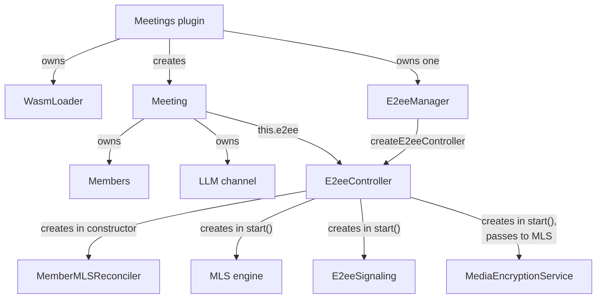
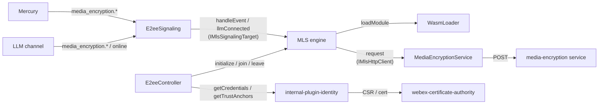
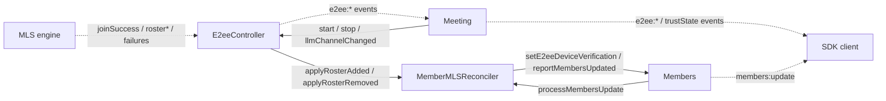

# E2EE / MLS in `plugin-meetings` — Design

> End-to-end-encrypted (E2EE) meetings, backed by MLS, are handled inside `@webex/plugin-meetings`,
> so an SDK client joins an E2EE meeting exactly like any other meeting (`meeting.joinWithMedia()`).

## Requirements

The SDK must:

1. Expose the meeting **security code**.
2. Expose per-**member** identity-verification status and certificate data, sourced from the MLS roster.
3. Pass SFrame media-encryption keys to the media connection
   (`MediaProperties.webrtcMediaConnection`).
4. Report whether **media services** (recording / transcoding / streaming servers) are in the MLS
   roster. Their presence means the meeting is not fully zero-trust.
5. Expose the meeting **trust state** (`calculating` | `strong` | `zeroTrust` | `adaptiveStrong` |
   `adaptiveZeroTrust`), derived live from the Locus flags, the MLS state and media-service presence.

The WASM module (libe2ee + mlspp, with a `WebE2EE` wrapper) is built outside this package and
placed in `packages/@webex/plugin-meetings/assets`.

## How a meeting becomes E2EE

E2EE is gated by the `meetings.enableE2ee` config (default `false`) **and** WebAssembly support
(`WebCapabilities.supportsWasm()`); both are checked by `MeetingsUtil.isE2eeEnabledAndSupported()`.

**Client → Locus** (join request, `meeting/request.ts`, only when E2EE is enabled and supported):

- `supportsV2E2EEncryption: true`
- `E2EE_1K_SUPPORTED` pushed onto `deviceCapabilities`

**Locus → client** (read from `locusInfo.info`):

- `isV2E2EEncrypted` — the meeting requires an MLS join and SFrame media encryption.
- `isBestEffortE2EEncryption` — adaptive ("best effort") E2EE; selects the `adaptive*` trust states.
- `mediaEncryptionGroupUrl` — the MLS group service URL.

An MLS join happens only when E2EE is enabled and supported, `isV2E2EEncrypted` is true and
`mediaEncryptionGroupUrl` is present (`E2eeController.required()`).

Once joined, the meeting **stays on MLS + SFrame** for its whole lifetime; there is no switching to
or from plain SRTP. In an adaptive meeting a non-E2EE client may join and have a media service
(Homer) encrypt on its behalf. That only changes the reported trust state
(`adaptiveZeroTrust → adaptiveStrong`), not our media encryption path.

## Decisions

| # | Decision |
|---|----------|
| D1 | E2EE is a **per-meeting component** owned by `Meeting` (`meeting.e2ee`), like `members` / `roap`. |
| D2 | The MLS engine is **isolated from I/O**: HTTP, signaling and module loading are injected adapters. |
| D3 | Identity/credentials live in a separate plugin, **`@webex/internal-plugin-identity`** (one instance per Webex client), split from MLS group logic. |
| D4 | Member verification is exposed on `Member`, but MLS roster data is kept in a **separate registry keyed by device URL** and reconciled, because Locus member updates and MLS roster updates arrive independently and in any order. |
| D5 | A device is **verified** when its selected X.509 identity result is `E2eeValidationResult.Success` with a verified identity type. `Member` exposes per-device data and an aggregated state. |
| D6 | The WASM module is **preloaded** in `Meetings.register()`; credentials are fetched lazily on the first E2EE meeting and cached. |
| D7 | MLS failures are **fatal for the E2EE session**, not the meeting: the session is torn down, a failure event and a behavioral metric are emitted, and the state becomes `failed` / `evicted`. The SDK does not leave the meeting; the app decides whether to retry (`meeting.e2ee.start()`) or leave. |
| D8 | Media-key injection uses a **new `internal-media-core` API** defined by this package (`IE2eeMediaConnection`); its implementation is out of scope here. |

## Architecture

Code lives in `src/e2ee/`; the generic WASM loader is `src/common/wasm-loader.ts`; credentials
come from `@webex/internal-plugin-identity` (imported by `plugin-meetings` and available as
`webex.internal.identity`).

**Ownership** — who owns or creates what:



**MLS protocol** — how the engine gets its inputs and talks to the service:



**State to the app** — how MLS results reach `Meeting`, `Members` and the SDK client (dashed
arrows are events):



```
src/e2ee/
├── E2eeManager.ts            # one per Meetings plugin; preloads WASM, creates E2eeController
├── E2eeController.ts         # per-meeting orchestrator (meeting.e2ee)
├── mls.ts                    # MLS engine wrapping the WebE2EE WASM module (no I/O deps)
├── E2eeSignaling.ts          # LLM + mercury media_encryption.* events -> MLS
├── MediaEncryptionService.ts # MLS HTTP requests -> webex.request (media-encryption)
├── MemberMLSReconciler.ts    # MLS roster <-> Members verification
├── types.ts                  # shared E2EE types and enums
├── constants.ts              # event names, service name, timeouts, WASM asset name
└── wasm.d.ts                 # WebE2EE WASM typings
```

## Components

### `WasmLoader` (`common/wasm-loader.ts`)

Generic, not E2EE-specific. `preload(wasmUrl)`, `get(wasmUrl)` and `isLoaded(wasmUrl)` load and
cache a module keyed by its `.wasm` URL; the `.js` loader URL is derived by replacing the suffix.
`Meetings` owns one instance.

### `E2eeManager`

One per `Meetings` plugin, created in the `READY` handler (`webex.config` and `webex.request` are not
available when plugins are constructed). `Meetings` resolves the WASM URL from
`meetings.assetsBaseUrl` + `E2EE_WASM_ASSET` and passes it in.

- `isEnabled` — `isE2eeEnabledAndSupported(webex.config)`.
- `preload()` — warms the WASM module when enabled. `register()` calls it fire-and-forget, so a
  failure never blocks registration.
- `createE2eeController(context)` — injects the loader, WASM URL and `webex.internal.identity`.

### `MLS` (`mls.ts`)

Wraps `WebE2EE`. Constructed with an `IMlsHttpClient` and a `loadModule()` callback; it has no
webex, HTTP or LLM dependencies.

- Methods: `initialize(config)`, `join()`, `leave()`, `handleEvent(bytes, source)`,
  `setLlmConnectedBeforeJoin(connected)`, `llmConnected()`, `getSecurityCode()`, `getRoster()`,
  `isLeader()`, `on()` / `off()`.
- Events: `joinSuccess` `{epoch, securityCode, sframe, key}`, `joinFailure` `{reason}`,
  `mediaEncryptionServiceFailure` `{errorCode, message}`, `newKey`, `useKey` `{epoch}`,
  `purgeKeys` `{epoch}`, `rosterAdded` `E2eeRosterMember[]`, `rosterRemoved` `{urls}`,
  `leaderChanged`, `evicted`, `versionNegotiated`, `securityCodeChanged` `{code}`.

Transactions are tracked by ID so a completion maps to its `join` or `update` origin. A failed
`join` emits `joinFailure` with the engine's reason (`timeout`, `join_failure`,
`tree_fetch_failure`, `commit_fetch_failure`). A failed `update` (including
`update_override`) is only logged: the engine rolls back and stays in the group.

**HTTP:** the engine's request bytes are JSON-decoded, sent via `httpClient.request(url, body)`, and
the response is JSON-encoded back into `completeHttpRequest`. Completion is always asynchronous so
the engine is never re-entered from its own callback. On failure MLS completes the request as failed
with the service's `error.body.errorCode`, or `0` for client-side errors (JSON, network).

If libe2ee cannot recover from a service error code, or fails to process a response, it throws
`e2ee_negotiation_failure` out of `completeHttpRequest` (recoverable codes such as `not_leader` and
`epochs_not_matching` are handled internally). In WASM this is an opaque value with no message, so MLS
catches it and emits `mediaEncryptionServiceFailure` instead of letting it become an unhandled
rejection.

The engine's `keepAlive()` is for backend services (e.g. Homer) and is not called by the SDK.

### `MediaEncryptionService`

Implements `IMlsHttpClient` with a bound `webex.request`:
`POST {service: 'media-encryption', url, body}`, resolving with the parsed response body.
Standard webex auth applies.

### `E2eeSignaling`

Subscribes to the `media_encryption.*` events (see `MEDIA_ENCRYPTION_MERCURY_EVENTS`) on **both**
the meeting's LLM channel and mercury, since either can deliver them, and forwards each envelope to
`session.handleEvent(bytes, source)` tagged `'llm'` or `'mercury'`.

When the LLM channel is already connected for this meeting's locus it calls
`setLlmConnectedBeforeJoin(true)`; otherwise it calls `llmConnected()` on the next locus-matched
`online`. The locus URL is read through a `getLocusUrl()` callback so it stays correct across
breakout moves. `setLlmChannel()` swaps the channel when `Meeting` replaces it on reconnect.

### `internal-plugin-identity`

- `getCredentials(contactId)` — generates an EC P-256 CSR, requests a certificate from
  `webex-certificate-authority` (including the root), and caches the in-flight promise per contact.
  Cached credentials are renewed when the leaf certificate expires within a day; concurrent callers
  share one renewal.
- `getTrustAnchors()` — `{webexCaRoots, userIdentityRoots}`. Integration roots when
  `services.isIntegrationEnvironment()` is true, otherwise production + FedRAMP roots.
  `userIdentityRoots` is currently empty.

### `MemberMLSReconciler`

Holds only the MLS roster (`Map<deviceUrl, E2eeRosterMember>`). The `deviceUrl → Member` index
lives in `MembersCollection.getMemberByDeviceUrl()`, and verification is stored on each `Member`.
Matching is per device: `rosterMember.url === member.participant.devices[i].url`.

Verification is surfaced through the existing `members:update` event; there is no dedicated event:

- **Locus-driven** — `Members` calls a registered pre-emit processor (`setMembersUpdateProcessor`)
  before emitting `members:update`; `processMembersUpdate` stamps verification onto the delta members.
- **Roster-driven** — `applyRosterAdded` / `applyRosterRemoved` update the affected devices and pass
  members whose verification changed to `reportMembersUpdated`, which makes `Members` emit
  `members:update` with them in `delta.updated`.

Roster entries without a matching member stay in the map and are applied when that member next
appears, so ordering does not matter. The controller creates the reconciler in its constructor
(when E2EE is enabled), so verification is stamped for the whole meeting lifetime.

**Member state.** Each device verification keeps libe2ee's overall `validationResult` and the parsed
X.509 `identityResults` (one per credential, each with its chain leaf-first), so apps can show
identity and certificate details without parsing DER. Per device, the first successful result is
selected, falling back to the first result. A failed selected result is unverified; otherwise its
leaf `identityType` decides: Webex user/machine and external verified identities are verified,
anonymous identities are unverified, and no result or an unknown type is unknown. `Member.e2eeVerificationState`
aggregates devices: all verified → `verified`; all unknown → `unknown`; none verified but at least
one unverified → `unverified`; otherwise `partiallyVerified`. Verifiable-credential identities are
not supported.

### `E2eeController` (`meeting.e2ee`)

Constructed with an `E2eeMeetingContext` (`correlationId`, `getLocusInfo()`, `getLlmChannel()`,
`members`), so it never references `Meeting` directly.

Public API: `state`, `getSecurityCode()`, `hasUntrustedMediaServices`, `start()`, `stop()`,
`llmChannelChanged()`, plus events (`EventsScope`).

`start()` never rejects, and is a no-op unless `required()` or while a session is already
`initializing`, `joining` or `joined`. It runs from `disabled`, `left`, `failed` and `evicted`, so an
app can retry after a failure by calling it again; each run creates a fresh MLS session:

1. State → `initializing`. Load the WASM module and fetch credentials in parallel.
2. Create `MediaEncryptionService` and `MLS`, wire session events, and `initialize()` with the device,
   correlation ID, display name, group URL, credentials, trust anchors and timeouts.
3. Start `E2eeSignaling`, state → `joining`, `session.join()`.

Session events:

- `joinSuccess` / `securityCodeChanged` → update the security code and emit
  `SECURITY_CODE_UPDATED`.
- `rosterAdded` / `rosterRemoved` → update the reconciler, recompute media-service presence, and
  check join completion.
- `joinFailure` / `mediaEncryptionServiceFailure` / `evicted` → `handleFatal()`.

**Join completion.** State becomes `joined` only when our own device URL appears in the MLS roster,
not on `joinSuccess`. This is what moves the trust state from `calculating` to `zeroTrust`.

**Media services.** `hasUntrustedMediaServices` is true when any roster member has device type
`MEDIA_SERVICE`. It is recomputed on every roster change and cleared on teardown; changes emit
`MEDIA_SERVICES_CHANGED {hasMediaServices}`. Some media services (video mesh) could be trusted in
future; for now any media service counts as untrusted.

**`handleFatal(state, reason, details)`** logs, sends the `js_sdk_e2ee_failure` behavioral metric
(`correlation_id`, `state`, `reason`, plus `errorCode` / `errorMessage` when available), tears down the
session, sets state `failed` or `evicted` (clearing the security code), and emits
`MEETING_E2EE_FAILURE {reason, errorCode?, errorMessage?}`. Reasons: `startFailed`, the engine's join-failure reason,
`mediaEncryptionServiceFailure`, `evicted`. It does not leave the meeting (see D7); the SDK does not
retry on its own.

**`stop()`** tears down (stop signaling, unsubscribe, `session.leave()`, reset the reconciler) and
sets state `left`. It is silent when state is `disabled`, so callers can invoke it unconditionally.
It also cancels a `start()` still awaiting the WASM module, credentials or MLS initialization: that
`start()` returns without starting signaling or joining, and without reporting a failure.

## Integration

**`Meetings`** — owns `WasmLoader` and `E2eeManager`, preloads in `register()`, and passes
`e2eeManager` to each `Meeting`.

**`Meeting`**

- Constructor: `this.e2ee = attrs.e2eeManager?.createE2eeController(context)`; E2EE events are
  forwarded on the `Meeting` emitter.
- Lifecycle (`updateE2eeOnSelfChange`, on `LOCUS_INFO_UPDATE_SELF`):
  - **start** when this device's `joinedWith` transitions to `JOINED`. Gating on this device, not the
    aggregate self state, avoids starting when another of the user's devices joins.
  - **stop** when the device is moved back into the lobby (`isUserUnadmitted` becomes true); a later
    re-admit starts again.
  - **stop** in `clearMeetingData()`.
- `llmChannelChanged()` is called whenever `Meeting` replaces its LLM channel.
- `trustState` getter:

  ```ts
  if (!this.isJoined()) return undefined;
  const adaptive = !!info?.isBestEffortE2EEncryption;
  const isEncrypted = !!info?.isV2E2EEncrypted;
  if (isEncrypted && this.e2ee?.state !== 'joined') return 'calculating';
  const zeroTrust = isEncrypted && !this.e2ee?.hasUntrustedMediaServices;
  if (adaptive) return zeroTrust ? 'adaptiveZeroTrust' : 'adaptiveStrong';
  return zeroTrust ? 'zeroTrust' : 'strong';
  ```

  `meeting:trustStateChanged {trustState}` is emitted whenever this value changes.

**`Member`** — `e2eeVerificationState` plus per-device `get/set/removeE2eeDeviceVerification(s)`.
`ParticipantDevice` gains `url` (present at runtime, previously missing from the type).

**Events** (`EVENT_TRIGGERS`):

| Event | Payload |
|-------|---------|
| `meeting:e2ee:securityCodeUpdated` | `{securityCode: string | undefined}` |
| `meeting:e2ee:stateChanged` | `{state: E2eeState}` |
| `meeting:e2ee:mediaServicesChanged` | `{hasMediaServices}` |
| `meeting:e2ee:failure` | `{reason: string, errorCode?: number, errorMessage?: string}` |
| `meeting:trustStateChanged` | `{trustState}` |

The E2EE controller payloads are typed by `E2eeControllerEventMap` in `e2ee/types.ts`.

## Static assets

The WASM module (`E2EE_WASM_ASSET`, with a sibling `.js` loader) is a runtime asset, not part of the
JS bundle, and is loaded from `meetings.assetsBaseUrl`. By default that URL is version-pinned on
unpkg (`webex@<sdk>/umd/assets/plugin-meetings/`, falling back to the plugin's `dist/assets/`), or
`/assets/plugin-meetings/` in development and when no version is known.

Each plugin keeps its files in its own `assets` folder. The package build copies them to
`dist/assets`, and the UMD build gathers them under `packages/webex/umd/assets/<plugin-name>/`, so
same-named files cannot collide. `samples:serve` serves each plugin's `assets` at
`/assets/<plugin-name>`. Self-hosting apps set `assetsBaseUrl` to a version-matched location; the
host must allow cross-origin requests and serve the `.js` file with a JavaScript MIME type.

## Planned / not yet implemented

- **Media-key injection.** `internal-media-core` will implement a new method (working name
  `setEncryptionKeys`; exact shape to be agreed with the media team) on both media connection types:

  ```ts
  interface IE2eeMediaConnection {
    setEncryptionKeys(config: {
      cipherSuite: number;
      epochBits: number;
      keys: Array<{epoch: number; baseKey: Uint8Array; index: number; indexBits: number}>;
      activeEncryptionEpoch?: number; // undefined => decrypt-only
    }): void;
  }
  ```

  A `MediaKeyController` will buffer the SFrame params (from `joinSuccess`) and keys (`newKey`,
  `useKey`, `purgeKeys`), and pass the **full key set** on every change. The call is idempotent, so
  keys that arrive before media and media recreated on reconnect are both handled by replaying the
  set. `Meeting` will attach it after `createMediaConnection()` and detach it in
  `closePeerConnections()`. The MLS session and LLM persist across media reconnects, so the group is
  not rejoined.
- **Media while E2EE has failed.** Because the SDK no longer leaves on failure (D7), the
  `MediaKeyController` must ensure media is never sent unencrypted while E2EE is `failed` /
  `evicted`. `trustState` currently stays `calculating` in that case; a dedicated failed value may
  be added for app UIs.

## Testing

Unit specs live in `test/unit/spec/e2ee/` (one per module) plus `common/wasm-loader`, `meeting`,
`meetings`, `member(s)` and `internal-plugin-identity` specs. `MLS` is tested against a fake `WebE2EE` module with no webex dependency, and the adapters against stubbed `webex.request`, LLM and mercury.
