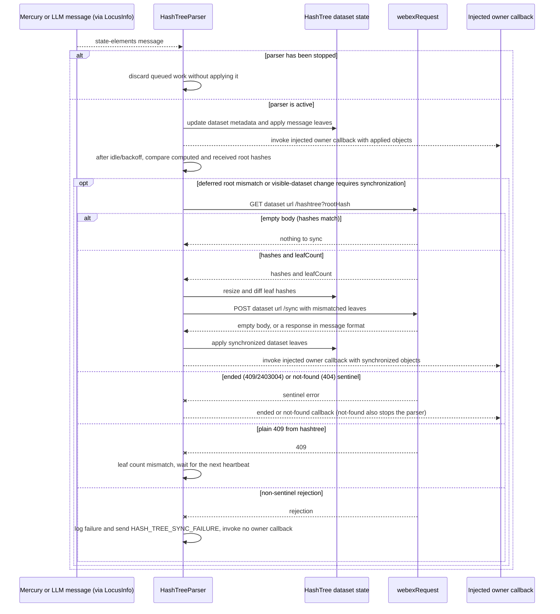
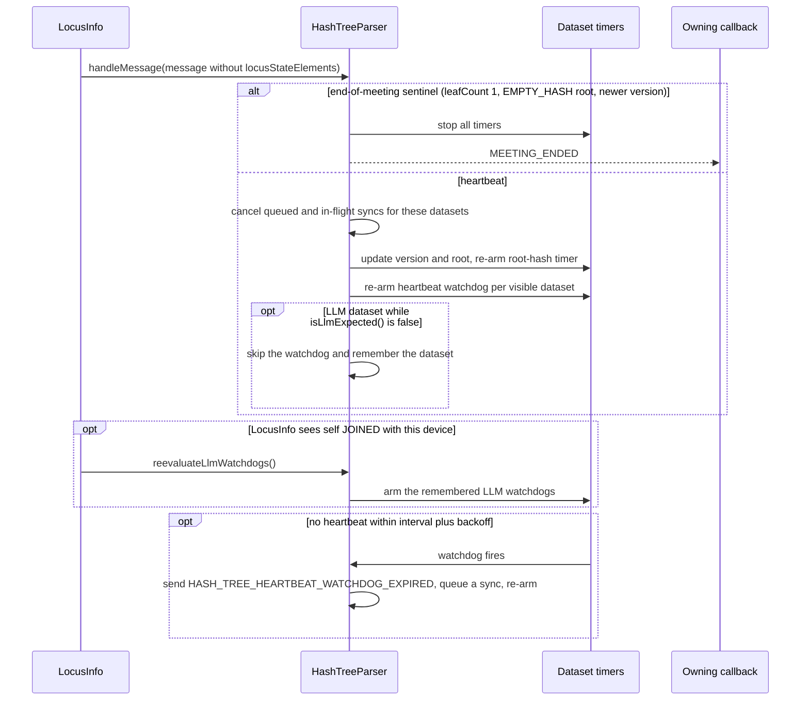
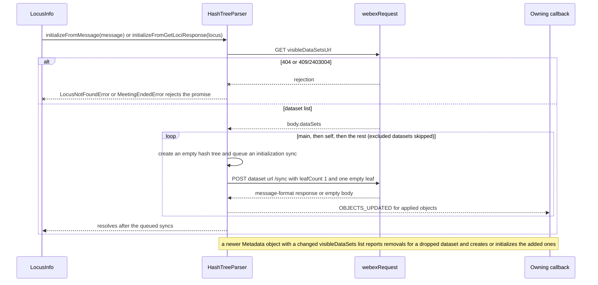
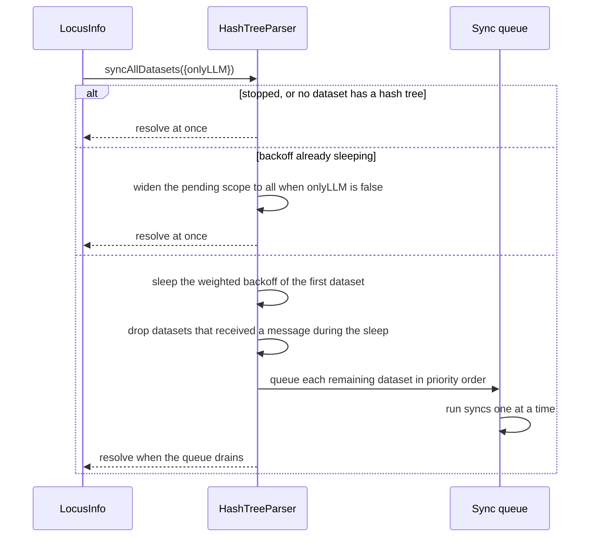
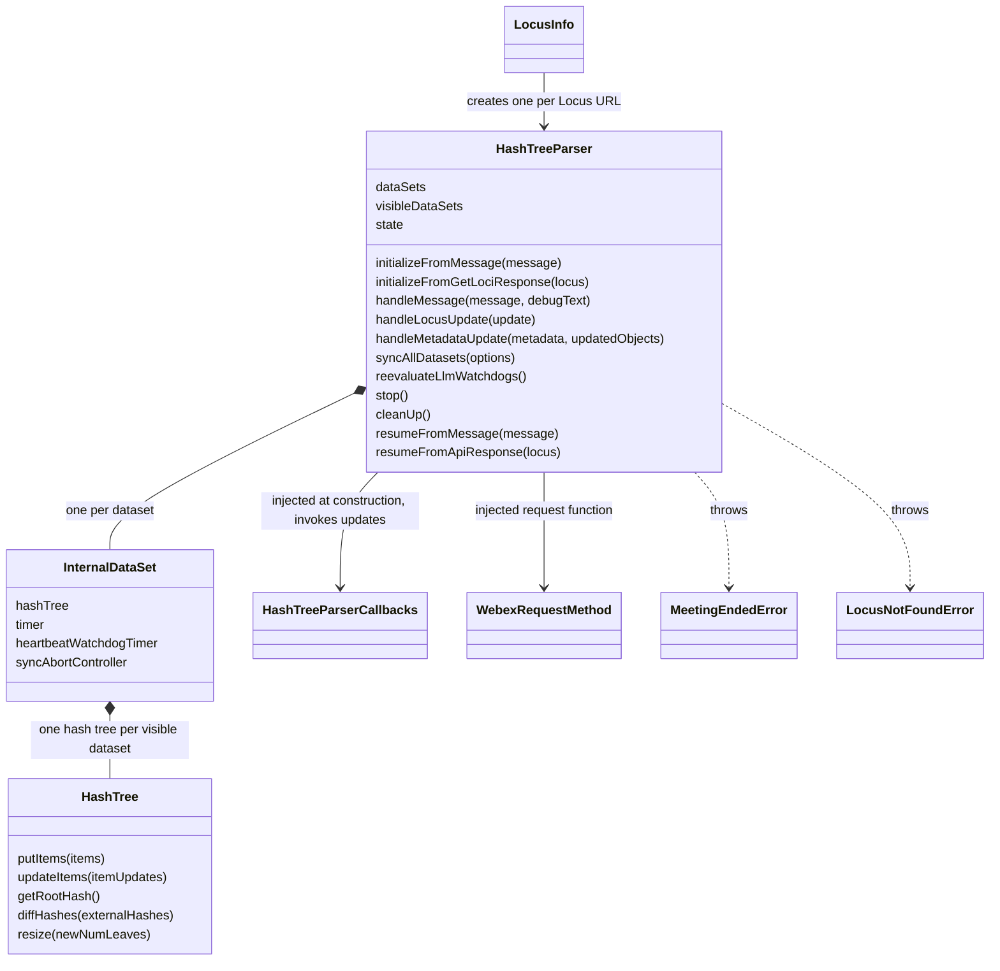
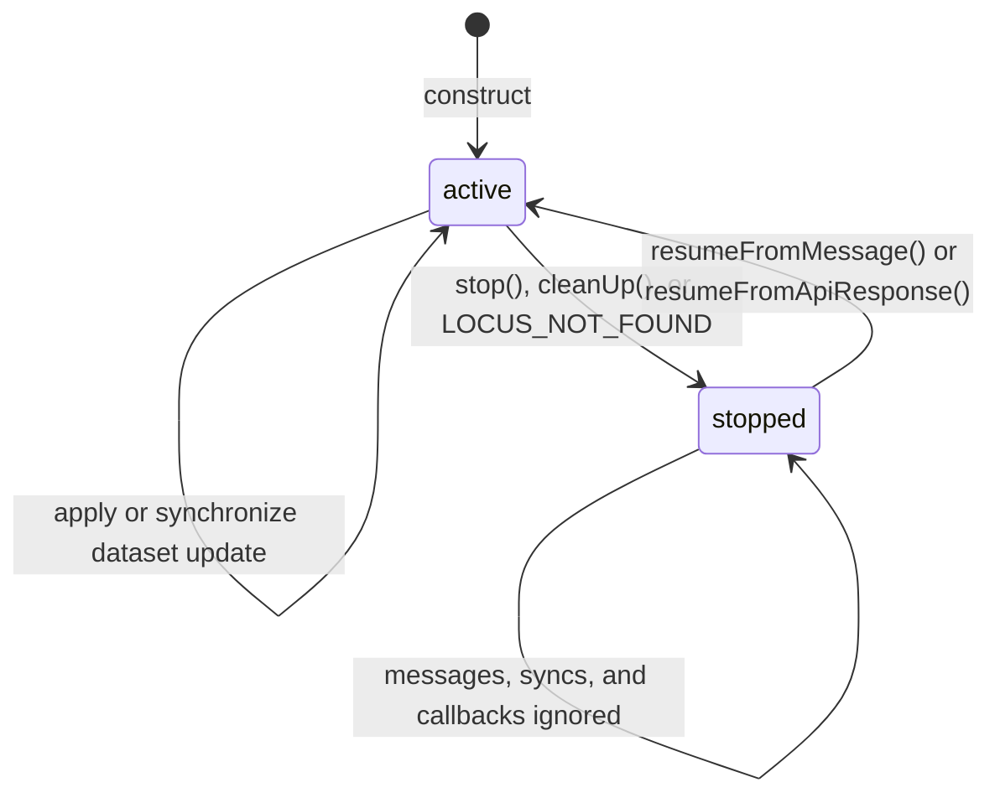

<!-- sdd-generated-metadata
doc_kind: module-spec
generated_from: module-spec@0.3.0
generated_by: claude-code
approved_by: rarajes2@cisco.com
updated_at: 2026-11-16T14:30:00Z
validation_status: not-run
-->

# Hash tree

This source-local document at `src/hashTree/docs/README.md` owns the stable specification for
**the hash tree module**: `HashTreeParser`, which keeps one client copy of each visible Locus dataset
in step with Locus by comparing hash trees, and `HashTree`, the versioned leaf structure it hashes.
`LocusInfo` creates one parser per Locus URL and receives its typed updates; see the
[Locus info specification](../../locus-info/docs/README.md). Ground every claim in package evidence
and link to the [package architecture](../../../docs/architecture.md) instead of repeating broader
facts. No service specification exists because this package is a library.

Related context: [documentation index](../../../docs/index.md) ·
[package agent instructions](../../../AGENTS.md)

## Metadata

| Field | Value |
| ----- | ----- |
| Owner | @webex/web-client, @webex/web-sdk |
| Source path | `src/hashTree` |
| Resource kind | module |
| Status | Draft |
| Last verified | 2026-11-16 at `0b8c34db7f` |
| Module id | `plugin-meetings/hashTree` |
| Parent spec | — |
| Doc kind | Module spec |
| Coverage score | Pending coverage assessment |
| Validation status | not-run |

## Applicability

| Condition ID                         | Status     | Evidence or reason | Owned section |
| ------------------------------------ | ---------- | ------------------ | ------------- |
| `module.has_tiers`                   | N/A        | No tier policy exists in `package.json` or `.sdd/manifest.json` | Tier |
| `module.has_ui`                      | N/A        | `src/hashTree/hashTreeParser.ts` returns data through callbacks and renders nothing | UI use-case flow |
| `module.crosses_service_boundaries`  | Applicable | `src/hashTree/hashTreeParser.ts` sends GET visibleDataSetsUrl, GET dataset hashtree, and POST dataset sync requests to Locus through the injected request function | Cross-boundary use-case flow |
| `module.holds_client_state`          | Applicable | `src/hashTree/hashTreeParser.ts` keeps per-dataset hash trees, timers, the sync queue, and the parser state; `src/hashTree/hashTree.ts` keeps leaf items | Client state model |
| `module.enforces_domain_rules`       | Applicable | Version rules in `src/hashTree/hashTree.ts`; update filtering, sentinel and visibility rules in `src/hashTree/hashTreeParser.ts` | Business rules and invariants |
| `module.is_concurrent_async`         | Applicable | Idle and watchdog timers, a sequential sync queue, abort controllers, and a backoff sleep in `src/hashTree/hashTreeParser.ts` and `src/hashTree/utils.ts` | Concurrency and reactive flow |
| `module.owns_persistence`            | N/A        | Everything is in memory; `src/hashTree/hashTreeParser.ts` writes no storage | Data, schema, and migration discipline |
| `module.stateful_transitions`        | Applicable | The parser moves between active and stopped through stop, resumeFromMessage, and resumeFromApiResponse in `src/hashTree/hashTreeParser.ts` | State machine |
| `module.exposes_wire_protocol`       | Applicable | The hash tree message, heartbeat, hashtree, and sync payload shapes in `src/hashTree/hashTreeParser.ts` and `src/hashTree/types.ts`, and the hash algorithm in `src/hashTree/hashTree.ts` | Protocol and wire format |
| `module.ui_multi_screen`             | N/A        | No UI | UI flow |
| `module.large_data_model`            | N/A        | The few types are listed under Protocol and wire format; `src/hashTree/types.ts` is 43 lines | Data model |
| `module.returns_caller_errors`       | Applicable | Constructors throw, initialization and resume promises reject with sentinel errors, and updates report MEETING_ENDED or LOCUS_NOT_FOUND, in `src/hashTree/hashTree.ts` and `src/hashTree/hashTreeParser.ts` | Caller-visible failure modes |
| `module.module_specific_conventions` | N/A        | The module follows the package-wide logging and metrics conventions in `src/hashTree/hashTreeParser.ts`; no extra rule is set | Module-specific rules |
| `module.published_package`           | N/A        | `src/index.ts` exports nothing from this module; it is internal to the package | Export stability |
| `module.embedded_in_host`            | N/A        | No host theme or embed API | Host integration and theming |
| `module.has_design_tradeoff`         | Applicable | Incremental datasets reconciled by hashes instead of full Locus state, in `src/hashTree/hashTreeParser.ts` | Key design trade-off |
| `module.has_submodules`              | N/A        | The src/hashTree directory has no child module in `.sdd/manifest.json` | Sub-modules |

## Evidence register

Requirements cite current implementation and mirrored unit-test paths. Current code wins over prose
when they conflict; commit and PR history are excluded by repository-owner decision. Missing test
evidence is stated as a gap rather than inferred.

| Evidence | What it establishes |
| -------- | ------------------- |
| `src/hashTree/hashTree.ts` | `HashTree`: leaves keyed by `id % numLeaves`, version rules for put and remove, XXH3-128 leaf and node hashes, `resize`, `diffHashes` |
| `src/hashTree/hashTreeParser.ts` | `HashTreeParser`, its exported types, `SyncAllBackoffType`, `LocusInfoUpdateType`, `MeetingEndedError`, `LocusNotFoundError`; every request to Locus, the timers, the sync queue, and the update filter |
| `src/hashTree/constants.ts` | `EMPTY_HASH`, `DataSetNames`, `DATA_SET_INIT_PRIORITY` (main before self, with the reason in a comment), `LLM_DATASET_NAMES` |
| `src/hashTree/types.ts` | `ObjectType`, `ObjectTypeToLocusKeyMap`, `HtMeta`, `HashTreeObject` |
| `src/hashTree/utils.ts` | `isSelf`, `isMetadata`, `deleteNestedObjectsWithHtMeta`, `sortByInitPriority`, `sleep` |
| `src/locus-info/index.ts` | The only creator of parsers (`createHashTreeParser`): injects `webex.request`, `updateFromHashTree`, the sync latency tracker, `isLlmExpected` (self `joinedWith.state` is `JOINED`), a tracking id generator, and `excludedDataSets`; calls `reevaluateLlmWatchdogs` when LLM becomes expected |
| `src/locus-info/types.ts` | `LocusErrorCodes.LOCUS_INACTIVE` (`2403004`) used by the meeting-ended sentinel |
| `src/config.ts` | Default `meetings.locus.excludedDataSets` is `['attendees']` |
| `src/metrics/constants.ts` | `HASH_TREE_SYNC_FAILURE`, `HASH_TREE_HEARTBEAT_WATCHDOG_EXPIRED`, `HASH_TREE_EMPTY_LOCUS_STATE_ELEMENTS` metric names |
| `src/meeting/index.ts`, `src/meetings/index.ts` | Import only types (`DataSet`, `HashTreeMessage`, `Metadata`, `HashTreeObject`) and `isSelf` |
| `package.json` | `xxh3-ts` dependency; `test:unit` runs `webex-legacy-tools test --unit --runner mocha` |
| `test/unit/spec/hashTree/hashTree.ts` | Put, remove, update, resize, diff, hash, and version cases for `HashTree` |
| `test/unit/spec/hashTree/hashTreeParser.ts` | Initialization, messages, sync algorithm, sentinels, visible dataset changes, heartbeat watchdog, update filtering, stop, resume, `syncAllDatasets`, sync queue, abort controller, and sync metrics cases |
| `test/unit/spec/hashTree/utils.ts` | `deleteNestedObjectsWithHtMeta`, `isSelf`, `sortByInitPriority`, `sleep` cases |
| Observation, `src/hashTree/hashTreeParser.ts` | `parseMessage` logs a warning and sends `HASH_TREE_EMPTY_LOCUS_STATE_ELEMENTS` when a message carries an empty `locusStateElements` array; the code gives no reason why this case is measured, so it is recorded here rather than as a requirement |
| Observation, `src/hashTree/hashTree.ts` | `getLeafData` returns a leaf's items sorted by id; its comment calls the sort optional, and `performSync` sends that order in `leafDataEntries`; no reason for the order is recorded, so it is not a requirement |

## Purpose and boundary

- Responsibility: tracks incremental Locus dataset versions, detects gaps, fetches missing datasets,
  and emits typed update callbacks.
- In scope: the `HashTree` leaf structure and its hashes; one `HashTreeParser` per Locus URL with
  its dataset table, visible dataset list, root-hash sync timers, heartbeat watchdogs, sync queue,
  `syncAllDatasets`, the meeting-ended and Locus-not-found sentinels, and the filter that drops
  stale updates before the callback.
- Out of scope: turning hash tree objects into the Locus DTO and meeting events (`LocusInfo`,
  [Locus info specification](../../locus-info/docs/README.md)); choosing which parser a message
  belongs to; the Mercury and LLM sockets; the HTTP pipeline behind the injected request function;
  the sync latency metrics store behind `syncLatencyTracker`.
- Consumers: `src/locus-info/index.ts` creates and drives every parser. `src/meeting/index.ts`,
  `src/meetings/index.ts`, and `src/locus-info/types.ts` import types and `isSelf`. Nothing is
  exported from `src/index.ts`.

## Structure and key files

`src/hashTree` contains 5 direct source files and has 3 mirrored unit-test files under
`test/unit/spec/hashTree`; the sections below separate its public operations, runtime data
movement, component ownership, state, and verification boundary. The code is TypeScript in the Node 22.14 Yarn workspace, built by
`yarn workspace @webex/plugin-meetings build:src`; tests use Mocha (`test:unit` runs
`webex-legacy-tools test --unit --runner mocha`), Sinon, and `@webex/test-helper-chai`.

| File | Holds |
|---|---|
| `src/hashTree/constants.ts` | module constants and wire values: `EMPTY_HASH`, `DataSetNames`, `DATA_SET_INIT_PRIORITY`, `LLM_DATASET_NAMES` |
| `src/hashTree/hashTree.ts` | `HashTree`: versioned leaf items, XXH3-128 leaf and tree hashes, resize, and hash diff; no I/O |
| `src/hashTree/hashTreeParser.ts` | `HashTreeParser`: dataset table, message and API-response handling, sync queue, timers, sentinels, and the update callback; plus the exported message, dataset, and callback types and the two sentinel error classes |
| `src/hashTree/types.ts` | module type declarations: `ObjectType`, `ObjectTypeToLocusKeyMap`, `HtMeta`, `HashTreeObject` |
| `src/hashTree/utils.ts` | normalization/helper functions: `isSelf`, `isMetadata`, `deleteNestedObjectsWithHtMeta`, `sortByInitPriority`, `sleep` |
| `test/unit/spec/hashTree/hashTree.ts`, `test/unit/spec/hashTree/hashTreeParser.ts`, `test/unit/spec/hashTree/utils.ts` | mirrored unit coverage of the structure, the parser, and the helpers |
| `src/hashTree/docs/README.md` | This module specification |

## Public surface

| Contract ID | Type | Surface | Purpose | Compatibility / deprecation | Schema / detail link | Root index |
|---|---|---|---|---|---|---|
| `hash-tree-sync` | in-memory structure | `HashTree.putItem()`, `putItems()`, `removeItem()`, `removeItems()`, and `updateItems()` | Apply version-aware leaf mutations to the pure hash-tree data structure. | Older/equal item versions do not replace newer data; a removal applies only when its version is equal to or newer than the stored one; preserve leaf-bucket semantics (`id % numLeaves`). | `src/hashTree/hashTree.ts` | [architecture](../../../docs/architecture.md) |
| `hash-tree-sync` | in-memory structure | `computeLeafHash()`, `computeTreeHashes()`, `getHashes()`, `getRootHash()`, `getLeafCount()`, `getTotalItemCount()`, `getLeafData()`, and `getItemVersion()` | Compute and inspect dataset hashes and stored item/version information. | Hash ordering (internal nodes then leaves) and result shapes are synchronization contracts. | `src/hashTree/hashTree.ts` | [architecture](../../../docs/architecture.md) |
| `hash-tree-sync` | in-memory structure | `HashTree.resize()` and `diffHashes()` | Resize the leaf layout and locate differing leaf indexes during synchronization. | Preserve deterministic redistribution and diff-index semantics; a too-short external list marks every leaf as different. | `src/hashTree/hashTree.ts` | [architecture](../../../docs/architecture.md) |
| `hash-tree-sync` | parser initialization | `HashTreeParser.initializeFromMessage()` and `initializeFromGetLociResponse()` | Fetch dataset metadata from the visibleDataSetsUrl of a Mercury hash-tree message or a get-loci response, then run an initialization sync per visible dataset. | Preserve dataset initialization priority (main, then self) and wait for the queued syncs; sentinel errors reject the promise. | `src/hashTree/hashTreeParser.ts` | [architecture](../../../docs/architecture.md) |
| `hash-tree-sync` | parser updates | `handleMetadataUpdate()`, `handleLocusUpdate()`, and `handleMessage()` | Apply message or API-response items, emit the resulting callback, and schedule any root-hash reconciliation required for the dataset. | Preserve the implemented ordering: `parseMessage()` mutates item state, `handleMessage()` invokes the callback and then re-arms watchdogs, and the delayed sync algorithm checks the resulting root hash separately. | `src/hashTree/hashTreeParser.ts` | [architecture](../../../docs/architecture.md) |
| `hash-tree-sync` | parser synchronization | `syncAllDatasets({onlyLLM})`, `resumeFromMessage()`, and `resumeFromApiResponse()` | Sync every dataset with a hash tree after one weighted backoff, or rebuild a stopped parser from a message or API response and resume processing. | Preserve ended/not-found sentinel handling, the backoff scope upgrade, and stopped-parser guards; `resumeFromMessage()` ignores a message without Metadata visibleDataSets. | `src/hashTree/hashTreeParser.ts` | [architecture](../../../docs/architecture.md) |
| `hash-tree-sync` | parser lifecycle | `stop()`, `cleanUp()`, and `reevaluateLlmWatchdogs()` | Stop future mutation and release queued/parser-owned state; arm LLM dataset watchdogs that were skipped while LLM was not expected. | Work completed after stop must not mutate the stopped parser; `cleanUp()` also empties the dataset table. | `src/hashTree/hashTreeParser.ts` | [architecture](../../../docs/architecture.md) |
| `hash-tree-sync` | exported contracts/helpers | `EMPTY_HASH`, `DataSetNames`, `DATA_SET_INIT_PRIORITY`, `LLM_DATASET_NAMES`, `LeafDataItem`, `SyncAllBackoffType`, `DataSet`, `RootHashMessage`, `HashTreeMessage`, `VisibleDataSetInfo`, `Metadata`, `LocusInfoUpdateType`, `LocusInfoUpdate`, `LocusInfoUpdateCallback`, `SyncLatencyTracker`, `HashTreeParserCallbacks`, `MeetingEndedError`, `LocusNotFoundError`, `ObjectType`, `ObjectTypeToLocusKeyMap`, `HtMeta`, `HashTreeObject`, `isSelf()`, `isMetadata()`, `deleteNestedObjectsWithHtMeta()`, `sortByInitPriority()`, and `sleep()` | Share the exact dataset protocol vocabulary, sentinel errors, and normalization helpers used by Locus integration. | Preserve dataset names, error identity, ordering, and raw message fields. | `src/hashTree/hashTree.ts`, `src/hashTree/hashTreeParser.ts`, `src/hashTree/types.ts`, `src/hashTree/constants.ts`, `src/hashTree/utils.ts` | [architecture](../../../docs/architecture.md) |

Compatibility notes:

- Prefer additive options and payload fields. Preserve method/event names, rejection semantics, and
  cleanup timing. The module is internal: change its surface together with `src/locus-info/index.ts`,
  the owning object, rather than through `src/index.ts`, which exports none of it.

Contract ID `hash-tree-sync` is registered in `.sdd/manifest.json` with source
`src/hashTree/hashTreeParser.ts` and indexed in the
[package architecture](../../../docs/architecture.md). The module requires `locus-http`, the Locus
REST service, reached here only through the injected request function.

## Dependencies

Hash-tree wire messages, the injected dataset request function, Locus identifiers, the XXH3 checksum,
and the consumer callbacks are the module's inputs.

| Dependency | Why it is required | Failure behavior |
| ---------- | ------------------ | ---------------- |
| Injected `webexRequest` (`webex.request` bound by `LocusInfo`) | GET visibleDataSetsUrl, GET `<dataset url>/hashtree`, POST `<dataset url>/sync` | 404 and 409/2403004 become sentinel errors; other errors are logged, reported as `HASH_TREE_SYNC_FAILURE` (hashtree and sync), and rethrown to the parser's own catch |
| `HashTreeParserCallbacks.locusInfoUpdateCallback` (`LocusInfo.updateFromHashTree`) | Receives `OBJECTS_UPDATED`, `MEETING_ENDED`, and `LOCUS_NOT_FOUND` | Called synchronously; never called once the parser is stopped |
| `HashTreeParserCallbacks.isLlmExpected` | Gates heartbeat watchdogs of the LLM datasets (main, atd-active, atd-unmuted) | Declared required but guarded at the call site; absent means the watchdog is armed |
| `syncLatencyTracker`, `generateTrackingId` (optional callbacks) | Sync latency timestamps and per-request tracking ids for main, atd-active, and atd-unmuted | Absent tracker means no sync metrics and no forced tracking ids |
| `xxh3-ts` (`XXH3_128`) | Leaf and internal node hashes that must equal Locus's | — |
| `lodash` (`cloneDeep`, `isEmpty`, `zip`) | Copying leaf data, empty-body checks, pairing put results with leaves | — |
| `src/common/logs/logger-proxy.ts`, `src/metrics/index.ts`, `src/metrics/constants.ts` | Logging and the three hash tree behavioral metrics | — |
| `src/locus-info/types.ts` (`LocusDTO`, `LocusErrorCodes`) | The get-loci response type and the `LOCUS_INACTIVE` code | — |
| `src/constants.ts` (`Enum`, `HTTP_VERBS`) | Type helper and HTTP verbs | — |

## Requirements

| ID | WHAT | WHY | Source Evidence | Test / Example Evidence | Assumptions / Gaps | Confidence |
|---|---|---|---|---|---|---|
| `HASH-TREE-R-001` | `HashTreeParser` parses hash-tree messages, tracks dataset versions, detects gaps by root hash, fetches datasets, and emits typed update callbacks; `HashTree` stores leaf items and computes leaf/tree hashes without any I/O. | Parser synchronization behavior and the hash data structure have different ownership and must not be attributed to the same file. | `src/hashTree/hashTreeParser.ts`, `src/hashTree/hashTree.ts` | `test/unit/spec/hashTree/hashTreeParser.ts`, `test/unit/spec/hashTree/hashTree.ts` | none | PRESENT |
| `HASH-TREE-R-002` | `HashTreeParser.parseMessage()` updates dataset metadata, cancels pending and in-flight syncs for the message's datasets, and applies message items; `handleMessage()` then invokes the object-update callback. `runSyncAlgorithm()` performs the root-hash comparison later, after the dataset's `idleMs` plus a weighted random backoff, and queues synchronization on mismatch. | Callers need the real callback-versus-reconciliation ordering and must not assume the callback waits for the deferred root-hash check. | `src/hashTree/hashTreeParser.ts`, `src/hashTree/hashTree.ts`, `src/hashTree/utils.ts` | `test/unit/spec/hashTree/hashTreeParser.ts`, `test/unit/spec/hashTree/hashTree.ts`, `test/unit/spec/hashTree/utils.ts` | none | PRESENT |
| `HASH-TREE-R-003` | `performSync()` converts meeting-ended/not-found responses into their sentinel callback paths (`LOCUS_NOT_FOUND` also stops the parser), catches and logs other synchronization failures after the request layer sends `HASH_TREE_SYNC_FAILURE`, and prevents stopped-parser work from being applied. | Sentinel dataset outcomes, logged sync failure, and stopped work must remain distinct so no failed fetch is misreported as a caller-visible rejection or current state. | `src/hashTree/hashTreeParser.ts` | `test/unit/spec/hashTree/hashTreeParser.ts` | the queue continuing with the next entry after a non-sentinel failure has no explicit case | PRESENT |
| `HASH-TREE-R-004` | `resetHeartbeatWatchdogs()` clears and re-arms a per-dataset timer at `heartbeatIntervalMs + getWeightedBackoffTime(backoff)`, preferring the dataset-level `heartbeatIntervalMs` over `topLevelHeartbeatIntervalMs`. It skips any dataset without a `hashTree`, without a resolved non-zero interval, or that `isVisibleDataSet()` rejects, and skips a dataset in `LLM_DATASET_NAMES` when the injected `callbacks.isLlmExpected()` returns false, remembering it so `reevaluateLlmWatchdogs()` arms it once LLM becomes expected. On expiry it emits `HASH_TREE_HEARTBEAT_WATCHDOG_EXPIRED`, saves the backoff latency, enqueues a sync for that dataset, and re-arms itself. `handleMessage()` re-arms the watchdogs *after* `callLocusInfoUpdateCallback()` on the state-elements path, and immediately after `handleRootHashHeartBeatMessage()` on the heartbeat-only path. | A watchdog armed for a dataset whose transport is not connected would fire on every interval and enqueue perpetual syncs, so visibility and LLM-expectation gating are part of the contract, not an optimization. Re-arming after the update callback keeps the timer anchored to the point the message was actually applied; the pending set avoids missing a watchdog when an LLM dataset arrives before the self update (code comment). | `src/hashTree/hashTreeParser.ts`, `src/hashTree/constants.ts`, `src/locus-info/index.ts` | `test/unit/spec/hashTree/hashTreeParser.ts` | the `isLlmExpected` callback is declared required on `HashTreeParserCallbacks` but is also guarded for absence at the call site; treat the guard as current behavior | PRESENT |
| `HASH-TREE-R-005` | `HashTree` puts an item into leaf `id % numLeaves` only when no item with that type and id exists or the stored version is lower; it removes an item only when the stored version is lower than or equal to the given one. Every mutation returns `false` on a tree with 0 leaves. The constructor and `resize()` throw unless the leaf count is 0 or a power of 2. | The leaf layout must match Locus's, because `diffHashes()` compares our leaf hashes with the hashes Locus returns for the same leaf count, and a stale message must never roll an item back. | `src/hashTree/hashTree.ts` | `test/unit/spec/hashTree/hashTree.ts` | none | PRESENT |
| `HASH-TREE-R-006` | A leaf hash is `XXH3_128` (seed 0) over the leaf's items, types in lexicographic order and ids ascending within a type, each written as 64-bit little-endian id then version, rendered as 32 hex digits. Internal nodes hash the byte-reversed halves of the left and right child hashes (the left child repeats when there is no right one). `getHashes()` returns internal nodes then leaves; an empty leaf and a 0-leaf tree hash to `EMPTY_HASH`. | The parser compares `getRootHash()` with the root Locus sends and sends it on every hashtree and sync request, so the algorithm must reproduce Locus's hashes byte for byte. | `src/hashTree/hashTree.ts`, `src/hashTree/constants.ts` | `test/unit/spec/hashTree/hashTree.ts` | none | PRESENT |
| `HASH-TREE-R-007` | Before calling `locusInfoUpdateCallback`, `OBJECTS_UPDATED` objects are dropped when any visible dataset holds a higher version of the same type and id, and removals are dropped while any visible dataset still holds a version equal or higher; nothing is called when every object is dropped or the list is empty. `MEETING_ENDED` and `LOCUS_NOT_FOUND` always pass. Nothing is called on a stopped parser. | One object can belong to several datasets, so an update or removal arriving through one dataset must not override what another dataset still holds (code comments in the filter). | `src/hashTree/hashTreeParser.ts` | `test/unit/spec/hashTree/hashTreeParser.ts` | none | PRESENT |
| `HASH-TREE-R-008` | A message in which any dataset named main, self, or unjoined has `leafCount` 1, root `EMPTY_HASH`, and a version newer than ours (or is unknown to us) is the end-of-meeting sentinel: the parser stops all timers and reports `MEETING_ENDED` without applying the message. | The code comment: this is a special way for Locus to indicate that the meeting has ended. | `src/hashTree/hashTreeParser.ts`, `src/hashTree/constants.ts` | `test/unit/spec/hashTree/hashTreeParser.ts` | none | PRESENT |
| `HASH-TREE-R-009` | Any request to Locus that fails with 404 stops all timers and throws `LocusNotFoundError`; a 409 whose `body.errorCode` is `LOCUS_INACTIVE` (`2403004`), for main, self, unjoined, or the visibleDataSetsUrl request, stops all timers and throws `MeetingEndedError`. Inside a sync they become `LOCUS_NOT_FOUND` (and `stop()`) or `MEETING_ENDED`; from initialization and resume they reject the caller. Any other 409 from the hashtree request ends that sync silently. | The code comments: a 404 means the Locus URL is no longer valid (moved to a breakout, or ended), while a dataset that is only not visible answers 400; a plain 409 is a leaf count mismatch, so the client waits for the next heartbeat. | `src/hashTree/hashTreeParser.ts`, `src/locus-info/types.ts` | `test/unit/spec/hashTree/hashTreeParser.ts` | the plain-409 hashtree branch has no case | PRESENT |
| `HASH-TREE-R-010` | Syncs run from one queue, one at a time; a dataset already queued is not queued again (an initialization request upgrades the entry), entries for datasets without a hash tree are skipped, and the loop stops when the parser stops. A message or heartbeat for a dataset removes its queued entries and aborts its in-flight sync, which is abandoned before the sync request is sent. | The code comment: all syncs are executed sequentially and no more than one runs at a time; a message received during a sync makes that sync's result obsolete. | `src/hashTree/hashTreeParser.ts` | `test/unit/spec/hashTree/hashTreeParser.ts` | none | PRESENT |
| `HASH-TREE-R-011` | A normal sync of a dataset with `leafCount` other than 1 GETs `<url>/hashtree?rootHash=<ours>`; an empty body means the hashes match. Otherwise the tree is resized to the returned leaf count, `diffHashes()` picks the mismatched leaves, and `POST <url>/sync?rootHash=<ours>` sends `{leafCount, leafDataEntries: [{leafIndex, elementIds}]}`. A 1-leaf dataset skips the hashtree request and sends leaf 0. An initialization sync sends `leafCount` 1 and one empty leaf. A non-empty sync response is filtered to the requested dataset and handled as a message; the root-hash timer is re-armed after every sync. | The code comments: Locus requires leafCount 1 with one empty leaf for initialization; filtering prevents shared datasets such as unjoined from being applied once per dataset; the timer is a safety net in case the data does not arrive by message. | `src/hashTree/hashTreeParser.ts`, `src/hashTree/hashTree.ts` | `test/unit/spec/hashTree/hashTreeParser.ts` | none | PRESENT |
| `HASH-TREE-R-012` | `syncAllDatasets({onlyLLM})` returns at once when stopped or when nothing has a hash tree; otherwise it sleeps `round(random ** exponent * maxMs)` from the first dataset's backoff, then queues every dataset with a hash tree (only the LLM datasets when `onlyLLM`) in priority order, skipping datasets that received a message during the sleep. A call during the sleep returns at once and can only widen the scope from LLM-only to all. | The code comment: delaying the start of the syncs is a Locus requirement to avoid thundering herd issues. | `src/hashTree/hashTreeParser.ts`, `src/hashTree/utils.ts`, `src/hashTree/constants.ts` | `test/unit/spec/hashTree/hashTreeParser.ts` | none | PRESENT |
| `HASH-TREE-R-013` | Visible datasets change only through a newer Metadata object. A dataset that leaves the list produces a removal object (data `null`) for every leaf item and loses its hash tree, timers, and in-flight sync. A dataset that joins gets an empty hash tree and a sync timer when its info is known, or is initialized asynchronously from visibleDataSetsUrl in priority order. Datasets in `excludedDataSets` (default attendees) never become visible. | The code comments: when a visible dataset is removed the client must be told that all its objects are removed; the attendees dataset is never needed (`src/config.ts`). | `src/hashTree/hashTreeParser.ts`, `src/hashTree/utils.ts`, `src/config.ts` | `test/unit/spec/hashTree/hashTreeParser.ts` | none | PRESENT |
| `HASH-TREE-R-014` | Dataset initialization, new visible dataset initialization, and `syncAllDatasets` order datasets main first, then self, then the rest in their received order. | The code comment: `LocusInfo` processes updated objects in order, and the self handler reads `locus.info.isWebinar`, which comes from main, to decide whether to create a webinar attendee's participant. | `src/hashTree/constants.ts`, `src/hashTree/utils.ts` | `test/unit/spec/hashTree/utils.ts`, `test/unit/spec/hashTree/hashTreeParser.ts` | none | PRESENT |
| `HASH-TREE-R-015` | Sync latency metrics are recorded only for main, atd-active, and atd-unmuted, only for non-initialization syncs, and only with a `syncLatencyTracker`. Each sync generates two tracking ids, hashtree first, and forces them onto the hashtree and sync request headers; a sync that sends no sync request clears only its own record. Completion is not recorded here. | The code comments: each Locus request must carry its own tracking id, the sync request's id is the one Locus echoes on the LLM message, and completion is driven from the LLM message path in `Meeting`. | `src/hashTree/hashTreeParser.ts` | `test/unit/spec/hashTree/hashTreeParser.ts` | none | PRESENT |
| `HASH-TREE-R-016` | The constructor builds a hash tree only for datasets in the Metadata visibleDataSets list that are also in `dataSets` and not excluded, seeding it from the `htMeta` found anywhere in the initial Locus and from the Metadata object; it throws when the Metadata `htMeta.dataSetNames` is not exactly `["self"]`. | The code comment: Locus always sends Metadata objects only in the self dataset, and code that relies on it must change if that changes; Locus sends visibleDataSets and dataSets as separate lists that can differ. | `src/hashTree/hashTreeParser.ts` | `test/unit/spec/hashTree/hashTreeParser.ts` | the throwing branch has no case | PRESENT |

## Design overview

`HashTreeParser` consumes state-element messages and API responses, applies their items to one
`HashTree` per visible dataset (`hashTree.ts` owns the version comparison), uses `utils.ts` for
Metadata detection, nested-object stripping, priority ordering, and the backoff sleep, fetches hashes
and missing leaves through its injected `webexRequest`, and reports normalized changes through
callbacks.

The parser keeps a table of every dataset Locus mentions, keyed by name, but builds a hash tree only
for the visible ones. Leaf items hold only type, id, and version; the object data passes through to
the callback and is not stored. Reconciliation is lazy: a message is applied at once, and only a
later timer compares our root hash with the one Locus sent. A mismatch queues a sync that asks Locus
for its hashes, finds the differing leaves, and sends our leaf contents so Locus can return or
re-send what differs. Heartbeat messages carry only dataset versions and roots and run the same
timer; a watchdog per dataset queues a sync when heartbeats stop.

`LocusInfo` owns the parsers. It creates one per Locus URL, stops the previous one when Locus
replaces the URL, resumes a stopped one, and passes `isLlmExpected` so LLM-only datasets are
supervised only while this device is joined.

## Data flow and sequence coverage

Call style: in-process method calls from `LocusInfo`; outbound HTTPS through the injected
`webexRequest`; timers (`setTimeout`) and a microtask for asynchronous dataset initialization.

Sequence coverage:

| Operation group | Diagram | Failure coverage |
|---|---|---|
| UC-1…UC-5 — hash-tree mutation and synchronization operation groups | Diagram 1, hash-tree mutation and synchronization primary sequence | stale/gapped metadata, hashes that already match, logged sync failure, and stopped-parser suppression |
| UC-1…UC-5 — hash-tree mutation and synchronization alternate/failure paths | Diagram 1 alt branches, hash-tree mutation and synchronization sequence | hash mismatch, dataset 404, 409 meeting-ended, plain 409 leaf count mismatch, non-sentinel rejection, or a stopped parser receiving queued work |
| Heartbeats and watchdogs (`UC-6`) | Diagram 2 | the end-of-meeting sentinel, the LLM-not-expected skip and later arming, watchdog expiry |
| Initialization and visible dataset changes (`UC-2`, `UC-7`) | Diagram 3 | missing visibleDataSetsUrl, excluded datasets, 404 or 409 rejecting initialization |
| Sync of all datasets (`UC-8`) | Diagram 4 | stopped during the backoff sleep, scope upgrade, datasets skipped after a message |
| API responses (`UC-9`) | `src/hashTree/hashTreeParser.ts` handleLocusUpdate; same apply and callback steps as Diagram 1 without timers | unknown or invisible datasets are ignored with a log |

Diagram 1 — hash-tree mutation and synchronization primary sequence:

Diagram 2 — heartbeats and watchdogs:

Diagram 3 — initialization and visible dataset changes:

Diagram 4 — sync of all datasets:

## Class and component relationships

The arrows identify ownership and delegation inside `src/hashTree/`; files that only declare types or
constants (`types.ts`, `constants.ts`) and the stateless helpers in `utils.ts` are not drawn as
components.

## Use cases and flows

| Use case | Actor or caller | Primary steps and outcome | Failure or boundary behavior | Evidence |
| -------- | --------------- | ------------------------- | ---------------------------- | -------- |
| `UC-1` | `HashTreeParser` | Insert, update, remove, resize, and diff versioned items in the pure `HashTree` without invoking remote synchronization. | Older versions are ignored; a 0-leaf tree accepts nothing; a bad leaf count throws | `src/hashTree/hashTree.ts`, `test/unit/spec/hashTree/hashTree.ts` |
| `UC-2` | `LocusInfo` when a meeting starts or a parser is created | Initialize parser datasets from a Mercury message or get-loci response in declared dataset priority (main, then self), each with an initialization sync. | A missing visibleDataSetsUrl resolves without work (get-loci) or yields no datasets (message); 404 and 409/2403004 reject | `src/hashTree/hashTreeParser.ts`, `src/hashTree/constants.ts` |
| `UC-3` | `LocusInfo` with a Mercury or LLM message | Apply message items in `parseMessage()` and invoke the normalized Locus callback from `handleMessage()` before the delayed root-hash reconciliation runs. | Stale objects are filtered out; nothing happens when stopped | `src/hashTree/hashTreeParser.ts`, `test/unit/spec/hashTree/hashTreeParser.ts` |
| `UC-4` | Root-hash timer, watchdog, or `syncAllDatasets` | Queue and synchronize missing datasets when a hash mismatch is detected, mapping ended/not-found sentinels to their callback paths. | Non-sentinel failures are logged and the sync is dropped | `src/hashTree/hashTreeParser.ts`, `test/unit/spec/hashTree/hashTreeParser.ts` |
| `UC-5` | `LocusInfo` replacing or discarding a parser | Stop and clean up a parser so queued or later-completing work cannot mutate its state; later resume it from a message or an API response. | Resume from a message without Metadata visibleDataSets is ignored | `src/hashTree/hashTreeParser.ts`, `src/locus-info/index.ts` |
| `UC-6` | Locus heartbeats | Heartbeats update versions and roots and re-arm timers; a silent dataset's watchdog queues a sync. | The end-of-meeting sentinel reports MEETING_ENDED; LLM datasets are not supervised while LLM is not expected | `src/hashTree/hashTreeParser.ts`, `test/unit/spec/hashTree/hashTreeParser.ts` |
| `UC-7` | Locus changing what this client may see | A newer Metadata object changes visibleDataSets: removed datasets report removals, added ones are created or initialized. | Excluded datasets are ignored; a 404 during asynchronous initialization reports LOCUS_NOT_FOUND | `src/hashTree/hashTreeParser.ts`, `test/unit/spec/hashTree/hashTreeParser.ts` |
| `UC-8` | `LocusInfo.syncAllHashTreeDatasets`, for example after a network reconnection | `syncAllDatasets` waits one backoff and syncs every dataset, or only the LLM ones. | Concurrent calls collapse into one; the scope can only widen | `src/hashTree/hashTreeParser.ts`, `src/locus-info/index.ts` |
| `UC-9` | `LocusInfo` with a Locus API response | `handleLocusUpdate` applies the response's datasets, Metadata, and `htMeta` objects and reports what changed. | Unknown or invisible datasets are logged and ignored | `src/hashTree/hashTreeParser.ts`, `test/unit/spec/hashTree/hashTreeParser.ts` |

<!-- Include if: the module calls another service or crosses an event or network boundary. [condition-id: module.crosses_service_boundaries] -->

### Cross-boundary use-case flow

| Boundary | Transport and ordering | Compatibility | Timeout, retry, and recovery |
| -------- | ---------------------- | ------------- | ---------------------------- |
| Locus visibleDataSetsUrl (`UC-2`, `UC-7`) | HTTPS GET through the injected request function | Response `body.dataSets` | No retry; 404 and 409/2403004 become sentinel errors |
| Locus dataset hashtree (`UC-4`) | HTTPS GET `<dataset url>/hashtree?rootHash`, then the sync request, one dataset at a time | Empty body means match; otherwise `hashes` and `dataSet.leafCount` | A plain 409 waits for the next heartbeat; a later timer or watchdog retries |
| Locus dataset sync (`UC-2`, `UC-4`) | HTTPS POST `<dataset url>/sync?rootHash` with the leaf entries; tracking id forced in the header | Response is empty or a hash tree message | The root-hash timer is re-armed after every sync as the retry path |
| Inbound messages through `LocusInfo` (`UC-3`, `UC-6`) | Synchronous `handleMessage` calls in arrival order | Message fields under Protocol and wire format | A message cancels queued and in-flight syncs for its datasets |

<!-- Include if: the module holds client-side state. [condition-id: module.holds_client_state] -->

## Client state model

Per-dataset version, root, leaf count, timing, and leaf items (type, id, version), pending
synchronization work, and timers are held in memory; object data is passed to the callback and not
kept.

| State or slice | Owner      | Initial state | Transition triggers | Reset or persistence boundary |
| -------------- | ---------- | ------------- | ------------------- | ----------------------------- |
| `dataSets` (name to dataset info, optional hash tree, timers, abort controller) | `HashTreeParser` | From the constructor's `initialLocus.dataSets` | Messages, heartbeats, API responses, initialization, visible dataset changes | `stop()` drops the hash trees; `cleanUp()` and both resumes empty the table |
| `visibleDataSets` | `HashTreeParser` | Metadata visibleDataSets present in dataSets and not excluded | Metadata changes, initialization | Emptied by `stop()`; rebuilt by resume |
| Hash tree leaves | `HashTree` | Seeded from initial `htMeta` items, or empty | put, remove, update, resize | Dropped with the hash tree |
| `syncQueue`, `isSyncInProgress` | `HashTreeParser` | Empty, false | Timers, watchdogs, initialization, `syncAllDatasets` | Emptied by `stop()` |
| `syncAllBackoffType`, `dataSetsSyncedDuringBackoff` | `HashTreeParser` | `none`, empty | `syncAllDatasets` and messages during its sleep | Reset after the sleep and by `stop()` |
| `topLevelHeartbeatIntervalMs`, `pendingLlmWatchdogDataSetNames` | `HashTreeParser` | Unset, empty | Messages with `heartbeatIntervalMs`; LLM watchdog skips; `reevaluateLlmWatchdogs` | Cleared by `stop()` |
| `state` | `HashTreeParser` | `active` | `stop()`, resume | See State machine |

<!-- Include if: the module enforces domain rules or entity invariants. [condition-id: module.enforces_domain_rules] -->

## Business rules and invariants

| ID | Invariant | WHY | Enforcement source | Test evidence |
| -- | --------- | --- | ------------------ | ------------- |
| `INV-001` | `HashTreeParser` applies only newer item versions and emits the applied-object callback for the received message after filtering out objects another visible dataset holds in a newer version. Root-hash mismatch detection is a later idle/backoff task that can enqueue synchronization; it is not a precondition for the first callback. | Consumers get applied changes promptly, and reconciliation cannot reorder or hold them back (`HASH-TREE-R-002`, `HASH-TREE-R-007`). | `src/hashTree/hashTreeParser.ts`, `src/hashTree/hashTree.ts` | `test/unit/spec/hashTree/hashTreeParser.ts` |
| `INV-002` | Only visible datasets have a hash tree, and only datasets with a hash tree are synced, timed, or supervised. | Locus answers 400 for a dataset that is not visible, and Locus mentions datasets the client cannot see (code comments). | `src/hashTree/hashTreeParser.ts` | `test/unit/spec/hashTree/hashTreeParser.ts` |
| `INV-003` | At most one sync runs at a time per parser, and each dataset is queued at most once. | `HASH-TREE-R-010`. | `src/hashTree/hashTreeParser.ts` | `test/unit/spec/hashTree/hashTreeParser.ts` |
| `INV-004` | A stopped parser never calls `locusInfoUpdateCallback` and never starts a new sync. | A replaced Locus URL must not change the meeting state of its successor (`LocusInfo` stops the old parser when it creates a new one). | `src/hashTree/hashTreeParser.ts`, `src/locus-info/index.ts` | `test/unit/spec/hashTree/hashTreeParser.ts` |

<!-- Include if: the module is concurrent, asynchronous, reactive, or event-driven. [condition-id: module.is_concurrent_async] -->

## Concurrency and reactive flow

- State-elements work applies through `parseMessage()` and callbacks synchronously within
  `handleMessage()`, while root-hash reconciliation is deferred by dataset timers. `stop()` prevents
  queued or subsequently completed dataset work from mutating the stopped parser: the queue loop
  ends, in-flight syncs are aborted, and the callback is suppressed.
- Heartbeat watchdog timers are per dataset and are re-armed after the owning message has been
  applied, so watchdog delay is measured from application rather than from receipt.
  `stopAllTimers()` clears them alongside the sync timers.
- Execution model: one JavaScript event loop; timers for root-hash checks and watchdogs; one async
  sync loop; `queueMicrotask` starts the asynchronous initialization of new visible datasets.
- Ordering guarantees: messages are applied in the order `LocusInfo` passes them; syncs run in queue
  order; initialization and `syncAllDatasets` follow main, self, then the rest.
- Idempotency and retry: re-applying an item with the same version changes nothing; a dataset is
  queued once; nothing is retried immediately — the next timer, watchdog, or heartbeat is the retry.
- Shared-state protection: one owner (the parser); an `AbortController` per dataset lets a message
  cancel the sync it makes obsolete.
- Blocking restrictions: `handleMessage`, `handleLocusUpdate`, and `handleMetadataUpdate` are
  synchronous and deliver their callback before returning; the only awaits are in initialization,
  resume from an API response, `syncAllDatasets`, and the sync loop.

<!-- Include if: the module has non-trivial state transitions. [condition-id: module.stateful_transitions] -->

## State machine

The parser stores only `active` or `stopped` in `src/hashTree/hashTreeParser.ts`. The
end-of-meeting sentinel and `MEETING_ENDED` stop the timers but leave the state `active`;
`resumeFromMessage()` stays stopped when the message has no Metadata visibleDataSets.

<!-- Include if: callers depend on a wire protocol or serialized format. [condition-id: module.exposes_wire_protocol] -->

## Protocol and wire format

- External payloads are parsed/serialized by files under `src/hashTree/` and the injected Webex
  request function. Preserve current field names, enum/raw values, dataset versions, and
  compatibility behavior; do not treat the normalized client model as the wire schema.

| Message or frame | Version | Producer or serializer | Consumer or parser | Compatibility and ordering rule |
| ---------------- | ------- | ---------------------- | ------------------ | ------------------------------- |
| Hash tree message: `dataSets`, `visibleDataSetsUrl`, `locusStateElements`, `locusSessionId`, `locusUrl`, `heartbeatIntervalMs` | Per dataset `version` | Locus (Mercury, LLM, or a sync response) | `handleMessage` in `src/hashTree/hashTreeParser.ts` | A dataset's info is replaced only by a higher version; an element without `data` is a removal |
| Heartbeat (root hash) message: `dataSets` with no `locusStateElements` | Per dataset `version` | Locus | `handleRootHashHeartBeatMessage` | Updates version and root only |
| `DataSet`: `url`, `root`, `version`, `leafCount`, `name`, `idleMs`, `backoff {maxMs, exponent}`, `heartbeatIntervalMs` | `version` | Locus | `updateDataSetInfo` | Dataset-level `heartbeatIntervalMs` wins over the top-level one |
| `HashTreeObject`: `htMeta.elementId {type, id, version}`, `htMeta.dataSetNames`, `data` | `elementId.version` | Locus | `src/hashTree/types.ts`, `src/hashTree/hashTree.ts` | Types are matched case-insensitively for self and metadata; `ObjectTypeToLocusKeyMap` maps types to Locus DTO keys |
| Metadata object with `visibleDataSets [{name, url, dataChannelUrl}]` | `elementId.version` | Locus, in the self dataset only | `checkForVisibleDataSetChanges` | Only Metadata changes the visible dataset list |
| GET `<dataset url>/hashtree?rootHash=<ours>` | — | `getHashesFromLocus` | Locus | Empty body means our hashes match; else `{hashes, dataSet}` |
| POST `<dataset url>/sync?rootHash=<ours>` with `{leafCount, leafDataEntries: [{leafIndex, elementIds}]}` | — | `sendSyncRequestToLocus` | Locus | Initialization sends leafCount 1 and leaf 0 empty; the response is a hash tree message or empty |
| Leaf and node hashes | — | `src/hashTree/hashTree.ts` | Locus comparison | XXH3-128 over 64-bit little-endian id and version pairs (`HASH-TREE-R-006`) |

<!-- Include if: the module returns or raises errors callers must handle. [condition-id: module.returns_caller_errors] -->

## Caller-visible failure modes

| Condition | Signal | Caller recovery |
|---|---|---|
| Hash comparison requires a missing dataset leaf set | `hashTreeParser.ts` requests the dataset hashes and then syncs the mismatched leaves through the injected request function; the response, or later messages, carry the synchronized items. | Let the synchronization request settle; do not apply the incomplete delta directly. |
| Dataset request returns 404, Locus returns 409 with `LOCUS_INACTIVE`, or an end-of-meeting sentinel message arrives | The parser invokes its established not-found/ended callback path: `LOCUS_NOT_FOUND` (the parser also stops) or `MEETING_ENDED`. | The owner decides whether to stop or establish a new dataset. |
| Dataset fetch fails outside the ended/not-found sentinels, or queued work reaches a stopped parser | `performSync()` catches/logs the fetch failure after `HASH_TREE_SYNC_FAILURE` is sent; stopped-parser work is not applied. | Observe parser diagnostics and establish a new synchronization trigger if the owner still needs current state. |
| No heartbeat arrives for a visible dataset within its interval plus backoff | The watchdog fires, emits `HASH_TREE_HEARTBEAT_WATCHDOG_EXPIRED`, enqueues a sync for that dataset, and re-arms. For an LLM dataset while `isLlmExpected()` is false, no watchdog is armed and the skip is logged; `reevaluateLlmWatchdogs()` arms it later. | Do not treat a missing watchdog metric as proof of a healthy transport; check whether the dataset is visible and whether LLM is expected. |
| `initializeFromMessage`, `initializeFromGetLociResponse`, or `resumeFromApiResponse` gets 404 or 409/2403004 from visibleDataSetsUrl | The returned promise rejects with `LocusNotFoundError` or `MeetingEndedError`; other request errors reject unchanged. | Catch the rejection and treat it as Locus not found or meeting ended. |
| A Metadata object whose `htMeta.dataSetNames` is not exactly self is passed to the constructor | `Error` naming the unexpected dataset names. | Do not create the parser from that input. |
| `new HashTree` or `resize` with a leaf count that is not 0 or a power of 2 | `Error`. | Pass the leaf count Locus sent. |

## Pitfalls and constraints

- Dataset and item versions are compared as plain numbers (`<`, `<=`, `>`); there is no rollover
  handling. Changing the operators changes which updates and removals apply.
- Public behavior of this module is reachable only through a parent `Meeting` (its `LocusInfo`) and
  `Meetings` object: no source helper here is exported directly from `src/index.ts`.
- On the state-elements path `handleMessage` always passes its result to the update filter, even an
  empty list; the filter then makes no call, so `LocusInfo` sees no update.
- `MEETING_ENDED` from a sync or sentinel stops the timers but leaves the parser `active`; only
  `LOCUS_NOT_FOUND` also calls `stop()`.
- A sync response that includes other datasets is cut down to the requested one; applying it whole
  would apply shared datasets such as unjoined twice.
- `stop()` drops every hash tree, so a resumed parser starts empty and must sync.

<!-- Include if: the module has a non-obvious design trade-off consumers or maintainers must preserve. [condition-id: module.has_design_tradeoff] -->

## Key design trade-off

| Chosen trade-off | Preserved invariant or benefit | Cost or limitation | Decision evidence |
| ---------------- | ------------------------------ | ------------------ | ----------------- |
| Incremental datasets reduce full-state traffic but require version, checksum, and resynchronization bookkeeping. | Messages carry only changed objects; a short hash exchange finds and repairs only the differing leaves. | The client must reproduce Locus's leaf layout and hash bytes, and keep per-dataset timers, watchdogs, and a sync queue. | `src/hashTree/hashTreeParser.ts`, `src/hashTree/hashTree.ts` |
| Reconciliation runs after an idle delay plus a random backoff, not on every message. | Callbacks are not delayed; many clients do not sync at the same moment. | State can be briefly wrong until the timer or a message repairs it. | `src/hashTree/hashTreeParser.ts` |

## Verification

Use the current mirrored suites: `test/unit/spec/hashTree/hashTree.ts`,
`test/unit/spec/hashTree/hashTreeParser.ts`, `test/unit/spec/hashTree/utils.ts`. Characterize the
hashTree-specific use cases above and each listed failure condition; add cleanup or transition cases
only for resources and state this module actually owns.

| Behavior / Requirement | Existing test evidence | Gap |
|---|---|---|
| `HASH-TREE-R-001` | `test/unit/spec/hashTree/hashTree.ts`, `test/unit/spec/hashTree/hashTreeParser.ts` | none: versioned put/remove/resize/diff are covered separately from parser synchronization |
| `HASH-TREE-R-002` | `test/unit/spec/hashTree/hashTreeParser.ts` | non-sentinel synchronization failures are logged internally and clear the abort controller; the queue moving on to the next entry after that failure has no case |
| `HASH-TREE-R-003` | `test/unit/spec/hashTree/hashTreeParser.ts` | sentinel callbacks (409/2403004, 404), the `HASH_TREE_SYNC_FAILURE` metric, and stopped-parser suppression have cases; the plain-409 hashtree branch has none |
| `HASH-TREE-R-004` | `test/unit/spec/hashTree/hashTreeParser.ts` | none: the dataset-level interval preference, the invisible-dataset and LLM-not-expected skips, `reevaluateLlmWatchdogs`, expiry re-arming, and re-arm on normal messages have cases |
| `HASH-TREE-R-005`, `HASH-TREE-R-006` | `test/unit/spec/hashTree/hashTree.ts` | none |
| `HASH-TREE-R-007` | `test/unit/spec/hashTree/hashTreeParser.ts` | none |
| `HASH-TREE-R-008` | `test/unit/spec/hashTree/hashTreeParser.ts` | none |
| `HASH-TREE-R-009` | `test/unit/spec/hashTree/hashTreeParser.ts` | the plain-409 leaf count mismatch branch has no case |
| `HASH-TREE-R-010`, `HASH-TREE-R-011` | `test/unit/spec/hashTree/hashTreeParser.ts` | none |
| `HASH-TREE-R-012` | `test/unit/spec/hashTree/hashTreeParser.ts` | none |
| `HASH-TREE-R-013` | `test/unit/spec/hashTree/hashTreeParser.ts` | none |
| `HASH-TREE-R-014` | `test/unit/spec/hashTree/utils.ts`, `test/unit/spec/hashTree/hashTreeParser.ts` | none |
| `HASH-TREE-R-015` | `test/unit/spec/hashTree/hashTreeParser.ts` | none |
| `HASH-TREE-R-016` | `test/unit/spec/hashTree/hashTreeParser.ts` | the constructor throwing for Metadata outside self has no case |
| `INV-004` | `test/unit/spec/hashTree/hashTreeParser.ts` | none |

Record coverage gaps explicitly; the gaps above are the follow-up work.
