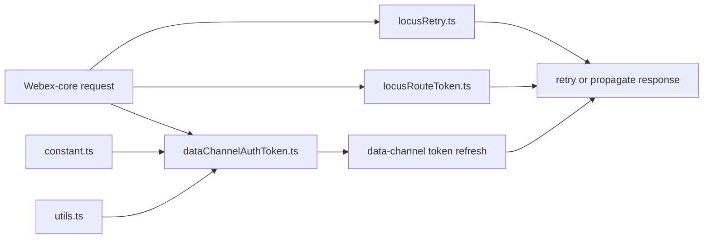
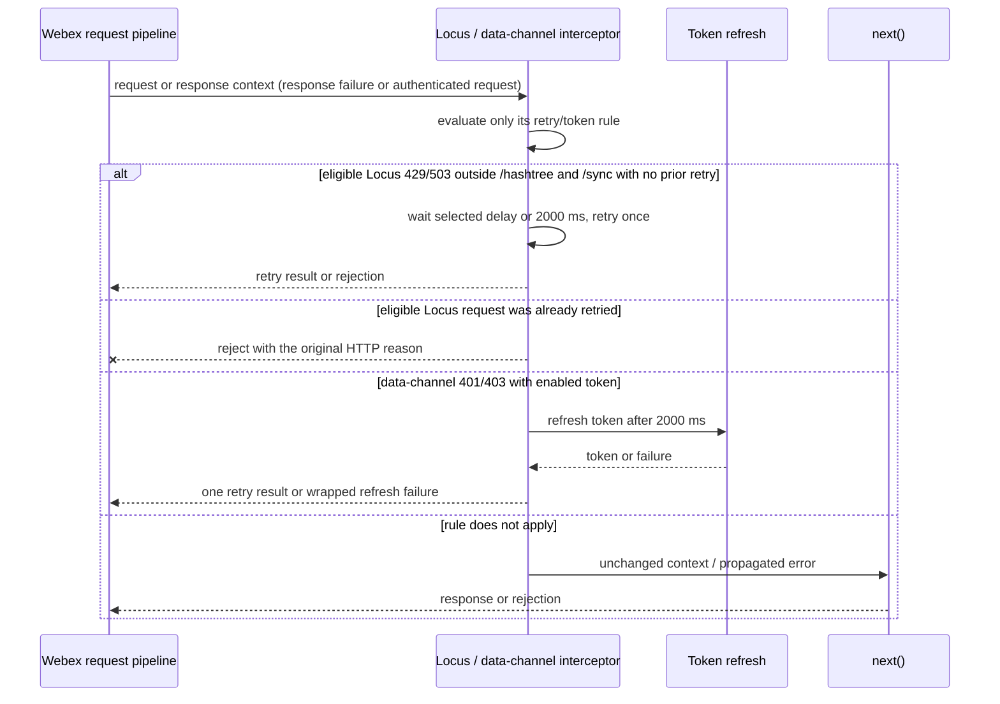
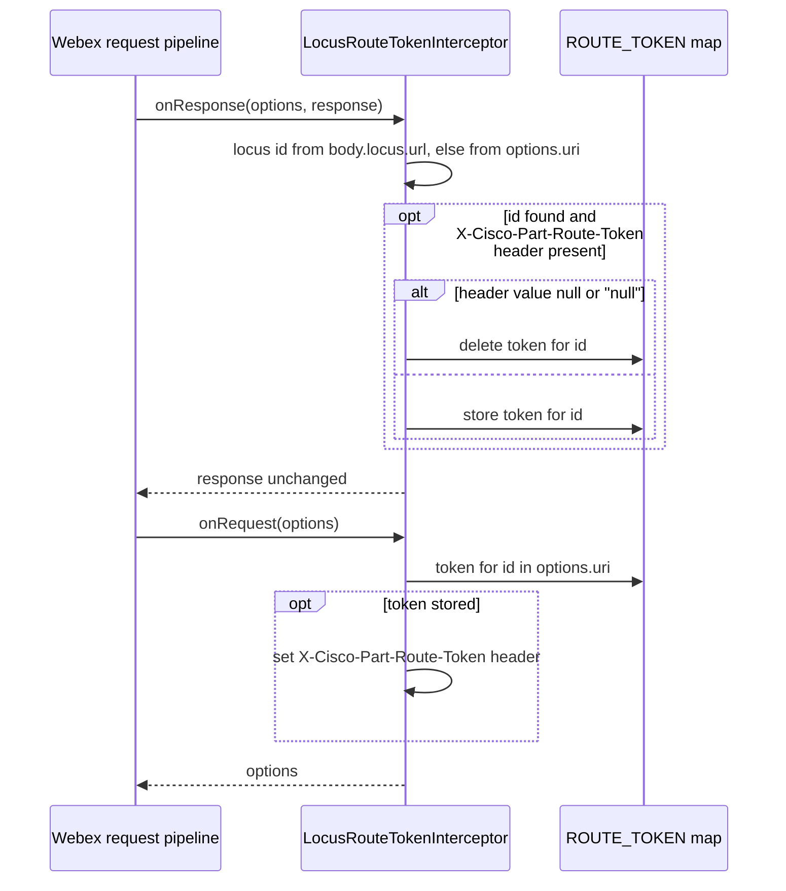
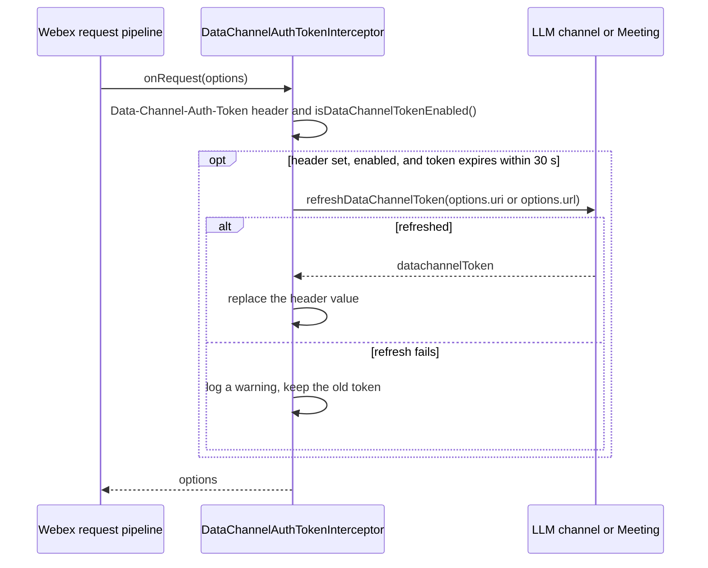
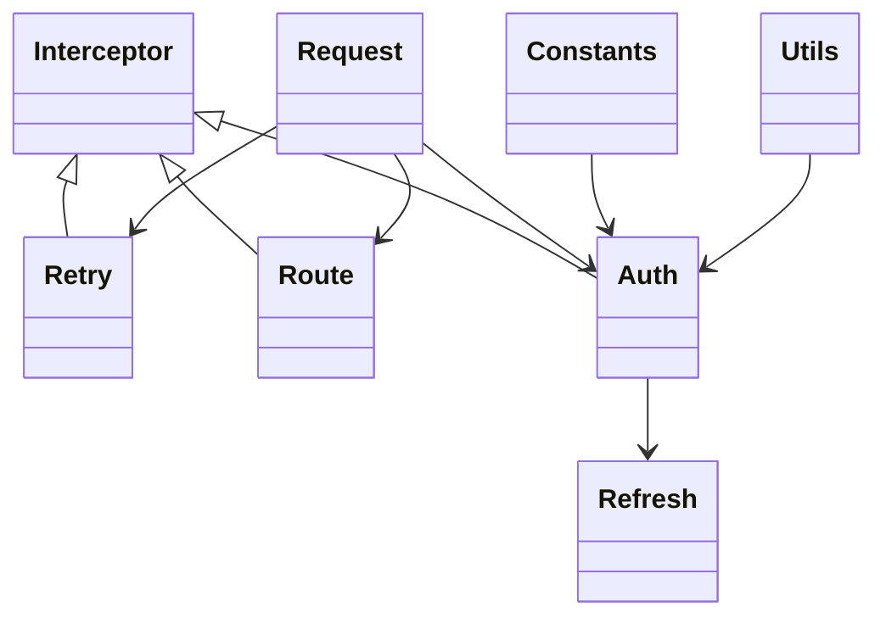

<!-- sdd-generated-metadata
doc_kind: module-spec
generated_from: module-spec@0.3.0
generated_by: claude-code
approved_by: rarajes2@cisco.com
updated_at: 2026-11-16T14:30:00Z
validation_status: not-run
-->

# Locus and data-channel interceptors

This source-local document at `src/interceptors/docs/README.md` owns the stable specification for
**the interceptors module** of `@webex/plugin-meetings`: three `@webex/http-core` request
interceptors that the package installs into the Webex request pipeline — a bounded retry for Locus
429/503 responses, Locus route-token capture and attachment, and data-channel auth-token refresh.
Ground every claim in package evidence and link to the
[package architecture](../../../docs/architecture.md) instead of repeating broader facts. No service
specification exists because this package is a library.

Related context — start here: root [package agent instructions](../../../AGENTS.md) · router
[documentation index](../../../docs/index.md) · system [package architecture](../../../docs/architecture.md).
This is the canonical source-local spec for `src/interceptors/`.

Repo architecture: [package architecture](../../../docs/architecture.md) · Registry:
[documentation index](../../../docs/index.md) · Coverage state and contracts baseline: `.sdd/manifest.json`.

## Metadata

| Field | Value |
|---|---|
| Owner | @webex/web-client, @webex/web-sdk |
| Source path | `src/interceptors` |
| Resource kind | module |
| Status | Draft |
| Last verified | 2026-11-16 at `0b8c34db7f` |
| Module id | `plugin-meetings/interceptors` |
| Parent spec | — |
| Doc kind | Module spec |
| Coverage score | Pending coverage assessment |
| Validation status | not-run |

## Applicability

| Condition ID | Status | Evidence or reason | Owned section |
| ------------ | ------ | ------------------ | ------------- |
| `module.has_tiers` | N/A | No tier policy exists in `package.json` or `.sdd/manifest.json` | Tier |
| `module.has_ui` | N/A | `src/interceptors/index.ts` exports request middleware only | UI use-case flow |
| `module.crosses_service_boundaries` | Applicable | `src/interceptors/locusRetry.ts` re-issues Locus requests and `src/interceptors/dataChannelAuthToken.ts` refreshes tokens and re-issues data-channel requests | Cross-boundary use-case flow |
| `module.holds_client_state` | N/A | Process-level maps in `src/interceptors/locusRouteToken.ts` and `src/interceptors/dataChannelAuthToken.ts` are routing bookkeeping, not client-visible state | Client state model |
| `module.enforces_domain_rules` | Applicable | Status, path, header, and retry-count rules in `src/interceptors/locusRetry.ts`, `src/interceptors/locusRouteToken.ts`, and `src/interceptors/dataChannelAuthToken.ts` | Business rules and invariants |
| `module.is_concurrent_async` | Applicable | Every hook returns a promise; both retry paths wait on timers (`src/interceptors/locusRetry.ts`, `src/interceptors/dataChannelAuthToken.ts`) | Concurrency and reactive flow |
| `module.owns_persistence` | N/A | Nothing is stored beyond process memory in `src/interceptors/locusRouteToken.ts` | Data, schema, and migration discipline |
| `module.stateful_transitions` | N/A | The retry flag and counters in `src/interceptors/locusRetry.ts` are covered under Concurrency and reactive flow | State machine |
| `module.exposes_wire_protocol` | Applicable | The route-token and data-channel auth headers and the Locus URL pattern in `src/interceptors/locusRouteToken.ts` and `src/interceptors/constant.ts` | Protocol and wire format |
| `module.ui_multi_screen` | N/A | No UI | UI flow |
| `module.large_data_model` | N/A | No data model in `src/interceptors/index.ts` | Data model |
| `module.returns_caller_errors` | Applicable | Requests that end in these hooks reject with the HTTP error or a wrapped refresh error (`src/interceptors/locusRetry.ts`, `src/interceptors/dataChannelAuthToken.ts`) | Caller-visible failure modes |
| `module.module_specific_conventions` | N/A | Repository-wide rules in `AGENTS.md` apply unchanged | Module-specific rules |
| `module.published_package` | N/A | `src/index.ts` registers the interceptors but does not export them | Export stability |
| `module.embedded_in_host` | Applicable | `src/index.ts` hands the three factories to the plugin registration, and the host's request pipeline instantiates them | Host integration and theming |
| `module.has_design_tradeoff` | N/A | No recorded trade-off in `src/interceptors/index.ts` | Key design trade-off |
| `module.has_submodules` | N/A | The module directory has no child module | Sub-modules |

## Evidence register

Requirements cite current source and mirrored tests. Current code wins over retained prose when they
conflict; commit and PR history are excluded. Missing evidence stays a gap.

| Evidence | What it establishes |
| -------- | ------------------- |
| `src/index.ts` | `registerPlugin('meetings', Meetings, {config, interceptors: {LocusRetryStatusInterceptor, LocusRouteTokenInterceptor, DataChannelAuthTokenInterceptor}})`, each value being the class's static `create` |
| `src/interceptors/index.ts` | Named exports of the three interceptor classes, nothing else |
| `src/interceptors/locusRetry.ts` | `LocusRetryStatusInterceptor.onResponseError` and `handleRetryRequestLocusServiceError`; the module-level `WeakMap` retry flag keyed by interceptor instance; the code comment that retrying `/hashtree` or `/sync` during a sync storm makes things worse and the sync timers recover them |
| `src/interceptors/locusRouteToken.ts` | `LocusRouteTokenInterceptor` with `LOCUS_ID_REGEX`, the `X-Cisco-Part-Route-Token` header, and the module-level `ROUTE_TOKEN` map |
| `src/interceptors/dataChannelAuthToken.ts` | `DataChannelAuthTokenInterceptor` with the URL-routed `refreshDataChannelToken`, `onRequest`, `onResponseError`, `refreshTokenAndRetryWithDelay`, and the module-level `retryCountMap` |
| `src/interceptors/constant.ts`, `src/interceptors/utils.ts` | `DATA_CHANNEL_AUTH_HEADER`, `MAX_RETRY = 1`, `RETRY_INTERVAL = 2000`, `RETRY_KEY = '_dcRetryKey'`; `isJwtTokenExpired` with a 30-second `EXPIRY_BUFFER` using `jose.decodeJwt` |
| `test/unit/spec/interceptors/locusRetry.ts`, `test/unit/spec/interceptors/locusRouteToken.ts`, `test/unit/spec/interceptors/dataChannelAuthToken.ts`, `test/unit/spec/interceptors/utils.ts` | Mirrored suites for each interceptor and the JWT helper |
| Sibling package webex-core, file src/webex-core.js | Each configured interceptor factory is called with the Webex instance as `this` (`Reflect.apply(interceptor, this, [])`), so each Webex instance gets one instance of each interceptor in its request pipeline |
| Sibling package http-core, file src/lib/interceptor.js | `Interceptor` copies constructor attributes onto the instance and supplies pass-through defaults for every hook |
| Observation, no stated WHY | `isJwtTokenExpired` returns `false` for a token without `exp` and `true` for a token `jose.decodeJwt` cannot decode (`src/interceptors/utils.ts`, `test/unit/spec/interceptors/utils.ts`) |
| Observation, no stated WHY | `LocusRetryStatusInterceptor` reads `retry-after` from the request options headers, not from the error response, and uses the value as milliseconds (`src/interceptors/locusRetry.ts`, `test/unit/spec/interceptors/locusRetry.ts`) |
| Observation, no stated WHY | The Locus retry re-sends only `method`, `uri`, and `body`; other request options such as headers and `qs` are dropped (`src/interceptors/locusRetry.ts`) |

## Purpose and boundary

- Responsibility: Provides Webex-core request middleware for bounded Locus retries, Locus route-token
  propagation, and data-channel auth-token refresh.
- In scope: the three interceptor classes, their constants, and the JWT expiry helper.
- Out of scope: the request pipeline and its other interceptors (`@webex/webex-core`,
  `@webex/http-core`); issuing the data-channel token refresh request (the LLM channel in
  `@webex/internal-plugin-llm`, or `Meeting.refreshDataChannelToken`); Locus sync recovery (the
  locus-info and hashTree modules (`src/locus-info/docs/README.md`,
  `src/hashTree/docs/README.md`)); what Locus and the data channel decide.
- Consumers: `src/index.ts` registers them; afterwards every request sent through `webex.request` on
  that Webex instance passes through them, whichever plugin sends it.

## Structure and key files

`src/interceptors` contains 6 direct source/reference file(s) and has 4 mirrored unit-test file(s). Stack:
TypeScript/JavaScript in the Node 22.14 Yarn workspace; Webex core/plugin abstractions and
Mocha/Sinon/`@webex/test-helper-chai` tests.

```text
src/interceptors/
├── constant.ts — interceptor constants (data-channel header and retry settings)
├── dataChannelAuthToken.ts — dataChannelAuthToken implementation responsibility (DataChannelAuthTokenInterceptor)
├── index.ts — module facade/controller or primary exports (the three classes)
├── locusRetry.ts — locusRetry implementation responsibility (LocusRetryStatusInterceptor)
├── locusRouteToken.ts — locusRouteToken implementation responsibility (LocusRouteTokenInterceptor)
├── utils.ts — normalization/helper functions (isJwtTokenExpired)
└── docs/README.md — canonical module specification
```

| File | Holds |
|---|---|
| `src/interceptors/constant.ts` | interceptor constants: `DATA_CHANNEL_AUTH_HEADER`, `MAX_RETRY`, `RETRY_INTERVAL`, `RETRY_KEY` |
| `src/interceptors/dataChannelAuthToken.ts` | dataChannelAuthToken implementation responsibility: `DataChannelAuthTokenInterceptor` and its URL-routed refresh |
| `src/interceptors/index.ts` | module facade/controller or primary exports: the three interceptor classes |
| `src/interceptors/locusRetry.ts` | locusRetry implementation responsibility: `LocusRetryStatusInterceptor` |
| `src/interceptors/locusRouteToken.ts` | locusRouteToken implementation responsibility: `LocusRouteTokenInterceptor` and the route-token map |
| `src/interceptors/utils.ts` | normalization/helper functions: `isJwtTokenExpired` |
| `test/unit/spec/interceptors/dataChannelAuthToken.ts` and 3 sibling test file(s) | mirrored characterization/unit coverage: `locusRetry.ts`, `locusRouteToken.ts`, and `utils.ts` |

## Public surface

| Contract ID | Type | Surface | Purpose | Compatibility / deprecation | Schema / detail link | Root index |
|---|---|---|---|---|---|---|
| `locus-interceptors` | request interceptor | `LocusRetryStatusInterceptor.create()`, `onResponseError()`, and `handleRetryRequestLocusServiceError()` | Retry one eligible Locus 429/503 response while excluding hash-tree/sync recovery routes. | Preserve the instance-local one-retry `WeakMap` guard and the delay selection (request `retry-after` or 2000 ms). | `src/interceptors/locusRetry.ts` | [package architecture](../../../docs/architecture.md) |
| `locus-interceptors` | request/response interceptor | `LocusRouteTokenInterceptor.create()`, `getLocusIdByRequestUrl()`, `getLocusIdByResponseBody()`, `getHeader()`, `onResponse()`, `onRequest()`, `updateToken()`, and `getToken()` | Capture route tokens by Locus id and attach only the token matching the outgoing request. | Never leak a token across Locus ids; preserve response/header parsing. | `src/interceptors/locusRouteToken.ts` | [package architecture](../../../docs/architecture.md) |
| `locus-interceptors` | auth interceptor | `DataChannelAuthTokenInterceptor.create()`, `onRequest()`, `onResponseError()`, and `refreshTokenAndRetryWithDelay()` | Attach a usable data-channel token and perform the bounded refresh/retry path after auth failure. | Preserve `MAX_RETRY = 1`, `RETRY_INTERVAL = 2000`, and per-options retry bookkeeping. | `src/interceptors/dataChannelAuthToken.ts` | [package architecture](../../../docs/architecture.md) |
| `locus-interceptors` | exported utility | `isJwtTokenExpired()` | Treat a token as expired when its JWT expiry is within the 30-second safety buffer. | Preserve malformed-token handling and the exact buffer used before request dispatch. | `src/interceptors/utils.ts` | [package architecture](../../../docs/architecture.md) |
| `locus-interceptors` | exported constants | `DATA_CHANNEL_AUTH_HEADER`, `MAX_RETRY`, `RETRY_INTERVAL`, and `RETRY_KEY` | Share the exact header and bounded-retry settings used by the auth interceptor. | Header/key values and retry limits are observable request behavior. | `src/interceptors/constant.ts` | [package architecture](../../../docs/architecture.md) |

Contract ID `locus-interceptors` is internal to the package: `src/index.ts` registers the factories
but does not export the classes. It is indexed in the
[package architecture](../../../docs/architecture.md) and registered in `.sdd/manifest.json`; the
module requires `webex-core-plugin-host` and `internal-plugin-llm-channel`.

Compatibility notes:

- Prefer additive fields/options and preserve current return and rejection semantics. Internal helpers are not public merely because they are exported within the source directory.

## Dependencies

Webex core Interceptor/request pipeline, JWT decoding helpers, LLM data channels and the meetings
collection, request URLs/headers, timers, and retry constants.

| Dependency | Why it is required | Failure behavior |
| ---------- | ------------------ | ---------------- |
| `@webex/http-core` `Interceptor` base class (imported, not declared in `package.json`) | Hook defaults and attribute copying for all three classes | — |
| `@webex/webex-core` request pipeline (contract `webex-core-plugin-host`) | Calls each `create` with the Webex instance as `this`; runs the hooks on every request; `webex.request` re-sends retried requests | A re-sent request passes through every interceptor again |
| `webex.internal.llm` (`@webex/internal-plugin-llm`, contract `internal-plugin-llm-channel`) | `isDataChannelTokenEnabled()` gates the data-channel hooks; `getChannelByDatachannelUrl()` finds the channel that refreshes the token; `LLMChannel.matchesDatachannelRequestUrl` matches meeting URLs | A rejection of the enabled check rejects the hook |
| `webex.meetings.getAllMeetings()` and `Meeting.refreshDataChannelToken()` / `setLLMChannelDataToken()` | Fallback refresh when no LLM channel matches the request URL | No match throws `No LLM channel or meeting found for request URL` |
| `jose` `decodeJwt` | Reads `exp` without verifying the signature | A decode error counts as expired |
| `LoggerProxy` (`src/common/logs/logger-proxy.ts`) | Warns on a failed pre-request refresh; errors when the retry count is exhausted | — |

## Requirements

| ID | WHAT | WHY | Source Evidence | Test / Example Evidence | Assumptions / Gaps | Confidence |
|---|---|---|---|---|---|---|
| `INTERCEPTORS-R-001` | retry eligible Locus failures using status-based rules: a response error with status 429 or 503 on a URI containing `locus` is retried once by `LocusRetryStatusInterceptor`. | The retry JSDoc handles Locus service-unavailable errors, which are temporary, so one delayed retry can succeed without caller involvement. | `src/interceptors/locusRetry.ts`, `src/interceptors/index.ts` | `test/unit/spec/interceptors/locusRetry.ts` | none | PRESENT |
| `INTERCEPTORS-R-002` | capture and attach route tokens keyed by Locus id. | A route or auth token attached to the wrong request can leak authority across meetings or retry indefinitely. | `src/interceptors/locusRouteToken.ts`, `src/interceptors/index.ts` | `test/unit/spec/interceptors/locusRouteToken.ts` | no case attaches a stored token to a request for another Locus id | PRESENT |
| `INTERCEPTORS-R-003` | Failures outside the eligible retry branches reject with the original reason. For an eligible Locus 429/503 after this interceptor instance has already retried once, `LocusRetryStatusInterceptor.onResponseError()` clears its retry flag and rejects with the original HTTP reason. Locus retries are bounded per interceptor; token-refresh retries are tracked through request options. | Rejecting the original reason preserves the terminal HTTP status and response details for callers. | `src/interceptors/locusRetry.ts`, `src/interceptors/dataChannelAuthToken.ts` | `test/unit/spec/interceptors/locusRetry.ts`, `test/unit/spec/interceptors/dataChannelAuthToken.ts` | none | PRESENT |
| `INTERCEPTORS-R-004` | Locus retry handles one eligible 429/503 retry per interceptor instance using the `WeakMap` flag and the existing delay selection (default 2000 ms); Locus `/hashtree` and `/sync` 429/5xx responses are excluded. | Global request middleware must not amplify synchronization storms, retry terminal failures, or loop indefinitely. | `src/interceptors/locusRetry.ts` | `test/unit/spec/interceptors/locusRetry.ts` | none | PRESENT |
| `INTERCEPTORS-R-005` | Route tokens are extracted from supported Locus responses, keyed by Locus id, and attached only to matching requests. | Loose routing could omit a required token or leak it to an unrelated request. | `src/interceptors/locusRouteToken.ts` | `test/unit/spec/interceptors/locusRouteToken.ts` | none | PRESENT |
| `INTERCEPTORS-R-006` | Data-channel JWTs are treated as expired when `exp` is within the 30-second (`30 * 1000`) buffer, refreshed when needed, and retried once after 2000 ms on eligible 401/403 responses. | Refreshing before expiry avoids a request racing token expiration without creating an authentication retry storm. | `src/interceptors/dataChannelAuthToken.ts`, `src/interceptors/utils.ts`, `src/interceptors/constant.ts` | `test/unit/spec/interceptors/dataChannelAuthToken.ts`, `test/unit/spec/interceptors/utils.ts` | none | PRESENT |
| `INTERCEPTORS-R-007` | Both data-channel hooks act only when the request carries a `Data-Channel-Auth-Token` header (any case) and `webex.internal.llm.isDataChannelTokenEnabled()` resolves true; otherwise `onRequest` returns the options unchanged and `onResponseError` rejects with the original reason. | The interceptor sees every request of the Webex instance and must leave requests without a data-channel token, or with the feature off, untouched. | `src/interceptors/dataChannelAuthToken.ts` | `test/unit/spec/interceptors/dataChannelAuthToken.ts` | none | PRESENT |
| `INTERCEPTORS-R-008` | A token refresh is routed by request URL: the LLM channel returned by `getChannelByDatachannelUrl` refreshes and stores the token; with no channel, the meeting whose `datachannelUrl` or `practiceSessionDatachannelUrl` matches refreshes it and stores it on its LLM channel; a refresh result without `body` throws `DataChannel token refresh returned no payload`, and no match throws `No LLM channel or meeting found for request URL`. | The code comment: route refresh by request URL, because each meeting (and its practice session) owns its own channel and token. | `src/interceptors/dataChannelAuthToken.ts` | `test/unit/spec/interceptors/dataChannelAuthToken.ts` | none | PRESENT |
| `INTERCEPTORS-R-009` | Importing the package registers the three factories on the `meetings` plugin, so each Webex instance builds one instance of each interceptor in its request pipeline. | Locus and data-channel requests are sent through `webex.request` by many modules; the pipeline is the one place every such request passes. | `src/index.ts`, `src/interceptors/index.ts` | None found | registration is not asserted by a unit case | PRESENT |

## Design overview

`index.ts` only exports three independent Webex-core interceptors. `locusRetry.ts` bounds eligible
retries, `locusRouteToken.ts` stores/attaches tokens by Locus id, and `dataChannelAuthToken.ts`
refreshes expiring channel credentials; none is a controller for the others.

Each class extends the `@webex/http-core` `Interceptor` and overrides only the hooks it needs:
`LocusRetryStatusInterceptor` overrides `onResponseError`; `LocusRouteTokenInterceptor` overrides
`onRequest` and `onResponse`; `DataChannelAuthTokenInterceptor` overrides `onRequest` and
`onResponseError`. State lives in module-level maps shared by every instance in the process: the
Locus retry flag (`WeakMap` keyed by interceptor instance), the route tokens (`ROUTE_TOKEN` keyed by
Locus id), and the data-channel retry counts (`retryCountMap` keyed by the `_dcRetryKey` stamped on
the request options). `DataChannelAuthTokenInterceptor.create` injects the two functions that reach
the LLM plugin and the meetings collection, so the class itself depends only on its constructor
options.

## Data flow and sequence coverage

Call style: in-process hooks invoked by the `@webex/webex-core` request pipeline around HTTPS
requests; retries re-enter the pipeline through `webex.request`. There are three operation groups,
one per interceptor; the data-channel group has a pre-request refresh and a post-error retry.



Sequence coverage:

| Operation group | Diagram | Failure coverage |
|---|---|---|
| UC-1…UC-4 — request interceptor operation groups | Request interceptor sequence | ineligible Locus status, token mismatch/expiry, refresh failure, and retry exhaustion; non-retryable status, exhausted retry count, missing Locus-token match, or failed data-channel token refresh |
| UC-2 — route-token capture and attachment | Route-token sequence | no Locus id, no header, `null` token deletion |
| UC-3 — pre-request data-channel refresh | Pre-request refresh sequence | feature disabled, no header, refresh failure continues with the old token |

Request interceptor sequence:



Route-token sequence:



Pre-request refresh sequence:



## Class and component relationships



The arrows identify ownership and delegation inside `src/interceptors/`; files that only declare types
or constants are not presented as transports. `Interceptor` is the `@webex/http-core` base class,
`Request` is the webex-core pipeline, `Retry` is `LocusRetryStatusInterceptor`, `Route` is
`LocusRouteTokenInterceptor`, `Auth` is `DataChannelAuthTokenInterceptor`, `Refresh` is the injected
URL-routed refresh function, `Constants` is `constant.ts`, and `Utils` is `utils.ts`.

## Use cases and flows

| Use case | Actor or caller | Primary steps and outcome | Failure or boundary behavior | Evidence |
| -------- | --------------- | ------------------------- | ---------------------------- | -------- |
| `UC-1` | Any module sending a Locus request | Retry one eligible Locus 429/503 response after the selected delay (request `retry-after`, else 2000 ms) while leaving hash-tree/sync failures to their owning recovery paths. | The next eligible failure on the same Webex instance rejects without retry and clears the flag | `src/interceptors/locusRetry.ts`, `test/unit/spec/interceptors/locusRetry.ts` |
| `UC-2` | Any module sending Locus requests | Capture a route token from a Locus response and attach it only to a later request whose URL resolves to the same Locus id. | A response without the header keeps the stored token; a `null` value deletes it | `src/interceptors/locusRouteToken.ts`, `test/unit/spec/interceptors/locusRouteToken.ts` |
| `UC-3` | LLM channel or Meeting sending a data-channel request | Attach an unexpired data-channel token to an outgoing request, using the 30-second JWT expiry buffer. | A failed refresh is logged and the request is sent with the old token | `src/interceptors/dataChannelAuthToken.ts`, `test/unit/spec/interceptors/dataChannelAuthToken.ts` |
| `UC-4` | Same, after a 401 or 403 | On the handled auth failure, wait 2000 ms, refresh, retry once, and clear the retry key after success or refresh failure. | A second 401/403 on the retry rejects; the caller sees `DataChannel token refresh failed: …` | `src/interceptors/dataChannelAuthToken.ts`, `test/unit/spec/interceptors/dataChannelAuthToken.ts` |

### Cross-boundary use-case flow

| Boundary | Transport and ordering | Compatibility | Timeout, retry, and recovery |
| -------- | ---------------------- | ------------- | ---------------------------- |
| Locus (`UC-1`, `UC-2`) | HTTPS through the webex-core pipeline; the retry is a new `webex.request` after the delay | Route tokens use `X-Cisco-Part-Route-Token`; Locus ids follow `/locus/api/v1/loci/<uuid>` | One retry per eligible failure, alternating per interceptor instance; `/hashtree` and `/sync` recover through their own sync timers |
| Data channel (`UC-3`, `UC-4`) | HTTPS through the pipeline; the refresh runs before the request or 2000 ms after a 401/403 | `Data-Channel-Auth-Token` header carries the JWT | One refresh-and-retry per request options object (`MAX_RETRY = 1`) |
| LLM plugin and meetings collection (refresh) | In-process calls that issue their own refresh request | Refresh result must carry `body.datachannelToken` | Errors propagate into the hook as described under Caller-visible failure modes |

## Business rules and invariants

- Tokens attach only to intended request routes; JWT expiry includes the 30-second buffer;
  data-channel retry stops at `MAX_RETRY = 1`; terminal auth/service errors propagate. Enforced under
  `src/interceptors/`.

| ID | Invariant | WHY | Enforcement source | Test evidence |
| -- | --------- | --- | ------------------ | ------------- |
| `INV-001` | A Locus URI whose path contains `/locus/` and ends with `/hashtree` or `/sync` is never retried on 429 or any status of 500 or above; a URI that cannot be parsed is not treated as such. | The code comment: retries during a sync storm make things worse, and the normal sync timers recover these endpoints (`INTERCEPTORS-R-004`). | `src/interceptors/locusRetry.ts` | `test/unit/spec/interceptors/locusRetry.ts` |
| `INV-002` | A route token is attached only when the request URI yields a Locus id with a stored token, and only under that id. | Loose routing could leak a token to an unrelated request (`INTERCEPTORS-R-005`). | `src/interceptors/locusRouteToken.ts` | `test/unit/spec/interceptors/locusRouteToken.ts` |
| `INV-003` | A data-channel request is refreshed and retried at most once after a 401/403; its retry key is removed after success, refresh failure, or exhaustion. | Avoid an authentication retry storm (`INTERCEPTORS-R-006`). | `src/interceptors/dataChannelAuthToken.ts`, `src/interceptors/constant.ts` | `test/unit/spec/interceptors/dataChannelAuthToken.ts` |

## Concurrency and reactive flow

- `LocusRetryStatusInterceptor` permits one retry per interceptor instance using its `WeakMap` flag and never retries Locus `/hashtree` or `/sync` 429/5xx failures. Data-channel retries are keyed on the request options, wait 2000 ms, and stop after `MAX_RETRY = 1`; the key is removed after success or refresh failure.
- Execution model: one JavaScript event loop; every hook returns a promise, and both retry paths wait
  on a `setTimeout`.
- Ordering guarantees: none across requests. The Locus flag is shared by all requests of the
  interceptor instance, not tracked per request: after a retry the flag stays set until the next
  eligible failure, which rejects without retry and clears it, so concurrent eligible failures do not
  each get a retry.
- Idempotency and retry: the Locus retry re-sends `method`, `uri`, and `body` regardless of HTTP
  method; the data-channel retry re-sends the full options with the new token.
- Shared-state protection: none. `ROUTE_TOKEN` and `retryCountMap` are module-level, so every Webex
  instance in the process shares them.

## Protocol and wire format

- Existing request/event/channel types and constants under `src/interceptors/` own serialization and
  parsing. Preserve field names, enum/raw values, identity/routing fields, and compatibility;
  normalized client properties are not a replacement wire schema.

| Message or frame | Version | Producer or serializer | Consumer or parser | Compatibility and ordering rule |
| ---------------- | ------- | ---------------------- | ------------------ | ------------------------------- |
| `X-Cisco-Part-Route-Token` response header | Unversioned | Locus | `LocusRouteTokenInterceptor.onResponse` | Read case-insensitively; the value `null` or the string `null` deletes the stored token |
| `X-Cisco-Part-Route-Token` request header | Unversioned | `LocusRouteTokenInterceptor.onRequest` | Locus | Set only on requests whose URI carries a Locus id with a stored token |
| Locus id in `/locus/api/v1/loci/<36-character hex-and-dash id>` | — | Locus URLs | `LOCUS_ID_REGEX` | Taken from `body.locus.url` before the request URI |
| `Data-Channel-Auth-Token` request header | Unversioned | LLM channel or Meeting | `DataChannelAuthTokenInterceptor` | Read case-insensitively; replaced under the exact name `Data-Channel-Auth-Token` |
| Request option `_dcRetryKey` | — | `DataChannelAuthTokenInterceptor` | The same interceptor | Stamped on the options object as `<timestamp>-<random>`; never sent as a header |
| `retry-after` request header | — | The caller's request options | `LocusRetryStatusInterceptor` | Used as milliseconds; absent means 2000 |

## Caller-visible failure modes

| Condition | Signal | Caller recovery |
|---|---|---|
| Locus failure is not 429/503, is a `/hashtree` or `/sync` 429/5xx, or has already been retried | The interceptor rejects without another retry. | Let the normal sync/recovery path or caller policy handle the failure. |
| A route token does not match the request's Locus id | No unrelated route token is attached. | Continue without a token or obtain the token for the matching Locus. |
| Data-channel token refresh or its single retry fails | The interceptor clears its retry key and rejects with a `DataChannel token refresh failed: <message>` error carrying `statusCode` and `original`; when the retry count is already exhausted it rejects with the original terminal response. | Re-establish valid data-channel credentials before a new request. |
| Data-channel 401/403 while the token feature is disabled or the request has no `Data-Channel-Auth-Token` header | The original HTTP error, unchanged. | Handle the error. |
| Pre-request refresh fails | No error: a warning is logged and the request is sent with the expired token. | A resulting 401/403 enters the retry path. |

## Pitfalls and constraints

- An interceptor runs across host requests. Loose URL matching or header reuse can leak meeting tokens to an unrelated service.
- Verify both typed constants/enums and raw wire values before changing a logical condition in this legacy package.
- The Locus retry matches any URI containing `locus`, host names included, and its delay comes from the
  request options, not from a server `Retry-After` response header.
- The Locus retry drops request headers and query options; the route-token interceptor re-adds its
  header on the new request, but other headers are not re-sent.
- `@webex/http-core` is imported by all three interceptors but is not listed in `package.json`; it
  resolves through the workspace.
- `updateToken(id, undefined)` stores `undefined` rather than deleting the entry.

## Host integration and theming

The Webex SDK host provides request, identity, event, and media capabilities and exposes this module
through `webex.meetings` or Meeting-composed controllers. The module renders no UI and has no theme
contract.

- Mount or entry contract: `registerPlugin('meetings', …, {interceptors})` in `src/index.ts`;
  webex-core calls each `create` with the Webex instance as `this`.
- Required providers, peers, or host versions: `@webex/webex-core` and `@webex/http-core` from the
  workspace; `webex.internal.llm` and `webex.meetings` for the data-channel interceptor.
- Theme and design-token contract: none.
- Accessibility and lifecycle obligations: none; the instances live as long as the Webex instance.

## Verification

Use the current mirrored suites: `test/unit/spec/interceptors/dataChannelAuthToken.ts`,
`test/unit/spec/interceptors/locusRetry.ts`, `test/unit/spec/interceptors/locusRouteToken.ts`,
`test/unit/spec/interceptors/utils.ts`. Characterize the interceptors-specific use cases above and
each listed failure condition; add cleanup or transition cases only for resources and state this
module actually owns.

| Behavior / Requirement | Existing test evidence | Gap |
|---|---|---|
| `INTERCEPTORS-R-001` | `test/unit/spec/interceptors/locusRetry.ts` | retry, route-token, and data-channel interceptor families are now covered independently, one suite each; no case covers a URI containing `locus` only in its host name |
| `INTERCEPTORS-R-002` | `test/unit/spec/interceptors/locusRouteToken.ts` | add cross-Locus request/response cases proving tokens cannot be attached to the wrong id |
| `INTERCEPTORS-R-003` | `test/unit/spec/interceptors/dataChannelAuthToken.ts`, `test/unit/spec/interceptors/locusRetry.ts` | assert one delayed retry and retry-key removal on both terminal paths; the exhausted Locus retry rejecting with the original reason is covered |
| `INTERCEPTORS-R-004` | `test/unit/spec/interceptors/locusRetry.ts` | terminal status and retry exhaustion are now verified; the alternating flag after a successful retry is not |
| `INTERCEPTORS-R-005` | `test/unit/spec/interceptors/locusRouteToken.ts` | verify unrelated URL never receives token |
| `INTERCEPTORS-R-006` | `test/unit/spec/interceptors/dataChannelAuthToken.ts`, `test/unit/spec/interceptors/utils.ts` | malformed/near-expiry tokens and retry exhaustion are now verified, and the 2000 ms delay is driven with fake timers; no case asserts the retry key is removed after exhaustion |
| `INTERCEPTORS-R-007` | `test/unit/spec/interceptors/dataChannelAuthToken.ts` | none |
| `INTERCEPTORS-R-008` | `test/unit/spec/interceptors/dataChannelAuthToken.ts` | the practice-session URL branch is not exercised |
| `INTERCEPTORS-R-009` | None found | no case asserts the registration in `src/index.ts` |

A module specification is complete only when its public surface, invariants, failure modes, and test
evidence agree with the implementation.
