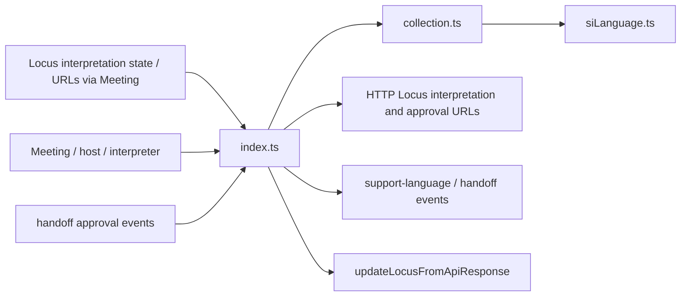
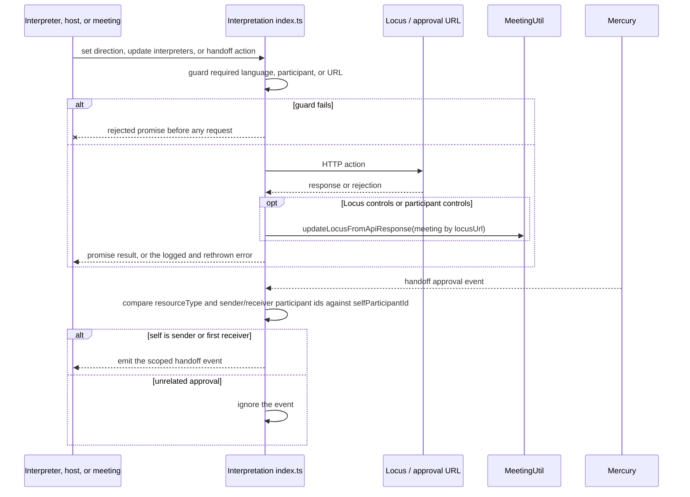
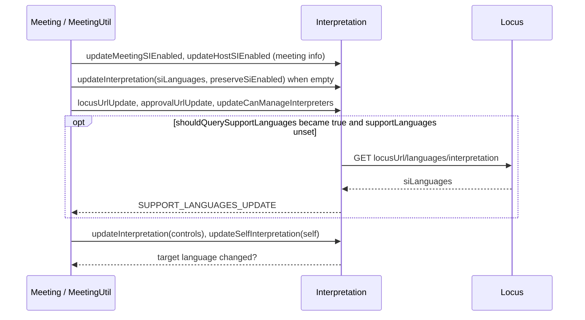
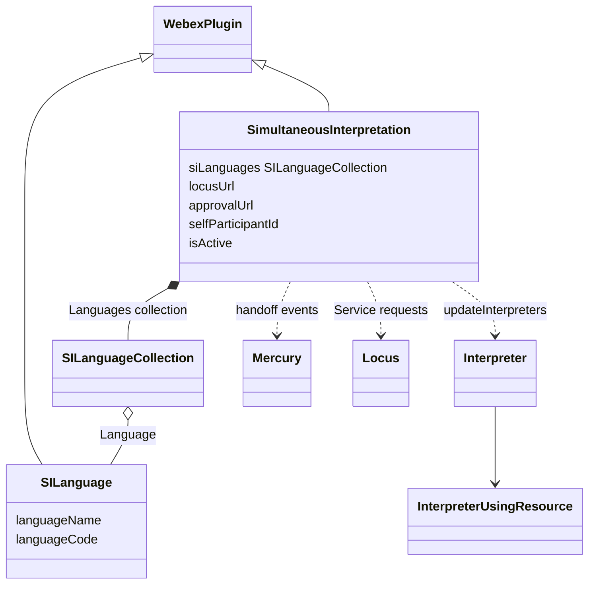
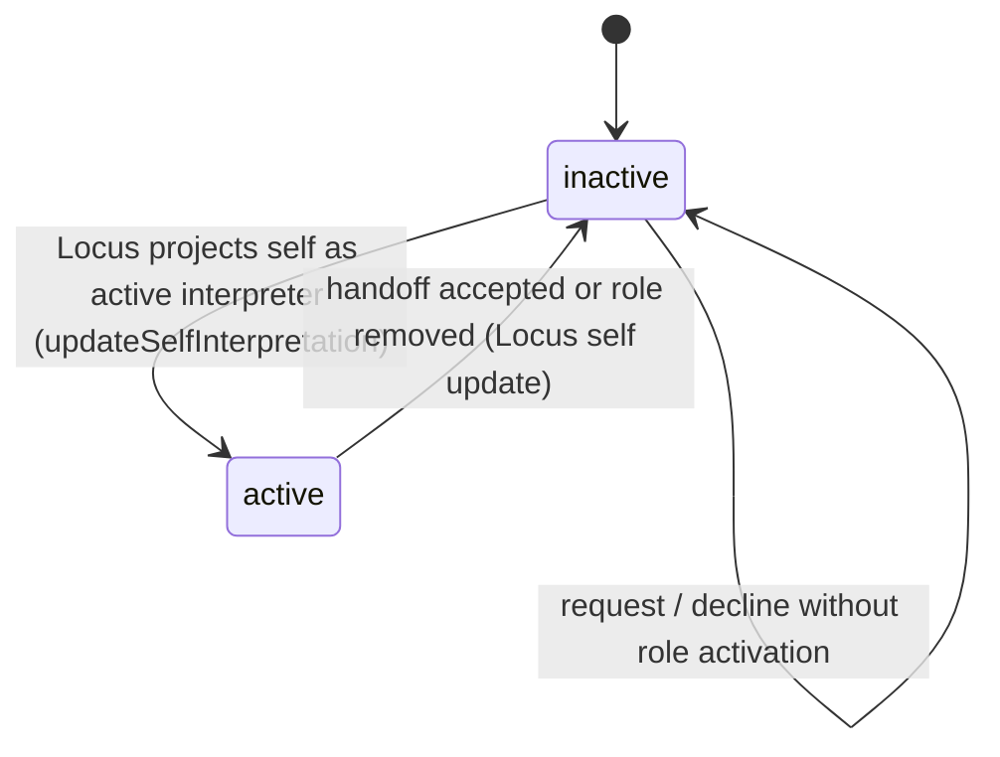

<!-- sdd-generated-metadata
doc_kind: module-spec
generated_from: module-spec@0.3.0
generated_by: claude-code
approved_by: rarajes2@cisco.com
updated_at: 2026-11-16T14:30:00Z
validation_status: not-run
-->

# Simultaneous interpretation

This canonical source-local document at `src/interpretation/docs/README.md` owns the stable
specification for **simultaneous interpretation**: the `meeting.simultaneousInterpretation`
controller (`SimultaneousInterpretation`, a `WebexPlugin`) with its `siLanguages` collection of
`SILanguage` models. The module holds the meeting's interpretation languages and the self
interpreter's direction, queries the languages a host can assign, reads and updates interpreters,
ends interpretation, changes an interpreter's direction, and offers, requests, accepts, and declines
interpreter handoffs through the approval service. Ground every claim in package evidence and link to
the [package architecture](../../../docs/architecture.md) instead of repeating broader facts. No
service specification exists because this package is a library.

Related context: [documentation index](../../../docs/index.md) ·
[package agent instructions](../../../AGENTS.md)

## Metadata

| Field | Value |
| ----- | ----- |
| Owner | @webex/web-client, @webex/web-sdk |
| Source path | `src/interpretation` |
| Resource kind | module |
| Status | Draft |
| Last verified | 2026-11-16 at `0b8c34db7f` |
| Module id | `plugin-meetings/interpretation` |
| Parent spec | — |
| Doc kind | Module spec |
| Coverage score | Pending coverage assessment |
| Validation status | not-run |

## Applicability

| Condition ID                         | Status     | Evidence or reason | Owned section |
| ------------------------------------ | ---------- | ------------------ | ------------- |
| `module.has_tiers`                   | N/A        | No tier policy exists in `package.json` or `src/interpretation/index.ts` | Tier |
| `module.has_ui`                      | N/A        | `src/interpretation/index.ts` exposes state, promises, and events; no UI | UI use-case flow |
| `module.crosses_service_boundaries`  | Applicable | Locus and approval-service requests and the Mercury approval listener in `src/interpretation/index.ts` | Cross-boundary use-case flow |
| `module.holds_client_state`          | Applicable | Language, self-interpreter, enablement, and URL props in `src/interpretation/index.ts` | Client state model |
| `module.enforces_domain_rules`       | Applicable | Input guards, the handoff filter, and the target-language rule in `src/interpretation/index.ts` | Business rules and invariants |
| `module.is_concurrent_async`         | Applicable | Promise requests, an automatic language query, and a Mercury listener in `src/interpretation/index.ts` | Concurrency and reactive flow |
| `module.owns_persistence`            | N/A        | Nothing is stored; Locus holds the record (`src/interpretation/index.ts`) | Data, schema, and migration discipline |
| `module.stateful_transitions`        | Applicable | The self interpreter's active state and the meeting's SI enablement in `src/interpretation/index.ts` | State machine |
| `module.exposes_wire_protocol`       | N/A        | Recorded false in `.sdd/manifest.json`; request bodies are described under Requirements | Protocol and wire format |
| `module.ui_multi_screen`             | N/A        | No UI | UI flow |
| `module.large_data_model`            | N/A        | Two small types in `src/interpretation/interpretation.types.ts` and one model in `src/interpretation/siLanguage.ts` | Data model |
| `module.returns_caller_errors`       | Applicable | Local rejections and rethrown request errors in `src/interpretation/index.ts` | Caller-visible failure modes |
| `module.module_specific_conventions` | Applicable | The log-and-rethrow request convention and the Locus-response update in `src/interpretation/index.ts` | Module-specific rules |
| `module.published_package`           | N/A        | `src/index.ts` exports only the two interpreter types; the controller is reached through a meeting | Export stability |
| `module.embedded_in_host`            | N/A        | No host theme or embed API | Host integration and theming |
| `module.has_design_tradeoff`         | N/A        | Recorded false in `.sdd/manifest.json`; no trade-off is stated in `src/interpretation/index.ts` | Key design trade-off |
| `module.has_submodules`              | N/A        | The interpretation directory has no child module (`src/interpretation/index.ts`) | Sub-modules |

## Evidence register

Requirements cite current source and mirrored tests under `test/unit/spec/interpretation/`. Where
prose and code disagree, current code wins; commit and PR history are not used as evidence. Missing
evidence stays a recorded gap.

| Evidence | What it establishes |
| -------- | ------------------- |
| `src/interpretation/index.ts` | `SimultaneousInterpretation` extends `WebexPlugin` (namespace `Meetings`): props, the derived `shouldQuerySupportLanguages`, the `siLanguages` collection, every request, and the Mercury handoff listener |
| `src/interpretation/collection.ts` | `SILanguageCollection`, an ampersand collection of `SILanguage` with `mainIndex: 'languageName'` |
| `src/interpretation/siLanguage.ts` | `SILanguage` (`idAttribute: 'languageName'`) with `languageCode` and `languageName` |
| `src/interpretation/interpretation.types.ts` | `Interpreter` (`order`, `sourceLanguage`, `targetLanguage`, `usingResource`) and `InterpreterUsingResource` (`id`, optional `email`) |
| `src/constants.ts` | `INTERPRETATION` (events, action types, resource type `SiHandover`, capabilities), `LOCUSEVENT.APPROVAL_REQUEST`, and `EVENT_TRIGGERS` `meeting:interpretation:*` |
| `src/meeting/index.ts` | `Meeting` creates `new SimultaneousInterpretation({}, {parent: webex})`, feeds Locus URL, approval URL, interpretation controls, self interpretation, and roles, re-emits the module events, and uses `getTargetLanguageCode()` in `setSendNamedMediaGroup` |
| `src/meeting/util.ts` | `parseInterpretationInfo` sets SI enablement from meeting info and seeds `siLanguages`; `cleanUp` calls `simultaneousInterpretation.cleanUp()`; `updateLocusFromApiResponse` applies a Locus response to a meeting |
| `src/index.ts` | Exports the `Interpreter` and `InterpreterUsingResource` types |
| `src/interpretation/README.md` | Names `getSupportLanguages()`, `siLanguage.subscribe()`, and `siLanguage.unsubscribe()`, which `src/interpretation/index.ts` and `src/interpretation/siLanguage.ts` do not define |
| `test/unit/spec/interpretation/index.ts` | Controller cases: automatic language query, setters, updates, target language code, every request and its guards, and the handoff listener |
| `test/unit/spec/interpretation/collection.ts`, `test/unit/spec/interpretation/siLanguage.ts` | Collection model and `SILanguage` props |
| Observation, no stated WHY | `changeDirection()` sends the current `isActive` and `order` with the swapped languages (`src/interpretation/index.ts`) |
| Observation, no stated WHY | `listenToHandoffRequests` compares only the first receiver with self (`src/interpretation/index.ts`) |

## Purpose and boundary

- Responsibility: Owns simultaneous-interpretation language state, interpreter collections, direction changes, and interpreter handoff request/approval workflows.
- In scope: the `SimultaneousInterpretation` controller and its props; the `siLanguages`
  collection; the host language query, interpreter read and update, and ending interpretation; the
  self interpreter's direction change; handoff offer, request, accept, and decline; the Mercury
  `locus.approval_request` listener for `SiHandover`.
- Out of scope: parsing Locus and meeting info into interpretation data (`src/locus-info`,
  `MeetingUtil.parseInterpretationInfo`); sending audio to a language's named media group
  (`Meeting.setSendNamedMediaGroup`); applying Locus responses (`MeetingUtil.updateLocusFromApiResponse`);
  what Locus and the approval service decide.
- Consumers: `Meeting` (`src/meeting/index.ts`, `src/meeting/util.ts`) constructs, feeds, and
  cleans it up and re-emits its events; applications call `meeting.simultaneousInterpretation`.

## Structure and key files

`src/interpretation/` contains 5 direct source and reference files (four TypeScript files and the
retained `README.md`) and has 3 mirrored unit-test files under `test/unit/spec/interpretation/`.
This specification separates its public operations, runtime data movement, component ownership,
state, and verification boundary. Sources are TypeScript in the Node 22.14 Yarn workspace on Webex
core plugin abstractions (`WebexPlugin`) and ampersand collections; tests run under Mocha with Sinon
and `@webex/test-helper-chai` (`test:unit` in `package.json`).

| File | Holds |
| ---- | ----- |
| `src/interpretation/index.ts` | `SimultaneousInterpretation` controller mounted as `meeting.simultaneousInterpretation`: module facade/controller and primary (default) export holding props, requests, and the handoff listener |
| `src/interpretation/collection.ts` | `SILanguageCollection`, the module-owned collection of `SILanguage` models indexed by `languageName` |
| `src/interpretation/interpretation.types.ts` | Module type declarations: `Interpreter` and `InterpreterUsingResource` |
| `src/interpretation/siLanguage.ts` | `SILanguage` model: one interpretation language with its `languageName` id and numeric `languageCode` |
| `src/interpretation/README.md` | Retained human feature guide, context only; some method names in it do not exist |
| `src/interpretation/docs/README.md` | This module specification |
| `test/unit/spec/interpretation/index.ts`, `test/unit/spec/interpretation/collection.ts`, `test/unit/spec/interpretation/siLanguage.ts` | Mirrored characterization/unit coverage, one test file per source file except the types |

## Public surface

`meeting.simultaneousInterpretation` is the `SimultaneousInterpretation` instance `Meeting` creates;
`src/index.ts` exports only the `Interpreter` and `InterpreterUsingResource` types, so applications
reach the controller through a meeting. Every row belongs to contract `interpretation-api`, indexed in
the [package architecture](../../../docs/architecture.md#public-and-consumer-surfaces); contract IDs
and coverage state are recorded in `.sdd/manifest.json`.

| Contract ID | Type | Surface | Purpose | Compatibility / deprecation | Schema / detail link | Root index |
|---|---|---|---|---|---|---|
| `interpretation-api` | SDK / lifecycle | `initialize()`, `cleanUp()`, `locusUrlUpdate()`, `approvalUrlUpdate()`, `updateCanManageInterpreters()`, `updateHostSIEnabled()`, `updateMeetingSIEnabled()`, `updateInterpretation()`, and `updateSelfInterpretation()` | Maintain meeting-scoped interpretation configuration and Mercury handoff listener ownership; `Meeting` calls these. | `initialize()` installs the listener before self-participant context may be available; cleanup removes it. `updateInterpretation()` takes `{preserveSiEnabled}`. | `src/interpretation/index.ts` | [architecture](../../../docs/architecture.md#public-and-consumer-surfaces) |
| `interpretation-api` | SDK / remote | `querySupportLanguages()` and `getTargetLanguageCode()` | Fetch the languages a host can assign into `supportLanguages`, and map the self interpreter's target language to its `siLanguages` code. | Preserve the `supportLanguages` replacement and language-code matching behavior; the code is `0` when self is not an interpreter. | `src/interpretation/index.ts`, `src/interpretation/siLanguage.ts` | [architecture](../../../docs/architecture.md#public-and-consumer-surfaces) |
| `interpretation-api` | SDK / remote | `getInterpreters()`, `updateInterpreters()`, and `endSimultaneousInterpretation()` | Query and mutate interpreter assignments, or end interpretation, through the current Locus URL. | Preserve request bodies and caller-visible request rejection; these methods do not preflight capability or a missing `locusUrl`. | `src/interpretation/index.ts`, `src/interpretation/interpretation.types.ts` | [architecture](../../../docs/architecture.md#public-and-consumer-surfaces) |
| `interpretation-api` | SDK / remote | `changeDirection()` | Change the configured interpretation direction for the supported current participant context. | Do not imply a separate attendee direction API that code does not expose. | `src/interpretation/index.ts` | [architecture](../../../docs/architecture.md#public-and-consumer-surfaces) |
| `interpretation-api` | SDK / event/remote | `listenToHandoffRequests()`, `handoffInterpreter()`, `requestHandoff()`, `acceptRequest()`, and `declineRequest()` | Receive and act on interpreter handoff approval requests using participant and approval URLs. | Preserve event filtering as implemented; the Mercury callback does not compare `locusUrl`. | `src/interpretation/index.ts` | [architecture](../../../docs/architecture.md#public-and-consumer-surfaces) |
| `interpretation-api` | exported types/models | `InterpreterUsingResource`, `Interpreter`, `SILanguage`, and `SILanguageCollection` | Represent supported-language and interpreter-resource data used by the controller and consumers; only the two interpreter types are exported from `src/index.ts`. | Add fields compatibly; language collection identity remains code-driven. | `src/interpretation/interpretation.types.ts`, `src/interpretation/siLanguage.ts`, `src/interpretation/collection.ts` | [architecture](../../../docs/architecture.md#public-and-consumer-surfaces) |

Current source emits or forwards these observable literals for this operation boundary. Preserve literal values, scope, payload shape, and emission timing; a constant name alone is not a substitute for the consumer-visible value.

| Event literal | Constant / expression | Emission evidence |
|---|---|---|
| `HANDOFF_REQUESTS_ARRIVED` | `INTERPRETATION.EVENTS.HANDOFF_REQUESTS_ARRIVED` | `src/interpretation/index.ts` |
| `meeting:interpretation:handoffRequestsArrived` | `EVENT_TRIGGERS.MEETING_INTERPRETATION_HANDOFF_REQUESTS_ARRIVED` | `src/meeting/index.ts` |
| `meeting:interpretation:supportLanguagesUpdate` | `EVENT_TRIGGERS.MEETING_INTERPRETATION_SUPPORT_LANGUAGES_UPDATE` | `src/meeting/index.ts` |
| `meeting:interpretation:update` | `EVENT_TRIGGERS.MEETING_INTERPRETATION_UPDATE` | `src/meeting/index.ts`, `src/meeting/util.ts` |
| `SUPPORT_LANGUAGES_UPDATE` | `INTERPRETATION.EVENTS.SUPPORT_LANGUAGES_UPDATE` | `src/interpretation/index.ts` |

`HANDOFF_REQUESTS_ARRIVED` carries `{actionType, isReceiver, isSender, senderId, receiverId, url}`,
which `Meeting` passes through; `SUPPORT_LANGUAGES_UPDATE` carries none. `Meeting` emits
`meeting:interpretation:update` itself after it applies interpretation controls, self
interpretation, or meeting info. The literals are defined in `src/constants.ts`.

Compatibility notes:

- Prefer additive fields/options and preserve current rejection/event/cleanup semantics. Internal helpers are not public merely because they are exported within the source directory.

## Dependencies

Requires: Parent Meeting/Locus state, approval URL, interpretation collections/types, member/self
identity, request access, and scoped events. Contracts: provides `interpretation-api`; requires
`locus-http`, `internal-plugin-mercury-events`, and `webex-core-plugin-host` (`.sdd/manifest.json`).

| Dependency | Why it is required | Failure behavior |
| ---------- | ------------------ | ---------------- |
| `@webex/webex-core` (`webex-core-plugin-host`) | `WebexPlugin` base class; `this.request` carries every Locus and approval call | Rejections are logged and rethrown |
| Locus (`locus-http`) | `languages/interpretation`, `interpretation/interpreters`, `controls`, and `participant/<id>/controls` under the meeting's `locusUrl` | Errors are logged and rethrown |
| Approval service | `approvalUrl` from Locus `services.approval.url` for offers and requests; the event-supplied `url` for accept and decline | Errors are logged and rethrown |
| `webex.internal.mercury` (`internal-plugin-mercury-events`) | `event:locus.approval_request` carries handoff approvals | No retry; unrelated approvals are ignored |
| `Meeting`, `LocusInfo`, and `MeetingUtil` (`src/meeting`) | URLs, roles (`MODERATOR` sets `canManageInterpreters`), SI enablement, controls, self interpretation; `webex.meetings.meetingCollection` finds the meeting by `locusUrl` for `updateLocusFromApiResponse` | A meeting that is not found leaves Locus state to the next event |
| `ampersand-collection` | The `siLanguages` collection | — |

## Requirements

| ID | WHAT | WHY | Source Evidence | Test / Example Evidence | Assumptions / Gaps | Confidence |
|---|---|---|---|---|---|---|
| `INTERPRETATION-R-001` | query supported languages and expose interpretation state: when `shouldQuerySupportLanguages` (`canManageInterpreters`, `hostSIEnabled`, and `locusUrl` all set) becomes true and none are loaded, `querySupportLanguages()` GETs `<locusUrl>/languages/interpretation`, stores `body.siLanguages` in `supportLanguages`, and emits `SUPPORT_LANGUAGES_UPDATE`. | Only the host can manage interpreters (JSDoc of `updateCanManageInterpreters`), and the host needs the language list to assign them when host SI control is on. | `src/interpretation/index.ts` | `test/unit/spec/interpretation/index.ts` | An automatic query that fails is an unhandled rejection | Present |
| `INTERPRETATION-R-002` | change interpreter language direction: `changeDirection()` rejects without `sourceLanguage` and `targetLanguage` or without `selfParticipantId`; otherwise it PATCHes `<locusUrl>/participant/<selfParticipantId>/controls` with the two languages swapped and the current `isActive` and `order`, then applies the response to the meeting. | Language-direction and interpreter-assignment bodies must match the current Locus interpretation contract. | `src/interpretation/index.ts`, `src/meeting/util.ts` | `test/unit/spec/interpretation/index.ts` | listener initialization before self id and absent Locus-URL filtering need characterization | Present |
| `INTERPRETATION-R-003` | HTTP failures reject their operations; `initialize()` installs the handoff Mercury listener immediately, before self participant id may be available, and `cleanUp()` removes owned listeners. The callback filters resource/participant roles but does not compare Locus URL. | Handoff listeners and request failures must reflect actual initialization/filter/cleanup behavior rather than an invented subscription or Locus guard. | `src/interpretation/index.ts` | `test/unit/spec/interpretation/index.ts` | listener-before-self and cross-Locus same-participant behavior need characterization | Present |
| `INTERPRETATION-R-004` | `updateInterpretation(interpretation, {preserveSiEnabled})` replaces `siLanguages` (empty when absent) and sets `siEnabled` from `interpretation.siEnabled` unless `preserveSiEnabled`; `parseInterpretationInfo` seeds meeting-info languages, renaming `languageCode` to `languageName` and `languageGroupId` to `languageCode`, only while the collection is empty and with `preserveSiEnabled`. | Meeting info carries only `siLanguages`, while `siEnabled` is owned by Locus controls (code comment in `parseInterpretationInfo`). | `src/interpretation/index.ts`, `src/meeting/util.ts` | `test/unit/spec/interpretation/index.ts` | none | Present |
| `INTERPRETATION-R-005` | `updateSelfInterpretation({interpretation, selfParticipantId})` sets `originalLanguage`, `sourceLanguage`, `targetLanguage`, `receiveLanguage`, `order`, `isActive`, and `selfParticipantId`, sets `selfIsInterpreter` to whether a target language exists, and returns whether the target language changed. | `Meeting` re-sends the audio named media group when the interpreter's target language changes (`setUpLocusInfoSelfListener` in `src/meeting/index.ts`). | `src/interpretation/index.ts`, `src/meeting/index.ts` | `test/unit/spec/interpretation/index.ts` | none | Present |
| `INTERPRETATION-R-006` | `getTargetLanguageCode()` returns the `languageCode` of `targetLanguage` in `siLanguages` when self is an interpreter, else `0`. | `Meeting.setSendNamedMediaGroup` sends the audio to that code's named media group and sends no group for `0` (`src/meeting/index.ts`). | `src/interpretation/index.ts`, `src/meeting/index.ts` | `test/unit/spec/interpretation/index.ts` | none | Present |
| `INTERPRETATION-R-007` | `updateInterpreters(interpreters)` PATCHes `<locusUrl>/controls` with `{interpretation: {interpreters}}`, and `endSimultaneousInterpretation()` PATCHes it with `{interpretation: {siEnabled: false}}`; both apply the response to the meeting found by `locusUrl`, and resolve the response unchanged when none is found. | Ending is host-only, and Locus then clears SI subscriptions and interpreter roles, which cannot be re-enabled during the meeting (JSDoc of `endSimultaneousInterpretation`); applying the response updates the meeting's Locus info (JSDoc of `updateLocusFromApiResponse`). | `src/interpretation/index.ts`, `src/meeting/util.ts` | `test/unit/spec/interpretation/index.ts` | none | Present |
| `INTERPRETATION-R-008` | `handoffInterpreter(participantId)` POSTs `{actionType: 'OFFERED', resourceType: 'SiHandover', receivers: [{participantId}]}` to `approvalUrl`; `requestHandoff()` POSTs `{actionType: 'REQUESTED', resourceType: 'SiHandover'}`; `acceptRequest(url)` and `declineRequest(url)` PUT `{actionType: 'ACCEPTED'}` or `{actionType: 'DECLINED'}` to the given url. Each rejects first without its participant id, approval URL, or url. | The active interpreter hands the role to another interpreter of the same group, an inactive interpreter asks for it, and the answer goes to the url of the last approval event (JSDoc of each method). | `src/interpretation/index.ts`, `src/constants.ts` | `test/unit/spec/interpretation/index.ts` | none | Present |
| `INTERPRETATION-R-009` | The handoff listener emits `HANDOFF_REQUESTS_ARRIVED` only for an approval with `resourceType` `SiHandover` whose first receiver or initiator is self. | Only handoffs this participant sends or must answer reach the application (filter in `listenToHandoffRequests`). | `src/interpretation/index.ts` | `test/unit/spec/interpretation/index.ts` | WHY inferred from the filter | Weak |

## Design overview

The controller maintains simultaneous-interpretation languages and participant role state, uses
`collection.ts` and `siLanguage.ts` for language objects, calls the active Locus URLs directly, and
filters Mercury handoff approval events by resource and self sender/receiver roles without comparing
Locus URL.

`Meeting` is the only writer of the state. Meeting info sets `meetingSIEnabled` (SI turned on),
`hostSIEnabled` (SI on and the site allows host interpreter control), and a scheduled
`selfIsInterpreter`, and seeds `siLanguages`; Locus interpretation controls replace `siLanguages`
and set `siEnabled`; Locus self interpretation sets the self interpreter's languages, order, and
`isActive`; the `MODERATOR` role sets `canManageInterpreters`. Locus-mutating requests
(`updateInterpreters`, `endSimultaneousInterpretation`, `changeDirection`) apply their response to the
meeting at once through `MeetingUtil.updateLocusFromApiResponse`; handoff requests go to the approval
service and change state only through later Locus updates.

## Data flow and sequence coverage

Call style: in-process method calls on `meeting.simultaneousInterpretation`; outbound HTTPS to
Locus and the approval service through `this.request`; inbound Mercury `locus.approval_request`
events and Locus updates through `Meeting`.

Sequence coverage:

| Operation group | Diagram | Failure coverage |
|---|---|---|
| UC-2…UC-4 — interpretation and handoff request groups, including handoff event filtering | Interpretation and handoff primary sequence (diagram 1) | unsupported language/direction, explicit language/participant/approval validation, unguarded Locus-URL interpolation, handoff request rejection, unrelated event handling, and listener cleanup |
| UC-1 — state updates from Meeting and the automatic language query | Diagram 2 | the query runs once per missing list; a failed automatic query is not caught |

Diagram 1 — interpretation and handoff primary sequence:

Diagram 2 — state updates from `Meeting`:

## Class and component relationships

The arrows identify ownership and delegation inside `src/interpretation/`; files that only declare types or constants are not presented as transports.

## Use cases and flows

| Use case | Actor or caller | Primary steps and outcome | Failure or boundary behavior | Evidence |
| -------- | --------------- | ------------------------- | ---------------------------- | -------- |
| `UC-1` | `Meeting` | Initialize meeting-scoped interpretation state and the handoff listener, keep it current from meeting info and Locus, then remove owned listener state during cleanup | A failed automatic language query is not caught | `src/interpretation/index.ts`, `src/meeting/util.ts` |
| `UC-2` | Host and interpreter | Refresh supported-language objects from Locus and resolve the target language code for the current interpretation direction | The code is `0` when self is not an interpreter | `src/interpretation/index.ts`, `src/interpretation/siLanguage.ts` |
| `UC-3` | Host or interpreter | Query/update interpreter assignments, end interpretation, or change direction using the current Locus URL | No local capability check; `changeDirection` rejects without languages or self id | `src/interpretation/index.ts` |
| `UC-4` | Interpreter | Offer, request, accept, or decline an interpreter handoff against the current participant and approval URLs, without assuming an unimplemented Locus-URL event filter | Each method rejects without its input; only self-related approvals emit | `src/interpretation/index.ts` |

### Cross-boundary use-case flow

| Boundary | Transport and ordering | Compatibility | Timeout, retry, and recovery |
| -------- | ---------------------- | ------------- | ---------------------------- |
| Locus (`UC-2`, `UC-3`) | HTTPS through `this.request`, one request per call | GET `languages/interpretation` and `interpretation/interpreters`; PATCH `controls` and `participant/<id>/controls` | No retry; errors are logged and rethrown |
| Approval service (`UC-4`) | HTTPS POST to `approvalUrl`, PUT to the event url | `resourceType: 'SiHandover'` and the `INTERPRETATION.ACTION_TYPE` values | No retry |
| Mercury (`UC-4`) | `event:locus.approval_request`, handled as it arrives | `data.approval.{resourceType, receivers, initiator, actionType, url}` | Unrelated approvals are dropped |

## Client state model

Supported languages, interpreters, self interpretation/direction, host/meeting enablement, management capability, and handoff listeners are meeting scoped.

| State or slice | Owner      | Initial state | Transition triggers | Reset or persistence boundary |
| -------------- | ---------- | ------------- | ------------------- | ----------------------------- |
| `siLanguages` collection | `SimultaneousInterpretation` | empty | `updateInterpretation` from Locus controls or meeting info | Replaced as a whole; never persisted |
| `supportLanguages` | `SimultaneousInterpretation` | unset | `querySupportLanguages` | Queried once while unset |
| Self interpreter (`originalLanguage`, `sourceLanguage`, `targetLanguage`, `receiveLanguage`, `order`, `isActive`, `selfIsInterpreter`, `selfParticipantId`) | `SimultaneousInterpretation` | unset | `updateSelfInterpretation`; `updateMeetingSIEnabled` also sets `selfIsInterpreter` | Per meeting |
| Enablement (`meetingSIEnabled`, `hostSIEnabled`, `siEnabled`) | `SimultaneousInterpretation` | unset | Meeting info setters; `updateInterpretation` for `siEnabled` | `siEnabled` kept when `preserveSiEnabled` |
| `canManageInterpreters` | `SimultaneousInterpretation` | unset | `updateCanManageInterpreters` on role changes | Feeds `shouldQuerySupportLanguages` only |
| `locusUrl`, `approvalUrl` | `SimultaneousInterpretation` | unset | `locusUrlUpdate`, `approvalUrlUpdate` | — |
| Mercury handoff listener | `SimultaneousInterpretation` | installed by `initialize` | — | Removed by `cleanUp` |

## Business rules and invariants

| ID | Invariant | WHY | Enforcement source | Test evidence |
| -- | --------- | --- | ------------------ | ------------- |
| `INV-001` | Direction and handoff actions require current language/interpreter/self data: `changeDirection` needs both languages and self id, `handoffInterpreter` a participant id and approval URL, `requestHandoff` an approval URL, accept and decline a url. | A request without them would target the wrong participant or no approval (guards and their error messages). | `src/interpretation/index.ts` | `test/unit/spec/interpretation/index.ts` |
| `INV-002` | Only the intended approver/requester transition is applied: a handoff event reaches the application only when self is the first receiver or the initiator. | See `INTERPRETATION-R-009`. | `src/interpretation/index.ts` | `test/unit/spec/interpretation/index.ts` |
| `INV-003` | Cleanup removes approval listeners: `cleanUp()` stops every listener the controller added. | `Meeting` cleanup must not leave a Mercury listener on an ended meeting (`MeetingUtil.cleanUp`). | `src/interpretation/index.ts`, `src/meeting/util.ts` | `test/unit/spec/interpretation/index.ts` |
| `INV-004` | `selfIsInterpreter` is true exactly when self has a target language after a self update. | The target language is what an interpreter sends audio to (`INTERPRETATION-R-006`). | `src/interpretation/index.ts` | `test/unit/spec/interpretation/index.ts` |

## Concurrency and reactive flow

- Execution model: one JavaScript event loop; requests return promises; the Mercury listener and
  the `change:shouldQuerySupportLanguages` listener run synchronously as events arrive.
- Listener timing: `initialize()` installs the Mercury subscription immediately, before `selfParticipantId` may be populated. Each callback reads the current id and filters only `resourceType` plus first-receiver/sender participant ids; it performs no Locus-URL comparison. Language and handoff HTTP operations settle their own returned promises.
- Ordering guarantees: none across calls; Locus-mutating requests apply their own response, and a
  later Locus event may apply it again.
- Idempotency and retry: the automatic language query runs only while `supportLanguages` is unset;
  nothing is retried.
- Shared-state protection: none; `Meeting` is the only writer.

## State machine

The active/inactive projection is the concrete `isActive` state maintained in
`src/interpretation/index.ts` from Locus self updates; handoff requests do not change it directly.
`siEnabled` follows Locus controls; after `endSimultaneousInterpretation()` Locus reports it false,
and it cannot be re-enabled during the meeting.

## Caller-visible failure modes

| Condition | Signal | Caller recovery |
|---|---|---|
| `changeDirection()`, `handoffInterpreter()`, `requestHandoff()`, `acceptRequest()`, or `declineRequest()` lacks the input each method explicitly guards | The method returns a rejected promise before issuing its request. | Supply the language, participant, approval URL, or decision URL required by that operation. |
| `querySupportLanguages()`, `getInterpreters()`, `updateInterpreters()`, `endSimultaneousInterpretation()`, or `changeDirection()` runs without `locusUrl` | No local pre-rejection occurs; the method builds a URI containing the current value (including `undefined`) and invokes `request()`. | Establish current Locus context before calling and handle the actual request outcome. |
| Interpretation or handoff HTTP request rejects | The same failure is logged and rethrown to the caller. | Handle the service rejection; retry only as a new caller operation. |
| Mercury approval has another resource type, or self is neither its first receiver nor its sender | The subscribed controller ignores it and emits no handoff event. A same-participant approval from another Locus is not filtered locally. | No caller action for a participant mismatch; consumers must not rely on this controller for Locus scoping. |
| The automatic language query fails | Logged as `Meeting:interpretation#querySupportLanguages failed` and rethrown into a listener that does not catch it; `supportLanguages` stays unset. | Call `querySupportLanguages()` again and handle its rejection. |

## Pitfalls and constraints

- Host-enabled, meeting-enabled, and self-interpreter state are distinct. Collapsing them yields incorrect controls and handoff eligibility.
- Verify both typed constants/enums and raw wire values before changing a logical condition in this legacy package.
- `supportLanguages` (the host's assignable list) and `siLanguages` (the meeting's languages) are
  different; `getTargetLanguageCode()` reads only `siLanguages`.
- The retained README names `getSupportLanguages()`, `siLanguage.subscribe()`, and
  `siLanguage.unsubscribe()`; none exists.
- `cleanUp()` stops every listener, including `change:shouldQuerySupportLanguages`, and nothing
  re-installs them on the same instance.

## Module-specific rules

- Do: preserve this boundary: refresh supported-language objects from Locus and notify consumers when the catalog changes.
- Do not: move remote I/O or lifecycle ownership into a passive type, constant, catalog, or normalization file such as `collection.ts`, `siLanguage.ts`, or `interpretation.types.ts`.
- Do: log a failed request as `Meeting:interpretation#<method> failed` and rethrow it unchanged,
  as every request method does.
- Do: apply Locus responses of Locus-mutating requests through
  `MeetingUtil.updateLocusFromApiResponse` with the meeting found by `locusUrl` (`INTERPRETATION-R-007`).

## Verification

Use the current mirrored suites: `test/unit/spec/interpretation/collection.ts`, `test/unit/spec/interpretation/index.ts`, `test/unit/spec/interpretation/siLanguage.ts`. Characterize the interpretation-specific use cases above and each listed failure condition; add cleanup or transition cases only for resources and state this module actually owns.

| Behavior / Requirement | Existing test evidence | Gap |
|---|---|---|
| `INTERPRETATION-R-001` | `test/unit/spec/interpretation/index.ts` | the automatic query and its conditions are covered; no case for a failed automatic query |
| `INTERPRETATION-R-002` | `test/unit/spec/interpretation/index.ts` | language-code resolution and each interpreter-assignment and direction request body are covered |
| `INTERPRETATION-R-003` | `test/unit/spec/interpretation/index.ts` | characterize listener installation before self id, absent Locus filtering, and exact cleanup removal |
| `INTERPRETATION-R-004` to `INTERPRETATION-R-008` | `test/unit/spec/interpretation/index.ts`, `test/unit/spec/meeting/utils.js` | none; the meeting-info seeding is covered in the meeting util suite |
| `INTERPRETATION-R-009`, `INV-002` | `test/unit/spec/interpretation/index.ts` | no case for an initiator-only (sender) approval |
| `INV-001`, `INV-003`, `INV-004` | `test/unit/spec/interpretation/index.ts` | none |

Every cited case invokes the named behavior. A module specification is complete only when its
public surface, invariants, failure modes, and test evidence agree with the implementation. The
module stays Partial until coverage review and independent validation run on this specification.
