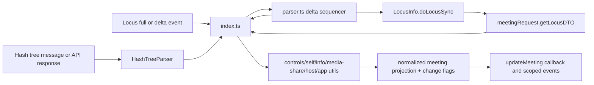
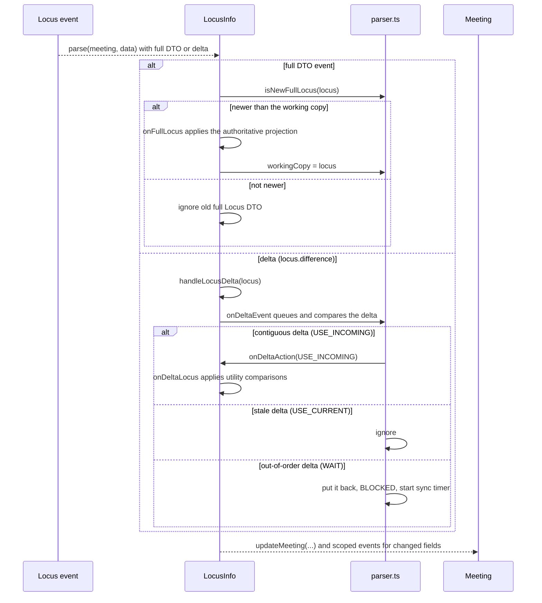
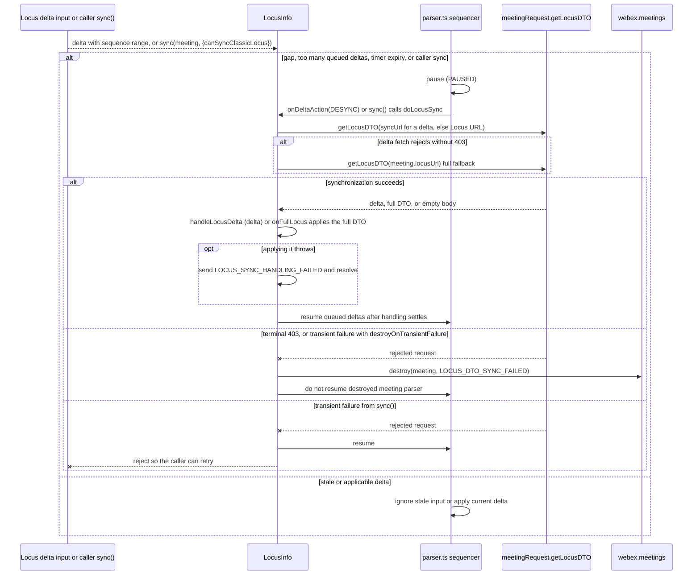
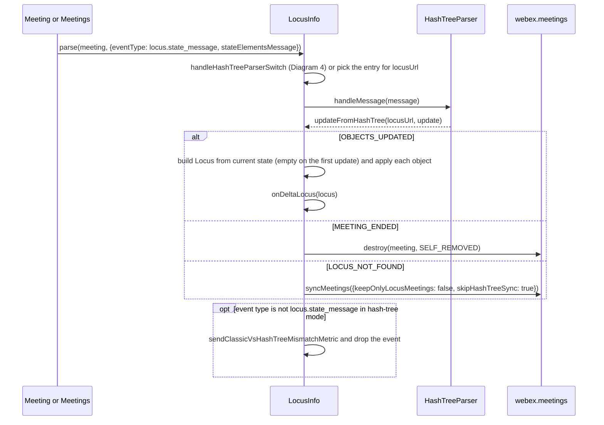
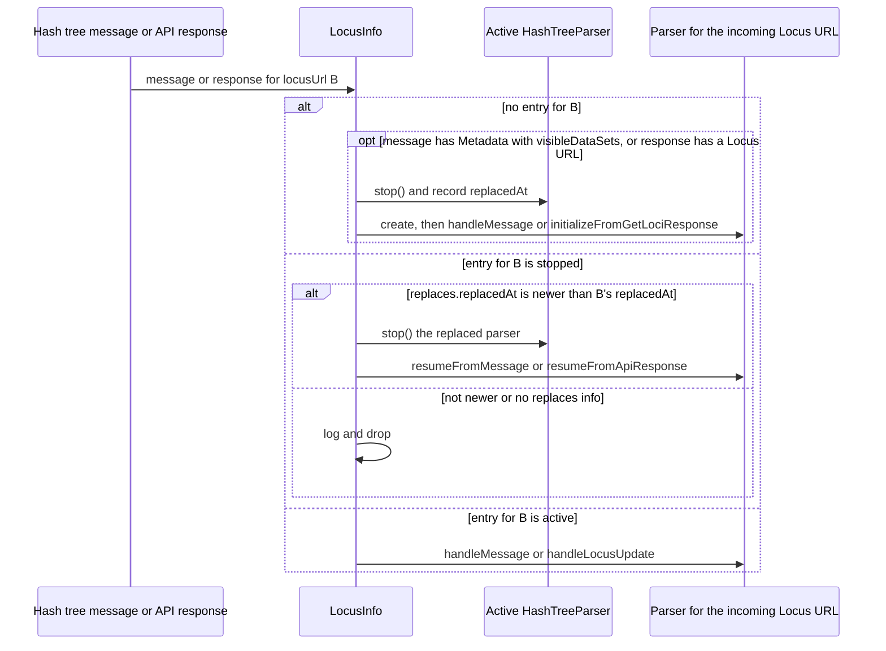
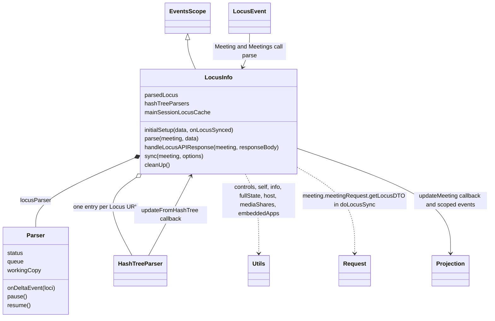
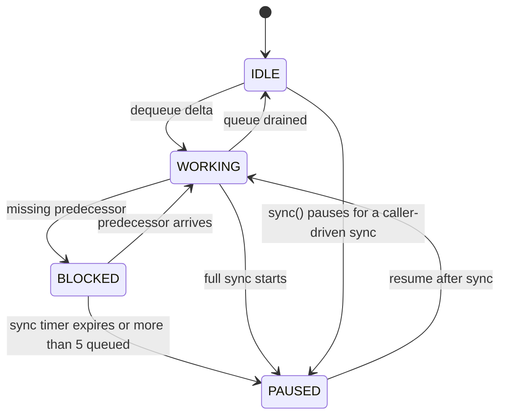

<!-- sdd-generated-metadata
doc_kind: module-spec
generated_from: module-spec@0.3.0
generated_by: claude-code
approved_by: rarajes2@cisco.com
updated_at: 2026-11-16T14:30:00Z
validation_status: not-run
-->

# Locus info

This source-local document at `src/locus-info/docs/README.md` owns the stable specification for
**the Locus info module**: `LocusInfo`, which every `Meeting` creates to hold one normalized copy of
its Locus state, and the classic delta sequencer in `parser.ts`. `LocusInfo` accepts full Locus DTOs,
classic deltas, Locus API responses, and hash-tree updates, and reports what changed through the
`updateMeeting` callback and scoped events that `Meeting` subscribes to. Hash-tree datasets are kept
by the [hash tree module](../../hashTree/docs/README.md); the roster built from the participants is
owned by the [members module](../../members/docs/README.md). Ground every claim in package evidence
and link to the [package architecture](../../../docs/architecture.md) instead of repeating broader
facts. No service specification exists because this package is a library.

Related context: [documentation index](../../../docs/index.md) ·
[package agent instructions](../../../AGENTS.md)

## Metadata

| Field | Value |
| ----- | ----- |
| Owner | @webex/web-client, @webex/web-sdk |
| Source path | `src/locus-info` |
| Resource kind | module |
| Status | Draft |
| Last verified | 2026-11-16 at `0b8c34db7f` |
| Module id | `plugin-meetings/locus-info` |
| Parent spec | — |
| Doc kind | Module spec |
| Coverage score | Pending coverage assessment |
| Validation status | not-run |

## Applicability

| Condition ID                         | Status     | Evidence or reason | Owned section |
| ------------------------------------ | ---------- | ------------------ | ------------- |
| `module.has_tiers`                   | N/A        | No tier policy exists in `package.json` or `.sdd/manifest.json` | Tier |
| `module.has_ui`                      | N/A        | `src/locus-info/index.ts` reports state through a callback and events and renders nothing | UI use-case flow |
| `module.crosses_service_boundaries`  | Applicable | `src/locus-info/index.ts` fetches Locus DTOs through the meeting request, calls webex.meetings destroy and syncMeetings, and injects webex.request into each hash tree parser | Cross-boundary use-case flow |
| `module.holds_client_state`          | Applicable | `src/locus-info/index.ts` keeps the parsed projection, raw subdocument copies, parser entries, and the main session cache; `src/locus-info/parser.ts` keeps the delta queue and working copy | Client state model |
| `module.enforces_domain_rules`       | Applicable | Sequence rules in `src/locus-info/parser.ts`; transport, replacement, and meeting-end rules in `src/locus-info/index.ts` | Business rules and invariants |
| `module.is_concurrent_async`         | Applicable | Promise-based syncs, a sorted delta queue with a sync timer in `src/locus-info/parser.ts`, and asynchronous hash tree callbacks in `src/locus-info/index.ts` | Concurrency and reactive flow |
| `module.owns_persistence`            | N/A        | Everything is in memory; `src/locus-info/index.ts` writes no storage | Data, schema, and migration discipline |
| `module.stateful_transitions`        | Applicable | The delta parser moves between IDLE, WORKING, BLOCKED, and PAUSED in `src/locus-info/parser.ts` | State machine |
| `module.exposes_wire_protocol`       | Applicable | Locus full and delta DTO, Mercury event, hash tree message, and API response shapes read by `src/locus-info/index.ts`, `src/locus-info/parser.ts`, and `src/locus-info/types.ts` | Protocol and wire format |
| `module.ui_multi_screen`             | N/A        | No UI | UI flow |
| `module.large_data_model`            | N/A        | The Locus DTO is owned by Locus; the few client types in `src/locus-info/types.ts` are listed under Protocol and wire format | Data model |
| `module.returns_caller_errors`       | Applicable | initialSetup and onFullLocus throw, and sync rejects on a transient failure, in `src/locus-info/index.ts` | Caller-visible failure modes |
| `module.module_specific_conventions` | N/A        | The module follows the package-wide logging, metrics, and event conventions seen in `src/locus-info/index.ts`; no extra rule is set | Module-specific rules |
| `module.published_package`           | N/A        | `src/index.ts` exports nothing from this module; it is internal to the package | Export stability |
| `module.embedded_in_host`            | N/A        | No host theme or embed API | Host integration and theming |
| `module.has_design_tradeoff`         | N/A        | `.sdd/manifest.json` records has_design_tradeoff false for this module; the classic versus hash tree split is described under Design overview | Key design trade-off |
| `module.has_submodules`              | N/A        | The src/locus-info directory has no child module in `.sdd/manifest.json` | Sub-modules |

## Evidence register

Requirements cite current implementation and mirrored unit-test paths. Current code wins over prose
when they conflict; commit and PR history are excluded by repository-owner decision. Missing test
evidence is stated as a gap rather than inferred.

| Evidence | What it establishes |
| -------- | ------------------- |
| `src/locus-info/index.ts` | `LocusInfo` (extends `EventsScope`), `findMeetingForHashTreeMessage`, `createLocusFromHashTreeMessage`, and the exported types `LocusLLMEvent`, `LocusApiResponseBody`, `HashTreeParserEntry`, `LocusInfoCallbacks`; every entry path, sync, parser switch, projection update, and event emission |
| `src/locus-info/parser.ts` | The classic delta sequencer: `IDLE`, `WORKING`, `BLOCKED`, `PAUSED`; the `loci` comparison results; a sorted queue; the out-of-order wait of 10 to 15 seconds and the queue limit of 5 |
| `src/locus-info/controlsUtils.ts` | Controls parsing and change flags, `isNeedReplaceMembers`, `getSessionSwitchStatus`, `isMainSessionDTO` |
| `src/locus-info/selfUtils.ts` | Self parsing (`getSelves`) and the self change flags that drive the self events |
| `src/locus-info/infoUtils.ts` | Meeting info parsing with roles and joined state, `DisplayHintSection`, lock and unlock flags |
| `src/locus-info/fullState.ts`, `src/locus-info/hostUtils.ts` | Full state parsing with meeting state and type change; host id parsing and the new-host flag |
| `src/locus-info/mediaSharesUtils.ts`, `src/locus-info/embeddedAppsUtils.ts` | Content and whiteboard share extraction; embedded app parsing (Slido detection) and the similarity check by count and state |
| `src/locus-info/types.ts` | `LocusDTO`, `LocusFullState`, `Links`, `ReplacesInfo`, `EndMeetingReason`, and `LocusErrorCodes` (`LOCUS_INACTIVE` 2403004, `LOCUS_USER_FULL` 2423001) |
| `src/hashTree/hashTreeParser.ts` | The parser `LocusInfo` creates; `LocusInfoUpdateType` values `OBJECTS_UPDATED`, `MEETING_ENDED`, `LOCUS_NOT_FOUND`; `reevaluateLlmWatchdogs`; uses `LocusErrorCodes.LOCUS_INACTIVE` |
| `src/meeting/index.ts` | Creates `LocusInfo`, subscribes to its events, calls `initialSetup`, `parse`, `syncAllHashTreeDatasets`, and `suspendDestroyMeeting`; compares `LocusErrorCodes.LOCUS_USER_FULL` |
| `src/meeting/util.ts` | Passes Locus API response bodies to `handleLocusAPIResponse` |
| `src/meetings/index.ts` | Calls `initialSetup` for meetings created from Locus events and destroys the meeting when it throws; calls `sync` from `syncMeetings` |
| `src/meetings/util.ts` | `isSelfMovedOrBreakoutEnded`, `isWholeMeetingEnded`, and `getThisDevice`; reads `EndMeetingReason.breakoutEnded` |
| `src/constants.ts` | `LOCUSEVENT` names (`locus.difference`, `locus.state_message`, `jsSdk.locus_from_sync_meetings`), `EVENTS` and `LOCUSINFO.EVENTS` names, removal reasons |
| `src/config.ts` | `meetings.locus.excludedDataSets` defaults to `attendees` |
| `test/unit/spec/locus-info/index.js` | Behavioral cases for initial setup, every update family, hash tree switching, API responses, sync and doLocusSync failure branches, caches, meeting end, and out-of-order deltas |
| `test/unit/spec/locus-info/parser.js` | Sequence comparison fixture cases, queueing, DESYNC pause, USE_INCOMING, locus URL change, full DTO freshness, invalid loci |
| `src/locus-info/index.ts` (observation) | `updateParticipants` emits `PARTICIPANT_REASON_CHANGED` for every participant whose `reason` is `FAILURE`; no reason is recorded in code |
| `src/locus-info/index.ts` (observation) | `handleHashTreeParserSwitchForAPIResponse` starts `initializeFromGetLociResponse` and `resumeFromApiResponse` without awaiting or catching them, so their `LocusNotFoundError` or `MeetingEndedError` rejection is not handled; no reason is recorded in code |
| `src/locus-info/parser.ts` (observation) | On `LOCUS_URL_CHANGED` the parser clears its working copy but does not pause, so deltas already queued are dropped as invalid until the sync result arrives; no reason is recorded in code |
| `src/locus-info/index.ts` (observation) | For 1:1 call types `isMeetingActive` still emits `DESTROY_MEETING` while destroy is suspended (it only adds the metric and `joinInProgress`); for meeting type it suppresses the event; no reason is recorded in code |

## Purpose and boundary

- Responsibility: Normalizes Locus full-state, delta, API-response, and hash-tree inputs into one
  meeting-state projection and scoped callbacks.
- In scope: the four entry paths (`initialSetup`, `parse`, `handleLocusAPIResponse`, `sync`); the
  classic delta queue and its Locus sync (`doLocusSync`); creating, stopping, and reactivating one
  `HashTreeParser` per Locus URL and converting its updates into a Locus-shaped object; projecting
  controls, self, host, info, full state, media shares, embedded apps, links, participants, URLs,
  and sequences; detecting that a 1:1 call or a meeting has ended; the main session cache used when
  moving between breakouts.
- Out of scope: hash comparison, dataset requests, and heartbeat watchdogs (`src/hashTree`); building
  and diffing `Member` models (`src/members`, `src/member`); what `Meeting` does with each event;
  the Locus HTTP routes (`src/meeting/request.ts`); destroying a meeting and resyncing all meetings
  (`src/meetings/index.ts`).
- Consumers: `Meeting` (`src/meeting/index.ts`) creates one `LocusInfo` per meeting and is the only
  listener of its events; `Meetings` (`src/meetings/index.ts`) calls `initialSetup`, `parse`, and
  `sync`, and uses `findMeetingForHashTreeMessage`; `src/meeting/util.ts` forwards API responses.
  Applications reach the state only through `Meeting` properties and events.

## Structure and key files

`src/locus-info` contains 10 source files and has 10 mirrored unit-test files under
`test/unit/spec/locus-info` (seven suites plus the `selfConstant.js`, `lib/BasicSeqCmp.json`, and
`lib/SeqCmp.json` fixtures). There is no dedicated suite for `fullState.ts`, `hostUtils.ts`, or
`types.ts`; `index.js` exercises them through `LocusInfo`.

The code is TypeScript in the Node 22.14 Yarn workspace, built on the package's `EventsScope` and
Webex core abstractions, with Mocha, Sinon, and `@webex/test-helper-chai` tests run by `test:unit`
(`webex-legacy-tools test --unit --runner mocha`). Build target: `yarn workspace
@webex/plugin-meetings build:src`.

| File | Holds |
|---|---|
| `src/locus-info/controlsUtils.ts` | Parses `controls` and computes the per-control change flags; decides member replacement and breakout to main session switches |
| `src/locus-info/embeddedAppsUtils.ts` | Parses embedded apps (Slido or other) and compares app lists by count and state |
| `src/locus-info/fullState.ts` | Parses `fullState` into type, meeting state, lock, and attendee count, with state and type change detection |
| `src/locus-info/hostUtils.ts` | Parses `host` into a host id and flags a new host |
| `src/locus-info/index.ts` | `LocusInfo`: entry paths, syncs, hash tree parser entries, projection updates, scoped events, caches; the hash tree message helpers |
| `src/locus-info/infoUtils.ts` | Parses `info` with the self roles and joined state into display hints, policy, and lock flags |
| `src/locus-info/mediaSharesUtils.ts` | Extracts content and whiteboard share state, floors, beneficiaries, and URLs from `mediaShares` |
| `src/locus-info/parser.ts` | Classic delta sequencer: sequence comparison rules, sorted queue, IDLE, WORKING, BLOCKED, and PAUSED status, sync trigger |
| `src/locus-info/selfUtils.ts` | Parses `self` and computes the self change flags (roles, mute, lobby, breakout, layout, media) |
| `src/locus-info/types.ts` | Locus DTO, full state, links, replaces, end meeting reason, and Locus error code types |
| `test/unit/spec/locus-info/index.js` and 9 sibling test files | Mirrored unit coverage: `controlsUtils.js`, `embeddedAppsUtils.js`, `infoUtils.js`, `mediaSharesUtils.ts`, `parser.js`, `selfUtils.js`, and the fixtures `selfConstant.js`, `lib/BasicSeqCmp.json`, `lib/SeqCmp.json` |
| `src/locus-info/docs/README.md` | This module specification |

## Public surface

`LocusInfo` is internal to the package: `src/index.ts` does not export it, and applications reach it
only as `meeting.locusInfo`. Contract ID `locus-info-projection` is indexed in the
[package architecture](../../../docs/architecture.md) and its native source is
`src/locus-info/index.ts`.

| Contract ID | Type | Surface | Purpose | Compatibility / deprecation | Schema / detail link | Root index |
|---|---|---|---|---|---|---|
| `locus-info-projection` | SDK / initialization | `init()`, `initialSetup(data, onLocusSynced)`, `handleLocusAPIResponse()`, and `applyLocusDeltaData()` / `handleLocusDelta()` | Establish the Locus projection from a join response, a Locus message, or a GET loci response, and queue API or Mercury deltas through the delta parser. | Preserve initialization order, the three `initialSetup` triggers, and single-event mutation discipline; `onLocusSynced` errors are logged, not thrown. | `src/locus-info/index.ts` | [architecture](../../../docs/architecture.md) |
| `locus-info-projection` | SDK / hash-tree | `updateLocusFromHashTreeObject()`, `sendClassicVsHashTreeMismatchMetric()`, and `syncAllHashTreeDatasets({onlyLLM})` | Convert synchronized hash-tree objects into the same Locus projection and emit the existing metric when an update arrives in the unexpected transport shape. | Preserve parser callback ownership, metric trigger conditions (at most 5 metrics per instance), and sequential dataset synchronization per parser. | `src/locus-info/index.ts`, `src/hashTree/hashTreeParser.ts` | [architecture](../../../docs/architecture.md) |
| `locus-info-projection` | SDK / parsing/event | `parse()`, `emitScoped()`, `onFullLocus()`, `onDeltaLocus()`, and `handleOneOnOneEvent()` | Parse full and delta payloads and notify Meeting through the `updateMeeting` callback and scoped events. | Preserve event names and payloads and the 1:1 `REMOTE_RESPONSE` handling; `onFullLocus()` throws when `dataSets` arrive without metadata. | `src/locus-info/index.ts` | [architecture](../../../docs/architecture.md) |
| `locus-info-projection` | SDK / projection | `updateLocusInfo()`, `getLocusPartner()`, `isMeetingActive()`, `suspendDestroyMeeting()`, `compareAndUpdate()`, and `compareSelfAndHost()` | Reconcile meeting activity, partner, self, and host changes and decide when the meeting has ended, without duplicating remote transport. | Preserve comparison semantics, the `DESTROY_MEETING` reasons, and destroy-suspension behavior. | `src/locus-info/index.ts` | [architecture](../../../docs/architecture.md) |
| `locus-info-projection` | SDK / projection | `updateParticipants()`, `updateControls()`, `updateConversationUrl()`, `updateCreated()`, `updateLinks()`, `updateFullState()`, `updateHostInfo()`, `updateMeetingInfo()`, `updateEmbeddedApps()`, `updateMediaShares()`, `updateReplaces()`, `updateSelf()`, `ensureSelfParticipantExists()`, and `mergeParticipants()` | Project the Locus subdocuments into Meeting, Members, controls, media shares, and related state. | Preserve per-subdocument comparison with the stored raw copy and callback routing. | `src/locus-info/index.ts`, `src/locus-info/controlsUtils.ts`, `src/locus-info/embeddedAppsUtils.ts`, `src/locus-info/mediaSharesUtils.ts` | [architecture](../../../docs/architecture.md) |
| `locus-info-projection` | SDK / identity/cache | `updateLocusUrl()`, `updateAclUrl()`, `updateBasequence()`, `updateSequence()`, `updateLocusCache()`, `getTheLocusToUpdate()`, `updateMainSessionLocusCache()`, `clearMainSessionLocusCache()`, and `cleanUp()` | Maintain the current and main session Locus identity and the cached main session payload used when returning from a breakout. | Preserve main-session separation; `cleanUp()` cleans up and forgets every hash tree parser. | `src/locus-info/index.ts` | [architecture](../../../docs/architecture.md) |
| `locus-info-projection` | parser comparison | `locus2string()`, `checkSequenceOverlap()`, `checkUnequalRanges()`, `checkForUniqueEntries()`, `checkIfOutOfSync()`, `compare()`, `compareFullDtoSequence()`, `isNewFullLocus()`, `compareSequence()`, `compareToAction()`, `extractComparisonState()`, `getMetaData()`, `getUniqueSequences()`, `getNumbersOutOfRange()`, `isValidLocus()`, `isSequenceEmpty()`, and `isLoci()` | Determine whether a delta is applicable, stale, out of order, from another Locus URL, or requires a full sync. | Preserve the `loci` results (`USE_INCOMING`, `USE_CURRENT`, `WAIT`, `DESYNC`, `LOCUS_URL_CHANGED`) and the `IDLE`, `PAUSED`, `WORKING`, and `BLOCKED` parser-state transitions. | `src/locus-info/parser.ts` | [architecture](../../../docs/architecture.md) |
| `locus-info-projection` | parser queue/lifecycle | `nextEvent()`, `onDeltaAction()`, `onDeltaEvent()`, `packComparisonResult()`, `pause()`, `processDeltaEvent()`, `resume()`, and `getDebugMessage()` | Serialize queued deltas and expose the parser's current blocking or working state for debugging. | Pause/resume and queue ordering are observable through applied callback order. | `src/locus-info/parser.ts` | [architecture](../../../docs/architecture.md) |
| `locus-info-projection` | exported helpers/contracts | `findMeetingForHashTreeMessage()`, `createLocusFromHashTreeMessage()`, `LocusLLMEvent`, `LocusApiResponseBody`, `HashTreeParserEntry`, `LocusInfoCallbacks`, `DisplayHintSection`, `EndMeetingReason`, `LocusFullState`, `Links`, `LocusDTO`, `ReplacesInfo`, and `LocusErrorCodes` | Share the exact Locus and hash-tree integration vocabulary used by Meetings and composed controllers. | Add fields compatibly; raw error, status, and link shapes remain cross-module contracts. | `src/locus-info/index.ts`, `src/locus-info/types.ts`, `src/locus-info/infoUtils.ts` | [architecture](../../../docs/architecture.md) |
| `locus-info-projection` | SDK / sync | `sync(meeting, {canSyncClassicLocus, canSyncHashTree})` and `isUsingHashTrees()` | Resync this meeting after a reconnection through whichever mechanism it uses, and tell callers which one that is. | A hash tree meeting never takes the classic path; the classic path rejects only on a transient failure so the caller can retry. | `src/locus-info/index.ts` | [architecture](../../../docs/architecture.md) |

Compatibility notes:

- Prefer additive options and payload fields. Preserve method and event names, rejection semantics,
  and cleanup timing. The module is internal: change its surface together with its callers in
  `src/meeting/index.ts`, `src/meeting/util.ts`, and `src/meetings/index.ts`, not through
  `src/index.ts`.

## Dependencies

`LocusInfo` needs Locus payloads and fetch access through the meeting request, the hash-tree parser,
event scope utilities, the meeting update callback, and metrics.

| Dependency | Why it is required | Failure behavior |
| ---------- | ------------------ | ---------------- |
| `src/hashTree` (contract `hash-tree-sync`) | `HashTreeParser` keeps each visible dataset and calls back with `OBJECTS_UPDATED`, `MEETING_ENDED`, or `LOCUS_NOT_FOUND` | Initialization rejections propagate out of `initialSetup`; other sync failures stay inside the parser |
| Meeting request, `meeting.meetingRequest.getLocusDTO` (contract `locus-http`) | Delta and full Locus DTO fetches in `doLocusSync` | A delta failure falls back to a full fetch unless it is a 403; see Caller-visible failure modes |
| `webex.meetings` (`src/meetings/index.ts`) | `destroy` after a failed or terminal sync and on `MEETING_ENDED`; `syncMeetings` on `LOCUS_NOT_FOUND`; `meetingCollection` lookup | A `syncMeetings` rejection is logged |
| `webex.request`, `webex.sessionId`, `webexTrackingIdSequenceNumbers` from `@webex/webex-core` | Injected into each `HashTreeParser` as its request function and tracking id source | The tracking id falls back to a uuid when no interceptor sequence exists |
| `webex.internal.device.url` | Finding this device's `replaces` entry and parsing self | — |
| `webex.internal.newMetrics.submitClientEvent`, `Metrics.sendBehavioralMetric` (`src/metrics`) | `client.call.remote-ended`, delta sync failure, sync handling failure, classic versus hash tree mismatch, destroy while suspended, out-of-order delta, unsupported hash tree operation | Fire and forget |
| `EventsScope` (`src/common/events/events-scope.ts`), `SortedQueue` (`src/common/queue.ts`) | Scoped event emission; the delta queue ordered by base sequence | — |
| `MeetingsUtil` (`src/meetings/util.ts`), `src/constants.ts` | Moved or breakout-ended detection, whole meeting end, this device lookup; event and state names | — |
| `webex.config.meetings.locus.excludedDataSets` (`src/config.ts`) | Datasets the hash tree parser must not sync (default `attendees`) | — |
| `lodash` (`isEqual`, `assignWith`, `cloneDeep`, `isEmpty`), `uuid` | Change detection by deep equality, cache merging and copying, empty-body detection, tracking id fallback | — |

## Requirements

| ID | WHAT | WHY | Source Evidence | Test / Example Evidence | Assumptions / Gaps | Confidence |
|---|---|---|---|---|---|---|
| `LOCUS-INFO-R-001` | `init()`, `initialSetup()`, `parse()`, and the `update*()` family initialize and update the Locus state held on `LocusInfo`: a raw copy of each subdocument plus the parsed `parsedLocus` projection, pushed to Meeting through `callbacks.updateMeeting`. | Meeting needs one normalized projection and scoped callbacks instead of raw Locus full-state, delta, API-response, and hash-tree inputs (the class JSDoc: LocusInfo converts Locus info into a private emitter for the parent object). | `src/locus-info/index.ts` | `test/unit/spec/locus-info/index.js` | none | PRESENT |
| `LOCUS-INFO-R-002` | Full, delta, API, and hash-tree updates are applied by path: a classic full DTO is applied only when `isNewFullLocus()` finds it newer than the working copy; a classic delta is queued in `parser.ts` and applied through `onDeltaLocus()` on `USE_INCOMING`; a hash-tree update is converted to a Locus-shaped object and applied through `onDeltaLocus()`. | Full, delta, API, and hash-tree inputs must converge on one ordered Locus projection without applying gaps or older state. | `src/locus-info/index.ts`, `src/locus-info/parser.ts` | `test/unit/spec/locus-info/index.js`, `test/unit/spec/locus-info/parser.js` | none | PRESENT |
| `LOCUS-INFO-R-003` | Malformed or stale deltas follow parser comparison rules. `doLocusSync()` fetches the delta DTO from the working copy's `syncUrl` (full DTO from the meeting or new Locus URL otherwise), falls back from delta to full sync unless the delta fetch got a 403, applies a delta body through `handleLocusDelta()` and a full body through `onFullLocus()`, and ignores an empty body. It returns a promise: a terminal 403 always destroys the meeting with `LOCUS_DTO_SYNC_FAILED` and resolves; a transient fetch failure destroys and resolves by default, or with `destroyOnTransientFailure: false` keeps the meeting and rejects; a failure to apply a fetched DTO sends `LOCUS_SYNC_HANDLING_FAILED` and resolves. Its `finally` resumes the parser when the meeting survives. | Parser recovery is internal on the delta path, which does not await it; only the caller-driven reconnection path may retry, and code comments state that re-applying the same unprocessable DTO would fail identically and retry forever. | `src/locus-info/index.ts`, `src/locus-info/parser.ts` | `test/unit/spec/locus-info/index.js`, `test/unit/spec/locus-info/parser.js` | none | PRESENT |
| `LOCUS-INFO-R-004` | Full-state, delta, API-response, and hash-tree inputs converge into the same current Locus projection through `updateLocusInfo()` and `updateParticipants()`. A meeting uses one transport: `isUsingHashTrees()` is true once any parser exists, classic mode ignores `locus.state_message` events received before a parser exists, and hash-tree mode routes `jsSdk.locus_from_sync_meetings` through `handleLocusAPIResponse()`. | Alternate synchronization transports must not expose divergent meeting state; the `doLocusSync` JSDoc forbids the classic sync for hash-tree meetings, and a code comment says an early hash-tree event before the join response is safe to ignore. | `src/locus-info/index.ts`, `src/locus-info/parser.ts` | `test/unit/spec/locus-info/index.js`, `test/unit/spec/locus-info/parser.js` | none | PRESENT |
| `LOCUS-INFO-R-005` | Sequence gaps trigger synchronization rather than speculative application: an out-of-order delta (`WAIT`) blocks the parser and starts a 10 to 15 second timer, and the timer or more than 5 queued deltas triggers a `DESYNC` sync; a delta whose base sequence equals its sequence also requests a sync. Hash-tree dataset gaps are reconciled by `HashTreeParser`. `sendClassicVsHashTreeMismatchMetric()` reports an unexpected transport shape (a non hash-tree event in hash-tree mode, or `dataSets` in a classic API response), logs every time, and sends at most 5 metrics; it does not compare classic and hash-tree state values. | Applying stale or incomplete remote state can produce false meeting, member, or control events, while the metric contract must not imply a state-diff computation that does not exist; the cap keeps it from flooding the metrics system (code comment). | `src/locus-info/index.ts`, `src/locus-info/parser.ts`, `src/hashTree/hashTreeParser.ts` | `test/unit/spec/locus-info/index.js`, `test/unit/spec/locus-info/parser.js`, `test/unit/spec/hashTree/hashTreeParser.ts` | none | PRESENT |
| `LOCUS-INFO-R-006` | Normalized changes invoke the scoped event for what changed: `LOCUS_INFO_UPDATE_PARTICIPANTS` on every participants update; `LOCUS_INFO_UPDATE_SELF`, `LOCUS_INFO_UPDATE_HOST`, `LOCUS_INFO_UPDATE_MEDIA_SHARES`, `LOCUS_INFO_UPDATE_URL`, `LOCUS_INFO_CAN_ASSIGN_HOST`; the `LOCUSINFO.EVENTS` control, self, info, full state, embedded apps, and links events; `DESTROY_MEETING` and `REMOTE_RESPONSE` for meeting lifecycle. Each update compares the incoming subdocument with the stored raw copy (deep equality, or count and state for embedded apps) and emits only on change. | Parent Meeting and consumers need domain-specific deltas for members, self, controls, media shares, host, embedded apps, and meeting lifecycle, not an undifferentiated Locus payload. | `src/locus-info/index.ts`, `src/locus-info/controlsUtils.ts`, `src/locus-info/selfUtils.ts` | `test/unit/spec/locus-info/index.js`, `test/unit/spec/locus-info/controlsUtils.js`, `test/unit/spec/locus-info/selfUtils.js` | none | PRESENT |
| `LOCUS-INFO-R-007` | `LocusErrorCodes` is the shared catalogue of raw Locus `errorCode` values the client branches on: `LOCUS_INACTIVE` (`2403004`), read by the hash-tree parser's meeting-ended check, and `LOCUS_USER_FULL` (`2423001`), read by Meeting. When constructing the hash-tree parser, `LocusInfo` injects `isLlmExpected: () => this.parsedLocus.self?.joinedWith?.state === 'JOINED'`, and when `updateSelf()` turns that from false to true it calls `reevaluateLlmWatchdogs()` on every parser. | These numeric codes cross module boundaries and drive caller-visible decisions, so their values are contracts, not internal constants. Anchoring the LLM expectation on `joinedWith` prevents heartbeat watchdogs from supervising a transport this device does not hold, and the re-evaluation arms watchdogs skipped before the device joined (code comment). | `src/locus-info/types.ts`, `src/locus-info/index.ts`, `src/hashTree/hashTreeParser.ts`, `src/meeting/index.ts` | `test/unit/spec/locus-info/index.js` | none | PRESENT |
| `LOCUS-INFO-R-008` | `createHashTreeParser()` stops every other active parser, records the new `replacedAt` on them when known, stores the new entry by Locus URL with `initializedFromHashTree: false`, and clears the object id to participant id map. A stopped parser is reactivated only when this device's `replaces` entry has a `replacedAt` newer than the one stored for it; the parser it replaces is then stopped. The first `OBJECTS_UPDATED` after creation or reactivation starts from an empty Locus and sets `forceReplaceMembers`, except for a parser created from a full join-response Locus, which counts as initialized. | Locus only sends updates for the current Locus URL, and a move from breakout A to breakout B and back to A must reuse A's parser; a new URL starts from a clean state (code comments). | `src/locus-info/index.ts` | `test/unit/spec/locus-info/index.js` | none | PRESENT |
| `LOCUS-INFO-R-009` | On `MEETING_ENDED` from a parser, `LocusInfo` destroys its meeting with `SELF_REMOVED` when the meeting is still in the collection; on `LOCUS_NOT_FOUND` it calls `webex.meetings.syncMeetings({keepOnlyLocusMeetings: false, skipHashTreeSync: true})` and logs a rejection. | The parser reports that the meeting ended or that the Locus URL no longer exists (a 404 means it was replaced or ended, per the hash-tree parser's comment), so the meeting must be removed or its Locus found again. | `src/locus-info/index.ts`, `src/hashTree/hashTreeParser.ts` | `test/unit/spec/locus-info/index.js` | none | PRESENT |
| `LOCUS-INFO-R-010` | `isMeetingActive()` decides the end of a meeting. For `CALL`, `SIP_BRIDGE`, and `SPACE_SHARE` it sends the `updateMeeting` partner, then emits `DESTROY_MEETING` with `CALL_INACTIVE` (full state inactive), `PARTNER_LEFT` (partner left while self declined, notified, or joined; `shouldLeave` when self `joinedWith` is not left), or `SELF_LEFT` (self left while the partner left, declined, was notified, or idle), each after a `client.call.remote-ended` client event. For `MEETING` it emits `MEETING_INACTIVE_TERMINATING` when the whole meeting ended, or `SELF_REMOVED` when self is removed. | Locus reports the end through state rather than a dedicated event, so Meeting relies on these reasons to tear down; code comments note a removed guest gets no further events. | `src/locus-info/index.ts`, `src/meetings/util.ts` | `test/unit/spec/locus-info/index.js` | none | PRESENT |
| `LOCUS-INFO-R-011` | `suspendDestroyMeeting(true)` makes `isMeetingActive()` suppress the meeting-type `DESTROY_MEETING` and send `DESTROY_MEETING_WHILE_SUSPENDED` instead; the 1:1 paths send the metric and `joinInProgress: true` in the client event. `suspendDestroyMeeting(false)` restores emission. | The method JSDoc: `joinWithMedia` uses it to prevent meeting destruction during retry flows. | `src/locus-info/index.ts`, `src/meeting/index.ts` | `test/unit/spec/locus-info/index.js` | The 1:1 paths still emit `DESTROY_MEETING`; see the Evidence register observation | PRESENT |
| `LOCUS-INFO-R-012` | Main session DTOs are cached: `updateLocusCache()` merges each main session DTO into `mainSessionLocusCache`, merging participants by id. `getTheLocusToUpdate()` returns a copy of the cache when a classic event returns the user from a breakout to the main session (or when the creator's session switch needs it), and clears the cache when the main session is no longer active or self was removed from it. | Locus does not send the full main session participant list on return from a breakout or when a host or cohost leaves a breakout (code comments). | `src/locus-info/index.ts`, `src/locus-info/controlsUtils.ts` | `test/unit/spec/locus-info/index.js` | none | PRESENT |
| `LOCUS-INFO-R-013` | When members are replaced, `onDeltaLocus()` copies self into participants if it is missing; a hash-tree SELF update for a webinar attendee also adds a participant built from self; a hash-tree participant matching self identity with state `LEFT` and reason `MOVED` is copied into self. | The web app relies on a self participant while Locus briefly sends none during breakout moves, webinar attendees get no participant for themselves, and the participant update for a move often arrives over LLM before self (code comments). | `src/locus-info/index.ts` | `test/unit/spec/locus-info/index.js` | none | PRESENT |
| `LOCUS-INFO-R-014` | `updateLocusInfo()` ignores a DTO for which `MeetingsUtil.isSelfMovedOrBreakoutEnded()` is true and returns false, so `onDeltaLocus()` sends no participant update for it. | When moved to a breakout, Locus sends a message for the previous Locus saying self was moved, which would otherwise be read as leaving the call (code comment). | `src/locus-info/index.ts`, `src/meetings/util.ts` | `test/unit/spec/locus-info/index.js` | none | PRESENT |
| `LOCUS-INFO-R-015` | `initialSetup()` handles three triggers: `locus-message` (a hash-tree message must carry a Metadata object with `visibleDataSets`, otherwise it throws; a classic message is applied as a full Locus), `join-response` (full Locus, with a hash-tree parser when `dataSets` are present), and `get-loci-response` (a parser when the Locus has a visibleDataSets link). It awaits the parser initialization, calls `onLocusSynced` with the join-response Locus or the classic GET loci Locus, otherwise with a snapshot of current state, logs a callback error, and sets `emitChange`. | Meetings creates a meeting object before setup and destroys it when setup throws (code comment and `src/meetings/index.ts`); the snapshot gives the caller full state even when only hash-tree messages arrived. | `src/locus-info/index.ts`, `src/meetings/index.ts` | `test/unit/spec/locus-info/index.js` | none | PRESENT |
| `LOCUS-INFO-R-016` | `sync()` syncs all hash-tree datasets when the meeting uses hash trees and `canSyncHashTree` is set; otherwise, when `canSyncClassicLocus` is set and the meeting has a Locus URL, it pauses the parser and awaits `doLocusSync()` with `destroyOnTransientFailure: false`. | A reconnection must not tear down the meeting on a transient failure and must not fetch a DTO for a meeting without a Locus URL; signed-in users resync classic meetings through `getActiveMeetings` instead (method JSDoc). | `src/locus-info/index.ts`, `src/meetings/index.ts` | `test/unit/spec/locus-info/index.js` | none | PRESENT |
| `LOCUS-INFO-R-017` | `handleLocusAPIResponse()` accepts a wrapped body (`{dataSets, locus, metadata}`) or a bare Locus. In hash-tree mode it passes it to the active parser for its Locus URL, or switches or creates a parser when none is active; in classic mode it queues the Locus as a delta. | Locus returns the whole Locus unwrapped for meeting-wide actions such as mute all (type comment), and a response can name a new Locus URL after a breakout move. | `src/locus-info/index.ts`, `src/meeting/util.ts` | `test/unit/spec/locus-info/index.js` | none | PRESENT |
| `LOCUS-INFO-R-018` | `updateMeetingInfo()` re-parses info when the info, the self roles, or the joined state changes, using the stored info when the update has none, then emits `MEETING_LOCKED` or `MEETING_UNLOCKED` on a lock change and `MEETING_INFO_UPDATED` with `isInitializing` when no self was passed. | The display hints depend on info, roles, and joined state, and a delta that turns self JOINED often carries no info (code comment). | `src/locus-info/index.ts`, `src/locus-info/infoUtils.ts` | `test/unit/spec/locus-info/index.js`, `test/unit/spec/locus-info/infoUtils.js` | none | PRESENT |

## Design overview

`LocusInfo` owns the normalized meeting projection. The utility files compare individual Locus
domains, while `parser.ts` serializes classic delta application and asks `LocusInfo` to run
`doLocusSync()` when a gap requires the meeting request to fetch a delta or full DTO.

A meeting runs in one of two modes, chosen by what Locus sends:

- Classic: full DTOs and deltas with `sequence`, `baseSequence`, and `syncUrl`. Full DTOs pass the
  freshness check in `parser.isNewFullLocus()`; deltas go through the parser queue.
- Hash tree: once any `HashTreeParser` exists (`isUsingHashTrees()`), Locus messages and API
  responses go to the parser for their Locus URL. The parser calls `updateFromHashTree()` with the
  objects that changed; `LocusInfo` builds a Locus-shaped object from the current state and those
  objects (`updateLocusFromHashTreeObject()`) and applies it through `onDeltaLocus()`. It keeps a map
  from hash-tree object ids to participant ids so a removed participant object can be reported as a
  removed participant id.

Both modes end in the same update functions, so Meeting sees one projection and one set of events.
Each `update*()` function compares the incoming subdocument with the raw copy it stored last time,
asks the matching utility for the parsed form and change flags, calls `updateMeeting`, and emits the
scoped events for the flags that are set.

## Data flow and sequence coverage

Call style: in-process method calls from Meeting and Meetings; outbound HTTPS only through
`meeting.meetingRequest.getLocusDTO` and the `webex.request` function injected into each
`HashTreeParser`; outbound in-process events through `EventsScope`.

Sequence coverage:

| Operation group | Diagram | Failure coverage |
|---|---|---|
| Classic full and delta Locus projection (UC-1, UC-2, UC-5) | Diagram 1 — classic Locus projection primary sequence | older full DTO ignored, duplicate or stale delta (`USE_CURRENT`) ignored, out-of-order delta blocks the parser, moved self ignored |
| Classic recovery and caller-driven sync (UC-3) | Diagram 2 — classic Locus recovery alternate/failure sequence | missing sequence range, delta sync failure with full fallback, 403, transient failure with and without destroy, invalid DTO, apply failure, parser resume |
| Hash-tree updates (UC-4, UC-5) | Diagram 3 — hash-tree update | meeting ended, Locus not found, unexpected transport shape metric |
| Hash-tree parser switch on breakout moves (UC-4, UC-6) | Diagram 4 — parser switch | replacement not newer, missing metadata, missing Locus URL |
| Meeting end detection | `src/locus-info/index.ts` (`isMeetingActive`, LOCUS-INFO-R-010, LOCUS-INFO-R-011) | suppression while destroy is suspended |

Diagram 1 — classic Locus projection primary sequence:

Diagram 2 — classic Locus recovery alternate/failure sequence:

Diagram 3 — hash-tree update:

Diagram 4 — parser switch:

## Class and component relationships

The arrows identify ownership and delegation inside `src/locus-info/`; files that only declare types
or constants are not presented as transports. `HashTreeParser` belongs to `src/hashTree` and is
created and owned here.

## Use cases and flows

| Use case | Actor or caller | Primary steps and outcome | Failure or boundary behavior | Evidence |
| -------- | --------------- | ------------------------- | ---------------------------- | -------- |
| `UC-001` | Meeting after join, Meetings for a new Locus event or GET loci | Initialize from a full Locus API response, Locus message, or GET loci response and project self, host, participants, controls, links, meeting info, shares, embedded apps, and replacement state; create a hash-tree parser when datasets are present | A hash-tree message without Metadata visibleDataSets throws and Meetings destroys the meeting | `src/locus-info/index.ts`, `src/meetings/index.ts`, `test/unit/spec/locus-info/index.js` |
| `UC-002` | Meeting receiving Mercury Locus events or API responses | Serialize incoming Locus deltas so only one queued event mutates the projection at a time | Stale deltas are ignored; invalid loci are skipped | `src/locus-info/parser.ts`, `src/locus-info/index.ts`, `test/unit/spec/locus-info/parser.js` |
| `UC-003` | The parser, or Meetings after a reconnection | Pause/block parsing and run the Locus sync when sequence comparison finds missing or out-of-order state, or when `sync()` is called | Full fallback, destroy on terminal or default failure, reject on a transient failure from `sync()` | `src/locus-info/parser.ts`, `src/locus-info/index.ts`, `test/unit/spec/locus-info/index.js` |
| `UC-004` | Meeting receiving hash-tree messages and API responses | Convert hash-tree messages and API responses into Locus updates through the parser for their Locus URL, switching parsers on breakout moves; emit the existing diagnostic when an update arrives in the unexpected transport shape; no classic-vs-hash-tree value comparison is performed | Meeting ended destroys the meeting; Locus not found resyncs meetings | `src/locus-info/index.ts`, `src/hashTree/hashTreeParser.ts`, `test/unit/spec/locus-info/index.js` |
| `UC-005` | Meeting listening to LocusInfo | Emit scoped callbacks only for the Locus subdocuments that changed, preserving Meeting, Members, and controller ownership | A moved-self DTO is ignored; unchanged subdocuments emit nothing except the participants update | `src/locus-info/index.ts`, `src/locus-info/controlsUtils.ts`, `src/locus-info/embeddedAppsUtils.ts`, `src/locus-info/mediaSharesUtils.ts` |
| `UC-006` | Meeting moving between main session and breakouts | Maintain and clear distinct current and main-session Locus caches as breakout session context changes | The cache is cleared when the main session is inactive or self was removed | `src/locus-info/index.ts`, `src/locus-info/controlsUtils.ts`, `test/unit/spec/locus-info/index.js` |

### Cross-boundary use-case flow

| Boundary | Transport and ordering | Compatibility | Timeout, retry, and recovery |
| -------- | ---------------------- | ------------- | ---------------------------- |
| Locus DTO fetch (`UC-003`) | HTTPS through `meeting.meetingRequest.getLocusDTO`; delta first, then one full fallback | An empty body means the client already has the latest DTO; a delta body is recognized by `baseSequence` | No retry here; the reconnection caller retries after a rejection |
| Hash-tree dataset requests (`UC-001`, `UC-004`) | HTTPS issued by `HashTreeParser` through the injected `webex.request`; syncs run one parser at a time in `syncAllHashTreeDatasets` | Excluded datasets come from `meetings.locus.excludedDataSets` | Owned by the hash tree module |
| Meetings collection (`UC-003`, `UC-004`) | In-process calls to `webex.meetings.destroy` and `syncMeetings` | Removal reasons from `src/constants.ts` | A `syncMeetings` rejection is logged |
| Meeting (`UC-005`) | Synchronous `updateMeeting` callback and `EventsScope` events, in update order | Event names and payloads from `src/constants.ts` | — |

<!-- Include if: the module holds client-side state. [condition-id: module.holds_client_state] -->

## Client state model

Normalized Locus, sequence state, hash-tree parser entries, partner, self, and member projections,
and the destroy-suspension flag are held per meeting on one `LocusInfo` instance; dataset hashes
live in each `HashTreeParser`.

| State or slice | Owner      | Initial state | Transition triggers | Reset or persistence boundary |
| -------------- | ---------- | ------------- | ------------------- | ----------------------------- |
| Parsed projection (`parsedLocus`: controls, self, host, info, fullState, mediaShares, and the self `states` history) | `LocusInfo` | `{states: []}` | Each `update*()` call that sees a change | Instance memory for the meeting's life |
| Raw subdocument copies (`controls`, `self`, `host`, `info`, `fullState`, `mediaShares`, `embeddedApps`, `links`, `participants`, `url`, `sequence`, and others) | `LocusInfo` | `undefined` | Stored after each comparison; compared with the next update | Instance memory |
| Delta parser (`status`, `queue`, `workingCopy`, `syncTimer`) | `parser.ts` | `IDLE`, empty queue, `null` working copy | Deltas, sync start and resume, full DTOs | See State machine |
| Hash-tree parser entries (`hashTreeParsers` by Locus URL, with `replacedAt` and `initializedFromHashTree`) | `LocusInfo` | Empty map | Created on hash-tree input; stopped or reactivated on breakout moves | `cleanUp()` cleans up and clears them |
| Object id to participant id map | `LocusInfo` | Empty map | Participant objects added or removed; cleared on parser creation, reactivation, and `cleanUp()` | Instance memory |
| Main session cache (`mainSessionLocusCache`) | `LocusInfo` | `undefined` | `updateLocusCache` merges main session DTOs; `getTheLocusToUpdate` clears it | Instance memory |
| Flags (`destroyMeetingSuspended`, `compareAndUpdateFlags`, `emitChange`, mismatch metric counter) | `LocusInfo` | `false`, `{}`, `false`, `0` | `suspendDestroyMeeting`, host and self updates, the end of `initialSetup`, the mismatch metric | Instance memory |

<!-- Include if: the module enforces domain rules or entity invariants. [condition-id: module.enforces_domain_rules] -->

## Business rules and invariants

| ID | Invariant | WHY | Enforcement source | Test evidence |
| -- | --------- | --- | ------------------ | ------------- |
| `INV-001` | Older or mismatched updates must not silently replace newer state: a classic full DTO applies only when its last sequence entry is greater than the working copy's (or either sequence is empty), and a delta applies only on `USE_INCOMING`. | Applying stale Locus state would emit false meeting, member, and control events. | `src/locus-info/parser.ts`, `src/locus-info/index.ts` | `test/unit/spec/locus-info/parser.js`, `test/unit/spec/locus-info/index.js` |
| `INV-002` | The self participant exists in the participants of any update that replaces members, and a webinar attendee's self is copied into a participant. | The web app expects a self member at all times (code comments). | `src/locus-info/index.ts` | `test/unit/spec/locus-info/index.js` |
| `INV-003` | A meeting is in hash-tree mode exactly when `hashTreeParsers` is not empty, and `doLocusSync` is never run for it. | The two transports keep different sequence state, and the JSDoc forbids the classic sync for hash-tree meetings. | `src/locus-info/index.ts` | `test/unit/spec/locus-info/index.js` |
| `INV-004` | At most one hash-tree parser is active; creating or reactivating one stops the others. | Locus sends updates only for the current Locus URL (code comment). | `src/locus-info/index.ts` | `test/unit/spec/locus-info/index.js` |
| `INV-005` | Only one classic delta is processed at a time, in base sequence order. | The status field ensures one event at a time (code comment), so each comparison sees the last applied working copy. | `src/locus-info/parser.ts` | `test/unit/spec/locus-info/parser.js` |

<!-- Include if: the module is concurrent, asynchronous, reactive, or event-driven. [condition-id: module.is_concurrent_async] -->

## Concurrency and reactive flow

- Execution model: one JavaScript event loop. Delta processing is synchronous inside
  `onDeltaEvent`; Locus syncs and hash-tree initialization are promises; hash-tree callbacks arrive
  whenever a parser applies a message or finishes a sync.
- Ordering guarantees: Delta inputs are ordered by the parser's sequence state. A gap or a too-long
  out-of-order wait enters the parser's synchronization path, the parser stays paused until the
  fetched delta or full DTO is handled, and stale inputs follow the comparison result instead of
  being applied speculatively. `syncAllHashTreeDatasets` syncs parsers one after another.
- Idempotency and retry: every `update*()` call is a no-op for an unchanged subdocument; a full DTO
  that is not newer is ignored; this module does not retry a failed sync itself, and `sync()` rejects
  so its caller can.
- Shared-state protection: none beyond the parser status. A classic `DESYNC` sync is started without
  awaiting; the `finally` resume is the only re-entry point. The `LOCUS_URL_CHANGED` sync does not
  pause the parser (see the Evidence register observation).
- Blocking restrictions: no work blocks the event loop; the out-of-order wait is a timer of 10 to 15
  seconds, cleared when the missing delta arrives or a sync starts.

<!-- Include if: the module has non-trivial state transitions. [condition-id: module.stateful_transitions] -->

## State machine

The diagram uses the parser's `IDLE`, `WORKING`, `BLOCKED`, and `PAUSED` values from
`src/locus-info/parser.ts`.

- Guards: `nextEvent` does nothing while `PAUSED` or `BLOCKED`; `onDeltaEvent` only enqueues while
  `WORKING` or `PAUSED`, and while `BLOCKED` it processes the head of the queue again unless more
  than 5 deltas are queued.
- Rejected transitions: none are guarded; `resume()` sets `WORKING` from any state and drains the
  queue.
- No state is terminal. A meeting destroyed by a failed sync is never resumed, so after a `DESYNC`
  sync its parser stays `PAUSED`.

<!-- Include if: callers depend on a wire protocol or serialized format. [condition-id: module.exposes_wire_protocol] -->

## Protocol and wire format

External payloads are parsed by files under `src/locus-info/` and by `src/hashTree`. Preserve
current field names, enum and raw values, sequence identifiers, and compatibility behavior; do not
treat the normalized client model as the wire schema. The Locus DTO itself is owned by the Locus
service; `src/locus-info/types.ts` types only the fields the client reads.

| Message or frame | Version | Producer or serializer | Consumer or parser | Compatibility and ordering rule |
| ---------------- | ------- | ---------------------- | ------------------ | ------------------------------- |
| Classic full Locus DTO | Unversioned | Locus, through Mercury events and API responses | `onFullLocus` in `src/locus-info/index.ts` | `sequence.entries` last value orders full DTOs; `meeting`, `participants`, and every subdocument are read |
| Classic Locus delta | Unversioned | Locus `locus.difference` events, API responses, and `syncUrl` fetches | `src/locus-info/parser.ts` | `baseSequence`, `sequence` (`rangeStart`, `rangeEnd`, `entries`), `syncUrl`, `url`; a delta with equal base sequence and sequence requests a sync |
| Mercury Locus event types | Unversioned | Locus through Mercury | `parse` in `src/locus-info/index.ts` | Participant, controls, self, floor, and declined events carry a full DTO; `locus.difference` and unknown types carry a delta |
| Hash-tree message (`LocusLLMEvent`, `locus.state_message`) | Unversioned | Locus over Mercury or LLM | `src/hashTree/hashTreeParser.ts`, then `updateFromHashTree` | `locusUrl`, `dataSets`, `locusStateElements` with `htMeta.elementId` type, id, and version; object types map to Locus keys through `ObjectTypeToLocusKeyMap` |
| Locus API response (`LocusApiResponseBody`) | Unversioned | Locus REST responses | `handleLocusAPIResponse` | Wrapped `{dataSets, locus, metadata}` or a bare Locus DTO |
| `replaces` entry on this device | Unversioned | Locus self devices | `findMeetingForHashTreeMessage`, parser switch | `locusUrl`, `replacedAt` (compared as strings), `sessionId` |
| `LocusErrorCodes`, `EndMeetingReason` | Unversioned | Locus error bodies and `fullState.endMeetingReason` | `src/hashTree/hashTreeParser.ts`, `src/meeting/index.ts`, `src/meetings/util.ts` | Raw numeric codes and string reasons are compared exactly |

<!-- Include if: the module returns or raises errors callers must handle. [condition-id: module.returns_caller_errors] -->

## Caller-visible failure modes

| Condition | Signal | Caller recovery |
|---|---|---|
| Delta sequence is stale, out of order, or has a missing range | `parser.ts` follows its sequence comparison result: stale input is ignored, an out-of-order delta blocks the parser until its predecessor arrives or the timer or queue limit starts a sync, and a gap requests synchronization. | Wait for the synchronized DTO before consuming later projected changes. |
| `getLocusDTO()` rejects during `doLocusSync()` | `doLocusSync()` returns a promise. A 403 is terminal: it destroys the meeting with `LOCUS_DTO_SYNC_FAILED` and resolves. A transient failure destroys and resolves on the delta path (the default), and rejects without destroying when `sync()` set `destroyOnTransientFailure: false`. Its `finally` resumes the parser when the meeting survives. | On the delta path observe the owning meeting lifecycle; a `sync()` caller retries after a rejection. |
| The DTO is fetched but applying it throws | `doLocusSync()` sends `LOCUS_SYNC_HANDLING_FAILED`, resolves, and resumes the parser. | Nothing to retry; later deltas or a later sync bring the state up to date. |
| Full/API/hash-tree input is accepted | `LocusInfo` updates its normalized projection and invokes only the callbacks for changed member, self, control, share, host, app, or lifecycle fields. | Consume the scoped change callback rather than the raw Locus payload. |
| `initialSetup()` gets a `locus-message` whose hash-tree message has no Metadata with `visibleDataSets` | It throws `Error('Metadata object with visibleDataSets is missing in the message')`. | Meetings destroys the partially created meeting. |
| Hash-tree initialization in `initialSetup()` gets a 404 or a 409 with `LOCUS_INACTIVE` | The awaited parser initialization rejects with `LocusNotFoundError` or `MeetingEndedError`, so `initialSetup()` rejects. | The caller destroys or abandons the meeting. |
| `onFullLocus()` receives `dataSets` without metadata | It throws an `Error` saying the hash tree metadata is missing. | Pass the metadata from the same response. |

## Pitfalls and constraints

- Full, delta, and hash-tree messages can overlap or arrive out of order. Updating callbacks before
  reconciliation creates transient false state.
- `LocusInfo` is not exported from `src/index.ts`; its behavior is reachable only through the parent
  `Meeting` (`meeting.locusInfo`) and `Meetings`, so a change here is a change to Meeting's events.
- `doLocusSync()` must not be used for hash-tree meetings; use `sync()` or
  `syncAllHashTreeDatasets()`.
- `LOCUS_INFO_UPDATE_PARTICIPANTS` is emitted on every `updateParticipants()` call, changed or not;
  the members module computes the real delta.
- The parser-switch path for API responses does not await or catch the parser initialization (see
  the Evidence register observation), so a rejection there surfaces as an unhandled rejection.
- Main session participants come from the cache after a breakout; clearing the cache too early
  loses the participant list.

## Verification

Use the current mirrored suites: `test/unit/spec/locus-info/controlsUtils.js`,
`test/unit/spec/locus-info/embeddedAppsUtils.js`, `test/unit/spec/locus-info/index.js`,
`test/unit/spec/locus-info/infoUtils.js`, `test/unit/spec/locus-info/mediaSharesUtils.ts`,
`test/unit/spec/locus-info/parser.js`, `test/unit/spec/locus-info/selfUtils.js`, with the fixtures
`test/unit/spec/locus-info/selfConstant.js`, `test/unit/spec/locus-info/lib/BasicSeqCmp.json`, and
`test/unit/spec/locus-info/lib/SeqCmp.json`. Run them with
`yarn workspace @webex/plugin-meetings test:unit --targets locus-info/index.js` (or another suite)
after `build:src`. Characterize the use cases above and each listed failure condition; add cleanup
or transition cases only for resources and state this module owns.

| Behavior / Requirement | Existing test evidence | Gap |
|---|---|---|
| `LOCUS-INFO-R-001` | `test/unit/spec/locus-info/index.js` | `init()` has no direct case; cover it with every changed-subdocument callback family |
| `LOCUS-INFO-R-002` | `test/unit/spec/locus-info/index.js`, `test/unit/spec/locus-info/parser.js` | none; full sync failure while the parser is blocked is covered by the out-of-order cases |
| `LOCUS-INFO-R-003` | `test/unit/spec/locus-info/index.js`, `test/unit/spec/locus-info/parser.js` | the destroyed meeting leaving the parser paused is not asserted |
| `LOCUS-INFO-R-004` | `test/unit/spec/locus-info/index.js`, `test/unit/spec/locus-info/parser.js` | none |
| `LOCUS-INFO-R-005` | `test/unit/spec/locus-info/index.js`, `test/unit/spec/hashTree/hashTreeParser.ts` | none; the mismatch metric cap of 5 is asserted, and dataset recovery is verified separately in the hash-tree suite |
| `LOCUS-INFO-R-006` | `test/unit/spec/locus-info/index.js`, `test/unit/spec/locus-info/controlsUtils.js`, `test/unit/spec/locus-info/selfUtils.js` | `updateLinks` events and `LOCUS_INFO_CAN_ASSIGN_HOST` have no direct case |
| `LOCUS-INFO-R-007` | `test/unit/spec/locus-info/index.js` | covered for the `isLlmExpected` joined and self-joined-but-device-not-joined cases and for the watchdog re-evaluation; `LocusErrorCodes` values are asserted only where the hash-tree parser and Meeting use them |
| `LOCUS-INFO-R-008` | `test/unit/spec/locus-info/index.js` | none |
| `LOCUS-INFO-R-009` | `test/unit/spec/locus-info/index.js` | none |
| `LOCUS-INFO-R-010` | `test/unit/spec/locus-info/index.js` | none |
| `LOCUS-INFO-R-011` | `test/unit/spec/locus-info/index.js` | none |
| `LOCUS-INFO-R-012` | `test/unit/spec/locus-info/index.js` | none |
| `LOCUS-INFO-R-013` | `test/unit/spec/locus-info/index.js` | none; the missing-self copy is a parametrized `onDeltaLocus` case |
| `LOCUS-INFO-R-014` | `test/unit/spec/locus-info/index.js` | none |
| `LOCUS-INFO-R-015` | `test/unit/spec/locus-info/index.js` | rejection of the awaited hash-tree initialization is not asserted |
| `LOCUS-INFO-R-016` | `test/unit/spec/locus-info/index.js` | none |
| `LOCUS-INFO-R-017` | `test/unit/spec/locus-info/index.js` | none |
| `LOCUS-INFO-R-018` | `test/unit/spec/locus-info/index.js`, `test/unit/spec/locus-info/infoUtils.js` | none |
| `INV-001` to `INV-005` | `test/unit/spec/locus-info/parser.js`, `test/unit/spec/locus-info/index.js` | none |

Record coverage gaps explicitly and link follow-up work. A module specification is complete only
when its public surface, invariants, failure modes, and test evidence agree with the implementation.
