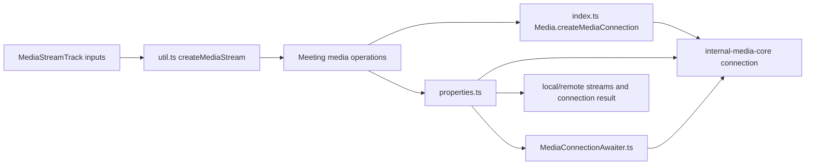
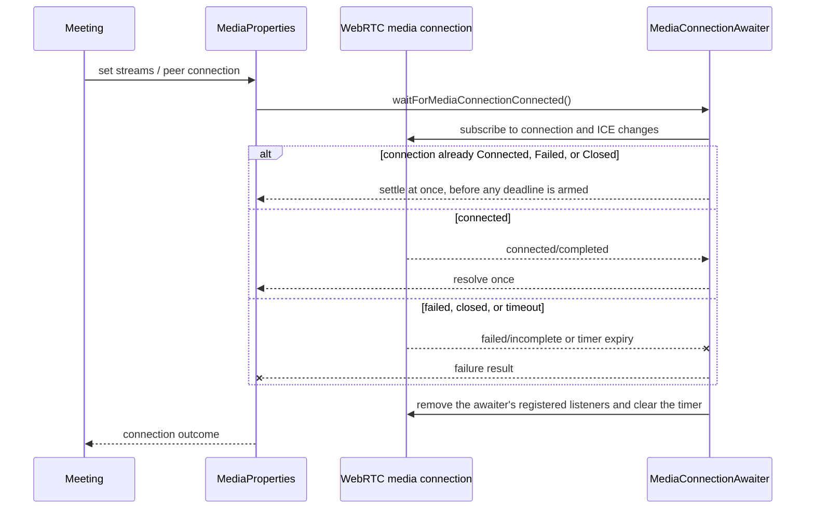
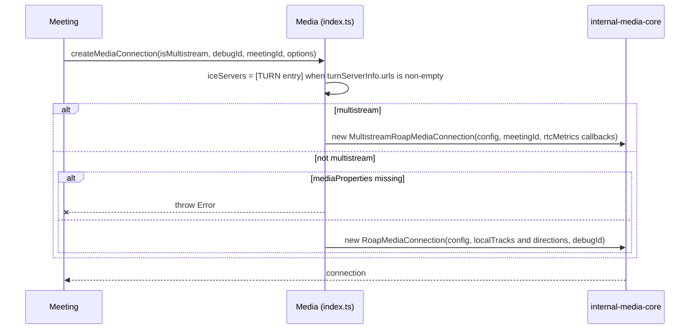
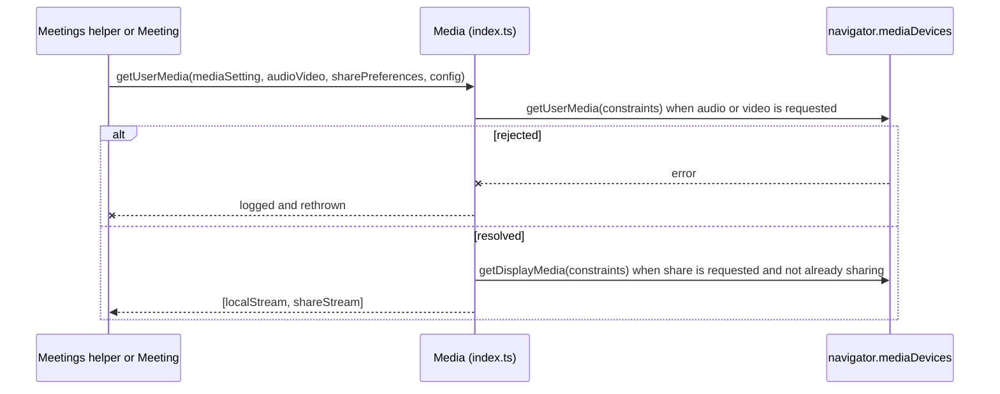
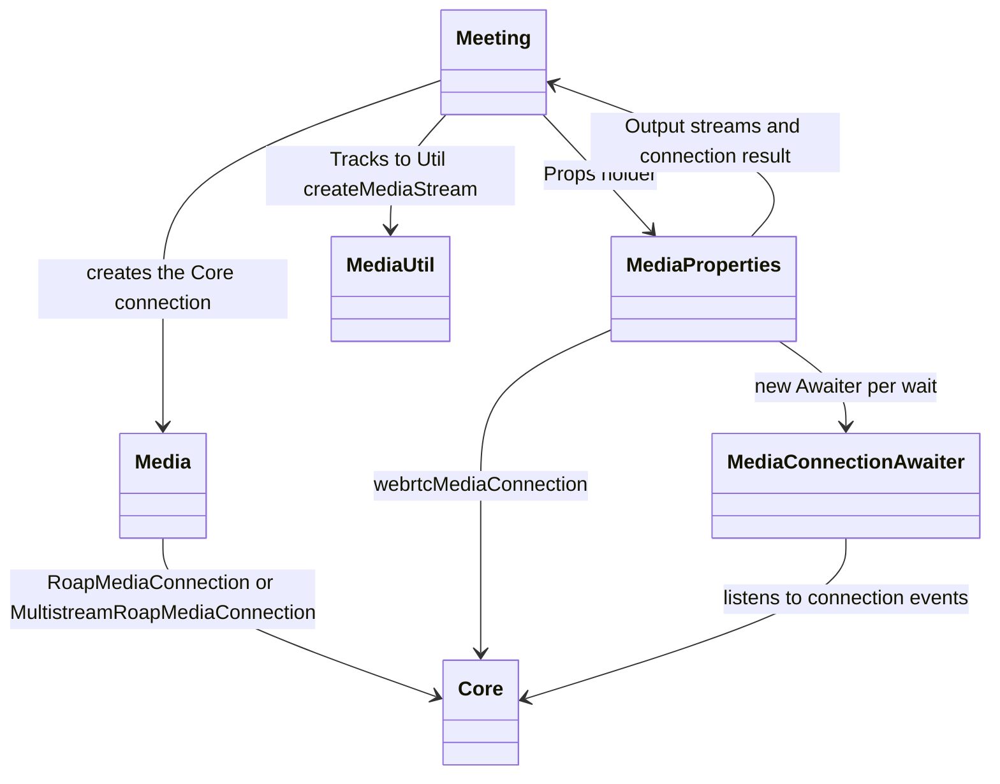
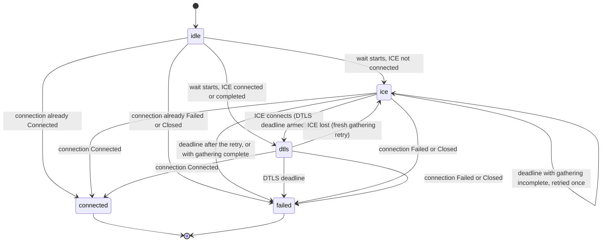

<!-- sdd-generated-metadata
doc_kind: module-spec
generated_from: module-spec@0.3.0
generated_by: claude-code
approved_by: rarajes2@cisco.com
updated_at: 2026-11-17T03:14:21Z
validation_status: pass-with-warnings
-->

# Media

This source-local document at `src/media/docs/README.md` is the canonical source-local spec for
`src/media/` and owns the stable specification for **the media module** of `@webex/plugin-meetings`:
the `Media` facade that creates internal-media-core connections and acquires local browser media,
the `MediaProperties` holder that a `Meeting` keeps for its streams and connection, and the
`MediaConnectionAwaiter` that waits for ICE and DTLS connectivity. Ground every claim in package
evidence and link to the [package architecture](../../../docs/architecture.md) instead of repeating
broader facts. No service specification exists because this package is a library.

Related context: [documentation index](../../../docs/index.md) ·
[package agent instructions](../../../AGENTS.md) · repo architecture:
[package architecture](../../../docs/architecture.md) · registry:
[specification registry](../../../docs/specs/README.md)

## Metadata

| Field | Value |
| ----- | ----- |
| Owner | @webex/web-client, @webex/web-sdk |
| Source path | `src/media` |
| Resource kind | module |
| Status | Draft |
| Last verified | 2026-11-16 at `0b8c34db7f` |
| Module id | `plugin-meetings/media` |
| Parent spec | — |
| Doc kind | Module spec |
| Coverage score | Pending coverage assessment |
| Validation status | not-run |

Coverage state and the contracts baseline are recorded in `.sdd/manifest.json`.

## Applicability

| Condition ID | Status | Evidence or reason | Owned section |
| ------------ | ------ | ------------------ | ------------- |
| `module.has_tiers` | N/A | No tier policy exists in `package.json` | Tier |
| `module.has_ui` | N/A | `src/media/index.ts` returns streams and connections; it renders nothing | UI use-case flow |
| `module.crosses_service_boundaries` | Applicable | `src/media/index.ts` calls navigator.mediaDevices and builds internal-media-core connections; `src/media/properties.ts` and `src/media/MediaConnectionAwaiter.ts` read WebRTC stats and send behavioral metrics | Cross-boundary use-case flow |
| `module.holds_client_state` | Applicable | `src/media/properties.ts` holds the streams, the connection, the media direction, and the media-issue counters of one Meeting | Client state model |
| `module.enforces_domain_rules` | Applicable | Settle-once, teardown, and retry rules in `src/media/MediaConnectionAwaiter.ts` | Business rules and invariants |
| `module.is_concurrent_async` | Applicable | Event listeners, deadlines, and stats promises in `src/media/MediaConnectionAwaiter.ts` and `src/media/properties.ts` | Concurrency and reactive flow |
| `module.owns_persistence` | N/A | Nothing under `src/media/index.ts`, `src/media/properties.ts`, or `src/media/MediaConnectionAwaiter.ts` writes storage | Data, schema, and migration discipline |
| `module.stateful_transitions` | Applicable | The State union (idle, ice, dtls, connected, failed) and its transitions in `src/media/MediaConnectionAwaiter.ts` | State machine |
| `module.exposes_wire_protocol` | Applicable | `src/media/index.ts` sets SDP munging and ICE server options; `src/media/properties.ts` parses the local SDP | Protocol and wire format |
| `module.ui_multi_screen` | N/A | No UI in `src/media/index.ts` | UI flow |
| `module.large_data_model` | N/A | The exported shapes in `src/media/properties.ts` and `src/media/MediaConnectionAwaiter.ts` are small | Data model |
| `module.returns_caller_errors` | Applicable | Readiness rejections in `src/media/MediaConnectionAwaiter.ts`; thrown and rethrown errors in `src/media/index.ts` | Caller-visible failure modes |
| `module.module_specific_conventions` | N/A | The manifest section profile resolves this to false; repository rules in `AGENTS.md` apply | Module-specific rules |
| `module.published_package` | N/A | No src/media export is re-exported by `src/index.ts` | Export stability |
| `module.embedded_in_host` | N/A | No host mount API in `src/media/index.ts` | Host integration and theming |
| `module.has_design_tradeoff` | Applicable | The Media facade in `src/media/index.ts` isolates Meeting from internal-media-core option shapes | Key design trade-off |
| `module.has_submodules` | N/A | src/media has no child module in `.sdd/manifest.json` | Sub-modules |

## Evidence register

Requirements cite current implementation and mirrored unit-test paths. Current code wins over
retained prose when they conflict; commit and PR history are excluded by repository-owner decision.
Missing test evidence is stated as a gap rather than inferred.

| Evidence | What it establishes |
| -------- | ------------------- |
| `src/media/index.ts` | The `Media` facade: `createMediaConnection`, `getDirection`, `getLocalMedia`, `getUserMedia`, `getDisplayMedia`, `getMedia`, `stopStream`, `toggleStream`; the `BundlePolicy` type |
| `src/media/properties.ts` | `MediaProperties`: stream, connection, direction, and settings fields; `waitForMediaConnectionConnected`; `getCurrentConnectionInfo`; `sendMediaIssueMetric`; the `MediaDirection` and `IPVersion` types |
| `src/media/MediaConnectionAwaiter.ts` | The awaiter's `State` union (`idle`, `ice`, `dtls`, `connected`, `failed`), per-phase deadlines, the single ICE gathering retry, teardown, and the `MEDIA_STILL_NOT_CONNECTED` metric |
| `src/media/util.ts` | `MediaUtil.createMediaStream(tracks)` filters falsy tracks and returns a `MediaStream` |
| `src/constants.ts` | `ICE_CONNECTION_TIMEOUT` is 20000 ms and `DTLS_CONNECTION_TIMEOUT` is 15000 ms; the `media:*` `EVENT_TRIGGERS` literals |
| `src/metrics/constants.ts` | `MEDIA_ISSUE_DETECTED` and `MEDIA_STILL_NOT_CONNECTED` behavioral metric names |
| `src/meeting/index.ts` | The only caller: creates the connection through `Media.createMediaConnection`, holds a `MediaProperties`, waits for readiness, closes the connection, then calls `unsetPeerConnection`; emits the `media:*` events; builds remote streams with `MediaUtil.createMediaStream` |
| `src/meetings/index.ts` | Exposes `Media.getUserMedia` on the Meetings media helpers |
| `test/unit/spec/media/index.ts` | `createMediaConnection` cases for both connection classes, directions, ICE servers, bundle and ICE transport policy, DTX, TWCC, AV1 slides, and Firefox relay gathering |
| `test/unit/spec/media/properties.ts` | Readiness, connection-info fallbacks, IP version, connection type, and media-issue throttling and flush cases |
| `test/unit/spec/media/MediaConnectionAwaiter.ts` | Phase deadlines, gathering retry, terminal cleanup, late callbacks, and repeated waits |
| Observation, no stated WHY | `Media.toggleStream` is a no-op kept on the facade (`src/media/index.ts`); `MediaUtil.createMediaStream` logs when `tracks` is missing and then throws a `TypeError` calling `filter` on it (`src/media/util.ts`). Neither is a requirement until a reason is recorded |

## Purpose and boundary

- Responsibility: creates/configures media-core connections (`Media.createMediaConnection`),
  derives media properties and connection diagnostics, awaits readiness, and exposes media lifecycle
  helpers to Meeting.
- In scope: building the `RoapMediaConnection` or `MultistreamRoapMediaConnection` configuration;
  local camera, microphone, and display acquisition through `navigator.mediaDevices`; the
  `MediaProperties` holder; ICE and DTLS readiness waiting; connection-type, IP-version, and
  transport diagnostics; throttled media-issue metrics; `MediaUtil.createMediaStream`.
- Out of scope: ROAP signaling and TURN discovery (`src/roap`); multistream slots and media
  requests (`src/multistream`); closing the connection and emitting `media:*` events (`Meeting` in
  `src/meeting/index.ts`); the WebRTC implementation (`@webex/internal-media-core`); local stream
  classes (`@webex/media-helpers`).
- Consumers: `Meeting` (`src/meeting/index.ts`) and the Meetings media helpers
  (`src/meetings/index.ts`).

## Structure and key files

`src/media/` contains 4 direct source/reference file(s) and has 3 mirrored unit-test file(s) under
`test/unit/spec/media/`. The module facade and primary exports are `index.ts`; `properties.ts`,
`MediaConnectionAwaiter.ts`, and the `util.ts` helper functions sit beside it, and this canonical
module specification is `src/media/docs/README.md`. The code is TypeScript in the Node 22.14 Yarn
workspace; Webex core/plugin abstractions and Mocha/Sinon/`@webex/test-helper-chai` tests. Build
target: `yarn workspace @webex/plugin-meetings build:src`.

| File | Holds |
| ---- | ----- |
| `src/media/MediaConnectionAwaiter.ts` | MediaConnectionAwaiter: the ICE and DTLS readiness wait for one connection, its deadlines, retry, teardown, and timeout metric |
| `src/media/index.ts` | module facade (`Media`): connection creation, direction mapping, and local media acquisition, plus the `BundlePolicy` export |
| `src/media/properties.ts` | `MediaProperties`: per-Meeting streams, connection, media direction and settings, readiness entry point, and connection diagnostics |
| `src/media/util.ts` | `MediaUtil.createMediaStream`, the helper that builds a `MediaStream` from received tracks |
| `test/unit/spec/media/MediaConnectionAwaiter.ts` and 2 sibling test file(s) | mirrored characterization/unit coverage (`index.ts`, `properties.ts`) |

## Public surface

None of these are re-exported by `src/index.ts`; they are reached through `Meeting`. Contract ID
`media-connection` is registered in `.sdd/manifest.json` and indexed in the
[package architecture](../../../docs/architecture.md#public-and-consumer-surfaces).

Manifest contracts: provides `media-connection`; requires `internal-media-core` and
`browser-webrtc`.

| Contract ID | Type | Surface | Purpose | Compatibility / deprecation | Schema / detail link | Root index |
| ----------- | ---- | ------- | ------- | --------------------------- | -------------------- | ---------- |
| `media-connection` | SDK / in-process | `MediaProperties.setMediaDirection()`, `setMediaSettings()`, `setMediaPeerConnection()`, and `getVideoDeviceId()` / `setVideoDeviceId()` | Hold the media-core configuration and preferred camera identity used by Meeting. | Preserve default directions (all six flags false), null-device behavior (`getVideoDeviceId()` returns `null` when unset), and setter names. | `src/media/properties.ts` | package architecture |
| `media-connection` | SDK / in-process | local stream setters: `setLocalAudioStream()`, `setLocalVideoStream()`, `setLocalShareAudioStream()`, `setLocalShareVideoStream()`, and `hasLocalShareStream()` | Keep microphone, camera, and share tracks distinct so Meeting can publish and stop them independently. | Preserve optional-stream inputs and the boolean share predicate. | `src/media/properties.ts` | package architecture |
| `media-connection` | SDK / in-process | remote setters: `setRemoteAudioStream()`, `setRemoteVideoStream()`, `setRemoteShareStream()`, `setRemoteQualityLevel()` | Store the remote media projections consumed by Meeting and UI code. | Preserve independent audio, video, share, and quality fields; `remoteQualityLevel` defaults to `HIGH`. | `src/media/properties.ts` | package architecture |
| `media-connection` | SDK / lifecycle | `unsetRemoteMedia()`, `unsetRemoteShareStream()`, `unsetRemoteStreams()`, and `unsetPeerConnection()` | Detach stored references when the owning Meeting explicitly replaces or tears down media. | These methods do not close the peer connection or stop tracks themselves; `unsetPeerConnection()` also flushes the throttled media-issue metric. | `src/media/properties.ts` | package architecture |
| `media-connection` | SDK / async | `MediaProperties.waitForMediaConnectionConnected(correlationId)`, which builds a `MediaConnectionAwaiter`, plus the awaiter's `waitForMediaConnectionConnected()`, `peerConnectionStateHandler()`, `iceConnectionStateHandler()`, `iceGatheringStateHandler()`, and `onTimeout()` | Resolve readiness or reject with `{iceConnected, iceConnectedAtLeastOnce}` after concrete connection/ICE event and timeout evaluation. | Allow one incomplete-gathering retry per ICE phase; DTLS does not retry. Preserve terminal cleanup. | `src/media/properties.ts`, `src/media/MediaConnectionAwaiter.ts` | package architecture |
| `media-connection` | diagnostic | `MediaProperties.getCurrentConnectionInfo()`, `sendMediaIssueMetric()`, and the awaiter's private timeout metric | Derive connection/IP diagnostics and emit bounded media issue information. | Preserve metric throttling (at most once every 5 minutes) and the existing unknown/fallback values (`unknown`, `-1`, `0`). | `src/media/properties.ts`, `src/media/MediaConnectionAwaiter.ts` | package architecture |
| `media-connection` | exported types/constants | `BundlePolicy`, `MediaDirection`, `IPVersion`, `MediaConnectionAwaiterProps`, and `FailureResult` | Provide the concrete configuration and failure shapes used across the meetings package. | Definitions are partitioned precisely: BundlePolicy is in the media index, MediaDirection and IPVersion are in properties, and the awaiter props/result types are in MediaConnectionAwaiter. Add fields compatibly; raw enum/type values are shared package contracts. | `src/media/index.ts`, `src/media/properties.ts`, `src/media/MediaConnectionAwaiter.ts` | package architecture |
| `media-connection` | SDK / factory | `Media.createMediaConnection(isMultistream, debugId, meetingId, options)` and `Media.getDirection(forceSendRecv, receive, send)` | Build a `MultistreamRoapMediaConnection` or a `RoapMediaConnection` from Meeting options and map send/receive flags to `sendrecv`, `sendonly`, `recvonly`, or `inactive`. | Throws for a non-multistream connection without `mediaProperties`; TURN servers are added only when `turnServerInfo.urls` is non-empty. | `src/media/index.ts` | package architecture |
| `media-connection` | SDK / browser media | `Media.getUserMedia()`, `getLocalMedia()`, `getMedia()`, `getDisplayMedia()`, `stopStream()`, and `toggleStream()`; `MediaUtil.createMediaStream()` | Acquire camera, microphone, and display streams with SDK constraints, stop a local stream, and wrap received tracks. | `getUserMedia()` resolves `[localStream, shareStream]`; `stopStream()` never rejects; `toggleStream()` does nothing. | `src/media/index.ts`, `src/media/util.ts` | package architecture |

The `media:*` events below are emitted or forwarded by `Meeting` (`src/meeting/index.ts`) and
`MeetingsUtil` (`src/meetings/util.ts`), not by files under `src/media/`; they report the outcome of
the media this module builds. Current source emits or forwards these observable literals for this
operation boundary. Preserve literal values, scope, payload shape, and emission timing; a constant
name alone is not a substitute for the consumer-visible value.

| Event literal | Constant / expression | Emission evidence |
|---|---|---|
| `media:activeSpeakerChanged` | `EVENT_TRIGGERS.ACTIVE_SPEAKER_CHANGED` | `src/meeting/index.ts` |
| `media:codec:loaded` | `EVENT_TRIGGERS.MEDIA_CODEC_LOADED` | `src/meetings/util.ts` |
| `media:codec:missing` | `EVENT_TRIGGERS.MEDIA_CODEC_MISSING` | `src/meetings/util.ts` |
| `media:inboundAudio:issueDetected` | `EVENT_TRIGGERS.MEDIA_INBOUND_AUDIO_ISSUE_DETECTED` | `src/meeting/index.ts` |
| `media:negotiated` | `EVENT_TRIGGERS.MEDIA_NEGOTIATED` | `src/meeting/index.ts` |
| `media:ready` | `EVENT_TRIGGERS.MEDIA_READY` | `src/meeting/index.ts` |
| `media:remoteAudio:created` | `EVENT_TRIGGERS.REMOTE_MEDIA_AUDIO_CREATED` | `src/meeting/index.ts` |
| `media:remoteInterpretationAudio:created` | `EVENT_TRIGGERS.REMOTE_MEDIA_INTERPRETATION_AUDIO_CREATED` | `src/meeting/index.ts` |
| `media:remoteScreenShareAudio:created` | `EVENT_TRIGGERS.REMOTE_MEDIA_SCREEN_SHARE_AUDIO_CREATED` | `src/meeting/index.ts` |
| `media:remoteVideo:layoutChanged` | `EVENT_TRIGGERS.REMOTE_MEDIA_VIDEO_LAYOUT_CHANGED` | `src/meeting/index.ts` |
| `media:remoteAudioSourceCountChanged` | `EVENT_TRIGGERS.REMOTE_AUDIO_SOURCE_COUNT_CHANGED` | `src/meeting/index.ts` |
| `media:remoteVideoSourceCountChanged` | `EVENT_TRIGGERS.REMOTE_VIDEO_SOURCE_COUNT_CHANGED` | `src/meeting/index.ts` |
| `media:stopped` | `EVENT_TRIGGERS.MEDIA_STOPPED` | `src/meeting/index.ts` |

Compatibility notes:

- Prefer additive options and payload fields. Preserve method/event names, rejection semantics, and cleanup timing; route public changes through `src/index.ts` or the documented owning object.

## Dependencies

Browser WebRTC, `@webex/internal-media-core`, `@webex/media-helpers` stream classes, the ROAP
`TurnServerInfo` type, and logging/metrics; meeting/Locus signaling stays with `Meeting`.

| Dependency | Why it is required | Failure behavior |
| ---------- | ------------------ | ---------------- |
| `@webex/internal-media-core` (`internal-media-core`) | `RoapMediaConnection`, `MultistreamRoapMediaConnection`, `ConnectionState`, and `MediaConnectionEventNames` | Construction errors propagate to `Meeting`; connection state drives the awaiter |
| Browser WebRTC and Media Capture (`browser-webrtc`) | `navigator.mediaDevices.getUserMedia` and `getDisplayMedia`, `MediaStream`, `getStats()` | `getMedia` logs and rethrows; stats failures fall back to `unknown` values |
| `@webex/media-helpers` | `LocalCameraStream`, `LocalMicrophoneStream`, `LocalDisplayStream`, `LocalSystemAudioStream`, `RemoteStream`, `LocalStream` types | — |
| `@webex/internal-plugin-metrics` | `RtcMetrics` callbacks for multistream connections; the `ClientEvent` type behind `IPVersion` | Callbacks are optional (`rtcMetrics?.`) |
| `@webex/web-capabilities` and `src/common/browser-detection.ts` | Firefox, Edge, Chrome, and Safari branches | — |
| `@webex/ts-sdp` | Parses the local SDP to find the IP version when a candidate has no address | A parse error logs a warning and yields `undefined` |
| `lodash` `throttle` | Media-issue metric throttling | — |
| `@webex/common` `Defer` | The awaiter's settle-once promise | — |
| `src/metrics/index.ts`, `src/common/logs/logger-proxy.ts` | Behavioral metrics and logging | Metric failures in the awaiter are logged as warnings |
| `src/config.ts`, `src/common/config.ts`, `src/constants.ts` | Share constraints, bandwidth limits, phase timeouts | — |
| `src/roap/types.ts` | `TurnServerInfo` shape for ICE servers | — |

## Requirements

| ID | WHAT | WHY | Source evidence | Test / example evidence | Assumptions / gaps | Confidence |
| --- | ---- | --- | --------------- | ----------------------- | ------------------ | ---------- |
| `MEDIA-R-001` | create and configure a media connection: `Media.createMediaConnection` returns a `MultistreamRoapMediaConnection` for multistream meetings and a `RoapMediaConnection` otherwise, adds one TURN ICE server entry only when `turnServerInfo.urls` is non-empty, and throws when a non-multistream connection has no `mediaProperties`. | Creates/configures media-core connections, derives media properties, awaits readiness, and exposes media lifecycle helpers to Meeting; the code comment says TURN may be missing when discovery failed, was not done, or a video mesh node was reached. | `src/media/index.ts` | `test/unit/spec/media/index.ts` | none | PRESENT |
| `MEDIA-R-002` | `MediaProperties` attaches/replaces local and remote streams and the peer connection; `util.ts` constructs a `MediaStream` from received tracks. `MediaConnectionAwaiter` registers connection-readiness listeners and schedules its timeout, and clears its timer and listeners on every terminal transition. | Stream ownership must remain separate from readiness waiting, and readiness settlement must release its timer and listeners without closing the owned transport. | `src/media/properties.ts`, `src/media/util.ts`, `src/media/MediaConnectionAwaiter.ts` | `test/unit/spec/media/properties.ts`, `test/unit/spec/media/MediaConnectionAwaiter.ts` | none | PRESENT |
| `MEDIA-R-003` | Connection failure or timeout rejects with the awaiter result and the awaiter's teardown (`unregisterCallbacks()`) removes only the listeners it registered. It does not close the peer connection or unset streams; explicit `MediaProperties` unset methods detach stored references, while Meeting owns connection closure. | Callers must distinguish readiness-listener cleanup from transport and stream teardown. | `src/media/MediaConnectionAwaiter.ts`, `src/media/properties.ts`, `src/meeting/index.ts` | `test/unit/spec/media/MediaConnectionAwaiter.ts`, `test/unit/spec/media/properties.ts` | none | PRESENT |
| `MEDIA-R-004` | `Media.createMediaConnection` translates meeting options and the local-stream state of `mediaProperties` (directions through `Media.getDirection`, first output track of each local stream) into media-core connection configuration; `MediaProperties` only stores that state. | Meeting callers should not depend directly on low-level media-core option shapes. | `src/media/index.ts`, `src/media/properties.ts` | `test/unit/spec/media/index.ts` | none | PRESENT |
| `MEDIA-R-005` | The awaiter transitions through idle, ICE, DTLS, connected, and failed states. ICE has a 20000 ms deadline and DTLS a 15000 ms deadline. Each ICE entry permits one retry if gathering remains incomplete; DTLS rejects at its deadline without retrying. Gathering completing during ICE restarts the ICE deadline. Terminal transitions clear the timer and listeners exactly once. | Lifecycle state must own its deadline and retry allowance so ICE recovery resets only the ICE retry, and DTLS cannot be extended by incomplete gathering. | `src/media/MediaConnectionAwaiter.ts`, `src/constants.ts` | `test/unit/spec/media/MediaConnectionAwaiter.ts` | none | PRESENT |
| `MEDIA-R-006` | `MediaProperties.unsetRemoteStreams()` and `unsetPeerConnection()` detach the owned remote streams and connection during replacement/teardown, and `unsetPeerConnection()` flushes any pending throttled media-issue metric; `util.ts` only creates a `MediaStream` from tracks. | Teardown ownership must be explicit so browser tracks and media-core callbacks do not outlive their meeting. | `src/media/properties.ts`, `src/media/util.ts` | `test/unit/spec/media/properties.ts` | none | PRESENT |
| `MEDIA-R-007` | `getCurrentConnectionInfo()` waits at most 1000 ms for `getStats()` and, on failure or timeout, resolves `{connectionType: 'unknown', ipVersion: undefined, selectedCandidatePairChanges: -1, numTransports: 0}`; otherwise it reports `UDP`, `TCP`, or `TURN-<protocol>` from the first succeeded candidate pair and the IP version of the selected local candidate. | Its JSDoc defines `-1` as "browser doesn't supply this information" and `unknown` as "connection was not established", and the Firefox and Safari branches are commented as browser gaps. | `src/media/properties.ts` | `test/unit/spec/media/properties.ts` | none | PRESENT |
| `MEDIA-R-008` | `sendMediaIssueMetric(issueType, issueSubType, metadata)` counts each `<type>_<subType>` key and sends `MEDIA_ISSUE_DETECTED` with the counters at most once every 5 minutes, resetting the counters after each send. | Its JSDoc: metrics are throttled so that not too many are sent, but include a count so the number of detected issues is known. | `src/media/properties.ts`, `src/metrics/constants.ts` | `test/unit/spec/media/properties.ts` | none | PRESENT |

## Design overview

`index.ts` is the `Media` facade: it creates the internal-media-core connection, maps directions,
and acquires local camera, microphone, and display media; `util.ts` only creates a `MediaStream`;
`properties.ts` owns local/remote streams, the peer connection, teardown, and construction of
`MediaConnectionAwaiter`, which waits on WebRTC/ICE events with phase deadlines. Its `State` union
owns lifecycle and ICE retry allowance; `waitForMediaConnectionConnected()` registers listeners once
before evaluation, including for an already terminal connection; `evaluate()` selects transitions,
`enter()` applies deadlines or settlement, and `teardown()` removes timers and registered callbacks
idempotently.

## Data flow and sequence coverage

Call style: in-process method calls from `Meeting`; event subscriptions on the internal-media-core
connection; browser `navigator.mediaDevices` promises; behavioral metrics through `src/metrics`.

Sequence coverage:

| Operation group | Diagram | Failure coverage |
|---|---|---|
| UC-1…UC-5 — media properties and readiness operation groups | Media properties and readiness primary sequence | connection failure or closure, immediate terminal state, bounded ICE timeout, incomplete ICE gathering after the bounded retry, listener removal, and explicit owner teardown |
| UC-6 — connection creation | Connection creation sequence | non-multistream call without `mediaProperties` throws; empty TURN urls give no ICE server |
| UC-7 — local media acquisition | Local media acquisition sequence | `getUserMedia` rejection is logged and rethrown; `stopStream` swallows stop errors |
| UC-5 — diagnostics | `src/media/properties.ts`; the awaiter lifecycle is under State machine | `getStats()` failure or 1000 ms timeout resolves fallback values |

Media properties and readiness primary sequence:

Connection creation sequence:

Local media acquisition sequence:

## Class and component relationships

The arrows identify ownership and delegation inside `src/media/`; files that only declare types or constants are not presented as transports.

## Use cases and flows

| Use case | Actor or caller | Primary steps and outcome | Failure or boundary behavior | Evidence |
| -------- | --------------- | ------------------------- | ---------------------------- | -------- |
| `UC-1` | Meeting | Store media direction, media settings, preferred video device, and the active media-core connection on `MediaProperties` | `getVideoDeviceId()` returns `null` when unset | `src/media/properties.ts` |
| `UC-2` | Meeting | Assign microphone, camera, share-audio, and share-video streams independently and test local sharing with `hasLocalShareStream()` | Streams are optional; unset streams are `null` | `src/media/properties.ts` |
| `UC-3` | Meeting | Replace or unset remote audio, video, and share references without treating those assignments as track or peer-connection closure | Meeting closes the connection itself before `unsetPeerConnection()` | `src/media/properties.ts`, `src/meeting/index.ts` |
| `UC-4` | Meeting | Await connection readiness, retry one incomplete ICE-gathering timeout, and remove only the awaiter's WebRTC listeners when it settles | Rejects with `{iceConnected, iceConnectedAtLeastOnce}` | `src/media/MediaConnectionAwaiter.ts`, `test/unit/spec/media/MediaConnectionAwaiter.ts` |
| `UC-5` | Meeting | Derive current connection diagnostics and throttle repeated media-issue metric submission | `getStats()` failure gives fallback values | `src/media/properties.ts`, `src/media/MediaConnectionAwaiter.ts` |
| `UC-6` | Meeting | Build the media connection with `Media.createMediaConnection` from Meeting config, TURN info, and media properties | Throws without `mediaProperties` for a non-multistream connection | `src/media/index.ts`, `test/unit/spec/media/index.ts` |
| `UC-7` | Meetings media helpers | Acquire local camera, microphone, and display streams with `Media.getUserMedia` | Browser rejections are logged and rethrown | `src/media/index.ts`, `src/meetings/index.ts` |

### Cross-boundary use-case flow

| Boundary | Transport and ordering | Compatibility | Timeout, retry, and recovery |
| -------- | ---------------------- | ------------- | ---------------------------- |
| internal-media-core connection (`UC-4`, `UC-6`) | In-process construction and `on`/`off` event subscriptions | Constructor options under Protocol and wire format | Awaiter deadlines of 20000 ms (ICE) and 15000 ms (DTLS); one ICE gathering retry |
| Browser media capture (`UC-7`) | `navigator.mediaDevices` promises, camera/microphone before display | Firefox and Safari constraint branches in `src/media/index.ts` | No retry; rejection is rethrown |
| WebRTC stats (`UC-5`) | `getStats()` promise | Reads `transport`, `candidate-pair`, and `local-candidate` reports | 1000 ms timeout with fallback values |
| Behavioral metrics (`UC-4`, `UC-5`) | `Metrics.sendBehavioralMetric` | Metric names in `src/metrics/constants.ts` | Awaiter metric failure is logged, never rethrown |

## Client state model

Media connection, transceivers/streams, readiness waiters, and listener cleanup are held for the
meeting media lifetime.

| State or slice | Owner | Initial state | Transition triggers | Reset or persistence boundary |
| -------------- | ----- | ------------- | ------------------- | ----------------------------- |
| `webrtcMediaConnection` | `MediaProperties` | `null` | `setMediaPeerConnection` | `unsetPeerConnection` after Meeting closes the connection |
| Local streams (`audioStream`, `videoStream`, `shareAudioStream`, `shareVideoStream`) | `MediaProperties` | `null` | `setLocal*Stream` | Replaced by the next setter; never stopped here |
| Remote streams (`remoteAudioStream`, `remoteVideoStream`, `remoteShareStream`) | `MediaProperties` | `undefined` | `setRemote*Stream` | `unsetRemoteMedia`, `unsetRemoteShareStream`, `unsetRemoteStreams` set them to `null` |
| `mediaDirection`, `mediaSettings`, `videoDeviceId`, `remoteQualityLevel` | `MediaProperties` | All directions false, `{}`, `null`, `HIGH` | Setters | Instance memory |
| `mediaIssueCounters` | `MediaProperties` | `{}` | `sendMediaIssueMetric` | Zeroed after each throttled send; flushed by `unsetPeerConnection` |
| Awaiter `state`, `timer`, `iceConnectedAtLeastOnce` | `MediaConnectionAwaiter` | `idle`, none, `false` | Connection events and deadlines | Discarded with the awaiter; one awaiter per `waitForMediaConnectionConnected` call |

## Business rules and invariants

| ID | Invariant | WHY | Enforcement source | Test evidence |
| --- | --------- | --- | ------------------ | ------------- |
| `INV-001` | Every readiness waiter exposes one defer result and removes registered listeners on its terminal path. Connected and failed transitions both clear the timer through idempotent teardown. | A settled wait must not leave callbacks or deadlines that act on a connection after the wait is over (JSDoc of `teardown`: releases the deadline and registered listeners on either terminal transition). | `src/media/MediaConnectionAwaiter.ts` | `test/unit/spec/media/MediaConnectionAwaiter.ts` |
| `INV-002` | Closed media is not reused: connection state `Closed` is treated like `Failed` and rejects the wait. | A closed connection cannot become ready, so waiting on it would only expire the deadline. | `src/media/MediaConnectionAwaiter.ts` | `test/unit/spec/media/MediaConnectionAwaiter.ts` |
| `INV-003` | Permission/negotiation failures remain visible: `getMedia` logs and rethrows `getUserMedia` errors, and readiness failures reject with the connectivity result. | Meeting reports ICE failures with `iceConnected` (client.ice.end in `src/meeting/index.ts`) and callers must see capture failures. | `src/media/index.ts`, `src/media/MediaConnectionAwaiter.ts` | `test/unit/spec/media/MediaConnectionAwaiter.ts` |

## Concurrency and reactive flow

- Execution model: one JavaScript event loop; connection events, deadlines, and `getStats()`
  promises interleave.
- Each `MediaConnectionAwaiter` uses one defer for its specific media-core connection and removes its WebRTC listeners on terminal paths. Both terminal states clear the timer and prevent later callbacks from restarting the wait. Replacing or tearing down media uses `MediaProperties.unsetRemoteStreams()` and `unsetPeerConnection()` so old stream/connection references are detached before reuse.
- Ordering guarantees: `waitForMediaConnectionConnected()` registers listeners and evaluates in the
  same synchronous call; repeated calls on one awaiter return the same promise without registering
  again.
- Idempotency and retry: the ICE gathering retry is the only retry; `sendMetric` captures
  connectivity before awaiting stats so a later state change does not alter the reported values.
- Shared-state protection: none beyond the settle-once state check; each wait gets its own awaiter.

## State machine

`MediaConnectionAwaiter` holds one `State` value. `waitForMediaConnectionConnected()` leaves `idle`
once, registers the three listeners, and evaluates the connection; every listener and the deadline
call `evaluate()` again. The phase follows ICE connectivity: ICE state `connected` or `completed`
selects the DTLS phase, anything else selects the ICE phase, connection state `Connected` resolves,
and `Failed` or `Closed` rejects. `iceConnectedAtLeastOnce` keeps ICE history across phase changes
for the failure result and the timeout metric.

- States: `idle` (before the wait), `ice` (with a `gatheringRetried` flag), `dtls`, and the
  terminal `connected` and `failed` (with the `FailureResult`).
- Timeouts: entering `ice` arms a 20000 ms deadline (`ICE_CONNECTION_TIMEOUT`); entering `dtls`
  arms a 15000 ms deadline (`DTLS_CONNECTION_TIMEOUT`). Each arm replaces the previous timer.
- Guards: a deadline first re-evaluates the connection, so an unreported change wins over the
  timeout. In `ice`, an expired deadline with gathering not `complete` and `gatheringRetried` false
  re-enters `ice` with the flag set and a new deadline; otherwise it enters `failed`. A `dtls`
  deadline always enters `failed`. Every entry into `ice` from another state resets
  `gatheringRetried` to false; repeated events within the same phase do not.
- ICE gathering reaching `complete` while the state stays `ice` restarts the ICE deadline without
  consuming the retry.
- Terminal states: `connected` resolves and `failed` rejects; both run `teardown()`, which clears the
  timer and removes the listeners. Later callbacks and deadlines are ignored, and a repeated
  `waitForMediaConnectionConnected()` returns the same promise.
- Rejected transitions: a settled awaiter never leaves `connected` or `failed`, and an active wait
  never returns to `idle`.

## Protocol and wire format

Wire-relevant values are produced as internal-media-core constructor options and read from browser
stats and SDP; preserve current field names, enum/raw values, and compatibility behavior, and do not
treat the normalized client model as the wire schema.

| Message or frame | Version | Producer or serializer | Consumer or parser | Compatibility and ordering rule |
| ---------------- | ------- | ---------------------- | ------------------ | ------------------------------- |
| ICE server entry `{urls, username, credential}` | — | `Media.createMediaConnection` from `TurnServerInfo` | internal-media-core | Present only when `turnServerInfo.urls` is non-empty; empty username or password become `''` |
| Multistream config: `iceServers`, `disableAudioTwcc`, `enableAV1SlidesSupport`, optional `bundlePolicy`, `iceTransportPolicy`, `disableAudioMainDtx`; Firefox `doFullIce` and `stopIceGatheringAfterFirstRelayCandidate`; Chromium `enableInboundAudioLevelMonitoring` | — | `Media.createMediaConnection` | `MultistreamRoapMediaConnection` | Optional fields are omitted when undefined |
| Transcoded config: `requireH264: true`, `skipInactiveTransceivers: false`, `sdpMunging` with bandwidth limits, `startBitrate`, `periodicKeyframes: 20`, `disableExtmap`, `disableRtx` | — | `Media.createMediaConnection` | `RoapMediaConnection` | `periodicKeyframes` is hard-coded; extmap and RTX follow Meeting config |
| Local SDP candidate lines | SDP | Browser | `MediaProperties.getConnectionIpVersion` through `@webex/ts-sdp` | Used only when the local candidate has no address (Safari) |
| `js_sdk_media_still_not_connected`, `js_sdk_media_issue_detected` | — | `MediaConnectionAwaiter`, `MediaProperties` | Behavioral metrics | Metric names from `src/metrics/constants.ts` |

## Caller-visible failure modes

| Condition | Signal | Caller recovery |
|---|---|---|
| Media connection reports immediate failure | `evaluate()` enters failed with its connectivity result; teardown clears the timer and registered listeners. | Tear down or replace the connection before beginning a new attempt. |
| Media does not become ready before the awaiter's timeout | The timeout callback rejects with its connection result and removes registered listeners; one retry is allowed on an incomplete-gathering ICE deadline, reset on each new ICE entry. DTLS deadlines reject without retrying. | Tear down or replace that connection before beginning a new media attempt. |
| Media connection reaches the expected connected/completed state | The awaiter resolves once and removes its listeners and timer. | Continue using the established connection. |
| Remote streams or peer connection are replaced/removed | `MediaProperties` unsets the owned stream or connection reference; `util.ts` only constructs a `MediaStream` from supplied tracks. | Do not assign transport lifecycle ownership to the utility helper. |
| A non-multistream connection is requested without `mediaProperties` | `Media.createMediaConnection` throws `mediaProperties have to be provided for non-multistream media connections`. | Pass the Meeting's `mediaProperties`. |
| The browser rejects camera or microphone capture | `Media.getMedia` logs the error and its `constraint`, then rethrows it. | Handle the capture error; retry with other constraints. |
| `getStats()` fails or does not settle within 1000 ms | `getCurrentConnectionInfo()` resolves `connectionType: 'unknown'`, `ipVersion: undefined`, `selectedCandidatePairChanges: -1`, `numTransports: 0`. | Treat the values as unknown. |
| Stopping a local stream throws | `Media.stopStream` logs the error and still resolves. | None. |

## Pitfalls and constraints

- Event listeners can fire before or after a wait begins. Register and inspect atomically. Terminal transitions clear the timer and listeners. Returning from DTLS to ICE grants a fresh ICE gathering retry; repeated events within the same phase do not reset that allowance.
- Public behavior may be reachable through a parent `Meeting`/`Meetings` object even when the source helper is not exported directly.
- `unsetPeerConnection()` does not close the connection; `Meeting` calls `webrtcMediaConnection.close()` first, and its `unsetPeerConnections()` JSDoc warns not to call it without closing peer connections (`src/meeting/index.ts`).
- The awaiter reads the connection passed at construction; `MediaProperties.waitForMediaConnectionConnected` must be called after `setMediaPeerConnection`.

## Key design trade-off

- A media-core adapter isolates Meeting from lower-level WebRTC details, adding translation code but keeping public meeting semantics stable.

| Chosen trade-off | Preserved invariant or benefit | Cost or limitation | Decision evidence |
| ---------------- | ------------------------------ | ------------------ | ----------------- |
| `Media.createMediaConnection` translates Meeting options into internal-media-core configuration | Meeting semantics stay stable while connection option shapes change (`MEDIA-R-004`) | Browser-specific branches and hard-coded munging values live in this module | `src/media/index.ts` |
| Readiness uses an explicit phase state with per-phase deadlines | ICE recovery and DTLS limits are independent (`MEDIA-R-005`) | More states to test than a single timeout | `src/media/MediaConnectionAwaiter.ts` |

## Verification

Use the current mirrored suites: `test/unit/spec/media/MediaConnectionAwaiter.ts`, `test/unit/spec/media/index.ts`, `test/unit/spec/media/properties.ts`. Characterize the media-specific use cases above and each listed failure condition; add cleanup or transition cases only for resources and state this module actually owns.

| Behavior / Requirement | Existing test evidence | Gap |
|---|---|---|
| `MEDIA-R-001` | `test/unit/spec/media/index.ts` | cover property assignment, readiness waiting, diagnostics, and explicit teardown separately; no case for the missing-`mediaProperties` throw |
| `MEDIA-R-002` | `test/unit/spec/media/properties.ts`, `test/unit/spec/media/MediaConnectionAwaiter.ts` | awaiter settlement versus Meeting-owned peer closure needs a boundary assertion |
| `MEDIA-R-003` | `test/unit/spec/media/MediaConnectionAwaiter.ts`, `test/unit/spec/media/properties.ts` | add a boundary assertion that awaiter rejection removes listeners but neither closes the connection nor unsets `MediaProperties` references |
| `MEDIA-R-004` | `test/unit/spec/media/index.ts` | none |
| `MEDIA-R-005` | `test/unit/spec/media/MediaConnectionAwaiter.ts` | none |
| `MEDIA-R-006` | `test/unit/spec/media/properties.ts` | verify unset during partial setup and replacement; only the metric flush is asserted |
| `MEDIA-R-007` | `test/unit/spec/media/properties.ts` | none |
| `MEDIA-R-008` | `test/unit/spec/media/properties.ts` | none |
| `INV-001` to `INV-003` | `test/unit/spec/media/MediaConnectionAwaiter.ts` | no case for the `getMedia` rethrow, `getDisplayMedia`, or `stopStream` |

A module specification is complete only when its public surface, invariants, failure modes, and
test evidence agree with the implementation. Coverage measurement is pending; semantic validation
has not run.
