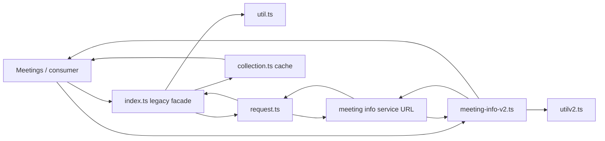
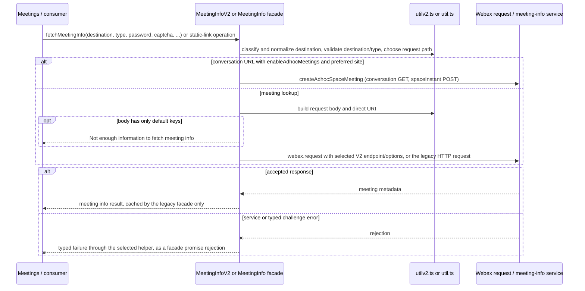
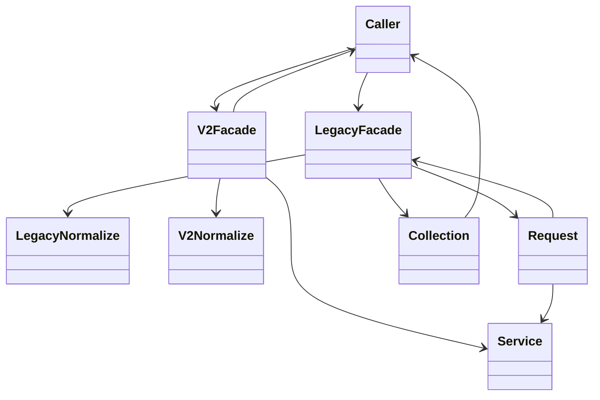

<!-- sdd-generated-metadata
doc_kind: module-spec
generated_from: module-spec@0.3.0
generated_by: claude-code
approved_by: rarajes2@cisco.com
updated_at: 2026-11-17T03:14:21Z
validation_status: pass-with-warnings
-->

# Meeting info

This source-local document at `src/meeting-info/docs/README.md` is the canonical source-local spec
for `src/meeting-info/`: the legacy `MeetingInfo` facade and `MeetingInfoV2`, which resolve a meeting
destination into meeting metadata and map service failures into typed errors. Ground every claim in
package evidence and link to the [package architecture](../../../docs/architecture.md) instead of
repeating broader facts. No service specification exists because this package is a library.

Related context: start from the root [package agent instructions](../../../AGENTS.md) · router
[documentation index](../../../docs/index.md) · system [package architecture](../../../docs/architecture.md).
Related module specs: [Meetings plugin](../../meetings/docs/README.md) ·
[personal meeting room](../../personal-meeting-room/docs/README.md).

## Metadata

| Field | Value |
|---|---|
| Owner | @webex/web-client, @webex/web-sdk |
| Source path | `src/meeting-info` |
| Resource kind | module |
| Status | Draft |
| Last verified | 2026-11-16 at `0b8c34db7f` |
| Module id | `plugin-meetings/meeting-info` |
| Parent spec | — |
| Doc kind | Module spec |
| Coverage score | Pending coverage assessment |
| Validation status | not-run |

## Applicability

| Condition ID | Status | Evidence or reason | Owned section |
|---|---|---|---|
| `module.has_tiers` | N/A | No tier policy exists in `package.json` or `src/meeting-info/meeting-info-v2.ts` | Tier |
| `module.has_ui` | N/A | `src/meeting-info/meeting-info-v2.ts` returns promises and error classes; it renders nothing | UI use-case flow |
| `module.crosses_service_boundaries` | Applicable | `src/meeting-info/meeting-info-v2.ts` calls the Webex meeting-info (wbxappapi), conversation, and people services; `src/meeting-info/request.ts` calls Locus | Cross-boundary use-case flow |
| `module.holds_client_state` | Applicable | `src/meeting-info/collection.ts` caches meeting-info bodies for the legacy facade in `src/meeting-info/index.ts` | Client state model |
| `module.enforces_domain_rules` | Applicable | Destination classification in `src/meeting-info/utilv2.ts` and error-code mapping in `src/meeting-info/meeting-info-v2.ts` | Business rules and invariants |
| `module.is_concurrent_async` | Applicable | Every lookup returns a promise; classification may await a people or Hydra lookup (`src/meeting-info/utilv2.ts`) | Concurrency and reactive flow |
| `module.owns_persistence` | N/A | The cache in `src/meeting-info/collection.ts` is in memory only | Data, schema, and migration discipline |
| `module.stateful_transitions` | N/A | No lifecycle state in `src/meeting-info/meeting-info-v2.ts` or `src/meeting-info/index.ts` | State machine |
| `module.exposes_wire_protocol` | N/A | Request bodies are built in `src/meeting-info/utilv2.ts` for a service-owned API; no wire format is owned here | Protocol and wire format |
| `module.ui_multi_screen` | N/A | No UI | UI flow |
| `module.large_data_model` | N/A | Meeting-info bodies are service responses passed through unchanged by `src/meeting-info/meeting-info-v2.ts` | Data model |
| `module.returns_caller_errors` | Applicable | Typed error classes and rejections in `src/meeting-info/meeting-info-v2.ts`; ParameterError in `src/meeting-info/request.ts` and `src/meeting-info/utilv2.ts` | Caller-visible failure modes |
| `module.module_specific_conventions` | N/A | Package-wide conventions apply; see `AGENTS.md` | Module-specific rules |
| `module.published_package` | N/A | The module is not a package; MeetingInfoV2 and MeetingInfoUtil are exported by `src/index.ts` | Export stability |
| `module.embedded_in_host` | N/A | Constructed by `src/meetings/index.ts` with the webex instance; no host theme or embed API | Host integration and theming |
| `module.has_design_tradeoff` | N/A | No recorded trade-off beyond the two providers, covered under Pitfalls (`src/meetings/index.ts` selects the provider) | Key design trade-off |
| `module.has_submodules` | N/A | The src/meeting-info directory has no child module directory | Sub-modules |

## Evidence register

Requirements cite current implementation and mirrored unit-test paths. Current code wins over retained prose when they conflict; commit and PR history are excluded by repository-owner decision. Missing test evidence is stated as a gap rather than inferred.

| Evidence | What it establishes |
|---|---|
| `src/meeting-info/meeting-info-v2.ts` | `MeetingInfoV2`: `fetchInfoOptions`, `fetchMeetingInfo`, the ad-hoc and static-link methods, the three error handlers, and the nine exported error classes with their code lists |
| `src/meeting-info/utilv2.ts` | `MeetingInfoUtil` (V2): destination classification, request body, Webex site, and direct meeting-info URI helpers |
| `src/meeting-info/index.ts` | Legacy `MeetingInfo` facade: `getMeetingInfo`, `setMeetingInfo`, `fetchMeetingInfo`, CA events, and the meeting-link retry |
| `src/meeting-info/request.ts` | `MeetingInfoRequest.fetchMeetingInfo`: option validation and one `webex.request` to Locus |
| `src/meeting-info/util.ts` | Legacy `MeetingInfoUtil`: classification, link-to-SIP conversion, resource URL, and request params |
| `src/meeting-info/collection.ts` | `MeetingInfoCollection` with lookup by id, `sipUrl`, `locusId`, `userId`, or `meetingLink` |
| `src/index.ts` | `export * as MeetingInfoV2` and `MeetingInfoUtil` from `utilv2.ts` |
| `src/meetings/index.ts`, `src/meeting/index.ts` | Provider selection by `experimental.enableUnifiedMeetings`; `Meeting` passes `{meetingId, sendCAevents, correlationId}` to `fetchMeetingInfo` |
| `src/metrics/constants.ts`, `src/constants.ts` | Behavioral metric names, `WBXAPPAPI_SERVICE`, and `DEFAULT_MEETING_INFO_REQUEST_BODY` |
| `test/unit/spec/meeting-info/meetinginfov2.js`, `test/unit/spec/meeting-info/utilv2.js` | V2 lookup, static links, ad-hoc, error mapping, CA events, header, and `locusCluster` cases; V2 helper cases |
| `test/unit/spec/meeting-info/index.js`, `test/unit/spec/meeting-info/request.js`, `test/unit/spec/meeting-info/util.js` | Legacy facade CA events, the request call, and two legacy helper cases |
| Observation, no stated WHY | The legacy meeting-link retry in `src/meeting-info/index.ts` spreads the promise returned by `fetchInfoOptions` into the retry options, so the retry carries only `meetingId` and `sendCAevents` and `MeetingInfoRequest` throws its ParameterError, which rejects the facade promise; no comment or test states that this is intended, so it is recorded here rather than as a requirement |

## Purpose and boundary

- Responsibility: Resolves meeting destinations into normalized meeting metadata and maps service-specific errors into caller-actionable failures.
- In scope: destination classification (SIP URI, phone number, meeting link, conversation URL, Hydra person or room id, personal room, Locus); the V2 lookup request and its URI choice; ad-hoc space meetings; static meeting-link fetch, enable, and disable; the typed V2 errors and their behavioral metrics; CA meeting-info events; the legacy facade, request, and cache.
- Out of scope: when and how a Meeting fetches or applies meeting info (`src/meeting/index.ts`); the Meetings facade methods and provider selection (`src/meetings/index.ts`); the PMR claim (`src/personal-meeting-room/index.ts`); the meeting-info service itself.
- Consumers: `Meetings` (`fetchInfoOptions` in `create()`, static links), each `Meeting` as its `meetingInfoProvider`, `PersonalMeetingRoom.get()`, and applications through the `MeetingInfoV2` and `MeetingInfoUtil` package exports.

## Structure and key files

`src/meeting-info/` contains 6 direct source/reference file(s) and has 5 mirrored unit-test file(s). This spec separates its public operations, runtime data movement, component ownership, state applicability, and verification boundary.

TypeScript/JavaScript in the Node 22.14 Yarn workspace; Webex core/plugin abstractions and Mocha/Sinon/`@webex/test-helper-chai` tests. Build target: `yarn workspace @webex/plugin-meetings build:src`.

| File | Holds |
|---|---|
| `src/meeting-info/collection.ts` | `MeetingInfoCollection`, the module-owned collection of legacy meeting-info bodies |
| `src/meeting-info/index.ts` | `MeetingInfo`, the legacy module facade/controller and its CA events |
| `src/meeting-info/meeting-info-v2.ts` | `MeetingInfoV2`, the meeting-info-v2 implementation responsibility: lookup, ad-hoc, static links, and the typed errors |
| `src/meeting-info/request.ts` | `MeetingInfoRequest`, the HTTP request boundary of the legacy facade |
| `src/meeting-info/util.ts` | legacy `MeetingInfoUtil` normalization/helper functions |
| `src/meeting-info/utilv2.ts` | V2 `MeetingInfoUtil`, the utilv2 implementation responsibility: classification, request body, and direct URI; exported by the package |
| `test/unit/spec/meeting-info/index.js` and 4 sibling test file(s) (`meetinginfov2.js`, `request.js`, `util.js`, `utilv2.js`) | mirrored characterization/unit coverage |
| `src/meeting-info/docs/README.md` | This module specification |

## Public surface

| Contract ID | Type | Surface | Purpose | Compatibility / deprecation | Schema / detail link | Root index |
|---|---|---|---|---|---|---|
| `meeting-info-api` | SDK collection/model | `MeetingInfoCollection.get()` and `MeetingInfo.getMeetingInfo()`, `setMeetingInfo()`, `fetchMeetingInfo()` | Cache destination-keyed meeting information and refresh it through the selected request path. | Preserve collection identity, cache updates, and request rejection; the legacy facade is used only when `experimental.enableUnifiedMeetings` is false. | `src/meeting-info/collection.ts`, `src/meeting-info/index.ts` | [architecture](../../../docs/architecture.md#public-and-consumer-surfaces) |
| `meeting-info-api`, `meeting-info-http` | SDK / V2 remote | `MeetingInfoV2.fetchInfoOptions()` and `fetchMeetingInfo()` | Build V2 lookup options and normalize supported destination responses into meeting information. | Preserve password/captcha/registration inputs and typed error mapping. | `src/meeting-info/meeting-info-v2.ts` | [architecture](../../../docs/architecture.md#public-and-consumer-surfaces) |
| `meeting-info-api`, `meeting-info-http` | SDK / V2 remote | `createAdhocSpaceMeetingOrEnableStaticMeetingLink()`, `createAdhocSpaceMeeting()`, and `fetchStaticMeetingLink()` | Select existing static-link lookup versus ad-hoc creation/enablement for a space destination. | Preserve branch conditions and direct service outcomes. | `src/meeting-info/meeting-info-v2.ts` | [architecture](../../../docs/architecture.md#public-and-consumer-surfaces) |
| `meeting-info-api`, `meeting-info-http` | SDK / V2 remote | `enableStaticMeetingLink()` and `disableStaticMeetingLink()` | Mutate the static meeting-link state for the supplied space/context. | Preserve request route/body and typed V2 error behavior. | `src/meeting-info/meeting-info-v2.ts` | [architecture](../../../docs/architecture.md#public-and-consumer-surfaces) |
| `meeting-info-http` | request adapter | `MeetingInfoRequest.fetchMeetingInfo()` | Perform the legacy meeting-info request selected by the facade. | Preserve HTTP request parameters and direct response/rejection propagation. | `src/meeting-info/request.ts` | [architecture](../../../docs/architecture.md#public-and-consumer-surfaces) |
| `meeting-info-api` | package-exported utilities | `MeetingInfoUtil.getParsedUrl()`, `isMeetingLink()`, `isConversationUrl()`, `isSipUri()`, `isPhoneNumber()`, `getHydraId()`, `getSipUriFromHydraPersonId()`, `getDestinationType()`, `getRequestBody()`, `getWebexSite()`, and `getDirectMeetingInfoURI()` | Expose the destination classification and V2 request-body helpers exported as `MeetingInfoUtil` by `src/index.ts`. | Preserve classification precedence, URL parsing, and generated V2 body/URI shapes; methods that exist only on legacy `util.ts` are not package exports. | `src/index.ts`, `src/meeting-info/utilv2.ts` | [architecture](../../../docs/architecture.md#public-and-consumer-surfaces) |
| `meeting-info-api` | exported errors | `MeetingInfoV2PasswordError`, `MeetingInfoV2AdhocMeetingError`, `MeetingInfoV2PolicyError`, `MeetingInfoV2CaptchaError`, `MeetingInfoV2JoinWebinarError`, `MeetingInfoV2JoinForbiddenError`, `MeetingInfoV2StaticLinkDoesNotExistError`, `MeetingInfoV2MeetingIsInProgressError`, and `MeetingInfoV2StaticMeetingLinkAlreadyExists` | Give callers typed outcomes for service-specific meeting-info failures. | Preserve class identity and mapping from current service status/body conditions. | `src/meeting-info/meeting-info-v2.ts` | [architecture](../../../docs/architecture.md#public-and-consumer-surfaces) |
| `meeting-info-api` | V2 error mapping | `MeetingInfoV2.handlePolicyError()`, `handleJoinWebinarError()`, and `handleForbiddenError()` | Convert service policy/webinar/forbidden responses into the exported typed error classes. | Preserve response-condition precedence and error identity. | `src/meeting-info/meeting-info-v2.ts` | [architecture](../../../docs/architecture.md#public-and-consumer-surfaces) |

Provided contract IDs (manifest): `meeting-info-api` and `meeting-info-http`. They are indexed in the
[package architecture](../../../docs/architecture.md#public-and-consumer-surfaces). Coverage state
and the contracts baseline are registered in `.sdd/manifest.json`.

### Emitted events

Current source emits or forwards these observable literals for this operation boundary. Preserve literal values, scope, payload shape, and emission timing; a constant name alone is not a substitute for the consumer-visible value.

| Event literal | Constant / expression | Emission evidence |
|---|---|---|
| `meeting:meetingInfoAvailable` | `EVENT_TRIGGERS.MEETING_INFO_AVAILABLE` | `src/meeting/index.ts` |
| `meeting:meetingInfoUpdated` | `EVENT_TRIGGERS.MEETING_INFO_UPDATED` | `src/meeting/index.ts` |

Both events are emitted by the `Meeting` that applies the meeting info, not by this module. This
module itself submits only telemetry: the CA events `internal.client.meetinginfo.request`,
`client.meetinginfo.request`, `internal.client.meetinginfo.response`, and
`client.meetinginfo.response` through `webex.internal.newMetrics`, and V2 behavioral metrics.

Compatibility notes:

- Prefer additive options and payload fields. Preserve method/event names, rejection semantics, and cleanup timing; route public changes through `src/index.ts` or the documented owning object.

## Dependencies

Webex request/service access plus meeting, conversation, people, and webinar service responses.

Required contract IDs (manifest): `webex-core-plugin-host` and `meetings-metrics`.

| Dependency | Why it is required | Failure behavior |
|---|---|---|
| `@webex/webex-core` (`webex-core-plugin-host`) | `webex.request` for every lookup and the conversation fetch; `webex.internal.services.getClusterId` for conversation URLs | Request rejections are mapped to typed errors or rethrown |
| Webex meeting-info service (`webex-appapi-service`, or `https://<site>/wbxappapi/...`) | Meeting-info lookup, `spaceInstant`, `spaceInstant/query`, and `spaceInstant/deletePersistentMeeting` | Status 403, 409, and 423 map to typed errors; other errors rethrow |
| Conversation service | `GET <conversationUrl>?includeParticipants=true` before an ad-hoc meeting or static-link enable | Rejection maps to `MeetingInfoV2AdhocMeetingError` for ad-hoc, or the static-link mapping |
| `webex.people.list` and Hydra id decoding | Personal-room destinations given as an email or id, and Hydra person ids converted to a SIP URI | Rejections propagate |
| `webex.meetings.preferredWebexSite` | The host of the ad-hoc and static-link URIs | Missing site rejects with `No preferred webex site found` |
| `src/metrics/index.ts` (`meetings-metrics`) and `webex.internal.newMetrics` | Behavioral metrics and CA events | Not awaited |
| `src/common/errors/parameter.ts`, `src/common/errors/webex-errors.ts` | `ParameterError` and `SpaceIDDeprecatedError` | Thrown to the caller |

## Requirements

| ID | WHAT | WHY | Source Evidence | Test / Example Evidence | Assumptions / Gaps | Confidence |
|---|---|---|---|---|---|---|
| `MEETING-INFO-R-001` | fetch meeting information for a destination/type. `MeetingInfoV2.fetchMeetingInfo()` classifies the destination, starts an ad-hoc space meeting instead for a conversation URL when `enableAdhocMeetings` and a preferred site are set, builds the body with `disableWebRedirect: true`, and POSTs it to `https://<fullSiteUrl>/wbxappapi/v1/meetingInfo`, else the direct site URI, else service `webex-appapi-service` resource `meetingInfo`; it resolves the raw response. | Resolves meeting destinations into normalized meeting metadata and maps service-specific errors into caller-actionable failures; the direct URI avoids a redirect (JSDoc of `getDirectMeetingInfoURI`). | `src/meeting-info/index.ts`, `src/meeting-info/meeting-info-v2.ts`, `src/meeting-info/utilv2.ts` | `test/unit/spec/meeting-info/index.js`, `test/unit/spec/meeting-info/meetinginfov2.js` | none | PRESENT |
| `MEETING-INFO-R-002` | resolve, enable, and disable static meeting links. | Static-link lookup and mutation select different V2 endpoints and typed error outcomes. | `src/meeting-info/index.ts`, `src/meeting-info/meeting-info-v2.ts` | `test/unit/spec/meeting-info/meetinginfov2.js` | the 403 in-progress (enable and disable), 409 already-exists, and 403 does-not-exist mappings have cases | PRESENT |
| `MEETING-INFO-R-003` | `MeetingInfoRequest.fetchMeetingInfo()` throws `ParameterError` synchronously when its options lack a type or destination. When the legacy facade invokes that helper inside its promise chain, the throw becomes the facade's returned rejection; V2 password, captcha, permission, and request failures also remain typed caller-visible promise outcomes. Request helpers own no persistent listeners or timers. | Callers must distinguish the direct request helper's synchronous validation boundary from facade/V2 promise failures while still retaining actionable typed errors. | `src/meeting-info/request.ts`, `src/meeting-info/index.ts`, `src/meeting-info/meeting-info-v2.ts` | `test/unit/spec/meeting-info/request.js`, `test/unit/spec/meeting-info/index.js`, `test/unit/spec/meeting-info/meetinginfov2.js` | none | PRESENT |
| `MEETING-INFO-R-004` | Emit CA request/response events only when both `meetingId` and `sendCAevents` are supplied, and emit the operation-specific behavioral success/failure metric on V2 outcomes. `MeetingInfoV2.fetchMeetingInfo()` additionally accepts `options.correlationId` and sets the request header `{correlationId}` only when `meetingId`, `sendCAevents`, and `correlationId` are all present; any missing one leaves `requestOptions.headers` unset. `Meeting` supplies `this.correlationId` on that option. The V2 success `client.meetinginfo.response` sets `identifiers.meetingLookupUrl` from the response URL and passes `globalMeetingId`, `webexConferenceIdStr`, and `locusCluster` (from `response.body.locusClusterUrl`) as options, which the metrics plugin applies to the event identifiers when the meeting's own meeting info does not yet provide them. | Conditional correlation avoids unscoped CA telemetry, while stable behavioral metrics preserve operation-level observability for lookup and link-management failures. Propagating the correlation id as a header lets the service join its own trace to the client's CA events, and gating it on the same three inputs keeps the header from leaking on requests that emit no CA events. Meeting info is not on the `Meeting` yet when the response event fires, so the identifiers come from the response itself. | `src/meeting-info/index.ts`, `src/meeting-info/meeting-info-v2.ts`, `src/metrics/constants.ts` | `test/unit/spec/meeting-info/index.js`, `test/unit/spec/meeting-info/meetinginfov2.js` | none | PRESENT |
| `MEETING-INFO-R-005` | A V2 lookup that fails with status 403 first runs the policy (codes 403049, 403104, 403103, 403048, 403102, 403101), webinar (403021, 403022, 403024, 403137, 423007, 403026, 403037, 403106), and forbidden (403003) handlers in that order, each throwing its typed error after its metric, and otherwise throws `MeetingInfoV2PasswordError` with `body.data.meetingInfo`; status 423 throws `MeetingInfoV2CaptchaError` with the captcha id and URLs, `isPasswordRequired` for 423005, 423006, and 423008, and `isRegistrationIdRequired` for 423007; any other failure is rethrown after `FETCH_MEETING_INFO_V1_FAILURE`. | Give callers typed outcomes for service-specific meeting-info failures, so a password, captcha, registration, policy, or forbidden join can be answered rather than treated as a generic failure. | `src/meeting-info/meeting-info-v2.ts` | `test/unit/spec/meeting-info/meetinginfov2.js` | none | Present |
| `MEETING-INFO-R-006` | `createAdhocSpaceMeeting`, `fetchStaticMeetingLink`, `enableStaticMeetingLink`, and `disableStaticMeetingLink` reject with `Error('No preferred webex site found')` before any request when `webex.meetings.preferredWebexSite` is empty. | Their endpoints are on the preferred site's wbxappapi host, which the URI is built from. | `src/meeting-info/meeting-info-v2.ts` | `test/unit/spec/meeting-info/meetinginfov2.js` | none | Present |
| `MEETING-INFO-R-007` | When the built body has only the `DEFAULT_MEETING_INFO_REQUEST_BODY` keys (`supportHostKey`, `supportCountryList`), `MeetingInfoV2.fetchMeetingInfo()` rejects with `Not enough information to fetch meeting info` and sends `FETCH_MEETING_INFO_V1_FAILURE` without a request. | Without destination fields there is not enough to fetch the meeting info, so the request is not tried (code comment). | `src/meeting-info/meeting-info-v2.ts`, `src/constants.ts` | `test/unit/spec/meeting-info/meetinginfov2.js` | none | Present |

## Design overview

`index.ts` provides the legacy meeting-info facade, `request.ts` performs that facade's HTTP calls, and `collection.ts` caches its meeting-info objects. `meeting-info-v2.ts` implements the V2 pipeline and calls `webex.request` directly after using `utilv2.ts` for destination classification and request-body handling; it returns the service response without reshaping it.

`Meetings` builds one provider at the Webex `ready` event: `MeetingInfoV2` by default, or the legacy
`MeetingInfo` when `experimental.enableUnifiedMeetings` is false (`src/meetings/index.ts`). The
legacy facade has no ad-hoc or static-link methods. The V2 class holds only the `webex` reference;
its three error handlers are arrow-function properties that return when the error has no body and
throw a typed error when the body code is in their list.

## Data flow and sequence coverage

Call style: in-process method calls; outbound HTTPS through `webex.request` to the meeting-info
service (by service name or absolute site URI), the conversation service, and Locus (legacy).

Sequence coverage:

| Operation group | Diagram | Failure coverage |
|---|---|---|
| UC-1…UC-5 — meeting-info lookup and static-link operation groups | Meeting-info lookup and static-link sequence | destination validation, the ad-hoc branch, the empty-body rejection, plus typed password/captcha/policy/static-link request failures, unsupported destination, permission error, or meeting-info service rejection |
| UC-4, UC-5 — static links | `src/meeting-info/meeting-info-v2.ts` (one request each; Caller-visible failure modes) | missing preferred site, 403 and 409 mappings, other errors rethrown |

### Meeting-info lookup and static-link sequence

This one diagram covers lookup and static-link operations for both providers: the legacy
`MeetingInfo` facade goes through `MeetingInfoRequest` and its cache, and `MeetingInfoV2` calls the
service directly.

## Class and component relationships

The arrows identify ownership and delegation inside `src/meeting-info/`; files that only declare types or constants are not presented as transports.

## Use cases and flows

| Use case | Actor or caller | Primary steps and outcome | Failure or boundary behavior | Evidence |
|---|---|---|---|---|
| `UC-1` | `Meetings.create()`, applications | Classify a SIP URI, meeting URL, conversation URL, phone number, or Hydra identity and construct the corresponding request inputs. | A Hydra room id throws `SpaceIDDeprecatedError`; an unclassifiable destination throws `ParameterError` | `src/meeting-info/util.ts`, `src/meeting-info/utilv2.ts` |
| `UC-2` | `Meeting`, `PersonalMeetingRoom` | Resolve a destination through the legacy `MeetingInfoRequest` or V2 path selected by Meetings configuration; the legacy path caches the normalized result. | Typed V2 errors; the legacy facade rejects | `src/meeting-info/index.ts`, `src/meeting-info/request.ts`, `src/meeting-info/meeting-info-v2.ts` |
| `UC-3` | `Meeting` (join with a password, captcha, or registration id) | Supply password, captcha, registration, webinar, or policy context and preserve the matching typed V2 error outcome. | 403 and 423 mappings (`MEETING-INFO-R-005`) | `src/meeting-info/meeting-info-v2.ts` |
| `UC-4` | `Meetings` static-link facade, `fetchMeetingInfo` | Fetch or create an ad-hoc/static meeting link for a space, including the branch that enables an existing static link. | Missing preferred site rejects | `src/meeting-info/meeting-info-v2.ts` |
| `UC-5` | `Meetings` static-link facade | Enable or disable a static meeting link and return the service result without substituting a legacy lookup. | 403 and 409 map to typed errors | `src/meeting-info/meeting-info-v2.ts` |

### Cross-boundary use-case flow

| Boundary | Transport and ordering | Compatibility | Timeout, retry, and recovery |
|---|---|---|---|
| Meeting-info service (`UC-2`, `UC-3`) | One POST per lookup, after any people or Hydra lookup needed to classify | Body built by `getRequestBody`; optional `correlationId` header | No retry in V2; the legacy facade retries a failed meeting link once (see Pitfalls) |
| Conversation and spaceInstant (`UC-4`) | GET the conversation, then POST `spaceInstant` on the preferred site | `schedule: true` requests a static link | No retry |
| Static-link endpoints (`UC-4`, `UC-5`) | One POST to `spaceInstant/query` or `spaceInstant/deletePersistentMeeting` | Body `{spaceUrl}` | No retry |
| Locus (legacy `UC-2`) | One `webex.request` built by `getRequestParams` with `API.LOCUS` | Legacy resource URLs | No retry |

## Client state model

A small in-memory collection may retain resolved meeting-info objects; remote services remain authoritative.

| State or slice | Owner | Initial state | Transition triggers | Reset or persistence boundary |
|---|---|---|---|---|
| `meetingInfoCollection` | Legacy `MeetingInfo` | Empty | A legacy lookup with a body stores it under `sipMeetingUri` or `meetingLink` | In memory; replaced with the provider |
| `MeetingInfoV2` | — | Holds only `webex` | None | No cache |

## Business rules and invariants

| ID | Invariant | WHY | Enforcement source | Test evidence |
|---|---|---|---|---|
| `INV-001` | Destination type and response error codes determine the correct request and typed error; invalid or forbidden meetings are never returned as successful metadata. | Callers act on the typed error (`MEETING-INFO-R-005`) | `src/meeting-info/meeting-info-v2.ts`, `src/meeting-info/utilv2.ts` | `test/unit/spec/meeting-info/meetinginfov2.js` |
| `INV-002` | An explicit `type` skips classification, except that `PERSONAL_ROOM` first resolves the destination to `{userId, orgId}` (from the device when empty, otherwise by people lookup) | A personal room is addressed by user and org, not by a string destination | `src/meeting-info/utilv2.ts` | `test/unit/spec/meeting-info/utilv2.js` |

## Concurrency and reactive flow

- Execution model: Each meeting-info/static-link call owns only its returned request promise; the helpers retain no listeners or timers. The V2 request path fetches directly and therefore does not imply that the legacy collection cache was populated.
- Ordering guarantees: within one lookup, classification (with any people or Hydra lookup) completes before the request; separate lookups are independent.
- Idempotency and retry: lookups are reads; ad-hoc creation and static-link enable or disable are not deduplicated here.
- Shared-state protection: none needed; the legacy cache is last-write-wins.
- Blocking restrictions: none.

## Caller-visible failure modes

| Condition | Signal | Caller recovery |
|---|---|---|
| Direct `MeetingInfoRequest.fetchMeetingInfo()` options omit type or destination | The helper throws `ParameterError` synchronously before issuing a request. The legacy `MeetingInfo.fetchMeetingInfo()` promise chain converts that helper throw into its returned rejection. | Validate direct-helper inputs synchronously; when using the facade, handle its returned rejection. |
| Service requires password/captcha, denies permission, or rejects the request | The module maps or propagates the typed caller-visible rejection. | Satisfy the challenge/permission requirement or handle the request failure. |
| Meeting-info response is accepted | The returned promise resolves with normalized meeting metadata; V2 lookup does not claim a legacy collection-cache update. | Use the resolved response as the current operation result. |
| `meetingId`, `sendCAevents`, or `correlationId` is absent on a V2 lookup | No `correlationId` request header is set and the lookup proceeds normally; this is not an error. | Supply all three when the service trace must be correlated to client CA events. |
| Destination is a Hydra room id, or cannot be classified | V2 throws `SpaceIDDeprecatedError` or `ParameterError` from classification; the returned promise rejects. | Use a meeting ID or SIP address. |
| No preferred Webex site for ad-hoc or static-link calls | Rejects with `Error('No preferred webex site found')`. | Register Meetings first so the preferred site is fetched. |
| `fetchStaticMeetingLink` gets 403; enable gets 403 or 409; disable gets 403 | `MeetingInfoV2StaticLinkDoesNotExistError`; `MeetingInfoV2MeetingIsInProgressError` or `MeetingInfoV2StaticMeetingLinkAlreadyExists`; `MeetingInfoV2MeetingIsInProgressError`. | Act on the error type; other statuses are rethrown unchanged. |
| Ad-hoc meeting creation fails | Policy, webinar, or forbidden typed errors first; otherwise `MeetingInfoV2AdhocMeetingError` with the service code and message. | Act on the error type. |

## Pitfalls and constraints

- Meeting-info v1 and v2 paths have different response/error mappings; do not assume one parser covers both.
- Public behavior may be reachable through a parent `Meeting`/`Meetings` object even when the source helper is not exported directly.
- The current `MeetingInfoV2PolicyError` and `MeetingInfoV2CaptchaError` constructors assign `name` values associated with other typed errors (`MeetingInfoV2AdhocMeetingError` and `MeetingInfoV2PasswordError`). Preserve the current behavior until a separately reviewed implementation/spec change intentionally corrects it; callers should prefer the actual error instance and documented fields over `name` alone. Evidence: `src/meeting-info/meeting-info-v2.ts`; no unit case asserts these `name` values.
- Code 423007 is listed as a webinar error code, but the webinar handler runs only for status 403; a 423 with code 423007 becomes `MeetingInfoV2CaptchaError` with `isRegistrationIdRequired` true.
- The legacy meeting-link retry never reaches the service as a SIP lookup (Evidence register observation), and its four unit cases call the async helper without awaiting it, so they pass without checking anything (`test/unit/spec/meeting-info/index.js`).

## Verification

Use the current mirrored suites: `test/unit/spec/meeting-info/index.js`, `test/unit/spec/meeting-info/meetinginfov2.js`, `test/unit/spec/meeting-info/request.js`, `test/unit/spec/meeting-info/util.js`, `test/unit/spec/meeting-info/utilv2.js`. Characterize the meeting-info-specific use cases above and each listed failure condition; add cleanup or transition cases only for resources and state this module actually owns.

| Behavior / Requirement | Existing test evidence | Gap |
|---|---|---|
| `MEETING-INFO-R-001` | `test/unit/spec/meeting-info/index.js`, `test/unit/spec/meeting-info/meetinginfov2.js`, `test/unit/spec/meeting-info/request.js` | no mandatory coverage gap identified |
| `MEETING-INFO-R-002` | `test/unit/spec/meeting-info/meetinginfov2.js` | no mandatory coverage gap identified |
| `MEETING-INFO-R-003` | `test/unit/spec/meeting-info/meetinginfov2.js` | no case asserts the synchronous `ParameterError` from `MeetingInfoRequest` or its conversion into the facade rejection; error-name inconsistencies are current behavior and are not asserted |
| `MEETING-INFO-R-004` | `test/unit/spec/meeting-info/index.js`, `test/unit/spec/meeting-info/meetinginfov2.js` | the `correlationId` header is covered by the table-driven cases asserting it is sent only for the all-three-present combination |
| `MEETING-INFO-R-005` | `test/unit/spec/meeting-info/meetinginfov2.js` | none |
| `MEETING-INFO-R-006` | `test/unit/spec/meeting-info/meetinginfov2.js` | none for the static-link methods; `createAdhocSpaceMeeting` without a site is not asserted |
| `MEETING-INFO-R-007` | `test/unit/spec/meeting-info/meetinginfov2.js` | none |
| `INV-002` | `test/unit/spec/meeting-info/utilv2.js` | none |

Run a single suite with
`yarn workspace @webex/plugin-meetings test:unit --targets meeting-info/meetinginfov2.js`. A module
specification is complete only when its public surface, invariants, failure modes, and test evidence
agree with the implementation.
