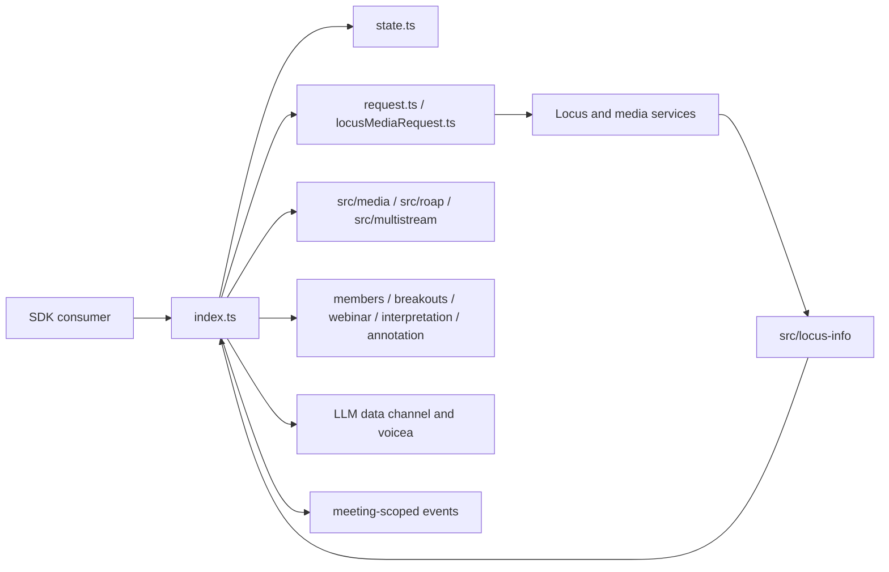
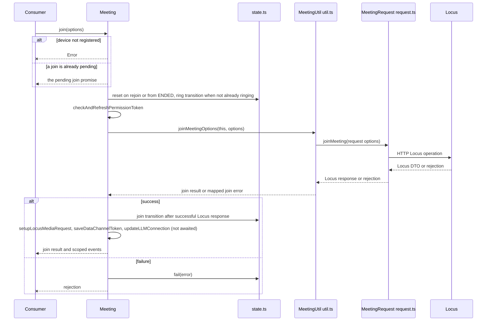
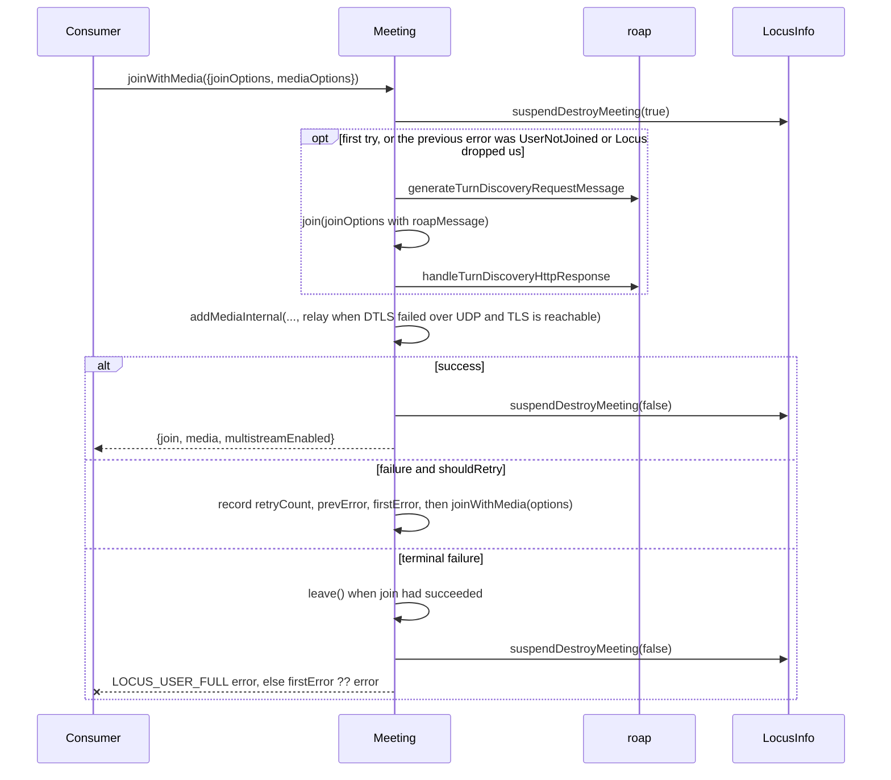
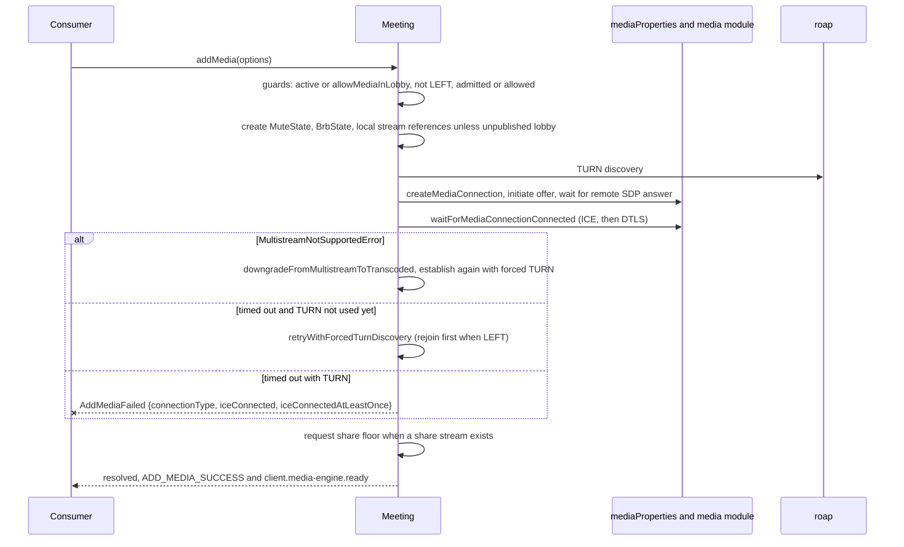
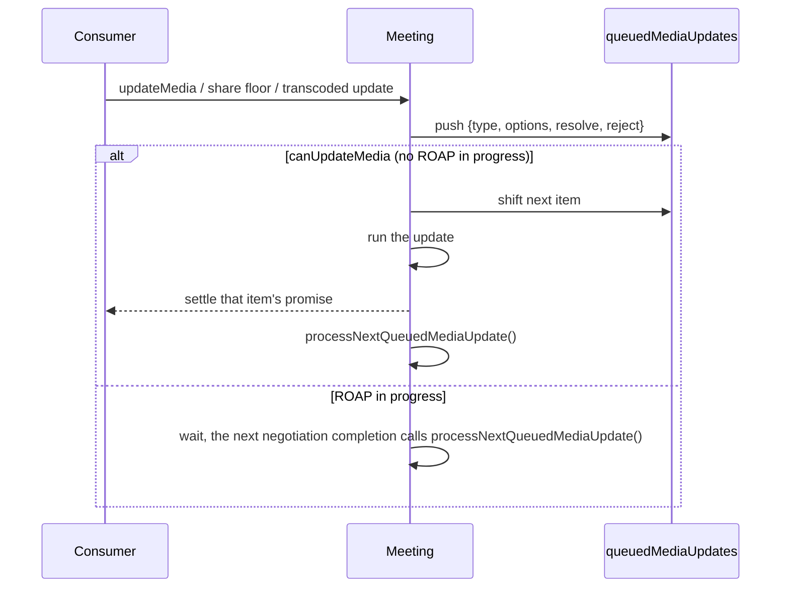
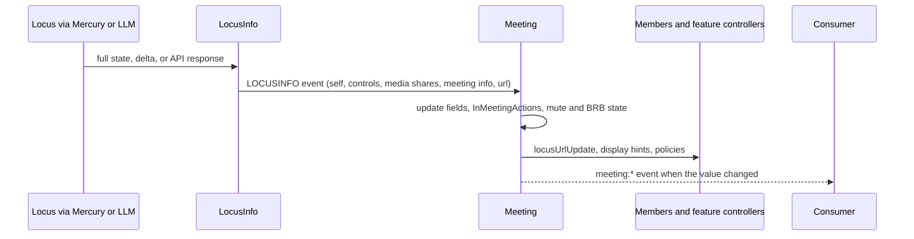
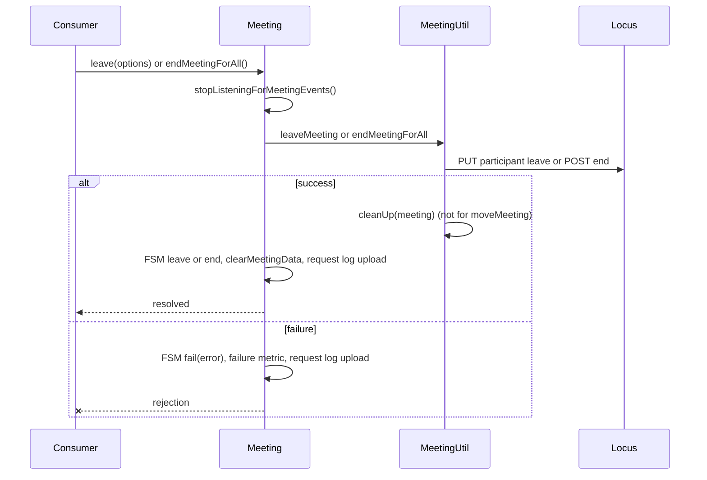
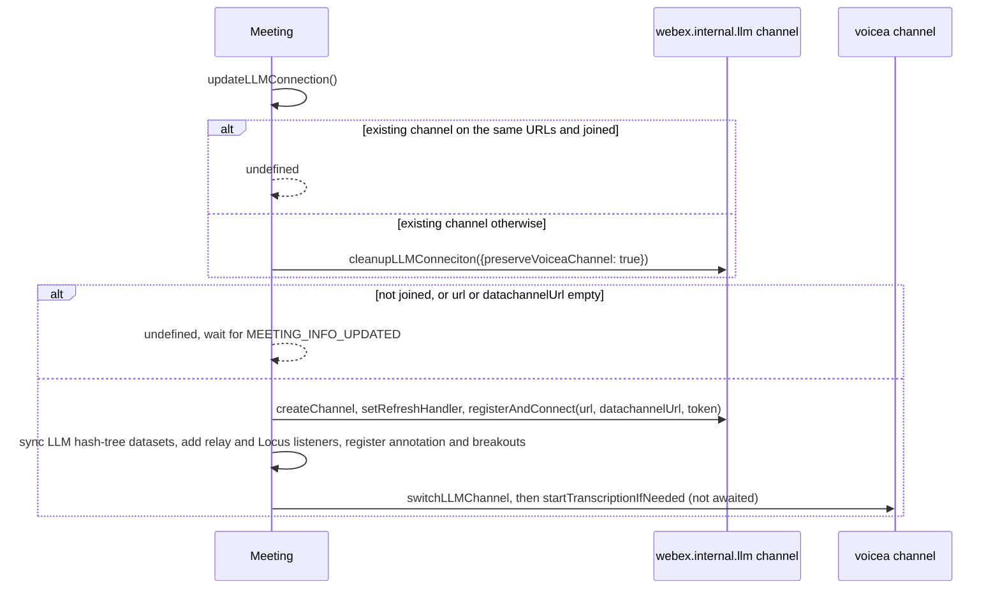
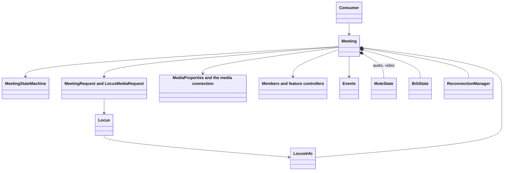
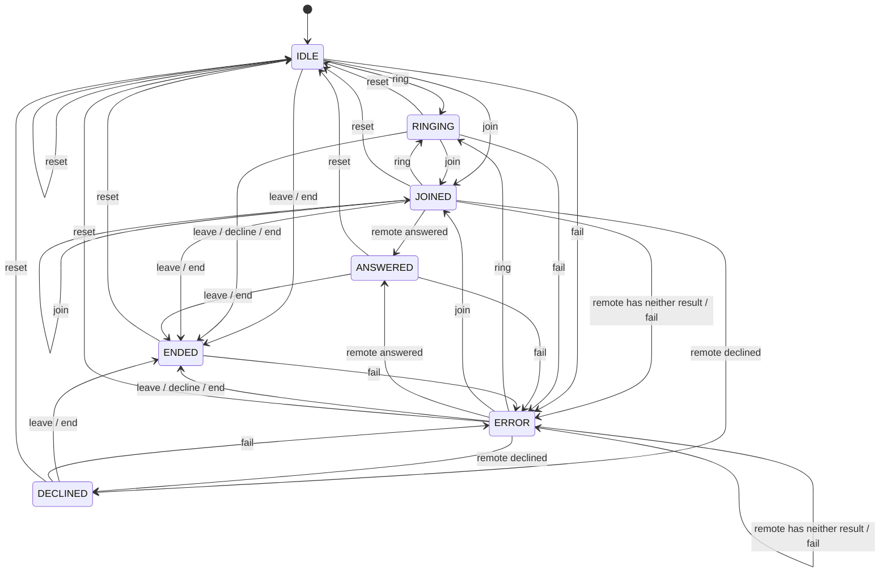

<!-- sdd-generated-metadata
doc_kind: module-spec
generated_from: module-spec@0.3.0
generated_by: claude-code
approved_by: rarajes2@cisco.com
updated_at: 2026-11-17T03:14:21Z
validation_status: pass-with-warnings
-->

# Meeting

This source-local document at `src/meeting/docs/README.md` owns the stable specification for
**the Meeting module**: the `Meeting` class that represents one meeting or call, together with its
lifecycle state machine, Locus request adapters, mute and BRB helpers, in-meeting action flags, and
caption processing. Ground every claim in package evidence and link to the
[package architecture](../../../docs/architecture.md) instead of repeating broader facts. No service
specification exists because this package is a library.

Related context: [documentation index](../../../docs/index.md) ·
[package agent instructions](../../../AGENTS.md) ·
[module registry](../../../docs/specs/README.md).
Repo architecture: [package architecture](../../../docs/architecture.md) · Registry:
[module registry](../../../docs/specs/README.md). Coverage state and contracts baseline:
`.sdd/manifest.json` routes this module and registers its contract IDs.
Neighbouring specifications: [Meetings collection](../../meetings/docs/README.md) ·
[LocusInfo](../../locus-info/docs/README.md) · [Members](../../members/docs/README.md) ·
[media](../../media/docs/README.md) · [ROAP](../../roap/docs/README.md) ·
[multistream](../../multistream/docs/README.md) ·
[reconnection manager](../../reconnection-manager/docs/README.md).

## Metadata

| Field             | Value |
| ----------------- | ----- |
| Owner             | @webex/web-client, @webex/web-sdk |
| Source path       | `src/meeting` |
| Resource kind     | module |
| Status            | Draft |
| Last verified     | 2026-11-16 at `0b8c34db7f` |
| Module id         | `plugin-meetings/meeting` |
| Parent spec       | — |
| Doc kind          | Module spec |
| Coverage score    | Pending coverage assessment |
| Validation status | not-run |

## Applicability

| Condition ID                         | Status     | Evidence or reason | Owned section |
| ------------------------------------ | ---------- | ------------------ | ------------- |
| `module.has_tiers`                   | N/A        | No tier policy exists in `package.json` or under src/meeting | Tier |
| `module.has_ui`                      | N/A        | `src/meeting/index.ts` returns promises and emits events; it renders nothing | UI use-case flow |
| `module.crosses_service_boundaries`  | Applicable | `src/meeting/request.ts` and `src/meeting/locusMediaRequest.ts` call Locus, the meeting policy, site, and hydra services; `src/meeting/index.ts` uses Mercury and the LLM data channel | Cross-boundary use-case flow |
| `module.holds_client_state`          | Applicable | `src/meeting/index.ts` keeps identity, Locus projections, media, mute, share, LLM, and timer state for one meeting | Client state model |
| `module.enforces_domain_rules`       | Applicable | Lifecycle, media, retry, and cleanup rules in `src/meeting/index.ts`, `src/meeting/state.ts`, and `src/meeting/util.ts` | Business rules and invariants |
| `module.is_concurrent_async`         | Applicable | Queued media updates, the queued Locus media requests, timers, and un-awaited LLM work in `src/meeting/index.ts` and `src/meeting/locusMediaRequest.ts` | Concurrency and reactive flow |
| `module.owns_persistence`            | N/A        | Nothing is persisted by the src/meeting files; the join cookie read in `src/meeting/request.ts` is owned by reachability | Data, schema, and migration discipline |
| `module.stateful_transitions`        | Applicable | `src/meeting/state.ts` defines the meeting state machine | State machine |
| `module.exposes_wire_protocol`       | Applicable | The Locus participant, media, and control requests built in `src/meeting/request.ts` and `src/meeting/locusMediaRequest.ts` | Protocol and wire format |
| `module.ui_multi_screen`             | N/A        | No UI | UI flow |
| `module.large_data_model`            | N/A        | The Locus data model is owned by `src/locus-info/index.ts`; this module's exported types are listed under Public surface | Data model |
| `module.returns_caller_errors`       | Applicable | Typed rejections from `src/common/errors/webex-errors.ts` and request failures surfaced by `src/meeting/index.ts` | Caller-visible failure modes |
| `module.module_specific_conventions` | Applicable | Lifecycle through the state machine and remote I/O kept in the request classes (`src/meeting/index.ts`, `src/meeting/request.ts`) | Module-specific rules |
| `module.published_package`           | Applicable | `src/index.ts` exports Meeting from the published package defined in `package.json` (main, types, deploy:npm) | Export stability |
| `module.embedded_in_host`            | Applicable | Meeting extends StatelessWebexPlugin and relies on the host's webex.request, device, Mercury, and metrics (`src/meeting/index.ts`) | Host integration and theming |
| `module.has_design_tradeoff`         | Applicable | One Meeting object composes many controllers (`src/meeting/index.ts`) | Key design trade-off |
| `module.has_submodules`              | N/A        | The src/meeting directory has no child module directory | Sub-modules |

## Evidence register

Requirements cite current implementation and mirrored unit-test paths. Code wins over prose when
they conflict, and commit and PR history are excluded as evidence by repository-owner decision.
Missing test evidence is stated as a gap rather than inferred.

| Evidence | What it establishes |
| -------- | ------------------- |
| `src/meeting/index.ts` | The `Meeting` class (default export, a StatelessWebexPlugin), its exported types and `MEDIA_UPDATE_TYPE`, `ScreenShareFloorStatus`, and the module-level `storeEventForDebugging`; every public method, the Locus listeners, the LLM connection, and media setup. JSDoc and code comments are the recorded rationale |
| `src/meeting/state.ts` | `MeetingStateMachine.create`: the javascript-state-machine transition table, `onRing`, `onRemote`, `onEnterError`, and a 25-state history |
| `src/meeting/util.ts` | `MeetingUtil`: join, leave, end, and decline options; `cleanUp`; display-hint capability checks; the Locus delta request with sequence; `updateLocusFromApiResponse` |
| `src/meeting/request.ts`, `src/meeting/request.type.ts` | `MeetingRequest` and its option types: every Locus, policy, site, and hydra request the Meeting sends |
| `src/meeting/locusMediaRequest.ts` | `LocusMediaRequest`: the queued Locus `/media` PUT for ROAP and local mute, confluence state, and selfUrl retry |
| `src/meeting/muteState.ts`, `src/meeting/brbState.ts` | `MuteState` and `BrbState`: client versus server mute and BRB state |
| `src/meeting/connectionStateHandler.ts` | `ConnectionStateHandler`: emits `connectionState:changed` when the media connection's combined state changes |
| `src/meeting/in-meeting-actions.ts` | `InMeetingActions`: the action flags, whose `set` reports whether anything changed |
| `src/meeting/voicea-meeting.ts` | `getSpeaker`, `getSpeakerFromProxyOrStore`, `processNewCaptions` |
| `src/meeting/type.ts` | `Invitee` |
| `src/constants.ts` | `EVENT_TRIGGERS` literals, `MEETING_STATE_MACHINE`, `ICE_CONNECTION_TIMEOUT` (20000) and `DTLS_CONNECTION_TIMEOUT` (15000), `SHARE_STATUS` |
| `src/media/MediaConnectionAwaiter.ts` | The separate ICE and DTLS waits that `mediaProperties.waitForMediaConnectionConnected` runs; the Meeting wraps their failure |
| `src/common/errors/webex-errors.ts` | `MediaConnectionTimedOutError` (with `iceConnected`), `AddMediaFailed`, `UserNotJoinedError`, `MeetingNotActiveError`, `UserInLobbyError`, `NoMediaEstablishedYetError` |
| `src/locus-info/types.ts` | `LocusErrorCodes.LOCUS_USER_FULL` = 2423001 |
| `src/meetings/index.ts` | `Meetings.destroy` calls `MeetingUtil.cleanUp` with `preserveVoiceaChannel: false`, then `locusInfo.cleanUp()`; the E2EE manager and WASM loader live on Meetings, not on Meeting |
| `src/index.ts` | Exports `Meeting` from the package |
| `package.json` | `test:unit` runs `webex-legacy-tools test --unit --runner mocha`; `build:src` builds `dist` |
| `test/unit/spec/meeting/index.js` and 8 sibling suites in the same test directory | Mocha, Sinon, and `@webex/test-helper-chai` unit coverage, listed under Verification |
| Observation: the Meeting mute methods call a removed MuteState method | `muteAudio`, `unmuteAudio`, `muteVideo`, and `unmuteVideo` call `this.audio.handleClientRequest` or `this.video.handleClientRequest`, which `src/meeting/muteState.ts` no longer defines; past the joined, media, and control guards they throw a TypeError. The unit tests stub the method (`test/unit/spec/meeting/index.js`) |
| Observation: unsetPeerConnections removes every Mercury ONLINE and OFFLINE listener | With `reconnection.detection` on, it calls `mercury.off(ONLINE)` and `mercury.off(OFFLINE)` without a handler, unlike `stopListeningForMercuryEvents`, whose comment says Mercury is shared and only the bound handlers may be removed (`src/meeting/index.ts`) |
| Observation: keepalive interval | `startKeepAlive` sends a keepalive every `(keepAliveSecs - 1) * 750` ms, a value the code comment says was taken from UCF, and stops after the first failed request (`src/meeting/index.ts`) |
| Observation: a successful leave with moveMeeting skips cleanup | `MeetingUtil.leaveMeeting` resolves without `cleanUp` when `options.moveMeeting` is set (`src/meeting/util.ts`) |

## Purpose and boundary

- Responsibility: owns one meeting's join/leave lifecycle, Locus projection integration, media,
  controls, feature controllers, events, and teardown.
- In scope: meeting info and permission-token handling before join; `join`, `joinWithMedia`,
  `acknowledge`, `decline`, `leave`, `endMeetingForAll`, and `reconnect`; media setup, update, and
  publishing; local and remote streams; mute and BRB; share and whiteboard floor; recording, lock,
  and control delegation; captions, transcription, reactions, and stage; phone audio, move, DTMF, and
  SIP call-out; the LLM data channel and its token; keepalive; log upload; Meeting-scoped events.
- Out of scope: the meetings collection, device registration, E2EE and WASM module loading
  (`src/meetings`, `src/e2ee`); Locus state parsing and hash-tree sync (`src/locus-info`,
  `src/hashTree`); the roster (`src/members`); WebRTC connection creation and the ICE/DTLS waits
  (`src/media`); ROAP and TURN discovery (`src/roap`); multistream slots and layouts
  (`src/multistream`); reconnection (`src/reconnection-manager`); breakouts, interpretation,
  annotation, webinar, AI enable requests, recording and control-option controllers in their own
  modules.
- Consumers: applications through `webex.meetings` and the exported `Meeting` class; the Meetings
  collection (`src/meetings/index.ts`); the reconnection manager and the feature controllers that
  hold a meeting reference.

## Structure and key files

`src/meeting/` contains 12 direct source files and has 9 mirrored unit-test files; this specification
separates their public operations, runtime data movement, component ownership, state, and
verification boundary.
TypeScript source with Mocha, Sinon, and `@webex/test-helper-chai` unit tests: `test:unit` runs
`webex-legacy-tools test --unit --runner mocha`, and the build target is
`yarn workspace @webex/plugin-meetings build:src` (`package.json`).

| File | Holds |
| ---- | ----- |
| `src/meeting/brbState.ts` | BRB state projection and transition logic: `BrbState` keeps client and server BRB, applies it through `setBrb`, and sets the main video source override to away |
| `src/meeting/connectionStateHandler.ts` | Connection state projection: `ConnectionStateHandler` turns peer and ICE connection state changes into one `connectionState:changed` event |
| `src/meeting/in-meeting-actions.ts` | `InMeetingActions` implementation: the action flags (can lock, can admit, and so on) whose `set` reports a change |
| `src/meeting/index.ts` | module facade/controller and primary exports: the `Meeting` class, its exported types, and `storeEventForDebugging` |
| `src/meeting/locusMediaRequest.ts` | Locus media request coordination and payload types: the queued `/media` request for ROAP and local mute |
| `src/meeting/muteState.ts` | Mute state projection and transition logic: `MuteState` reconciles local, server, and remote mute |
| `src/meeting/request.ts` | HTTP request boundary: `MeetingRequest` for Locus, policy, site, and hydra calls |
| `src/meeting/request.type.ts` | Request option and payload types for reactions, BRB, consent, stage, and the data-channel token |
| `src/meeting/state.ts` | Lifecycle state machine and transition logic |
| `src/meeting/type.ts` | The `Invitee` type implementation responsibility |
| `src/meeting/util.ts` | `MeetingUtil` normalization/helper functions: request options, cleanup, capability checks, and Locus delta requests |
| `src/meeting/voicea-meeting.ts` | Voicea caption processing for the meeting: speaker lookup and interim/final caption merging |
| `test/unit/spec/meeting/brbState.ts` and 8 sibling test files | mirrored characterization/unit coverage: `connectionStateHandler.ts`, `in-meeting-actions.ts`, `index.js`, `locusMediaRequest.ts`, `muteState.js`, `request.js`, `utils.js`, `voicea-meeting.ts` |
| `src/meeting/docs/README.md` | This module specification, the canonical module specification for this folder |

## Public surface

| Contract ID | Type | Surface | Purpose | Compatibility / deprecation | Schema / detail link | Root index |
|---|---|---|---|---|---|---|
| `meeting-api` | SDK / identity/metrics | `getWebexObject()`, `isLocusCall()`, `correlationId`, `pstnCorrelationId`, `userNameInput`, `emailInput`, `sessionCorrelationId`, `isoLocalClientMeetingJoinTime`, `setCorrelationId()`, `updateCallStateForMetrics()`, `postMetrics()`, and `getCurUserType()` | Expose meeting identity and maintain correlation/call-state context used by requests and telemetry. | Preserve accessor semantics, correlation propagation, and metric field names. | `src/meeting/index.ts` | [architecture](../../../docs/architecture.md#public-and-consumer-surfaces) |
| `meeting-api` | SDK / meeting-info/auth | `injectMeetingInfo()`, `refreshPermissionToken()`, `fetchMeetingInfo()`, `verifyPassword()`, `verifyRegistrationId()`, `refreshCaptcha()`, `parseMeetingInfo()`, `setSelfUserPolicies()`, `setPermissionTokenPayload()`, `setSipUri()`, `getPermissionTokenExpiryInfo()`, and `checkAndRefreshPermissionToken()` | Resolve destination/authentication context before joining and refresh expiring permission state. | Preserve typed meeting-info failures, token ownership, and direct request outcomes. | `src/meeting/index.ts`, `src/meeting-info/index.ts` | [architecture](../../../docs/architecture.md#public-and-consumer-surfaces) |
| `meeting-api` | SDK / members, breakouts, and BRB | `setUpBreakoutsListener()`, `invite()`, `cancelPhoneInvite()`, `cancelInviteByMemberId()`, `admit()`, `beRightBack()`, `remove()`, `mute()`, `transfer()`, and `getMembers()` | Delegate roster/lobby/host operations to Members, bridge breakout events, and route BRB changes through the Meeting-owned `brbState`. | Preserve target member ids, returned promises, scoped event behavior, and BRB's multistream/media-connection guards. | `src/meeting/index.ts`, `src/meeting/brbState.ts`, `src/members/index.ts`, `src/breakouts/index.ts` | [architecture](../../../docs/architecture.md#public-and-consumer-surfaces) |
| `meeting-api` | SDK / Locus/log/event plus module helper | Meeting methods `finalizeMeetingAfterInitialLocusSetup()`, `setLocus()`, `uploadLogs()`, `startPeriodicLogUpload()`, `stopPeriodicLogUpload()`, `setMercuryListener()`, `forwardEvent()`, and `handleDataChannelUrlChange()`; module-level export `storeEventForDebugging()` | Establish composed controller state, own Meeting listener forwarding, and capture/upload meeting diagnostics without presenting the module helper as a Meeting instance method. | Preserve listener/event names, periodic upload lifecycle, and the module-level helper boundary. | `src/meeting/index.ts` | [architecture](../../../docs/architecture.md#public-and-consumer-surfaces) |
| `meeting-api` | SDK / teardown | `unsetRemoteStreams()`, `closeRemoteStream()`, `closeRemoteStreams()`, `cleanupLocalStreams()`, `closePeerConnections()`, `unsetPeerConnections()`, and `saveDataChannelToken()` | Release or detach the stream, peer-connection, and token resources owned by the Meeting lifecycle. | Keep close versus unset semantics distinct and cleanup idempotent. `closePeerConnections()` resets `sendSlotManager` (unpublishing every send slot) before closing `webrtcMediaConnection`, so each slot detaches its stream event listeners while the connection is still open instead of being abandoned on an already-closed one. There is no `clearDataChannelToken()`; the channel's token goes away with the LLM channel in `cleanupLLMConneciton`, but a pending `_pendingDatachannelToken` is not cleared there and stays until `updateLLMConnection()` hands it to a new channel. | `src/meeting/index.ts`, `src/media/properties.ts`, `src/multistream/sendSlotManager.ts` | [architecture](../../../docs/architecture.md#public-and-consumer-surfaces) |
| `meeting-api` | SDK / local mute | `muteAudio()`, `unmuteAudio()`, `muteVideo()`, and `unmuteVideo()` | Reject when the user is not joined, media is not established, or no mute control exists; otherwise call the mute control. | These methods call `handleClientRequest`, which `MuteState` no longer defines (Evidence register); local mute flows through the local stream mute events into `MuteState.handleLocalStreamMuteStateChange`, and remote-mute/unmute constraints are applied there. | `src/meeting/index.ts`, `src/meeting/muteState.ts` | [architecture](../../../docs/architecture.md#public-and-consumer-surfaces) |
| `meeting-api` | SDK / lifecycle/media | `joinWithMedia()`, `reconnect()`, `join()`, `addMedia()`, `canUpdateMedia()`, `updateMedia()`, `acknowledge()`, `decline()`, `buildLeaveFetchRequestOptions()`, `leave()`, `endMeetingForAll()`, and `getMediaConnectionDebugId()` | Drive the join/leave FSM and establish or renegotiate media against current Locus state. | Preserve state guards, request ordering, media options, and rollback/cleanup behavior. | `src/meeting/index.ts`, `src/meeting/request.ts`, `src/meeting/locusMediaRequest.ts` | [architecture](../../../docs/architecture.md#public-and-consumer-surfaces) |
| `meeting-api` | SDK / captions/reactions/consent | `isTranscriptionSupported()`, `isReactionsSupported()`, `setCaptionLanguage()`, `setSpokenLanguage()`, `startTranscription()`, `startTranscriptionIfNeeded()`, `stopTranscription()`, `sendReaction()`, `toggleReactions()`, `extendMeeting()`, and `setPostMeetingDataConsent()` | Expose optional in-meeting collaboration features through their current request/data-channel paths. | Preserve implemented support checks and event values; `setPostMeetingDataConsent()` forwards its request without a local feature/capability check. | `src/meeting/index.ts`, `src/reactions/reactions.ts` | [architecture](../../../docs/architecture.md#public-and-consumer-surfaces) |
| `meeting-api` | SDK / telephony/move | `usePhoneAudio()`, `disconnectPhoneAudio()`, `moveTo()`, `moveFrom()`, `sendDTMF()`, `sipCallOut()`, and `cancelSipCallOut()` | Switch audio devices/meetings and operate PSTN/SIP signaling within the current meeting. | Preserve correlation/participant context and direct request failures. | `src/meeting/index.ts`, `src/meeting/request.ts` | [architecture](../../../docs/architecture.md#public-and-consumer-surfaces) |
| `meeting-api` | SDK / meeting controls | `startRecording()`, `stopRecording()`, `pauseRecording()`, `resumeRecording()`, `setMuteOnEntry()`, `setDisallowUnmute()`, `setMuteAll()`, `lockMeeting()`, `unlockMeeting()`, `changeVideoLayout()`, and `setRemoteQualityLevel()` | Delegate recording, meeting-control, layout, and remote-quality actions to their owning controller/request. | Preserve capability checks, action values, and service-vs-Locus routing. | `src/meeting/index.ts`, `src/recording-controller/index.ts`, `src/controls-options-manager/index.ts` | [architecture](../../../docs/architecture.md#public-and-consumer-surfaces) |
| `meeting-api` | SDK / share/publication | `startWhiteboardShare()`, `stopWhiteboardShare()`, `enableMusicMode()`, `setSendNamedMediaGroup()`, `publishStreams()`, and `unpublishStreams()` | Start/stop whiteboard sharing and configure/publish/unpublish local media-core streams. | Preserve explicit stream lists, publication state, and share cleanup reasons. | `src/meeting/index.ts` | [architecture](../../../docs/architecture.md#public-and-consumer-surfaces) |
| `meeting-api` | SDK / stage/LLM/data channel | `setStage()`, `unsetStage()`, `notifyHost()`, `updateLLMConnection()`, `isLLMConnected()`, `getLLMLocusUrl()`, `setLLMChannelDataToken()`, `refreshDataChannelToken()`, and `getDataChannelTokenType()` | Manage stage synchronization, host notification, and meeting data-channel authorization/connection state. | Preserve stage payload options and token-type selection; `refreshDataChannelToken()` logs request failure and resolves `null` rather than rejecting. `updateLLMConnection()` still disconnects/cleans up a mismatched or not-joined existing `llmChannel` first, but requires the meeting to be joined and `locusInfo.url` and `locusInfo.info.datachannelUrl` to both be populated before creating or registering a *new* `llmChannel`; otherwise it resolves `undefined` without creating one, and `handleDataChannelUrlChange()` re-invokes it once `MEETING_INFO_UPDATED` supplies the real `datachannelUrl`. | `src/meeting/index.ts`, `src/meeting/request.ts` | [architecture](../../../docs/architecture.md#public-and-consumer-surfaces) |
| `meeting-api` | exported helper classes | `BrbState.enable()` / `handleServerBrbUpdate()`; `LocusMediaRequest.send()` / `isConfluenceCreated()` / `downgradeFromMultistreamToTranscoded()`; `MuteState.init()`, `handleLocalStreamChange()`, `enable()`, `handleLocalStreamMuteStateChange()`, `applyClientStateLocally()`, `handleServerRemoteMuteUpdate()`, `handleServerLocalUnmuteRequired()`, `isMuted()`, `isRemotelyMuted()`, `isUnmuteAllowed()`, and `isLocallyMuted()` | Separate BRB, mute, and Locus-media mechanics from the main Meeting facade. | Preserve helper state transitions and media-request contract shapes. | `src/meeting/brbState.ts`, `src/meeting/locusMediaRequest.ts`, `src/meeting/muteState.ts` | [architecture](../../../docs/architecture.md#public-and-consumer-surfaces) |
| `locus-http` | exported request adapter | `MeetingRequest.joinMeeting()`, `getLocusDTO()`, `prepareLeaveMeetingRequestOptions()`, `leaveMeeting()`, `buildLeaveMeetingRequestOptions()`, `acknowledgeMeeting()`, `lockMeeting()`, `declineMeeting()`, `changeMeetingFloor()`, `sendDTMF()`, `changeVideoLayout()`, `endMeetingForAll()`, `keepAlive()`, `sendReaction()`, `extendMeeting()`, `toggleReactions()`, `getLocusStatusByUrl()`, `setBrb()`, `setPostMeetingDataConsent()`, `synchronizeStage()`, `notifyHost()`, `sipCallOut()`, `cancelSipCallOut()`, and `fetchDatachannelToken()` | Provide the direct Locus/request boundary used by Meeting operations. | Preserve per-method HTTP outcomes: missing data-channel token inputs reject, while a token transport failure is caught and resolves `null`; other adapters retain their implemented response/rejection behavior. | `src/meeting/request.ts` | [architecture](../../../docs/architecture.md#public-and-consumer-surfaces) |
| `meeting-api` | exported contracts | `createBrbState`, `BrbState`, `ConnectionStateEvent`, `ConnectionStateChangedEvent`, `ConnectionStateHandler`, `InMeetingActions`, `CaptionData`, `Transcription`, `LocalStreams`, `AddMediaOptions`, `AdditionalMediaOptions`, `CallStateForMetrics`, `MEDIA_UPDATE_TYPE`, `ScreenShareFloorStatus`, `RequestResult`, `RoapRequest`, `LocalMuteRequest`, `Request`, `Config`, `MediaRequestType`, `LocusMediaRequest`, `createMuteState`, `MuteState`, `MeetingRequest`, `SendReactionOptions`, `ToggleReactionsOptions`, `BrbOptions`, `PostMeetingDataConsentOptions`, `StageCustomLogoPositions`, `StageNameLabelType`, `StageCustomBackground`, `StageCustomLogo`, `StageCustomNameLabel`, `SetStageOptions`, `SetStageVideoLayout`, `UnsetStageVideoLayout`, `fetchDataChannelTokenOptions`, `SynchronizeVideoLayout`, `Invitee`, `getSpeaker()`, `getSpeakerFromProxyOrStore()`, `processNewCaptions()`, and the default exports `MeetingStateMachine` and `MeetingUtil` | Share the exact state, option, request, stage, caption, speaker, and event vocabulary used by Meeting consumers and helpers. | Add fields/options compatibly; existing raw media-update, screen-share, layout, and request values are observable contracts. | `src/meeting/index.ts`, `src/meeting/brbState.ts`, `src/meeting/connectionStateHandler.ts`, `src/meeting/in-meeting-actions.ts`, `src/meeting/locusMediaRequest.ts`, `src/meeting/muteState.ts`, `src/meeting/request.ts`, `src/meeting/type.ts`, `src/meeting/request.type.ts`, `src/meeting/state.ts`, `src/meeting/util.ts`, `src/meeting/voicea-meeting.ts` | [architecture](../../../docs/architecture.md#public-and-consumer-surfaces) |
| `meeting-api` | SDK / negotiation/keepalive | `handleRoapFailure()`, `roapMessageReceived()`, `setupSdpListeners()`, `setupMediaConnectionListeners()`, `setupStatsAnalyzerEventHandlers()`, `mediaNegotiatedEvent()`, `processNextQueuedMediaUpdate()`, `clearMeetingData()`, `startKeepAlive()`, and `stopKeepAlive()` | Coordinate ROAP/media event listeners, queued renegotiation, meeting-data reset, and Locus keepalive around the main lifecycle. | Preserve queue ordering, listener ownership, and keepalive timer cleanup. | `src/meeting/index.ts` | [architecture](../../../docs/architecture.md#public-and-consumer-surfaces) |

Provided contract IDs: `meeting-api`, `meetings-events`, and `locus-http`. They are provided here, indexed in the
[package architecture](../../../docs/architecture.md#public-and-consumer-surfaces), and registered in
`.sdd/manifest.json`. `Meeting` is exported from `src/index.ts`; `MeetingRequest`,
`LocusMediaRequest`, and the helper classes are reached through a Meeting instance.

Emitted events (`meetings-events`). Current source emits or forwards these observable literals for
this operation boundary. Preserve literal values, scope, payload shape, and emission timing; a
constant name alone is not a substitute for the consumer-visible value.

| Event literal | Constant / expression | Emission evidence |
|---|---|---|
| `meeting:caption-received` | `EVENT_TRIGGERS.MEETING_CAPTION_RECEIVED` | `src/meeting/index.ts` |
| `meeting:embeddedApps:update` | `EVENT_TRIGGERS.MEETING_EMBEDDED_APPS_UPDATE` | `src/meeting/index.ts` |
| `meeting:entryExitTone:update` | `EVENT_TRIGGERS.MEETING_ENTRY_EXIT_TONE_UPDATE` | `src/meeting/index.ts` |
| `meeting:locked` | `EVENT_TRIGGERS.MEETING_LOCKED` | `src/meeting/index.ts` |
| `meeting:locus:locusUrl:update` | `EVENT_TRIGGERS.MEETING_LOCUS_URL_UPDATE` | `src/meeting/index.ts` |
| `meeting:manualCaptionControl:updated` | `EVENT_TRIGGERS.MEETING_MANUAL_CAPTION_UPDATED` | `src/meeting/index.ts` |
| `meeting:media:local:start` | `EVENT_TRIGGERS.MEETING_MEDIA_LOCAL_STARTED` | `src/meeting/index.ts` |
| `meeting:media:remote:start` | `EVENT_TRIGGERS.MEETING_MEDIA_REMOTE_STARTED` | `src/meeting/index.ts` |
| `meeting:meetingContainer:update` | `EVENT_TRIGGERS.MEETING_MEETING_CONTAINER_UPDATE` | `src/meeting/index.ts` |
| `meeting:participant-reason-changed` | `EVENT_TRIGGERS.MEETING_PARTICIPANT_REASON_CHANGED` | `src/meeting/index.ts` |
| `meeting:receiveTranscription:started` | `EVENT_TRIGGERS.MEETING_STARTED_RECEIVING_TRANSCRIPTION` | `src/meeting/index.ts` |
| `meeting:receiveTranscription:stopped` | `EVENT_TRIGGERS.MEETING_STOPPED_RECEIVING_TRANSCRIPTION` | `src/meeting/index.ts` |
| `meeting:recording:paused` | `EVENT_TRIGGERS.MEETING_PAUSED_RECORDING` | `src/meeting/index.ts` |
| `meeting:recording:resumed` | `EVENT_TRIGGERS.MEETING_RESUMED_RECORDING` | `src/meeting/index.ts` |
| `meeting:recording:started` | `EVENT_TRIGGERS.MEETING_STARTED_RECORDING` | `src/meeting/index.ts` |
| `meeting:recording:stopped` | `EVENT_TRIGGERS.MEETING_STOPPED_RECORDING` | `src/meeting/index.ts` |
| `meeting:resourceLinks:update` | `EVENT_TRIGGERS.MEETING_RESOURCE_LINKS_UPDATE` | `src/meeting/index.ts` |
| `meeting:ringing` | `EVENT_TRIGGERS.MEETING_RINGING` | `src/meeting/state.ts` |
| `meeting:ringingStop` | `EVENT_TRIGGERS.MEETING_RINGING_STOP` | `src/meeting/state.ts` |
| `meeting:self:brbUpdate` | `EVENT_TRIGGERS.MEETING_SELF_BRB_UPDATE` | `src/meeting/index.ts` |
| `meeting:self:cannotViewParticipantList` | `EVENT_TRIGGERS.MEETING_SELF_CANNOT_VIEW_PARTICIPANT_LIST` | `src/meeting/index.ts` |
| `meeting:self:guestAdmitted` | `EVENT_TRIGGERS.MEETING_SELF_GUEST_ADMITTED` | `src/meeting/index.ts` |
| `meeting:self:isSharingBlocked` | `EVENT_TRIGGERS.MEETING_SELF_IS_SHARING_BLOCKED` | `src/meeting/index.ts` |
| `meeting:self:left` | `EVENT_TRIGGERS.MEETING_SELF_LEFT` | `src/meeting/index.ts` |
| `meeting:self:lobbyWaiting` | `EVENT_TRIGGERS.MEETING_SELF_LOBBY_WAITING` | `src/meeting/index.ts` |
| `meeting:self:mutedByOthers` | `EVENT_TRIGGERS.MEETING_SELF_MUTED_BY_OTHERS` | `src/meeting/index.ts` |
| `meeting:self:phoneAudioUpdate` | `EVENT_TRIGGERS.MEETING_SELF_PHONE_AUDIO_UPDATE` | `src/meeting/index.ts` |
| `meeting:self:requestedToUnmute` | `EVENT_TRIGGERS.MEETING_SELF_REQUESTED_TO_UNMUTE` | `src/meeting/index.ts` |
| `meeting:self:rolesChanged` | `EVENT_TRIGGERS.MEETING_SELF_ROLES_CHANGED` | `src/meeting/index.ts` |
| `meeting:self:unmutedByOthers` | `EVENT_TRIGGERS.MEETING_SELF_UNMUTED_BY_OTHERS` | `src/meeting/index.ts` |
| `meeting:self:videoMutedByOthers` | `EVENT_TRIGGERS.MEETING_SELF_VIDEO_MUTED_BY_OTHERS` | `src/meeting/index.ts` |
| `meeting:self:videoUnmutedByOthers` | `EVENT_TRIGGERS.MEETING_SELF_VIDEO_UNMUTED_BY_OTHERS` | `src/meeting/index.ts` |
| `media:remoteAudio:created` | `EVENT_TRIGGERS.REMOTE_MEDIA_AUDIO_CREATED` | `src/meeting/index.ts` |
| `media:remoteInterpretationAudio:created` | `EVENT_TRIGGERS.REMOTE_MEDIA_INTERPRETATION_AUDIO_CREATED` | `src/meeting/index.ts` |
| `media:remoteScreenShareAudio:created` | `EVENT_TRIGGERS.REMOTE_MEDIA_SCREEN_SHARE_AUDIO_CREATED` | `src/meeting/index.ts` |
| `media:remoteVideo:layoutChanged` | `EVENT_TRIGGERS.REMOTE_MEDIA_VIDEO_LAYOUT_CHANGED` | `src/meeting/index.ts` |
| `meeting:srtpCipher:updated` | `EVENT_TRIGGERS.MEETING_SRTP_CIPHER_UPDATED` | `src/meeting/index.ts` |
| `meeting:startedSharingLocal` | `EVENT_TRIGGERS.MEETING_STARTED_SHARING_LOCAL` | `src/meeting/index.ts` |
| `meeting:startedSharingRemote` | `EVENT_TRIGGERS.MEETING_STARTED_SHARING_REMOTE` | `src/meeting/index.ts` |
| `meeting:startedSharingWhiteboard` | `EVENT_TRIGGERS.MEETING_STARTED_SHARING_WHITEBOARD` | `src/meeting/index.ts` |
| `meeting:stateChange` | `EVENT_TRIGGERS.MEETING_STATE_CHANGE` | `src/meeting/index.ts` |
| `meeting:stoppedSharingRemote` | `EVENT_TRIGGERS.MEETING_STOPPED_SHARING_REMOTE` | `src/meeting/index.ts` |
| `meeting:stoppedSharingWhiteboard` | `EVENT_TRIGGERS.MEETING_STOPPED_SHARING_WHITEBOARD` | `src/meeting/index.ts` |
| `meeting:streamPublishStateChanged` | `EVENT_TRIGGERS.MEETING_STREAM_PUBLISH_STATE_CHANGED` | `src/meeting/index.ts` |
| `meeting:transcription:connected` | `EVENT_TRIGGERS.MEETING_TRANSCRIPTION_CONNECTED` | `src/meeting/index.ts` |
| `meeting:transcription:spokenLanguageUpdate` | `EVENT_TRIGGERS.MEETING_TRANSCRIPTION_SPOKEN_LANGUAGE_UPDATED` | `src/meeting/index.ts` |
| `meeting:unlocked` | `EVENT_TRIGGERS.MEETING_UNLOCKED` | `src/meeting/index.ts` |
| `network:connected` | `EVENT_TRIGGERS.MEETINGS_NETWORK_CONNECTED` | `src/meeting/index.ts` |
| `network:disconnected` | `EVENT_TRIGGERS.MEETINGS_NETWORK_DISCONNECTED` | `src/meeting/index.ts`, `src/meetings/index.ts` |
| `network:quality` | `EVENT_TRIGGERS.NETWORK_QUALITY` | `src/meeting/index.ts` |
| `media:activeSpeakerChanged` | `EVENT_TRIGGERS.ACTIVE_SPEAKER_CHANGED` | `src/meeting/index.ts` |
| `media:inboundAudio:issueDetected` | `EVENT_TRIGGERS.MEDIA_INBOUND_AUDIO_ISSUE_DETECTED` | `src/meeting/index.ts` |
| `media:negotiated` | `EVENT_TRIGGERS.MEDIA_NEGOTIATED` | `src/meeting/index.ts` |
| `media:ready` | `EVENT_TRIGGERS.MEDIA_READY` | `src/meeting/index.ts` |
| `media:remoteAudioSourceCountChanged` | `EVENT_TRIGGERS.REMOTE_AUDIO_SOURCE_COUNT_CHANGED` | `src/meeting/index.ts` |
| `media:remoteVideoSourceCountChanged` | `EVENT_TRIGGERS.REMOTE_VIDEO_SOURCE_COUNT_CHANGED` | `src/meeting/index.ts` |
| `media:stopped` | `EVENT_TRIGGERS.MEDIA_STOPPED` | `src/meeting/index.ts` |
| `meeting:actionsUpdate` | `EVENT_TRIGGERS.MEETING_ACTIONS_UPDATE` | `src/meeting/index.ts` |
| `meeting:breakouts:askForHelp` | `EVENT_TRIGGERS.MEETING_BREAKOUTS_ASK_FOR_HELP` | `src/meeting/index.ts` |
| `meeting:breakouts:askReturnToMain` | `EVENT_TRIGGERS.MEETING_BREAKOUTS_ASK_RETURN_TO_MAIN` | `src/meeting/index.ts` |
| `meeting:breakouts:closing` | `EVENT_TRIGGERS.MEETING_BREAKOUTS_CLOSING` | `src/meeting/index.ts` |
| `meeting:breakouts:leave` | `EVENT_TRIGGERS.MEETING_BREAKOUTS_LEAVE` | `src/meeting/index.ts` |
| `meeting:breakouts:message` | `EVENT_TRIGGERS.MEETING_BREAKOUTS_MESSAGE` | `src/meeting/index.ts` |
| `meeting:breakouts:preAssignmentsUpdate` | `EVENT_TRIGGERS.MEETING_BREAKOUTS_PRE_ASSIGNMENTS_UPDATE` | `src/meeting/index.ts` |
| `meeting:breakouts:update` | `EVENT_TRIGGERS.MEETING_BREAKOUTS_UPDATE` | `src/meeting/index.ts` |
| `meeting:controls:ai-summary-notification:updated` | `EVENT_TRIGGERS.MEETING_CONTROLS_AI_SUMMARY_NOTIFICATION_UPDATED` | `src/meeting/index.ts` |
| `meeting:controls:annotation:updated` | `EVENT_TRIGGERS.MEETING_CONTROLS_ANNOTATION_UPDATED` | `src/meeting/index.ts` |
| `meeting:controls:auto-end-meeting-warning:updated` | `EVENT_TRIGGERS.MEETING_CONTROLS_AUTO_END_MEETING_WARNING_UPDATED` | `src/meeting/index.ts` |
| `meeting:controls:disallow-unmute:updated` | `EVENT_TRIGGERS.MEETING_CONTROLS_DISALLOW_UNMUTE_UPDATED` | `src/meeting/index.ts` |
| `meeting:controls:meeting-full:updated` | `EVENT_TRIGGERS.MEETING_CONTROLS_MEETING_FULL_UPDATED` | `src/meeting/index.ts` |
| `meeting:controls:mute-on-entry:updated` | `EVENT_TRIGGERS.MEETING_CONTROLS_MUTE_ON_ENTRY_UPDATED` | `src/meeting/index.ts` |
| `meeting:controls:polling-qa:updated` | `EVENT_TRIGGERS.MEETING_CONTROLS_POLLING_QA_UPDATED` | `src/meeting/index.ts` |
| `meeting:controls:practice-session-status:updated` | `EVENT_TRIGGERS.MEETING_CONTROLS_PRACTICE_SESSION_STATUS_UPDATED` | `src/meeting/index.ts` |
| `meeting:controls:raise-hand:updated` | `EVENT_TRIGGERS.MEETING_CONTROLS_RAISE_HAND_UPDATED` | `src/meeting/index.ts` |
| `meeting:controls:reactions:updated` | `EVENT_TRIGGERS.MEETING_CONTROLS_REACTIONS_UPDATED` | `src/meeting/index.ts` |
| `meeting:controls:remote-desktop-control:updated` | `EVENT_TRIGGERS.MEETING_CONTROLS_REMOTE_DESKTOP_CONTROL_UPDATED` | `src/meeting/index.ts` |
| `meeting:controls:share-control:updated` | `EVENT_TRIGGERS.MEETING_CONTROLS_SHARE_CONTROL_UPDATED` | `src/meeting/index.ts` |
| `meeting:controls:stage-view:updated` | `EVENT_TRIGGERS.MEETING_CONTROLS_STAGE_VIEW_UPDATED` | `src/meeting/index.ts` |
| `meeting:controls:video:updated` | `EVENT_TRIGGERS.MEETING_CONTROLS_VIDEO_UPDATED` | `src/meeting/index.ts` |
| `meeting:controls:view-the-participants-list:updated` | `EVENT_TRIGGERS.MEETING_CONTROLS_VIEW_THE_PARTICIPANTS_LIST_UPDATED` | `src/meeting/index.ts` |
| `meeting:controls:webcast:updated` | `EVENT_TRIGGERS.MEETING_CONTROLS_WEBCAST_UPDATED` | `src/meeting/index.ts` |
| `meeting:interpretation:handoffRequestsArrived` | `EVENT_TRIGGERS.MEETING_INTERPRETATION_HANDOFF_REQUESTS_ARRIVED` | `src/meeting/index.ts` |
| `meeting:interpretation:supportLanguagesUpdate` | `EVENT_TRIGGERS.MEETING_INTERPRETATION_SUPPORT_LANGUAGES_UPDATE` | `src/meeting/index.ts` |
| `meeting:interpretation:update` | `EVENT_TRIGGERS.MEETING_INTERPRETATION_UPDATE` | `src/meeting/index.ts`, `src/meeting/util.ts` |
| `meeting:layout:update` | `EVENT_TRIGGERS.MEETING_CONTROLS_LAYOUT_UPDATE` | `src/meeting/index.ts` |
| `meeting:meetingInfoAvailable` | `EVENT_TRIGGERS.MEETING_INFO_AVAILABLE` | `src/meeting/index.ts` |
| `meeting:meetingInfoUpdated` | `EVENT_TRIGGERS.MEETING_INFO_UPDATED` | `src/meeting/index.ts` |
| `meeting:receiveReactions` | `EVENT_TRIGGERS.MEETING_RECEIVE_REACTIONS` | `src/meeting/index.ts` |
| `meeting:stoppedSharingLocal` | `EVENT_TRIGGERS.MEETING_STOPPED_SHARING_LOCAL` | `src/meeting/index.ts` |
| `meeting:updateAnnotationInfo` | `EVENT_TRIGGERS.MEETING_UPDATE_ANNOTATION_INFO` | `src/meeting/index.ts` |

Compatibility notes:

- Prefer additive options and payload fields. Preserve method/event names, rejection semantics, and
  cleanup timing; route public changes through `src/index.ts` or the documented owning object.

## Dependencies

Requires the Meetings host, LocusInfo, Members, meeting requests, media/ROAP/multistream,
reconnection, reachability, feature controllers, Webex services, and metrics.

Required contract IDs, as registered in `.sdd/manifest.json`: `locus-info-projection`,
`members-api`, `media-connection`, `roap-signaling`, `remote-media-api`, `reachability-service`,
`reconnection-manager`, `internal-media-core`, `media-helpers-streams`,
`internal-plugin-llm-channel`, `internal-plugin-voicea-transcription`, `meetings-metrics`, and
`webex-core-plugin-host`. The Meetings collection row names the host that constructs the Meeting;
it is a consumer relationship, not a required contract.

| Dependency | Why it is required | Failure behavior |
| ---------- | ------------------ | ---------------- |
| Meetings collection (`src/meetings`) | Creates the Meeting, owns registration, reachability, sync, and `destroy` | `join` rejects when the device is not registered |
| LocusInfo (`src/locus-info`, contract `locus-info-projection`) | Applies Locus full state, deltas, and API responses; emits the events the Meeting listens to | Meeting state lags until the next Locus update |
| Members (`src/members`, `members-api`) | Roster operations behind `invite`, `admit`, `remove`, `mute`, `transfer` | Rejections propagate |
| Media (`src/media`, `media-connection`) | Creates the WebRTC connection; waits for ICE then DTLS | Timeout becomes `MediaConnectionTimedOutError`, then a TURN-TLS retry or `AddMediaFailed` |
| ROAP (`src/roap`, `roap-signaling`) | Offer/answer and TURN discovery | `handleRoapFailure` and the add-media failure path |
| Multistream (`src/multistream`, `remote-media-api`) | Send and receive slots, media requests, remote media manager | — |
| Reachability (`src/reachability`, `reachability-service`) | TLS reachability for the TURN-TLS-only retry and metric fields | A failed probe counts as unreachable |
| Reconnection manager (`src/reconnection-manager`, `reconnection-manager`) | Media recovery behind `reconnect` and the connection-state listener | ReconnectionNotStartedError resolves; others reject |
| `@webex/internal-media-core` (`internal-media-core`) | Connection state, media types, ROAP and multistream connections | — |
| `@webex/media-helpers` (`media-helpers-streams`) | Local stream classes and their mute and track events | — |
| `@webex/internal-plugin-llm` (`internal-plugin-llm-channel`) | `createChannel`, `registerAndConnect`, data-channel token | Connection failure is logged after join and rejected from `updateLLMConnection` |
| `@webex/internal-plugin-voicea` (`internal-plugin-voicea-transcription`) | `createChannel`, `switchLLMChannel`, captions and transcription | A failed switch is logged |
| Metrics (`src/metrics`, `meetings-metrics`) and `webex.internal.newMetrics` | Behavioral metrics and call-analyzer client events | Not awaited |
| `@webex/webex-core` (`webex-core-plugin-host`) | `StatelessWebexPlugin`, `webex.request`, device, Mercury, service catalog | Request rejections propagate |

## Requirements

| ID | WHAT | WHY | Source Evidence | Test / Example Evidence | Assumptions / Gaps | Confidence |
|---|---|---|---|---|---|---|
| `MEETING-R-001` | join, acknowledge, leave, and end-for-all lifecycle: `join()` rejects when the device is not registered, returns the pending promise to a concurrent caller, generates a new correlation id on every later join unless one is passed, resets the FSM on `rejoin` or from ENDED, rings unless RINGING, then calls `MeetingUtil.joinMeetingOptions` and moves to JOINED; `acknowledge(INCOMING)` sends the alert and rings; `decline` moves to ENDED; `leave` and `endMeetingForAll` move to ENDED after the Locus request. | The `state.ts` transition comments: a meeting rings before it joins, 1:1 calls stay in RINGING, and leave, end, and decline move to ENDED; one join promise at a time keeps one Locus join per attempt. | `src/meeting/index.ts`, `src/meeting/state.ts`, `src/meeting/util.ts` | `test/unit/spec/meeting/index.js` | none | PRESENT |
| `MEETING-R-002` | add/update/stop media and local/remote stream state: `updateMedia`, the transcoded media update, and the share-floor request are queued in `queuedMediaUpdates` and run one at a time while no ROAP exchange is in progress (`canUpdateMedia`). | Media establishment/update and stream teardown must follow lifecycle state so a failed transition does not leak resources; the `canUpdateMedia` comment keeps queuing at the SDK level because of server issues with concurrent updates. | `src/meeting/index.ts`, `src/meeting/request.ts` | `test/unit/spec/meeting/index.js` | queued media update during leave/reconnect needs explicit ordering coverage | PRESENT |
| `MEETING-R-003` | Typed join/media/control failures remain caller-visible. Successful leave (unless `moveMeeting`), successful end-for-all, and the Meetings-owned destroy path invoke `MeetingUtil.cleanUp()`, which closes remote streams/peer connections and detaches local-stream state. Before leave/end requests, `stopListeningForMeetingEvents()` removes the LLM, bound Mercury `ONLINE`/`OFFLINE`, transcription, and annotation listeners it owns; it does not remove the LocusInfo listener set, which can still process Locus-driven triggers while the request is in flight. FSM `fail(error)` transitions to `ERROR` and supplies the error to `onEnterError`. | Callers must receive the actual failure outcome, and partial pre-request listener teardown must not be described as cleanup of every Meeting listener or attributed to a nonexistent `Meeting.destroy()`/`stopMedia()` method; the method comment records the Locus team recommendation to stop listening before `/leave` and `/end`. | `src/meeting/index.ts`, `src/meeting/util.ts`, `src/meeting/state.ts`, `src/meetings/index.ts` | `test/unit/spec/meeting/index.js`, `test/unit/spec/meeting/connectionStateHandler.ts` | characterize LocusInfo callbacks that arrive between listener subset teardown and leave/end settlement | PRESENT |
| `MEETING-R-004` | Join applies returned Locus state and can complete before media is added or ready. | The retained staged lifecycle and current code allow signaling participation without conflating it with WebRTC readiness. | `src/meeting/index.ts`, `src/meeting/request.ts` | `test/unit/spec/meeting/index.js`, `test/unit/spec/meeting/request.js` | none | PRESENT |
| `MEETING-R-005` | Media setup uses provided local streams, negotiates signaling, and emits media readiness/stopped outcomes by media type. `addMediaInternal` rejects with `MeetingNotActiveError` unless the meeting is active or `allowMediaInLobby` is set, with `UserNotJoinedError` when Locus shows the user LEFT, and with `UserInLobbyError` for an unadmitted user unless wireless share or `allowMediaInLobby`; it publishes local streams in the lobby only with `allowPublishMediaInLobby`, and on `MultistreamNotSupportedError` downgrades to transcoded and retries with forced TURN discovery. | Consumers attach media asynchronously and need local, remote audio/video, and remote-share distinctions; the code comments: publishing in the lobby could expose the user if the admit event is missed, and a downgrade lands on a new confluence that may be on another node. | `src/meeting/index.ts`, `src/media/index.ts` | `test/unit/spec/meeting/index.js`, `test/unit/spec/media/index.ts` | none | PRESENT |
| `MEETING-R-006` | Locus updates refresh members, actions, lock/recording/share/self state, and composed feature controllers before scoped consumer events. | Consumers require one coherent per-meeting projection rather than unrelated raw event payloads. | `src/meeting/index.ts`, `src/locus-info/index.ts` | `test/unit/spec/meeting/index.js`, `test/unit/spec/locus-info/index.js` | none | PRESENT |
| `MEETING-R-007` | Locking, host transfer, recording, mute, share, reactions, BRB, stage, DTMF, and end-for-all operations use current capability/role and request contracts. | These are privileged or state-sensitive mutations and invalid exposure leads to server rejection or incorrect UI actions. | `src/meeting/index.ts`, `src/meeting/request.ts`, `src/meeting/in-meeting-actions.ts` | `test/unit/spec/meeting/index.js`, `test/unit/spec/meeting/request.js`, `test/unit/spec/meeting/in-meeting-actions.ts` | none | PRESENT |
| `MEETING-R-008` | `MeetingUtil.cleanUp()` tells the device the meeting ended, stops periodic log upload, cleans breakouts, webinar, and interpretation, drops `locusMediaRequest`, stops the stats analyzer, closes remote streams and peer connections, detaches local streams, unsets peer connections, resets reconnection state, stops keepalive, and cleans the LLM connection when `enableAutomaticLLM` is on. Before leave/end, `stopListeningForMeetingEvents()` removes only LLM, the meeting's bound Mercury `ONLINE`/`OFFLINE`, transcription, and annotation listeners; LocusInfo listeners remain until later cleanup. Meetings-owned destroy delegates to `MeetingUtil.cleanUp()` and then calls `locusInfo.cleanUp()`. `closePeerConnections()` resets (unpublishes) every `sendSlotManager` slot before closing `webrtcMediaConnection`; a slot reset after the connection is closed would abandon it still subscribed to its last published stream's track-change events, and that stream object can be reused by a later meeting instance. | Partially initialized or recovered calls otherwise leak resources, while accurately scoping the pre-request subset avoids a false guarantee that no Locus-driven callback can run during leave/end. Unpublishing send slots before the connection closes prevents an abandoned slot's sender (bound to the now-closing connection) from later throwing when a reused stream's track changes; hash-tree parsers survive leave so they can consume Locus's final END message. | `src/meeting/index.ts`, `src/meeting/util.ts`, `src/meetings/index.ts`, `src/multistream/sendSlotManager.ts` | `test/unit/spec/meeting/index.js`, `test/unit/spec/meeting/connectionStateHandler.ts`, `test/unit/spec/multistream/sendSlotManager.ts` | verify integration cleanup for every optional controller and the in-flight LocusInfo-listener window | PRESENT |
| `MEETING-R-009` | `joinWithMedia()` retries only when the call is not 1-1 and either `retryCount < 1` or the error is a `UserNotJoinedError`/Locus-dropped-us error (status 409 or 403) under `JOIN_WITH_MEDIA_RETRY_MAX_COUNT` (2). Retry is then forced off for definitively non-transient failures: SDP-offer-creation errors, WebRTC-API-not-available errors, browser media errors, and `LOCUS_USER_FULL` (`error.error.body.errorCode === 2423001`, matched by the private `isLocusUserFullError()`). On the terminal path the thrown error is the current `error` when it is `LOCUS_USER_FULL`, otherwise the retained `firstError ?? error`. | Retrying a full Locus consumes attempts and delays the caller for a failure that cannot change, and a capacity error must reach the consumer verbatim, so it deliberately outranks any earlier retryable error that would otherwise be surfaced as `firstError`. | `src/meeting/index.ts`, `src/locus-info/types.ts` | `test/unit/spec/meeting/index.js` | none | PRESENT |
| `MEETING-R-010` | `processNewCaptions()` treats a final caption whose `transcriptId` has no recorded interim list as valid: it reads `transcriptData.interimCaptions[transcriptId] ?? []`, so no interim captions are spliced, the key is deleted, `captionData.id` becomes the bare `transcriptId`, and the final caption is appended. | A final-only transcript is a normal upstream case, not corrupt input; indexing the missing interim list directly would throw inside the caption pipeline and drop the caption for the consumer. | `src/meeting/voicea-meeting.ts` | `test/unit/spec/meeting/voicea-meeting.ts` | none | PRESENT |
| `MEETING-R-011` | `updateLLMConnection()` first runs its existing-channel reuse/cleanup logic: it returns early when the existing `llmChannel` is connected or connecting to the same URLs while joined, and otherwise disconnects it via `cleanupLLMConneciton({preserveVoiceaChannel: true})` regardless of whether the new `locusInfo.url`/`locusInfo.info.datachannelUrl` are populated. Only after that does it require the meeting to be joined and both URLs to be non-empty before creating or registering a *new* `llmChannel`; if not — e.g. a lobby-transition event (`SELF_UNADMITTED_GUEST`/`SELF_ADMITTED_GUEST`) fires before Locus has synced them on rejoin — it resolves `undefined` without creating one. `handleDataChannelUrlChange()` re-invokes `updateLLMConnection()` once `MEETING_INFO_UPDATED` delivers the real `datachannelUrl` and `enableAutomaticLLM` is on. | Registering a new channel with an empty data-channel URL throws inside the request/service-interceptor layer; the un-awaited lobby-event call sites do not catch that rejection, so it previously surfaced as an uncaught error during meeting rejoin. Skipping only the creation step — not the cleanup of a stale channel — avoids that failure while still preventing a left-behind session from continuing to receive events while the user waits in the lobby. | `src/meeting/index.ts` | `test/unit/spec/meeting/index.js` | none | PRESENT |
| `MEETING-R-012` | When waiting for the media connection fails (ICE then DTLS, each with its own timeout in the media module), the Meeting submits `client.ice.end` before media has ever connected and throws `MediaConnectionTimedOutError` with `iceConnected`. If TURN was not used, `addMedia` retries once with forced TURN discovery, rejoining first when the state is LEFT; otherwise it throws `AddMediaFailed` with the connection type, `iceConnected`, and `iceConnectedAtLeastOnce`. A `joinWithMedia` retry after an `AddMediaFailed` DTLS handshake failure over UDP on a multistream meeting uses `iceTransportPolicy: 'relay'` when any cluster is reachable over TLS. | The `shouldRetryMediaWithOnlyTurnTLS` comment: a single TURN-TLS transport minimizes the chance of the media server sending DTLS on the wrong transport and gets past firewalls that let STUN through but block other UDP. | `src/meeting/index.ts`, `src/media/MediaConnectionAwaiter.ts`, `src/common/errors/webex-errors.ts`, `src/constants.ts` | `test/unit/spec/meeting/index.js` | The VMN case, where TURN discovery returns no URLs and relay is dropped, is covered; ICE-versus-DTLS timeouts are tested in the media module | PRESENT |
| `MEETING-R-013` | `joinWithMedia()` rejects with `ParameterError` unless `mediaOptions.allowMediaInLobby` is true, throws `WebrtcApiNotAvailableError` before any request when `RTCPeerConnection` is not available, suspends Locus-driven meeting destruction for the whole attempt, and on a retry after a successful join calls only `addMedia` with forced TURN discovery. | The code comments: fail fast when WebRTC is missing, and ignore the Locus drop notification caused by the first failed attempt, which would otherwise clean the meeting up and break the retry. | `src/meeting/index.ts` | `test/unit/spec/meeting/index.js` | none | PRESENT |
| `MEETING-R-014` | `LocusMediaRequest` sends one Locus `/media` PUT at a time. A local-mute request before the confluence exists only records the latest mute values and resolves; a queued local mute merges into the queued request; a ROAP message removes queued local mutes and carries the latest mute state. The selfUrl is resolved when the request leaves the queue, and a 409 or 403 is retried with the new selfUrl while it keeps rotating, up to a retry limit. | The code comments: a mute before the confluence would fail, ROAP requests already carry the mute state, and Locus rotates selfUrl on breakout end, move-to, and lobby admit, so a captured value can be stale. | `src/meeting/locusMediaRequest.ts` | `test/unit/spec/meeting/locusMediaRequest.ts` | none | PRESENT |
| `MEETING-R-015` | `reconnect(options)` rejects with `ParameterError` when there is no reconnection manager or media was never established, runs `cleanUpBeforeReconnection`, and passes a completion callback that waits for the remote SDP answer and the connected media connection; it resolves on `ReconnectionNotStartedError` and uploads logs and rejects on any other failure. | The rejection messages: reconnection needs a manager and established media; a not-started reconnection is not a failure of the meeting. | `src/meeting/index.ts` | `test/unit/spec/meeting/index.js` | none | PRESENT |

## Design overview

`Meeting` orchestrates join/leave, controls, media, Locus, members, feature controllers, and metrics.
`state.ts` is the package lifecycle FSM; request and media helpers own remote calls, while
specialized files own mute, BRB, connection, in-meeting actions, and Voicea behavior.

The constructor builds the collaborators: `MeetingRequest` (with a Locus delta request bound by a
`WeakRef`), `LocusInfo`, `Members`, the feature controllers (breakouts, interpretation, annotation,
webinar, AI enable request, recording, control options), `MediaProperties`, the ROAP and
reconnection managers, and the FSM. It then registers LocusInfo listeners that translate Locus
changes into Meeting fields and events. Media state is created per `addMedia`: mute and BRB state
objects, the WebRTC connection, its `ConnectionStateHandler`, the stats analyzer, and, for
multistream, the slot and request managers. The LLM data channel is created on join when
`enableAutomaticLLM` is on and recreated when the Locus or data-channel URL changes.

## Data flow and sequence coverage

Sequence coverage: the call style is in-process async method calls from the application; outbound
HTTPS to Locus and other services through `webex.request` in the request classes; inbound Locus
events from Mercury and the LLM channel through LocusInfo; WebRTC through the media module.

| Operation group | Entry and outcome | Diagram or evidence | Failure and recovery coverage |
| --------------- | ----------------- | ------------------- | ----------------------------- |
| Meeting info and auth | `fetchMeetingInfo`, `verifyPassword`, `verifyRegistrationId`, `refreshCaptcha`, permission-token refresh | `src/meeting/index.ts` (one meeting-info call each) | Typed password, captcha, and permission errors fail join |
| Join | `join` | Diagram 1 | Not registered, bad quality option, token errors, Locus rejection |
| Join with media | `joinWithMedia` | Diagram 2 | Retry rules, LOCUS_USER_FULL, leave on terminal failure |
| Add media | `addMedia`, `addMediaInternal` | Diagram 3 | Lobby and state guards, downgrade, TURN-TLS retry, AddMediaFailed |
| Media updates | `updateMedia`, share floor, transcoded update | Diagram 4 | Queue while ROAP is in progress; each promise settles in order |
| Locus-driven updates | LocusInfo events | Diagram 5 | Events emitted only for real changes |
| Leave and end | `leave`, `endMeetingForAll`, `decline` | Diagram 6 | FSM fail, metrics, log upload |
| LLM data channel | `updateLLMConnection` | Diagram 7 | Reuse, cleanup, empty URL skip, registration failure |
| Controls and features | recording, lock, mute-all, layout, reactions, stage, DTMF, SIP | `src/meeting/request.ts` and the controllers | Request rejections propagate |
| Reconnection | `reconnect`, connection-state changes | `src/reconnection-manager/index.ts` (see the reconnection manager specification) | Not-started resolves; failure uploads logs and rejects |

Diagram 1 — join, the meeting lifecycle primary sequence:

Diagram 2 — join with media and its retry:

Diagram 3 — add media:

Diagram 4 — queued media updates:

Diagram 5 — Locus-driven updates:

Diagram 6 — leave and end:

Diagram 7 — the LLM data channel:

## Class and component relationships

The arrows identify ownership and delegation inside `src/meeting/`; files that only declare types or
constants are not presented as transports.

## Use cases and flows

| Use case | Actor or caller | Primary steps and outcome | Failure or boundary behavior | Evidence |
| -------- | --------------- | ------------------------- | ---------------------------- | -------- |
| `UC-1` | Application | Resolve meeting info, password/registration/captcha, and permission-token context before joining, preserving typed lookup/authentication failures. | Captcha, password, and permission errors fail the join and the FSM | `src/meeting/index.ts`, `src/meeting-info/index.ts` |
| `UC-2` | Application | Join, acknowledge, decline, leave, reconnect, or end-for-all through the lifecycle FSM while reconciling accepted Locus state into composed controllers. | Rejections move the FSM to ERROR | `src/meeting/index.ts`, `src/meeting/request.ts`, `test/unit/spec/meeting/index.js` |
| `UC-3` | Application | Add or update media, publish/unpublish local streams, and cleanly close/detach remote/local media resources; mute flows through the local stream and `MuteState`. | TURN-TLS retry, downgrade, AddMediaFailed | `src/meeting/index.ts`, `src/media/properties.ts`, `src/meeting/muteState.ts` |
| `UC-4` | Host or application | Invite, admit, remove, mute, transfer, or retrieve members; bridge breakout events; and apply BRB through `brbState.enable()` after multistream/media-connection guards. | BRB rejects for transcoded meetings or without a media connection | `src/meeting/index.ts`, `src/meeting/brbState.ts`, `src/members/index.ts`, `src/breakouts/index.ts` |
| `UC-5` | Host | Start/stop/pause/resume recording, update entry/mute controls, lock/unlock, change layout, and select remote quality through the owning controller. | Controller and request rejections propagate | `src/meeting/index.ts`, `src/recording-controller/index.ts`, `src/controls-options-manager/index.ts` |
| `UC-6` | Participant | Send reactions, configure captions/languages, start/stop transcription, or extend the meeting under their implemented checks; forward post-meeting consent directly without inventing a local feature gate. | Unsupported features reject or log | `src/meeting/index.ts`, `src/reactions/reactions.ts` |
| `UC-7` | Participant | Switch to/from phone audio, move between meetings, send DTMF, or initiate/cancel SIP call-out while retaining correlation context. | Request failures propagate | `src/meeting/index.ts`, `src/meeting/request.ts` |
| `UC-8` | Meeting itself and host | Synchronize stage, notify host, refresh the data-channel token, and update the LLM connection while preserving Meeting-owned listener/token cleanup. | Token refresh resolves `null`; LLM registration failure rejects | `src/meeting/index.ts`, `src/meeting/request.ts` |

### Cross-boundary use-case flow

- Locus REST (`locus-http`): HTTPS through `webex.request`. Participant and control requests go
  through the Locus delta request, which adds the current Locus `sequence` to the body and applies a
  Locus DTO from the response when the request URI starts with the meeting's `locusUrl`. Media
  requests are serialized by `LocusMediaRequest`.
- Mercury: the Meeting listens to `ONLINE` and `OFFLINE` only for metrics; Locus events reach it
  through LocusInfo.
- LLM data channel: a websocket registered per meeting; relay events carry reactions and captions,
  and Locus LLM events carry hash-tree updates.
- Other services: the meeting policy service (`continueMeeting`), the site `notifyhost` API, hydra
  `meetingParticipants/callout`, the reaction channel, and the keepalive URL.
- Timeouts and retries: media waits use the media module's ICE and DTLS timeouts; keepalive stops
  after one failure; the media request retries on selfUrl rotation; joinWithMedia retries as in
  MEETING-R-009.

## Client state model

Identity, meeting/locus state, members, local and remote streams, media connection,
mute/share/BRB/control state, feature controllers, timers, and correlation identifiers are
meeting-scoped.

| State or slice | Owner | Initial state | Transition triggers | Reset or persistence boundary |
| -------------- | ----- | ------------- | ------------------- | ----------------------------- |
| `meetingFiniteStateMachine` | Meeting | IDLE | join, ring, leave, end, decline, fail, reset | Lives with the instance |
| `correlationId` and `callStateForMetrics` | Meeting | From the constructor | A new UUID on each later join unless one is passed | Lives with the instance |
| `audio`, `video` (MuteState), `brbState` | Meeting | null until `addMedia` | Local stream mute events and Locus self updates | `closePeerConnections(true)` and `clearMeetingData` set audio and video to null |
| `mediaProperties`, `remoteMediaManager`, slot and request managers | Meeting | Empty | `addMedia`, `moveTo`, reconnect | `closePeerConnections`, `unsetPeerConnections` |
| `shareStatus`, `screenShareFloorState` | Meeting | No share, released | Local share and Locus media-share updates | `clearMeetingData` |
| `queuedMediaUpdates` | Meeting | Empty | `enqueueMediaUpdate` | Emptied by `clearMeetingData` |
| `llmChannel`, `voiceaChannel` | Meeting | None | Join, URL changes, admit | `cleanupLLMConneciton` (`voiceaChannel` is kept when `preserveVoiceaChannel` is set) |
| `_pendingDatachannelToken` | Meeting | None | `saveDataChannelToken` on join, and `ensureDefaultDatachannelTokenAfterAdmit` when no channel exists | Cleared only when `updateLLMConnection` hands it to a new `llmChannel`; `cleanupLLMConneciton` does not clear it, so it can outlive leave |
| `joinWithMediaRetryInfo` | Meeting | Zero retries | Each `joinWithMedia` failure | Reset on success and on the terminal failure |
| `keepAliveTimerId`, log-upload timer, LLM health-check timer | Meeting | None | `startKeepAlive`, `startPeriodicLogUpload`, LLM connect | `stopKeepAlive`, `stopPeriodicLogUpload`, LLM cleanup |
| `inMeetingActions` | Meeting | All null | `updateMeetingActions` on Locus and policy changes | Lives with the instance |

## Business rules and invariants

Remote Locus state remains authoritative; `MeetingUtil.cleanUp()` owns media/resource closure for
successful leave and Meetings-owned destroy. Before leave/end, `stopListeningForMeetingEvents()`
removes the LLM/Mercury/transcription/annotation subset but not LocusInfo listeners; privileged
operations require current capability/role data.

| ID | Invariant | WHY | Enforcement source | Test evidence |
| -- | --------- | --- | ------------------ | ------------- |
| `INV-001` | Lifecycle state changes only through the transitions in `state.ts`. | The `state.ts` comments define which operations are valid from which state, so an operation the table does not allow is rejected rather than reported (MEETING-R-001). | `src/meeting/state.ts` | `test/unit/spec/meeting/index.js` (join, leave, decline, and fail transitions through `meetingFiniteStateMachine`) |
| `INV-002` | At most one join request is in flight per meeting. | `join` returns the pending `deferJoin` promise to concurrent callers (MEETING-R-001). | `src/meeting/index.ts` | `test/unit/spec/meeting/index.js` |
| `INV-003` | At most one queued media update runs at a time, and only while no ROAP exchange is in progress. | The `canUpdateMedia` comment (MEETING-R-002). | `src/meeting/index.ts` | `test/unit/spec/meeting/index.js` |
| `INV-004` | At most one Locus `/media` request is in flight, and it always carries the latest mute state. | The `LocusMediaRequest` comments (MEETING-R-014). | `src/meeting/locusMediaRequest.ts` | `test/unit/spec/meeting/locusMediaRequest.ts` |
| `INV-005` | A new LLM channel is never registered with an empty URL or for a meeting that is not joined. | Registering with an empty data-channel URL throws in the request/interceptor layer, and the lobby-event call sites do not catch it, so it surfaced as an uncaught error on rejoin (MEETING-R-011). | `src/meeting/index.ts` | `test/unit/spec/meeting/index.js` |
| `INV-006` | Send slots are reset before the media connection closes. | The `closePeerConnections` comment: resetting while the connection is open lets each slot finish its stop-sending negotiation and detach its stream listeners, instead of racing the close and staying subscribed to a stream a later meeting may reuse (MEETING-R-008). | `src/meeting/index.ts` | `test/unit/spec/meeting/index.js` |

## Concurrency and reactive flow

- Execution model: the JavaScript event loop; Locus, Mercury, LLM, and media events arrive as
  emitter callbacks; timers run keepalive, periodic log upload, and the LLM health check.
- Ordering guarantees: Meeting lifecycle work is serialized through the meeting FSM and current
  Locus/media state. Failure transitions receive their error payload; successful leave and
  Meetings-owned destroy use `MeetingUtil.cleanUp()`. Leave/end remove the LLM, bound Mercury,
  transcription, and annotation listener subset before the Locus operation, but LocusInfo listeners
  are not part of that method and can still process Locus-driven callbacks until later cleanup.
  Media updates run in queue order; Locus media requests run one at a time.
- Idempotency and retry: `stopListeningForMeetingEvents` and `stopListeningForMercuryEvents` are
  idempotent; `cleanupLLMConneciton` always clears the health-check timer; joinWithMedia retries as
  in MEETING-R-009.
- Shared-state protection: Mercury is shared with other plugins, so only bound handlers are removed
  in `stopListeningForMercuryEvents`.
- Multistream media requests go through the four `MediaRequestManager` instances. Meeting injects
  `isReadyToSendRequests: isReadyToSendMediaRequests`, whose callback reads
  `webrtcMediaConnection?.getConnectionState() === ConnectionState.Connected` live; the private
  `sendMediaRequests()` method is only called from manager callbacks. On `Connected`, Meeting calls
  `sendPendingRequests()` on every manager. The managers retain the latest state rather than a task
  queue; see [multistream synchronization](../../multistream/docs/README.md#concurrency-and-reactive-flow).
  Send errors propagate synchronously; an error in one manager interrupts that listener's loop.
- Blocking restrictions: the LLM connection after join and the voicea channel switch are not awaited,
  so a data-channel failure never fails the join.

## State machine

The diagram follows the `MEETING_STATE_MACHINE` values and transition table implemented in
`src/meeting/state.ts`. `onRing` emits `meeting:ringing`, `onRemote` emits `meeting:ringingStop`,
`onEnterError` logs the error with the last states, and the history keeps 25 states.

Rejected transitions: when a consumer calls join, a media/control action, leave, or
endMeetingForAll and the Meeting FSM cannot validate the lifecycle transition (javascript-state-machine
throws for a transition its table does not allow), or a required capability/permission is absent, the
returned promise is a typed rejection without a successful transition, and no scoped meeting event
reports one. An accepted operation performs the Locus/media operation and settles with its result or
failure.

## Protocol and wire format

External payloads are parsed/serialized by files under `src/meeting/` and existing Webex/media
dependencies. Preserve current field names, enum/raw values, sequence identifiers, and compatibility
behavior; do not treat the normalized client model as the wire schema.

| Message or frame | Version | Producer or serializer | Consumer or parser | Compatibility and ordering rule |
| ---------------- | ------- | ---------------------- | ------------------ | ------------------------------- |
| Join: POST `<locusUrl>/participant` or `<clusterUrl>/loci/call`, with `alternateRedirect=true` | Locus REST, unversioned | `src/meeting/request.ts` | `src/meeting/util.ts` (parse join) | The response Locus is applied through LocusInfo |
| Leave: PUT `<locusUrl>/participant/<selfId>/leave` | Locus REST | `src/meeting/request.ts` | Locus | Sent after listener teardown |
| Alert, decline: PUT `<locusUrl>/participant/alert` and `/participant/decline` | Locus REST | `src/meeting/request.ts` | Locus | — |
| Controls: PATCH or PUT `<locusUrl>/controls` (lock, layout, reactions, stage) | Locus REST | `src/meeting/request.ts` | Locus | Through the delta request with `sequence`; `changeVideoLayout` is debounced 2000 ms |
| Self controls: PATCH `<locusUrl>/participant/<selfId>/controls` (BRB, consent) | Locus REST | `src/meeting/request.ts` | Locus | Through the delta request with `sequence` |
| Media: PUT `<selfUrl>/media` with `localMedias[0].localSdp` as a JSON string of mute state and ROAP message | Locus REST | `src/meeting/locusMediaRequest.ts` | Locus | One at a time; `localSdp` must be JSON-stringified for Locus |
| End: POST `<locusUrl>/end`; DTMF: POST `<locusUrl>/sendDtmf`; floor: PUT floor grant URI | Locus REST | `src/meeting/request.ts` | Locus | — |
| Data-channel token: GET `<locusUrl>/participant/<id>[/practiceSession]/datachannel/token` | Locus REST | `src/meeting/request.ts` | `src/meeting/index.ts` | Missing ids reject; transport errors resolve `null` |
| Keepalive: GET `keepAliveUrl` | Locus REST | `src/meeting/request.ts` | Locus | Every `(keepAliveSecs - 1) * 750` ms |
| Extend: POST `<meetingPolicyUrl>/continueMeeting`; notify host: POST `https://<site>/wbxappapi/v1/meetings/<uuid>/notifyhost`; SIP: POST hydra `meetingParticipants/callout` and `cancelCallout`; reaction: POST reaction channel URL | Service REST | `src/meeting/request.ts` | Those services | — |

## Caller-visible failure modes

| Condition | Signal | Caller recovery |
|---|---|---|
| Lifecycle transition is invalid or a required permission/capability is absent | The public operation rejects and does not report a successful transition. | Refresh current meeting state/capabilities before issuing another operation. |
| Locus or media negotiation fails | The returned promise rejects with the typed/current failure and the FSM failure path preserves the error for meeting failure handling. | Handle the error; start a new operation only if current meeting state permits it. |
| Data-channel token inputs are missing or retrieval fails | `MeetingRequest.fetchDatachannelToken()` rejects for missing Locus/participant ids but catches transport failure and returns `null`; `refreshDataChannelToken()` also logs and returns `null`. | Branch on `null` before using token fields; do not handle transport failure as a rejected refresh promise. |
| Post-meeting consent is requested | `setPostMeetingDataConsent()` forwards the supplied boolean and current Locus/device/self context without a local feature or capability check. | Treat server/request outcome as authoritative; do not rely on a client-side eligibility rejection. |
| Successful leave or Meetings-owned destroy runs while media/listeners/controllers are owned | `MeetingUtil.cleanUp()` closes remote streams/peer connections and cleans feature/reconnection/keepalive state. Before leave/end, only the LLM, bound Mercury, transcription, and annotation subset is stopped; LocusInfo listeners can remain active until later cleanup. `closePeerConnections()` resets `sendSlotManager` (unpublishing every slot) before closing the connection, so a slot cannot remain subscribed to a stream that a later meeting instance reuses. | Do not assume pre-request teardown suppresses every Locus-driven callback, and do not reuse a removed meeting instance. |
| `joinWithMedia()` fails because the Locus is full | `isLocusUserFullError()` matches `errorCode` `2423001`, retry is suppressed, `leave()` runs if the join had succeeded, and that error is thrown in preference to any retained `firstError`. | Surface the capacity error to the user; do not re-issue `joinWithMedia()` expecting a different outcome. |
| `updateLLMConnection()` runs before `locusInfo.url`/`locusInfo.info.datachannelUrl` have synced for this meeting (e.g., a lobby-transition event firing on rejoin before Locus resyncs) | Existing-channel cleanup still runs first — a mismatched-URL or not-joined `llmChannel` is disconnected via `cleanupLLMConneciton()` regardless. The method then resolves `undefined` immediately and does not create/register a new `llmChannel` with the empty urls. | No caller action needed; `handleDataChannelUrlChange()` re-invokes `updateLLMConnection()` once `MEETING_INFO_UPDATED` supplies the real `datachannelUrl`. |
| A final caption arrives with no preceding interim captions for its `transcriptId` | `processNewCaptions()` substitutes an empty interim list, appends the final caption under the bare `transcriptId`, and does not throw. | Consume the appended final caption normally. |
| Media never connects, even over TURN-TLS | `addMedia` rejects with `AddMediaFailed` carrying `connectionType`, `iceConnected`, and `iceConnectedAtLeastOnce`; `isDtlsHandshakeFailure` tells an ICE-connected DTLS failure apart. | Retry through `joinWithMedia`, which can switch to TURN-TLS only. |
| `addMedia` before the meeting is active, after LEFT, or in the lobby | `MeetingNotActiveError`, `UserNotJoinedError`, or `UserInLobbyError` | Join, wait for admission, or pass `allowMediaInLobby`. |
| `joinWithMedia` without `allowMediaInLobby`, or without WebRTC | `ParameterError`, or `WebrtcApiNotAvailableError` before any request | Fix the options or the environment. |
| `muteAudio`, `unmuteAudio`, `muteVideo`, or `unmuteVideo` | `UserNotJoinedError`, `NoMediaEstablishedYetError`, or `ParameterError` from the guards; past them, a TypeError (Evidence register) | Mute through the local stream instead. |

Evidence: `src/meeting/index.ts`, `src/meeting/request.ts`, `src/meeting/util.ts`,
`src/meeting/voicea-meeting.ts`, `src/common/errors/webex-errors.ts`, and
`test/unit/spec/meeting/index.js`.

## Pitfalls and constraints

- Joining and adding media are distinct stages. A join can succeed before streams are ready, and
  teardown must handle partially initialized media.
- Public behavior may be reachable through a parent `Meeting`/`Meetings` object even when the source
  helper is not exported directly.
- The Meeting mute methods fail past their guards because `MuteState.handleClientRequest` no longer
  exists; the unit tests stub it, so they do not catch this (Evidence register).
- `unsetPeerConnections` removes every Mercury `ONLINE` and `OFFLINE` listener when
  `reconnection.detection` is on, including other plugins' listeners (Evidence register).
- The method name `cleanupLLMConneciton` is misspelled in code; search for that spelling.
- `src/meeting/index.ts` is over 11,000 lines; keep new logic in the helper files or the feature
  modules where it belongs.

## Module-specific rules

- Do: preserve this boundary: Join and leave through the lifecycle FSM while reconciling accepted
  Locus state into composed controllers (`src/meeting/state.ts`, `src/meeting/index.ts`).
- Do: send Locus participant and control mutations through the Locus delta request so the sequence
  is added and the response is applied (`src/meeting/util.ts`).
- Do not: move remote I/O or lifecycle ownership into a passive type, constant, catalog, or
  normalization file.
- Do not: call `mercury.off` without a handler for a Meeting-owned listener; Mercury is shared.

## Export stability

| Export or entry point | Consumer | Stability | Versioning and deprecation rule | Declaration or API report |
| --------------------- | -------- | --------- | ------------------------------- | ------------------------- |
| `Meeting` (named export of the package entry) | Applications that type or construct meetings | Published, contract `meeting-api` | Public method names, parameters, return promises, and rejection types change only in a semver-major release; new options and payload fields are added compatibly | `src/index.ts`, `src/meeting/index.ts`, `package.json` |
| Meeting-scoped event literals | Applications listening on a Meeting | Published, contract `meetings-events` | Literal values, scope, payload shape, and emission timing are preserved; new events and payload fields are additive | `src/constants.ts`, `src/meeting/index.ts` |
| Exported Meeting types (`AddMediaOptions`, `LocalStreams`, `CaptionData`, `Transcription`, `MEDIA_UPDATE_TYPE`, `ScreenShareFloorStatus`) | TypeScript consumers through the generated declarations | Published with the package types | Fields and union members are added, not removed or renamed, outside a major release | `src/meeting/index.ts`, `package.json` |
| `MeetingRequest`, `LocusMediaRequest`, helper classes | The Meeting and its controllers | Internal, contract `locus-http` for the request adapter | Not exported from `src/index.ts`; may change with the Meeting | `src/meeting/request.ts`, `src/meeting/locusMediaRequest.ts` |

The package publishes `dist/index.js` with declarations at `dist/types/index.d.ts` through
`deploy:npm`. Compatibility follows the notes under Public surface: prefer additive options and
payload fields, and preserve method/event names, rejection semantics, and cleanup timing.

## Host integration and theming

The Webex SDK host supplies initialized request/device/Mercury/media capabilities and exposes this
behavior through `webex.meetings` or its Meeting objects. The module renders no UI and has no theme
contract.

- Mount or entry contract: `Meeting` extends `StatelessWebexPlugin`; the Meetings collection
  constructs it with the parent webex.
- Required providers, peers, or host versions: `webex.request`, `webex.internal.device`,
  `webex.internal.mercury`, `webex.internal.llm`, `webex.internal.voicea`,
  `webex.internal.newMetrics`, and `webex.meetings` (registration and reachability).
- Theme and design-token contract: none.
- Accessibility and lifecycle obligations: call `leave` or `endMeetingForAll` so cleanup runs; the
  Meetings collection destroys the meeting after Locus removes it.

## Key design trade-off

The object composes many controllers to give consumers one stable meeting surface; the cost is
careful delegation and lifecycle cleanup.

| Chosen trade-off | Preserved invariant or benefit | Cost or limitation | Decision evidence |
| ---------------- | ------------------------------ | ------------------ | ----------------- |
| One Meeting facade owning every per-meeting controller | One object, one event scope, and one cleanup path per meeting | A very large class, and cleanup that must name every controller | `src/meeting/index.ts`, `src/meeting/util.ts` |

## Verification

Use the current mirrored suites: `test/unit/spec/meeting/brbState.ts`,
`test/unit/spec/meeting/connectionStateHandler.ts`, `test/unit/spec/meeting/in-meeting-actions.ts`,
`test/unit/spec/meeting/index.js`, `test/unit/spec/meeting/locusMediaRequest.ts`,
`test/unit/spec/meeting/muteState.js`, `test/unit/spec/meeting/request.js`,
`test/unit/spec/meeting/utils.js`, `test/unit/spec/meeting/voicea-meeting.ts`. Characterize the
meeting-specific use cases above and each listed failure condition; add cleanup or transition cases
only for resources and state this module actually owns.

| Behavior / Requirement | Existing test evidence | Gap |
|---|---|---|
| `MEETING-R-001` | `test/unit/spec/meeting/index.js` | cover each lifecycle/media/member/control/feature/telephony/stage operation group represented above |
| `MEETING-R-002` | `test/unit/spec/meeting/index.js` | queued media update during leave/reconnect needs explicit ordering coverage |
| `MEETING-R-003` | `test/unit/spec/meeting/index.js` | split lifecycle rejection, rollback, stream/peer cleanup, listener removal, and token cleanup into independently asserted outcomes |
| `MEETING-R-004` | `test/unit/spec/meeting/index.js`, `test/unit/spec/meeting/request.js` | none |
| `MEETING-R-005` | `test/unit/spec/meeting/index.js`, `test/unit/spec/media/index.ts` | verify every media type and partial initialization |
| `MEETING-R-006` | `test/unit/spec/meeting/index.js`, `test/unit/spec/locus-info/index.js` | verify event ordering for each projection family |
| `MEETING-R-007` | `test/unit/spec/meeting/request.js`, `test/unit/spec/meeting/in-meeting-actions.ts` | verify capability-denied cases for each control |
| `MEETING-R-008` | `test/unit/spec/meeting/index.js`, `test/unit/spec/multistream/sendSlotManager.ts` | covered for the send-slot unpublish-before-close ordering; verify every other optional controller cleanup path |
| `MEETING-R-009` | `test/unit/spec/meeting/index.js` | covered for `LOCUS_USER_FULL` suppressing retry and taking precedence over `firstError`; add a case per non-retryable classifier |
| `MEETING-R-010` | `test/unit/spec/meeting/voicea-meeting.ts` | covered for the final-only caption path |
| `MEETING-R-011` | `test/unit/spec/meeting/index.js` | none |
| `MEETING-R-012` | `test/unit/spec/meeting/index.js` | covered for the relay decision and AddMediaFailed fields |
| `MEETING-R-013` | `test/unit/spec/meeting/index.js` | none |
| `MEETING-R-014` | `test/unit/spec/meeting/locusMediaRequest.ts` | none |
| `MEETING-R-015` | `test/unit/spec/meeting/index.js` | none |
