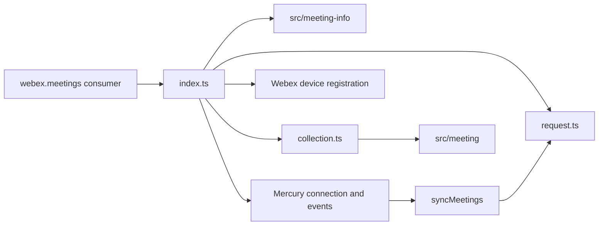
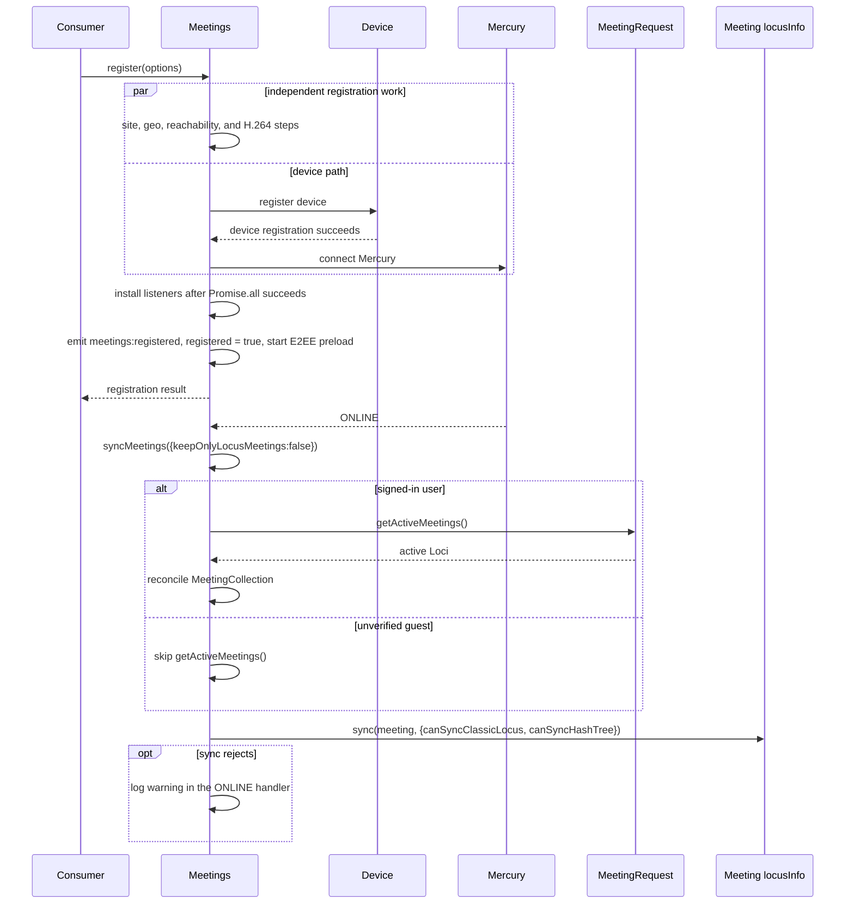
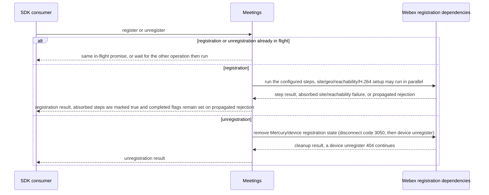
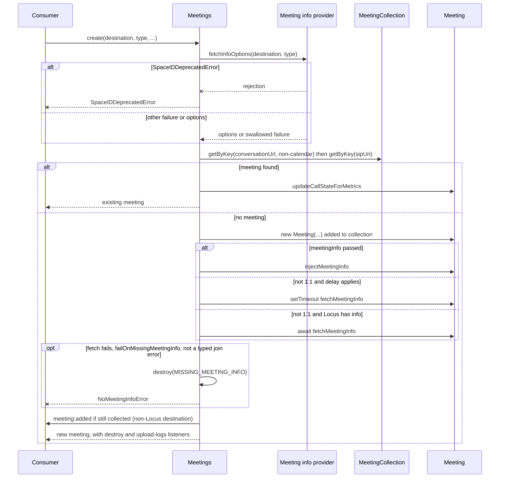
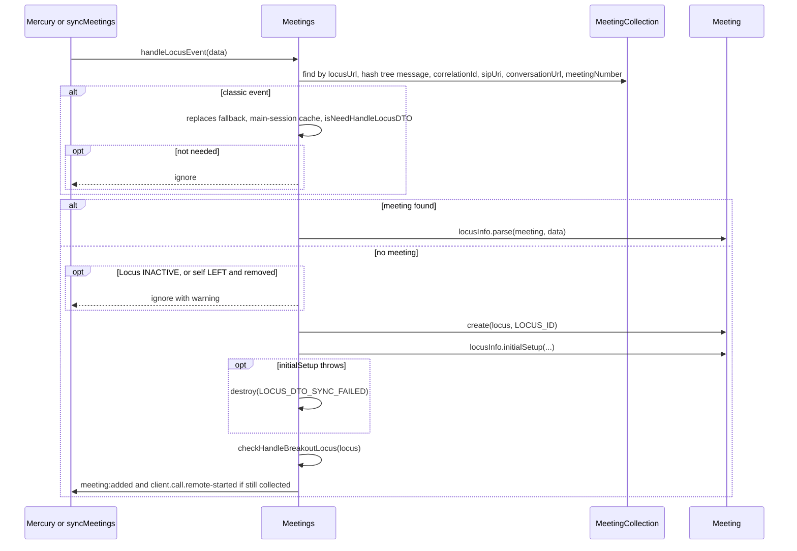
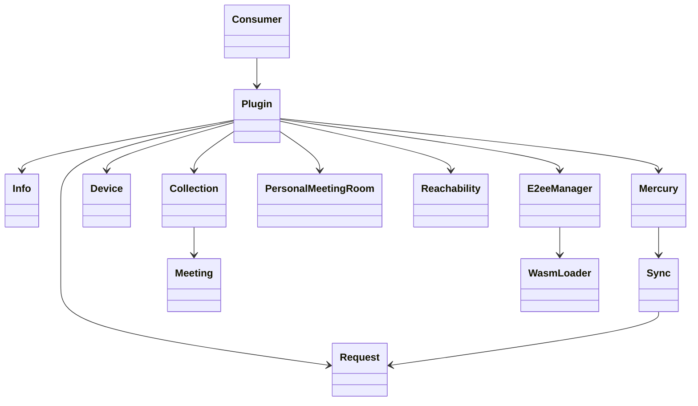
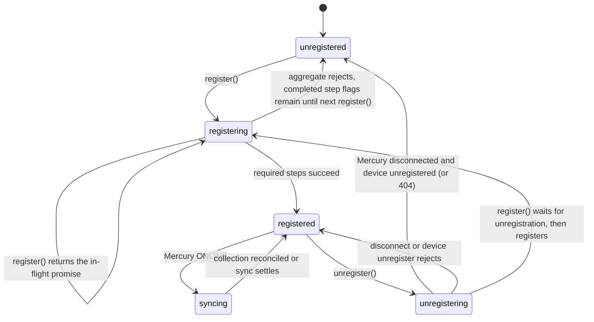

<!-- sdd-generated-metadata
doc_kind: module-spec
generated_from: module-spec@0.3.0
generated_by: claude-code
approved_by: rarajes2@cisco.com
updated_at: 2026-11-17T03:14:21Z
validation_status: pass-with-warnings
-->

# Meetings plugin

This source-local document at `src/meetings/docs/README.md` is the canonical source-local spec for
`src/meetings/`: the registered plugin `webex.meetings`. It owns plugin registration and
unregistration, Mercury and Locus event routing, meeting creation and lookup, active-meeting
synchronization, and the top-level meeting collection. Ground every claim in package evidence and
link to the [package architecture](../../../docs/architecture.md) instead of repeating broader facts.
No service specification exists because this package is a library.

Related context: start from the root [package agent instructions](../../../AGENTS.md) · router
[documentation index](../../../docs/index.md) · system [package architecture](../../../docs/architecture.md).
Related module specs: [meeting-info](../../meeting-info/docs/README.md) ·
[personal meeting room](../../personal-meeting-room/docs/README.md).

## Metadata

| Field | Value |
|---|---|
| Owner | @webex/web-client, @webex/web-sdk |
| Source path | `src/meetings` |
| Resource kind | module |
| Status | Draft |
| Last verified | 2026-11-16 at `0b8c34db7f` |
| Module id | `plugin-meetings/meetings` |
| Parent spec | — |
| Doc kind | Module spec |
| Coverage score | Pending coverage assessment |
| Validation status | not-run |

## Applicability

| Condition ID | Status | Evidence or reason | Owned section |
|---|---|---|---|
| `module.has_tiers` | N/A | No tier policy exists in `package.json` or `src/meetings/index.ts` | Tier |
| `module.has_ui` | N/A | `src/meetings/index.ts` returns models, promises, and events; it renders nothing | UI use-case flow |
| `module.crosses_service_boundaries` | Applicable | `src/meetings/index.ts` and `src/meetings/request.ts` call device registration, Mercury, Locus, the services catalog, people and user lookups, and the Webex site preference API | Cross-boundary use-case flow |
| `module.holds_client_state` | Applicable | `src/meetings/index.ts` keeps the registration flags, in-flight promises, collection, deleted-meeting cache, preferred site, and geo hint; `src/meetings/collection.ts` keeps the meetings | Client state model |
| `module.enforces_domain_rules` | Applicable | Locus routing, meeting reuse, and sync removal rules in `src/meetings/index.ts` and `src/meetings/util.ts` | Business rules and invariants |
| `module.is_concurrent_async` | Applicable | register() runs its steps through Promise.all; register and unregister serialize on in-flight promises; Mercury callbacks run between calls (`src/meetings/index.ts`) | Concurrency and reactive flow |
| `module.owns_persistence` | N/A | Nothing is written to storage; the collection and deleted-meeting map in `src/meetings/index.ts` are in memory only | Data, schema, and migration discipline |
| `module.stateful_transitions` | Applicable | registered, registrationPromise, and unregistrationPromise move the plugin between unregistered, registering, registered, and unregistering (`src/meetings/index.ts`) | State machine |
| `module.exposes_wire_protocol` | N/A | Requests are built through webex-core in `src/meetings/request.ts`; the Locus payload shape is owned by `src/locus-info/index.ts` | Protocol and wire format |
| `module.ui_multi_screen` | N/A | No UI in `src/meetings/index.ts` | UI flow |
| `module.large_data_model` | N/A | The owned types in `src/meetings/meetings.types.ts` are few; the Meeting model is owned by `src/meeting/index.ts` | Data model |
| `module.returns_caller_errors` | Applicable | register(), unregister(), create(), syncMeetings(), and fetchSitePreferencesMeViaSite() reject or throw in `src/meetings/index.ts` and `src/meetings/request.ts` | Caller-visible failure modes |
| `module.module_specific_conventions` | N/A | Package-wide conventions apply; see `AGENTS.md` | Module-specific rules |
| `module.published_package` | N/A | The module is not a package; package exports are owned by `src/index.ts` and `package.json` | Export stability |
| `module.embedded_in_host` | Applicable | `src/index.ts` registers the class as webex.meetings inside the Webex SDK host | Host integration and theming |
| `module.has_design_tradeoff` | Applicable | One coordinator in `src/meetings/index.ts` routes every Locus event and owns the collection | Key design trade-off |
| `module.has_submodules` | N/A | src/meetings has no child module directory | Sub-modules |

## Evidence register

Requirements cite current implementation and mirrored unit-test paths. Current code wins over retained prose when they conflict; commit and PR history are excluded by repository-owner decision. Missing test evidence is stated as a gap rather than inferred.

| Evidence | What it establishes |
|---|---|
| `src/meetings/index.ts` | `Meetings` extends `WebexPlugin`: registration, unregistration, Mercury listeners, Locus routing, create and lookup, sync, destroy, static-link and preference delegation, effects, log upload, and the WASM runtime probe |
| `src/meetings/collection.ts` | `MeetingCollection` over `src/common/collection.ts`, keyed by meeting id with key, breakout, and WebRTC lookups |
| `src/meetings/request.ts` | `MeetingRequest` extends `StatelessWebexPlugin`: Locus `loci` fetch with remote-cluster redirection, geo hint, meeting preferences, and the site preference request |
| `src/meetings/meetings.types.ts` | `MEETING_KEY`, `MeetingRegistrationStatus`, effect option types, and the site preference option, default, and response types |
| `src/meetings/util.ts` | Locus classification helpers, ROAP Mercury routing, correlation-id lookup, site name derivation, and the H.264 check |
| `src/index.ts` | `registerPlugin('meetings', Meetings, {config, interceptors})`; default export `Meetings`; exports `SitePreferenceSelectOption` and the site preference types |
| `src/config.ts` | Defaults read here: `autoUploadLogs` true, `enableE2ee` false, `assetsBaseUrl` from `getUmdAssetsBaseUrl`, `multipartSitePrefixList`, `experimental.enableUnifiedMeetings` true, `experimental.storeLocusHashTreeEventsForDebugging` false |
| `src/constants.ts` | Event literals in `EVENT_TRIGGERS`, `INITIAL_REGISTRATION_STATUS`, and `MAX_RANDOM_DELAY_FOR_MEETING_INFO` (3 minutes) |
| `src/metrics/constants.ts` | Registration, log upload, and `WASM_RUNTIME_PERFORMANCE` metric names |
| `src/e2ee/E2eeManager.ts`, `src/common/wasm-loader.ts` | E2EE preload gating on `enableE2ee` and WASM support, and the asset URL from `assetsBaseUrl` |
| `src/locus-info/index.ts`, `src/reconnection-manager/index.ts` | In-package callers of `syncMeetings()`: `LOCUS_NOT_FOUND` with `skipHashTreeSync: true`, and reconnection with `keepOnlyLocusMeetings: false` |
| `test/unit/spec/meetings/index.js` | Registration, unregistration and their serialization, effects, getters, site preferences, sync, static links, create, WASM telemetry, listeners, Locus routing, createMeeting, destroy, preferred site, and log upload cases |
| `test/unit/spec/meetings/collection.js`, `test/unit/spec/meetings/request.js`, `test/unit/spec/meetings/utils.js` | Collection lookups, the site preference request, and the util helpers |
| Observation, no stated WHY | `unregister()` treats a 404 from `device.unregister()` as success and continues (`src/meetings/index.ts`); no comment or test name states why, so it is recorded here rather than as a requirement |
| Observation, no stated WHY | `uploadLogs()` catches an upload failure, emits `meeting:logUpload:failure`, sends the failure metric, and resolves `undefined` instead of rejecting (`src/meetings/index.ts`); no comment states why, so it is recorded here rather than as a requirement |

## Purpose and boundary

- Responsibility: Owns the registered plugin lifecycle, meeting discovery, registration, realtime routing, and the top-level meeting collection.
- In scope: `register()` and `unregister()` and their serialization; the Mercury Locus, ROAP, `ONLINE`, and `OFFLINE` listeners; routing Locus events (classic and hash tree) to an existing meeting or a new one; `create()` and the meeting lookups; `syncMeetings()` and breakout ordering; `destroy` and the deleted-meeting cache; delegation of static links to meeting info and of the personal room to `src/personal-meeting-room/index.ts`; site preferences, geo hint, reachability start, log upload, media effect construction, and the WASM runtime probe.
- Out of scope: one meeting's lifecycle, media, and controls (`src/meeting/index.ts`); Locus state parsing and hash trees (`src/locus-info/index.ts`, `src/hashTree/hashTreeParser.ts`); destination resolution and meeting-info errors (`src/meeting-info/meeting-info-v2.ts`); reachability probing (`src/reachability/index.ts`); the PMR claim (`src/personal-meeting-room/index.ts`); E2EE key handling beyond the preload.
- Consumers: applications through `webex.meetings`; in the package, `src/reconnection-manager/index.ts` and `src/locus-info/index.ts` call `syncMeetings()`, and `src/meeting-info/meeting-info-v2.ts` reads `webex.meetings.preferredWebexSite`.

## Structure and key files

`src/meetings/` contains 5 direct source/reference file(s) and has 4 mirrored unit-test file(s). This spec separates its public operations, runtime data movement, component ownership, state applicability, and verification boundary.

TypeScript/JavaScript in the Node 22.14 Yarn workspace; Webex core/plugin abstractions and Mocha/Sinon/`@webex/test-helper-chai` tests. Build target: `yarn workspace @webex/plugin-meetings build:src`.

| File | Holds |
|---|---|
| `src/meetings/collection.ts` | `MeetingCollection`, the module-owned collection keyed by meeting id, with `getByKey`, `getActiveBreakoutLocus`, and `getActiveWebrtcMeeting` |
| `src/meetings/index.ts` | `Meetings`, the module facade/controller and primary export: registration, listeners, routing, create, sync, and delegations |
| `src/meetings/meetings.types.ts` | module type declarations: `MEETING_KEY`, `MeetingRegistrationStatus`, effect options, and site preference types |
| `src/meetings/request.ts` | `MeetingRequest`, the HTTP request boundary for Locus `loci`, geo hint, meeting preferences, and site preferences |
| `src/meetings/util.ts` | `MeetingsUtil` normalization/helper functions: Locus classification, ROAP routing, site name, and the H.264 check |
| `test/unit/spec/meetings/collection.js` and 3 sibling test file(s) (`index.js`, `request.js`, `utils.js`) | mirrored characterization/unit coverage |
| `src/meetings/docs/README.md` | This module specification |

## Public surface

| Contract ID | Type | Surface | Purpose | Compatibility / deprecation | Schema / detail link | Root index |
|---|---|---|---|---|---|---|
| `meetings-collection-api` | SDK collection | `MeetingCollection.set()`, `getByKey()`, `getActiveBreakoutLocus()`, and `getActiveWebrtcMeeting()` | Store Meeting models and resolve current normal/breakout active meetings. | Preserve collection key aliases and active-meeting selection. | `src/meetings/collection.ts` | [architecture](../../../docs/architecture.md#public-and-consumer-surfaces) |
| `meetings-collection-api` | SDK / registration | `executeRegistrationStep()`, `register()`, and `unregister()` | Coordinate device registration and Meetings-owned Mercury/Locus/ROAP listener lifecycle. | Preserve tracked step results, the exact listeners each lifecycle method adds/removes, and the in-flight promise reuse between concurrent register and unregister calls. | `src/meetings/index.ts` | [architecture](../../../docs/architecture.md#public-and-consumer-surfaces) |
| `meetings-collection-api` | SDK / diagnostics/media effects | `uploadLogs()`, `getReachability()`, `startReachability()`, `getGeoHint()`, `createNoiseReductionEffect()`, and `createVirtualBackgroundEffect()` | Expose logs, reachability/geo diagnostics, and configured media-effect creation. | `startReachability()` returns the gather promise directly. Only the separate registration callback absorbs its rejection. Preserve that boundary, other request outcomes, and effect construction inputs. | `src/meetings/index.ts` | [architecture](../../../docs/architecture.md#public-and-consumer-surfaces) |
| `meetings-collection-api`, `site-preferences-http` | SDK / preferences | `fetchUserPreferredWebexSite()`, `getPersonalMeetingRoom()`, `fetchSitePreferencesMeViaSite()`, and `getBasicMeetingInformation()` | Fetch account/site preferences, PMR, and lightweight meeting information. | Preserve parallel independent request behavior; do not claim a strict ordering across site/geo/reachability/H264 setup. | `src/meetings/index.ts` | [architecture](../../../docs/architecture.md#public-and-consumer-surfaces) |
| `meetings-collection-api` | SDK / static links | `fetchStaticMeetingLink()`, `enableStaticMeetingLink()`, and `disableStaticMeetingLink()` | Delegate static meeting-link lookup and mutation to meeting-info V2. | Preserve typed meeting-info errors and direct service outcomes. | `src/meetings/index.ts`, `src/meeting-info/meeting-info-v2.ts` | [architecture](../../../docs/architecture.md#public-and-consumer-surfaces) |
| `meetings-collection-api` | SDK / meeting lookup | `create()`, `getMeetingByType()`, `getAllMeetings()`, and `getActiveWebrtcMeeting()` | Create/find/list Meeting models from destination information and collection keys. | Preserve model reuse/collection identity and lookup-type behavior. | `src/meetings/index.ts`, `src/meetings/collection.ts` | [architecture](../../../docs/architecture.md#public-and-consumer-surfaces) |
| `meetings-collection-api` | SDK / synchronization | `syncMeetings()`, `sortLocusArrayToUpdate()`, `checkHandleBreakoutLocus()`, and `getCorrespondingMeetingByLocus()` | Reconcile active Loci into the collection, including breakout/main relationships. | All four methods are defined on `Meetings` in `index.ts`; Online Mercury handling, the reconnection manager, and Locus-info `LOCUS_NOT_FOUND` handling invoke this sync, while `register()` itself does not. | `src/meetings/index.ts` | [architecture](../../../docs/architecture.md#public-and-consumer-surfaces) |
| `site-preferences-http` | request/types | `MeetingRequest.getActiveMeetings()`, `fetchGeoHint()`, `getMeetingPreferences()`, `fetchSitePreferencesMeViaSite()`, and `determineRedirections()` plus `LocusEvent`, `BasicMeetingInformation`, `INoiseReductionEffect`, `IVirtualBackgroundEffect`, `MEETING_KEY`, `MeetingRegistrationStatus`, `SitePreferenceSelectOption`, `FetchSitePreferencesMeViaSiteOptions`, `DEFAULT_SITE_PREFERENCE_SELECT_OPTIONS`, and `SitePreferencesResponse` | Provide direct service requests and the exact collection/configuration vocabulary consumed by Meetings. | Preserve request result shapes, enum/raw option values, and default site-selection options; only `SitePreferenceSelectOption`, `FetchSitePreferencesMeViaSiteOptions`, and `SitePreferencesResponse` are package exports in `src/index.ts`. | `src/meetings/request.ts`, `src/meetings/meetings.types.ts`, `src/meetings/index.ts` | [architecture](../../../docs/architecture.md#public-and-consumer-surfaces) |
| `meetings-collection-api` | SDK / diagnostics | `getLogger()` | Return the logger used by Meetings and child meeting operations. | Preserve logger identity and existing call sites. | `src/meetings/index.ts` | [architecture](../../../docs/architecture.md#public-and-consumer-surfaces) |

Provided contract IDs (manifest): `plugin-meetings-sdk`, `meetings-plugin`, `meetings-collection-api`, and `site-preferences-http`. The package-level contracts `plugin-meetings-sdk` (the published entry, whose default export is
`Meetings`) and `meetings-plugin` (`registerPlugin('meetings', Meetings, …)` in `src/index.ts`) are
indexed with the IDs above in the
[package architecture](../../../docs/architecture.md#public-and-consumer-surfaces). Coverage state
and the contracts baseline are registered in `.sdd/manifest.json`.

### Emitted events

Current source emits or forwards these observable literals for this operation boundary. Preserve literal values, scope, payload shape, and emission timing; a constant name alone is not a substitute for the consumer-visible value.

| Event literal | Constant / expression | Emission evidence |
|---|---|---|
| `meeting:added` | `EVENT_TRIGGERS.MEETING_ADDED` | `src/meetings/index.ts` |
| `meeting:logUpload:failure` | `EVENT_TRIGGERS.MEETING_LOG_UPLOAD_FAILURE` | `src/meetings/index.ts` |
| `meeting:logUpload:success` | `EVENT_TRIGGERS.MEETING_LOG_UPLOAD_SUCCESS` | `src/meetings/index.ts` |
| `meeting:removed` | `EVENT_TRIGGERS.MEETING_REMOVED` | `src/meetings/index.ts` |
| `meetings:ready` | `EVENT_TRIGGERS.MEETINGS_READY` | `src/meetings/index.ts` |
| `meetings:registered` | `EVENT_TRIGGERS.MEETINGS_REGISTERED` | `src/meetings/index.ts` |
| `meetings:unregistered` | `EVENT_TRIGGERS.MEETINGS_UNREGISTERED` | `src/meetings/index.ts` |
| `network:disconnected` | `EVENT_TRIGGERS.MEETINGS_NETWORK_DISCONNECTED` | `src/meetings/index.ts` |

Payloads: `meeting:added` carries `{meeting, type}`, where `type` is `join` or `incoming` from a
Locus event and the `MeetingsUtil.getMeetingAddedType()` value from `create()`; `meeting:removed`
carries `{meetingId, reason}`; the log-upload events carry `{meetingId, details}` or
`{meetingId, reason}`; `meetings:ready`, `meetings:registered`, `meetings:unregistered`, and
`network:disconnected` carry no payload. `meetings:ready` fires once, on the Webex `ready` event.

Compatibility notes:

- Prefer additive options and payload fields. Preserve method/event names, rejection semantics, and cleanup timing; route public changes through `src/index.ts` or the documented owning object.

## Dependencies

Webex core host, device and Mercury plugins, meeting-info services, Meeting construction, reachability, and metrics.

Required contract IDs (manifest): `webex-core-plugin-host`, `internal-plugin-device-registration`, `internal-plugin-mercury-events`, `meeting-info-api`, `meeting-api`, `reachability-service`, `meetings-metrics`, `personal-meeting-room-api`, `locus-info-projection`, and `hash-tree-sync`.

| Dependency | Why it is required | Failure behavior |
|---|---|---|
| `@webex/webex-core` (`webex-core-plugin-host`) | `WebexPlugin`, `StatelessWebexPlugin`, `webex.request` with `api: 'locus'`, and `webex.internal.services` (`fetchClientRegionInfo`, `getMeetingPreferences`, `_getCatalog().addAllowedDomains`) | Request rejections reject the calling method; `getActiveMeetings` rethrows wrapped in `Error` |
| `@webex/internal-plugin-device` (`internal-plugin-device-registration`) | `device.register(options)`, `device.unregister()`, `device.url`, `userId`, `orgId` | Register rejection rejects `register()`; unregister rejection rejects `unregister()` except a 404 |
| `@webex/internal-plugin-mercury` (`internal-plugin-mercury-events`) | `connect()`, `disconnect({code: 3050, reason})`, and the Locus, ROAP, `online`, and `offline` events | Connect rejection rejects `register()`; disconnect rejection rejects `unregister()` |
| Meeting info (`meeting-info-api`) | `MeetingInfoV2`, or legacy `MeetingInfo` when `experimental.enableUnifiedMeetings` is false, for `fetchInfoOptions`, the Meeting's meeting-info provider, and static links | See [meeting-info](../../meeting-info/docs/README.md); `create()` swallows option failures except `SpaceIDDeprecatedError` |
| Meeting (`meeting-api`) | `new Meeting(...)`, `fetchMeetingInfo`, `injectMeetingInfo`, `locusInfo.initialSetup`, `parse`, `sync`, `cleanUp`, `MeetingUtil.cleanUp` | Errors from `initialSetup` destroy the new meeting with `LOCUS_DTO_SYNC_FAILED` |
| Reachability (`reachability-service`) | `gatherReachability(trigger)` | `startReachability()` rejects; the registration step absorbs it |
| Metrics (`meetings-metrics`) and `webex.internal.newMetrics` | Behavioral metrics and the `client.call.remote-started` client event | Metric failures are not awaited, except in the WASM probe, which catches them |
| Personal meeting room (`personal-meeting-room-api`) | `new PersonalMeetingRoom({meetingInfo}, {parent: webex})` at `ready` | See [personal meeting room](../../personal-meeting-room/docs/README.md) |
| Locus info (`locus-info-projection`) | `createLocusFromHashTreeMessage` and `findMeetingForHashTreeMessage` for hash tree Locus events; each meeting's `locusInfo` (`initialSetup`, `parse`, `sync`, `updateMainSessionLocusCache`, `cleanUp`) | `initialSetup` errors destroy the new meeting; sync rejections reject `syncMeetings()` |
| Hash tree (`hash-tree-sync`) | `HashTreeMessage` and `HashTreeObject` types and `isSelf` to find the self element in a hash tree Locus event | — |
| `webex.people._getMe()`, `webex.internal.user.get()` | Guest detection and the preferred-site fallback | Caught and logged; the site stays unset |
| `webex.credentials` | `supertoken.access_token` for effects; `isUnverifiedGuest` for sync | — |
| `@webex/media-helpers`, `@webex/internal-media-core`, `@webex/web-capabilities` | Effect classes, `setLogger`, and `WasmRuntimeProbe` | Probe failures are caught and logged |
| `src/e2ee/E2eeManager.ts`, `src/common/wasm-loader.ts` | E2EE WASM preload after registration | Preload rejection is logged as a warning |

## Requirements

| ID | WHAT | WHY | Source Evidence | Test / Example Evidence | Assumptions / Gaps | Confidence |
|---|---|---|---|---|---|---|
| `MEETINGS-R-001` | create/get meeting and collection lookup. `create()` normalizes the destination through `fetchInfoOptions`, returns an existing meeting found by conversation URL (only when it is not a calendar meeting) or by SIP URI after `updateCallStateForMetrics`, and otherwise calls `createMeeting`, which adds the new Meeting to the collection. | Owns the registered plugin lifecycle, meeting discovery, registration, realtime routing, and the top-level meeting collection; skipping a found calendar meeting allows the creation of instant-meetings when calendar meetings are present (code comment). | `src/meetings/index.ts` | `test/unit/spec/meetings/index.js` | none | PRESENT |
| `MEETINGS-R-002` | register/unregister device and Mercury lifecycle. | Registration owns device/listener readiness; active-meeting synchronization is a separate online-event flow. | `src/meetings/index.ts`, `src/meetings/request.ts` | `test/unit/spec/meetings/index.js` | unregister does not remove the OFFLINE listener; retain as a targeted teardown gap | PRESENT |
| `MEETINGS-R-003` | `executeRegistrationStep()` marks a step `true` whenever its supplied promise resolves and rethrows a rejection without resetting other flags. `fetchUserPreferredWebexSite()` catches its own failures and resolves, while the `startReachability` registration callback catches that gather rejection and resolves; those two steps are therefore marked successful even when their underlying work failed. `unregister()` removes Locus, ROAP, and `ONLINE` Mercury listeners plus device state, but leaves the `OFFLINE` listener installed. | Registration status records wrapper settlement, not necessarily underlying site/reachability success; other rejected steps preserve partial progress until the next `register()` reset, and the residual `OFFLINE` listener must stay visible as a teardown gap. | `src/meetings/index.ts` | `test/unit/spec/meetings/index.js` | characterize absorbed site/reachability failures, partial status after a non-absorbed rejection, and the surviving `OFFLINE` callback | PRESENT |
| `MEETINGS-R-004` | `register()` starts site, geo, reachability, device-registration, and H.264 work together through `Promise.all`; Mercury connect is chained after device registration. Each wrapper-resolved step updates its own status, including the failure-absorbing site and reachability wrappers. `syncMeetings()` runs later from the Mercury `ONLINE` handler installed by `listenForEvents()`. | Registration readiness and active-meeting synchronization are distinct phases, and preserving wrapper-level settlement and actual concurrency prevents callers from depending on a nonexistent success definition or serial order. | `src/meetings/index.ts`, `src/meetings/meetings.types.ts` | `test/unit/spec/meetings/index.js` | none | PRESENT |
| `MEETINGS-R-007` | `emitWasmRuntimePerformance(correlationId)` is a `once()`-wrapped private probe that runs `WasmRuntimeProbe.check()` and reports `WASM_RUNTIME_PERFORMANCE` (`js_sdk_wasm_runtime_performance`) with `status`, `capability`, `reason`, the destructured measurements `divRatio`, `sqrtRatio`, `addNsPerOp`, `addMedianMs`, `divMedianMs`, `sqrtMedianMs`, and `correlation_id`. Each measurement defaults to `null` when `result.measurements` is absent or omits it. Both a probe rejection and a metric-submission rejection are caught and logged only. | The probe is diagnostic: it exists to find browsers where real-time WASM effects run poorly, so it must never be able to fail meeting creation. Explicit `null` defaults keep the metric schema fixed-width so the fields stay comparable across browsers that report partial measurements, and `once()` keeps one sample per plugin instance rather than one per meeting. | `src/meetings/index.ts`, `src/metrics/constants.ts` | `test/unit/spec/meetings/index.js` | none | PRESENT |
| `MEETINGS-R-008` | Meetings owns one shared `WasmLoader`, and at the Webex `ready` event builds one `E2eeManager` with it; after successful registration it calls `e2eeManager.preload()`, which starts E2EE WASM preloading only when `meetings.enableE2ee` is true and WebAssembly is supported, loading `e2ee-0.0.1.wasm` from the `meetings.assetsBaseUrl` directory. Preload is fire-and-forget, so a preload rejection is logged and does not change registration success. | Keep module initialization off the meeting join path while preserving registration behavior when the optional asset is unavailable. | `src/meetings/index.ts`, `src/common/wasm-loader.ts`, `src/e2ee/E2eeManager.ts`, `src/config.ts` | `test/unit/spec/meetings/index.js`, `test/unit/spec/common/wasm-loader.ts`, `test/unit/spec/e2ee/E2eeManager.ts` | `assetsBaseUrl` defaults to the UMD assets directory for this package version; the asset itself is published separately. | PRESENT |
| `MEETINGS-R-005` | Mercury/Locus events resolve an existing meeting by supported keys before creating or routing a new object. | Stable meeting identity prevents duplicate Meeting objects and misrouted realtime updates. | `src/meetings/index.ts`, `src/meetings/collection.ts` | `test/unit/spec/meetings/index.js`, `test/unit/spec/meetings/collection.js` | none | PRESENT |
| `MEETINGS-R-006` | Reachability, geo hints, site preferences, PMR, and active-meeting queries delegate to their current request/controller boundaries. | Central plugin access must preserve host credentials, service discovery, and established response/error behavior. | `src/meetings/index.ts`, `src/meetings/request.ts` | `test/unit/spec/meetings/request.js` | none | PRESENT |
| `MEETINGS-R-009` | A `register()` call while a registration is in flight returns the same promise; while an unregistration is in flight it waits for it (ignoring its outcome) and then registers. An `unregister()` call while an unregistration is in flight returns the same promise; while a registration is in flight it waits for it (ignoring its outcome) and then unregisters. Both promises are cleared when they settle. `register()` rejects with `SDK cannot authorize` when `webex.canAuthorize` is false and resolves at once when already registered. `unregister()` disconnects Mercury with code 3050 and reason `meetings unregister` before `device.unregister()`. | Overlapping calls must not register or unregister the device twice (test: prevents duplicate registrations), and the 3050 non-reconnecting close prevents Mercury auto-reconnect racing with `device.unregister()` (code comment). | `src/meetings/index.ts` | `test/unit/spec/meetings/index.js` | none | Present |
| `MEETINGS-R-010` | The Mercury `ONLINE` handler calls `syncMeetings({keepOnlyLocusMeetings: false})` without awaiting it and catches a rejection, logging a warning. | Nothing consumes this promise, so an unhandled rejection from a transient guest classic-sync failure would otherwise crash Node hosts (code comment). | `src/meetings/index.ts` | `test/unit/spec/meetings/index.js` | none | Present |
| `MEETINGS-R-011` | For an unverified guest (`webex.credentials.isUnverifiedGuest`), `syncMeetings()` skips `getActiveMeetings()`. Then, for every user, it calls `locusInfo.sync(meeting, {canSyncClassicLocus: isUnverifiedGuest, canSyncHashTree: !skipHashTreeSync})` for each remaining meeting with `locusInfo` and awaits them together. A `getActiveMeetings()` failure is logged and rethrown before any per-meeting sync. | Locus rejects `getActiveMeetings()` for unverified guests, so each classic meeting is resynced individually instead; for signed-in users classic meetings were already synced from the Loci list, so only the hash tree sync runs (JSDoc and code comment). | `src/meetings/index.ts` | `test/unit/spec/meetings/index.js` | none | Present |
| `MEETINGS-R-012` | After handling the returned Loci, `syncMeetings()` destroys with reason `NO_MEETINGS_TO_SYNC` each collected meeting whose `locusUrl` is not active (every meeting when `keepOnlyLocusMeetings` is true, only meetings with a `locusUrl` otherwise), except a meeting whose `locusInfo.info.globalMeetingId` matches a returned Locus. | Mercury events can be lost after a reconnect, so meetings Locus no longer returns are removed; a shared `globalMeetingId` means the user moved between breakouts while offline, for example a webinar attendee, so that meeting is kept (code comments). | `src/meetings/index.ts` | `test/unit/spec/meetings/index.js` | none | Present |
| `MEETINGS-R-013` | `destroy` runs `MeetingUtil.cleanUp` (without preserving the Voicea channel), then `meeting.locusInfo.cleanUp()`, stores a minimal `BasicMeetingInformation` in `deletedMeetings`, deletes the meeting from the collection, and emits `meeting:removed` with `{meetingId, reason}`. `getBasicMeetingInformation(id)` reads the collection first, then `deletedMeetings`. | Hash tree parsers are torn down here, not in `MeetingUtil.cleanUp`, so they survive leave and end-for-all to consume the final sentinel END message from Locus; only minimal Locus info is kept because `locusInfo` can be large (code comments). | `src/meetings/index.ts` | `test/unit/spec/meetings/index.js` | none | Present |
| `MEETINGS-R-014` | `createMeeting` emits `meeting:added` for a non-Locus destination only if the meeting is still in the collection, and the Locus-event path emits `meeting:added` and `client.call.remote-started` only if the created meeting still exists. | A meeting destroyed for missing meeting info, or a 1:1 meeting deleted because the other user left, must not reach consumers as an orphaned reference (code comments). | `src/meetings/index.ts` | `test/unit/spec/meetings/index.js` | none | Present |
| `MEETINGS-R-015` | For a Locus that is not active, with `enableUnifiedMeetings` and `useRandomDelayForInfo` (Locus events from Mercury), `createMeeting` delays `fetchMeetingInfo` by a random time up to the smaller of the time to start and 3 minutes; it skips the fetch for 1:1 calls and defers it for a Locus without `info` until Locus initial setup. With `failOnMissingMeetingInfo`, a fetch failure other than the captcha, password, permission, webinar, and forbidden errors destroys the meeting and throws `NoMeetingInfoError`. | The random delay spreads fetches for a scheduled meeting that starts in 5 to 6 minutes, avoiding a spike in traffic to the wbxappapi service; without meeting info the destination is assumed to be a 1:1 call or wireless share (code comments). | `src/meetings/index.ts`, `src/constants.ts` | `test/unit/spec/meetings/index.js` | none | Present |

## Design overview

`Meetings` is the registered plugin facade and collection owner. `register()` starts site, geo, reachability, device-registration, and H.264 steps concurrently in `Promise.all`; Mercury connection follows successful device registration, and listeners are installed only after the aggregate succeeds. Site-preference fetching absorbs its own failures, and the registration callback absorbs a reachability rejection, so both wrappers can resolve and be marked successful without completing their underlying work. Synchronization is a separate `syncMeetings()` call triggered by the Mercury `ONLINE` handler.

The constructor builds `MeetingRequest`, the log-upload request, `MeetingCollection`, the
`deletedMeetings` map, `Reachability`, and the shared `WasmLoader`. Everything that needs the
initialized client waits for the Webex `ready` event: static and logging config, the logger proxy,
the media logger, `E2eeManager`, the meeting-info provider (`MeetingInfoV2` unless
`experimental.enableUnifiedMeetings` is false), `PersonalMeetingRoom`, `meetings:ready`, the H.264
check, and metrics setup.

Register and unregister serialize on `registrationPromise` and `unregistrationPromise`
(`MEETINGS-R-009`). Locus events arrive from Mercury, from `syncMeetings()` (as
`SDK_LOCUS_FROM_SYNC_MEETINGS`), and from breakouts held for later; `handleLocusEvent` finds the
meeting, decides through `isNeedHandleLocusDTO` and `isNeedHandleMainLocus` whether a classic event
must be processed, and either parses it into the existing meeting or creates a new one and runs
`locusInfo.initialSetup`. ROAP Mercury messages go to `MeetingsUtil.handleRoapMercury`.

## Data flow and sequence coverage

Call style: in-process method calls on `webex.meetings`; outbound HTTPS through `webex.request`
(Locus `loci`, remote Locus clusters, and the site preference API) and through the device, services,
people, and user plugins; inbound Mercury events (`event:locus`, ROAP, `online`, `offline`).

Sequence coverage:

| Operation group | Diagram | Failure coverage |
|---|---|---|
| UC-1…UC-5 — Meetings registration and synchronization operation groups | Meetings registration and synchronization primary sequence | registration-step failure, independent setup requests, online sync rejection logged by the handler, per-meeting Locus sync, and listener teardown |
| UC-1…UC-5 — Meetings registration and synchronization alternate/failure paths | Meetings registration and synchronization alternate/failure sequence | registration-step rejection, Mercury/device failure, in-flight register or unregister reuse, device unregister 404, unsupported destination, site-preference parameter error, or meeting-sync request failure |
| UC-3 — meeting creation | Meeting creation sequence | option failure swallowed except `SpaceIDDeprecatedError`, meeting-info failure with and without `failOnMissingMeetingInfo`, delayed or deferred fetch |
| UC-6 — Locus event routing | Locus event routing sequence | ignored DTO, inactive or left-and-removed Locus, `initialSetup` failure, meeting destroyed before `meeting:added` |
| UC-4, UC-5 — preferences, reachability, PMR, static links, logs, effects | `src/meetings/index.ts`, `src/meetings/request.ts` (one delegated call each) | synchronous `ParameterError`, static-link rejections logged and rethrown, log upload failure resolves |

### Meetings registration and synchronization primary sequence

### Meetings registration and synchronization alternate/failure sequence

### Meeting creation sequence

### Locus event routing sequence

## Class and component relationships

The arrows identify ownership and delegation inside `src/meetings/`; files that only declare types or constants are not presented as transports.

## Use cases and flows

| Use case | Actor or caller | Primary steps and outcome | Failure or boundary behavior | Evidence |
|---|---|---|---|---|
| `UC-1` | Application | Register device and Meetings-owned listeners through tracked registration steps without treating active-meeting synchronization as part of `register()` itself. | A failing device, Mercury, geo, or H.264 step rejects; site and reachability failures are absorbed | `src/meetings/index.ts`, `test/unit/spec/meetings/index.js` |
| `UC-2` | Mercury, reconnection manager, Locus info | On Mercury `ONLINE`, `Meetings.syncMeetings()` fetches active Loci through `MeetingRequest.getActiveMeetings()` and reconciles corresponding main/breakout Meeting models into the collection, then resyncs each meeting's Locus. | Unverified guests skip the fetch; the `ONLINE` handler logs a rejection | `src/meetings/index.ts`, `src/meetings/request.ts` |
| `UC-3` | Application | Create or retrieve a Meeting by destination/type while reusing collection identity when a matching model exists. | `SpaceIDDeprecatedError` rejects; `NoMeetingInfoError` with `failOnMissingMeetingInfo` | `src/meetings/index.ts`, `src/meetings/collection.ts` |
| `UC-4` | Application | Start/read reachability, fetch geo/site preferences, PMR, or basic meeting information through their independent request paths. | `fetchSitePreferencesMeViaSite()` throws synchronously without a site | `src/meetings/index.ts`, `src/meetings/request.ts` |
| `UC-5` | Application | Fetch, enable, or disable a static meeting link through the meeting-info V2 facade and preserve its typed outcomes. | Rejections are logged and rethrown unchanged | `src/meetings/index.ts`, `src/meeting-info/meeting-info-v2.ts` |
| `UC-6` | Mercury | A Locus event updates the matching meeting, or creates one and emits `meeting:added` | Ended or left Loci are ignored; a failed initial setup destroys the meeting | `src/meetings/index.ts`, `test/unit/spec/meetings/index.js` |

### Cross-boundary use-case flow

| Boundary | Transport and ordering | Compatibility | Timeout, retry, and recovery |
|---|---|---|---|
| Device registration (`UC-1`) | `webex.internal.device.register(options)`, then Mercury connect, in that order | Options passed through unchanged | No retry here; the caller registers again |
| Mercury (`UC-1`, `UC-2`, `UC-6`) | WebSocket events delivered one at a time to the four listeners | Locus envelopes other than ROAP and approval requests go to `handleLocusEvent` | Disconnect uses code 3050 so Mercury does not reconnect during unregister |
| Locus `loci` (`UC-2`) | GET through `api: 'locus'`, then one GET per `remoteLocusClusterUrls` entry with `runWhitelistedDomains`, merged into `loci` and `locusUrls` | Response body shape owned by Locus | A failure is logged and rethrown as `Error`; the Locus retry interceptor applies (`src/interceptors/locusRetry.ts`) |
| Webex site API (`UC-4`) | GET `https://<siteUrl>/wbxappapi/v1/users/me/preference?select=<options>&siteurl=<siteName>` | `select` defaults to `scheduling`; the site name is derived with `multipartSitePrefixList` | No retry |
| Services, people, and user plugins (`UC-1`, `UC-4`) | `fetchClientRegionInfo`, `getMeetingPreferences`, `_getMe`, `user.get` | The preferred site is added to the catalog's allowed domains | Site lookup failures are logged and absorbed |

## Client state model

Registration progress, meeting collection entries, sync state, and listener handles are held in memory for the plugin lifetime.

| State or slice | Owner | Initial state | Transition triggers | Reset or persistence boundary |
|---|---|---|---|---|
| `registered` | `Meetings` | `false` | `true` after registration succeeds; `false` after unregistration succeeds | In memory |
| `registrationStatus` | `Meetings` | Unset until `register()`, then `INITIAL_REGISTRATION_STATUS` (six `false` flags) | Each resolved step sets its flag | Reset by each `register()` and by a successful `unregister()` |
| `registrationPromise`, `unregistrationPromise` | `Meetings` | Unset | Set while an operation runs | Cleared when it settles |
| `meetingCollection` | `MeetingCollection` | Empty | `createMeeting`, `destroy` | In memory |
| `deletedMeetings` | `Meetings` | Empty `Map` | `destroy` | Never cleared during the plugin lifetime |
| `breakoutLocusForHandleLater` | `Meetings` | Unset | `sortLocusArrayToUpdate`, `checkHandleBreakoutLocus` | Replaced on each sort |
| `preferredWebexSite`, `geoHintInfo` | `Meetings` | `''`, unset | Registration steps | Overwritten by the next registration |
| `meetingInfo`, `personalMeetingRoom`, `e2eeManager` | `Meetings` | Unset until `ready` | `ready`; `_toggleUnifiedMeetings` replaces `meetingInfo` | In memory |

## Business rules and invariants

| ID | Invariant | WHY | Enforcement source | Test evidence |
|---|---|---|---|---|
| `INV-001` | A realtime event is routed to its corresponding meeting before a new meeting is created | Stable meeting identity prevents duplicate Meeting objects (`MEETINGS-R-005`) | `src/meetings/index.ts` | `test/unit/spec/meetings/index.js` |
| `INV-002` | A main-session Locus is skipped when it carries an older `replaceAt` than this device's breakout join, when this device joined an active breakout, or when self moved and is removed or this device's resource left and moved; a breakout Locus for a new meeting is handled only when self is `JOINED`, and one for an existing meeting only when self has not moved | Expired or moved main-session states must not overwrite the active breakout session (log messages in `isNeedHandleMainLocus` name these as expired or not needing handling) | `src/meetings/index.ts`, `src/meetings/util.ts` | `test/unit/spec/meetings/index.js` |
| `INV-003` | When a sync returns a main Locus and its breakout for a meeting that does not exist, the main Locus is handled first and the breakout after the meeting is created | Handling only the breakout Locus would miss data (code comment) | `src/meetings/index.ts` | `test/unit/spec/meetings/index.js` |

## Concurrency and reactive flow

- Execution model: Registration steps run through one `Promise.all` aggregate, with Mercury connection chained behind device registration. `executeRegistrationStep()` sets a flag after its callback resolves. Site-preference fetching and the registration reachability callback absorb their own failures and therefore still set their flags; a rejection from another step propagates without clearing flags already set. Unregistration removes the Mercury/device registration owned by the plugin; individual meeting synchronization requests remain separate returned promises rather than silently changing registration success.
- Ordering guarantees: overlapping register and unregister calls serialize on the in-flight promises (`MEETINGS-R-009`); `syncMeetings()` handles the Loci list before the per-meeting syncs, which run in parallel.
- Idempotency and retry: `register()` resolves when already registered and `unregister()` when already unregistered; `emitWasmRuntimePerformance` runs once per instance; nothing here retries.
- Shared-state protection: single-threaded event loop; the in-flight promises are the only guard.
- Blocking restrictions: the E2EE preload and the WASM probe are not awaited by registration or creation.

## State machine

These labels summarize the concrete `registered`, registration-promise, registration-step, and Mercury-`ONLINE` transitions in `src/meetings/index.ts`.

`unregister()` during `registering` waits for the registration to settle and then unregisters. A
failed unregistration leaves `registered` true with the Locus, ROAP, and `ONLINE` listeners already
removed.

## Caller-visible failure modes

| Condition | Signal | Caller recovery |
|---|---|---|
| Site-preference fetching or the registration reachability call fails | The inner catch logs/absorbs the failure, `executeRegistrationStep()` observes resolution, and `fetchWebexSite` or `startReachability` is marked `true`; that failure alone does not reject registration. | Treat those flags as wrapper-completion indicators and inspect diagnostics/current data before assuming the underlying work succeeded. |
| Another registration step or Mercury/device registration rejects | The returned registration promise rejects. The failing step is not marked successful, and flags already set by concurrently completed steps are not reset until the next `register()` initializes registration status. | Correct the failing dependency and treat the next registration call as the status reset boundary. |
| `fetchSitePreferencesMeViaSite()` has neither `options.siteUrl` nor `preferredWebexSite` | `MeetingRequest.fetchSitePreferencesMeViaSite()` throws `ParameterError` synchronously before returning a promise; the non-`async` facade returns that direct call, so `.catch()` on a nonexistent result cannot observe the error. | Supply either site URL and wrap the call boundary in synchronous error handling when inputs may be absent. |
| Another destination or preference request rejects | Its returned request promise preserves the implemented rejection. | Supply supported input or handle the returned rejection for that specific operation. |
| Meeting synchronization request rejects | A direct `syncMeetings()` call rejects independently of plugin registration state; the Mercury `ONLINE` handler catches the rejection and logs a warning. | Handle or repeat synchronization under the owning meeting workflow. |
| The WASM runtime probe or its metric submission rejects | The rejection is caught and logged as an error; no event is emitted, no metric is retried, and meeting creation is unaffected. | Read the logged diagnostic; do not treat a missing `js_sdk_wasm_runtime_performance` metric as a meeting-creation failure. |
| `webex.canAuthorize` is false | `register()` rejects with `Error('SDK cannot authorize')`. | Authorize the SDK, then register. |
| Mercury disconnect or a non-404 device unregister fails | `unregister()` rejects; `registered` stays true and `meetings:unregistered` is not emitted. | Call `unregister()` again. |
| `fetchInfoOptions` rejects in `create()` | `SpaceIDDeprecatedError` is rethrown; any other failure is logged and creation continues with the original destination. | Use a meeting ID or SIP address instead of a space ID. |
| Meeting info cannot be fetched with `failOnMissingMeetingInfo` | `create()` rejects with `NoMeetingInfoError` after the meeting is destroyed with `MISSING_MEETING_INFO`; no `meeting:added` is emitted. | Retry or handle the missing meeting. |

## Pitfalls and constraints

- Registration is multi-step. Treating device registration, Mercury setup, and active-meeting sync as one opaque call loses the failing stage and can leak listeners.
- Public behavior may be reachable through a parent `Meeting`/`Meetings` object even when the source helper is not exported directly.
- Teardown gap: unregister removes Locus/ROAP/`ONLINE` listeners and registration state but currently leaves the `OFFLINE` listener installed. `stopListeningForEvents()` calls `mercury.off(event)` without a handler and never removes `OFFLINE`, so after unregister and register the `OFFLINE` callback is installed twice and `network:disconnected` fires once per installed copy (`src/meetings/index.ts`).
- `uploadLogs()` resolves `undefined` on failure; check the `meeting:logUpload:failure` event, not the promise.
- The static-link facade methods call `fetchStaticMeetingLink`, `enableStaticMeetingLink`, and `disableStaticMeetingLink` on the meeting-info provider, which only `MeetingInfoV2` defines; with `experimental.enableUnifiedMeetings` false the call throws a `TypeError` synchronously.
- `PersonalMeetingRoom` keeps the meeting-info provider it was built with at `ready`; `_toggleUnifiedMeetings` replaces `meetings.meetingInfo` but not the personal room's provider.
- `_toggle*` and `_setLogUploadIntervalMultiplicationFactor` ignore values of the wrong type and change `config` in place; several must be called before `register()` or `joinWithMedia()` (JSDoc).

## Host integration and theming

The Webex SDK host supplies initialized request/device/Mercury/media capabilities and exposes this behavior through `webex.meetings` or its Meeting objects. The module renders no UI and has no theme contract.

- Mount or entry contract: `registerPlugin('meetings', Meetings, {config, interceptors})` in `src/index.ts`; the instance is reached as `webex.meetings`.
- Required providers, peers, or host versions: the device, Mercury, conversation, metrics, and identity plugins imported by `src/index.ts` and `src/meetings/index.ts`; the host must emit `ready` before the meeting-info provider, personal room, and E2EE manager exist.
- Theme and design-token contract: none.
- Accessibility and lifecycle obligations: call `register()` before relying on realtime events and `unregister()` to release the device and Mercury connection.

## Key design trade-off

| Chosen trade-off | Preserved invariant or benefit | Cost or limitation | Decision evidence |
|---|---|---|---|
| Central coordination favors consistent event routing and one meeting collection at the cost of a large orchestrator; feature behavior stays in child modules. | Every Locus event is matched against one collection | `src/meetings/index.ts` is large and holds routing rules for breakouts, hash trees, and sync | `src/meetings/index.ts` |

## Verification

Use the current mirrored suites: `test/unit/spec/meetings/collection.js`, `test/unit/spec/meetings/index.js`, `test/unit/spec/meetings/request.js`, `test/unit/spec/meetings/utils.js`. Characterize the meetings-specific use cases above and each listed failure condition; add cleanup or transition cases only for resources and state this module actually owns.

| Behavior / Requirement | Existing test evidence | Gap |
|---|---|---|
| `MEETINGS-R-001` | `test/unit/spec/meetings/index.js` | registration, online sync, create/lookup, preferences, reachability, and static-link groups are covered; the SIP URI reuse branch is covered only through `getByKey` stubs |
| `MEETINGS-R-002` | `test/unit/spec/meetings/index.js` | unregister does not remove the OFFLINE listener; retain as a targeted teardown gap |
| `MEETINGS-R-003` | `test/unit/spec/meetings/index.js` | the reachability rejection resolving registration and the progressive status flags are covered; assert the absorbed site failure flag, exact listener removal, and the surviving `OFFLINE` listener |
| `MEETINGS-R-004` | `test/unit/spec/meetings/index.js` | step status ordering and device-before-Mercury are covered with fake timers; a non-absorbed rejection leaving earlier flags set is not asserted |
| `MEETINGS-R-005` | `test/unit/spec/meetings/index.js`, `test/unit/spec/meetings/collection.js` | verify alternate-key collision cases |
| `MEETINGS-R-006` | `test/unit/spec/meetings/request.js` | none |
| `MEETINGS-R-007` | `test/unit/spec/meetings/index.js` | covered for the full-measurements payload, the `null` defaults when measurements are absent, and the swallowed probe rejection |
| `MEETINGS-R-008` | `test/unit/spec/meetings/index.js`, `test/unit/spec/common/wasm-loader.ts`, `test/unit/spec/e2ee/E2eeManager.ts` | the configured assets directory, config and capability gating, module caching and retry, and registration resilience are covered |
| `MEETINGS-R-009` | `test/unit/spec/meetings/index.js` | none |
| `MEETINGS-R-010` | `test/unit/spec/meetings/index.js` | none |
| `MEETINGS-R-011` | `test/unit/spec/meetings/index.js` | none |
| `MEETINGS-R-012` | `test/unit/spec/meetings/index.js` | none |
| `MEETINGS-R-013` | `test/unit/spec/meetings/index.js` | the auto-upload-logs-on-destroy case is skipped (`xit`) |
| `MEETINGS-R-014` | `test/unit/spec/meetings/index.js` | none |
| `MEETINGS-R-015` | `test/unit/spec/meetings/index.js` | none |
| `INV-002`, `INV-003` | `test/unit/spec/meetings/index.js`, `test/unit/spec/meetings/utils.js` | none |

Run a single suite with `yarn workspace @webex/plugin-meetings test:unit --targets meetings/index.js`;
the suites import this package's `src` modules directly. A module specification is complete only when its public surface, invariants, failure modes, and test evidence agree with the
implementation.
