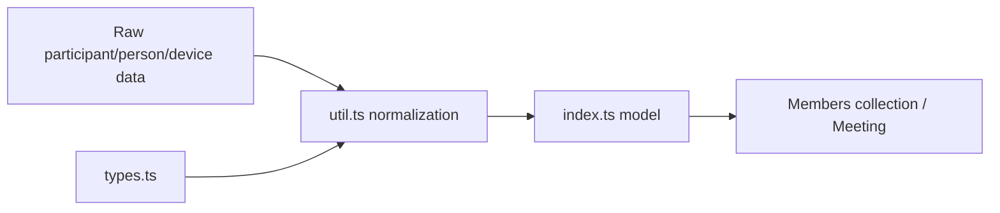
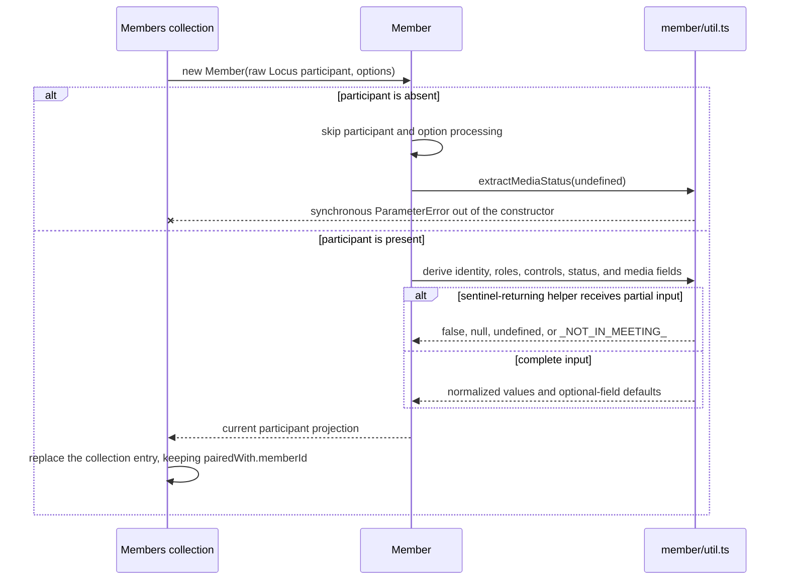
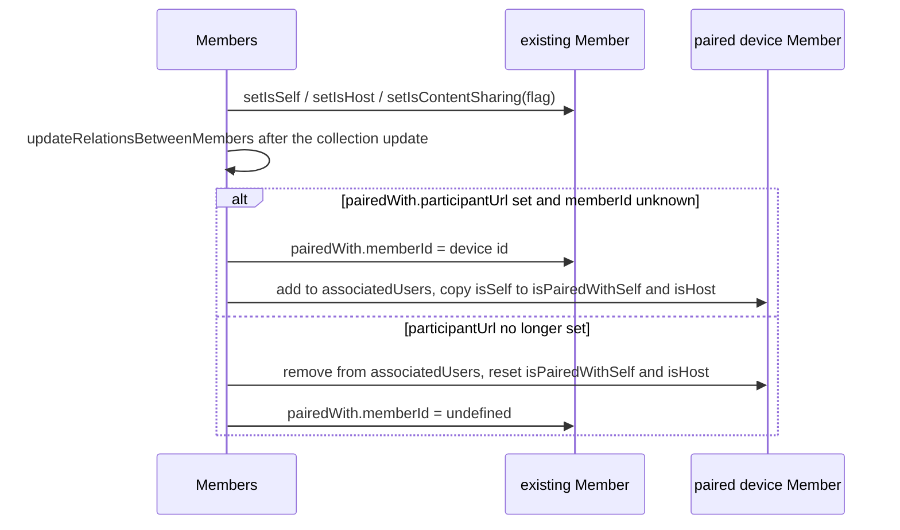
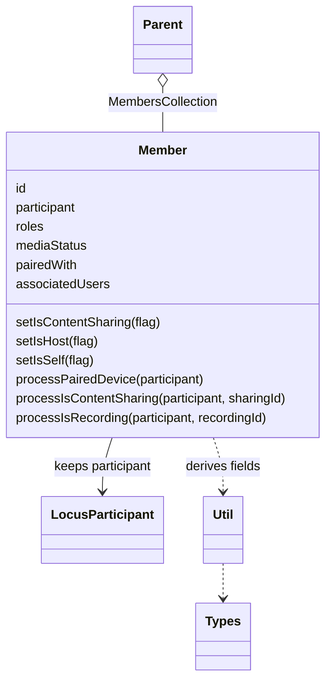

<!-- sdd-generated-metadata
doc_kind: module-spec
generated_from: module-spec@0.3.0
generated_by: claude-code
approved_by: rarajes2@cisco.com
updated_at: 2026-11-16T14:30:00Z
validation_status: not-run
-->

# Member

This source-local document at `src/member/docs/README.md` owns the stable specification for
**Member**, the client model of one Locus participant in a meeting roster. `Members` builds one
`Member` per participant and keeps it in its `membersCollection`; applications read the members through
`meeting.members`. Ground every claim in package evidence and link to the
[package architecture](../../../docs/architecture.md) instead of repeating broader facts. No service
specification exists because this package is a library. The roster collection, its requests, and its
events are specified in the [Members specification](../../members/docs/README.md).

Related context: [documentation index](../../../docs/index.md) ·
[package agent instructions](../../../AGENTS.md)

## Metadata

| Field | Value |
| ----- | ----- |
| Owner | @webex/web-client, @webex/web-sdk |
| Source path | `src/member` |
| Resource kind | module |
| Status | Draft |
| Last verified | 2026-11-16 at `0b8c34db7f` |
| Module id | `plugin-meetings/member` |
| Parent spec | — |
| Doc kind | Module spec |
| Coverage score | Pending coverage assessment |
| Validation status | not-run |

## Applicability

| Condition ID                         | Status     | Evidence or reason | Owned section |
| ------------------------------------ | ---------- | ------------------ | ------------- |
| `module.has_tiers`                   | N/A        | No tier policy exists in `package.json` or `.sdd/manifest.json` | Tier |
| `module.has_ui`                      | N/A        | `src/member/index.ts` is a data model with no rendering | UI use-case flow |
| `module.crosses_service_boundaries`  | N/A        | `src/member/index.ts` and `src/member/util.ts` make no request and handle no event; Locus traffic is owned by `src/members/index.ts` and `src/locus-info/index.ts` | Cross-boundary use-case flow |
| `module.holds_client_state`          | Applicable | Each Member holds the derived participant projection, the pairing fields, and the host, self, and content-sharing flags (`src/member/index.ts`) | Client state model |
| `module.enforces_domain_rules`       | Applicable | Status, mute, role, capability, removability, and mutability derivation rules in `src/member/util.ts` | Business rules and invariants |
| `module.is_concurrent_async`         | N/A        | Every function in `src/member/index.ts` and `src/member/util.ts` is synchronous; no promise, timer, or listener exists | Concurrency and reactive flow |
| `module.owns_persistence`            | N/A        | Members live in memory only, inside the collection of `src/members/collection.ts` | Data, schema, and migration discipline |
| `module.stateful_transitions`        | N/A        | A Member is rebuilt per update rather than transitioned; the lobby and meeting status is a derived value, not a state machine (`src/member/index.ts`) | State machine |
| `module.exposes_wire_protocol`       | N/A        | The participant shapes in `src/member/types.ts` describe Locus input that `src/locus-info/index.ts` receives; this module serializes nothing | Protocol and wire format |
| `module.ui_multi_screen`             | N/A        | No UI | UI flow |
| `module.large_data_model`            | N/A        | One model class; its fields are listed under Public surface and Client state model (`src/member/index.ts`) | Data model |
| `module.returns_caller_errors`       | N/A        | The only throws are synchronous ParameterError guards for an absent participant in `src/member/util.ts`; they are recorded under Requirements and Pitfalls and constraints | Caller-visible failure modes |
| `module.module_specific_conventions` | N/A        | No convention beyond the package rules in `AGENTS.md` | Module-specific rules |
| `module.published_package`           | N/A        | Member is not a named export of `src/index.ts`; the package contract is owned at package level in `package.json` | Export stability |
| `module.embedded_in_host`            | N/A        | No host theme or embed API | Host integration and theming |
| `module.has_design_tradeoff`         | N/A        | No recorded trade-off beyond replacement on update, which is described under Design overview (`src/members/index.ts`) | Key design trade-off |
| `module.has_submodules`              | N/A        | The src/member directory has no child module in `.sdd/manifest.json` | Sub-modules |

## Evidence register

Requirements cite current implementation and mirrored unit-test paths. Code wins when prose and code
conflict; commit and PR history are excluded as evidence by repository-owner decision. Missing test
evidence is stated as a gap rather than inferred.

| Evidence | What it establishes |
| -------- | ------------------- |
| `src/member/index.ts` | The Member class (default export) and the MemberId type: field defaults, the constructor order processParticipant, processParticipantOptions, processMember, and the public setIsContentSharing, setIsHost, setIsSelf, processPairedDevice, processIsContentSharing, and processIsRecording |
| `src/member/util.ts` | MemberUtil: every derivation helper, which ones throw ParameterError for an absent participant, and which return false, null, undefined, an empty array, or NOT_IN_MEETING |
| `src/member/types.ts` | Participant input shapes and the ServerRoles and MediaStatus enums; the comment that MediaStatus values are inherited from Locus and must not change, and that participant.moderator is deprecated by Locus in favor of role control |
| `src/members/index.ts` | The only constructor call site: update builds a new Member for every added or updated participant; constructMembers keeps only pairedWith.memberId; updateRelationsBetweenMembers fills pairing; locusSelfUpdate, locusHostUpdate, and locusMediaSharesUpdate call the setters; the comment that member ids must equal participant ids |
| `src/members/collection.ts` | MembersCollection stores Member objects by id |
| `src/meeting/index.ts` | Meeting reads isInMeeting, isInLobby, isSelf, isPairedWithSelf, and isAudioMuted of members |
| `src/aiEnableRequest/utils.ts` | getAIEnablementApprover picks a moderator, else the first cohost by id, whose canApproveAIEnablement is true |
| `src/common/errors/parameter.ts` | ParameterError extends Error with sdkMessage, error, and code |
| `README.md` | The application-facing Member property list, and the 0.109.0 note that participant email was removed to reduce PII |
| `test/unit/spec/member/index.js` | Constructor property presence and that processParticipant and processMember call the expected MemberUtil helpers |
| `test/unit/spec/member/util.js` | MemberUtil helper cases, including the ParameterError guards and the extractCsis cases |
| `test/unit/spec/members/index.js` | Pairing cases that assert pairedWith.participantUrl and pairedWith.memberId after a roster update |
| `src/member/util.ts` | Observation, no stated WHY: isRemovable is false for a guest, the self, or a CALL type, else true only in the meeting; isMutable is true only in the meeting, not muted, not CALL, and for the self or a device. Why these combinations is not stated in code or tests |
| `src/member/index.ts` | Observation, no stated WHY: isSelf, isHost, and isContentSharing are computed only for USER type participants, while isRecording is computed for every participant |
| `src/member/util.ts` | Observation, no stated WHY: the second branch of isNotAdmitted compares a negated status with IN_MEETING, which is always false, so only the waiting-guest-in-lobby branch can return true |
| `src/members/index.ts` | Observation, no stated WHY: Members passes a whiteboardSharingId option that the Member constructor never reads |

## Purpose and boundary

- Responsibility: builds the normalized client projection for one Locus participant, a `Member`,
  and holds the few flags that `Members` changes on it later.
- In scope: the `Member` fields and their derivation from a Locus `Participant` (`src/member/util.ts`);
  the participant input types and the role and media enums (`src/member/types.ts`); the in-place
  setters and processors `Members` calls.
- Out of scope: storing, adding, removing, and finding members, the roster events, and every request
  about a member ([Members specification](../../members/docs/README.md)); parsing Locus into
  participants ([LocusInfo specification](../../locus-info/docs/README.md)); the Locus service itself.
- Consumers: `src/members/index.ts` and `src/members/collection.ts` (construction and storage);
  `src/meeting/index.ts` and `src/aiEnableRequest/utils.ts` (read fields); applications through
  `meeting.members.membersCollection`.

## Structure and key files

`src/member` contains 3 direct source files (`index.ts`, `types.ts`, `util.ts`) plus this specification, and
has 2 mirrored unit-test files under `test/unit/spec/member`. Pairing behavior is also exercised by
the members suite, because only `Members` resolves it.

TypeScript in the Node 22.14 Yarn workspace; the module uses no Webex core or plugin abstraction
(`Member` is a plain class). Tests are Mocha with Sinon and `@webex/test-helper-chai`, run by
`test:unit` (`webex-legacy-tools test --unit --runner mocha` in `package.json`). Build target:
`yarn workspace @webex/plugin-meetings build:src`.

| File | Holds |
| ---- | ----- |
| `src/member/index.ts` | The module's primary export: the `Member` class and the `MemberId` type; field defaults, construction order, and the public setters and processors |
| `src/member/types.ts` | Module type declarations: the Locus `Participant` input shapes, `ServerRoles`, `MediaStatus`, `IExternalRoles`, and `IMediaStatus` |
| `src/member/util.ts` | `MemberUtil` normalization/helper functions that derive each field from a participant |
| `test/unit/spec/member/index.js`, `test/unit/spec/member/util.js` | Mirrored unit coverage: Member construction calls and the `MemberUtil` helper cases |
| `src/member/docs/README.md` | This module specification |

## Public surface

| Contract ID | Type | Surface | Purpose | Compatibility / deprecation | Schema / detail link | Root index |
|---|---|---|---|---|---|---|
| `member-model` | SDK model | `Member` construction from a `Participant` (`new Member(participant, options)`) and its fields: `id`, `name`, `participant`, `status`, `isInLobby`, `isInMeeting`, `isNotAdmitted`, mute, hand, brb, role, capability, assignment, device, guest, and pairing fields | Normalize participant person/device, roles, controls, status, media, and identifiers into the roster model. | Preserve the observable member fields consumed by `MembersCollection`, `Meeting`, and applications (the README Member property list); `associatedUser` is deprecated in favor of `associatedUsers`. | `src/member/index.ts`, `src/member/types.ts` | [architecture](../../../docs/architecture.md) |
| `member-model` | SDK mutation | `processPairedDevice()`, `setIsHost()`, and `setIsSelf()` | Record the paired-device participant URL, and set the host and self flags that `Members` decides from Locus context. | `processPairedDevice` sets only `pairedWith.participantUrl`; the setters assign the flag and never throw. | `src/member/index.ts`, `src/member/util.ts` | [architecture](../../../docs/architecture.md) |
| `member-model` | SDK mutation | `setIsContentSharing()`, `processIsContentSharing()`, and `processIsRecording()` | Project current share and recording state onto the member without owning their transport. | Preserve the boolean projection rules: content sharing only for USER participants, recording for every participant; synchronous updates. | `src/member/index.ts` | [architecture](../../../docs/architecture.md) |
| `member-model` | exported participant contracts | `MemberId`, `IExternalRoles`, `ServerRoles`, `ServerRoleShape`, `MediaStatus`, `IMediaStatus`, `Csi`, `Direction`, `ParticipantUrl`, `MediaSession`, `Intent`, `ParticipantDevice`, `ParticipantPerson`, `ParticipantMediaStatus`, `ParticipantControls`, and `Participant` | Share the exact participant input vocabulary used by Locus parsing and roster reconciliation. | Add fields compatibly; role, direction, and media raw values remain package contracts (`MediaStatus` values are inherited from Locus). | `src/member/types.ts`, `src/member/index.ts` | [architecture](../../../docs/architecture.md) |
| `member-model` | internal helpers | `MemberUtil` (default export of `src/member/util.ts`), including `extractCsis()` used by `Members` for CSI lookup | Derive every Member field from a participant. | Internal to the package; reached by `src/members/index.ts`, not by applications. | `src/member/util.ts` | [architecture](../../../docs/architecture.md) |

Compatibility notes:

- Prefer additive options and payload fields. Preserve property names, the synchronous
  throw-or-sentinel semantics, and the replacement-on-update timing. `Member` is not a named export of
  `src/index.ts`; route public changes through the owning `Members` collection.

Contract ID `member-model` is indexed in the
[package architecture](../../../docs/architecture.md) and registered in `.sdd/manifest.json`.

## Dependencies

Member requires Locus participant payloads, the member normalization utilities, and shared
constants; it calls no service.

| Dependency | Why it is required | Failure behavior |
| ---------- | ------------------ | ---------------- |
| `src/member/util.ts` (`MemberUtil`) | Every derived field | Helpers that guard an absent participant throw `ParameterError` |
| `src/constants.ts` | `MEETINGS` namespace, status values (`IN_LOBBY`, `IN_MEETING`, `NOT_IN_MEETING`), Locus states (`JOINED`, `IDLE`, `LEFT`), intents (`WAIT`, `OBSERVE`), participant types (`USER`, `RESOURCE_ROOM`), `CALL`, and media status keys | — |
| `src/common/errors/parameter.ts` | `ParameterError` for absent participants | — |
| Locus participant payload (from `src/locus-info/index.ts` through `src/members/index.ts`) | The input of every Member | Missing optional fragments yield null, false, or undefined fields |

## Requirements

| ID | WHAT | WHY | Source Evidence | Test / Example Evidence | Assumptions / Gaps | Confidence |
|---|---|---|---|---|---|---|
| `MEMBER-R-001` | `new Member(participant, options)` constructs a member from participant data: it keeps the raw Locus participant on `participant`, derives every participant field in `processParticipant`, applies the `selfId`, `hostId`, `contentSharingId`, `recordingId`, and `type` options in `processParticipantOptions`, then derives `isRemovable`, `isMutable`, and `mediaStatus` in `processMember`. A falsy participant skips the first two steps and the constructor throws `ParameterError` from `extractMediaStatus`. | Builds the normalized client projection for one Locus participant that `Members` stores; the README lists these fields as the application-facing Member surface. | `src/member/index.ts`, `src/member/util.ts`, `src/members/index.ts` | `test/unit/spec/member/index.js` | The constructor throw for a falsy participant has no test; `Members` never passes one | PRESENT |
| `MEMBER-R-002` | Identity, roles, controls-derived flags, status, and media properties are computed once, at construction. Locus updates are not applied in place: `Members` builds a new Member for every added or updated participant and replaces the collection entry, carrying over only `pairedWith.memberId`. | Roster consumers rely on stable synchronous participant projections even as Locus fields arrive incrementally; rebuilding from the latest participant keeps every derived field consistent with one payload. | `src/member/index.ts`, `src/member/util.ts`, `src/members/index.ts` | `test/unit/spec/member/index.js`, `test/unit/spec/members/index.js` | No case asserts that an update replaces the Member object; malformed paired-device and role inputs return undefined or false rather than throw, and no case covers them | PRESENT |
| `MEMBER-R-003` | Missing participant input has helper-specific synchronous outcomes: `canReclaimHost`, `isAudioMuted`, `isVideoMuted`, `isHandRaised`, `isBreakoutsSupported`, `isSupportsSingleUserAutoEndMeeting`, `isInterpretationSupported`, `isLiveAnnotationSupported`, `isRecording`, and `extractMediaStatus` throw `ParameterError`; `canApproveAIEnablement` and `isAttendeeAssignmentProhibited` return `false`; `extractId`, `extractName`, and `getRecordingMember` return `null`; `extractPairedWithParticipantUrl` returns `undefined` and `extractCsis` an empty array; `extractStatus` returns `_NOT_IN_MEETING_`; `isUser`, `isGuest`, `isDevice`, `isModerator`, and `isSame` return the falsy input itself; `isBrb` throws a `TypeError`. The module owns no asynchronous resource, listener, or timer. | Callers must preserve each helper's implemented sentinel or exception instead of treating all malformed or partial participant data as one failure contract. | `src/member/util.ts`, `src/member/index.ts` | `test/unit/spec/member/index.js`, `test/unit/spec/member/util.js` | The `isBrb` TypeError and the falsy-passthrough helpers have no absent-participant case | PRESENT |
| `MEMBER-R-004` | `id` is `participant.id` (`extractId`). | `Members` keys its collection by this id and removes members by the Locus `removedParticipantIds`; its code comment states it depends on member ids being participant ids. | `src/member/util.ts`, `src/members/index.ts` | `test/unit/spec/members/index.js` | None | PRESENT |
| `MEMBER-R-005` | `status` is `IN_MEETING` when the participant has devices and state `JOINED`; `IN_LOBBY` when state is `IDLE` and a device intent is `WAIT` or `OBSERVE`; otherwise, or without devices, `NOT_IN_MEETING`. `isInLobby` and `isInMeeting` follow from `status`. `isNotAdmitted` is computed last, from `isGuest` and `status`: true for a guest whose first device intent is `WAIT` while in the lobby. | `Meeting` counts members that are in the meeting or in the lobby and checks `isInMeeting` before transferring the host; the README promises that a not-admitted member also has `isInLobby` true. | `src/member/util.ts`, `src/member/index.ts`, `src/meeting/index.ts` | None found | `extractStatus` and `isNotAdmitted` have no unit case | PRESENT |
| `MEMBER-R-006` | `isAudioMuted` and `isVideoMuted` are true when the Locus control `controls.audio.muted` or `controls.video.muted` is true; else true when the participant's own status is `RECVONLY` and false when `SENDRECV`; else the control value itself (possibly `undefined`). `mediaStatus` is `{audio: status.audioStatus, video: status.videoStatus}`. | The code comments separate a remote mute (server control) from a local mute (the participant's media direction); `Meeting` reads `isAudioMuted` to find another unmuted member. | `src/member/util.ts`, `src/meeting/index.ts` | `test/unit/spec/member/util.js` | None | PRESENT |
| `MEMBER-R-007` | `roles` is `{cohost, moderator, presenter}`, each true when `controls.role.roles` holds an entry of that `ServerRoles` type with `hasRole` true; `isModerator` is the raw `participant.moderator`. | `src/member/types.ts` records that Locus deprecates `participant.moderator` in favor of role control; `getAIEnablementApprover` and the meeting utilities read the role entries. | `src/member/util.ts`, `src/member/types.ts`, `src/aiEnableRequest/utils.ts` | `test/unit/spec/member/util.js`, `test/unit/spec/member/index.js` | None | PRESENT |
| `MEMBER-R-008` | `processPairedDevice` sets `pairedWith.participantUrl` to the `associatedWith` of the last `OBSERVE` intent across `devices[].intents[]`, and leaves `pairedWith.memberId` undefined. | The code comment: the member for the paired device might not exist yet, so `Members` sets the member id only after the whole collection is updated. | `src/member/index.ts`, `src/member/util.ts`, `src/members/index.ts` | `test/unit/spec/members/index.js` | `extractPairedWithParticipantUrl` has no direct unit case | PRESENT |
| `MEMBER-R-009` | Capability and policy flags read Locus negative flags: `supportsBreakouts`, `supportsSingleUserAutoEndMeeting`, `supportsInterpretation`, `supportLiveAnnotation`, and `canApproveAIEnablement` are the negation of `doesNotSupportBreakouts`, `doesNotSupportSingleUserAutoEndMeeting`, `doesNotSupportSiInterpreter`, `annotatorAssignmentNotAllowed`, and `attendeeRequestAiAssistantNotAllowed`; `canReclaimHost` is `canReclaimHostRole` or false; `isAttendeeAssignmentProhibited` is coerced to a boolean, while `isModeratorAssignmentProhibited` and `isPresenterAssignmentProhibited` are the raw values. | An absent negative flag must read as allowed (the unit cases assert true for an undefined flag); `getAIEnablementApprover` chooses the approver from `canApproveAIEnablement`. | `src/member/util.ts`, `src/aiEnableRequest/utils.ts` | `test/unit/spec/member/util.js`, `test/unit/spec/member/index.js` | WHY of the negative-flag reading is inferred from the field names and tests | Weak |
| `MEMBER-R-010` | `isSelf`, `isHost`, `isContentSharing`, and `isRecording` compare the `selfId`, `hostId`, `contentSharingId`, and `recordingId` options with `participant.id` or `participant.person.id` (`isSame`). | The `isSame` JSDoc: there are multiple ids that can be used for a participant. | `src/member/util.ts`, `src/member/index.ts` | None found | `isSame` has no unit case | PRESENT |
| `MEMBER-R-011` | `setIsSelf`, `setIsHost`, and `setIsContentSharing` assign the flag on an existing Member; `Members` calls them from its self, host, and media-share updates, and its relation pass writes `associatedUsers`, `associatedUser`, `isPairedWithSelf`, `isHost`, and `pairedWith.memberId` directly. | Self, host, and share changes arrive as Locus updates separate from participant updates, so `Members` changes those flags without rebuilding the member. | `src/member/index.ts`, `src/members/index.ts` | `test/unit/spec/members/index.js` | None | PRESENT |

## Design overview

`Member` is a local participant model. `util.ts` synchronously normalizes Locus participant/person/device fields into the model and `types.ts` defines shapes; the module performs no request or event transport.

The constructor fixes every field to a default (`null` for most flags, `false` for `canReclaimHost`,
`isBrb`, and `isPairedWithSelf`, an empty `associatedUsers` set) and then runs three steps whose order
matters: participant fields first, then the option-based flags, then `isRemovable`, `isMutable`, and
`mediaStatus`, which read the earlier results (code comments "must be done last" and "must occur
after"). Ownership of change is split: the participant-derived fields belong to construction, and
`Members` replaces the whole object on every Locus participant update; the host, self, content-sharing,
and pairing fields are the only ones `Members` changes in place, because they depend on context or on
other members.

## Data flow and sequence coverage

Call style: synchronous in-process calls. `Members` constructs a Member from a Locus participant it
received through `Meeting` and `LocusInfo`; the Member calls `MemberUtil` helpers. No transport is
involved.

| Operation group | Diagram | Failure coverage |
|---|---|---|
| UC-1…UC-2 — member projection construction and replacement operation group | Member projection primary sequence | malformed participant input throws synchronously; synchronous projection replacement on every update without transport or cleanup |
| UC-1…UC-2 — member projection alternate/failure paths | Member projection primary sequence, alt branches | absent participant (ParameterError), partial/malformed participant data, or absent optional person/device fields |
| UC-2…UC-3 — in-place host, self, content, and pairing updates | Member in-place flag update sequence | no failure path: the setters assign the flag; pairing is cleared when the participant URL disappears |

Member projection primary sequence:

Member in-place flag update sequence:

## Class and component relationships

The arrows identify ownership and delegation inside `src/member/`; files that only declare types or constants are not presented as transports.
`Parent` is `MembersCollection` in `src/members/collection.ts`, owned by `Members`.

## Use cases and flows

| Use case | Actor or caller | Primary steps and outcome | Failure or boundary behavior | Evidence |
| -------- | --------------- | ------------------------- | ---------------------------- | -------- |
| `UC-1` | `Members` on a Locus participant update | Normalize a `Participant` with person, device, role, controls, status, and media data into one local `Member` projection, built anew for each update | A falsy participant throws `ParameterError`; missing optional fragments give null, false, or undefined fields | `src/member/index.ts`, `src/members/index.ts` |
| `UC-2` | `Members` when Locus self, host, or pairing context changes | Recompute host/self/paired-device flags: new Members compare `selfId` and `hostId`; existing ones get `setIsSelf` and `setIsHost`; pairing is resolved after the collection update | Each helper keeps its synchronous `ParameterError`, `false`, `null`, or `_NOT_IN_MEETING_` outcome for absent/partial input | `src/member/index.ts`, `src/member/util.ts`, `src/members/index.ts` |
| `UC-3` | `Members` on a media-share or recording change | Update content-sharing and recording projections without performing I/O; roster requests and update events remain owned by `src/members/` | Content sharing is set only for USER participants at construction | `src/member/index.ts`, `src/members/index.ts` |

<!-- Include if: the module holds client-side state. [condition-id: module.holds_client_state] -->

## Client state model

One in-memory participant projection is held per Member. It is not updated in place as Locus data
changes: each participant update builds a new Member that replaces the old one; only the flags below
marked as set by `Members` change in place.

| State or slice | Owner      | Initial state | Transition triggers | Reset or persistence boundary |
| -------------- | ---------- | ------------- | ------------------- | ----------------------------- |
| Participant-derived fields (`id`, `name`, mute, hand, brb, roles, capability and assignment flags, `status`, `isInLobby`, `isInMeeting`, `isNotAdmitted`, `isRemovable`, `isMutable`, `mediaStatus`) | Member | Defaults, then derived in the constructor | None after construction | Replaced with the whole Member on the next participant update; dropped when the participant is removed |
| `isSelf`, `isHost`, `isContentSharing`, `isRecording` | Member, set by `Members` | `null`, then derived from options for the participant | `setIsSelf`, `setIsHost`, `setIsContentSharing` from the self, host, and media-share updates | Recomputed from options on the next rebuild |
| `pairedWith` (`participantUrl`, `memberId`) | Member, `memberId` set by `Members` | Both undefined, then `participantUrl` from the OBSERVE intent | `updateRelationsBetweenMembers` | `memberId` is carried over on rebuild and cleared when `participantUrl` is gone |
| `associatedUsers`, `associatedUser`, `isPairedWithSelf` (device side) | Member, set by `Members` | Empty set, `null`, `false` | `updateRelationsBetweenMembers` | Reset when the paired user's participant URL disappears; a rebuilt device starts empty again |

<!-- Include if: the module enforces domain rules or entity invariants. [condition-id: module.enforces_domain_rules] -->

## Business rules and invariants

| ID | Invariant | WHY | Enforcement source | Test evidence |
| -- | --------- | --- | ------------------ | ------------- |
| `INV-001` | Participant identity and role/media/control fields derive from the newest participant payload each time a Member is built; removed PII such as participant email is not reintroduced: neither `ParticipantPerson` nor `Member` has an email field. | The README 0.109.0 note: participant email was removed to reduce PII, and callers look up details by participant identity. | `src/member/types.ts`, `src/member/index.ts` | None found |
| `INV-002` | `isInLobby` and `isInMeeting` are never both true; both follow only from `status`. | A member is in exactly one of lobby, meeting, or neither, and `Meeting` counts them by these flags. | `src/member/index.ts` | None found |
| `INV-003` | The module performs no request, emits no event, and holds no listener or timer. | Roster requests and events are owned by `Members`, so a Member can be rebuilt freely. | `src/member/index.ts`, `src/member/util.ts` | `test/unit/spec/member/index.js` |

## Pitfalls and constraints

- A participant can expose identity, person, device, and media fragments at different times; treat missing optional fragments as incomplete state, not deletion.
- Public behavior may be reachable through a parent `Meeting`/`Meetings` object even when the source helper is not exported directly.
- A reference held to a Member goes stale after the next participant update, because `Members`
  replaces the object (`src/members/index.ts`).
- `isUser`, `isGuest`, `isDevice`, `isModerator`, `isSame`, and the moderator and presenter assignment
  flags can return `undefined` or `null` instead of a boolean (`src/member/util.ts`).
- The second branch of `isNotAdmitted` is always false; only a waiting guest in the lobby is not
  admitted (`src/member/util.ts`).
- Constructing a Member without a participant throws; `isBrb` on an absent participant throws a
  `TypeError`, not `ParameterError` (`src/member/util.ts`).
- `src/members/types.ts` declares a second `ServerRoles` enum with the same values; the member one is
  the one `src/meeting/util.ts` imports.

## Verification

Use the current mirrored suites: `test/unit/spec/member/index.js` and `test/unit/spec/member/util.js`,
which import `src/member` through the package path. Pairing is covered only by
`test/unit/spec/members/index.js`. Characterize the member-specific use cases above and each listed
synchronous outcome; the module owns no cleanup or async resource to test.

| Behavior / Requirement | Existing test evidence | Gap |
|---|---|---|
| `MEMBER-R-001` | `test/unit/spec/member/index.js` | cover participant construction field values and the constructor throw for a falsy participant |
| `MEMBER-R-002` | `test/unit/spec/member/index.js`, `test/unit/spec/members/index.js` | no case asserts replacement of the Member on update; malformed paired-device and role inputs have no case |
| `MEMBER-R-003` | `test/unit/spec/member/index.js`, `test/unit/spec/member/util.js` | assert the per-helper matrix: the `ParameterError` guards are covered except `isRecording`; `canApproveAIEnablement` false is covered; the `null`, falsy-passthrough, and `isBrb` TypeError outcomes for an absent participant are not |
| `MEMBER-R-004` | `test/unit/spec/members/index.js` | none |
| `MEMBER-R-005` | none found | `extractStatus`, `processStatus`, and `isNotAdmitted` have no unit case |
| `MEMBER-R-006` | `test/unit/spec/member/util.js` | none |
| `MEMBER-R-007` | `test/unit/spec/member/util.js`, `test/unit/spec/member/index.js` | none |
| `MEMBER-R-008` | `test/unit/spec/members/index.js` | no direct case for `extractPairedWithParticipantUrl` |
| `MEMBER-R-009` | `test/unit/spec/member/util.js`, `test/unit/spec/member/index.js` | none |
| `MEMBER-R-010` | none found | `isSame` and the USER-only gating have no unit case |
| `MEMBER-R-011` | `test/unit/spec/members/index.js` | the setters themselves have no direct case |

A module specification is complete only when its public surface, invariants, failure modes, and test
evidence agree with the implementation.
