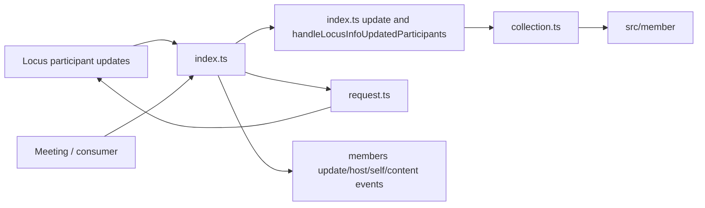
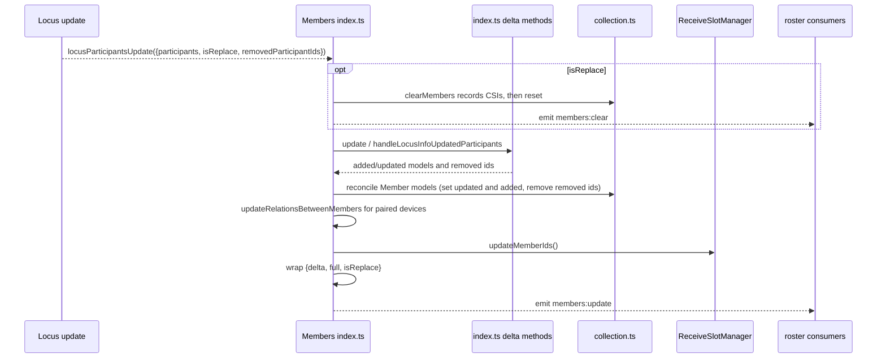
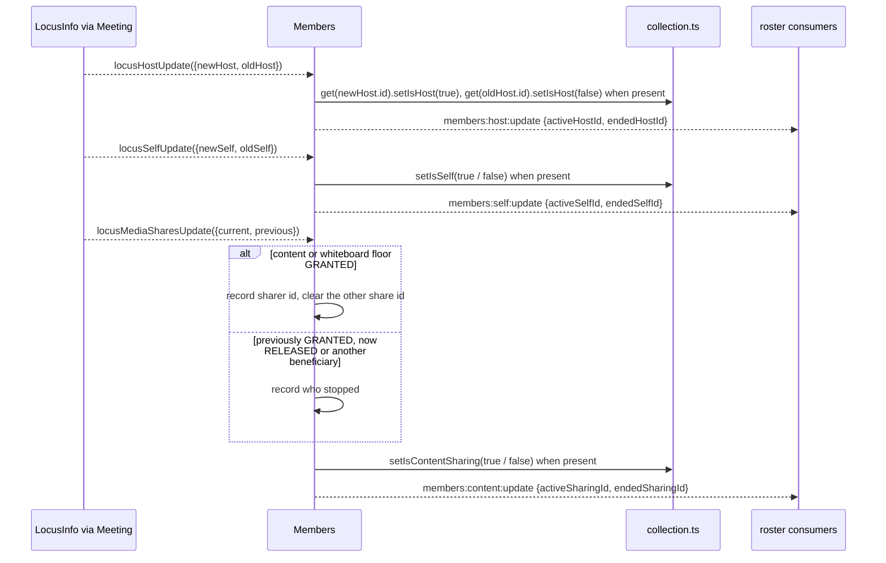
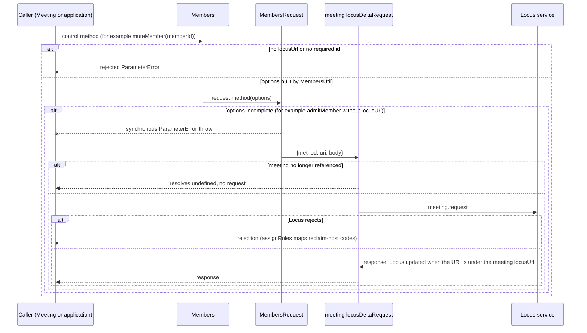
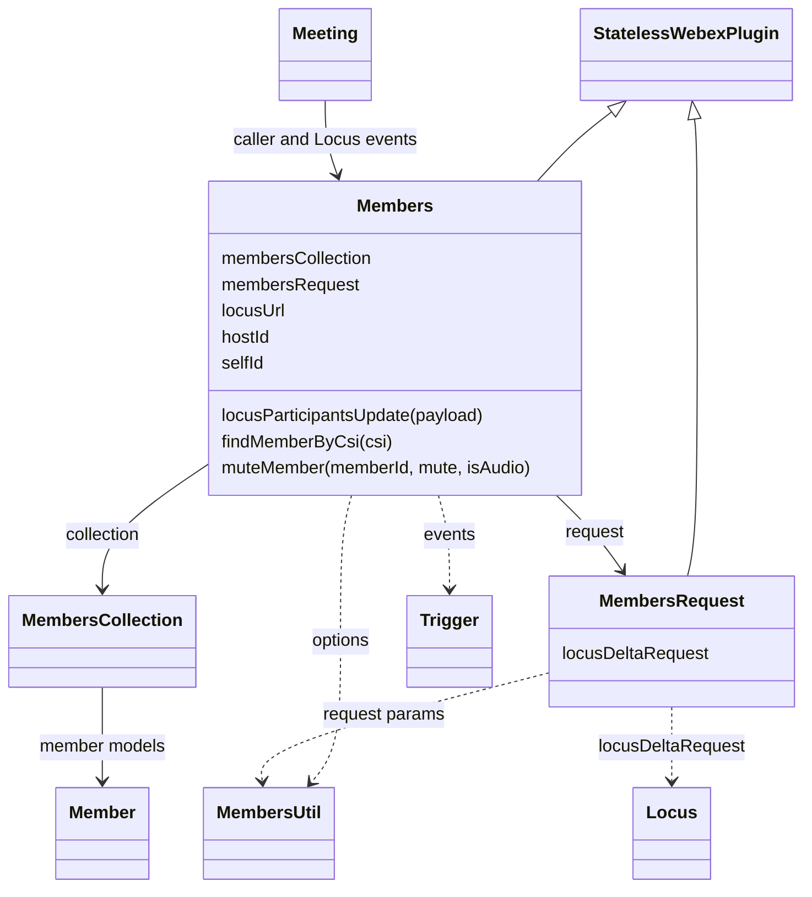

<!-- sdd-generated-metadata
doc_kind: module-spec
generated_from: module-spec@0.3.0
generated_by: claude-code
approved_by: rarajes2@cisco.com
updated_at: 2026-11-16T14:30:00Z
validation_status: not-run
-->

# Members

This source-local document at `src/members/docs/README.md` owns the stable specification for
**Members**, the roster of one meeting. `Meeting` creates one `Members` instance and exposes it as
`meeting.members`. It keeps a `MembersCollection` of `Member` models reconciled from `LocusInfo`
participant, host, self, media-share, URL, and full-state callbacks, emits the `members:*` events,
and sends participant-control requests (invite, admit, remove, mute, roles, lobby, hands, host
transfer, DTMF, display name) to Locus through the meeting's Locus delta request. Ground every claim
in package evidence and link to the [package architecture](../../../docs/architecture.md) instead of
repeating broader facts. No service specification exists because the package is a library.

Related context: [documentation index](../../../docs/index.md) ·
[package agent instructions](../../../AGENTS.md) ·
[member model specification](../../member/docs/README.md) ·
[Locus info specification](../../locus-info/docs/README.md) ·
[meeting specification](../../meeting/docs/README.md)

## Metadata

| Field             | Value |
| ----------------- | ----- |
| Owner             | @webex/web-client, @webex/web-sdk |
| Source path       | `src/members` |
| Resource kind     | module |
| Status            | Draft |
| Last verified     | 2026-11-16 at `0b8c34db7f` |
| Module id         | `plugin-meetings/members` |
| Parent spec       | — |
| Doc kind          | Module spec |
| Coverage score    | Pending coverage assessment |
| Validation status | not-run |

## Applicability

| Condition ID                         | Status     | Evidence or reason | Owned section |
| ------------------------------------ | ---------- | ------------------ | ------------- |
| `module.has_tiers`                   | N/A        | No tier policy exists in `package.json` or `.sdd/manifest.json` | Tier |
| `module.has_ui`                      | N/A        | `src/members/index.ts` holds models and returns promises; it renders nothing | UI use-case flow |
| `module.crosses_service_boundaries`  | Applicable | Every participant control in `src/members/index.ts` is sent to the Locus service by `src/members/request.ts` through the meeting's Locus delta request in `src/meeting/util.ts` | Cross-boundary use-case flow |
| `module.holds_client_state`          | Applicable | `src/members/index.ts` keeps the locus URL, host, self, type, share, and recording ids and a CSI history map; `src/members/collection.ts` keeps the Member models | Client state model |
| `module.enforces_domain_rules`       | Applicable | One Member per participant id, hidden-roster filtering, paired-device relations, and per-method argument guards in `src/members/index.ts` | Business rules and invariants |
| `module.is_concurrent_async`         | Applicable | Locus callbacks arrive as events from `src/meeting/index.ts`; every control method returns a promise (`src/members/index.ts`) | Concurrency and reactive flow |
| `module.owns_persistence`            | N/A        | Nothing is stored; `src/members/collection.ts` is in memory only | Data, schema, and migration discipline |
| `module.stateful_transitions`        | N/A        | `src/members/index.ts` replaces fields per callback; there is no state machine with guards | State machine |
| `module.exposes_wire_protocol`       | N/A        | Request bodies are built in `src/members/util.ts` for the Locus service, which owns the protocol; callers of this module see only method arguments and events. Bodies are listed under Cross-boundary use-case flow | Protocol and wire format |
| `module.ui_multi_screen`             | N/A        | No UI | UI flow |
| `module.large_data_model`            | N/A        | The member model is owned by `src/member/index.ts`; `src/members/types.ts` declares only role-assignment shapes | Data model |
| `module.returns_caller_errors`       | Applicable | Control methods reject with ParameterError, plain Error, or the reclaim-host errors of `src/common/errors/reclaim-host-role-errors.ts`; setters throw synchronously (`src/members/index.ts`) | Caller-visible failure modes |
| `module.module_specific_conventions` | N/A        | The module follows the package-wide request-class and Trigger patterns of `src/common/events/trigger-proxy.ts` | Module-specific rules |
| `module.published_package`           | N/A        | `src/index.ts` does not export Members; consumers reach it as meeting.members, and package exports are owned by the package architecture | Export stability |
| `module.embedded_in_host`            | N/A        | No host theme or embed API | Host integration and theming |
| `module.has_design_tradeoff`         | N/A        | No recorded design trade-off; see Pitfalls and constraints for behavior to preserve | Key design trade-off |
| `module.has_submodules`              | N/A        | The `src/members/collection.ts` sibling files are one module with no child module | Sub-modules |

## Evidence register

Requirements cite current implementation and mirrored unit-test paths. Current code wins over
prose when they conflict; commit and PR history are excluded as evidence by repository-owner
decision. Missing test evidence is stated as a gap rather than inferred.

| Evidence | What it establishes |
| -------- | ------------------- |
| `src/members/index.ts` | Members extends StatelessWebexPlugin in namespace Meetings; its constructor, the locus* callbacks, the context setters, roster reconciliation, CSI lookup, every participant-control method, and the event triggers |
| `src/members/collection.ts` | MembersCollection, a plain object map keyed by member id with set, setAll, get, getAll, remove, and reset |
| `src/members/request.ts` | MembersRequest: one method per Locus request, each guarding its options and throwing ParameterError synchronously before calling locusDeltaRequest |
| `src/members/util.ts` | Members requests use PUT, PATCH, and POST only; an invitee phone number must match `DIALER_REGEX.E164_FORMAT` (`DIALER_REGEX.INTERNAL_NUMBER` when `isInternalNumber`), and an email or SIP address must match `VALID_EMAIL_ADDRESS` or `DIALER_REGEX.SIP_ADDRESS` |
| `src/members/types.ts` | ServerRoles (COHOST, MODERATOR, PRESENTER), ServerRoleShape, RoleAssignmentOptions, RoleAssignmentBody, RoleAssignmentRequest |
| `src/constants.ts` | The members:* event literals, CONTROLS, PARTICIPANT, LEAVE, ALIAS, sendDtmf, FORCED, REMOVE, FLOOR_ACTION, and the ASSIGN_ROLES_ERROR_CODES values |
| `src/meeting/index.ts` | Meeting constructs Members with locusUrl, receiveSlotManager, mediaRequestManagers, and itself; it wires the LocusInfo events to the locus* callbacks and forwards its participant-control methods to meeting.members |
| `src/meeting/util.ts` | generateLocusDeltaRequest holds the meeting through a WeakRef, resolves undefined when the meeting is gone, and applies the API response to Locus only when the request URI starts with the meeting's locusUrl |
| `src/common/errors/reclaim-host-role-errors.ts` | The four reclaim-host error classes that assignRoles maps Locus error codes to |
| `test/unit/spec/members/index.js` | Constructor, addMember, admitMembers, muteMember, transferHostToMember, clearMembers, locusParticipantsUpdate (event payload, removal, paired devices), sendDialPadKey, cancel invites, assignRoles error mapping, hands, editDisplayName, findMemberByCsi and CSI history, getCsisForMember, moveToLobby |
| `test/unit/spec/members/request.js` | The method, URI, and body sent through locusDeltaRequest for every MembersRequest method, and the lowerAllHandsMember guards |
| `test/unit/spec/members/utils.js` | Option and request builders in MembersUtil |
| `test/unit/spec/members/collection.js` | MembersCollection set, remove, reset, setAll, get, getAll |
| `test/unit/spec/meeting/index.js` | Meeting-level cases that observe members:content:update emitted from locusMediaSharesUpdate |
| Observation, no stated WHY (`src/members/index.ts`) | update skips any participant whose hideInRoster is truthy, so it is neither added nor updated; the code gives no reason |
| Observation, no stated WHY (`src/members/request.ts`) | addMembers throws only when emailAddress, email, phoneNumber, and locusUrl are all present, because its guard is negated; with ordinary input it never throws |
| Observation, no stated WHY (`src/members/index.ts`) | locusMediaSharesUpdate emits members:content:update with activeSharingId and endedSharingId, while the JSDoc above the class names activeContentSharingId and endedContentSharingId |

## Purpose and boundary

- Responsibility: owns the meeting roster collection, reconciles participant updates, performs
  participant mutations, and emits member events for one meeting.
- In scope: the `MembersCollection`; the context ids (locus URL, host, self, meeting type, content
  and whiteboard sharer, recording id); roster reconciliation from Locus participants including
  removals, replacement, and paired-device relations; the CSI history used by `findMemberByCsi`;
  the `members:*` events; the participant-control requests and their argument guards.
- Out of scope: what a `Member` derives from one participant (owned by
  [the member model](../../member/docs/README.md)); Locus parsing and which callback fires (owned by
  [Locus info](../../locus-info/docs/README.md)); the HTTP request, Locus delta application, and the
  meeting-level wrappers (owned by [the meeting](../../meeting/docs/README.md)); what Locus allows each
  participant to do.
- Consumers: `Meeting` (`src/meeting/index.ts`), which creates the instance, feeds it, forwards its
  control methods, and resolves CSIs through `findMemberByCsi`; the multistream `ReceiveSlotManager`
  through `updateMemberIds`; applications through `meeting.members` and the `members:*` events.

## Structure and key files

`src/members` contains five direct source files, one file per responsibility, and has four mirrored unit-test files under
`test/unit/spec/members`. The module is TypeScript in the Node 22.14 Yarn workspace, built on the
Webex core `StatelessWebexPlugin` abstraction; its tests use Mocha, Sinon, and
`@webex/test-helper-chai`, run by `yarn workspace @webex/plugin-meetings test:unit`
(`webex-legacy-tools test --unit --runner mocha`). Build target:
`yarn workspace @webex/plugin-meetings build:src`.

| File | Holds |
| ---- | ----- |
| `src/members/collection.ts` | module-owned collection: `MembersCollection`, the in-memory map of member id to `Member` |
| `src/members/index.ts` | module facade and default export: the `Members` class, its Locus callbacks, reconciliation, CSI queries, control methods, and event triggers |
| `src/members/request.ts` | HTTP request boundary: `MembersRequest`, which validates options and sends each request through the meeting's `locusDeltaRequest` |
| `src/members/types.ts` | module type declarations: `ServerRoles` and the role-assignment shapes |
| `src/members/util.ts` | option and request builders: `MembersUtil` invitee validation and the method, URI, and body of each request |
| `test/unit/spec/members/collection.js` and 3 sibling test files (`index.js`, `request.js`, `utils.js`) | mirrored unit coverage of the collection, the facade, the request class, and the builders |
| `src/members/docs/README.md` | this module specification |

## Public surface

| Contract ID | Type | Surface | Purpose | Compatibility / deprecation | Schema / detail link | Root index |
|---|---|---|---|---|---|---|
| `members-api` | SDK collection | `MembersCollection.set()`, `setAll()`, `get()`, `getAll()`, `remove()`, and `reset()` | Store member models by member id and support roster replacement/reset. | Preserve collection keying; `getAll()` returns the live map object, and `reset()` / `setAll()` replace it. | `src/members/collection.ts` | [architecture](../../../docs/architecture.md) |
| `members-api` | SDK / Locus input | `locusSelfUpdate()`, `locusHostUpdate()`, `locusParticipantsUpdate()`, `locusMediaSharesUpdate()`, `locusUrlUpdate()`, `locusFullStateTypeUpdate()`, `setLocusUrl()`, `setHostId()`, `setType()`, `setSelfId()`, `setMediaShareContentId()`, `setMediaShareWhiteboardId()`, and `clearMembers()` | Reconcile authoritative Locus roster/context into the current collection. | Preserve one `MEMBERS_UPDATE` emission per participants update with `{delta, full, isReplace}`; the nested delta carries added/updated models and removed ids. | `src/members/index.ts` | [architecture](../../../docs/architecture.md) |
| `members-api` | SDK / model mutation | `addMember()` and participant reconciliation (`update()`, `constructMembers()`, `removeMembers()`, `updateRelationsBetweenMembers()`) | `addMember()` invites a guest by email, SIP address, or phone number; reconciliation creates new `Member` projections for added and updated participants and computes the ids reported in the roster update payload. | Preserve member id keying, the kept `pairedWith.memberId`, and local comparison behavior; updated participants are new `Member` objects. | `src/members/index.ts`, `src/member/index.ts` | [architecture](../../../docs/architecture.md) |
| `members-api` | SDK / remote | `cancelPhoneInvite()`, `cancelInviteByMemberId()`, `admitMembers()`, `removeMember()`, and `muteMember()` | Execute invitation/lobby/removal/mute operations against current Locus/member URLs. | Preserve request inputs and each method's actual caller-visible failure boundary: returned rejections are common, while `admitMembers()` can surface a synchronous `MembersRequest.admitMember()` validation throw. No blanket local capability pre-check exists for any operation. | `src/members/index.ts`, `src/members/request.ts` | [architecture](../../../docs/architecture.md) |
| `members-api` | SDK / remote | `assignRoles()`, `moveToLobby()`, `raiseOrLowerHand()`, `lowerAllHands()`, and `transferHostToMember()` | Mutate participant roles, lobby placement, hand state, or host assignment. | Preserve role/action body shapes, the reclaim-host error mapping of `assignRoles()`, the breakout `authorizingLocusUrl`, and current per-method validation. | `src/members/index.ts`, `src/members/request.ts` | [architecture](../../../docs/architecture.md) |
| `members-api` | SDK / remote | `sendDialPadKey()` and `editDisplayName()` | Send member-scoped DTMF to the member's SIP device or display-name changes through the request adapter. | Preserve target member/device/session context and caller-visible request errors. | `src/members/index.ts`, `src/members/request.ts` | [architecture](../../../docs/architecture.md) |
| `members-api` | SDK / query | `findMemberByCsi()` and `getCsisForMember()` | Resolve media CSI/member relationships from the current roster projection and the CSI history. | Preserve `undefined` and empty-array outcomes for unresolved mappings. | `src/members/index.ts` | [architecture](../../../docs/architecture.md) |
| `members-api` (outbound: `locus-http`) | request/types | `MembersRequest.addMembers()`, `admitMember()`, `removeMember()`, `muteMember()`, `assignRolesMember()`, `moveToLobbyMember()`, `raiseOrLowerHandMember()`, `lowerAllHandsMember()`, `editDisplayNameMember()`, `transferHostToMember()`, `sendDialPadKey()`, `cancelPhoneInvite()`, and `cancelInviteByMemberId()` plus `ServerRoles`, `ServerRoleShape`, `RoleAssignmentOptions`, `RoleAssignmentBody`, and `RoleAssignmentRequest` | Provide the direct HTTP boundary and exact role-assignment vocabulary used by the facade. | Request helpers do not own roster mutation; role raw values are compatibility-sensitive. | `src/members/request.ts`, `src/members/types.ts` | [architecture](../../../docs/architecture.md) |

Contract ID `members-api` is indexed in the
[package architecture](../../../docs/architecture.md) and registered in `.sdd/manifest.json`; this
module requires `member-model` and `locus-http`.

Compatibility notes:

- Prefer additive options and payload fields. Preserve method/event names, rejection semantics, and
  cleanup timing; route public changes through the owning `Meeting` object, because `src/index.ts`
  does not export `Members` and applications reach it as `meeting.members`.

### Emitted events

Current source emits or forwards these observable literals for this operation boundary. Preserve literal values, scope, payload shape, and emission timing; a constant name alone is not a substitute for the consumer-visible value.

| Event literal | Constant / expression | Emission evidence |
|---|---|---|
| `members:clear` | `EVENT_TRIGGERS.MEMBERS_CLEAR` | `src/members/index.ts` |
| `members:content:update` | `EVENT_TRIGGERS.MEMBERS_CONTENT_UPDATE` | `src/members/index.ts` |
| `members:host:update` | `EVENT_TRIGGERS.MEMBERS_HOST_UPDATE` | `src/members/index.ts` |
| `members:self:update` | `EVENT_TRIGGERS.MEMBERS_SELF_UPDATE` | `src/members/index.ts` |
| `members:update` | `EVENT_TRIGGERS.MEMBERS_UPDATE` | `src/members/index.ts` |

Payloads, all emitted through `Trigger.trigger` on the `Members` instance with `file: 'members'`:
`members:update` carries `{delta: {added, updated, removedIds}, full, isReplace}`;
`members:clear` carries `{}`; `members:host:update` carries `{activeHostId, endedHostId}`;
`members:self:update` carries `{activeSelfId, endedSelfId}`; `members:content:update` carries
`{activeSharingId, endedSharingId}`.

## Dependencies

Locus participant updates, Member models, meeting/Locus URLs, the request helper, event utilities,
and the multistream receive-slot manager; role and capability state is decided by Locus, not here.

| Dependency | Why it is required | Failure behavior |
| ---------- | ------------------ | ---------------- |
| `Meeting` and `LocusInfo` (`src/meeting/index.ts`) | Construct Members and call `locusParticipantsUpdate`, `locusHostUpdate`, `locusSelfUpdate`, `locusMediaSharesUpdate`, `locusUrlUpdate`, and `locusFullStateTypeUpdate` from LocusInfo events | A missing `participants` array is logged as a warning and treated as no change |
| `Member` and `MemberUtil` (`src/member`) | Build one model per participant and extract CSIs for the history map | Owned by the member module |
| `MeetingUtil.generateLocusDeltaRequest` (`src/meeting/util.ts`) | Sends every request through `meeting.request` and applies the Locus response | Resolves `undefined` without a request when the meeting was garbage-collected; request rejections propagate to the caller |
| `Trigger` (`src/common/events/trigger-proxy.ts`) | Emits the `members:*` events on the instance | — |
| `ParameterError`, reclaim-host errors (`src/common/errors`) | Typed rejections for invalid arguments and for the assign-roles error codes | — |
| `ReceiveSlotManager` (`src/multistream/receiveSlotManager.ts`) | `updateMemberIds()` after each participants update so receive slots re-resolve their member | Optional; skipped when absent |
| `LoggerProxy` (`src/common/logs/logger-proxy.ts`) | Warning for a missing participants payload | — |
| `lodash` (`get`, `set`, `isEmpty`, `isEqual`, `has`), `uuid` | Keeping `pairedWith.memberId`, the empty-id check, the device-change check, optional body fields, and the DTMF correlation id | — |
| Locus service (external) | Applies every participant control and is the source of roster truth | Errors propagate as rejections, mapped for assign-roles |

## Requirements

| ID | WHAT | WHY | Source Evidence | Test / Example Evidence | Assumptions / Gaps | Confidence |
|---|---|---|---|---|---|---|
| `MEMBERS-R-001` | `Meeting` constructs one `Members` with `{locusUrl, receiveSlotManager, mediaRequestManagers, meeting}`; it creates a `MembersRequest` bound to that meeting and an empty `MembersCollection`, then initializes and reconciles the members collection from `LocusInfo` callbacks. | Owns the meeting roster collection, reconciles participant updates, performs participant mutations, and emits member events for exactly one meeting. | `src/members/index.ts`, `src/meeting/index.ts` | `test/unit/spec/members/index.js` | none | PRESENT |
| `MEMBERS-R-002` | admit/remove/mute/assign-role/transfer-host and related participant controls build options with `MembersUtil` and send them through `MembersRequest` to Locus participant or controls URLs under the current `locusUrl`; none edits the collection. | Participant controls target distinct URLs/bodies, while roster state changes only from authoritative Locus updates. | `src/members/index.ts`, `src/members/request.ts`, `src/members/util.ts` | `test/unit/spec/members/index.js`, `test/unit/spec/members/request.js` | mixed add/update/remove reconciliation needs one-payload assertions | PRESENT |
| `MEMBERS-R-003` | Server failures reject their caller, while validation may either return a rejected promise or throw synchronously at the request-helper boundary; malformed roster updates follow existing diff rules, and `clearMembers()` records current CSIs in the history map, resets the collection, and emits `members:clear`. | Callers must handle the actual synchronous-versus-promise boundary, while roster consumers need one authoritative update payload and a deterministic local reset. | `src/members/index.ts`, `src/members/request.ts` | `test/unit/spec/members/index.js`, `test/unit/spec/members/request.js` | none | PRESENT |
| `MEMBERS-R-004` | Roster reconciliation keeps one Member per participant id and emits `{delta, full, isReplace}`; `delta` is `{added, updated, removedIds}` with new `Member` models for added and updated participants, `full` is the current collection map, and `isReplace` first clears the collection. Only `pairedWith.memberId` is carried from the old model. | One entry per id and the exact wrapper shape let consumers distinguish incremental versus replacement updates without inventing top-level changed/removed fields; the TODO in `update()` records that comparing old and new members was deferred as premature optimization. | `src/members/index.ts`, `src/members/collection.ts` | `test/unit/spec/members/index.js`, `test/unit/spec/members/collection.js` | consumers must not rely on object identity across updates | PRESENT |
| `MEMBERS-R-005` | Host, self, and active-content changes emit their dedicated member events with active/ended ids: `{activeHostId, endedHostId}`, `{activeSelfId, endedSelfId}`, and `{activeSharingId, endedSharingId}`, after setting `isHost`, `isSelf`, or `isContentSharing` on the members found. | These roles/streams can change independently of general participant fields and consumers need focused transitions. | `src/members/index.ts`, `src/constants.ts` | `test/unit/spec/meeting/index.js` | no members-level test of locusHostUpdate or locusSelfUpdate | PRESENT |
| `MEMBERS-R-006` | Participant mutations use current Locus/device/participant context and propagate server rejection. | Admit, remove, mute, and role changes are privileged remote state, not optimistic local edits. | `src/members/index.ts`, `src/members/request.ts` | `test/unit/spec/members/request.js` | none | PRESENT |
| `MEMBERS-R-007` | Before a member is removed, before the collection is cleared, and when an updated member's devices change, the member's CSIs are recorded in `memberIdByHistoryCsi`; `findMemberByCsi(csi)` prefers a current device match and falls back to that map, resolving only members still in the collection. | The code comments: the map is kept on Members so a CSI a member used earlier still resolves after members are removed and re-added, for example when entering or leaving a breakout session. | `src/members/index.ts` | `test/unit/spec/members/index.js` | none | PRESENT |
| `MEMBERS-R-008` | After each participants update, `updateRelationsBetweenMembers` links a member whose `pairedWith.participantUrl` is set to the member with that participant URL (adding it to `associatedUsers`, setting the deprecated `associatedUser` to the first one, and copying `isPairedWithSelf` and `isHost`), and undoes those links when the URL is gone. | The code comments: these props depend on other members, so they must be computed only after the collection is fully updated; `associatedUser` stays for backwards compatibility although a device can have several users. | `src/members/index.ts` | `test/unit/spec/members/index.js` | none | PRESENT |
| `MEMBERS-R-009` | `assignRoles(memberId, roles)` rejects a Locus error whose `body.errorCode` is 2400127, 2403135, 2403136, or 2409150 with `ReclaimHostNotSupportedError`, `ReclaimHostNotAllowedError`, `ReclaimHostEmptyWrongKeyError`, or `ReclaimHostIsHostAlreadyError`, and rejects any other error unchanged. | Reclaiming the host role with a host key has distinct failure reasons that the caller must tell apart; the error classes name them (`ASSIGN_ROLES_ERROR_CODES`). | `src/members/index.ts`, `src/constants.ts`, `src/common/errors/reclaim-host-role-errors.ts` | `test/unit/spec/members/index.js` | none | PRESENT |
| `MEMBERS-R-010` | `admitMembers(memberIds, sessionLocusUrls)` sends to `mainLocusUrl` when given and adds `authorizingLocusUrl` to the body; `transferHostToMember(memberId, moderator, breakoutLocusUrl)` sends to `breakoutLocusUrl` when given and adds the main `locusUrl` as `authorizingLocusUrl` when they differ. | The builder comment: a host or cohost in a breakout session must admit against the main session's Locus; the JSDoc: a breakout host transfer is sent against the breakout session's Locus. | `src/members/index.ts`, `src/members/util.ts` | `test/unit/spec/members/index.js`, `test/unit/spec/members/utils.js`, `test/unit/spec/members/request.js` | none | PRESENT |
| `MEMBERS-R-011` | `addMember(invitee, alertIfActive)` rejects without a `locusUrl` and, unless `invitee.skipEmailValidation === true`, rejects an invitee whose phone number fails the E.164 or internal-number pattern or whose email/SIP address fails `VALID_EMAIL_ADDRESS` and the SIP pattern; otherwise it PUTs `{invitees: [{address, roles?, isInternalNumber?}], alertIfActive}` to the locus URL. | The JSDoc: adds a guest member to the associated meeting by email, emailAddress, or phoneNumber. | `src/members/index.ts`, `src/members/util.ts` | `test/unit/spec/members/index.js`, `test/unit/spec/members/utils.js` | none | PRESENT |
| `MEMBERS-R-012` | `sendDialPadKey(tones, memberId)` rejects without tones (0 is allowed) or without a member, and otherwise sends the tones to the member's first `SIP` device URL with a fresh `correlationId` and `direction: 'transmit'`. | The JSDoc: send DTMF tones for the PSTN member of a meeting, which is reached through its SIP device. | `src/members/index.ts`, `src/members/util.ts` | `test/unit/spec/members/index.js`, `test/unit/spec/members/request.js` | none | PRESENT |
| `MEMBERS-R-013` | `getCsisForMember(memberId, mediaType = 'video', mediaContent = 'main')` returns the CSIs of the member's device media sessions that match both values, or an empty array. | The JSDoc: return a member's CSIs matching the media type ('audio' or 'video') and content ('main' or 'slides'). | `src/members/index.ts` | `test/unit/spec/members/index.js` | none | PRESENT |
| `MEMBERS-R-014` | `setLocusUrl`, `setHostId`, `setType`, `setSelfId`, `setMediaShareContentId`, and `setMediaShareWhiteboardId` take an explicit value first, else derive it from the Locus or full-state object (null when absent there), else throw `ParameterError`. | The JSDoc of each: the explicit value is optional and takes precedence over the Locus object. | `src/members/index.ts` | none found | none | PRESENT |

## Design overview

`Members` owns roster collection reconciliation and member-control requests. `index.ts` computes the
added/updated/removed delta in `update()`; `handleLocusInfoUpdatedParticipants()` updates contextual
ids, delegates participant reconciliation to `update()`, and attaches the removed participant ids,
then `handleMembersUpdate()` writes updated and added models and removes the removed ids before
`locusParticipantsUpdate()` wraps the result with the full collection and `isReplace`.
`collection.ts` stores `Member` models and `request.ts` sends admit/remove/mute/role operations to
current Locus URLs.

`Members` is a `StatelessWebexPlugin` that holds plain fields rather than ampersand state. It keeps
the context Locus gives it (host, self, type, sharer, recording id) because every new `Member` is
constructed with those ids. Removal and reset do not erase the CSI history map, so media lookups
survive breakout moves (`MEMBERS-R-007`). Paired-device relations are a second pass because they
read other members (`MEMBERS-R-008`).

The control methods share one shape: check `locusUrl`, check the id, build options with
`MembersUtil`, and call the matching `MembersRequest` method, which checks its options again and
throws `ParameterError` synchronously when they are incomplete. Because the facade methods are not
`async`, that second check surfaces as a throw, not a rejection.

## Data flow and sequence coverage

Call style: in-process method calls from `Meeting` and applications; Locus input arrives as
`LocusInfo` event callbacks; outbound HTTPS to the Locus service through the meeting's
`locusDeltaRequest`; output as `members:*` events through `Trigger`.

Sequence coverage:

| Operation group | Diagram | Failure coverage |
|---|---|---|
| UC-1 — roster reconciliation operation group | Roster reconciliation sequence | missing participants payload, `isReplace` clear, removed ids, hidden-roster participants, and the single update payload |
| UC-1…UC-5 — roster and member-control failure paths, carried by the Roster reconciliation sequence and Member-control request sequence | Roster reconciliation sequence and Member-control request sequence, alt branches | missing member/Locus URL, request rejection or synchronous validation throw, or inconsistent roster update; no blanket local capability gate |
| Host, self, and content changes | Host, self, and content update sequence | member not in the collection (event still emitted), floor released, sharer changed |
| UC-3…UC-5 — member-control requests | Member-control request sequence | guard rejection, request-class throw, Locus rejection, reclaim-host error mapping, meeting garbage-collected |
| UC-2 — CSI queries | `src/members/index.ts` (synchronous reads, MEMBERS-R-007, MEMBERS-R-013) | `undefined` or empty array |

### Roster reconciliation sequence

### Host, self, and content update sequence

### Member-control request sequence

## Class and component relationships

The arrows identify ownership and delegation inside `src/members/`; files that only declare types or constants are not presented as transports.

## Use cases and flows

| Use case | Actor or caller | Primary steps and outcome | Failure or boundary behavior | Evidence |
| -------- | --------------- | ------------------------- | ---------------------------- | -------- |
| `UC-1` | LocusInfo, through Meeting | Replace or incrementally reconcile Locus participants into `Member` models keyed by participant id and emit one `members:update` (`MEMBERS_UPDATE`) payload shaped as `{delta, full, isReplace}` | Hidden-roster participants are skipped; a missing participants list is logged and yields an empty delta | `src/members/index.ts`, `src/members/collection.ts`, `test/unit/spec/members/index.js` |
| `UC-2` | Meeting and multistream media | Resolve member/CSI relationships for media consumers from the current roster with `findMemberByCsi` and `getCsisForMember` | Falls back to the CSI history map; `undefined` or an empty array when unresolved | `src/members/index.ts`, `test/unit/spec/members/index.js` |
| `UC-3` | Host or application | Cancel invitations, admit lobby members, remove or mute a participant using current Locus/member request context | Rejects without a locus URL or id; `admitMembers` can throw synchronously | `src/members/index.ts`, `src/members/request.ts`, `test/unit/spec/members/request.js` |
| `UC-4` | Host or application | Assign roles, move to lobby, raise/lower hands, lower all hands, or transfer host using each method's actual validation/body | Reclaim-host errors are mapped; breakout host transfer adds `authorizingLocusUrl` | `src/members/index.ts`, `src/members/request.ts`, `test/unit/spec/members/index.js` |
| `UC-5` | Application | Send member DTMF or edit a display name and propagate the request adapter's outcome | DTMF needs the member and its SIP device; display name needs a requesting participant id | `src/members/index.ts`, `src/members/request.ts`, `test/unit/spec/members/index.js` |
| `UC-6` | Host or application | `addMember(invitee, alertIfActive)` invites a guest by email, SIP address, or phone number | Invalid invitee rejects unless `skipEmailValidation` is true | `src/members/index.ts`, `src/members/util.ts`, `test/unit/spec/members/index.js` |

<!-- Include if: the module calls another service or crosses an event or network boundary. [condition-id: module.crosses_service_boundaries] -->

### Cross-boundary use-case flow

Every request is one HTTPS call to the Locus service through `locusDeltaRequest` (`src/meeting/util.ts`),
issued once with no retry or timeout of its own; the Locus response is applied to the meeting's Locus
only when the request URI starts with the meeting's `locusUrl`. Inbound Locus state arrives through
`LocusInfo` events in the order `Meeting` receives them.

| Operation | Method and URI | Body |
| --------- | -------------- | ---- |
| `addMember` | PUT `<locusUrl>` | `{invitees: [{address, roles?, isInternalNumber?}], alertIfActive}` |
| `cancelPhoneInvite` | PUT `<locusUrl>` | `{actionType: 'REMOVE', invitees: [{address: phoneNumber}]}` |
| `cancelInviteByMemberId` | PUT `<locusUrl>` | `{actionType: 'REMOVE', invitees: [{address: memberId, isInternalNumber?}]}` |
| `admitMembers` | PUT `<mainLocusUrl or locusUrl>/controls` | `{authorizingLocusUrl?, admit: {participantIds}}` |
| `removeMember` | PUT `<locusUrl>/participant/<id>/leave` | `{reason: 'FORCED'}` |
| `muteMember` | PATCH `<locusUrl>/participant/<id>/controls` | `{audio: {muted}}`, or `{video: {muted}}` when `isAudio` is false |
| `assignRoles` | PATCH `<locusUrl>/participant/<id>/controls` | `{role: {roles: [{type, hasRole, hostKey?}]}}` |
| `moveToLobby` | PATCH `<locusUrl>/participant/<id>/controls` | `{moveToLobby: {participantIds: [id]}}` |
| `raiseOrLowerHand` | PATCH `<locusUrl>/participant/<id>/controls` | `{hand: {raised}}` |
| `lowerAllHands` | PATCH `<locusUrl>/controls` | `{hand: {raised: false, roles?}, requestingParticipantId}` |
| `transferHostToMember` | PATCH `<breakoutLocusUrl or locusUrl>/participant/<id>/controls` | `{role: {roles: [{hasRole: true, type: 'MODERATOR'}]}, authorizingLocusUrl?}` |
| `editDisplayName` | POST `<locusUrl>/participant/<id>/alias` | `{aliasValue, requestingParticipantId, suffixValue?}` |
| `sendDialPadKey` | POST `<locusUrl>/participant/<id>/sendDtmf` | `{device: {url}, memberId, dtmf: {correlationId, tones, direction: 'transmit'}}` |

<!-- Include if: the module holds client-side state. [condition-id: module.holds_client_state] -->

## Client state model

The roster collection, the self/host/sharer/recording ids, the meeting type, and the CSI history are
scoped to one meeting's `Members` instance; the module adds no event listeners of its own.

| State or slice | Owner      | Initial state | Transition triggers | Reset or persistence boundary |
| -------------- | ---------- | ------------- | ------------------- | ----------------------------- |
| `membersCollection.members` | `MembersCollection` | `{}` | `locusParticipantsUpdate` adds, replaces, and removes | `clearMembers` (and `isReplace`) resets it; memory only |
| `locusUrl` | `Members` | `attrs.locusUrl` or `null` | `locusUrlUpdate`, `setLocusUrl` | Memory only |
| `hostId`, `selfId` | `Members` | `null` | `locusHostUpdate`, `locusSelfUpdate`, the participants payload, `setHostId`, `setSelfId` | Memory only |
| `type` | `Members` | `null` | `locusFullStateTypeUpdate`, `setType` | Memory only |
| `mediaShareContentId`, `mediaShareWhiteboardId` | `Members` | `null` | `locusMediaSharesUpdate`, the two setters; granting one clears the other | Memory only |
| `recordingId` | `Members` | `null` | Every participants payload overwrites it | Memory only |
| `memberIdByHistoryCsi` | `Members` | empty `Map` | Member removal, `clearMembers`, an update whose devices changed | Never cleared for the life of the instance (`MEMBERS-R-007`) |

<!-- Include if: the module enforces domain rules or entity invariants. [condition-id: module.enforces_domain_rules] -->

## Business rules and invariants

Each participant id maps to one current Member and removed participants leave the collection. Remote
mutations validate their own ids/Locus context, but `Members` does not apply a blanket
meeting-capability check before sending them.

| ID | Invariant | WHY | Enforcement source | Test evidence |
| -- | --------- | --- | ------------------ | ------------- |
| `INV-001` | The collection key is the member id, which equals the participant id, so `removedParticipantIds` remove members directly. | The code comment: removal depends on member ids being the same as participant ids. | `src/members/index.ts`, `src/members/collection.ts` | `test/unit/spec/members/index.js` |
| `INV-002` | No control method edits the collection or the context ids; only Locus callbacks do. | Admit, remove, mute, and role changes are privileged remote state confirmed by Locus (`MEMBERS-R-006`). | `src/members/index.ts` | `test/unit/spec/members/request.js` |
| `INV-003` | Paired-device relations are computed after the collection holds every updated and added member. | The code comment: updateRelationsBetweenMembers must run only after the collection is fully updated. | `src/members/index.ts` | `test/unit/spec/members/index.js` |
| `INV-004` | Every control except `admitMembers`, `sendDialPadKey`, and `transferHostToMember` (which uses its breakout URL first) rejects with `ParameterError` before any request when `locusUrl` is unset. | Each request targets a URL under the meeting's Locus; the messages say the locus URL must be defined. | `src/members/index.ts` | `test/unit/spec/members/index.js` |

<!-- Include if: the module is concurrent, asynchronous, reactive, or event-driven. [condition-id: module.is_concurrent_async] -->

## Concurrency and reactive flow

- Roster reconciliation keys additions, updates, and removals by current participant/member identity
  before mutating the collection. `clearMembers()` resets the local member models; member-control
  requests settle independently and do not turn a rejected server action into a local optimistic
  update.
- Execution model: one JavaScript event loop. The `locus*` callbacks run synchronously from
  `LocusInfo` events and emit their events before returning; control methods return promises.
- Ordering guarantees: within one participants update, `members:clear` (when replacing) precedes the
  reconciliation, relations, `updateMemberIds()`, and `members:update`. Nothing orders control
  requests against each other or against later Locus updates.
- Idempotency and retry: repeated participants updates replace models with fresh ones; no request is
  retried here.
- Shared-state protection: none beyond the single thread; the instance belongs to one meeting.

<!-- Include if: the module returns or raises errors callers must handle. [condition-id: module.returns_caller_errors] -->

## Caller-visible failure modes

| Condition | Signal | Caller recovery |
|---|---|---|
| Required input to a synchronous context setter such as `setLocusUrl()`, `setHostId()`, `setType()`, `setSelfId()`, `setMediaShareContentId()`, or `setMediaShareWhiteboardId()` is absent | The setter throws `ParameterError` synchronously. | Supply the direct value or its accepted Locus/full-state container before calling. |
| `admitMembers()` receives an empty member-id array | It returns a rejected `ParameterError` promise before constructing request options. | Supply at least one member id and handle the returned rejection. |
| `admitMembers()` receives member ids but its generated request options lack `locusUrl` | `MembersRequest.admitMember()` throws `ParameterError` synchronously; `admitMembers()` is not `async`, so a chained `.catch()` does not observe this validation error. | Refresh Locus context and catch at the synchronous call boundary when it may be absent. |
| `sendDialPadKey()` cannot resolve the member | It returns a rejected `ParameterError` promise. | Refresh the roster and retry with a current member id. |
| `sendDialPadKey()` resolves the member but lacks a Locus URL or SIP device URL | It returns a rejected plain `Error` promise, not `ParameterError`. | Restore the meeting/device call-control context before retrying. |
| Member-control request rejects | The request promise rejects and no successful server mutation is claimed; `assignRoles()` turns the four reclaim-host error codes into `ReclaimHost*Error` rejections. | Handle the rejection before attempting a later action. |
| Accepted roster update adds, changes, or removes participants | The collection reconciles the affected `Member` models and emits one `members:update`; host, self, and content changes arrive as their own events. | Consume the updated collection projection. |
| A control method runs without `locusUrl` or without its id | It returns a rejected `ParameterError` promise before any request. | Wait for the meeting's Locus URL and pass the id. |
| `transferHostToMember(memberId, false)` or `editDisplayName()` without a requesting participant id | `MembersRequest` throws `ParameterError` synchronously, because it requires a truthy `moderator` and a `requestingParticipantId`. | Pass those values, or catch at the call. |
| `addMember()` with an invalid invitee | It returns a rejected `ParameterError` promise unless `skipEmailValidation` is true. | Correct the address or phone number. |
| The meeting behind `locusDeltaRequest` has been garbage-collected | The request resolves `undefined` and nothing is sent. | Treat as no-op; the meeting is gone. |

## Pitfalls and constraints

- Roster snapshots and deltas may represent the same participant differently, and every update
  builds a new `Member` object for each participant, so holding a `Member` reference across updates
  sees stale data; read it again from `getAll()` or the `full` payload (`src/members/index.ts`).
- Public behavior is reachable through the parent `Meeting` object (for example
  `meeting.admitMembers` and `meeting.transferHostToMember` forward here) even though `src/index.ts`
  does not export `Members` directly (`src/meeting/index.ts`).
- Some validation throws instead of rejecting: `admitMembers` without a locus URL,
  `transferHostToMember` with a falsy `moderator`, and `editDisplayName` without a requesting
  participant id (`src/members/request.ts`).
- `members:content:update` uses the keys `activeSharingId` and `endedSharingId`; the class JSDoc
  still names `activeContentSharingId` and `endedContentSharingId` (`src/members/index.ts`).
- `getAll()` returns the collection's live map; mutating it mutates the roster
  (`src/members/collection.ts`).

## Verification

Use the current mirrored suites: `test/unit/spec/members/collection.js`, `test/unit/spec/members/index.js`, `test/unit/spec/members/request.js`, `test/unit/spec/members/utils.js`. Characterize the members-specific use cases above and each listed failure condition; add cleanup or transition cases only for resources and state this module actually owns.

| Behavior / Requirement | Existing test evidence | Gap |
|---|---|---|
| `MEMBERS-R-001` | `test/unit/spec/members/index.js` | constructor case covers the MembersRequest binding; cover CSI queries and every member request family at the facade |
| `MEMBERS-R-002` | `test/unit/spec/members/index.js`, `test/unit/spec/members/request.js` | mixed add/update/remove reconciliation needs one-payload assertions |
| `MEMBERS-R-003` | `test/unit/spec/members/index.js`, `test/unit/spec/members/request.js` | assert the synchronous throws of admitMembers, transferHostToMember, and editDisplayName at the facade, without a fabricated global capability gate |
| `MEMBERS-R-004` | `test/unit/spec/members/index.js`, `test/unit/spec/members/collection.js` | the exact `{delta, full, isReplace}` payload is asserted for replace and removal; no case covers an updated member |
| `MEMBERS-R-005` | `test/unit/spec/meeting/index.js` | no members-level case for locusHostUpdate, locusSelfUpdate, or locusMediaSharesUpdate; verify simultaneous host/content changes |
| `MEMBERS-R-006` | `test/unit/spec/members/request.js` | verify service rejection and confirm the facade does not invent a local capability-denied branch |
| `MEMBERS-R-007` | `test/unit/spec/members/index.js` | none |
| `MEMBERS-R-008` | `test/unit/spec/members/index.js` | none |
| `MEMBERS-R-009` | `test/unit/spec/members/index.js` | none |
| `MEMBERS-R-010` | `test/unit/spec/members/index.js`, `test/unit/spec/members/utils.js`, `test/unit/spec/members/request.js` | none |
| `MEMBERS-R-011` | `test/unit/spec/members/index.js`, `test/unit/spec/members/utils.js` | invalid phone-number rejection is not asserted |
| `MEMBERS-R-012` | `test/unit/spec/members/index.js`, `test/unit/spec/members/request.js` | the plain-Error branch without a SIP device is not asserted |
| `MEMBERS-R-013` | `test/unit/spec/members/index.js` | none |
| `MEMBERS-R-014` | none found | no case covers the setters or their ParameterError throws |
