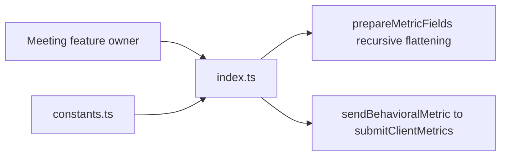
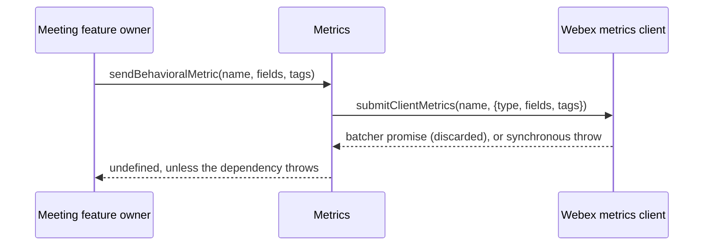
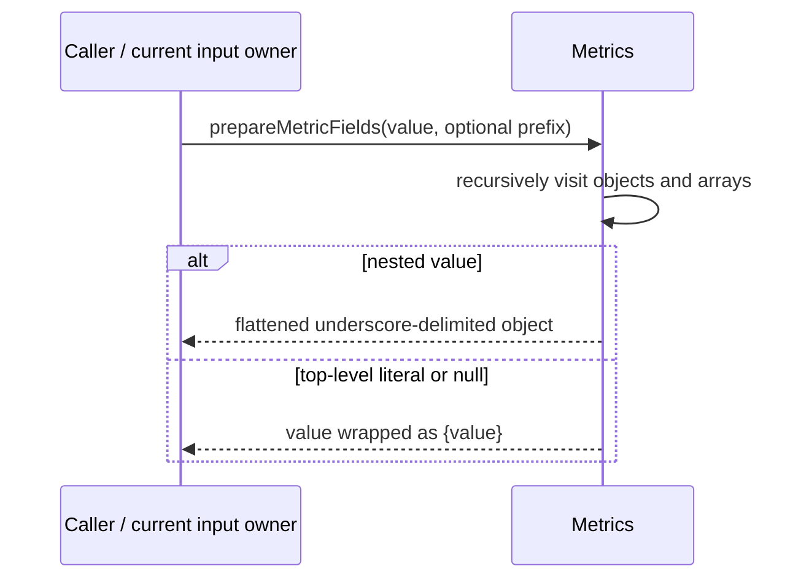
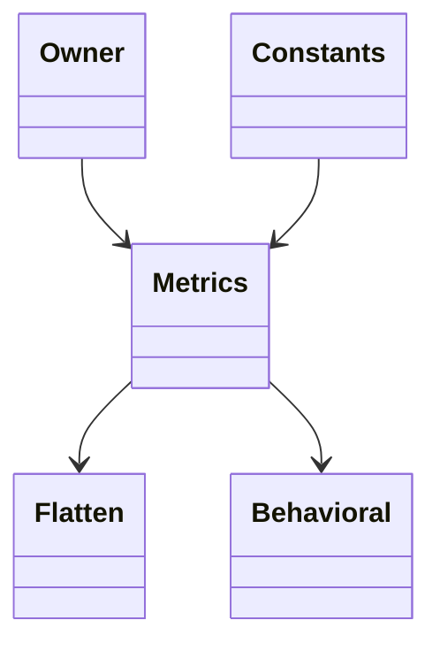

<!-- sdd-generated-metadata
doc_kind: module-spec
generated_from: module-spec@0.3.0
generated_by: claude-code
approved_by: rarajes2@cisco.com
updated_at: 2026-11-16T14:30:00Z
validation_status: not-run
-->

# Meetings metrics

This source-local document at `src/metrics/docs/README.md` owns the stable specification for
**the metrics module** of `@webex/plugin-meetings`: the process-wide `Metrics` singleton that stores
the Webex host, flattens nested metric fields, and submits behavioral metrics through
`webex.internal.metrics`, plus the `BEHAVIORAL_METRICS` name catalog. Ground every claim in package
evidence and link to the [package architecture](../../../docs/architecture.md) instead of repeating
broader facts. No service specification exists because this package is a library.

Related context — start here: root [package agent instructions](../../../AGENTS.md) · router
[documentation index](../../../docs/index.md) · system [package architecture](../../../docs/architecture.md).
This is the canonical source-local spec for `src/metrics/`.

Repo architecture: [package architecture](../../../docs/architecture.md) · Registry:
[documentation index](../../../docs/index.md) · Coverage state and contracts baseline: `.sdd/manifest.json`.

## Metadata

| Field | Value |
|---|---|
| Owner | @webex/web-client, @webex/web-sdk |
| Source path | `src/metrics` |
| Resource kind | module |
| Status | Draft |
| Last verified | 2026-11-16 at `0b8c34db7f` |
| Module id | `plugin-meetings/metrics` |
| Parent spec | — |
| Doc kind | Module spec |
| Coverage score | Pending coverage assessment |
| Validation status | not-run |

## Applicability

| Condition ID | Status | Evidence or reason | Owned section |
| ------------ | ------ | ------------------ | ------------- |
| `module.has_tiers` | N/A | No tier policy exists in `package.json` or `.sdd/manifest.json` | Tier |
| `module.has_ui` | N/A | `src/metrics/index.ts` renders nothing | UI use-case flow |
| `module.crosses_service_boundaries` | Applicable | `src/metrics/index.ts` hands every metric to the internal metrics plugin, which batches it to the metrics service | Cross-boundary use-case flow |
| `module.holds_client_state` | N/A | The only field is the stored Webex host in `src/metrics/index.ts`; no client-visible state | Client state model |
| `module.enforces_domain_rules` | Applicable | Field flattening rules and the singleton rule in `src/metrics/index.ts`; the name catalog in `src/metrics/constants.ts` | Business rules and invariants |
| `module.is_concurrent_async` | N/A | Every method in `src/metrics/index.ts` is synchronous; batching is owned by the metrics plugin | Concurrency and reactive flow |
| `module.owns_persistence` | N/A | Nothing is stored by `src/metrics/index.ts` | Data, schema, and migration discipline |
| `module.stateful_transitions` | N/A | No state machine in `src/metrics/index.ts` | State machine |
| `module.exposes_wire_protocol` | N/A | The wire payload is built by the metrics plugin, not by `src/metrics/index.ts` | Protocol and wire format |
| `module.ui_multi_screen` | N/A | No UI | UI flow |
| `module.large_data_model` | N/A | One string map in `src/metrics/constants.ts` | Data model |
| `module.returns_caller_errors` | N/A | No method in `src/metrics/index.ts` rejects or throws its own error; dependency throws propagate unchanged | Caller-visible failure modes |
| `module.module_specific_conventions` | N/A | Repository-wide rules in `AGENTS.md` apply unchanged | Module-specific rules |
| `module.published_package` | N/A | `src/index.ts` does not re-export the module | Export stability |
| `module.embedded_in_host` | N/A | No mount or theme contract | Host integration and theming |
| `module.has_design_tradeoff` | N/A | No recorded trade-off in `src/metrics/index.ts` | Key design trade-off |
| `module.has_submodules` | N/A | The module directory has no child module | Sub-modules |

## Evidence register

Requirements cite current source and mirrored tests. Current code wins over retained prose when they
conflict; commit and PR history are excluded. Missing evidence stays a gap.

| Evidence | What it establishes |
| -------- | ------------------- |
| `src/metrics/index.ts` | Class `Metrics` whose constructor returns the first-created instance; the default export is that instance; `initialSetup(webex)`, `sendBehavioralMetric(metricName, metricFields = {}, metricTags = {})`, and `prepareMetricFields(payload = {}, prefix = '')`. Its JSDoc says the fields are flattened because Amplitude does not accept nested objects |
| `src/metrics/constants.ts` | Default export `BEHAVIORAL_METRICS`: 97 keys mapped to metric names, all prefixed `js_sdk_` except `meetings_registration_step` |
| `src/meetings/index.ts` | `Meetings` calls `Metrics.initialSetup(this.webex)` inside its `READY` handler, after the static, logger, and media-logger setup |
| `test/unit/spec/metrics/index.js` | Two `sendBehavioralMetric` cases (one call; name, type, fields, and tags with `calledWithMatch`) and eight `prepareMetricFields` cases (empty object, root literals including `null`, flat and nested objects, arrays, arrays in objects, arrays in arrays, prefix) |
| Sibling package internal-plugin-metrics, files src/metrics.js and src/client-metrics-batcher.js | `submitClientMetrics(eventName, props)` throws without a name, merges environment tags and fields, uses `props.type` or else `config.metrics.type`, and returns the batcher's promise; the batcher POSTs `{metrics: payload}` to the `metrics` service `clientmetrics` resource |
| Observation, no stated WHY | No default for `config.metrics.type` exists in `src/config.ts` or in the @webex/internal-plugin-metrics package's src/config.js, so `type` is `undefined` unless the host config sets it (`src/metrics/index.ts`, `src/config.ts`) |
| Observation, no stated WHY | `meetings_registration_step` is the only name in `src/metrics/constants.ts` without the `js_sdk_` prefix |

## Purpose and boundary

- Responsibility: Initializes meeting behavioral telemetry, flattens metric fields, and submits
  established metric names/tags through the Webex metrics host.
- In scope: the `Metrics` singleton (`initialSetup`, `sendBehavioralMetric`,
  `prepareMetricFields`) and the `BEHAVIORAL_METRICS` name catalog.
- Out of scope: batching, environment tags and fields, the HTTP request, and retry
  (`@webex/internal-plugin-metrics`); call diagnostic and call analyzer events
  (`webex.internal.newMetrics`, used directly by other modules); deciding when a metric is sent
  (the calling modules).
- Consumers: 15 files in 10 sibling modules import both `src/metrics/index.ts` and
  `src/metrics/constants.ts`: meetings, meeting, meeting-info, locus-info, hashTree, media,
  multistream, reachability, reconnection manager, and roap (each specified at
  `src/<module>/docs/README.md`).

## Structure and key files

`src/metrics` contains 2 direct source/reference file(s) and has 1 mirrored unit-test file(s). Stack:
TypeScript/JavaScript in the Node 22.14 Yarn workspace; Webex core/plugin abstractions and
Mocha/Sinon/`@webex/test-helper-chai` tests.

```text
src/metrics/
├── constants.ts — module constants and wire values (BEHAVIORAL_METRICS names)
├── index.ts — module facade/controller or primary exports (the Metrics singleton)
└── docs/README.md — canonical module specification
```

| File | Holds |
|---|---|
| `src/metrics/constants.ts` | module constants and wire values: the `BEHAVIORAL_METRICS` key-to-name map |
| `src/metrics/index.ts` | module facade/controller or primary exports: the `Metrics` class and its default singleton instance |
| `test/unit/spec/metrics/index.js` | mirrored characterization/unit coverage |

## Public surface

| Contract ID | Type | Surface | Purpose | Compatibility / deprecation | Schema / detail link | Root index |
|---|---|---|---|---|---|---|
| `meetings-metrics` | singleton setup | default singleton `initialSetup(webex)` | Store the Webex host used by later behavioral submissions. | Repeated setup replaces the host; there is no one-time guard or readiness check. | `src/metrics/index.ts` | [package architecture](../../../docs/architecture.md) |
| `meetings-metrics` | pure normalization | `prepareMetricFields(payload, prefix)` | Flatten nested objects/arrays and wrap root literals for clients that reject nested metric fields. | Preserve underscore path construction, array indices, and `{value}` root-literal behavior. | `src/metrics/index.ts` | [package architecture](../../../docs/architecture.md) |
| `meetings-metrics` | remote side effect | `sendBehavioralMetric(metricName, metricFields, metricTags)` | Forward the metric name, configured metrics type, fields, and tags to `submitClientMetrics()`. | The method returns `void` and does not expose an operational-metric API or promise. | `src/metrics/index.ts` | [package architecture](../../../docs/architecture.md) |
| `meetings-metrics` | name catalog | default export `BEHAVIORAL_METRICS` of `src/metrics/constants.ts` | Name every behavioral metric the package sends. | Values are measurement names; renaming one starts a new measurement. | `src/metrics/constants.ts` | [package architecture](../../../docs/architecture.md) |

Contract ID `meetings-metrics` is internal to the package: `src/index.ts` does not re-export the
module. It is indexed in the [package architecture](../../../docs/architecture.md) and registered in
`.sdd/manifest.json`; this module requires `internal-plugin-metrics-api`.

Compatibility notes:

- Prefer additive fields/options and preserve current return and rejection semantics. Internal helpers are not public merely because they are exported within the source directory.

## Dependencies

Webex metrics plugin/host, behavioral metric constants, logging/error handling, and callers in
meeting/feature modules.

| Dependency | Why it is required | Failure behavior |
| ---------- | ------------------ | ---------------- |
| `@webex/internal-plugin-metrics` through `webex.internal.metrics` (contract `internal-plugin-metrics-api`) | `submitClientMetrics` builds the payload, adds environment tags and fields, and batches it to the metrics service | Throws synchronously without a metric name; its promise is discarded here, so batch failures never reach the caller |
| The Webex host stored by `initialSetup` | Supplies `internal.metrics` and `config.metrics.type` | Before `initialSetup`, `sendBehavioralMetric` throws a `TypeError` reading `internal` of `undefined` |
| `src/metrics/constants.ts` (within the module) | Callers pass its names as `metricName` | — |

The module itself does no logging and catches no error.

## Requirements

| ID | WHAT | WHY | Source Evidence | Test / Example Evidence | Assumptions / Gaps | Confidence |
|---|---|---|---|---|---|---|
| `METRICS-R-001` | `initialSetup(webex)` replaces the singleton's stored Webex host on every call. | Later behavioral submissions must use the host supplied by the owning SDK instance without implying an idempotence guard the implementation does not have. | `src/metrics/index.ts` | `test/unit/spec/metrics/index.js` | repeat setup is not covered explicitly | PRESENT |
| `METRICS-R-002` | `prepareMetricFields` recursively flattens objects and arrays into underscore-delimited keys and wraps a top-level literal as `{value}`. | The behavioral metrics client cannot accept nested field objects, so callers need a deterministic flattening helper. | `src/metrics/index.ts` | `test/unit/spec/metrics/index.js` | no cycle or size bound is implemented | PRESENT |
| `METRICS-R-003` | `sendBehavioralMetric` calls `webex.internal.metrics.submitClientMetrics` with the configured metric type, supplied fields, and tags; the method returns no independent result. | The facade must preserve the actual behavioral-metrics boundary without inventing an operational-metrics API or lifecycle guarantee. | `src/metrics/index.ts` | `test/unit/spec/metrics/index.js` | thrown dependency errors propagate synchronously; the promise `submitClientMetrics` returns is discarded, so a batch failure is not observed | PRESENT |
| `METRICS-R-004` | The `Metrics` constructor returns the first instance it created, and the module's default export is that instance, so every importer in the process shares one stored host. | The JSDoc names `initialSetup` the initializer of the Metrics singleton; `Meetings` calls it once on `READY` and every other module only imports the instance. | `src/metrics/index.ts`, `src/meetings/index.ts` | `test/unit/spec/metrics/index.js` | the singleton constructor is not asserted | PRESENT |
| `METRICS-R-005` | Callers name metrics with the `BEHAVIORAL_METRICS` values of `src/metrics/constants.ts`; each value is sent unchanged as the metric name. | The JSDoc defines the name as the measurement the metrics service aggregates, so a changed value starts a different measurement. | `src/metrics/constants.ts`, `src/metrics/index.ts` | None found | no test pins the catalog values | PRESENT |

## Design overview

`src/metrics/index.ts` is a singleton facade that stores the current Webex host, flattens
caller-supplied fields, and forwards behavioral metrics to `submitClientMetrics`. `constants.ts`
defines meeting metric names and fields. The module owns no listener, timer, or remote controller.

`prepareMetricFields` is pure: it does not touch the stored host. `sendBehavioralMetric` does not
flatten; callers that send nested data call `prepareMetricFields` first (for example
`src/reachability/index.ts` does so for its completion metric). Environment metadata such as browser,
OS, and SDK versions is added by the metrics plugin, not here.

## Data flow and sequence coverage

Call style: synchronous in-process calls on the default `Metrics` instance; the metrics plugin then
batches the payload and sends it over HTTPS (`POST` to the `metrics` service `clientmetrics`
resource). There are two operation groups: submission and field preparation.



Sequence coverage:

| Operation group | Diagram | Failure coverage |
|---|---|---|
| UC-1…UC-2 — behavioral metrics operation groups | Behavioral metrics primary sequence | uninitialized host submission failure and nested/array/literal field normalization |
| UC-2 — field preparation | Behavioral metrics alternate/failure sequence | literal, array, object, and optional-prefix branches |

Behavioral metrics primary sequence:



Behavioral metrics alternate/failure sequence:



## Class and component relationships



The arrows identify ownership and delegation inside `src/metrics/`; files that only declare types or
constants are not presented as transports. `Owner` is a calling module, `Metrics` is the singleton in
`src/metrics/index.ts`, `Constants` is `BEHAVIORAL_METRICS`, `Flatten` is `prepareMetricFields`, and
`Behavioral` is the `sendBehavioralMetric` path into `webex.internal.metrics`.

## Use cases and flows

| Use case | Actor or caller | Primary steps and outcome | Failure or boundary behavior | Evidence |
| -------- | --------------- | ------------------------- | ---------------------------- | -------- |
| `UC-1` | `Meetings` on `READY`, then any meeting feature owner | Initialize the singleton with a Webex host and forward a named behavioral metric with configured type plus caller-supplied fields/tags. | Before setup the call throws a `TypeError`; a missing name throws in the metrics plugin; batch failures are not observed | `src/metrics/index.ts`, `src/meetings/index.ts`, `test/unit/spec/metrics/index.js` |
| `UC-2` | A caller with nested metric data, such as reachability | Flatten nested objects, arrays, prefixed values, null, and root literals into the exact field shape accepted by the metrics client. | No cycle or size bound; a cyclic object recurses until the stack overflows | `src/metrics/index.ts`, `src/reachability/index.ts`, `test/unit/spec/metrics/index.js` |

### Cross-boundary use-case flow

| Boundary | Transport and ordering | Compatibility | Timeout, retry, and recovery |
| -------- | ---------------------- | ------------- | ---------------------------- |
| `webex.internal.metrics` (internal-plugin-metrics, `UC-1`) | In-process call; the plugin queues the payload in its client metrics batcher | `submitClientMetrics(name, {type, fields, tags})`; caller tags are overridden by the plugin's environment tags of the same name | Owned by the batcher; nothing here waits, retries, or recovers |
| Metrics service `clientmetrics` (through the batcher) | HTTPS `POST` of `{metrics: [payload]}` batches | Payload shape owned by internal-plugin-metrics | Owned by the batcher and its configuration |

## Business rules and invariants

- Behavioral submission requires `initialSetup` to have assigned a Webex host; the facade does not
  validate metric names or remove sensitive fields. Flattening is deterministic but unbounded, so
  callers remain responsible for bounded, non-sensitive input. Enforced under `src/metrics/`.

| ID | Invariant | WHY | Enforcement source | Test evidence |
| -- | --------- | --- | ------------------ | ------------- |
| `INV-001` | A flattened key joins the path with `_`: object keys by name and array items by index; a literal with a prefix becomes `{[prefix]: value}` and a root literal (including `null`) becomes `{value}`. | Amplitude does not accept nested objects as metric fields (JSDoc of `prepareMetricFields`). | `src/metrics/index.ts` | `test/unit/spec/metrics/index.js` |
| `INV-002` | `sendBehavioralMetric` passes `fields` and `tags` through unchanged, defaulting each to `{}`. | Flattening is the caller's choice; the JSDoc tells callers to use `prepareMetricFields` before sending nested data. | `src/metrics/index.ts` | `test/unit/spec/metrics/index.js` |

## Pitfalls and constraints

- Flattening arbitrary service payloads can create unbounded or sensitive tags. Callers must submit an intentional bounded projection.
- Verify both typed constants/enums and raw wire values before changing a logical condition in this legacy package.
- `sendBehavioralMetric` called before `Meetings` reaches `READY` throws, because no host is stored yet.
- Two flattened paths can collide (`{a_b: 1, a: {b: 2}}` yields one `a_b` key; the later entry wins).
- Caller tags named like the metrics plugin's environment tags (`app_name`, `browser`, `os`, `domain`,
  and others) are overwritten by the plugin.

## Verification

Use the current mirrored suites: `test/unit/spec/metrics/index.js`. Characterize the metrics-specific
use cases above and each listed failure condition; add cleanup or transition cases only for resources
and state this module actually owns.

| Behavior / Requirement | Existing test evidence | Gap |
|---|---|---|
| `METRICS-R-001` | `test/unit/spec/metrics/index.js` | cover singleton setup, submission, and recursive flattening branches |
| `METRICS-R-002` | `test/unit/spec/metrics/index.js` | nested arrays and a root `null` are covered; add prefixed primitives and nested `null` values |
| `METRICS-R-003` | `test/unit/spec/metrics/index.js` | assert the exact `submitClientMetrics` call and the method's `undefined` return |
| `METRICS-R-004` | `test/unit/spec/metrics/index.js` | the suite uses the default instance but never constructs a second one |
| `METRICS-R-005` | None found | no case pins a `BEHAVIORAL_METRICS` value |

A module specification is complete only when its public surface, invariants, failure modes, and test
evidence agree with the implementation.
