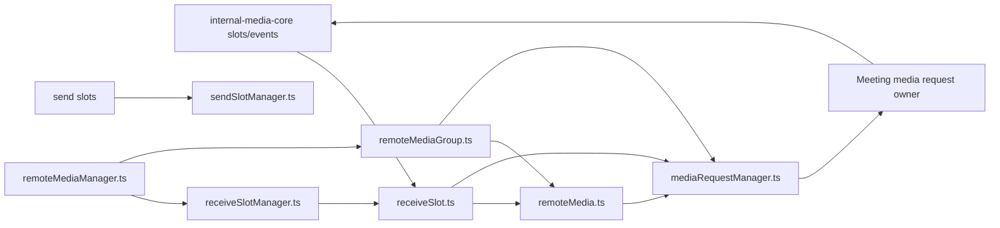
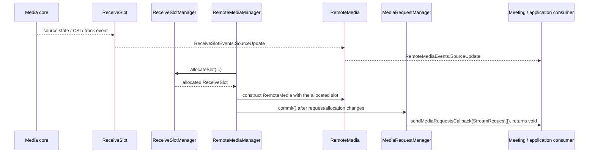
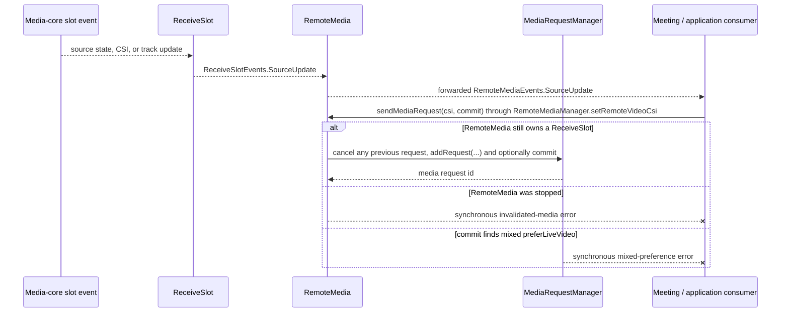
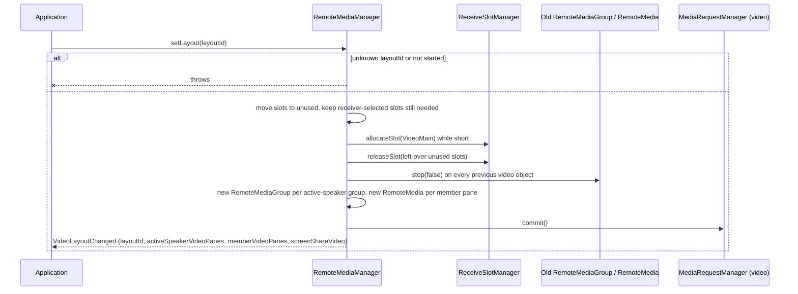
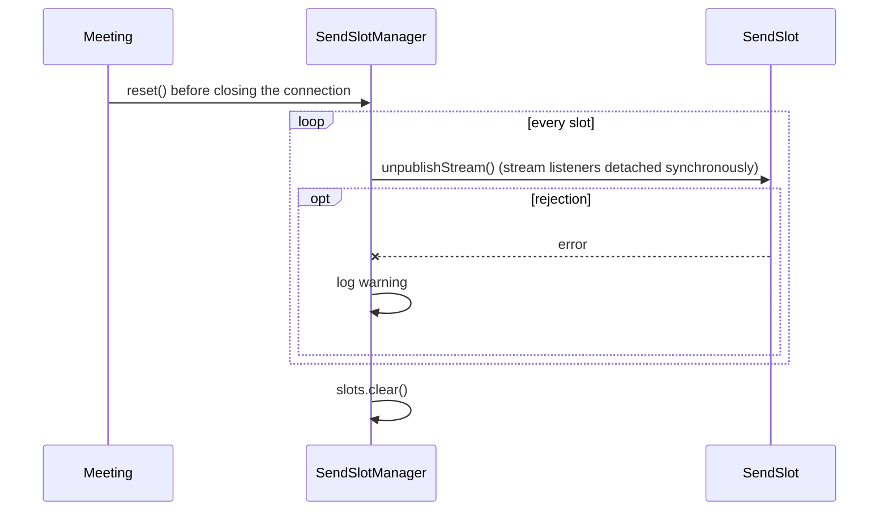
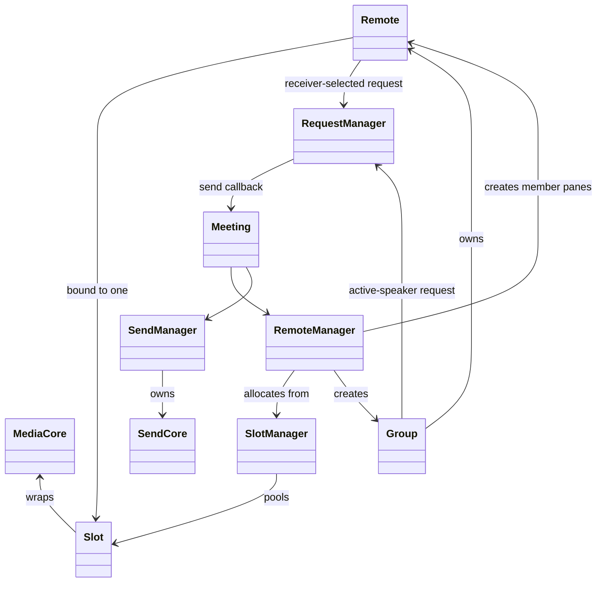
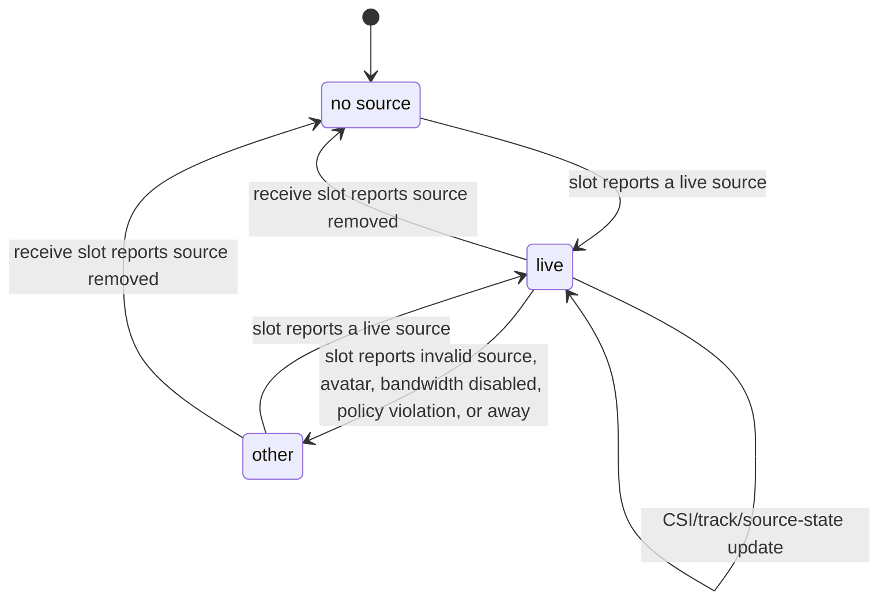
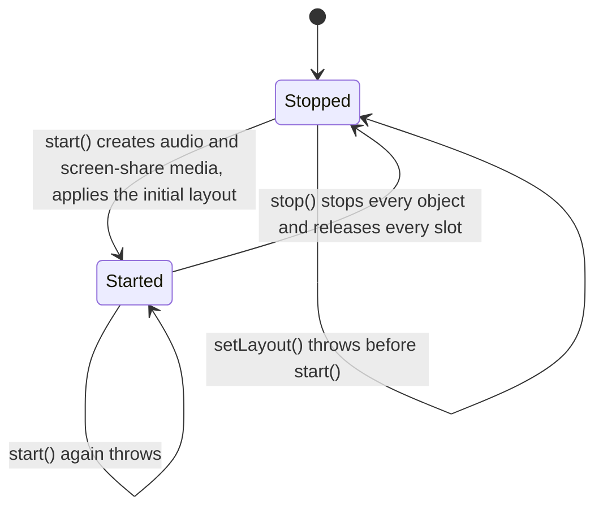

<!-- sdd-generated-metadata
doc_kind: module-spec
generated_from: module-spec@0.3.0
generated_by: claude-code
approved_by: rarajes2@cisco.com
updated_at: 2026-11-17T03:14:21Z
validation_status: pass-with-warnings
-->

# Multistream

This source-local document at `src/multistream/docs/README.md` is the canonical source-local spec
for `src/multistream/` and owns the stable specification for **the multistream module** of
`@webex/plugin-meetings`: the receive-slot pool, the `RemoteMedia` and `RemoteMediaGroup` objects
that applications render, the `RemoteMediaManager` that turns layouts into receive slots and media
requests, the `MediaRequestManager` that batches those requests for internal-media-core, and the
`SendSlotManager` that owns outgoing send slots. Ground every claim in package evidence and link to
the [package architecture](../../../docs/architecture.md) instead of repeating broader facts. No
service specification exists because this package is a library.

Related context: [documentation index](../../../docs/index.md) ·
[package agent instructions](../../../AGENTS.md) · repo architecture:
[package architecture](../../../docs/architecture.md) · registry:
[specification registry](../../../docs/specs/README.md) · related module:
[media](../../media/docs/README.md)

## Metadata

| Field | Value |
| ----- | ----- |
| Owner | @webex/web-client, @webex/web-sdk |
| Source path | `src/multistream` |
| Resource kind | module |
| Status | Draft |
| Last verified | 2026-11-16 at `0b8c34db7f` |
| Module id | `plugin-meetings/multistream` |
| Parent spec | — |
| Doc kind | Module spec |
| Coverage score | Pending coverage assessment |
| Validation status | not-run |

Coverage state and the contracts baseline are recorded in `.sdd/manifest.json`.

## Applicability

| Condition ID | Status | Evidence or reason | Owned section |
| ------------ | ------ | ------------------ | ------------- |
| `module.has_tiers` | N/A | No tier policy exists in `package.json` | Tier |
| `module.has_ui` | N/A | `src/multistream/remoteMedia.ts` exposes streams; the application renders them | UI use-case flow |
| `module.crosses_service_boundaries` | Applicable | `src/multistream/mediaRequestManager.ts` delivers stream requests to internal-media-core through a Meeting callback; `src/multistream/receiveSlot.ts` and `src/multistream/sendSlotManager.ts` wrap internal-media-core slots | Cross-boundary use-case flow |
| `module.holds_client_state` | Applicable | Slot pools in `src/multistream/receiveSlotManager.ts`; layout, slot, and media maps in `src/multistream/remoteMediaManager.ts`; client requests in `src/multistream/mediaRequestManager.ts` | Client state model |
| `module.enforces_domain_rules` | Applicable | Pinning, preferLiveVideo, slot-pool, and send-slot media-type rules in `src/multistream/remoteMediaGroup.ts`, `src/multistream/mediaRequestManager.ts`, `src/multistream/sendSlotManager.ts` | Business rules and invariants |
| `module.is_concurrent_async` | Applicable | Async slot allocation in `src/multistream/remoteMediaManager.ts`; debounced and event-driven commits in `src/multistream/mediaRequestManager.ts` | Concurrency and reactive flow |
| `module.owns_persistence` | N/A | All state in `src/multistream/remoteMediaManager.ts` and its siblings is in memory | Data, schema, and migration discipline |
| `module.stateful_transitions` | Applicable | Source state of `src/multistream/receiveSlot.ts`; started and layout state of `src/multistream/remoteMediaManager.ts` | State machine |
| `module.exposes_wire_protocol` | Applicable | `src/multistream/mediaRequestManager.ts` builds internal-media-core StreamRequest objects and codec infos | Protocol and wire format |
| `module.ui_multi_screen` | N/A | No UI in `src/multistream/remoteMediaManager.ts` | UI flow |
| `module.large_data_model` | N/A | The layout and request types in `src/multistream/remoteMediaManager.ts` and `src/multistream/mediaRequestManager.ts` are covered by Public surface | Data model |
| `module.returns_caller_errors` | Applicable | Synchronous throws and rejections across `src/multistream/remoteMediaManager.ts`, `src/multistream/remoteMediaGroup.ts`, `src/multistream/remoteMedia.ts`, `src/multistream/sendSlotManager.ts`, `src/multistream/mediaRequestManager.ts` | Caller-visible failure modes |
| `module.module_specific_conventions` | N/A | The manifest section profile resolves this to false; repository rules in `AGENTS.md` apply | Module-specific rules |
| `module.published_package` | Applicable | `src/index.ts` re-exports RemoteMedia from `src/multistream/remoteMedia.ts`, and `package.json` publishes the package | Export stability |
| `module.embedded_in_host` | N/A | No host mount API in `src/multistream/remoteMediaManager.ts` | Host integration and theming |
| `module.has_design_tradeoff` | Applicable | Stable RemoteMedia objects over raw slots in `src/multistream/remoteMedia.ts` and `src/multistream/remoteMediaManager.ts` | Key design trade-off |
| `module.has_submodules` | N/A | src/multistream/codec holds one constants file and is not a manifest module in `.sdd/manifest.json` | Sub-modules |

## Evidence register

Requirements cite current implementation and mirrored unit-test paths. Current code wins over
retained prose when they conflict; commit and PR history are excluded by repository-owner decision.
Missing test evidence is stated as a gap rather than inferred.

| Evidence | What it establishes |
| -------- | ------------------- |
| `src/multistream/receiveSlot.ts` | `ReceiveSlot` wraps one internal-media-core receive slot; initial source state `no source`; `sourceUpdate` and `maxFsUpdate` emissions; `findMemberId()`; `ReceiveSlotEvents`, `CSI`, `MemberId`, `ReceiveSlotId`, `FindMemberIdCallback`; re-export of `StreamState` |
| `src/multistream/receiveSlotManager.ts` | Per-media-type allocated and free pools; slots are reused because internal-media-core receive slots cannot be deleted (class JSDoc) |
| `src/multistream/remoteMedia.ts` | `RemoteMedia`, `RemoteMediaEvents`, `RemoteVideoResolution`, `MAX_FS_VALUES`, `getMaxFs()`, `RemoteMediaId`; `stop()` calls `removeAllListeners()` on its slot |
| `src/multistream/remoteMediaGroup.ts` | Pinned and unpinned `RemoteMedia` lists sharing one active-speaker request |
| `src/multistream/remoteMediaManager.ts` | Predefined layouts and `DefaultConfiguration`; `start`, `stop`, `setLayout`; slot preallocation and reuse; `Event` enum and `Events` interface |
| `src/multistream/mediaRequestManager.ts` | Request map, commit, trimming, degradation, codec info, and the synchronous `preferLiveVideo` check |
| `src/multistream/sendSlotManager.ts` | Send-slot map, publication, codec parameters, source-state override, and `reset()` |
| `src/multistream/codec/constants.ts` | `AV1_CODEC_PARAMETERS` per resolution and `H264_CODEC_PARAMETERS` (`maxFs` 8192, `maxFps` 3000, `maxMbps` 245760) |
| `src/meeting/index.ts` | Builds the receive-slot manager, the four media request managers whose callbacks call `webrtcMediaConnection.requestMedia`, and the send-slot manager; resets them before closing the connection |
| `src/index.ts` | Re-exports `RemoteMedia` from the package entry |
| `package.json` | Pins `@webex/internal-media-core` 2.32.1, whose `SendSlot.unpublishStream` detaches the published stream's listeners before awaiting the sender change |
| `test/unit/spec/multistream/remoteMediaManager.ts` and six sibling suites | Mirrored unit coverage for every file above |
| Observation, no stated WHY | `addMemberVideoPane` tests `newPane.id in this.currentLayout.memberVideoPanes` on an array, so a duplicate pane id is not rejected; `removeMemberVideoPane` deletes `memberVideoPanes[paneId]` from that array, which leaves the pane in the current layout until the next `setLayout` (`src/multistream/remoteMediaManager.ts`). `MediaRequestManager.reset()` clears requests without removing their slot listeners (`src/multistream/mediaRequestManager.ts`). None is a requirement until a reason is recorded |

## Purpose and boundary

- Responsibility: maps multistream media-core slots to stable remote-media objects/groups and
  arbitrates send/receive requests.
- In scope: receive-slot allocation and reuse; `RemoteMedia` and `RemoteMediaGroup` objects with
  pinning and size hints; layouts, active-speaker and receiver-selected panes, interpretation and
  screen-share audio; batching media requests into `StreamRequest[]` with degradation and trimming;
  outgoing send slots, publication, codec parameters, named media groups, and source-state overrides.
- Out of scope: creating and closing the multistream connection (`src/media`, `Meeting`); ROAP
  signaling (`src/roap`); member and CSI data (`src/members`); emitting the `media:*` events
  (`Meeting`); the WebRTC slot implementation (`@webex/internal-media-core`).
- Consumers: `Meeting` (`src/meeting/index.ts`) and applications that receive `RemoteMedia`,
  `RemoteMediaGroup`, and `RemoteMediaManager` objects through Meeting events.

## Structure and key files

`src/multistream/` contains 7 direct source/reference file(s) and has 7 mirrored unit-test file(s)
under `test/unit/spec/multistream/`, plus `codec/constants.ts`. The request coordination and payload
types are in `mediaRequestManager.ts`; `receiveSlot.ts`, `receiveSlotManager.ts`, `remoteMedia.ts`,
`remoteMediaGroup.ts`, `remoteMediaManager.ts`, and `sendSlotManager.ts` sit beside it, and this
canonical module specification is `src/multistream/docs/README.md`. The code is TypeScript in the
Node 22.14 Yarn workspace; Webex core/plugin abstractions and Mocha/Sinon/`@webex/test-helper-chai`
tests. Build target: `yarn workspace @webex/plugin-meetings build:src`.

| File | Holds |
| ---- | ----- |
| `src/multistream/mediaRequestManager.ts` | request coordination and payload types: `MediaRequestManager`, policy and codec info types |
| `src/multistream/receiveSlot.ts` | `ReceiveSlot`: one wrapped internal-media-core receive slot with source state, CSI, and member id |
| `src/multistream/receiveSlotManager.ts` | `ReceiveSlotManager`: the reusable receive-slot pool per media type |
| `src/multistream/remoteMedia.ts` | `RemoteMedia`: one remote stream bound to one receive slot and an optional receiver-selected request; max-fs helpers |
| `src/multistream/remoteMediaGroup.ts` | `RemoteMediaGroup`: a set of `RemoteMedia` sharing one active-speaker request, with pinning |
| `src/multistream/remoteMediaManager.ts` | `RemoteMediaManager`: layouts, slot allocation per layout, audio and screen-share groups, layout events |
| `src/multistream/sendSlotManager.ts` | `SendSlotManager`: outgoing send slots per media type, publication, codec parameters, overrides |
| `test/unit/spec/multistream/mediaRequestManager.ts` and 6 sibling test file(s) | mirrored characterization/unit coverage, one suite per source file |

## Public surface

`RemoteMedia` is re-exported by `src/index.ts`; the other classes are reached through `Meeting`
(`meeting.remoteMediaManager`, `meeting.receiveSlotManager`) and Meeting events. Contract ID
`remote-media-api` is registered in `.sdd/manifest.json` and indexed in the
[package architecture](../../../docs/architecture.md#public-and-consumer-surfaces).

Manifest contracts: provides `remote-media-api`; requires `internal-media-core`.

| Contract ID | Type | Surface | Purpose | Compatibility / deprecation | Schema / detail link | Root index |
| ----------- | ---- | ------- | ------- | --------------------------- | -------------------- | ---------- |
| `remote-media-api` | SDK / in-process | `ReceiveSlot`: `id`, `mediaType`, `memberId`, `csi`, `sourceState`, `stream`, `setMaxFs()`, `findMemberId()`, the `logString` getter, and `wcmeReceiveSlot` | Expose one stable wrapper around a media-core receive slot and its resolved participant/source state. | Preserve accessors and source-state event behavior across slot reassignment. | `src/multistream/receiveSlot.ts` | package architecture |
| `remote-media-api` | SDK / lifecycle | `ReceiveSlotManager.allocateSlot()`, `releaseSlot()`, `reset()`, `getStats()`, `updateMemberIds()`, `findReceiveSlotBySsrc()` | Allocate, recycle, inspect, and reconcile the finite receive-slot pool. | `releaseSlot()` only moves the same slot object from the allocated pool to the free pool; it does not reset CSI/member/source state or detach listeners. | `src/multistream/receiveSlotManager.ts` | package architecture |
| `remote-media-api` | SDK / in-process | `RemoteMedia.setSizeHint()`, `getEffectiveMaxFs()`, `stop()`, `sendMediaRequest()`, `cancelMediaRequest()`, `id`, `mediaType`, `memberId`, `csi`, `sourceState`, `stream`, and `getUnderlyingReceiveSlot()` | Give consumers a stable remote-media identity while the source on its receive slot and its receiver-selected request change; the slot is fixed for the object's life. | `stop()` cancels the request and removes all listeners from its receive slot; it is not an async transport result. `stop()`, `sendMediaRequest()`, `cancelMediaRequest()`, and `getUnderlyingReceiveSlot()` are marked `@internal`. | `src/multistream/remoteMedia.ts` | package architecture |
| `remote-media-api` | SDK / in-process | `RemoteMediaGroup.getRemoteMedia()`, `setActiveSpeakerCsis()`, `pin()`, `unpin()`, `isPinned()`, `setPreferLiveVideo()`, `setNamedMediaGroup()`, `stop()`, `includes()`, and `getEffectiveMaxFs()` | Coordinate a related set of stable remote-media objects and pin/preference policy. | Preserve group membership and pinning semantics when layouts change. | `src/multistream/remoteMediaGroup.ts` | package architecture |
| `remote-media-api` | SDK / lifecycle | `RemoteMediaManager.start()`, `stop()`, `setLayout()`, `getLayoutId()`, `setPreferLiveVideo()`, `setActiveSpeakerCsis()`, `setReceiveNamedMediaGroup()`, `logAllReceiveSlots()`, `setRemoteVideoCsis()`, `setRemoteVideoCsi()`, `addMemberVideoPane()`, `removeMemberVideoPane()`, `pinActiveSpeakerVideoPane()`, `unpinActiveSpeakerVideoPane()`, and `isPinned()` | Translate meeting layout and CSI intent into remote-media groups and receive-slot assignments. | Preserve manager-scoped event/listener cleanup and current layout identifiers (`AllEqual`, `AllEqual25`, `OnePlusFive`, `Single`, `Stage`, `ScreenShareView`). | `src/multistream/remoteMediaManager.ts` | package architecture |
| `remote-media-api` | SDK / in-process | `MediaRequestManager.addRequest()`, `cancelRequest()`, `commit()`, `reset()`, `setDegradationPreferences()`, and `setNumCurrentSources()` | Batch active-speaker/receiver-selected constraints and synchronously deliver `StreamRequest[]` to media core. | Mixed active-speaker `preferLiveVideo` values throw synchronously; the callback returns `void`. | `src/multistream/mediaRequestManager.ts` | package architecture |
| `remote-media-api` | SDK / lifecycle | `SendSlotManager.createSlot()`, `getSlot()`, `setNamedMediaGroups()`, `setSourceStateOverride()`, `publishStream()`, `unpublishStream()`, `setActive()`, `setCodecParameters()`, `deleteCodecParameters()`, `setCustomCodecParameters()`, `markCustomCodecParametersForDeletion()`, and `reset()` | Own outgoing media-core send-slot publication and codec configuration. | Preserve explicit publication and codec-deletion operations; `setCodecParameters()` and `deleteCodecParameters()` are deprecated in favor of the MIME-scoped methods and send a deprecation metric. `reset()` calls `unpublishStream()` on every slot (best-effort, logging and swallowing rejection) before clearing them, so each slot detaches its publishedStream's track-change/constraints/mute/ended listeners instead of being discarded while still subscribed. | `src/multistream/sendSlotManager.ts` | package architecture |
| `remote-media-api` | exported layout/configuration | `VideoLayout`, `ActiveSpeakerVideoPaneGroup`, `MemberVideoPane`, `Configuration`, `DefaultConfiguration`, `Event`, `Events`, `LayoutId`, `PaneSize`, `PaneId`, `PaneGroupId`, `VideoLayoutChangedEventData`, and `getRemoteMediaManagerConfigForLogging()` | Define the layout model and events consumed by `RemoteMediaManager`. | Add layout fields and events compatibly; existing ids and defaults are observable. | `src/multistream/remoteMediaManager.ts` | package architecture |
| `remote-media-api` | exported media contracts | `AV1_CODEC_PARAMETERS`, `H264_CODEC_PARAMETERS`, `ActiveSpeakerPolicyInfo`, `ReceiverSelectedPolicyInfo`, `PolicyInfo`, `H264CodecInfo`, `CodecInfo`, `MediaRequest`, `MediaRequestId`, `ReceiveSlotEvents`, `StreamState`, `CSI`, `MemberId`, `ReceiveSlotId`, `FindMemberIdCallback`, `CreateSlotCallback`, `RemoteMediaEvents`, `RemoteVideoResolution`, `MAX_FS_VALUES`, `getMaxFs()`, and `RemoteMediaId` | Share the exact request, codec, resolution, event, and identity vocabulary across Meeting and media-core adapters. | `StreamState` is imported and re-exported from `@webex/internal-media-core` by `receiveSlot.ts`, not defined locally; preserve that upstream type identity plus raw codec values (now in `codec/constants.ts`), max-fs mapping, event names, and other identifier types. | `src/multistream/receiveSlot.ts`, `src/multistream/codec/constants.ts`, `src/multistream/mediaRequestManager.ts`, `src/multistream/remoteMedia.ts`, `src/multistream/receiveSlotManager.ts` | package architecture |

These are object-local `EventsScope` emissions on exported consumer-reachable classes, not package-wide `Trigger`/`TriggerProxy` events. Preserve each literal, emitting object, timing, and payload.

| Emitter | Event literal | Timing | Payload | Emission evidence |
|---|---|---|---|---|
| `ReceiveSlot` | `sourceUpdate` | After an internal-media-core source update refreshes state/CSI/member id, or when `findMemberId()` later resolves a previously unknown member. | `{state, csi, memberId}` | `src/multistream/receiveSlot.ts` |
| `ReceiveSlot` | `maxFsUpdate` | Synchronously when `setMaxFs(newFs)` is called. | `{maxFs: newFs}` | `src/multistream/receiveSlot.ts` |
| `RemoteMedia` | `sourceUpdate` | When the associated `ReceiveSlot` emits `sourceUpdate`; the same payload is forwarded. | `{state, csi, memberId}` | `src/multistream/remoteMedia.ts` |
| `RemoteMedia` | `stopped` | After `stop()` cancels its request, removes receive-slot listeners, and clears the slot association. | `{}` | `src/multistream/remoteMedia.ts` |
| `RemoteMediaManager` | `AudioCreated` | After the main-audio `RemoteMediaGroup` is created during startup. | main-audio `RemoteMediaGroup` | `src/multistream/remoteMediaManager.ts` |
| `RemoteMediaManager` | `InterpretationAudioCreated` | After a configured interpretation/named-audio `RemoteMediaGroup` is created. | interpretation-audio `RemoteMediaGroup` | `src/multistream/remoteMediaManager.ts` |
| `RemoteMediaManager` | `ScreenShareAudioCreated` | After screen-share audio slots exist and their `RemoteMediaGroup` is created. | screen-share-audio `RemoteMediaGroup` | `src/multistream/remoteMediaManager.ts` |
| `RemoteMediaManager` | `VideoLayoutChanged` | After `setLayout()` updates receive slots and remote-media objects for the selected layout. | `VideoLayoutChangedEventData` (`layoutId`, active-speaker groups, member panes, optional screen-share video) | `src/multistream/remoteMediaManager.ts` |

Compatibility notes:

- Prefer additive options and payload fields. Preserve method/event names, rejection semantics, and cleanup timing; route public changes through `src/index.ts` or the documented owning object.

## Dependencies

internal-media-core multistream connection, member CSI data, codecs, event callbacks, and Meeting
media state; each is injected by `Meeting` rather than imported as a service.

| Dependency | Why it is required | Failure behavior |
| ---------- | ------------------ | ---------------- |
| `@webex/internal-media-core` (`internal-media-core`) | `ReceiveSlot`, `SendSlot`, `StreamRequest`, `Policy`, `ActiveSpeakerInfo`, `ReceiverSelectedInfo`, `CodecInfo`, `H264Codec`, `AV1Codec`, `MediaType`, bitrate helpers | Errors from slot calls propagate to the caller, except in `SendSlotManager.reset()` |
| Meeting create-slot callback (`CreateSlotCallback`) | Creates a new internal-media-core receive slot when the pool is empty | A rejection rejects `allocateSlot()` and the manager operation awaiting it |
| Meeting find-member callback (`FindMemberIdCallback`) | Resolves a CSI to a member id from the members list | Returns `undefined` until the member is known; `updateMemberIds()` retries |
| Meeting send-requests callback (`StreamRequest[]` to `void`) | Delivers committed requests to `webrtcMediaConnection.requestMedia` | Meeting logs and drops requests when no connection exists yet |
| Meeting ingress payload-type callback | Supplies the H264 and AV1 payload types for codec infos | `undefined` omits that codec info |
| `src/common/events/events-scope.ts`, `src/common/logs/logger-proxy.ts` | Object-local events and logging | — |
| `src/metrics/index.ts` | Deprecation and custom-codec metrics from `SendSlotManager` | — |
| `lodash` (`cloneDeep`, `cloneDeepWith`, `debounce`, `forEach`, `remove`) | Layout cloning, request cloning, max-fs debounce | — |

## Requirements

| ID | WHAT | WHY | Source evidence | Test / example evidence | Assumptions / gaps | Confidence |
| --- | ---- | --- | --------------- | ----------------------- | ------------------ | ---------- |
| `MULTISTREAM-R-001` | manage receive slots and remote-media groups. | Maps multistream media-core slots to stable remote-media objects/groups and arbitrates send/receive requests. | `src/multistream/remoteMediaManager.ts` | `test/unit/spec/multistream/remoteMediaManager.ts` | none | PRESENT |
| `MULTISTREAM-R-002` | Map member/CSI/layout requests to media-core. `ReceiveSlotManager.releaseSlot()` changes pool membership only; any association/listener cleanup must already be owned by `RemoteMedia.stop()`, request cancellation, or the surrounding manager flow. | Member, CSI, slot, and layout mappings must remain consistent while media-core reuses transport resources, without assigning cleanup behavior to a pool operation that does not perform it. | `src/multistream/remoteMediaManager.ts`, `src/multistream/receiveSlotManager.ts`, `src/multistream/remoteMedia.ts` | `test/unit/spec/multistream/remoteMediaManager.ts`, `test/unit/spec/multistream/receiveSlotManager.ts` | simultaneous slot reuse and layout change needs listener-identity coverage | PRESENT |
| `MULTISTREAM-R-003` | `MediaRequestManager` performs synchronous validation and calls its `sendMediaRequestsCallback(StreamRequest[])`, whose return type is `void`; it has no async rejection path. A mix of active-speaker requests with different `preferLiveVideo` values throws synchronously. `RemoteMedia.stop()` and request cancellation detach their owned associations/listeners; `releaseSlot()` does not. | Callers must handle the implemented synchronous validation boundary without inventing a rejected media-request promise, and cleanup must remain attributed to the object that performs it. | `src/multistream/mediaRequestManager.ts`, `src/multistream/remoteMedia.ts`, `src/multistream/receiveSlotManager.ts` | `test/unit/spec/multistream/mediaRequestManager.ts`, `test/unit/spec/multistream/remoteMedia.ts`, `test/unit/spec/multistream/receiveSlotManager.ts` | none | PRESENT |
| `MULTISTREAM-R-004` | A RemoteMedia identity remains stable while the track, source state, and member CSI mapping on its receive slot change; its slot is fixed for its life. `setLayout()` stops the previous video `RemoteMedia` and `RemoteMediaGroup` objects and announces the new ones in `VideoLayoutChanged`. Exported `ReceiveSlot`, `RemoteMedia`, and `RemoteMediaManager` objects emit the object-local event literals and payloads listed above at their concrete update/creation/stop boundaries. | Consumers keep references to remote media across layout and transport updates and rely on scoped events to know when those stable objects change. | `src/multistream/receiveSlot.ts`, `src/multistream/remoteMedia.ts`, `src/multistream/remoteMediaManager.ts` | `test/unit/spec/multistream/receiveSlot.ts`, `test/unit/spec/multistream/remoteMedia.ts`, `test/unit/spec/multistream/remoteMediaManager.ts` | none | PRESENT |
| `MULTISTREAM-R-005` | `RemoteMedia.stop()` cancels its request, removes all listeners from its receive slot (`removeAllListeners()`), and invalidates the association. `MediaRequestManager.cancelRequest()` removes its `SourceUpdate` and `MaxFsUpdate` handlers from every request slot before deletion. | Slot reuse must not deliver another participant's media or request callbacks through stale listeners. | `src/multistream/remoteMedia.ts`, `src/multistream/mediaRequestManager.ts` | `test/unit/spec/multistream/remoteMedia.ts`, `test/unit/spec/multistream/mediaRequestManager.ts` | none | PRESENT |
| `MULTISTREAM-R-006` | Media request arbitration and send-slot management preserve the latest supported layout/send intent: every commit clones the current request map and sends the whole set, so a cancelled or replaced request is absent from the next `StreamRequest[]`. | Concurrent layout/member changes should not apply obsolete stream requests. | `src/multistream/mediaRequestManager.ts`, `src/multistream/sendSlotManager.ts` | `test/unit/spec/multistream/mediaRequestManager.ts`, `test/unit/spec/multistream/sendSlotManager.ts` | none | PRESENT |
| `MULTISTREAM-R-007` | `SendSlotManager.reset()` calls `unpublishStream()` on every slot (catching and logging any rejection) before clearing the slot map. `unpublishStream()` detaches the slot's `OutputTrackChange`/`ConstraintsChange`/mute-state/`Ended` listeners from its `publishedStream` synchronously, before any awaited sender-replace work. | Simply clearing the slot map (as before) abandons each `SendSlot` still subscribed to its last published stream. If that stream object is reused by a later, unrelated meeting instance (the stream is owned by the caller, not the slot), the abandoned slot's handler fires on the new meeting's stream activity and throws trying to replace a track on its own (already-closed) connection's sender. | `src/multistream/sendSlotManager.ts` | `test/unit/spec/multistream/sendSlotManager.ts` | none | PRESENT |
| `MULTISTREAM-R-008` | Before sending, `MediaRequestManager` lowers every request's `maxFs` step by step from 1080p to 90p until the macroblocks of slots with a `live` source fit `degradationPreferences.maxMacroblocksLimit`, and logs a warning when it degrades or still exceeds the limit at 90p. | The code comment: reduce max-fs until total macroblocks is below the configured limit, so the client does not ask for more decode load than allowed. | `src/multistream/mediaRequestManager.ts` | `test/unit/spec/multistream/mediaRequestManager.ts` | none | PRESENT |
| `MULTISTREAM-R-009` | With `trimRequestsToNumOfSources`, active-speaker requests are trimmed so the total requested slots do not exceed the live (when `preferLiveVideo`) or total source count from `setNumCurrentSources()`, receiver-selected requests first and active-speaker groups by descending priority. | The code comment: the client should not ask for more than the streams available in total, and the lowest-priority requests are trimmed first. | `src/multistream/mediaRequestManager.ts` | `test/unit/spec/multistream/mediaRequestManager.ts` | none | PRESENT |

## Design overview

The module is a set of cooperating media managers rather than one entry controller: receive slots
project remote sources, remote-media groups expose them, the media-request manager batches receive
requests, and the send-slot manager owns publication, codec parameters, named media groups, and
source-state overrides.

`RemoteMediaManager` owns the receive slots it allocates. `start()` creates the main and
interpretation audio groups, the screen-share slots and audio group, preallocates the largest number
of video slots any layout needs, and applies the initial layout. `setLayout()` moves every video slot
back to an unused list, keeps receiver-selected slots whose CSI the new layout still needs, allocates
more slots only if the total is short, assigns slots to active-speaker groups by descending priority
and to member panes, releases what is left, and then replaces the video `RemoteMedia` and
`RemoteMediaGroup` objects. Each `RemoteMedia` is bound to one slot for its life; an active-speaker
group shares one request across its unpinned members, and each pinned or member-pane `RemoteMedia`
holds its own receiver-selected request.

## Data flow and sequence coverage

Call style: in-process method calls from `Meeting` and applications; object-local `EventsScope`
events; injected callbacks into internal-media-core (`createReceiveSlot`, `requestMedia`).

Sequence coverage:

| Operation group | Diagram | Failure coverage |
|---|---|---|
| UC-1…UC-6 — multistream slot and request operation groups | Multistream slot and request primary sequence | unknown/reused slot, pool-only release, removed source, mixed-preference validation, and owner-specific listener detachment |
| UC-1…UC-6 — multistream slot and request alternate/failure paths | Multistream slot and request alternate/failure sequence | stopped (invalidated) `RemoteMedia`, removed remote source, or mixed `preferLiveVideo` validation |
| UC-3 — layout change | Layout change sequence | invalid layout id or call before `start()` throws; old video objects are stopped before new ones are announced |
| UC-6 — send-slot reset | Send-slot reset sequence | a rejected `unpublishStream()` is logged and the slot is still removed |

Multistream slot and request primary sequence:

Multistream slot and request alternate/failure sequence:

Layout change sequence:

Send-slot reset sequence:

## Class and component relationships

The arrows identify ownership and delegation inside `src/multistream/`; files that only declare types or constants are not presented as transports.

## Use cases and flows

| Use case | Actor or caller | Primary steps and outcome | Failure or boundary behavior | Evidence |
| -------- | --------------- | ------------------------- | ---------------------------- | -------- |
| `UC-1` | `RemoteMediaManager`, Meeting | Allocate receive slots and return them to the free pool. `releaseSlot()` preserves the slot object's current CSI/member/source/listener state; callers must perform any required association cleanup through its actual owner before pool reuse. | Releasing an unmanaged slot logs a warning | `src/multistream/receiveSlotManager.ts`, `src/multistream/receiveSlot.ts`, `src/multistream/remoteMedia.ts` |
| `UC-2` | Application | Keep a `RemoteMedia` identity stable as the track, source state, member id, or size hint on its receive slot changes | A layout change replaces video `RemoteMedia` objects | `src/multistream/remoteMedia.ts`, `src/multistream/remoteMediaManager.ts` |
| `UC-3` | Application | Build remote-media groups, switch layouts, update active-speaker/CSI intent, and pin or unpin the active-speaker pane | Unknown layout, unknown `RemoteMedia`, or pinning without a CSI throws | `src/multistream/remoteMediaGroup.ts`, `src/multistream/remoteMediaManager.ts` |
| `UC-4` | `RemoteMedia`, `RemoteMediaGroup` | Add, cancel, and commit media requests, applying degradation and current-source limits before synchronously delivering `StreamRequest[]` | No connection yet: Meeting logs and drops the requests | `src/multistream/mediaRequestManager.ts`, `src/meeting/index.ts` |
| `UC-5` | `MediaRequestManager` | Reject a commit synchronously when active-speaker request groups disagree on `preferLiveVideo` | Throws before the callback runs | `src/multistream/mediaRequestManager.ts` |
| `UC-6` | Meeting | Publish/unpublish outgoing send slots and update named media groups, source-state overrides, active state, and codec parameters | Missing slot or wrong media type throws or rejects | `src/multistream/sendSlotManager.ts` |
| `UC-7` | Application | Receive interpretation audio with `setReceiveNamedMediaGroup(AudioMain, languageId)` | Non-audio media type throws; the same language is a no-op | `src/multistream/remoteMediaManager.ts` |

### Cross-boundary use-case flow

| Boundary | Transport and ordering | Compatibility | Timeout, retry, and recovery |
| -------- | ---------------------- | ------------- | ---------------------------- |
| internal-media-core receive slots (`UC-1`) | Async create-slot callback; then `sourceUpdate`, media started/stopped/ended events | Slots cannot be deleted, so they are pooled | No retry; a rejected create rejects the allocation |
| internal-media-core stream requests (`UC-4`, `UC-5`) | Synchronous `requestMedia(mediaType, StreamRequest[])` per media request manager; every commit sends the full set | Fields under Protocol and wire format | No retry; the next commit resends the current set |
| internal-media-core send slots (`UC-6`) | Async publish, unpublish, and codec calls per slot | Media-type restrictions under Business rules and invariants | `reset()` swallows unpublish failures |

## Client state model

Receive/send slots, remote-media objects/groups, requested layouts, CSI mappings, and pending media
requests live for the connection lifetime.

| State or slice | Owner | Initial state | Transition triggers | Reset or persistence boundary |
| -------------- | ----- | ------------- | ------------------- | ----------------------------- |
| Allocated and free slot pools per media type | `ReceiveSlotManager` | Empty | `allocateSlot`, `releaseSlot` | `reset()` empties both pools when Meeting tears media down |
| Slot lists (`audio.main`, `audio.si`, `screenShare`, `video.unused`/`activeSpeaker`/`receiverSelected`) and allocations | `RemoteMediaManager` | Empty | `start`, `setLayout`, `addMemberVideoPane`, `removeMemberVideoPane` | `stop()` releases every slot |
| `media` objects (audio, interpretation, video groups and panes, screen share) | `RemoteMediaManager` | Undefined | `start`, `setLayout`, `setReceiveNamedMediaGroup` | `stop()` stops them all |
| `started`, `currentLayout`, `currentLayoutId` | `RemoteMediaManager` | `false`, undefined | `start`, `setLayout` | `stop()` clears them |
| Pinned and unpinned lists, active-speaker request id | `RemoteMediaGroup` | All unpinned | `pin`, `unpin`, `setActiveSpeakerCsis` | `stop()` |
| `clientRequests`, `numTotalSources`, `numLiveSources` | `MediaRequestManager` | `{}`, 0, 0 | `addRequest`, `cancelRequest`, `setNumCurrentSources` | `reset()` |
| Send slots and source-state overrides | `SendSlotManager` | Empty | `createSlot`, `setSourceStateOverride` | `reset()` clears the slots |

## Business rules and invariants

| ID | Invariant | WHY | Enforcement source | Test evidence |
| --- | --------- | --- | ------------------ | ------------- |
| `INV-001` | A slot has one active owner/mapping while allocated. Returning it to the free pool does not itself detach tracks/listeners or reset CSI/member/source state; `RemoteMedia.stop()` and request cancellation own their respective cleanup. | internal-media-core receive slots cannot be deleted, so they are reused (class JSDoc of `ReceiveSlotManager`); cleanup must stay with the object that registered the listeners. | `src/multistream/receiveSlotManager.ts`, `src/multistream/remoteMedia.ts` | `test/unit/spec/multistream/receiveSlotManager.ts`, `test/unit/spec/multistream/remoteMedia.ts` |
| `INV-002` | Object-local emissions retain the exact literals/payloads listed under Public surface, and request arbitration preserves the latest supported layout intent. | Applications subscribe to these literals on the objects they hold. | `src/multistream/receiveSlot.ts`, `src/multistream/remoteMedia.ts`, `src/multistream/remoteMediaManager.ts`, `src/multistream/mediaRequestManager.ts` | `test/unit/spec/multistream/receiveSlot.ts`, `test/unit/spec/multistream/remoteMediaManager.ts` |
| `INV-003` | All active-speaker requests of one `MediaRequestManager` share one `preferLiveVideo` value. | The thrown message: a mix of active-speaker groups with different values for preferLiveVideo is not supported. | `src/multistream/mediaRequestManager.ts` | `test/unit/spec/multistream/mediaRequestManager.ts` |
| `INV-004` | Named media groups can be set only on the `AudioMain` send slot, and source-state overrides only on the `VideoMain` send slot; one send slot exists per media type. | The thrown messages state the restriction; a duplicate slot is rejected with `Slot for <mediaType> already exists`. | `src/multistream/sendSlotManager.ts` | `test/unit/spec/multistream/sendSlotManager.ts` |
| `INV-005` | Pinning needs a CSI (given or current) and a `RemoteMedia` from the group; a pinned `RemoteMedia` holds its own receiver-selected request and leaves the group's active-speaker request. | Pinning means the media no longer comes from the active speaker but from that CSI (JSDoc of `pin`). | `src/multistream/remoteMediaGroup.ts` | `test/unit/spec/multistream/remoteMediaGroup.ts` |

## Concurrency and reactive flow

- Execution model: one JavaScript event loop; slot allocation and send-slot calls are async, request
  commits are synchronous.
- Receive-slot and RemoteMedia identity is checked at each association change. `RemoteMedia.stop()` and `MediaRequestManager.cancelRequest()` detach the listeners they own; `ReceiveSlotManager.releaseSlot()` only changes pool membership. `MediaRequestManager` has no request result to wait for: each commit sends the whole current request set, so a superseded slot/group is simply absent from the next set.
- Reactive input: a `sourceUpdate` on any request slot commits immediately; a `maxFsUpdate` from
  `setSizeHint()` commits after a 1000 ms debounce.
- Ordering guarantees: `setLayout()` awaits slot allocation before replacing objects and emitting
  `VideoLayoutChanged`; concurrent `setLayout()` calls are not serialized.
- Idempotency: `setPreferLiveVideo`, `setNamedMediaGroup`, `setReceiveNamedMediaGroup`, and
  `setSourceStateOverride` do nothing when the value is unchanged; `start()` throws when already
  started.

## State machine

Receive-slot source state, as stored by `ReceiveSlot`:

The diagram records the initialized `no source` value and the `live` source path consumed by current
multistream code and tests; `ReceiveSlot` stores whichever `StreamState` internal-media-core reports,
and `MediaRequestManager` counts only `live` slots when it degrades `maxFs`.

`RemoteMediaManager` lifecycle:

## Protocol and wire format

Requests are internal-media-core objects built by `MediaRequestManager`; preserve current field
names, enum/raw values, and compatibility behavior, and do not treat the normalized client model as
the wire schema.

| Message or frame | Version | Producer or serializer | Consumer or parser | Compatibility and ordering rule |
| ---------------- | ------- | ---------------------- | ------------------ | ------------------------------- |
| `StreamRequest(policy, policyInfo, receiveSlots, maxPayloadBitsPerSecond, codecInfos)` | internal-media-core 2.32.1 | `MediaRequestManager.sendRequests` | `webrtcMediaConnection.requestMedia` | One per client request with at least one slot; the full set is sent on every commit |
| `ActiveSpeakerInfo(priority, crossPriorityDuplication, crossPolicyDuplication, preferLiveVideo, namedMediaGroups)` / `ReceiverSelectedInfo(csi)` | — | `MediaRequestManager` from `PolicyInfo` | internal-media-core | `RemoteMediaGroup` sends priority, `false`, `false`, its `preferLiveVideo`, and its named group |
| `maxPayloadBitsPerSecond` | — | `MediaRequestManager` | internal-media-core | Audio: `RecommendedOpusBitrates.FB_MONO_MUSIC`; video: `getRecommendedMaxBitrateForFrameSize(maxFs)` |
| H264 codec info `(payloadType, maxFs, maxFps, maxMbps, maxWidth, maxHeight)` | — | `MediaRequestManager` | internal-media-core | `maxFps` defaults to 3000 and `maxMbps` is `maxFs * maxFps / 100`; omitted when the payload type is unknown |
| AV1 codec info | — | `MediaRequestManager` when `enableAv1` | internal-media-core | Parameters from `AV1_CODEC_PARAMETERS` by the smallest resolution bucket that fits `maxFs`, else 1080p |
| Max-fs values `90p` 60, `180p` 240, `360p` 920, `540p` 2040, `720p` 3600, `1080p` 8192 | — | `MAX_FS_VALUES`, `getMaxFs`, `setSizeHint` | `MediaRequestManager` | Pane size `best` maps to 1080p; unknown sizes fall back to 720p with a warning |

## Caller-visible failure modes

| Condition | Signal | Caller recovery |
|---|---|---|
| Slot/CSI is unknown or a remote source is removed | The owning association is absent or detached by its `RemoteMedia`/request lifecycle. Merely calling `releaseSlot()` changes pool membership and provides no cleanup signal. | Reconcile against the current slot/member mapping and invoke the actual association owner before returning a slot to the pool. |
| Active-speaker requests mix different `preferLiveVideo` values | `MediaRequestManager.commit()` throws synchronously before delivering stream requests. | Make the grouped active-speaker policy consistent, then commit again. |
| Current slot reports a live source | The stable `RemoteMedia` object receives the slot/track update and emits its scoped update. | Continue using the stable remote-media identity. |
| `SendSlotManager.reset()` is called and a slot's `unpublishStream()` rejects (e.g. the underlying connection is already closing) | The rejection is caught and logged as a warning; the slot is still removed from the map. `reset()` itself never throws. | No caller action needed; the slot map is cleared regardless of the unpublish outcome. |
| `sendMediaRequest()` on a stopped `RemoteMedia` | Throws `sendMediaRequest() called on an invalidated RemoteMedia instance`. | Use the `RemoteMedia` from the latest `VideoLayoutChanged`. |
| `setLayout()` with an unknown id, before `start()`, or `start()` twice | Throws (`invalid layoutId`, `setLayout() called before start()`, `start() failure: already started`). | Use a configured layout id; call `start()` once. |
| Pin, unpin, `isPinned`, or `setRemoteVideoCsis` with a `RemoteMedia` outside the group or panes | Throws with the `RemoteMedia` id. | Pass a `RemoteMedia` from the current layout. |
| `addMemberVideoPane()` or `removeMemberVideoPane()` before `start()` | `addMemberVideoPane` rejects; `removeMemberVideoPane` returns a rejected promise. | Call `start()` first. |
| A send-slot operation for a missing slot or the wrong media type | Throws, or rejects for the async methods, `Slot for <mediaType> does not exist` or the media-type message. | Create the slot first; use `AudioMain` for named groups and `VideoMain` for overrides. |

## Pitfalls and constraints

- Remote-media identity is not the same as a transient track or slot. Recreating objects on every update breaks consumer references; source updates keep the object, but a layout change stops the previous video objects (each emits `stopped`) and hands out new ones in `VideoLayoutChanged`.
- `Event.InterpretationAudioCreated` is emitted at runtime, but the current exported `Events` interface does not declare its callback alongside the other manager events. Treat the runtime event as observable and the type-interface omission as a separate possible product/type defect.
- Public behavior may be reachable through a parent `Meeting`/`Meetings` object even when the source helper is not exported directly.
- `RemoteMedia.stop()` calls `removeAllListeners()` on its receive slot, which also drops listeners an application attached through `getUnderlyingReceiveSlot()`.
- `addMemberVideoPane` and `removeMemberVideoPane` treat the `memberVideoPanes` array like a map: duplicate pane ids are not rejected, and a removed pane stays in the current layout until the next `setLayout` (Evidence register observation).

## Export stability

| Export or entry point | Consumer | Stability | Versioning and deprecation rule | Declaration or API report |
| --------------------- | -------- | --------- | ------------------------------- | ------------------------- |
| Named export `RemoteMedia` from the package entry | Applications importing `@webex/plugin-meetings` | Published (`remote-media-api`) | No versioning or deprecation rule is declared in the package; `deploy:npm` publishes it, and its declaration ships in `dist/types/index.d.ts` built from `src/index.ts` | `src/index.ts`, `src/multistream/remoteMedia.ts`, `package.json` |
| `RemoteMedia` members not marked `@internal`: `id`, `mediaType`, `memberId`, `csi`, `sourceState`, `stream`, `setSizeHint()`, `getEffectiveMaxFs()`, and the `sourceUpdate` and `stopped` events | Applications | Published | Same; `stop()`, `sendMediaRequest()`, `cancelMediaRequest()`, and `getUnderlyingReceiveSlot()` are `@internal` and not a supported entry | `src/multistream/remoteMedia.ts` |
| `RemoteMediaGroup`, `RemoteMediaManager`, `ReceiveSlot`, `ReceiveSlotManager`, `MediaRequestManager`, `SendSlotManager`, and their types | Applications reach them through `Meeting` and its events, not as package exports | Reachable, not exported | No declared rule; compatibility commitments are under Public surface | `src/meeting/index.ts`, `src/index.ts` |

## Key design trade-off

- Stable remote-media objects are favored over exposing raw media-core slots, requiring explicit mapping and lifecycle management.

| Chosen trade-off | Preserved invariant or benefit | Cost or limitation | Decision evidence |
| ---------------- | ------------------------------ | ------------------ | ----------------- |
| Pool and reuse receive slots across layouts | Slots that cannot be deleted are not leaked, and preallocation avoids creating slots after the SDP exchange (JSDoc of `preallocateVideoReceiveSlots`) | Pool release does no cleanup, so owners must stop their `RemoteMedia` (`INV-001`) | `src/multistream/receiveSlotManager.ts`, `src/multistream/remoteMediaManager.ts` |
| Send the full request set on every commit | The latest intent always wins (`MULTISTREAM-R-006`) | Every source update re-sends every request | `src/multistream/mediaRequestManager.ts` |

## Verification

Use the current mirrored suites: `test/unit/spec/multistream/mediaRequestManager.ts`, `test/unit/spec/multistream/receiveSlot.ts`, `test/unit/spec/multistream/receiveSlotManager.ts`, `test/unit/spec/multistream/remoteMedia.ts`, `test/unit/spec/multistream/remoteMediaGroup.ts`, `test/unit/spec/multistream/remoteMediaManager.ts`, `test/unit/spec/multistream/sendSlotManager.ts`. Characterize the multistream-specific use cases above and each listed failure condition; add cleanup or transition cases only for resources and state this module actually owns.

| Behavior / Requirement | Existing test evidence | Gap |
|---|---|---|
| `MULTISTREAM-R-001` | `test/unit/spec/multistream/remoteMediaManager.ts` | cover each receive-slot, remote-media/group/manager, request-manager, layout, and send-slot family |
| `MULTISTREAM-R-002` | `test/unit/spec/multistream/remoteMediaManager.ts` | simultaneous slot reuse and layout change needs listener-identity coverage |
| `MULTISTREAM-R-003` | `test/unit/spec/multistream/mediaRequestManager.ts` | the synchronous mixed-`preferLiveVideo` throw is asserted; no case asserts that the `void` callback is not treated as a promise |
| `MULTISTREAM-R-004` | `test/unit/spec/multistream/remoteMedia.ts`, `test/unit/spec/multistream/remoteMediaManager.ts` | none |
| `MULTISTREAM-R-005` | `test/unit/spec/multistream/remoteMedia.ts`, `test/unit/spec/multistream/mediaRequestManager.ts`, `test/unit/spec/multistream/receiveSlotManager.ts` | verify rapid slot reuse while distinguishing pool-only release from RemoteMedia/request listener cleanup |
| `MULTISTREAM-R-006` | `test/unit/spec/multistream/mediaRequestManager.ts`, `test/unit/spec/multistream/sendSlotManager.ts` | verify stale request suppression |
| `MULTISTREAM-R-007` | `test/unit/spec/multistream/sendSlotManager.ts` | covered for the unpublish-before-clear happy path and the rejected-unpublish warning/no-throw path |
| `MULTISTREAM-R-008` | `test/unit/spec/multistream/mediaRequestManager.ts` | none |
| `MULTISTREAM-R-009` | `test/unit/spec/multistream/mediaRequestManager.ts` | none |
| `INV-003` to `INV-005` | `test/unit/spec/multistream/mediaRequestManager.ts`, `test/unit/spec/multistream/sendSlotManager.ts`, `test/unit/spec/multistream/remoteMediaGroup.ts` | no case for duplicate member pane ids |

A module specification is complete only when its public surface, invariants, failure modes, and
test evidence agree with the implementation. Coverage measurement is pending; semantic validation
has not run.
