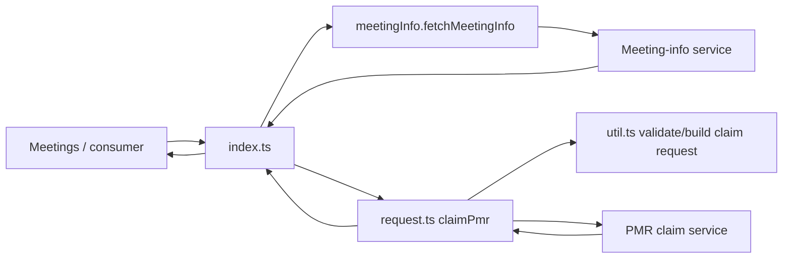
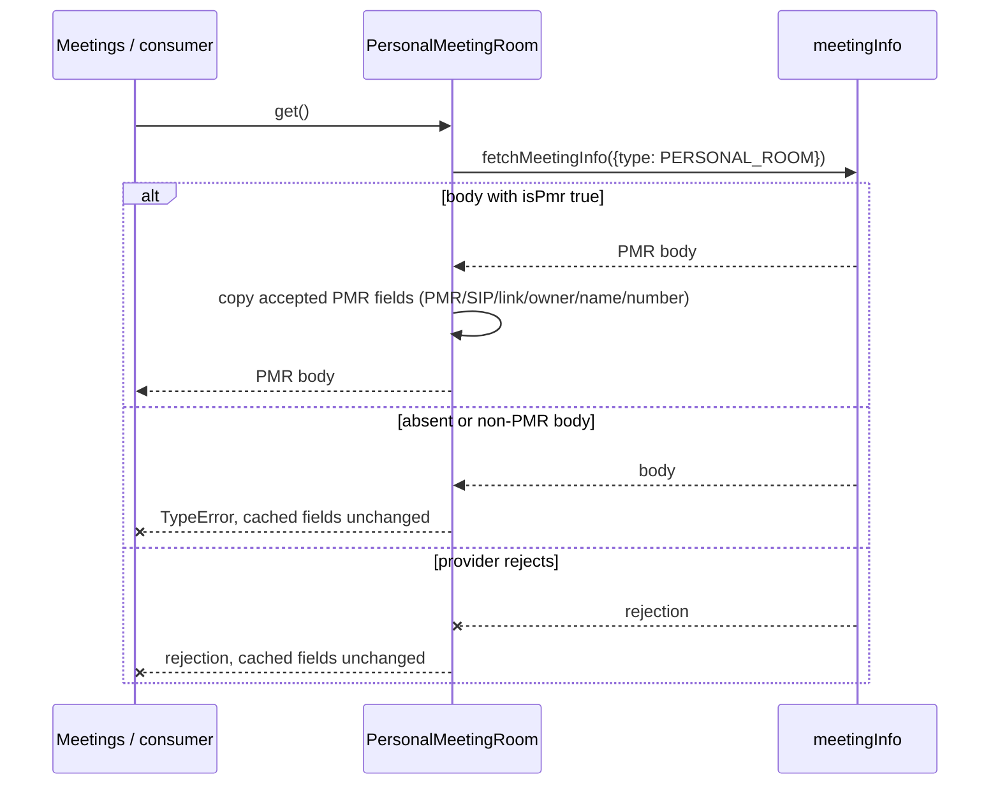
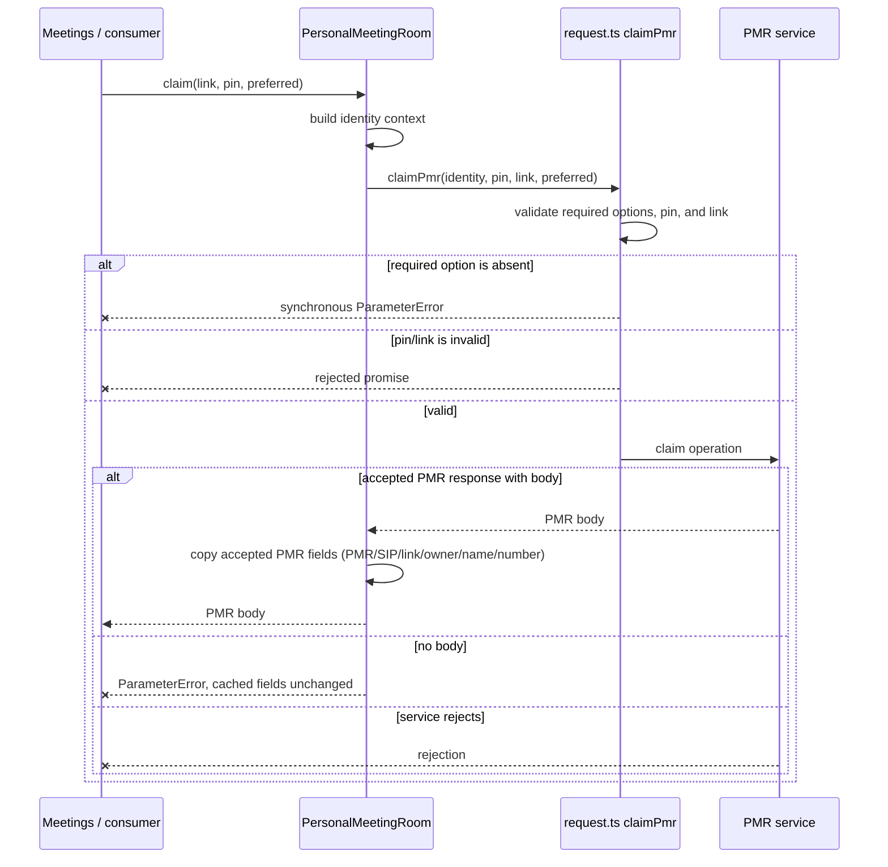
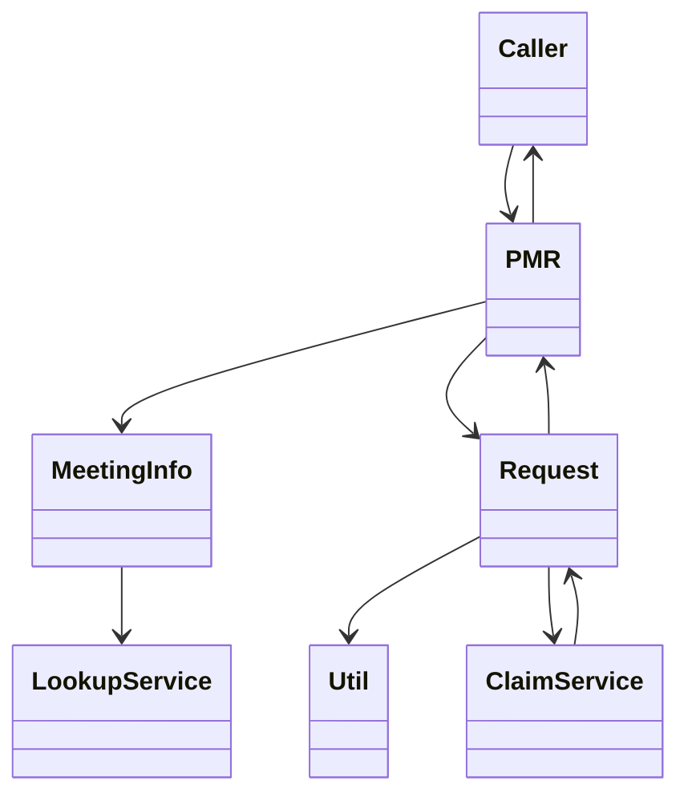

<!-- sdd-generated-metadata
doc_kind: module-spec
generated_from: module-spec@0.3.0
generated_by: claude-code
approved_by: rarajes2@cisco.com
updated_at: 2026-11-17T03:14:21Z
validation_status: pass-with-warnings
-->

# Personal meeting room

This source-local document at `src/personal-meeting-room/docs/README.md` is the canonical
source-local spec for `src/personal-meeting-room/`: `PersonalMeetingRoom`, reached as
`webex.meetings.personalMeetingRoom` (or `getPersonalMeetingRoom()`), which looks up and claims the
user's Personal Meeting Room (PMR) and keeps the last accepted room on the instance. Ground every
claim in package evidence and link to the [package architecture](../../../docs/architecture.md)
instead of repeating broader facts. No service specification exists because this package is a
library.

Related context: start from the root [package agent instructions](../../../AGENTS.md) · router
[documentation index](../../../docs/index.md) · system [package architecture](../../../docs/architecture.md).
Related module specs: [Meetings plugin](../../meetings/docs/README.md) ·
[meeting-info](../../meeting-info/docs/README.md).

## Metadata

| Field | Value |
|---|---|
| Owner | @webex/web-client, @webex/web-sdk |
| Source path | `src/personal-meeting-room` |
| Resource kind | module |
| Status | Draft |
| Last verified | 2026-11-16 at `0b8c34db7f` |
| Module id | `plugin-meetings/personal-meeting-room` |
| Parent spec | — |
| Doc kind | Module spec |
| Coverage score | Pending coverage assessment |
| Validation status | not-run |

## Applicability

| Condition ID | Status | Evidence or reason | Owned section |
|---|---|---|---|
| `module.has_tiers` | N/A | No tier policy exists in `package.json` or `src/personal-meeting-room/index.ts` | Tier |
| `module.has_ui` | N/A | `src/personal-meeting-room/index.ts` returns promises; it renders nothing | UI use-case flow |
| `module.crosses_service_boundaries` | Applicable | `src/personal-meeting-room/request.ts` POSTs the claim to the hecate service; lookup goes through the meeting-info provider | Cross-boundary use-case flow |
| `module.holds_client_state` | Applicable | `src/personal-meeting-room/index.ts` keeps the last accepted PMR body and its derived fields | Client state model |
| `module.enforces_domain_rules` | Applicable | Claim option, pin, and link validation in `src/personal-meeting-room/request.ts` and `src/personal-meeting-room/util.ts`; the isPmr check in `src/personal-meeting-room/index.ts` | Business rules and invariants |
| `module.is_concurrent_async` | Applicable | Lookup and claim return independent promises that each overwrite the cached room (`src/personal-meeting-room/index.ts`) | Concurrency and reactive flow |
| `module.owns_persistence` | N/A | The cached room in `src/personal-meeting-room/index.ts` is in memory only | Data, schema, and migration discipline |
| `module.stateful_transitions` | N/A | No lifecycle state in `src/personal-meeting-room/index.ts` | State machine |
| `module.exposes_wire_protocol` | N/A | The claim body is built in `src/personal-meeting-room/util.ts` for a service-owned API | Protocol and wire format |
| `module.ui_multi_screen` | N/A | No UI | UI flow |
| `module.large_data_model` | N/A | Six cached fields in `src/personal-meeting-room/index.ts` | Data model |
| `module.returns_caller_errors` | Applicable | ParameterError and TypeError rejections and a synchronous ParameterError in `src/personal-meeting-room/index.ts` and `src/personal-meeting-room/request.ts` | Caller-visible failure modes |
| `module.module_specific_conventions` | N/A | Package-wide conventions apply; see `AGENTS.md` | Module-specific rules |
| `module.published_package` | N/A | Not exported by `src/index.ts`; reached through the Meetings instance | Export stability |
| `module.embedded_in_host` | N/A | Constructed by `src/meetings/index.ts`; no host theme or embed API | Host integration and theming |
| `module.has_design_tradeoff` | N/A | No recorded trade-off in `src/personal-meeting-room/index.ts` | Key design trade-off |
| `module.has_submodules` | N/A | The src/personal-meeting-room directory has no child module directory | Sub-modules |

## Evidence register

Requirements cite current source and mirrored tests. Current code wins over retained prose when they conflict; commit and PR history are excluded. Missing evidence stays a gap.

| Evidence | What it establishes |
|---|---|
| `src/personal-meeting-room/index.ts` | `PersonalMeetingRoom` extends `StatelessWebexPlugin`: `claim(link, pin, preferred = true)`, `get()`, and the private `set(body)` |
| `src/personal-meeting-room/request.ts` | `PersonalMeetingRoomRequest.claimPmr(options)`: option, pin, and link validation, then one request |
| `src/personal-meeting-room/util.ts` | `getClaimPmrLink`, `getClaimPmrPin`, and `getClaimedRequestParams` (POST, api `hecate`, resource `/cmrmeetings/claim`) |
| `src/constants.ts` | `VALID_PIN`, `VALID_PMR_ADDRESS`, `VALID_PMR_LINK`, `HECATE`, `CMR_MEETINGS`, `CLAIM`, `WEBEX_DOT_COM` |
| `src/meetings/index.ts` | `Meetings` builds the instance at the Webex `ready` event with `{meetingInfo: this.meetingInfo}` and returns it from `getPersonalMeetingRoom()` |
| `src/meeting-info/meeting-info-v2.ts`, `src/meeting-info/index.ts`, `src/meeting-info/utilv2.ts`, `src/meeting-info/util.ts` | Both providers take `fetchMeetingInfo(destination, type, ...)` positionally; classification decodes a Hydra id from the destination before any other check |
| `test/unit/spec/personal-meeting-room/personal-meeting-room.js` | One case: `get()` calls a stubbed `fetchMeetingInfo` once with `{type: PERSONAL_ROOM}` |
| Observation, no stated WHY | `get()` passes `{type: PERSONAL_ROOM}` as the destination argument of the provider's `fetchMeetingInfo(destination, type, ...)`, so no type is applied, the PERSONAL_ROOM branch of classification is skipped, and the Hydra id decode of an object destination fails, rejecting the lookup before any request; no comment or test states that this is intended, so it is recorded here rather than as a requirement |
| Observation, no stated WHY | `claim(link, pin, preferred = true)` sends `{userId, passcode: pin, preferred, meetingAddress}` as a POST to api `hecate` resource `/cmrmeetings/claim`; `meetingAddress` is the link itself when it matches `VALID_PMR_ADDRESS`, or `<user>@<site>.webex.com` built from a `VALID_PMR_LINK` match, and the pin must match `VALID_PIN` (`src/personal-meeting-room/util.ts`); no comment states why the link is converted, so it is recorded here rather than as a requirement. No unit case covers it |

## Purpose and boundary

- Responsibility: Retrieves a user's Personal Meeting Room information and performs the claim operation through the Webex service boundary.
- In scope: `get()` through the injected meeting-info provider and its `isPmr` check; `claim()` and the claim request, with pin and link validation and link conversion; the cached room fields.
- Out of scope: meeting-info lookup and classification (`src/meeting-info/meeting-info-v2.ts`); creating or joining a meeting for the room (`src/meetings/index.ts`, `src/meeting/index.ts`); the hecate claim service.
- Consumers: applications through `webex.meetings.personalMeetingRoom` or `webex.meetings.getPersonalMeetingRoom()`; nothing else in the package calls it.

## Structure and key files

`src/personal-meeting-room/` contains 3 direct source/reference file(s) and has 1 mirrored unit-test file(s). This spec separates its public operations, runtime data movement, component ownership, state applicability, and verification boundary.

TypeScript/JavaScript in the Node 22.14 Yarn workspace; Webex core/plugin abstractions and Mocha/Sinon/`@webex/test-helper-chai` tests.

| File | Holds |
|---|---|
| `src/personal-meeting-room/index.ts` | `PersonalMeetingRoom`, the module facade/controller and primary export |
| `src/personal-meeting-room/request.ts` | `PersonalMeetingRoomRequest`, the PMR-claim validation and HTTP request boundary |
| `src/personal-meeting-room/util.ts` | `PersonalMeetingRoomUtil` normalization/helper functions: pin and link validation and the claim request params |
| `test/unit/spec/personal-meeting-room/personal-meeting-room.js` | mirrored characterization/unit coverage |
| `src/personal-meeting-room/docs/README.md` | This module specification |

## Public surface

| Contract ID | Type | Surface | Purpose | Compatibility / deprecation | Schema / detail link | Root index |
|---|---|---|---|---|---|---|
| `personal-meeting-room-api` | SDK / remote | `PersonalMeetingRoom.get()` | Fetch the current user's room through the injected meeting-info service and store a valid PMR projection. | Reject absent/non-PMR results; preserve the returned model state. | `src/personal-meeting-room/index.ts` | [architecture](../../../docs/architecture.md#public-and-consumer-surfaces) |
| `personal-meeting-room-api` | SDK / remote | `PersonalMeetingRoom.claim()` | Claim the current PMR through the request dependency, cache accepted response fields, and return the response body. | Preserve request rejection and response-body return semantics. | `src/personal-meeting-room/index.ts` | [architecture](../../../docs/architecture.md#public-and-consumer-surfaces) |
| `personal-meeting-room-api` | request adapter | `PersonalMeetingRoomRequest.claimPmr()` | Issue the PMR claim request with current Webex identity/request context. | This adapter performs claim I/O only; room lookup belongs to the injected meeting-info service. | `src/personal-meeting-room/request.ts` | [architecture](../../../docs/architecture.md#public-and-consumer-surfaces) |

The instance also exposes the cached fields `pmr`, `sipUri`, `meetingLink`, `userId`, `name`, and
`number` (and a `link` field that nothing sets). Provided contract ID (manifest): `personal-meeting-room-api`. It is indexed
in the [package architecture](../../../docs/architecture.md#public-and-consumer-surfaces). Coverage
state and the contracts baseline are registered in `.sdd/manifest.json`.

Compatibility notes:

- Prefer additive fields/options and preserve current return and rejection semantics. Internal helpers are not public merely because they are exported within the source directory.

## Dependencies

Webex host/request access, user/device identity, PMR service discovery, meeting-info normalization, and request errors.

Required contract IDs (manifest): `webex-core-plugin-host` and `meeting-info-api`.

| Dependency | Why it is required | Failure behavior |
|---|---|---|
| `@webex/webex-core` (`webex-core-plugin-host`) | `StatelessWebexPlugin` and its `request` for the claim POST with `api: 'hecate'` | Request rejection rejects `claim()` |
| Meeting-info provider (`meeting-info-api`) | Injected as `attrs.meetingInfo` by `Meetings`; `get()` calls its `fetchMeetingInfo` | Rejection rejects `get()` |
| `webex.internal.device.userId` | The claim `userId` | A missing id makes `claimPmr` throw `ParameterError` |
| `src/common/errors/parameter.ts` | `ParameterError` for invalid options and a missing claim body | Thrown or rejected to the caller |

## Requirements

| ID | WHAT | WHY | Source Evidence | Test / Example Evidence | Assumptions / Gaps | Confidence |
|---|---|---|---|---|---|---|
| `PERSONAL-MEETING-ROOM-R-001` | fetch the current user's Personal Meeting Room: `get()` calls the injected provider's `fetchMeetingInfo({type: PERSONAL_ROOM})` and resolves `pmr.body` only when `body.isPmr` is true. | Retrieves a user's Personal Meeting Room information and performs the claim operation through the Webex service boundary. | `src/personal-meeting-room/index.ts` | `test/unit/spec/personal-meeting-room/personal-meeting-room.js` | the provider takes the object as its destination argument, so the lookup rejects before any request (Evidence register observation); the test stubs the provider | Weak |
| `PERSONAL-MEETING-ROOM-R-002` | Copy a validated PMR response into the instance's PMR, SIP URI, meeting link, owner, name, and number fields. | Both lookup and claim must expose the same current room projection without attributing lookup to the claim-only request helper. | `src/personal-meeting-room/index.ts` | `test/unit/spec/personal-meeting-room/personal-meeting-room.js` | none | PRESENT |
| `PERSONAL-MEETING-ROOM-R-003` | `PersonalMeetingRoomRequest.claimPmr()` throws `ParameterError` synchronously when required claim options are absent, returns a rejected `ParameterError` promise for an invalid pin or link, and otherwise returns the request promise. Lookup/service failures and an accepted claim response without a body reject their returned chains; the instance owns no listener, timer, lock, or event cleanup. | Callers must distinguish the request builder's synchronous option validation from returned validation/service rejections while not confusing cached room metadata with an async lifecycle resource. | `src/personal-meeting-room/index.ts`, `src/personal-meeting-room/request.ts` | `test/unit/spec/personal-meeting-room/personal-meeting-room.js` | none | PRESENT |

## Design overview

`PersonalMeetingRoom.get()` delegates lookup to the injected `meetingInfo.fetchMeetingInfo`; `claim()` delegates only the claim operation to `PersonalMeetingRoomRequest.claimPmr`. `request.ts` and `util.ts` validate/build the claim request, while `index.ts` copies accepted response fields into the instance. The module has no listeners, timers, or event-emission lifecycle.

`Meetings` constructs the instance once, at the Webex `ready` event, with the meeting-info provider
current at that moment; before `ready`, `getPersonalMeetingRoom()` returns `null`.

## Data flow and sequence coverage

Call style: in-process method calls; the claim is one HTTPS request through the plugin's `request`
(api `hecate`); the lookup is a call on the meeting-info provider.

Sequence coverage:

| Operation group | Diagram | Failure coverage |
|---|---|---|
| UC-1, UC-3 — personal-room lookup operation group | Personal-room lookup sequence | absent/non-PMR lookup, unavailable PMR, provider rejection, and cache preservation |
| UC-2, UC-3 — personal-room claim operation group | Personal-room claim sequence | missing identity/site input, invalid pin or link, claim rejection, request failure, and cache preservation |

### Personal-room lookup sequence

### Personal-room claim sequence

## Class and component relationships

The arrows identify ownership and delegation inside `src/personal-meeting-room/`; files that only declare types or constants are not presented as transports.

## Use cases and flows

| Use case | Actor or caller | Primary steps and outcome | Failure or boundary behavior | Evidence |
|---|---|---|---|---|
| `UC-1` | Application | Fetch personal-room information through the injected meeting-info service and reject a response that is absent or not a PMR. | Rejects with `TypeError` when the body is absent or not a PMR | `src/personal-meeting-room/index.ts` |
| `UC-2` | Application | Claim a PMR through `PersonalMeetingRoomRequest.claimPmr()`, cache accepted response fields, and return the response body. | Synchronous `ParameterError` for missing options; rejected `ParameterError` for a bad pin or link | `src/personal-meeting-room/index.ts`, `src/personal-meeting-room/request.ts` |
| `UC-3` | Application | Propagate lookup or claim failures without fabricating a cached room or fallback transport. | Cached fields keep their previous values | `src/personal-meeting-room/index.ts`, `src/personal-meeting-room/request.ts` |

### Cross-boundary use-case flow

| Boundary | Transport and ordering | Compatibility | Timeout, retry, and recovery |
|---|---|---|---|
| Hecate claim service (`UC-2`) | One POST `/cmrmeetings/claim` through `api: 'hecate'` after local validation | Body `{userId, passcode, preferred, meetingAddress}` | No retry |
| Meeting-info provider (`UC-1`) | One `fetchMeetingInfo` call | Provider signature is positional (see Pitfalls) | No retry |

## Client state model

The plugin retains current PMR information and request helper state for the owning SDK instance.

| State or slice | Owner | Initial state | Transition triggers | Reset or persistence boundary |
|---|---|---|---|---|
| `pmr`, `sipUri`, `meetingLink`, `userId`, `name`, `number` | `PersonalMeetingRoom` | `null` (`meetingLink` and `number` unset) | An accepted `get()` or `claim()` body | In memory; never cleared |
| `meetingInfo`, `personalMeetingRoomRequest` | `PersonalMeetingRoom` | Set in the constructor | None | Fixed for the instance |

## Business rules and invariants

| ID | Invariant | WHY | Enforcement source | Test evidence |
|---|---|---|---|---|
| `INV-001` | PMR data comes from the service response; claim uses current authenticated identity and never fabricates room ownership. | Cached room fields must reflect a service-accepted PMR (`PERSONAL-MEETING-ROOM-R-002`) | `src/personal-meeting-room/index.ts` | None found |
| `INV-002` | A lookup body is cached only when `isPmr` is true, and a claim response only when it has a body | Non-PMR results must not overwrite the cached room (`PERSONAL-MEETING-ROOM-R-003`) | `src/personal-meeting-room/index.ts` | None found |

## Concurrency and reactive flow

- Execution model: Lookup and claim calls are independent promises with no cancellation or response-order guard. Each accepted completion calls `set`, so the last completion to resolve overwrites the cached PMR fields.
- Ordering guarantees: within `claimPmr`, validation runs before the request.
- Idempotency and retry: none; each call issues its own request.
- Shared-state protection: none; last accepted completion wins.
- Blocking restrictions: none.

## Caller-visible failure modes

| Condition | Signal | Caller recovery |
|---|---|---|
| A required request-builder option is absent | `PersonalMeetingRoomRequest.claimPmr()` throws `ParameterError` synchronously before it returns a promise. | Supply user id, passcode, meeting address, and a truthy preferred flag before calling. |
| Pin or meeting link has an invalid format | `PersonalMeetingRoomRequest.claimPmr()` returns a rejected `ParameterError` promise. | Correct the formatted pin/link and handle the returned rejection. |
| Lookup returns no PMR or lookup/claim service rejects | The returned promise rejects; no listener/timer cleanup is involved. | Handle service availability or retry as a new lookup/claim. |
| Lookup or claim returns an accepted PMR body | `index.ts` copies the PMR, SIP URI, link, owner, name, and number fields and returns the body. | Read the instance's current cached room projection. |

## Pitfalls and constraints

- A PMR is meeting metadata, not an already joined Meeting. Consumers must still create/join through Meetings.
- Verify both typed constants/enums and raw wire values before changing a logical condition in this legacy package.
- `claim(link, pin, false)` throws `ParameterError` synchronously, because `claimPmr` treats a falsy `preferred` as a missing option; `claim()` is not `async`, so the throw escapes the call.
- `get()` passes its options object where both meeting-info providers expect a destination string (Evidence register observation); fixing it means passing `(undefined, DESTINATION_TYPE.PERSONAL_ROOM)` positionally.
- `set` writes `meetingLink`, not `link`; the declared `link` field stays `null`.
- The meeting-info provider is captured at `ready`; `Meetings._toggleUnifiedMeetings` does not update it.

## Verification

Use the current mirrored suites: `test/unit/spec/personal-meeting-room/personal-meeting-room.js`. Characterize the personal-meeting-room-specific use cases above and each listed failure condition; add cleanup or transition cases only for resources and state this module actually owns.

| Behavior / Requirement | Existing test evidence | Gap |
|---|---|---|
| `PERSONAL-MEETING-ROOM-R-001` | `test/unit/spec/personal-meeting-room/personal-meeting-room.js` | only the call to a stubbed provider is asserted; cover valid/invalid lookup against a real provider signature and successful/failed claim as separate paths |
| `PERSONAL-MEETING-ROOM-R-002` | `test/unit/spec/personal-meeting-room/personal-meeting-room.js` | cover accepted claim response fields and request-body forwarding together; no case asserts the copied fields |
| `PERSONAL-MEETING-ROOM-R-003` | `test/unit/spec/personal-meeting-room/personal-meeting-room.js` | distinguish synchronous missing-option throws from invalid pin/link and service promise rejections, and assert failures leave no fabricated cached state; no case covers `claimPmr` today |

Run the suite with
`yarn workspace @webex/plugin-meetings test:unit --targets personal-meeting-room/personal-meeting-room.js`.
A module specification is complete only when its public surface, invariants, failure modes, and test
evidence agree with the implementation.
