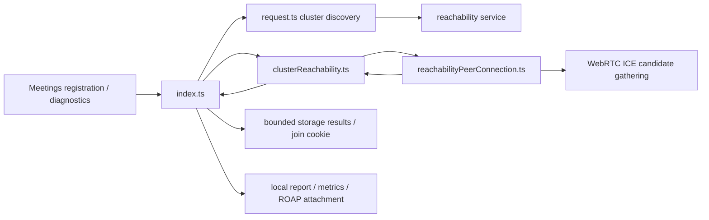
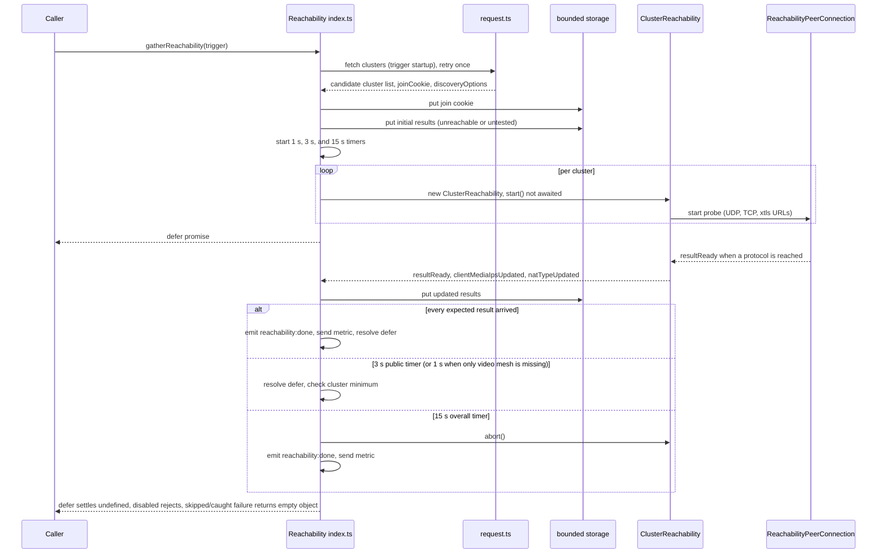
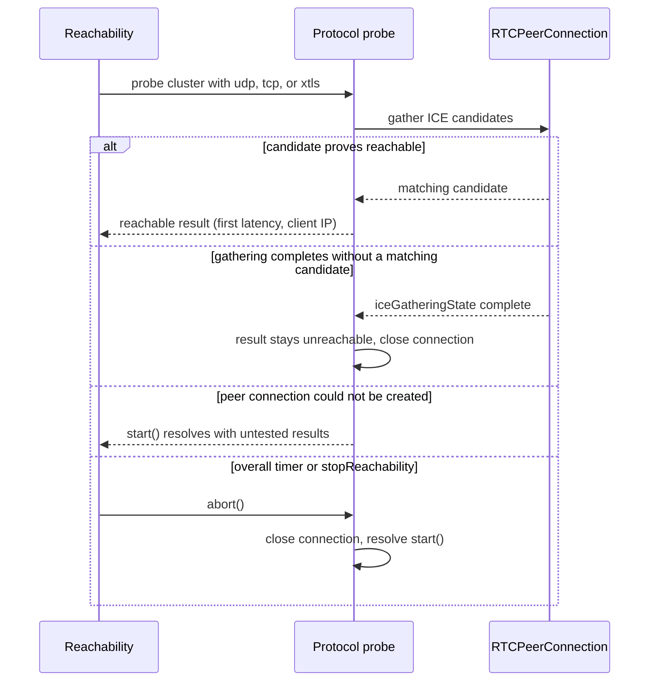
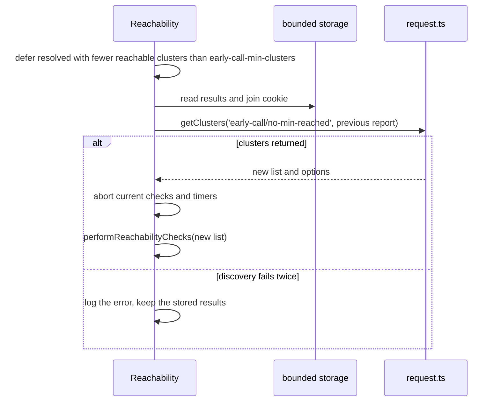
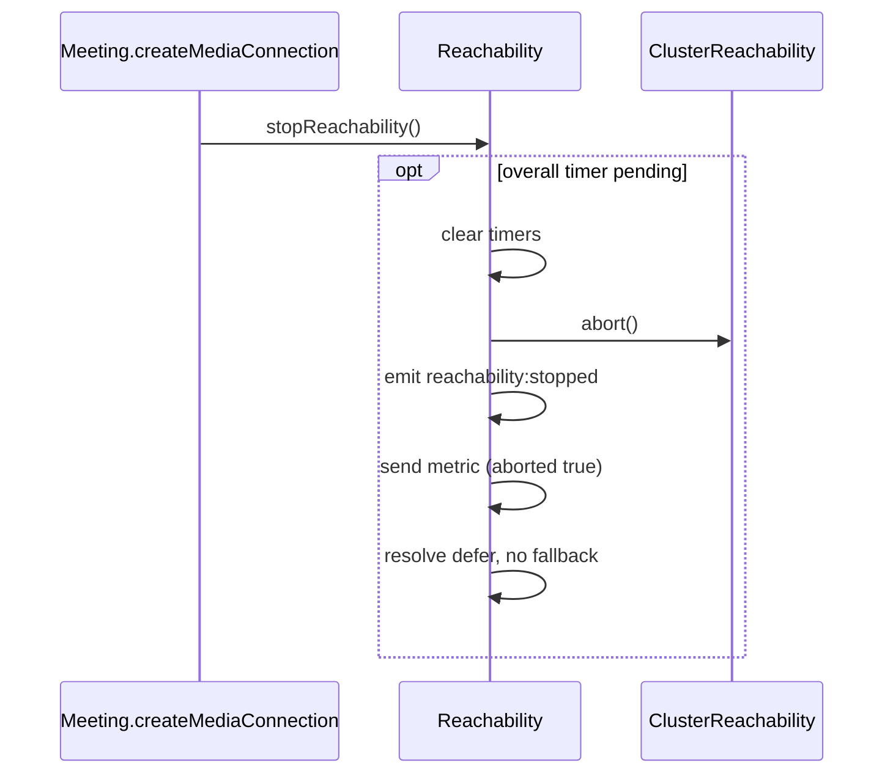
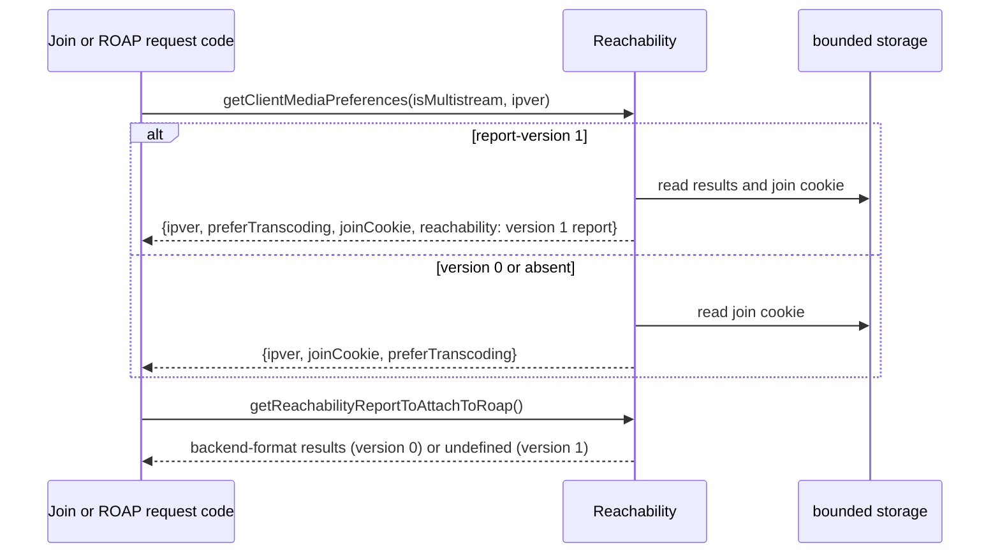
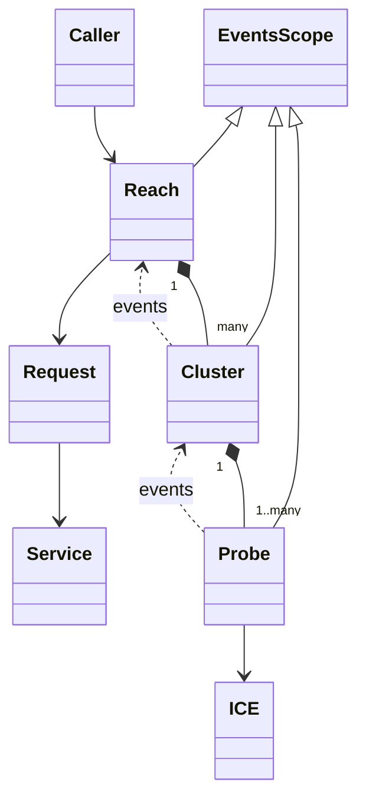

<!-- sdd-generated-metadata
doc_kind: module-spec
generated_from: module-spec@0.3.0
generated_by: claude-code
approved_by: rarajes2@cisco.com
updated_at: 2026-11-16T14:30:00Z
validation_status: not-run
-->

# Reachability

This source-local document at `src/reachability/docs/README.md` owns the stable specification for
**the reachability module** of `@webex/plugin-meetings`: the `Reachability` controller that
`webex.meetings.reachability` exposes. It fetches the media cluster list from the discovery service
(Orpheus, API `calliopeDiscovery`), probes each cluster over UDP, TCP, and TLS (`xtls`) with browser
peer connections, detects a symmetric NAT, stores the results and the join cookie in bounded storage,
and formats them for join requests, ROAP messages, and metrics. Ground every claim in package evidence
and link to the [package architecture](../../../docs/architecture.md) instead of repeating broader
facts. No service specification exists because this package is a library.

Related context — start here: root [package agent instructions](../../../AGENTS.md) · router
[documentation index](../../../docs/index.md) · system [package architecture](../../../docs/architecture.md).
This is the canonical source-local spec for `src/reachability/`.

Repo architecture: [package architecture](../../../docs/architecture.md) · Registry:
[documentation index](../../../docs/index.md) · Coverage state and contracts baseline: `.sdd/manifest.json`.

## Metadata

| Field | Value |
|---|---|
| Owner | @webex/web-client, @webex/web-sdk |
| Source path | `src/reachability` |
| Resource kind | module |
| Status | Draft |
| Last verified | 2026-11-16 at `0b8c34db7f` |
| Module id | `plugin-meetings/reachability` |
| Parent spec | — |
| Doc kind | Module spec |
| Coverage score | Pending coverage assessment |
| Validation status | not-run |

## Applicability

| Condition ID | Status | Evidence or reason | Owned section |
| ------------ | ------ | ------------------ | ------------- |
| `module.has_tiers` | N/A | No tier policy exists in `package.json` or `.sdd/manifest.json` | Tier |
| `module.has_ui` | N/A | `src/reachability/index.ts` renders nothing | UI use-case flow |
| `module.crosses_service_boundaries` | Applicable | `src/reachability/request.ts` calls the discovery service; `src/reachability/reachabilityPeerConnection.ts` contacts media cluster STUN and TURN servers | Cross-boundary use-case flow |
| `module.holds_client_state` | Applicable | Per-run cluster objects, counters, timers, NAT type, and discovery options on the instance in `src/reachability/index.ts` | Client state model |
| `module.enforces_domain_rules` | Applicable | Protocol selection, video-mesh exclusions, candidate classification, and query rules in `src/reachability/index.ts` and `src/reachability/reachabilityPeerConnection.ts` | Business rules and invariants |
| `module.is_concurrent_async` | Applicable | Parallel probes, three timers, and event-driven result updates in `src/reachability/index.ts` and `src/reachability/clusterReachability.ts` | Concurrency and reactive flow |
| `module.owns_persistence` | Applicable | `src/reachability/index.ts` writes the results and the join cookie to bounded storage under the namespace and keys in `src/constants.ts` | Data, schema, and migration discipline |
| `module.stateful_transitions` | N/A | The run lifecycle is covered by the timers under Concurrency and reactive flow in `src/reachability/index.ts` | State machine |
| `module.exposes_wire_protocol` | Applicable | The discovery request and response, the backend result format, and the ROAP and join payloads in `src/reachability/request.ts` and `src/reachability/reachability.types.ts` | Protocol and wire format |
| `module.ui_multi_screen` | N/A | No UI | UI flow |
| `module.large_data_model` | N/A | The result types in `src/reachability/reachability.types.ts` are listed under Protocol and wire format | Data model |
| `module.returns_caller_errors` | Applicable | The gather rejects when disabled, cluster discovery rejects after its retry, and the STUN converters in `src/reachability/util.ts` throw | Caller-visible failure modes |
| `module.module_specific_conventions` | N/A | Repository-wide rules in `AGENTS.md` apply unchanged | Module-specific rules |
| `module.published_package` | N/A | `src/index.ts` does not re-export the module | Export stability |
| `module.embedded_in_host` | N/A | No mount or theme contract | Host integration and theming |
| `module.has_design_tradeoff` | Applicable | Bounded waiting with results that keep arriving after the gather promise resolves, in `src/reachability/index.ts` | Key design trade-off |
| `module.has_submodules` | N/A | The module directory has no child module | Sub-modules |

## Evidence register

Requirements cite current implementation and mirrored unit-test paths. Current code wins over retained
prose when they conflict; commit and PR history are excluded by repository-owner decision. Missing
test evidence is stated as a gap rather than inferred.

| Evidence | What it establishes |
| -------- | ------------------- |
| `src/reachability/index.ts` | `Reachability` (extends `EventsScope`): discovery with one retry, the run (`performReachabilityChecks`), the 1 s video-mesh, 3 s public, and 15 s overall timers, fallback, stop, queries, report formatting, the completion metric, and the three emitted events |
| `src/reachability/clusterReachability.ts` | `ClusterReachability`: one `ReachabilityPeerConnection` per cluster, or one per UDP URL plus one for TCP and TLS when `enablePerUdpUrlReachability` is set; relays `resultReady`, `clientMediaIpsUpdated`, and `natTypeUpdated`; collects `reachedSubnets` |
| `src/reachability/reachabilityPeerConnection.ts` | `ReachabilityPeerConnection`: builds the ICE server list, gathers candidates, classifies `srflx` as UDP and `relay` as TCP or, on port 443, TLS, records the first latency, detects a symmetric NAT, and closes the peer connection when gathering completes or on abort |
| `src/reachability/request.ts` | `ReachabilityRequest.getClusters` (`POST` to `calliopeDiscovery` `clusters`) and the uncalled `remoteSDPForClusters`; `ClusterNode` and `ClusterList` |
| `src/reachability/util.ts` | `resolveReachabilityProtocols`, `isReachabilityEnabled`, `convertStunUrlToTurn`, `convertStunUrlToTurnTls` |
| `src/reachability/reachability.types.ts` | Protocol, result, metrics, backend, report, and media-preference types; `NatType` and `ReachabilityPeerConnectionEvents` |
| `src/constants.ts`, `src/config.ts` | Storage namespace `Reachability` with keys `reachability.result` and `reachability.joinCookie`; defaults `enableReachabilityChecks: true`, `reachabilityGetClusterTimeout: 5000`, `enablePerUdpUrlReachability: false` |
| `src/meetings/index.ts` | `new Reachability(this.webex)` in the constructor; `getReachability()`; `startReachability(trigger = 'client')`; registration calls `startReachability('registration')` and logs a failure as a warning |
| `src/meeting/index.ts`, `src/meeting/util.ts`, `src/roap/request.ts`, `src/roap/turnDiscovery.ts` | The in-package callers of `getClientMediaPreferences`, `getReachabilityReportToAttachToRoap`, `stopReachability`, `getReachabilityMetrics`, `isSubnetReachable`, `isAnyPublicClusterReachable`, `isWebexMediaBackendUnreachable`, and `isAnyClusterReachableViaProtocol` |
| `test/unit/spec/reachability/index.ts`, `test/unit/spec/reachability/clusterReachability.ts`, `test/unit/spec/reachability/request.js`, `test/unit/spec/reachability/util.ts` | The mirrored suites |
| Observation, no stated WHY | `gatherReachability(trigger)` always asks discovery with trigger `startup`; the caller's `trigger` only reaches the completion metric (`src/reachability/index.ts`, `test/unit/spec/reachability/index.ts`) |
| Observation, no stated WHY | `isAnyPublicClusterReachable` counts only UDP and TCP results; a public cluster reachable only over `xtls` yields `false` (`src/reachability/index.ts`, `test/unit/spec/reachability/index.ts`) |
| Observation, no stated WHY | The client sets no limit on fallback rounds; the loop ends only when a run reaches the discovery minimum, the minimum is `0` or absent, or the list is empty (`src/reachability/index.ts`, `test/unit/spec/reachability/index.ts`) |

## Purpose and boundary

- Responsibility: Discovers media clusters, probes protocol reachability with peer connections,
  determines NAT characteristics, and reports results.
- In scope: cluster discovery and the join cookie; UDP, TCP, and `xtls` probing; the timers, fallback,
  and stop of a run; stored results; queries over them; the formats sent with joins, ROAP messages,
  discovery fallbacks, and metrics; the `reachability:*` events.
- Out of scope: when reachability runs (`Meetings.register` and `startReachability`); media
  connections and TURN discovery (the media and roap modules); IP version detection
  (`webex.internal.device.ipNetworkDetector`); the behavioral metric transport (the metrics module);
  what the discovery service decides.
- Consumers: `src/meetings/index.ts` owns the instance; `src/meeting/index.ts`, `src/meeting/util.ts`,
  `src/roap/request.ts`, and `src/roap/turnDiscovery.ts` read it through `webex.meetings.reachability`;
  applications can reach it as `webex.meetings.getReachability()` and start it with
  `webex.meetings.startReachability()`.

## Structure and key files

`src/reachability` contains 6 direct source/reference file(s) and has 4 mirrored unit-test file(s).
Stack: TypeScript/JavaScript in the Node 22.14 Yarn workspace; Webex core/plugin abstractions and Mocha/Sinon/`@webex/test-helper-chai` tests. Build target: `yarn workspace @webex/plugin-meetings build:src`.

```text
src/reachability/
├── clusterReachability.ts — clusterReachability implementation responsibility (one cluster's probes)
├── index.ts — module facade/controller or primary exports (Reachability)
├── reachability.types.ts — module type declarations
├── reachabilityPeerConnection.ts — reachabilityPeerConnection implementation responsibility (one RTCPeerConnection)
├── request.ts — HTTP request boundary (cluster discovery)
├── util.ts — normalization/helper functions (protocol config, STUN to TURN URLs)
└── docs/README.md — canonical module specification
```

| File | Holds |
|---|---|
| `src/reachability/clusterReachability.ts` | clusterReachability implementation responsibility: `ClusterReachability`, its `Events`, and the event data types |
| `src/reachability/index.ts` | module facade/controller or primary exports: default export `Reachability` |
| `src/reachability/reachability.types.ts` | module type declarations: protocol, result, metrics, backend, report, and media-preference types |
| `src/reachability/reachabilityPeerConnection.ts` | reachabilityPeerConnection implementation responsibility: `ReachabilityPeerConnection`, candidate handling, and NAT detection |
| `src/reachability/request.ts` | HTTP request boundary: `ReachabilityRequest` and the cluster list types |
| `src/reachability/util.ts` | normalization/helper functions: protocol resolution and STUN URL conversion |
| `test/unit/spec/reachability/clusterReachability.ts` and 3 sibling test file(s) | mirrored characterization/unit coverage: `index.ts`, `request.js`, and `util.ts` |

## Public surface

| Contract ID | Type | Surface | Purpose | Compatibility / deprecation | Schema / detail link | Root index |
|---|---|---|---|---|---|---|
| `reachability-service` | SDK / remote | `Reachability.getClusters()` and `gatherReachability()` | Fetch cluster discovery data, cache the join cookie, and start a configured reachability run. | Disabled reachability rejects before the catch boundary; missing WebRTC capability or caught discovery/probe failure returns `{}`; a started successful run resolves its defer promise with `undefined` after storing results. | `src/reachability/index.ts`, `src/reachability/request.ts` | [package architecture](../../../docs/architecture.md) |
| `reachability-service` | SDK / async | `ClusterReachability.getResult()`, `start()`, `abort()` and `ReachabilityPeerConnection.getResult()`, `start()`, `abort()` | Run and settle per-cluster/per-protocol WebRTC probes with owned peer connections; the timers belong to `Reachability`. | Preserve the `udp`, `tcp`, and `xtls` protocol names and one-settlement cleanup; `start()` never rejects. | `src/reachability/clusterReachability.ts`, `src/reachability/reachabilityPeerConnection.ts` | [package architecture](../../../docs/architecture.md) |
| `reachability-service` | SDK / lifecycle | `gatherReachabilityFallback()` and `stopReachability()` | Restart with fallback discovery when the minimum cluster target is missed, or abort an active run. | Both paths absorb their documented internal failures; stop emits `reachability:stopped` only for an active timer. | `src/reachability/index.ts` | [package architecture](../../../docs/architecture.md) |
| `reachability-service` | SDK / query | `isSubnetReachable()`, `isAnyPublicClusterReachable()`, `isWebexMediaBackendUnreachable()`, and `isAnyClusterReachableViaProtocol()` | Answer media-selection questions from the latest stored cluster results; `isSubnetReachable()` reads the in-memory server IPs of the latest run. | Preserve boolean/null semantics and current public/video-mesh distinctions; the three async queries resolve `false` when storage is empty or unreadable. | `src/reachability/index.ts` | [package architecture](../../../docs/architecture.md) |
| `reachability-service` | SDK / report | `getJoinCookie()`, `getReachabilityReport()`, `getReachabilityMetrics()`, `getReachabilityResults()`, `getClientMediaPreferences()`, and `getReachabilityReportToAttachToRoap()` | Read cached/stored results and format local metrics, media preferences, or ROAP attachment data. | These methods construct/return data; they do not submit a reachability report to the service themselves; callers send it with joins and ROAP, and fallback sends it as `previous-report`. | `src/reachability/index.ts` | [package architecture](../../../docs/architecture.md) |
| `reachability-service` | exported utilities | `resolveReachabilityProtocols()`, `isReachabilityEnabled()`, `convertStunUrlToTurn()`, and `convertStunUrlToTurnTls()` | Resolve configured protocol sets and transform validated STUN URLs for probe setup. | Invalid STUN input throws; preserve `xtls` and URL conversion behavior. | `src/reachability/util.ts` | [package architecture](../../../docs/architecture.md) |
| `reachability-service` | exported events/types | `Events`, `ResultEventData`, `ClientMediaIpsUpdatedEventData`, `NatTypeUpdatedEventData`, `Protocol`, `ResolvedReachabilityProtocols`, `ReachabilityProtocolConfig`, `EnableReachabilityChecksConfig`, `ReachabilityPeerConnectionEvents`, `TransportResult`, `NatType`, `ClusterReachabilityResult`, `ReachabilityMetrics`, `TransportResultForBackend`, `ReachabilityResultForBackend`, `ReachabilityResultsForBackend`, `ReachabilityResults`, `ReachabilityReportV0`, `ReachabilityReportV1`, `ClientMediaPreferences`, `GetClustersTrigger`, `ClusterNode`, and `ClusterList` | Share the exact probe/result vocabulary with Meetings, metrics, and ROAP code. | Add fields compatibly and preserve raw result/protocol/NAT values. | `src/reachability/clusterReachability.ts`, `src/reachability/reachability.types.ts`, `src/reachability/request.ts` | [package architecture](../../../docs/architecture.md) |
| `reachability-service` | dormant request helper | `ReachabilityRequest.remoteSDPForClusters()` | POST local SDP offers to the reachability resource and return remote SDP bodies when called directly. | No current package code invokes this exported helper; do not present it as part of `gatherReachability()`. | `src/reachability/request.ts` | [package architecture](../../../docs/architecture.md) |

Contract ID `reachability-service` is internal to the package: `src/index.ts` does not re-export the
module, and applications reach the instance through the meetings plugin. It is indexed in the
[package architecture](../../../docs/architecture.md) and registered in `.sdd/manifest.json`; the
module requires `browser-webrtc` and `webex-core-plugin-host`.

Current source emits these observable literals from the `Reachability` controller. Preserve literal
values and the current terminal/progress timing.

| Event literal | Constant / expression | Emission evidence |
|---|---|---|
| `reachability:done` | inline literal | `src/reachability/index.ts` |
| `reachability:firstResultAvailable` | inline literal | `src/reachability/index.ts` |
| `reachability:stopped` | inline literal | `src/reachability/index.ts` |

`reachability:done` (payload `{}`) is emitted when every expected result has arrived, when the 15 s
overall timer fires, or at once for an empty cluster list. `reachability:firstResultAvailable` carries
`{protocol}` and is emitted once per protocol per run. `reachability:stopped` (payload `{}`) is
emitted by `stopReachability()` while a run is in progress.

Compatibility notes:

- Prefer additive options and payload fields. Preserve method/event names, rejection semantics, and cleanup timing; route public changes through `src/index.ts` or the documented owning object.

## Dependencies

Webex reachability services, browser RTCPeerConnection, STUN/TURN candidates, timers, and metrics/request access.

| Dependency | Why it is required | Failure behavior |
| ---------- | ------------------ | ---------------- |
| Discovery service through `webex.request` (`api: 'calliopeDiscovery'`, resource `clusters`) | The cluster list, the join cookie, and the discovery options | One retry, then the rejection reaches `getClusters`' caller; `gatherReachability` and fallback absorb it |
| Browser `RTCPeerConnection` (contract `browser-webrtc`) and `@webex/web-capabilities` | ICE gathering against each cluster; `supportsRTCPeerConnection()` gates the run | Not capable: `gatherReachability` resolves `{}`; a constructor error leaves that probe `untested` |
| `webex.boundedStorage` (contract `webex-core-plugin-host`) | Stores the join cookie and the results between runs and for the queries | Read failures make the queries resolve `false` or `undefined`; a write failure inside the gather is caught and resolves `{}`, and one inside a result handler is an unhandled rejection |
| `webex.internal.newMetrics.callDiagnosticLatencies.measureLatency` | Times the `startup` discovery call as `internal.get.cluster.time` | — |
| `webex.internal.device.ipNetworkDetector` | `detect(true)` starts IP version detection (not awaited); its results are reported in the completion metric | — |
| `MeetingUtil.getIpVersion` (`src/meeting/util.ts`) | `ipver` for the discovery request | — |
| The metrics module (`src/metrics/index.ts`, `src/metrics/constants.ts`) | Sends `js_sdk_reachability_completed` | See the metrics module specification |
| `@webex/common` `Defer`, `lodash` (`isEqual`, `mapValues`, `mean`), `EventsScope`, `LoggerProxy` | The gather promise, result counting and formatting, events, and logs | — |

## Requirements

| ID | WHAT | WHY | Source Evidence | Test / Example Evidence | Assumptions / Gaps | Confidence |
|---|---|---|---|---|---|---|
| `REACHABILITY-R-001` | fetch and normalize candidate clusters: `getClusters` POSTs to the discovery service, marks each cluster `isVideoMesh` when it is listed in `clusterClasses.hybridMedia`, keeps `early-call-min-clusters` and `report-version`, writes the join cookie to bounded storage, and retries once on failure. | Joins and ROAP messages carry the join cookie and the report format selected by `report-version`, and fallback depends on the cluster minimum. | `src/reachability/index.ts`, `src/reachability/request.ts` | `test/unit/spec/reachability/index.ts`, `test/unit/spec/reachability/request.js` | none | PRESENT |
| `REACHABILITY-R-002` | Run the `udp`, `tcp`, and `xtls` reachability probes used by code and metric keys, as enabled by `enableReachabilityChecks`; video-mesh clusters are probed over UDP only. | Callers and telemetry consumers need the exact wire/field name rather than an ambiguous prose-only TLS label; the code comments say Linus does not support TCP or xTLS checks on video mesh nodes. | `src/reachability/index.ts`, `src/reachability/clusterReachability.ts`, `src/reachability/reachability.types.ts`, `src/reachability/util.ts` | `test/unit/spec/reachability/index.ts`, `test/unit/spec/reachability/util.ts` | none | PRESENT |
| `REACHABILITY-R-003` | `gatherReachability()` throws from its `async` body when reachability is disabled before entering its `try`, so the returned promise rejects; it returns `{}` when WebRTC is unavailable or when discovery/probe setup fails inside the `try`. A started successful run returns the defer promise, which resolves with `undefined` after results are stored. `getClusters()` retries once and can reject its direct caller on the second failure; fallback catches and logs its own failures. | Callers must distinguish the disabled-config rejection, empty-object skip/failure sentinel, and successful void settlement instead of treating every gather outcome as `{}` or a rejection. | `src/reachability/index.ts`, `src/reachability/clusterReachability.ts`, `src/reachability/reachabilityPeerConnection.ts` | `test/unit/spec/reachability/index.ts`, `test/unit/spec/reachability/clusterReachability.ts` | none | PRESENT |
| `REACHABILITY-R-004` | Each peer-connection probe settles once — when ICE gathering completes or on abort — and closes its peer connection; a protocol with URLs starts `unreachable` and becomes `reachable` on its first matching candidate, a protocol without URLs stays `untested`, and the run's timers are owned and cleared by `Reachability`. | ICE events and timeouts race; deterministic cleanup and aggregation prevent false success and leaks. | `src/reachability/clusterReachability.ts`, `src/reachability/reachabilityPeerConnection.ts`, `src/reachability/index.ts` | `test/unit/spec/reachability/clusterReachability.ts` | none | PRESENT |
| `REACHABILITY-R-005` | The aggregate results preserve per-cluster protocol outcomes, latency, client media IPs, and video-mesh flag; the discovery request carries the IP version, the previous report, and the trigger; the NAT type is reported in the metrics. | The backend and media selection need comparable current results rather than a single boolean. | `src/reachability/index.ts`, `src/reachability/reachability.types.ts`, `src/reachability/request.ts` | `test/unit/spec/reachability/index.ts`, `test/unit/spec/reachability/request.js` | none | PRESENT |
| `REACHABILITY-R-006` | Once probes start, the gather defer resolves when every expected result has arrived, after 1 s if only video-mesh results are missing, or at the latest after 3 s; at 15 s any probe still running is aborted, `reachability:done` is emitted, and the completion metric is sent. Results that arrive after the defer resolves still update the stored results. | The code comments: the 3 s resolve keeps the client from being blocked on `meetings.register()` too long, and video-mesh results are likely to fail off the corporate network. | `src/reachability/index.ts` | `test/unit/spec/reachability/index.ts` | none | PRESENT |
| `REACHABILITY-R-007` | When a run resolves with fewer reachable clusters than `early-call-min-clusters`, `gatherReachabilityFallback` sends the current report as `previous-report` with trigger `early-call/no-min-reached`, aborts the running checks, and probes the returned list. A stop or an empty list never triggers fallback. | The JSDoc: when the minimum number of clusters required by Orpheus is not reached, the results go to Orpheus and a new list is tried. | `src/reachability/index.ts` | `test/unit/spec/reachability/index.ts` | none | PRESENT |
| `REACHABILITY-R-008` | `stopReachability()` acts only while the overall timer is pending: it aborts every probe, clears the timers, emits `reachability:stopped`, sends the completion metric with `aborted: true`, and resolves the defer without fallback. | Meeting stops reachability before creating a media connection because ongoing checks slow new media connections, especially on Firefox (code comment in `Meeting.createMediaConnection`). | `src/reachability/index.ts`, `src/meeting/index.ts` | `test/unit/spec/reachability/index.ts` | none | PRESENT |
| `REACHABILITY-R-009` | With `report-version` 0 or absent, `getClientMediaPreferences` returns `{ipver, joinCookie, preferTranscoding}` and `getReachabilityReportToAttachToRoap` returns the backend-format results; with version 1, the media preferences carry the version 1 report and the join cookie, and ROAP gets `undefined`. `preferTranscoding` is `!isMultistream`. | The code comments: for version 1 the report goes into `clientMediaPreferences` and nothing is attached to ROAP messages. | `src/reachability/index.ts`, `src/roap/request.ts`, `src/meeting/util.ts` | `test/unit/spec/reachability/index.ts`, `test/unit/spec/roap/request.ts`, `test/unit/spec/meeting/utils.js` | none | PRESENT |
| `REACHABILITY-R-010` | `isAnyPublicClusterReachable` is true when a non-video-mesh cluster is reachable over UDP or TCP; `isWebexMediaBackendUnreachable` is true only when UDP, TCP, and `xtls` were all tested and none reached any cluster; `isAnyClusterReachableViaProtocol` is true when any cluster reached the protocol; all three read the stored results and resolve `false` on a missing or unreadable entry. `isSubnetReachable` compares the first octet with the server IPs reached in the latest run. | TURN discovery is skipped when a public cluster is reachable, a TLS-only media retry needs `xtls` reachability, and media-failure reporting must not claim unreachability for an untested protocol (JSDoc of `isWebexMediaBackendUnreachable`). | `src/reachability/index.ts`, `src/roap/turnDiscovery.ts`, `src/meeting/index.ts` | `test/unit/spec/reachability/index.ts` | none | PRESENT |
| `REACHABILITY-R-011` | Each run first writes every cluster's initial result to bounded storage, then rewrites the stored results on each result and client-IP update; a run that fails before storing keeps the previous run's results. | The code comment: the initialized results are saved in case no result event arrives at all, and the queries and reports read storage, not the instance. | `src/reachability/index.ts` | `test/unit/spec/reachability/index.ts` | none | PRESENT |
| `REACHABILITY-R-012` | Each run sends `js_sdk_reachability_completed` once — on completion, on the overall timeout, or on stop — with flattened fields: `aborted`, min/max/average latency per protocol for public and video-mesh clusters (`-1` without a reachable result), the IP detection results, and the trigger. | The JSDoc: a metric with all the statistics about how long reachability took. | `src/reachability/index.ts`, `src/metrics/constants.ts` | `test/unit/spec/reachability/index.ts` | none | PRESENT |

## Design overview

`Reachability` fetches media clusters with `request.ts`, builds a `ClusterReachability` aggregate per
cluster, and runs UDP/TCP/`xtls` probes through `ReachabilityPeerConnection`; each probe owns and
closes its peer connection, while the timeouts belong to `Reachability`.

A probe needs no signalling: `ReachabilityPeerConnection` creates an offer, sets it as the local
description to start ICE gathering, and never sends it. The cluster's UDP URLs are STUN servers; to
test TCP and TLS the module presents the cluster as a TURN server (`turn:` with `transport=tcp`, and
`turns:` with `transport=tcp`) with fixed probe credentials, because STUN is contacted only over UDP
(code comment in `buildPeerConnectionConfig`). A server-reflexive candidate proves UDP; a relay
candidate proves TCP, or TLS when its port is 443. Two server-reflexive candidates with the same
address and related port but different ports mark a symmetric NAT.

`Reachability` counts expected results (one per protocol with URLs per cluster) against received
ones to decide completion, keeps the latest run's `ClusterReachability` objects in memory for
`isSubnetReachable` and the metric, and writes the per-cluster results to bounded storage for every
other reader.

## Data flow and sequence coverage

Call style: in-process promise-returning methods and `EventsScope` events; HTTPS `POST` through
`webex.request` to the discovery service; ICE (STUN and TURN over UDP, TCP, and TLS) from browser peer
connections to the media clusters; bounded storage reads and writes. Operation groups: discovery and
probing (gather), fallback, stop, and reading results (queries, reports, metrics).



Sequence coverage:

| Operation group | Diagram | Failure coverage |
|---|---|---|
| UC-1…UC-5 — reachability discovery and probe operation groups | Reachability discovery and probe primary sequence | second discovery failure, absorbed gather failure, overall-timeout abort, and peer cleanup |
| UC-1…UC-5 — reachability discovery and probe alternate/failure paths | Reachability discovery and probe alternate/failure sequence | ICE gathering that completes without a matching candidate, peer-connection creation failure, untested protocol, or abort by timer or explicit stop |
| UC-4 — fallback discovery | Fallback sequence | discovery failure is logged; an empty list or zero minimum ends the loop |
| UC-6 — stop before media | Stop sequence | no run in progress: nothing happens |
| UC-5 — join and ROAP reports | Report sequence | empty or unreadable storage yields `undefined` results |

Reachability discovery and probe primary sequence:



Reachability discovery and probe alternate/failure sequence:



Fallback sequence:



Stop sequence:



Report sequence:



## Class and component relationships



The arrows identify ownership and delegation inside `src/reachability/`; files that only declare types
or constants are not presented as transports. `Caller` is the meetings plugin, `Reach` is
`Reachability`, `Request` is `ReachabilityRequest`, `Service` is the discovery service, `Cluster` is
`ClusterReachability`, `Probe` is `ReachabilityPeerConnection`, and `ICE` is the browser
`RTCPeerConnection`.

## Use cases and flows

| Use case | Actor or caller | Primary steps and outcome | Failure or boundary behavior | Evidence |
| -------- | --------------- | ------------------------- | ---------------------------- | -------- |
| `UC-1` | `Meetings.register` or an application through `startReachability` | Fetch clusters with one retry, store the returned join cookie, and start enabled `udp`, `tcp`, and `xtls` probes. | Disabled config rejects; no WebRTC or a caught failure resolves `{}` | `src/reachability/index.ts`, `src/reachability/request.ts`, `test/unit/spec/reachability/index.ts` |
| `UC-2` | `Reachability` during a run | Settle each cluster/protocol probe once and close its peer connection on ICE gathering completion, failure, or abort; the overall timer aborts what is left. | A probe whose peer connection could not be created reports `untested` | `src/reachability/clusterReachability.ts`, `src/reachability/reachabilityPeerConnection.ts`, `test/unit/spec/reachability/clusterReachability.ts` |
| `UC-3` | Caller of `gatherReachability` | Reject before probing when reachability is disabled, return `{}` when WebRTC is unavailable or a discovery/probe setup failure is caught, and otherwise resolve the run's defer with `undefined` after storing results. | Results keep arriving after the defer resolves | `src/reachability/index.ts`, `test/unit/spec/reachability/index.ts` |
| `UC-4` | `Reachability` after a run resolves | Trigger fallback discovery when the minimum reachable-cluster threshold is missed, aborting the previous run before probing the replacement list. | A failed fallback is logged; the loop continues until the minimum is met or not requested | `src/reachability/index.ts`, `test/unit/spec/reachability/index.ts` |
| `UC-5` | Join, ROAP, TURN discovery, and media metrics code | Read results as metrics, client media preferences, or a ROAP attachment without calling the dormant `ReachabilityRequest.remoteSDPForClusters()` helper. | Empty storage yields zero metrics, `undefined` results, and `false` queries | `src/reachability/index.ts`, `src/reachability/request.ts`, `src/meeting/util.ts`, `src/roap/request.ts` |
| `UC-6` | `Meeting.createMediaConnection` | Call `stopReachability()` so running probes do not slow the new media connection. | No effect when no run is in progress | `src/meeting/index.ts`, `src/reachability/index.ts`, `test/unit/spec/reachability/index.ts` |

### Cross-boundary use-case flow

| Boundary | Transport and ordering | Compatibility | Timeout, retry, and recovery |
| -------- | ---------------------- | ------------- | ---------------------------- |
| Discovery service (`UC-1`, `UC-4`) | HTTPS `POST` through `webex.request`, `api: 'calliopeDiscovery'`, resource `clusters`, `shouldRefreshAccessToken: false` | Request and response fields under Protocol and wire format; `supported-options` advertises report version 1 and the early-call minimum | `reachabilityGetClusterTimeout` (5000 ms default) per call; one retry; fallback repeats while the minimum is missed |
| Media clusters (`UC-2`) | ICE from one `RTCPeerConnection` per cluster (or per UDP URL), all clusters in parallel | STUN for UDP; TURN `transport=tcp` for TCP; TURNS `transport=tcp` for TLS | No per-probe timer; the 15 s overall timer aborts |
| Bounded storage (`UC-1`, `UC-5`) | Asynchronous put and get under namespace `Reachability` | JSON strings | Read failures are absorbed by the readers |

## Client state model

Cluster/protocol probe state, peer connections, timers, and partial results exist for one reachability
run; the stored results, the join cookie, the NAT type, and the discovery options outlive the run.

| State or slice | Owner | Initial state | Transition triggers | Reset or persistence boundary |
| -------------- | ----- | ------------- | ------------------- | ----------------------------- |
| `clusterReachability` map | `Reachability` | `{}` | Replaced at the start of each run | Instance memory; the latest run only |
| `expectedResultsCount`, `resultsCount` | `Reachability` | All zero | Reset and recounted per run; `resultReady` increments | Instance memory |
| `vmnTimer`, `publicCloudTimer`, `overallTimer` | `Reachability` | `undefined` | Set when probes start; cleared on resolve, completion, abort, or stop | Instance memory; `overallTimer` marks a run in progress |
| `reachabilityDefer` | `Reachability` | `undefined` | New per `gatherReachability` | Instance memory |
| `natType` | `Reachability` | `unknown` | `natTypeUpdated` sets `symmetric-nat` | Instance memory; never reset to `unknown` by a later run |
| `minRequiredClusters`, `orpheusApiVersion` | `Reachability` | `undefined` | Each successful discovery | Instance memory |
| `lastTrigger`, `startTime`, `totalDuration` | `Reachability` | `undefined` | Gather start, run start, defer resolve | Instance memory |
| Stored results `reachability.result` | bounded storage | Absent | Each run's initial write and every update | Survives runs; in a browser build the bounded adapter is local storage, so it can survive a reload |
| Stored join cookie `reachability.joinCookie` | bounded storage | Absent | Each successful discovery | Same as the stored results |

## Business rules and invariants

- Each probe settles once and closes its peer connection; unsupported or failed protocols are reported
  rather than inferred reachable. Enforced by `src/reachability/index.ts` and supporting code under
  `src/reachability/`.

| ID | Invariant | WHY | Enforcement source | Test evidence |
| -- | --------- | --- | ------------------ | ------------- |
| `INV-001` | A protocol is `reachable` only after a matching candidate (server-reflexive for UDP, relay for TCP, relay on port 443 for TLS); before that a tested protocol is `unreachable` and one without URLs is `untested`. | No false success (`REACHABILITY-R-004`). | `src/reachability/reachabilityPeerConnection.ts`, `src/reachability/index.ts` | `test/unit/spec/reachability/clusterReachability.ts` |
| `INV-002` | Video-mesh clusters get no TCP or TLS URLs, and a protocol disabled in `enableReachabilityChecks` gets none on any cluster; UDP is disabled only by `enableReachabilityChecks: false`. | Linus does not support TCP or xTLS checks on video mesh nodes (code comments); the config resolves to per-protocol flags (`REACHABILITY-R-002`). | `src/reachability/index.ts`, `src/reachability/util.ts` | `test/unit/spec/reachability/index.ts`, `test/unit/spec/reachability/util.ts` |
| `INV-003` | The latency recorded for a protocol is the time to its first matching candidate; later candidates only add client IPs. | Comparable results across clusters (`REACHABILITY-R-005`). | `src/reachability/reachabilityPeerConnection.ts` | `test/unit/spec/reachability/clusterReachability.ts` |
| `INV-004` | In per-UDP-URL mode a cluster relays only its first reachable UDP result, and its UDP result is the first reachable one among its URLs. | One UDP result per cluster keeps the result counting exact (`REACHABILITY-R-006`). | `src/reachability/clusterReachability.ts` | `test/unit/spec/reachability/clusterReachability.ts` |
| `INV-005` | Backend-format results use strings: `reachable` is `'true'` or `'false'`, `untested` is `'true'`, and `latencyInMilliseconds` is a string; a missing protocol is reported as untested. | The type comment: this is the format the backend requires. | `src/reachability/index.ts`, `src/reachability/reachability.types.ts` | `test/unit/spec/reachability/index.ts` |

## Concurrency and reactive flow

- Each cluster/protocol probe owns one peer connection, settles once from its ICE gathering or abort path, and closes it before its start promise resolves; the run's timeouts belong to `Reachability`. Cluster discovery is requested remotely; report/metric/ROAP shapes are constructed locally. Only failures inside `gatherReachability()`'s `try` are absorbed as `{}`; disabled configuration rejects before that boundary.
- Execution model: one JavaScript event loop; every cluster's `start()` is called without awaiting,
  so all probes run in parallel; results arrive as events.
- Ordering guarantees: the initial results are stored before any probe starts; `reachability:done` is
  emitted at most once per run; the defer resolves once (later `resolve` calls have no effect).
- Idempotency and retry: discovery is retried once; probes are not retried; a fallback starts a new run.
- Shared-state protection: none. A second `gatherReachability` during a run replaces the cluster map,
  the counters, and the timer references without aborting the old probes or clearing the old timers;
  only fallback calls `abortCurrentChecks` first. Storage writes from overlapping runs are not
  serialized.
- Blocking restrictions: `Meeting` stops a run before creating a media connection because the probes
  slow it down.

## Data, schema, and migration discipline

| Store or schema | Owned entities or keys | Source of truth | Migration and compatibility rule |
| --------------- | ---------------------- | --------------- | -------------------------------- |
| `webex.boundedStorage`, namespace `Reachability` | `reachability.result`: JSON of `ReachabilityResults`, one entry per cluster with `udp`, `tcp`, `xtls` (each `{result, latencyInMilliseconds?, clientMediaIPs?}`) and `isVideoMesh` | `src/reachability/index.ts`, `src/reachability/reachability.types.ts`, `src/constants.ts` | No version field and no migration: each run overwrites the whole entry with its initial results before probing. Readers tolerate older or partial shapes: a missing protocol is reported as untested, a missing `isVideoMesh` counts as a public cluster, and a parse failure makes the readers resolve `undefined`, all-zero metrics, or `false` |
| `webex.boundedStorage`, namespace `Reachability` | `reachability.joinCookie`: JSON of the discovery response's `joinCookie`, treated as opaque | `src/reachability/index.ts`, `src/constants.ts` | Overwritten by every successful discovery; a parse failure is logged and `getJoinCookie` resolves `undefined` |

Retention and deletion are not handled here: the module never removes either key, and the entries
last as long as the host's bounded storage adapter keeps them (local storage in the browser build,
memory in Node). The stored shape is also the input of the backend formats under Protocol and wire
format, so a field rename here changes what joins and ROAP messages carry.

## Protocol and wire format

- External payloads are parsed/serialized by files under `src/reachability/` and existing Webex/media
  dependencies. Preserve current field names, enum/raw values, sequence identifiers, and compatibility
  behavior; do not treat the normalized client model as the wire schema.

| Message or frame | Version | Producer or serializer | Consumer or parser | Compatibility and ordering rule |
| ---------------- | ------- | ---------------------- | ------------------ | ------------------------------- |
| Discovery request body `{ipver, 'supported-options': {'report-version': 1, 'early-call-min-clusters': true}, 'previous-report', 'client-environment', trigger}` | — | `ReachabilityRequest.getClusters` | Discovery service | `client-environment` is `{components: {[appType]: appVersion}}`, sent only when both support config values are set; `trigger` is `startup` or `early-call/no-min-reached` |
| Discovery response `{clusters, joinCookie, discoveryOptions, clusterClasses}` | — | Discovery service | `ReachabilityRequest.getClusters` | Each cluster has `udp`, `tcp`, and `xtls` URL arrays; `clusterClasses.hybridMedia` lists video-mesh clusters |
| ICE servers per probe | — | `ReachabilityPeerConnection` | Browser `RTCPeerConnection` | UDP URLs as given with empty credentials; TCP as `turn:` plus `transport=tcp`; TLS as `turns:` plus `transport=tcp`; `iceCandidatePoolSize: 0`, `iceTransportPolicy: 'all'` |
| Backend results `{<cluster>: {udp, tcp, xtls}}` (report version 0) | 0 | `getReachabilityResults` | Discovery service, ROAP and join backends | String values (`INV-005`) |
| Report version 1 `{version: 1, result: {usedDiscoveryOptions: {'early-call-min-clusters'}, metrics: {'total-duration-ms'}, tests}}` plus `joinCookie` | 1 | `getReachabilityReport` | Join `clientMediaPreferences` and fallback `previous-report` | `tests` holds the version 0 results |
| `clientMediaPreferences` `{ipver, joinCookie, preferTranscoding, reachability?}` | 0 or 1 | `getClientMediaPreferences` | Meeting join and ROAP requests | `reachability` only for version 1 |
| Stored `reachability.result` and `reachability.joinCookie` | — | `Reachability` | `Reachability` readers | JSON strings in bounded storage namespace `Reachability` |
| Metric fields of `js_sdk_reachability_completed` | — | `sendMetric` through `Metrics.prepareMetricFields` | Metrics service | Flattened keys such as `public_udp_average` and `ipver_firstIpV4` |

## Caller-visible failure modes

| Condition | Signal | Caller recovery |
|---|---|---|
| Reachability is disabled in configuration | `gatherReachability()` throws `enableReachabilityChecks is disabled in config` from its `async` body before entering the catch block, which rejects the returned promise. | Enable the configured checks or handle the rejection; do not expect `{}` for this path. |
| Cluster discovery still fails after `getClusters()` retries once | A direct `getClusters()` caller receives the rejection; `gatherReachability()` and fallback callers catch it and resolve with their documented empty/void outcome. | Distinguish direct discovery from the failure-absorbing gather APIs. |
| ICE gathering completes, or the overall timer aborts the probe, before a supported protocol is reached | The protocol keeps its initial `unreachable` result; the probe closes its peer connection and its start promise resolves (it never rejects). | Record the explicit unreachable result; do not retain the probe connection. |
| Every expected `udp`, `tcp`, and `xtls` result arrives | The module stores aggregate protocol/cluster/IP results, emits `reachability:done`, sends the completion metric, and resolves the gather defer with `undefined`; the report itself is sent later, with a join, a ROAP message, or a fallback discovery request. | Read the stored/local report through the query/report helpers rather than expecting the gather promise to carry the result object. |
| A STUN URL passed to `convertStunUrlToTurn` or `convertStunUrlToTurnTls` is invalid or not `stun:` | Throws `TypeError` from `URL`, or `Error('Not a STUN URL: …')`; inside a probe this lands in the peer-connection catch, the probe reports `untested`, and the stored result keeps its initial `unreachable`. | Fix the cluster URL; nothing is retried. |
| Stored results are missing or unreadable | `getReachabilityResults` resolves `undefined`; `getReachabilityMetrics` resolves all-zero counters; the three async queries resolve `false`. | Treat as no reachability data. |

## Pitfalls and constraints

- Browser ICE callbacks and timeout can race. Cleanup must be idempotent and partial results must not be presented as a complete success.
- Public behavior may be reachable through a parent `Meeting`/`Meetings` object even when the source helper is not exported directly.
- The gather promise can resolve before all results arrive; results written later are still stored and
  read by later queries.
- The caller's `trigger` is not sent to discovery; only the completion metric carries it.
- `getJoinCookie` logs parse errors with the prefix `MeetingRequest#constructor`, and
  `getReachabilityMetrics` logs with `Roap:request#getReachabilityMetrics`; search logs by those
  strings.
- `natType` is never reset, so a symmetric NAT seen once is reported for every later run of the
  instance.

## Key design trade-off

- Parallel probes reduce startup time but require per-probe isolation and deterministic aggregation.

| Chosen trade-off | Preserved invariant or benefit | Cost or limitation | Decision evidence |
| ---------------- | ------------------------------ | ------------------ | ----------------- |
| Probe every cluster in parallel and resolve the gather promise after at most 3 s, letting results keep arriving until 15 s | Registration is not blocked for long (`REACHABILITY-R-006`) | A join right after registration may use partial results | `src/reachability/index.ts` |
| Store results in bounded storage and answer queries from storage | The latest results survive a failed later run and are shared by every reader (`REACHABILITY-R-011`) | Each update rewrites the whole entry; readers parse it on every call | `src/reachability/index.ts` |

## Verification

Use the current mirrored suites: `test/unit/spec/reachability/clusterReachability.ts`,
`test/unit/spec/reachability/index.ts`, `test/unit/spec/reachability/request.js`,
`test/unit/spec/reachability/util.ts`. Characterize the reachability-specific use cases above and each
listed failure condition; add cleanup or transition cases only for resources and state this module
actually owns.

| Behavior / Requirement | Existing test evidence | Gap |
|---|---|---|
| `REACHABILITY-R-001` | `test/unit/spec/reachability/index.ts`, `test/unit/spec/reachability/request.js` | discovery, probe, fallback, stop, query, and report-format groups now have cases; the `clusterClasses.hybridMedia` mapping is not asserted |
| `REACHABILITY-R-002` | `test/unit/spec/reachability/index.ts`, `test/unit/spec/reachability/util.ts` | protocol selection and the video-mesh exclusion are covered; second discovery failure versus absorbed gather failure is asserted by the two failed getClusters calls case |
| `REACHABILITY-R-003` | `test/unit/spec/reachability/index.ts` | keep paired assertions for disabled-config rejection, WebRTC/caught-failure `{}`, successful `undefined` defer settlement, and no `remoteSDPForClusters()` invocation |
| `REACHABILITY-R-004` | `test/unit/spec/reachability/clusterReachability.ts` | verify callback/timeout races |
| `REACHABILITY-R-005` | `test/unit/spec/reachability/index.ts`, `test/unit/spec/reachability/request.js` | verify partial/mixed protocol reports |
| `REACHABILITY-R-006` | `test/unit/spec/reachability/index.ts` | none |
| `REACHABILITY-R-007` | `test/unit/spec/reachability/index.ts` | no case for a fallback whose discovery fails |
| `REACHABILITY-R-008` | `test/unit/spec/reachability/index.ts` | none |
| `REACHABILITY-R-009` | `test/unit/spec/reachability/index.ts`, `test/unit/spec/roap/request.ts`, `test/unit/spec/meeting/utils.js` | none |
| `REACHABILITY-R-010` | `test/unit/spec/reachability/index.ts` | none |
| `REACHABILITY-R-011` | `test/unit/spec/reachability/index.ts` | none |
| `REACHABILITY-R-012` | `test/unit/spec/reachability/index.ts` | none |

A module specification is complete only when its public surface, invariants, failure modes, and test
evidence agree with the implementation.
