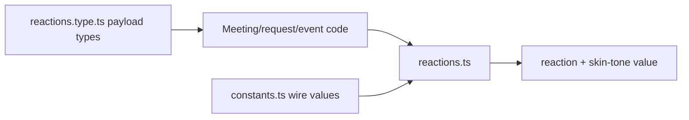
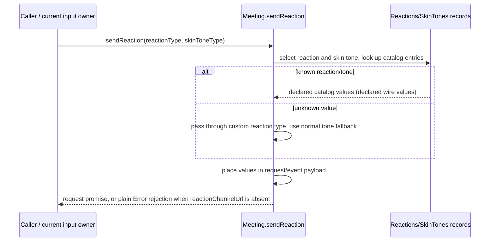
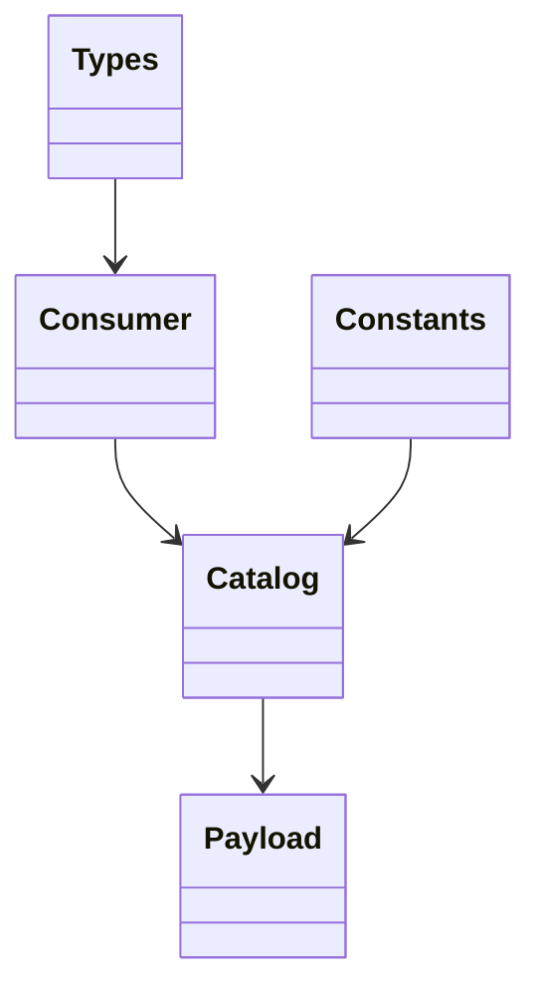

<!-- sdd-generated-metadata
doc_kind: module-spec
generated_from: module-spec@0.3.0
generated_by: claude-code
approved_by: rarajes2@cisco.com
updated_at: 2026-11-17T03:14:21Z
validation_status: pass-with-warnings
-->

# Reactions

This source-local document at `src/reactions/docs/README.md` owns the stable specification for
**the reactions module** of `@webex/plugin-meetings`: static reaction and skin-tone catalogs plus the
TypeScript shapes for reaction, sender, and relay payloads. Ground every claim in package evidence
and link to the [package architecture](../../../docs/architecture.md) instead of repeating broader
facts. No service specification exists because this package is a library.

Related context — start here: root [package agent instructions](../../../AGENTS.md) · router
[documentation index](../../../docs/index.md) · system [package architecture](../../../docs/architecture.md).
This is the canonical source-local spec for `src/reactions/`.

Repo architecture: [package architecture](../../../docs/architecture.md) · Registry:
[documentation index](../../../docs/index.md) · Coverage state and contracts baseline: `.sdd/manifest.json`.

## Metadata

| Field | Value |
|---|---|
| Owner | @webex/web-client, @webex/web-sdk |
| Source path | `src/reactions` |
| Resource kind | module |
| Status | Draft |
| Last verified | 2026-11-16 at `0b8c34db7f` |
| Module id | `plugin-meetings/reactions` |
| Parent spec | — |
| Doc kind | Module spec |
| Coverage score | Pending coverage assessment |
| Validation status | not-run |

## Applicability

| Condition ID | Status | Evidence or reason | Owned section |
| ------------ | ------ | ------------------ | ------------- |
| `module.has_tiers` | N/A | No tier policy exists in `package.json` or `.sdd/manifest.json` | Tier |
| `module.has_ui` | N/A | `src/reactions/reactions.ts` declares data only; the module renders nothing | UI use-case flow |
| `module.crosses_service_boundaries` | N/A | The module issues no request; Meeting sends and receives reactions in `src/meeting/index.ts` and `src/meeting/request.ts` | Cross-boundary use-case flow |
| `module.holds_client_state` | N/A | The catalogs in `src/reactions/reactions.ts` are constant records | Client state model |
| `module.enforces_domain_rules` | Applicable | The closed reaction and skin-tone enums in `src/reactions/reactions.type.ts` key the catalogs in `src/reactions/reactions.ts` | Business rules and invariants |
| `module.is_concurrent_async` | N/A | No promise, timer, or listener in `src/reactions/reactions.ts` or `src/reactions/reactions.type.ts` | Concurrency and reactive flow |
| `module.owns_persistence` | N/A | Nothing is stored; `src/reactions/reactions.ts` is static data | Data, schema, and migration discipline |
| `module.stateful_transitions` | N/A | No state changes in `src/reactions/reactions.ts` | State machine |
| `module.exposes_wire_protocol` | Applicable | The catalog values and the relay constant in `src/reactions/constants.ts` are the values Meeting sends to and matches from the reaction service | Protocol and wire format |
| `module.ui_multi_screen` | N/A | No UI | UI flow |
| `module.large_data_model` | N/A | Six small types in `src/reactions/reactions.type.ts` | Data model |
| `module.returns_caller_errors` | N/A | Nothing in `src/reactions/reactions.ts` throws or rejects; the send rejection belongs to `src/meeting/index.ts` | Caller-visible failure modes |
| `module.module_specific_conventions` | N/A | Repository-wide rules in `AGENTS.md` apply unchanged | Module-specific rules |
| `module.published_package` | Applicable | `src/index.ts` re-exports the catalogs and the Reaction type from the package named in `package.json` | Export stability |
| `module.embedded_in_host` | N/A | No mount or theme contract | Host integration and theming |
| `module.has_design_tradeoff` | N/A | No recorded trade-off in `src/reactions/reactions.ts` | Key design trade-off |
| `module.has_submodules` | N/A | The module directory has no child module | Sub-modules |

## Evidence register

Requirements cite current source and mirrored tests. Current code wins over retained prose when they
conflict; commit and PR history are excluded. Missing evidence stays a gap.

| Evidence | What it establishes |
| -------- | ------------------- |
| `src/reactions/reactions.ts` | `Reactions` (13 entries keyed by `ReactionServerType`) and `SkinTones` (6 entries keyed by `SkinToneType`), each entry holding `type`, `codepoints`, and `shortcodes`; exported as named exports only |
| `src/reactions/reactions.type.ts` | `EmoticonData`, `SkinTone`, `Reaction`, the `ReactionServerType` and `SkinToneType` enums, `Sender`, `ProcessedReaction`, and `RelayEvent` (with the unexported `RelayEventData`) |
| `src/reactions/constants.ts` | `REACTION_RELAY_TYPES.REACTION` is `'react'` |
| `src/index.ts` | Re-exports `src/reactions/reactions.ts` as the `REACTIONS` namespace and the `Reaction` type; no other reactions export reaches the package entry |
| `src/meeting/index.ts` | `sendReaction` looks up `Reactions[reactionType] || {type: reactionType}` and `SkinTones[skinToneType] || SkinTones.normal`; `processRelayEvent` handles relay type `react` and emits `meeting:receiveReactions` with a `ProcessedReaction` |
| `src/meeting/request.ts`, `src/meeting/request.type.ts` | `sendReaction` POSTs `{sender: {participantId}, reaction}` to `reactionChannelUrl`; `SendReactionOptions.reaction` is typed `Reaction` |
| `src/constants.ts` | `EVENT_TRIGGERS.MEETING_RECEIVE_REACTIONS` is `meeting:receiveReactions` |
| `test/unit/spec/meeting/index.js` | `#sendReaction` cases assert the serialized `thumb_down` and `light` catalog values, the custom-type pass-through, the `normal` tone fallback, and the missing-URL rejection; `#processRelayEvent` cases assert the emitted processed reaction and the unknown-sender skip |
| `test/unit/spec/meeting/request.js` | `#sendReaction` asserts the POST method, URI, sender, and reaction body |
| Observation, no stated WHY | `Meeting.processRelayEvent` acts only when the meeting config `receiveReactions` is truthy, and `src/config.ts` declares no default for it, so a host that does not set it receives no `meeting:receiveReactions` events (`src/meeting/index.ts`, `src/config.ts`) |

## Purpose and boundary

- Responsibility: Defines static reaction and skin-tone catalogs plus TypeScript shapes for reaction,
  sender, and relay payloads; owning Meeting code performs runtime lookup and fallback.
- In scope: the `Reactions` and `SkinTones` records, the `REACTION_RELAY_TYPES` constant, and the
  types in `src/reactions/reactions.type.ts`.
- Out of scope: choosing, serializing, and sending a reaction (`Meeting.sendReaction`,
  `MeetingRequest.sendReaction`); receiving relay events from the LLM data channel and emitting
  `meeting:receiveReactions` (`Meeting.processRelayEvent`); enabling reactions for a meeting
  (`Meeting.toggleReactions`, owned by the meeting module, `src/meeting/docs/README.md`).
- Consumers: `src/meeting/index.ts`, `src/meeting/request.type.ts`, and, through the `REACTIONS`
  namespace and the `Reaction` type in `src/index.ts`, applications using the published package.

## Structure and key files

`src/reactions` contains 3 direct source/reference file(s) and has 0 mirrored unit-test file(s). Stack:
TypeScript/JavaScript in the Node 22.14 Yarn workspace; Webex core/plugin abstractions and
Mocha/Sinon/`@webex/test-helper-chai` tests. The module has no runtime import beyond its own files.

```text
src/reactions/
├── constants.ts — module constants and wire values (REACTION_RELAY_TYPES)
├── reactions.ts — Reactions and SkinTones catalogs
├── reactions.type.ts — reactions.type payload types and enums
└── docs/README.md — canonical module specification
```

| File | Holds |
|---|---|
| `src/reactions/constants.ts` | module constants and wire values: `REACTION_RELAY_TYPES` with `REACTION: 'react'` |
| `src/reactions/reactions.ts` | reactions implementation responsibility: the `Reactions` and `SkinTones` catalog records |
| `src/reactions/reactions.type.ts` | reactions.type implementation responsibility: emoticon, reaction, sender, processed-reaction, and relay types and the two catalog-key enums |
| no source-local mirrored test directory | explicit characterization gap; behavior is exercised through `test/unit/spec/meeting/index.js` and `test/unit/spec/meeting/request.js` |

## Public surface

| Contract ID | Type | Surface | Purpose | Compatibility / deprecation | Schema / detail link | Root index |
|---|---|---|---|---|---|---|
| `reactions-catalog` | exported catalogs | `Reactions` and `SkinTones` (published as the `REACTIONS` namespace), plus the internal `REACTION_RELAY_TYPES` | Define the supported relay, reaction, and skin-tone values consumed by Meeting request/event code. | Preserve existing raw values; add new catalog members compatibly. `REACTION_RELAY_TYPES` is not re-exported by `src/index.ts`. | `src/reactions/constants.ts`, `src/reactions/reactions.ts` | [package architecture](../../../docs/architecture.md) |
| `reactions-catalog` | exported types | `Reaction` (published), and the internal `EmoticonData`, `SkinTone`, `ReactionServerType`, `SkinToneType`, `Sender`, `ProcessedReaction`, and `RelayEvent` | Type the sender, relay, server, and normalized reaction payloads crossing the Meeting boundary. | Type changes must remain compatible with existing relay and sender shapes. Only `Reaction` is re-exported by `src/index.ts`. | `src/reactions/reactions.type.ts` | [package architecture](../../../docs/architecture.md) |

Contract ID `reactions-catalog` is indexed in the
[package architecture](../../../docs/architecture.md) and registered in `.sdd/manifest.json`; its
native source is `package.json`. The module requires no contract.

This module emits no event. The Meeting module emits or forwards these observable literals for the
reaction boundary. Preserve literal values, scope, payload shape, and emission timing; a constant name
alone is not a substitute for the consumer-visible value.

| Event literal | Constant / expression | Emission evidence |
|---|---|---|
| `meeting:receiveReactions` | `EVENT_TRIGGERS.MEETING_RECEIVE_REACTIONS` | `src/meeting/index.ts` |

Compatibility notes:

- Prefer additive fields/options and preserve current return and rejection semantics. Internal helpers are not public merely because they are exported within the source directory.

## Dependencies

Reaction constants/types and Meeting reaction request/event paths.

| Dependency | Why it is required | Failure behavior |
| ---------- | ------------------ | ---------------- |
| `src/reactions/constants.ts` (within the module) | `reactions.type.ts` reads `REACTION_RELAY_TYPES` to type `RelayEventData.relayType` | — |
| Meeting reaction request/event paths (consumers, not imports) | `Meeting.sendReaction` and `Meeting.processRelayEvent` give the catalog and types their runtime meaning | Failures are owned by the meeting module |

## Requirements

| ID | WHAT | WHY | Source Evidence | Test / Example Evidence | Assumptions / Gaps | Confidence |
|---|---|---|---|---|---|---|
| `REACTIONS-R-001` | Export the supported `Reactions` and `SkinTones` record values without executable normalization or transport behavior. | Owning Meeting code needs one stable catalog of server type/codepoint/shortcode values while retaining responsibility for selection and fallback. | `src/reactions/reactions.ts` | `test/unit/spec/meeting/index.js`, `test/unit/spec/meeting/request.js` | no source-local mirrored test exists | PRESENT |
| `REACTIONS-R-002` | Type reaction, sender, and relay payloads: `Reaction` is `EmoticonData` (`type`, optional `codepoints` and `shortcodes`) with an optional `tone`; `Sender` has `displayName` and `participantId`; `ProcessedReaction` has `reaction` and `sender: {id, name}`; `RelayEvent` has `data: {relayType, reaction, sender}` and optional `headers.route`. | Meeting serialization depends on the exact reaction, skin-tone, sender, and relay type vocabulary. | `src/reactions/reactions.ts`, `src/reactions/reactions.type.ts` | `test/unit/spec/meeting/request.js`, `test/unit/spec/meeting/index.js` | catalog values need an exhaustive serializer compatibility matrix in the owning Meeting tests | PRESENT |
| `REACTIONS-R-003` | The catalogs are plain records and perform no validation, parsing, serialization, or fallible I/O; `Meeting.sendReaction` passes an unknown reaction type through as `{type}` and falls back to the normal skin tone (`normal_skin_tone`, empty codepoints and shortcodes) for an unknown or missing tone. | The spec must not turn static data declarations into a runtime normalization API or rejection contract. | `src/reactions/reactions.ts`, `src/reactions/constants.ts`, `src/meeting/index.ts` | `test/unit/spec/meeting/index.js`, `test/unit/spec/meeting/request.js` | none | PRESENT |
| `REACTIONS-R-004` | `REACTION_RELAY_TYPES.REACTION` is the literal `react`; `Meeting.processRelayEvent` handles a relay event only when `data.relayType` equals it and ignores every other relay type. | The relay event switch in Meeting matches on this literal, so changing it would silently drop received reactions. | `src/reactions/constants.ts`, `src/meeting/index.ts` | `test/unit/spec/meeting/index.js` | none | PRESENT |

## Design overview

`reactions.ts` and `constants.ts` export static reaction/skin-tone values, while `reactions.type.ts`
supplies compile-time payload shapes. The module has no runtime transport or lifecycle state.

Each catalog entry is keyed by the enum member that names it (`Record<ReactionServerType, Reaction>`
and `Record<SkinToneType, SkinTone>`), so TypeScript requires one entry per enum member. A reaction's
`type` equals its key; a skin tone's `type` is the key with `_skin_tone` appended (`light` maps to
`light_skin_tone`). Meeting builds the sent reaction by spreading the catalog entry and adding the
resolved skin tone as `tone`.

## Data flow and sequence coverage

Call style: in-process imports only. The module is read by `Meeting.sendReaction`, which sends the
result over HTTPS through `MeetingRequest.sendReaction`, and by `Meeting.processRelayEvent`, which
receives relay events from the LLM data channel. This is a trivial catalog/type module with one operation group; reaction
serialization and sending are owned by Meeting, so one sequence diagram covers it.



Sequence coverage:

| Operation group | Diagram | Failure coverage |
|---|---|---|
| UC-1…UC-2 — reaction catalog and payload operation groups | Reaction catalog and payload sequence | catalog/type-only behavior and owning Meeting serialization/request failure; consumer supplies a value outside the exported catalog, or `reactionChannelUrl` is absent and Meeting rejects |

Reaction catalog and payload sequence:



## Class and component relationships



The arrows identify ownership and delegation inside `src/reactions/`; files that only declare types or
constants are not presented as transports. `Consumer` is Meeting code, `Catalog` is
`src/reactions/reactions.ts`, `Constants` is `src/reactions/constants.ts`, `Types` is
`src/reactions/reactions.type.ts`, and `Payload` is the reaction body Meeting sends.

## Use cases and flows

| Use case | Actor or caller | Primary steps and outcome | Failure or boundary behavior | Evidence |
| -------- | --------------- | ------------------------- | ---------------------------- | -------- |
| `UC-1` | Application calling `Meeting.sendReaction` | Resolve consumer reaction and skin-tone choices from the exported `Reactions` and `SkinTones` catalogs before `Meeting.sendReaction()` serializes them. | An unknown reaction type is sent as `{type}`; an unknown tone becomes `normal`; a missing `reactionChannelUrl` rejects in Meeting | `src/reactions/reactions.ts`, `src/meeting/index.ts`, `test/unit/spec/meeting/index.js` |
| `UC-2` | Meeting receiving an LLM relay event | Carry sender identity and relay payloads through the exported reaction types while leaving parsing, validation, and transport to Meeting. | Meeting skips an event whose sender is not a member (outside webinars) | `src/reactions/reactions.type.ts`, `src/meeting/index.ts`, `test/unit/spec/meeting/index.js` |

## Business rules and invariants

- Consumer/server reaction and skin-tone values use declared enums/catalogs; participant sender data
  follows package privacy rules. Enforced under `src/reactions/reactions.type.ts` and
  `src/reactions/reactions.ts`.

| ID | Invariant | WHY | Enforcement source | Test evidence |
| -- | --------- | --- | ------------------ | ------------- |
| `INV-001` | `Reactions` has exactly one entry per `ReactionServerType` member (13) and `SkinTones` one per `SkinToneType` member (6); each reaction's `type` equals its key. | Meeting looks entries up by the caller's string, so key and server value must agree (`REACTIONS-R-001`). | `src/reactions/reactions.ts`, `src/reactions/reactions.type.ts` | `test/unit/spec/meeting/index.js` |
| `INV-002` | `SkinTones.normal` has type `normal_skin_tone` with empty `codepoints` and `shortcodes`. | It is the fallback tone Meeting attaches to every reaction without a known tone (`REACTIONS-R-003`). | `src/reactions/reactions.ts` | `test/unit/spec/meeting/index.js` |

## Protocol and wire format

- `src/reactions/` declares catalog values and TypeScript payload shapes used by owning request/event
  code. Preserve type names, enum/raw values, sender identity fields, and relay structure; parsing and
  serialization occur outside this module.

| Message or frame | Version | Producer or serializer | Consumer or parser | Compatibility and ordering rule |
| ---------------- | ------- | ---------------------- | ------------------ | ------------------------------- |
| Reaction send body `{sender: {participantId}, reaction: {type, codepoints, shortcodes, tone}}` | Unversioned | `src/meeting/request.ts` | Reaction service at `reactionChannelUrl` | The `reaction` object is a catalog entry plus `tone`, or `{type, tone}` for an unknown type |
| Relay event `{data: {relayType: 'react', reaction, sender: {displayName, participantId}}, headers: {route}}` | Unversioned | LLM data channel | `src/meeting/index.ts` | Only `relayType` `react` is handled; `headers.route` is checked against the active binding |
| Reaction codes: smile `1F642`, sad `1F625`, wow `1F62E`, haha `1F603`, celebrate `1F389`, clap `1F44F`, thumb_up `1F44D`, thumb_down `1F44E`, heart `2764`, fire `1F525`, prayer `1F64F`, speed_up `1F407`, slow_down `1F422` | — | `src/reactions/reactions.ts` | Reaction service | Raw `type`, `codepoints`, and `shortcodes` values are sent as declared |
| Skin tones: normal (empty), light `1F3FB`, medium_light `1F3FC`, medium `1F3FD`, medium_dark `1F3FE`, dark `1F3FF`, with shortcodes `:skin-tone-2:` to `:skin-tone-6:` | — | `src/reactions/reactions.ts` | Reaction service | The `type` sent is the `_skin_tone` form, not the key |

## Pitfalls and constraints

- Display glyph/name and server relay type are different representations. Send the declared server value, not an arbitrary UI label.
- Verify both typed constants/enums and raw wire values before changing a logical condition in this legacy package.
- `Meeting.sendReaction` types `reactionType` as `string`, not `ReactionServerType`, so any string is
  sent; only the catalog keys carry codepoints and shortcodes.
- A skin tone's key and its sent `type` differ (`light` and `light_skin_tone`); code that compares a
  received tone must use the `type` form.

## Export stability

| Export or entry point | Consumer | Stability | Versioning and deprecation rule | Declaration or API report |
| --------------------- | -------- | --------- | ------------------------------- | ------------------------- |
| `REACTIONS` namespace (`export * as REACTIONS from './reactions/reactions'`): `REACTIONS.Reactions` and `REACTIONS.SkinTones` | Applications using `@webex/plugin-meetings` | Public (contract `reactions-catalog`) | Follows the package version in `package.json`; removing or renaming a catalog key or changing a raw `type`, `codepoints`, or `shortcodes` value is a breaking change, while adding an entry is additive (`REACTIONS-R-001`) | `src/index.ts`, `src/reactions/reactions.ts`, `package.json` |
| `Reaction` type (`export {type Reaction}`) | TypeScript applications | Public (contract `reactions-catalog`) | Same version rule; new fields must be optional (`REACTIONS-R-002`) | `src/index.ts`, `src/reactions/reactions.type.ts`, `package.json` |
| `REACTION_RELAY_TYPES`, `EmoticonData`, `SkinTone`, `ReactionServerType`, `SkinToneType`, `Sender`, `ProcessedReaction`, `RelayEvent` | Package code only | Internal | Not reachable from the package entry; may change with their Meeting callers | `src/reactions/constants.ts`, `src/reactions/reactions.type.ts` |

The build emits declarations to `dist/types` (the `build` script in `package.json`); no API report is
committed.

## Verification

No mirrored module test directory exists. Characterize the reactions-specific use cases above and each
listed failure condition through the owning Meeting tests; add cleanup or transition cases only for
resources and state this module actually owns.

| Behavior / Requirement | Existing test evidence | Gap |
|---|---|---|
| `REACTIONS-R-001` | `test/unit/spec/meeting/index.js` | cover every exported catalog value and payload shape through owning Meeting serialization tests; only `thumb_down`, `light`, and `normal` are asserted |
| `REACTIONS-R-002` | `test/unit/spec/meeting/request.js` | keep serializer coverage tied to every exported reaction and skin-tone raw value |
| `REACTIONS-R-003` | `test/unit/spec/meeting/index.js` | add a boundary case showing transport failure belongs to Meeting rather than this catalog/type module |
| `REACTIONS-R-004` | `test/unit/spec/meeting/index.js` | no case sends a relay event with another `relayType` |

A module specification is complete only when its public surface, invariants, failure modes, and test
evidence agree with the implementation.
