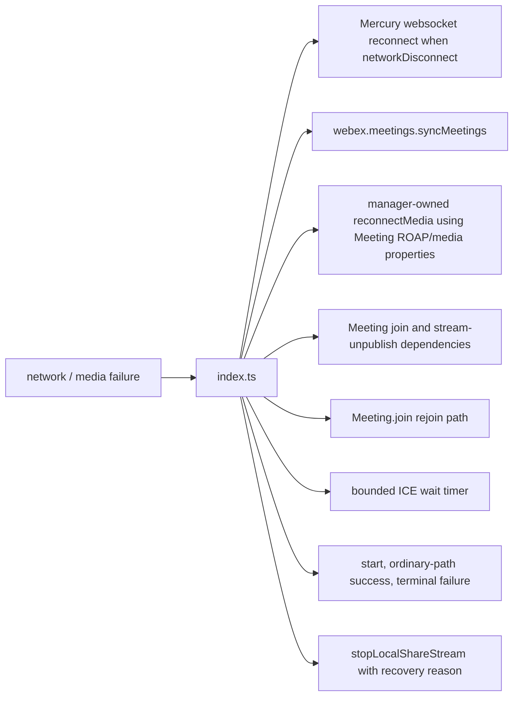
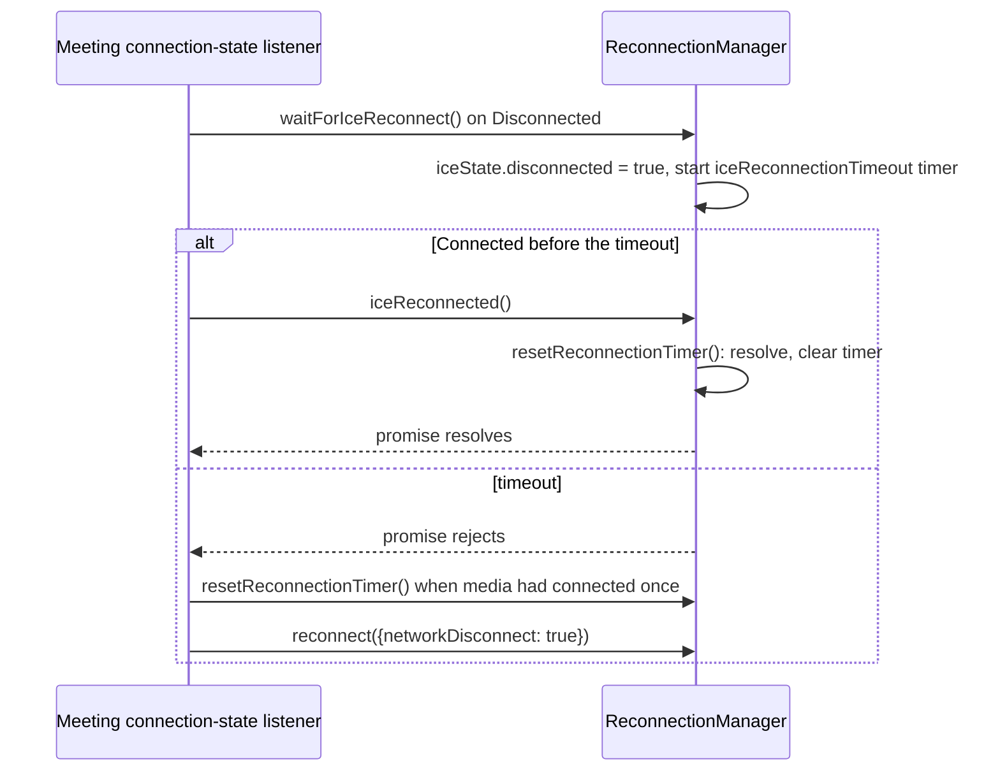
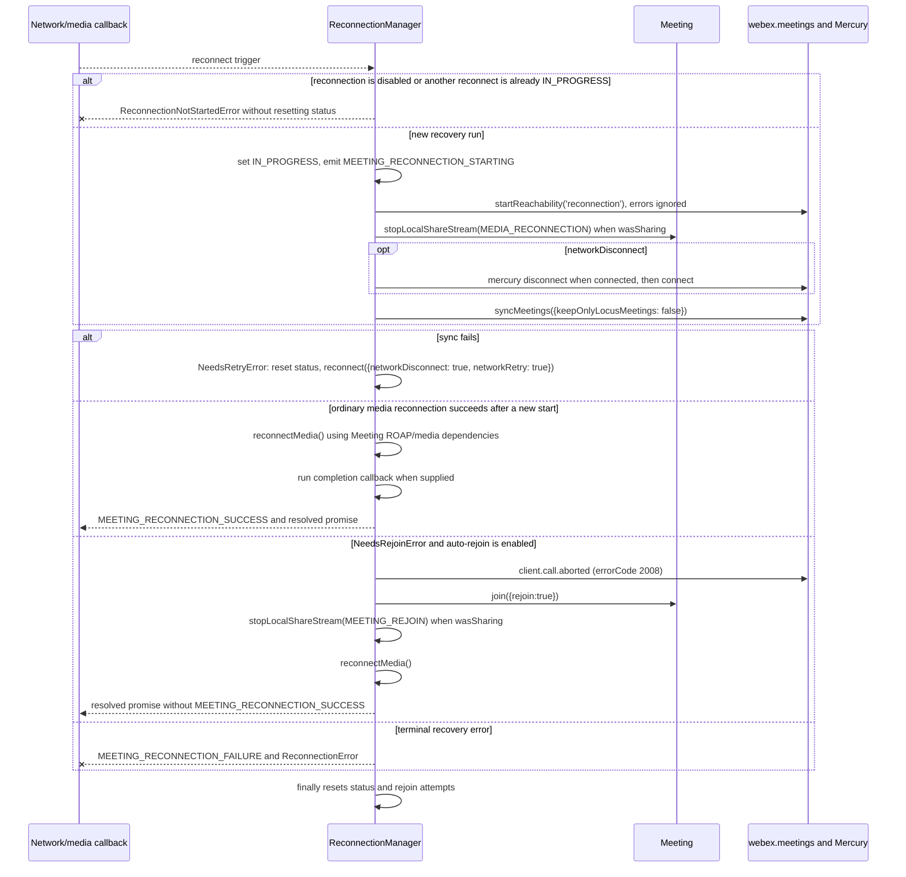
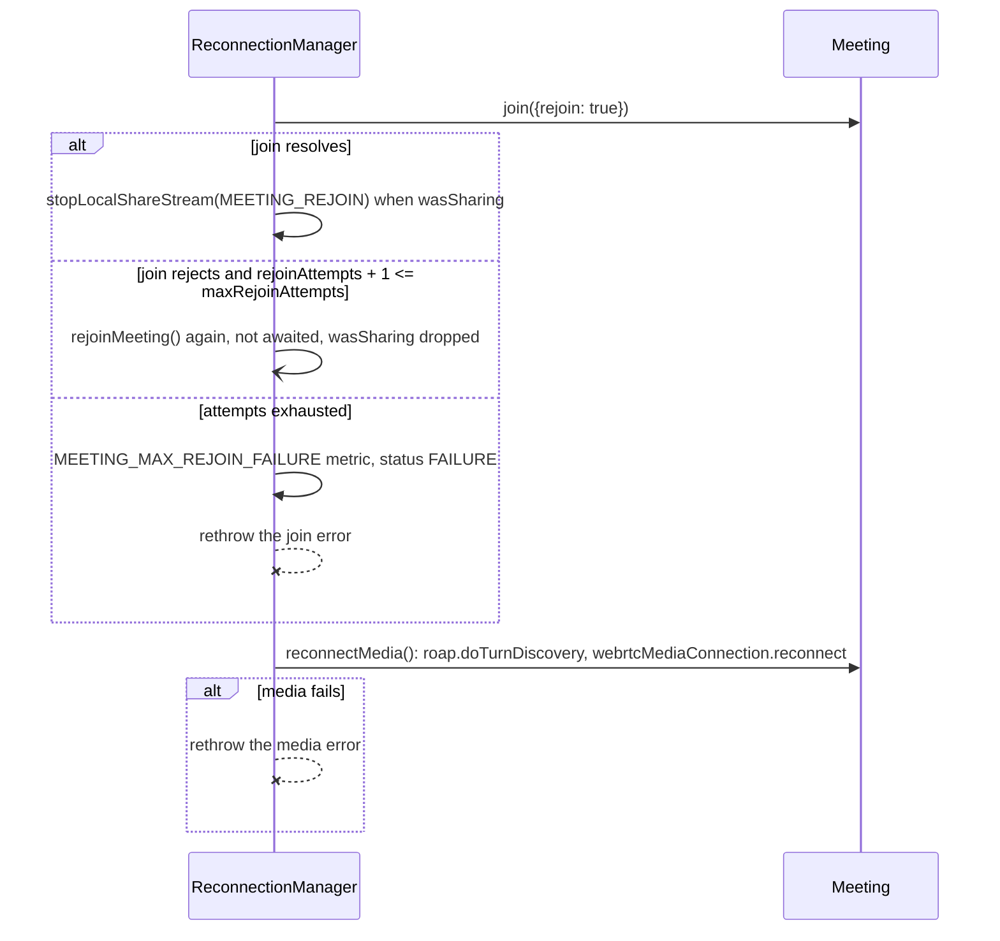
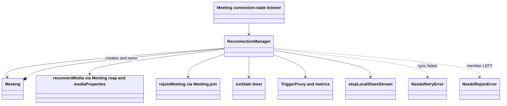

<!-- sdd-generated-metadata
doc_kind: module-spec
generated_from: module-spec@0.3.0
generated_by: claude-code
approved_by: rarajes2@cisco.com
updated_at: 2026-11-17T03:14:21Z
validation_status: pass-with-warnings
-->

# Reconnection manager

This source-local document at `src/reconnection-manager/docs/README.md` owns the stable
specification for **the reconnection manager**: the `ReconnectionManager` class that one `Meeting`
creates for itself and uses to recover from network and media failures. It waits a bounded time for
ICE to come back, then runs one recovery at a time — optionally reconnecting the Mercury websocket,
syncing meetings, and renewing the media connection — and rejoins the meeting when Locus shows the
user as LEFT. Ground every claim in package evidence and link to the
[package architecture](../../../docs/architecture.md) instead of repeating broader facts. No service
specification exists because this package is a library.

Related context: [documentation index](../../../docs/index.md) ·
[package agent instructions](../../../AGENTS.md) ·
[module registry](../../../docs/specs/README.md) ·
[owning Meeting specification](../../meeting/docs/README.md).
Repo architecture: [package architecture](../../../docs/architecture.md) · Registry:
[module registry](../../../docs/specs/README.md). Coverage state and contracts baseline:
`.sdd/manifest.json` routes this module and registers its contract IDs.

## Metadata

| Field             | Value |
| ----------------- | ----- |
| Owner             | @webex/web-client, @webex/web-sdk |
| Source path       | `src/reconnection-manager` |
| Resource kind     | module |
| Status            | Draft |
| Last verified     | 2026-11-16 at `0b8c34db7f` |
| Module id         | `plugin-meetings/reconnection-manager` |
| Parent spec       | — |
| Doc kind          | Module spec |
| Coverage score    | Pending coverage assessment |
| Validation status | not-run |

## Applicability

| Condition ID                         | Status     | Evidence or reason | Owned section |
| ------------------------------------ | ---------- | ------------------ | ------------- |
| `module.has_tiers`                   | N/A        | No tier policy exists in `package.json` or `src/reconnection-manager/index.ts` | Tier |
| `module.has_ui`                      | N/A        | `src/reconnection-manager/index.ts` renders nothing; it returns promises and emits meeting events | UI use-case flow |
| `module.crosses_service_boundaries`  | N/A        | `src/reconnection-manager/index.ts` sends no request itself; Locus, TURN, Mercury, and metrics traffic goes through the owning Meeting, webex.meetings, and the Mercury and metrics plugins | Cross-boundary use-case flow |
| `module.holds_client_state`          | Applicable | `src/reconnection-manager/index.ts` keeps the reconnection status, the rejoin attempt count, and the ICE wait state | Client state model |
| `module.enforces_domain_rules`       | Applicable | The single-run guard, the rejoin bound, and the LEFT-state rules in `src/reconnection-manager/index.ts` | Business rules and invariants |
| `module.is_concurrent_async`         | Applicable | Every recovery step is awaited, the ICE wait is a timer, and a failed rejoin retries without awaiting (`src/reconnection-manager/index.ts`) | Concurrency and reactive flow |
| `module.owns_persistence`            | N/A        | Nothing is stored outside the instance (`src/reconnection-manager/index.ts`) | Data, schema, and migration discipline |
| `module.stateful_transitions`        | Applicable | The status moves between the default, IN_PROGRESS, and FAILURE values of RECONNECTION.STATE in `src/constants.ts` | State machine |
| `module.exposes_wire_protocol`       | N/A        | The module builds no payload; the metric and event payloads it hands to other modules are listed under Public surface | Protocol and wire format |
| `module.ui_multi_screen`             | N/A        | No UI | UI flow |
| `module.large_data_model`            | N/A        | The state is five fields, listed under Client state model | Data model |
| `module.returns_caller_errors`       | Applicable | `src/reconnection-manager/index.ts` throws ReconnectionNotStartedError and ReconnectionError, from `src/common/errors/reconnection-not-started.ts` and `src/common/errors/reconnection.ts` | Caller-visible failure modes |
| `module.module_specific_conventions` | N/A        | The module follows the package rules in `AGENTS.md`; it adds none of its own | Module-specific rules |
| `module.published_package`           | N/A        | `src/index.ts` does not export the class; only `src/meeting/index.ts` imports it | Export stability |
| `module.embedded_in_host`            | N/A        | No host theme or embed API | Host integration and theming |
| `module.has_design_tradeoff`         | Applicable | Recovery escalates from waiting, to media reconnect, to rejoin, inside the owning Meeting (`src/reconnection-manager/index.ts`) | Key design trade-off |
| `module.has_submodules`              | N/A        | The directory holds one source file and no child module | Sub-modules |

## Evidence register

Requirements cite current implementation and mirrored unit-test paths. Code wins over prose when
they conflict, and commit and PR history are excluded as evidence by repository-owner decision.
Missing test evidence is stated as a gap rather than inferred.

| Evidence | What it establishes |
| -------- | ------------------- |
| `src/reconnection-manager/index.ts` | `ReconnectionManager` (default export), the module-private `NeedsRetryError` and `NeedsRejoinError`, every public method, and the private `canStartReconnection`, `stopLocalShareStream`, `executeReconnection`, and `reconnectMercuryWebSocket`. Its JSDoc and code comments are the recorded rationale |
| `src/constants.ts` | `RECONNECTION.STATE` (`IN_PROGRESS`, `FAILURE`, default `''`), `SHARE_STATUS`, `SHARE_STOPPED_REASON` (`SELF_STOPPED`, `MEETING_REJOIN`, `MEDIA_RECONNECTION`, `TRACK_ENDED`), and the `EVENT_TRIGGERS` literals emitted here |
| `src/config.ts` | `meetings.reconnection` defaults: `enabled` false, `autoRejoin` true, `detection` true, `iceReconnectionTimeout` 10000 ms, `maxRejoinAttempts` 3, with comments that state what the timeout and the attempt limit are for |
| `src/metrics/constants.ts` | Behavioral metric names `js_sdk_meeting_reconnect_failures` and `js_sdk_meeting_max_rejoin_failure` |
| `src/common/errors/reconnection.ts`, `src/common/errors/reconnection-not-started.ts` | The two error classes the module throws |
| `src/meeting/index.ts` | The only importer: the constructor creates the manager; `reconnect()` guards media state, cleans up, passes a completion callback that waits for the remote SDP answer and the media connection, and resolves on ReconnectionNotStartedError; the connection-state listener calls `waitForIceReconnect`, `iceReconnected`, and `resetReconnectionTimer`; `moveTo` calls `cleanUp` |
| `src/meeting/util.ts` | `MeetingUtil.cleanUp` calls `reconnectionManager.cleanUp()` after closing streams and peer connections |
| `test/unit/spec/reconnection-manager/index.js` | Mocha and Sinon cases for `reconnect` (sync, reachability, TURN information, media re-request, metrics and events, the two not-started guards), `iceReconnected`, `waitForIceReconnect`, and `cleanUp` |
| `test/unit/spec/meeting/index.js` | Meeting-side cases for `#reconnect` and for the Disconnected connection state with `waitForIceReconnect` resolving or rejecting |
| Observation: a failed rejoin retries without waiting | When `meeting.join({rejoin: true})` fails and attempts remain, `rejoinMeeting` calls itself without `await` and without `wasSharing`, then continues to `reconnectMedia()` in the same call (`src/reconnection-manager/index.ts`). No code comment or test states why the retry is not awaited |
| Observation: a failed meetings sync retries without limit | `NeedsRetryError` resets the status and calls `reconnect({networkDisconnect: true, networkRetry: true})` again, with no attempt counter (`src/reconnection-manager/index.ts`). No code comment or test states a bound |
| Observation: shareStatus is declared but unused | The class declares `shareStatus`, but sharing is read from `meeting.shareStatus` (`src/reconnection-manager/index.ts`) |

## Purpose and boundary

- Responsibility: coordinates network/media recovery for one Meeting, escalating from reconnecting
  media to rejoining the meeting when required. The rejoin is bounded by `maxRejoinAttempts`; a
  failed meetings sync restarts the run with no bound.
- In scope: the duplicate-run and enabled guards; the bounded ICE wait (`waitForIceReconnect`,
  `iceReconnected`, `resetReconnectionTimer`); one recovery run (`reconnect`), with the optional
  Mercury websocket reconnect, the meetings sync, the ended-meeting and LEFT-state checks, and the
  media reconnect (`reconnectMedia`); the meeting rejoin (`rejoinMeeting`); stopping a local share
  when recovery starts; the reconnection events and metrics; `reset` and `cleanUp`.
- Out of scope: deciding when to recover (the Meeting's connection-state listener and its
  `reconnect()` wrapper); TURN discovery (`src/roap`); the WebRTC connection and its ICE restart
  (`src/media` and `@webex/internal-media-core`); multistream media requests (`src/multistream`);
  joining (`Meeting.join`); the meetings sync and reachability (`src/meetings`, `src/reachability`);
  the websocket itself (`@webex/internal-plugin-mercury`).
- Consumers: `src/meeting/index.ts` only. Applications reach it as `meeting.reconnectionManager`, and
  usually through `meeting.reconnect()`.

## Structure and key files

`src/reconnection-manager/` contains 1 direct source file and has 1 mirrored unit-test file.
TypeScript source with Mocha, Sinon, and `@webex/test-helper-chai` unit tests: `test:unit` runs
`webex-legacy-tools test --unit --runner mocha`, and the build target is
`yarn workspace @webex/plugin-meetings build:src` (`package.json`).

| File | Holds |
| ---- | ----- |
| `src/reconnection-manager/index.ts` | module facade and controller: the `ReconnectionManager` default export (its only export), with the module-private `NeedsRetryError` and `NeedsRejoinError` primary control-flow errors |
| `test/unit/spec/reconnection-manager/index.js` | mirrored characterization/unit coverage of `reconnect`, the ICE wait, and `cleanUp` |
| `src/reconnection-manager/docs/README.md` | This module specification, the canonical module specification for this folder |

## Public surface

| Contract ID | Type | Surface | Purpose | Compatibility / deprecation | Schema / detail link | Root index |
|---|---|---|---|---|---|---|
| `reconnection-manager` | SDK / state | `ReconnectionManager.isReconnectInProgress()`, `reset()`, and `cleanUp()` | Expose the duplicate-run guard and reset only reconnection status plus rejoin attempts. | `cleanUp()` calls `reset()`; neither clears `iceState.timer` nor settles/clears the ICE wait. Use `resetReconnectionTimer()` for that separate state. | `src/reconnection-manager/index.ts` | [architecture](../../../docs/architecture.md#public-and-consumer-surfaces) |
| `reconnection-manager` | SDK / ICE wait | `waitForIceReconnect()`, `iceReconnected()`, and `resetReconnectionTimer()` | Wait for a bounded ICE recovery signal and settle/clear the owned timer and resolver. | Preserve the `iceReconnectionTimeout` duration (10000 ms default), resolve-on-reconnect, reject-on-timeout, the immediately resolved promise while a wait is pending, and reset ordering. | `src/reconnection-manager/index.ts`, `src/config.ts` | [architecture](../../../docs/architecture.md#public-and-consumer-surfaces) |
| `reconnection-manager` | SDK / recovery | `reconnect({networkDisconnect, networkRetry}, completionCallback)` | Run one guarded recovery sequence, emitting success after the ordinary recovery/completion-callback path and failure on terminal errors. | A successful auto-rejoin returns before `MEETING_RECONNECTION_SUCCESS`; disabled/duplicate starts throw, and terminal failure resets status/attempts in `finally`. | `src/reconnection-manager/index.ts` | [architecture](../../../docs/architecture.md#public-and-consumer-surfaces) |
| `reconnection-manager` | SDK / recovery | `reconnectMedia()` | Renew the current media connection: forced TURN discovery, `webrtcMediaConnection.reconnect(iceServers)`, and a multistream media-request commit. | No attempt limit of its own; a failure is terminal for `reconnect()` and is rethrown by `rejoinMeeting()`. | `src/reconnection-manager/index.ts` | [architecture](../../../docs/architecture.md#public-and-consumer-surfaces) |
| `reconnection-manager` | SDK / recovery | `rejoinMeeting(wasSharing)` | Rejoin the meeting up to `maxRejoinAttempts` extra times, stop a share that was active at recovery start with the recovery reason, then reconnect media. | Current code does not restore or republish sharing after recovery. | `src/reconnection-manager/index.ts` | [architecture](../../../docs/architecture.md#public-and-consumer-surfaces) |

Contract ID `reconnection-manager` is indexed in the
[package architecture](../../../docs/architecture.md#public-and-consumer-surfaces) and registered in
`.sdd/manifest.json`; this module requires `meeting-api` and `media-connection`. The class is not
exported from `src/index.ts`.

Emitted events. Current source emits or forwards these observable literals for this operation
boundary. Preserve literal values, scope, payload shape, and emission timing; a constant name alone
is not a substitute for the consumer-visible value.

| Event literal | Constant / expression | Emission evidence |
|---|---|---|
| `meeting:reconnectionFailure` | `EVENT_TRIGGERS.MEETING_RECONNECTION_FAILURE` | `src/reconnection-manager/index.ts` |
| `meeting:reconnectionStarting` | `EVENT_TRIGGERS.MEETING_RECONNECTION_STARTING` | `src/reconnection-manager/index.ts` |
| `meeting:reconnectionSuccess` | `EVENT_TRIGGERS.MEETING_RECONNECTION_SUCCESS` | `src/reconnection-manager/index.ts` |
| `meeting:stoppedSharingLocal` | `EVENT_TRIGGERS.MEETING_STOPPED_SHARING_LOCAL` | `src/meeting/index.ts`, `src/reconnection-manager/index.ts` |

Every event is triggered on the owning Meeting. `meeting:reconnectionFailure` carries
`{error: ReconnectionError}` and `meeting:stoppedSharingLocal` carries `{reason}`.
`MEETING_RECONNECTION_SUCCESS` is emitted only after `executeReconnection()` and any completion
callback finish on the ordinary path. When a `NeedsRejoinError` is handled by successful automatic
rejoin, `reconnect()` returns immediately after `rejoinMeeting()` and skips that success event.
Terminal errors still emit `MEETING_RECONNECTION_FAILURE`.

Metrics. Through `webex.internal.newMetrics.submitClientEvent` the module submits
`client.media.reconnecting` (only when `networkRetry` is false), `client.call.aborted` with one
error `{category: 'expected', errorCode: 2008, fatal: true, name: 'media-engine', shownToUser:
false}` whenever recovery fails without a retry, and `client.media.recovered` with
`{recoveredBy: 'new'}` on ordinary success. Through `Metrics.sendBehavioralMetric` it sends
`MEETING_RECONNECT_FAILURE` (`correlation_id`, `locus_id`, `reason`, `stack`) on a terminal failure
and `MEETING_MAX_REJOIN_FAILURE` (`locus_id`, `reason`, `stack`) when rejoin attempts run out.

Compatibility notes:

- Prefer additive options and payload fields. Preserve method/event names, rejection semantics, and
  cleanup timing; route public changes through the owning `Meeting` (`src/meeting/index.ts`), since
  the class is not exported from `src/index.ts`.

## Dependencies

Requires the owning Meeting's lifecycle/media methods, its network state callbacks, timers, the
`reconnection` retry configuration, logging, events, and metrics.

Required contract IDs, as registered in `.sdd/manifest.json`: `meeting-api` and
`media-connection`. The other rows are reached through the owning Meeting's `webex` and carry no
separate contract for this module.

| Dependency | Why it is required | Failure behavior |
| ---------- | ------------------ | ---------------- |
| Owning `Meeting` (`src/meeting/index.ts`, contract `meeting-api`) | `config.reconnection`, `id`, `state`, `type`, `shareStatus`, `locusUrl`, `correlationId`, `isMultistream`, `join({rejoin: true})`, `unpublishStreams`, `roap.doTurnDiscovery`, and `mediaRequestManagers` | A rejected join is retried up to the limit; a rejected TURN discovery or media reconnect ends the run with ReconnectionError |
| Media connection (`src/media`, contract `media-connection`) | `meeting.mediaProperties.webrtcMediaConnection.reconnect(iceServers)` renews the WebRTC connection | A rejection ends the run with ReconnectionError |
| `webex.meetings` (`src/meetings/index.ts`) | `startReachability('reconnection')`, `syncMeetings({keepOnlyLocusMeetings: false})`, and `getMeetingByType('id', meeting.id)` | Reachability failure is logged and ignored; sync failure restarts the run (`NeedsRetryError`); a missing meeting ends it |
| `webex.internal.mercury` | `connected`, `disconnect()`, and `connect()` when `networkDisconnect` is true | Either failure ends the run with ReconnectionError and sets FAILURE until the outer reset |
| `webex.internal.device` | `url` for a log line after the websocket reconnects | — |
| `webex.internal.newMetrics` | `submitClientEvent` for the client events under Public surface | Not awaited |
| `src/metrics` (`Metrics.sendBehavioralMetric`) | The two behavioral failure metrics | Not awaited |
| `src/common/events/trigger-proxy.ts`, `src/common/logs/logger-proxy.ts` | Meeting-scoped events and logging | — |
| `src/multistream/mediaRequestManager.ts` | The type whose `commit()` resends media requests after a multistream reconnect | — |

## Requirements

| ID | WHAT | WHY | Source Evidence | Test / Example Evidence | Assumptions / Gaps | Confidence |
|---|---|---|---|---|---|---|
| `RECONNECTION-MANAGER-R-001` | Start, reset, and inspect reconnection state: `isReconnectInProgress()` reports `status === IN_PROGRESS`; `reset()` sets `status` to `''` and `rejoinAttempts` to 0; `cleanUp()` only calls `reset()`; the constructor reads `iceReconnectionTimeout`, `maxRejoinAttempts`, and `autoRejoin` from the meeting config and calls `reset()`. | The constructor comment requires the reconnection state to start in default, and `MeetingUtil.cleanUp` and `moveTo` call `cleanUp()` so the next media session starts without a stale run. | `src/reconnection-manager/index.ts`, `src/meeting/util.ts` | `test/unit/spec/reconnection-manager/index.js` | none | PRESENT |
| `RECONNECTION-MANAGER-R-002` | Wait for ICE with a timer: `waitForIceReconnect()` marks ICE disconnected and returns a promise that resolves when `iceReconnected()` runs and rejects with `ice reconnection did not occur in <timeout>ms` after `iceReconnectionTimeout`; while a wait is pending it returns a resolved promise. `iceReconnected()` and `resetReconnectionTimer()` resolve the pending promise and clear the timer. | The config comment: the timeout is how long to wait for ICE to reconnect after a disconnect; the Meeting resets the timer on a failed connection because the browser will not recover it any more, and the resolved second promise prevents multiple catch executions of reconnect. | `src/reconnection-manager/index.ts`, `src/config.ts`, `src/meeting/index.ts` | `test/unit/spec/reconnection-manager/index.js`, `test/unit/spec/meeting/index.js` | ICE event/timeout races at the final attempt boundary need explicit coverage | PRESENT |
| `RECONNECTION-MANAGER-R-003` | Duplicate starts throw `ReconnectionNotStartedError`. Ordinary successful recovery emits `MEETING_RECONNECTION_SUCCESS` after its completion callback, but successful automatic rejoin returns before that emission. Terminal recovery failures emit `MEETING_RECONNECTION_FAILURE` and reject with `ReconnectionError`; some inner paths assign `FAILURE`, but the outer `finally` calls `reset()` and returns status to the default value. | Callers must not treat success-event presence as proof of every successful recovery mode, and must rely on the returned rejection/failure event rather than assume that `FAILURE` persists after settlement. | `src/reconnection-manager/index.ts` | `test/unit/spec/reconnection-manager/index.js` | characterize the absent success event after successful auto-rejoin | PRESENT |
| `RECONNECTION-MANAGER-R-004` | Any status other than `''` prevents a second recovery run, and so does `config.reconnection.enabled` being false (the default); `rejoinAttempts` is bounded by `maxRejoinAttempts` and both fields are reset by `reconnect()` cleanup. The separate ICE-wait path owns `iceState.timer` and clears it through `resetReconnectionTimer()`; `cleanUp()` does not invoke that method. | Concurrent network/media callbacks must not launch duplicate media negotiations or meeting joins, and lifecycle cleanup must not be documented as settling an independent ICE wait that current code leaves intact. | `src/reconnection-manager/index.ts`, `src/config.ts` | `test/unit/spec/reconnection-manager/index.js` | characterize `cleanUp()` while an ICE wait is pending | PRESENT |
| `RECONNECTION-MANAGER-R-005` | When recovery starts while sharing (`meeting.shareStatus` is `LOCAL_SHARE_ACTIVE`), current code calls `stopLocalShareStream` with `MEDIA_RECONNECTION` before anything else, and again with `MEETING_REJOIN` after a successful rejoin; each call unpublishes the share video and audio streams and emits `meeting:stoppedSharingLocal` with the reason. It does not republish or restore sharing. | The two reasons are distinct `SHARE_STOPPED_REASON` values beside `SELF_STOPPED` and `TRACK_ENDED`, so an application can tell a recovery stop from a user stop and decide whether to share again; nothing in this module restarts it. | `src/reconnection-manager/index.ts`, `src/constants.ts` | `test/unit/spec/reconnection-manager/index.js` | Possible product defect: user intent may be to restore prior sharing after recovery, but no restoration path exists. | PRESENT |
| `RECONNECTION-MANAGER-R-006` | `reconnect()` sets IN_PROGRESS, emits `MEETING_RECONNECTION_STARTING`, submits `client.media.reconnecting` only when `networkRetry` is false, and awaits `webex.meetings.startReachability('reconnection')`, logging and ignoring its failure. | The code comments: START metrics are logged only on the initial reconnect, and a reachability failure must not stop the reconnection attempt. | `src/reconnection-manager/index.ts` | `test/unit/spec/reconnection-manager/index.js` | The single start metric across a retry loop is not asserted | PRESENT |
| `RECONNECTION-MANAGER-R-007` | With `networkDisconnect`, recovery reconnects the Mercury websocket first: it disconnects when `mercury.connected`, then connects; either failure sets FAILURE and ends the run. It then awaits `syncMeetings({keepOnlyLocusMeetings: false})`; a sync failure becomes `NeedsRetryError`, which resets the status and reruns `reconnect({networkDisconnect: true, networkRetry: true}, completionCallback)`. | The code comments: if the socket cannot disconnect the SDK is in too bad a state to reconnect, and meeting data must be updated from the server before media is renewed. | `src/reconnection-manager/index.ts` | `test/unit/spec/reconnection-manager/index.js` (sync call only) | The websocket and retry branches have no unit case; the retry has no bound | PRESENT |
| `RECONNECTION-MANAGER-R-008` | After the sync, recovery throws `Unable to rejoin a meeting already ended or inactive.` when the meeting is no longer in the collection. When `meeting.state` is LEFT it throws `Unable to rejoin a call in LEFT state.` for type CALL and otherwise `NeedsRejoinError`. A non-retry failure submits `client.call.aborted` (errorCode 2008), then rejoins when the error is `NeedsRejoinError` and `autoRejoin` is on, and otherwise fails. | The code comments: the meeting may have been deleted for inactivity or ended remotely; a LEFT member no longer reconnects media; the aborted event is categorized as expected because a rejoin follows. | `src/reconnection-manager/index.ts`, `src/config.ts` | `test/unit/spec/reconnection-manager/index.js` (client.call.aborted) | The ended, LEFT-call, and rejoin branches have no unit case | PRESENT |
| `RECONNECTION-MANAGER-R-009` | `reconnectMedia()` calls `meeting.roap.doTurnDiscovery(meeting, true, true)`, passes one ICE server built from `turnServerInfo` (`username` and `password` default to `''`) only when its `urls` list is non-empty, awaits `webrtcMediaConnection.reconnect(iceServers)`, and, for a multistream meeting, calls `commit()` on every media request manager. | The code comments: TURN discovery is redone ignoring reachability because the TURN server might change, and media requests must be resent after the connection is renewed. | `src/reconnection-manager/index.ts` | `test/unit/spec/reconnection-manager/index.js` (TURN TLS, empty urls, transcoded and multistream re-request) | none | PRESENT |
| `RECONNECTION-MANAGER-R-010` | `rejoinMeeting(wasSharing)` awaits `meeting.join({rejoin: true})`. On a join error it increments `rejoinAttempts`; while the count is at most `maxRejoinAttempts` it calls itself again, otherwise it sends `MEETING_MAX_REJOIN_FAILURE`, sets FAILURE, and rethrows. It then awaits `reconnectMedia()` and rethrows a media error. | The config comment: `maxRejoinAttempts` is the number of times to attempt a rejoin during reconnect. | `src/reconnection-manager/index.ts`, `src/config.ts`, `src/metrics/constants.ts` | None found | The unawaited retry is an Evidence-register observation | PRESENT |
| `RECONNECTION-MANAGER-R-011` | On the ordinary path `reconnect()` awaits the completion callback, emits `MEETING_RECONNECTION_SUCCESS`, and submits `client.media.recovered` `{recoveredBy: 'new'}`. On a terminal error it emits `MEETING_RECONNECTION_FAILURE` with `{error: ReconnectionError}`, sends `MEETING_RECONNECT_FAILURE` with the correlation id, the last segment of `locusUrl`, the message, and the stack, and throws `ReconnectionError('Reconnection failure event', error)`. | The code comment: the completion callback finalizes the reconnection, and Meeting uses it to wait for the remote SDP answer and the connected media connection before success is reported. | `src/reconnection-manager/index.ts`, `src/meeting/index.ts` | `test/unit/spec/reconnection-manager/index.js` (success and failure metrics and events) | none | PRESENT |

## Design overview

The manager serializes one recovery run. It owns retry counters/timers and `stopLocalShareStream()`;
its media operation reaches into the Meeting's ROAP and media-connection dependencies rather than
calling a `Meeting.reconnectMedia()` method. After the optional websocket reconnect and the meetings
sync, it renews media with its own `reconnectMedia()` operation, unless Locus shows the member as
LEFT, in which case it calls `Meeting.join()` to rejoin and then renews media. A media failure
does not escalate to a rejoin; it ends the run.

The module holds a reference to the owning `Meeting` and its `webex`. Its own TODO comments note that
a saved meeting instance can be stale when the meeting ends remotely, and that the circular
dependency between `Meeting` and the manager could move to the meetings collection. Two
module-private errors steer the run: `NeedsRetryError` restarts it after a failed sync, and
`NeedsRejoinError` carries `wasSharing` into the rejoin.

## Data flow and sequence coverage

Sequence coverage: the call style is in-process async method calls from the owning Meeting; the
manager awaits Meeting, webex.meetings, and Mercury plugin promises and emits Meeting-scoped events.

| Operation group | Entry and outcome | Diagram or evidence | Failure and recovery coverage |
| --------------- | ----------------- | ------------------- | ----------------------------- |
| ICE wait | Meeting's Disconnected state calls `waitForIceReconnect`; Connected calls `iceReconnected`; a failed connection calls `resetReconnectionTimer` and `reconnect` | Diagram 1 | Timeout rejects and Meeting treats it as a connection failure |
| Recovery run | `reconnect` guards, signals start, runs `executeReconnection`, then the completion callback; outcomes are a disabled or duplicate start, ordinary success, rejoin success without the success event, or terminal failure | Diagram 2 | Not-started guard, sync retry, terminal failure, finally reset |
| Rejoin | `NeedsRejoinError` with `autoRejoin` leads to `rejoinMeeting` | Diagram 3 | Bounded join retries, max-attempt failure, media failure after rejoin |



Diagram 1 — the ICE wait:



Diagram 2 — reconnection and rejoin primary sequence:



Diagram 3 — rejoin retries:



## Class and component relationships



The arrows identify ownership and delegation inside `src/reconnection-manager/`; files that only
declare types or constants are not presented as transports.

## Use cases and flows

| Use case | Actor or caller | Primary steps and outcome | Failure or boundary behavior | Evidence |
| -------- | --------------- | ------------------------- | ---------------------------- | -------- |
| `UC-1` | Meeting `reconnect()` | Reject recovery when reconnection is disabled or another `reconnect()` already owns the `IN_PROGRESS` state. | `ReconnectionNotStartedError`; Meeting logs it and resolves | `src/reconnection-manager/index.ts`, `src/meeting/index.ts`, `test/unit/spec/reconnection-manager/index.js` |
| `UC-2` | Meeting connection-state listener | Wait for bounded ICE reconnection, clearing the timer and resolver when ICE returns or the wait resets. | Timeout rejects, and Meeting then calls `connectionFailed`, which reconnects only when media had connected once | `src/reconnection-manager/index.ts`, `src/meeting/index.ts`, `test/unit/spec/reconnection-manager/index.js`, `test/unit/spec/meeting/index.js` |
| `UC-3` | Meeting `reconnect()` | Reconnect the websocket when asked, sync meetings, and reconnect media; escalate to meeting rejoin only when Locus shows the member LEFT. Emit success only after the ordinary recovery/completion-callback path; a successful automatic rejoin resolves without that event, while terminal errors emit failure. | A failed sync reruns the whole recovery; an ended meeting or a LEFT call fails | `src/reconnection-manager/index.ts`, `test/unit/spec/reconnection-manager/index.js` |
| `UC-4` | Recovery run | When recovery began while sharing, stop the local share stream with the matching recovery reason; current code does not restore or republish it. | A rejoin path stops twice, once per reason | `src/reconnection-manager/index.ts`, `src/constants.ts` |

## Client state model

The manager stores reconnection `status`, `rejoinAttempts`, the configured attempt limit
`maxRejoinAttempts`, `autoRejoinEnabled`, and `iceState` (`disconnected`, resolver, timer, timeout
duration). Sharing is read from the owning Meeting when recovery starts; there is no stored reconnect
promise or last-recovery-mode field.

| State or slice | Owner | Initial state | Transition triggers | Reset or persistence boundary |
| -------------- | ----- | ------------- | ------------------- | ----------------------------- |
| `status` | ReconnectionManager | `''` | `reconnect()` sets IN_PROGRESS; websocket, media, or max-rejoin failure sets FAILURE; `NeedsRetryError` sets `''` | `reset()` in the constructor, in the `reconnect()` `finally`, and through `cleanUp()` |
| `rejoinAttempts` | ReconnectionManager | 0 | Each failed rejoin adds one | `reset()` |
| `iceState.disconnected`, `resolve`, `timer` | ReconnectionManager | false, a no-op, none | `waitForIceReconnect()`, `iceReconnected()`, the timeout | `resetReconnectionTimer()`; not touched by `reset()` or `cleanUp()` |
| `maxRejoinAttempts`, `autoRejoinEnabled`, `iceState.timeoutDuration` | ReconnectionManager, from `meeting.config.reconnection` | 3, true, 10000 by default | None | Read once in the constructor |

## Business rules and invariants

Only one recovery run is active at a time, and rejoins are bounded; a failed meetings sync is retried
without a bound. `reconnect()` success/failure resets reconnection status and attempts; the
independent ICE timer and resolver are cleared only through `iceReconnected()`/`resetReconnectionTimer()`,
not by `cleanUp()`. A previously active share is stopped with a recovery-specific reason and is not
restored by this module.

| ID | Invariant | WHY | Enforcement source | Test evidence |
| -- | --------- | --- | ------------------ | ------------- |
| `INV-001` | A run starts only when `config.reconnection.enabled` is true and `status` is `''`. | Concurrent network and media callbacks must not start duplicate negotiations or joins (RECONNECTION-MANAGER-R-004). | `src/reconnection-manager/index.ts` | `test/unit/spec/reconnection-manager/index.js` |
| `INV-002` | Every run that passed the guard ends with `status` `''` and `rejoinAttempts` 0. | The `finally` block resets state so the next trigger can start (RECONNECTION-MANAGER-R-003). | `src/reconnection-manager/index.ts` | `test/unit/spec/reconnection-manager/index.js` |
| `INV-003` | A member in LEFT state is never media-reconnected without a rejoin, and a LEFT call is never rejoined. | The code comment: when the meeting state is LEFT, media is no longer reconnected (RECONNECTION-MANAGER-R-008). | `src/reconnection-manager/index.ts` | None found |
| `INV-004` | Join is retried at most `maxRejoinAttempts` times after the first failure. | The config comment names it the number of rejoin attempts during reconnect (RECONNECTION-MANAGER-R-010). | `src/reconnection-manager/index.ts`, `src/config.ts` | None found |

## Concurrency and reactive flow

- Execution model: promise chains on the JavaScript event loop; the ICE wait is one `setTimeout`.
- Ordering guarantees: `status === IN_PROGRESS` is the duplicate-run guard for the duration of
  `reconnect()`. Within a run, the share stop, websocket reconnect, sync, checks, media reconnect,
  and completion callback are awaited in that order. The outer `finally` resets status and
  `rejoinAttempts`; the independent ICE-wait timer is cleared by
  `iceReconnected()`/`resetReconnectionTimer()`. A share active at recovery start is stopped with the
  concrete recovery reason and is not republished by a later completion.
- Idempotency and retry: a sync failure reruns `reconnect()` recursively with `networkRetry`, after
  resetting the status so the guard passes; the inner run's `finally` and the outer one both reset.
  A failed rejoin retries without `await` (Evidence register).
- Shared-state protection: the single `status` field; no lock.
- Blocking restrictions: none; every external step is a promise.

## State machine

```mermaid
stateDiagram-v2
  state "'' (default)" as DEFAULT
  [*] --> DEFAULT
  DEFAULT --> IN_PROGRESS: reconnect()
  IN_PROGRESS --> DEFAULT: recovery succeeds / reset()
  IN_PROGRESS --> DEFAULT: meetings sync failed, NeedsRetryError
  IN_PROGRESS --> FAILURE: websocket, media, or max-rejoin failure
  FAILURE --> DEFAULT: reset() in finally
```

The diagram uses the concrete `''`, `IN_PROGRESS`, and `FAILURE` values declared for reconnection
status. A run that fails for another reason, such as an ended meeting, goes from IN_PROGRESS
straight back to the default through `finally`. A `reconnect()` call is rejected without a transition
in any state other than the default.

## Caller-visible failure modes

| Condition | Signal | Caller recovery |
|---|---|---|
| Reconnection is disabled or status is already `IN_PROGRESS` | `reconnect()` throws `ReconnectionNotStartedError`. | Wait for the active run to settle or enable recovery before a new attempt. |
| Media/WebSocket/rejoin recovery reaches a terminal failure | The manager emits `MEETING_RECONNECTION_FAILURE`, rejects with `ReconnectionError`, and `finally` resets status/attempts; inner `FAILURE` assignments are not persistent terminal state. | Handle the failure event/rejection and inspect current meeting state before another run. |
| `NeedsRejoinError` is handled by a successful automatic rejoin | `reconnect()` resolves after `rejoinMeeting()` and returns before `MEETING_RECONNECTION_SUCCESS` or the recovered metric is emitted. | Treat the resolved operation/current meeting state as the outcome; do not wait for a success event on this path. |
| Recovery began while local sharing was active | Current code unpublishes/stops the local share with `MEDIA_RECONNECTION` and, after a rejoin, again with `MEETING_REJOIN`; it does not restore or republish it. | Treat restoration as a separate product decision/operation. |
| `cleanUp()` runs while `waitForIceReconnect()` is pending | Status and rejoin attempts reset, but the ICE timer and resolver remain active because `cleanUp()` does not call `resetReconnectionTimer()`. | Explicitly invoke the ICE reset path when the owner intends to settle that pending wait. |
| The meeting left the collection, or a CALL is in LEFT state | `ReconnectionError` wrapping `Unable to rejoin a meeting already ended or inactive.` or `Unable to rejoin a call in LEFT state.` | Do not retry; the meeting is gone. |
| `autoRejoin` is false and the member is LEFT | `ReconnectionError` wrapping the `NeedsRejoinError` | Rejoin explicitly with `meeting.join()`. |
| Rejoin fails more than `maxRejoinAttempts` times | `MEETING_MAX_REJOIN_FAILURE` metric and `ReconnectionError` wrapping the join error | Join again explicitly. |
| `waitForIceReconnect()` times out | Its promise rejects with `ice reconnection did not occur in <timeout>ms` | Meeting treats it as a failed connection. |

Evidence: `src/reconnection-manager/index.ts`, `src/meeting/index.ts`, and
`test/unit/spec/reconnection-manager/index.js`.

## Pitfalls and constraints

- Network and media events can request recovery concurrently. Starting a second timer/promise
  produces duplicate joins and stale completion callbacks.
- `cleanUp()` is not a full ICE-wait teardown: it resets status/attempts only. An owner that needs to
  settle and clear `iceState` must call `resetReconnectionTimer()` explicitly.
- Public behavior is reachable through the parent `Meeting` (`meeting.reconnectionManager` and
  `meeting.reconnect()`) even though the class is not exported from `src/index.ts`.
- A failed meetings sync loops back into `reconnect()` with no attempt limit, so a persistently
  failing sync keeps the run going (Evidence register).
- A failed rejoin schedules the next attempt without awaiting it and then continues to
  `reconnectMedia()`, so the outer promise can settle before the retries do, and the retries do not
  carry `wasSharing` (Evidence register).
- Reconnection is off by default (`enabled: false` in `src/config.ts`); an application must enable it.

## Key design trade-off

Escalating recovery favors continuity over immediate failure, with more lifecycle complexity; the
ICE wait and the rejoin count are bounded, but the sync retry is not.

| Chosen trade-off | Preserved invariant or benefit | Cost or limitation | Decision evidence |
| ---------------- | ------------------------------ | ------------------ | ----------------- |
| Wait for ICE, then renew media in place, and rejoin only for a LEFT member | The call survives a network change without a new join when Locus still has the member | Two retry mechanisms with different bounds, and a manager that holds a possibly stale meeting instance (its TODO comments) | `src/reconnection-manager/index.ts`, `src/config.ts` |

## Verification

Use the current mirrored suites: `test/unit/spec/reconnection-manager/index.js`, plus the Meeting
`#reconnect` and Disconnected-state cases in `test/unit/spec/meeting/index.js`. Characterize the
reconnection-manager-specific use cases above and each listed failure condition; add cleanup or
transition cases only for resources and state this module actually owns.

| Behavior / Requirement | Existing test evidence | Gap |
|---|---|---|
| `RECONNECTION-MANAGER-R-001` | `test/unit/spec/reconnection-manager/index.js` | cover state reset after each terminal path; only `cleanUp()` keeping the meeting reference is asserted |
| `RECONNECTION-MANAGER-R-002` | `test/unit/spec/reconnection-manager/index.js`, `test/unit/spec/meeting/index.js` | ICE event/timeout races at the final attempt boundary need explicit coverage |
| `RECONNECTION-MANAGER-R-003` | `test/unit/spec/reconnection-manager/index.js` | assert successful auto-rejoin resolves without `MEETING_RECONNECTION_SUCCESS`, both recovery reasons stop an active share, and no completion path republishes it |
| `RECONNECTION-MANAGER-R-004` | `test/unit/spec/reconnection-manager/index.js` | concurrent and disabled starts are covered; verify exhausted rejoin retries and `cleanUp()` during an ICE wait |
| `RECONNECTION-MANAGER-R-005` | `test/unit/spec/reconnection-manager/index.js` | characterize both `stopLocalShareStream` recovery reasons; restoration remains a product-decision gap |
| `RECONNECTION-MANAGER-R-006` | `test/unit/spec/reconnection-manager/index.js` | assert the start metric is not repeated on a network retry |
| `RECONNECTION-MANAGER-R-007` | `test/unit/spec/reconnection-manager/index.js` | add websocket reconnect, websocket failure, and sync-retry cases |
| `RECONNECTION-MANAGER-R-008` | `test/unit/spec/reconnection-manager/index.js` | add ended-meeting, LEFT-call, LEFT-meeting rejoin, and autoRejoin-off cases |
| `RECONNECTION-MANAGER-R-009` | `test/unit/spec/reconnection-manager/index.js` | none |
| `RECONNECTION-MANAGER-R-010` | None found | add join retry, max-attempt failure, and media-after-rejoin failure cases |
| `RECONNECTION-MANAGER-R-011` | `test/unit/spec/reconnection-manager/index.js` | assert the completion callback runs before the success event |
