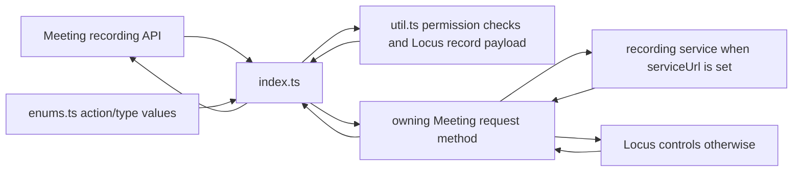
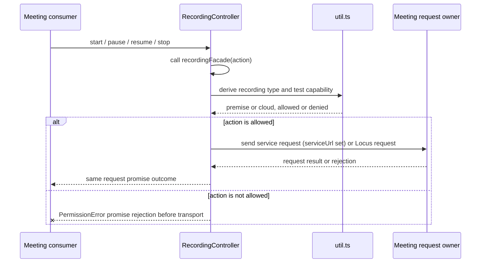
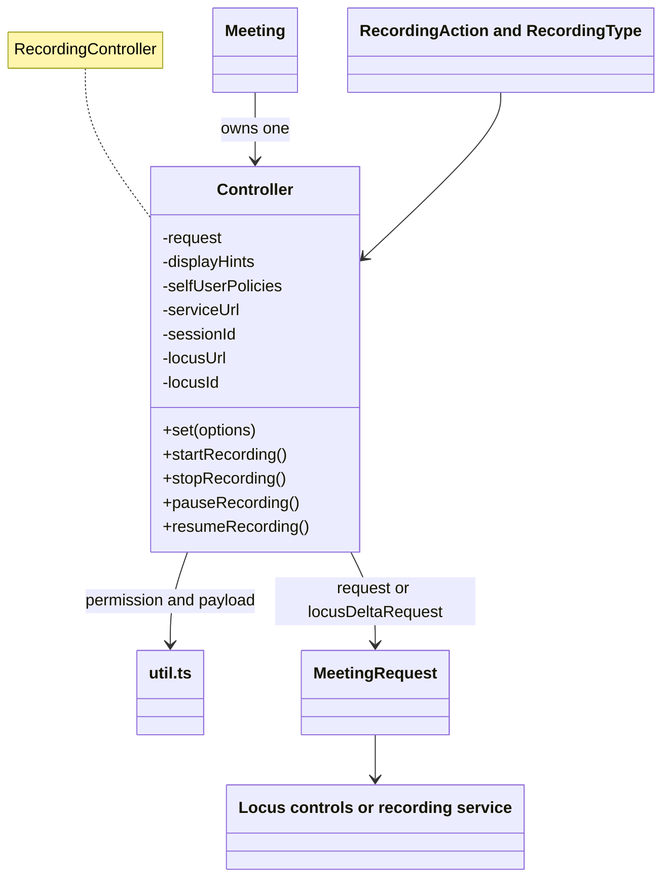

<!-- sdd-generated-metadata
doc_kind: module-spec
generated_from: module-spec@0.3.0
generated_by: claude-code
approved_by: rarajes2@cisco.com
updated_at: 2026-11-16T14:30:00Z
validation_status: not-run
-->

# Recording controller

This source-local document at `src/recording-controller/docs/README.md` owns the stable canonical
specification for the **recording controller**: `RecordingController`, the per-meeting object behind
`meeting.startRecording()`, `stopRecording()`, `pauseRecording()`, and `resumeRecording()`. Ground
every claim in repository evidence and link to the
[package architecture](../../../docs/architecture.md) instead of repeating broader facts. No service
specification exists because this package is a library.

Start here: root [package agent instructions](../../../AGENTS.md) · router
[documentation index](../../../docs/index.md) · system
[package architecture](../../../docs/architecture.md) · registry
[module registry](../../../docs/specs/README.md).

## Metadata

| Field             | Value |
| ----------------- | ----- |
| Owner             | @webex/web-client, @webex/web-sdk |
| Source path       | `src/recording-controller` |
| Resource kind     | module |
| Status            | Draft |
| Last verified     | 2026-11-16 at `0b8c34db7f` |
| Module id         | `plugin-meetings/recording-controller` |
| Parent spec       | — |
| Doc kind          | Module spec |
| Coverage score    | Pending coverage assessment |
| Validation status | not-run |

## Applicability

| Condition ID                         | Status     | Evidence or reason | Owned section |
| ------------------------------------ | ---------- | ------------------ | ------------- |
| `module.has_tiers`                   | N/A        | No tier policy exists in `package.json` | Tier |
| `module.has_ui`                      | N/A        | `src/recording-controller/index.ts` returns promises; it renders nothing | UI use-case flow |
| `module.crosses_service_boundaries`  | Applicable | `src/recording-controller/index.ts` sends the recording-service PUT or the Locus controls PATCH | Cross-boundary use-case flow |
| `module.holds_client_state`          | Applicable | `src/recording-controller/index.ts` keeps the request context, display hints, and self policies | Client state model |
| `module.enforces_domain_rules`       | Applicable | Display-hint and policy checks in `src/recording-controller/util.ts` | Business rules and invariants |
| `module.is_concurrent_async`         | Applicable | Each action returns the request promise (`src/recording-controller/index.ts`) | Concurrency and reactive flow |
| `module.owns_persistence`            | N/A        | Nothing is stored; recording state is owned remotely | Data, schema, and migration discipline |
| `module.stateful_transitions`        | N/A        | No recording status is held in `src/recording-controller/index.ts` | State machine |
| `module.exposes_wire_protocol`       | N/A        | The two request bodies are listed under Cross-boundary use-case flow; no versioned format is owned here | Protocol and wire format |
| `module.ui_multi_screen`             | N/A        | No UI | UI flow |
| `module.large_data_model`            | N/A        | Seven private fields in `src/recording-controller/index.ts` | Data model |
| `module.returns_caller_errors`       | Applicable | Denied actions reject with PermissionError and request failures propagate (`src/recording-controller/index.ts`) | Caller-visible failure modes |
| `module.module_specific_conventions` | N/A        | No convention beyond the package rules in `src/recording-controller/index.ts` | Module-specific rules |
| `module.published_package`           | N/A        | Reached through Meeting methods; export stability is owned by the package architecture (`package.json`) | Export stability |
| `module.embedded_in_host`            | N/A        | No host embedding | Host integration and theming |
| `module.has_design_tradeoff`         | N/A        | No recorded trade-off in `src/recording-controller/index.ts` | Key design trade-off |
| `module.has_submodules`              | N/A        | The directory has no child module | Sub-modules |

## Evidence register

Requirements cite current source and mirrored tests. Current code wins over retained prose when they
conflict; commit and PR history are excluded. Missing evidence stays a gap.

| Evidence | What it establishes |
| -------- | ------------------- |
| `src/recording-controller/index.ts` | `RecordingController` class: constructor, setters and getters, `recordingFacade`, `recordingService`, `recordingControls`, and the four public actions; its JSDoc says there should be one instance per meeting |
| `src/recording-controller/util.ts` | `canUserStart`, `canUserPause`, `canUserResume`, `canUserStop`, `isPremiseRecordingEnabled`, `deriveRecordingStates`, `extractLocusId` |
| `src/recording-controller/enums.ts` | `RecordingAction` (`Start`, `Stop`, `Pause`, `Resume`) and `RecordingType` (`premise`, `cloud`) |
| `src/constants.ts` | `DISPLAY_HINTS.RECORDING_CONTROL_*` and `PREMISE_RECORDING_CONTROL_*`, `SELF_POLICY.SUPPORT_NETWORK_BASED_RECORD` and `SUPPORT_PREMISE_RECORD`, `CONTROLS` |
| `src/meeting/index.ts` | Meeting constructs the controller with `meetingRequest` and `displayHints: []`, feeds the Locus URL, the record service URL and session id, display hints and self policies, and delegates its four recording methods |
| `src/meeting/util.ts` | `selfSupportsFeature` returns true when no policies are set |
| `src/meeting/request.ts` | `MeetingRequest.request` and `locusDeltaRequest` carry the two transports |
| `src/common/errors/permission.ts` | `PermissionError` used for denied actions |
| `test/unit/spec/recording-controller/index.js` | Setter and getter case; each action on the Locus route (missing hint, policy false, allowed) and on the service route (missing hint, cloud, premise) |
| `test/unit/spec/recording-controller/util.js` | Each `canUser*` rule, `deriveRecordingStates`, and `extractLocusId` |
| Observation, no stated WHY | A missing self-policy object counts as supported, because `MeetingUtil.selfSupportsFeature` returns true without policies (`src/meeting/util.ts`) |
| Observation, no stated WHY | The Locus controls route sends no recording type; the premise or cloud choice reaches only the recording-service body (`src/recording-controller/index.ts`) |

## Purpose and boundary

- Responsibility: validates consumer recording actions against display hints/policy, selects cloud or
  premise recording, and returns the owning request method's promise.
- In scope: the request context (`serviceUrl`, `sessionId`, `locusUrl`, derived `locusId`), display
  hints, self policies, the four action methods, the permission check, and the choice between the
  recording service and the Locus controls route.
- Out of scope: the recording status shown to users (Locus and the recording service own it); the HTTP
  pipeline and Locus delta handling (`MeetingRequest`, `MeetingUtil`); computing display hints.
- Consumers: `Meeting` (`src/meeting/index.ts`), which exposes the actions as
  `meeting.startRecording()`, `stopRecording()`, `pauseRecording()`, and `resumeRecording()`.

## Structure and key files

`src/recording-controller/` contains 3 direct source files and has 2 mirrored unit-test files. This
spec separates its public operations, runtime data movement, component ownership, state
applicability, and verification boundary.

| File | Holds |
| ---- | ----- |
| `src/recording-controller/enums.ts` | declared `RecordingAction` and `RecordingType` enum values |
| `src/recording-controller/index.ts` | `RecordingController` class: request context, facade, and the two transports |
| `src/recording-controller/util.ts` | permission helper functions, premise detection, Locus record-state derivation, and Locus id extraction |
| `test/unit/spec/recording-controller/index.js` and 1 sibling test file (`util.js`) | mirrored unit coverage |
| `src/recording-controller/docs/README.md` | this module specification |

## Public surface

| Contract ID | Type | Surface | Purpose | Compatibility / deprecation | Schema / detail link | Root index |
| ----------- | ---- | ------- | ------- | --------------------------- | -------------------- | ---------- |
| `recording-controller-api` | SDK / configuration | `RecordingController.set()`, `setLocusUrl()`, `setDisplayHints()`, `setUserPolicy()`, `setSessionId()`, `setServiceUrl()`, `getLocusUrl()`, `getLocusId()`, `getSessionId()`, `getServiceUrl()`, and `getDisplayHints()` | Refresh/read the request context and capability inputs used by later recording actions. | Preserve derived Locus id and getter/setter behavior; `set()` replaces every field it names; no recording status is stored. | `src/recording-controller/index.ts` | [architecture](../../../docs/architecture.md#public-and-consumer-surfaces) |
| `recording-controller-api` | SDK / remote | `startRecording()` | Validate the current start capability and send a `Start` action with the selected `RecordingType`. | Preserve action/type values and selected service-vs-Locus route. | `src/recording-controller/index.ts` | [architecture](../../../docs/architecture.md#public-and-consumer-surfaces) |
| `recording-controller-api` | SDK / remote | `pauseRecording()` and `resumeRecording()` | Map pause/resume intent to the permitted recording action under current display hints/policy. | Rejections remain the selected facade promise; the controller applies no response state. | `src/recording-controller/index.ts` | [architecture](../../../docs/architecture.md#public-and-consumer-surfaces) |
| `recording-controller-api` | SDK / remote | `stopRecording()` | Send the permitted `Stop` action through the current recording route. | Preserve caller-visible rejection and remote-authority ownership of final status. | `src/recording-controller/index.ts` | [architecture](../../../docs/architecture.md#public-and-consumer-surfaces) |
| `recording-controller-api` | module enums | `RecordingAction` and `RecordingType` | Define the exact action/type vocabulary serialized by controller operations. | Existing raw enum values are request contracts; additions must be compatible. The package root does not re-export them. | `src/recording-controller/enums.ts` | [architecture](../../../docs/architecture.md#public-and-consumer-surfaces) |

Contract ID `recording-controller-api` is indexed in the
[package architecture](../../../docs/architecture.md#public-and-consumer-surfaces) and registered in
`.sdd/manifest.json`; it requires `locus-http`.

Compatibility notes:

- Prefer additive fields/options and preserve current return and rejection semantics. Internal
  helpers are not public merely because they are exported within the source directory; the
  `util.ts` default export and the private `recordingFacade`, `recordingService`, and
  `recordingControls` methods are internal.

## Dependencies

The module requires Meeting request access, Locus URL/state, recording action/type enums, capability
state, and utility validation.

| Dependency | Why it is required | Failure behavior |
| ---------- | ------------------ | ---------------- |
| `MeetingRequest` (`src/meeting/request.ts`), contract `locus-http` | `request` for the recording-service PUT; `locusDeltaRequest` for the Locus controls PATCH | Rejections are returned unchanged |
| `Meeting` (`src/meeting/index.ts`) | Supplies the initial context and later updates: LOCUS_INFO_UPDATE_URL, LINKS_SERVICES `services.record.url` and the session id, MEETING_INFO_UPDATED display hints and self policies | Until updated, the constructor values apply |
| `MeetingUtil.selfSupportsFeature` (`src/meeting/util.ts`) | Policy lookup inside each permission helper | Undefined policies count as supported |
| `PermissionError`, `LoggerProxy`, `src/constants.ts` | The denial error, action logs, display-hint and policy names | — |

## Requirements

| ID | WHAT | WHY | Source evidence | Test / example evidence | Assumptions / gaps | Confidence |
| --- | ---- | --- | --------------- | ----------------------- | ------------------ | ---------- |
| `MOD-001` | `startRecording`, `pauseRecording`, `resumeRecording`, and `stopRecording` call `recordingFacade()` immediately. The facade derives the recording type, checks the corresponding display hint/self policy (`canUser<Action>`: the network hint with `supportNetworkBasedRecord`, or the premise hint with `supportPremiseRecord`), rejects a denied action before transport, and otherwise returns the selected request promise. | The permission decision belongs inside the facade, while accepted actions must preserve the actual request result without inventing local state application. | `src/recording-controller/index.ts`, `src/recording-controller/util.ts` | `test/unit/spec/recording-controller/index.js`, `test/unit/spec/recording-controller/util.js` | none | Present |
| `MOD-002` | select recording type/action payload: the type is `premise` when any premise recording hint is present and `supportPremiseRecord` holds, else `cloud`; with a `serviceUrl` the PUT to `<serviceUrl>/loci/<locusId>/recording` carries `{meetingInfo: {locusSessionId}, recording: {action: <lowercase action>}, recordingType}`; without one the PATCH to `<locusUrl>/controls` carries `{record: {recording, paused}}` from `deriveRecordingStates`. | Recording action/type pairs choose the remote transition and cannot be generalized without changing service behavior. | `src/recording-controller/index.ts`, `src/recording-controller/util.ts` | `test/unit/spec/recording-controller/index.js` | service and Locus paths need the same action/type rejection matrix | Present |
| `MOD-003` | Denied capability inputs or request failures reject the returned promise; this controller allocates no independent listener, lock, or timer. | Remote recording state remains authoritative, so rejection cannot be masked by a fabricated local transition. | `src/recording-controller/index.ts` | `test/unit/spec/recording-controller/index.js` | a missing display-hint array throws synchronously instead (see Caller-visible failure modes) | Present |
| `MOD-004` | `setLocusUrl(url)` stores the URL and sets `locusId` to its last path segment; `set(options)` replaces `serviceUrl`, `sessionId`, `displayHints`, and `locusUrl` (and so `locusId`) from `options`. | The recording-service route is addressed by the Locus id (`/loci/<locusId>/recording`), so it must follow every Locus URL change. | `src/recording-controller/index.ts`, `src/recording-controller/util.ts` | `test/unit/spec/recording-controller/index.js`, `test/unit/spec/recording-controller/util.js` | none | Present |

## Design overview

`RecordingController` stores request context, validates actions through `util.ts`, selects cloud or
premise recording, and delegates either to `request.request` for the recording service or
`request.locusDeltaRequest` for legacy Locus controls. It returns that promise and does not inspect
the response or apply recording state. It owns no listeners or timers.

The implementation is TypeScript/JavaScript in the Node 22.14 Yarn workspace, built on the Webex
core/plugin abstractions through `MeetingRequest` and tested with Mocha/Sinon/`@webex/test-helper-chai`.
It is a plain class, not a WebexPlugin; Meeting creates one per meeting (the class JSDoc says there
should be only one per meeting) and keeps it current from Locus events. The facade looks up the
permission helper by name (`canUser${action}`), which relies on the proper-cased `RecordingAction`
values (code comment: assumes action is proper cased).

## Data flow and sequence coverage

Call style: in-process method calls from `Meeting`; outbound HTTPS through `MeetingRequest.request`
(recording service) or `MeetingRequest.locusDeltaRequest` (Locus controls).
The module has one asynchronous operation group, the recording mutation (start, stop, pause, resume); context refresh is synchronous setters, so one sequence diagram covers it.

Sequence coverage:

| Operation group | Diagram | Failure coverage |
| --------------- | ------- | ---------------- |
| UC-002, UC-003 — recording control operation groups | Recording control sequence | missing display hint or self policy (PermissionError before transport), service-vs-Locus request rejection, and no local state application |
| UC-001 — context refresh | `src/recording-controller/index.ts` (synchronous setters, MOD-004) | a `set()` without display hints leaves them undefined |

### Recording control sequence

## Class and component relationships

The arrows identify ownership and delegation inside `src/recording-controller/`; `enums.ts` only
declares values and is not presented as a transport.

## Use cases and flows

| Use case | Actor or caller | Primary steps and outcome | Failure or boundary behavior | Evidence |
| -------- | --------------- | ------------------------- | ---------------------------- | -------- |
| `UC-001` | Meeting | Refresh Locus/service/session/display-hint/policy context without creating a local recording-status projection | — | `src/recording-controller/index.ts`, `src/meeting/index.ts` |
| `UC-002` | Application through Meeting | Map start, pause, resume, and stop to the exact `RecordingAction`/`RecordingType` payload allowed by current hints and policy | Denied actions reject with PermissionError | `src/recording-controller/index.ts`, `test/unit/spec/recording-controller/index.js` |
| `UC-003` | Application through Meeting | Route through the recording service when `serviceUrl` is present; otherwise send the derived `record` body through `locusDeltaRequest`, returning the selected dependency promise unchanged | Request rejections propagate | `src/recording-controller/index.ts`, `test/unit/spec/recording-controller/index.js` |

### Cross-boundary use-case flow

| Boundary | Transport and ordering | Compatibility | Timeout, retry, and recovery |
| -------- | ---------------------- | ------------- | ---------------------------- |
| Recording service (`UC-003`) | PUT `<serviceUrl>/loci/<locusId>/recording` through `MeetingRequest.request` | Body `{meetingInfo: {locusSessionId}, recording: {action: 'start' / 'stop' / 'pause' / 'resume'}, recordingType: 'premise' / 'cloud'}` | No retry here |
| Locus controls (`UC-003`) | PATCH `<locusUrl>/controls` through `locusDeltaRequest` | Body `{record: {recording, paused}}`: Start and Resume `{true, false}`, Pause `{true, true}`, Stop `{false, false}` | No retry here; the Locus delta helper applies the response |

## Client state model

The controller stores `serviceUrl`, `sessionId`, `locusUrl`, derived `locusId`, `displayHints`, and
`selfUserPolicies`. It does not store current recording status or apply a response projection; the
recording service/Locus remains authoritative.

| State or slice | Owner      | Initial state | Transition triggers | Reset or persistence boundary |
| -------------- | ---------- | ------------- | ------------------- | ----------------------------- |
| `serviceUrl`, `sessionId` | `RecordingController` | Meeting's record service URL and session id at construction | `setServiceUrl`, `setSessionId`, `set` | Instance memory |
| `locusUrl`, `locusId` | `RecordingController` | Meeting's Locus URL | `setLocusUrl`, `set` | Instance memory |
| `displayHints` | `RecordingController` | `[]` from Meeting | `setDisplayHints`, `set` | Instance memory |
| `selfUserPolicies` | `RecordingController` | undefined | `setUserPolicy` | Instance memory |

## Business rules and invariants

| ID | Invariant | WHY | Enforcement source | Test evidence |
| --- | --------- | --- | ------------------ | ------------- |
| `INV-001` | Only actions allowed by the current display hints/self policy are sent. | The permission decision belongs inside the facade (MOD-001). | `src/recording-controller/index.ts`, `src/recording-controller/util.ts` | `test/unit/spec/recording-controller/index.js` |
| `INV-002` | Presence of `serviceUrl` selects the recording-service PUT; absence selects the Locus controls PATCH. | Recording action/type pairs choose the remote transition (MOD-002). | `src/recording-controller/index.ts` | `test/unit/spec/recording-controller/index.js` |
| `INV-003` | The controller itself makes no recording-state change. | Remote recording state remains authoritative (MOD-003). | `src/recording-controller/index.ts` | `test/unit/spec/recording-controller/index.js` |

## Concurrency and reactive flow

- Each accepted action returns an independent request promise. The controller has no queue,
  cancellation, response ordering, or supersession guard; callers and the remote recording authority
  determine the outcome of overlapping actions.
- Execution model: one JavaScript event loop; the permission check and route choice are synchronous
  and use the context current at the call.

## Caller-visible failure modes

| Condition | Signal | Caller recovery |
| --------- | ------ | --------------- |
| Display hint/self policy does not permit the requested operation | The public method calls `recordingFacade()`; the facade returns a rejected `PermissionError` promise before selecting either transport request. | Refresh recording controls and issue only a currently allowed action. |
| `recordingFacade` request rejects | The controller returns that rejected promise; it does not apply a fabricated local recording state. | Handle the request failure and wait for authoritative recording state. |
| Recording action is accepted | The caller receives the facade request result for the selected typed payload. | Continue from service/Locus-projected recording state. |
| `displayHints` is undefined (a `set()` call without `displayHints`) | The permission helpers throw a `TypeError` synchronously; no promise is returned. | Always pass `displayHints` to `set()`. |

Evidence: `src/recording-controller/index.ts`, `src/recording-controller/util.ts`, and the rejection
cases in `test/unit/spec/recording-controller/index.js`.

## Pitfalls and constraints

- Action names and recording types are separate enums. Conflating them produces a syntactically valid
  request with the wrong server meaning.
- Verify both typed constants/enums and raw wire values before changing a logical condition in this
  legacy package: the service body lowercases the proper-cased `RecordingAction`, and the facade looks
  up `canUser${action}` by that proper-cased name.
- `recordingControls` logs the derived `record` object through a template string, so the log shows
  `[object Object]`.
- The PermissionError message always says the action is not allowed "due to moderator property",
  whichever hint or policy was missing.

## Verification

Use the current mirrored suites: `test/unit/spec/recording-controller/index.js`,
`test/unit/spec/recording-controller/util.js`. Characterize the recording-controller-specific use
cases above and each listed failure condition; add cleanup or transition cases only for resources and
state this module actually owns.

| Behavior / Requirement | Existing test evidence | Gap |
| ---------------------- | ---------------------- | --- |
| `MOD-001`, `INV-001` | `test/unit/spec/recording-controller/index.js` covers each recording action on service and Locus routes; `test/unit/spec/recording-controller/util.js` covers each permission rule | the service-route suite has no policy-false case |
| `MOD-002`, `INV-002` | `test/unit/spec/recording-controller/index.js` covers every action on the Locus route and every action with cloud and premise types on the service route | none |
| `MOD-003`, `INV-003` | `test/unit/spec/recording-controller/index.js` | assert facade rejection is returned unchanged and no local recording status is applied |
| `MOD-004` | `test/unit/spec/recording-controller/index.js` set-and-extract case; `test/unit/spec/recording-controller/util.js` extractLocusId cases | the set-and-extract case uses truthiness asserts, so values are not compared |

Coverage state and the contracts baseline are recorded in `.sdd/manifest.json`. Coverage measurement
is pending; the module stays Partial until coverage review and independent validation run.
