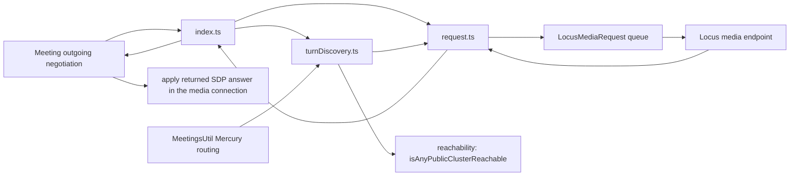
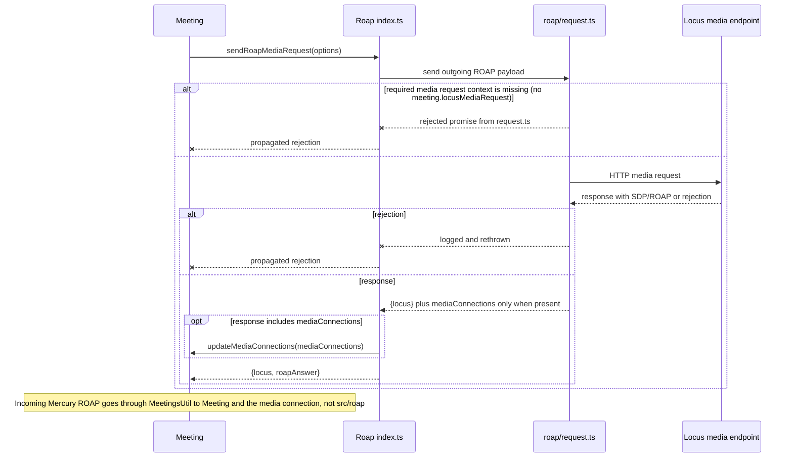
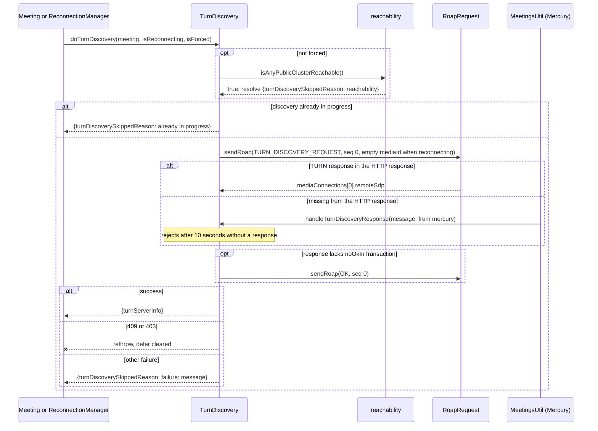
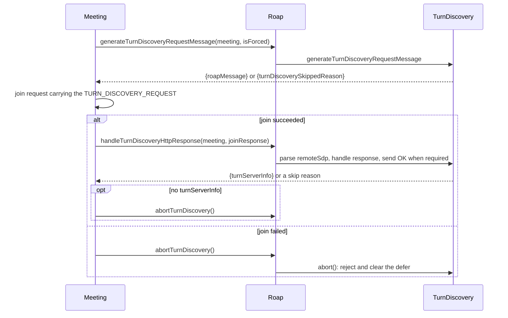
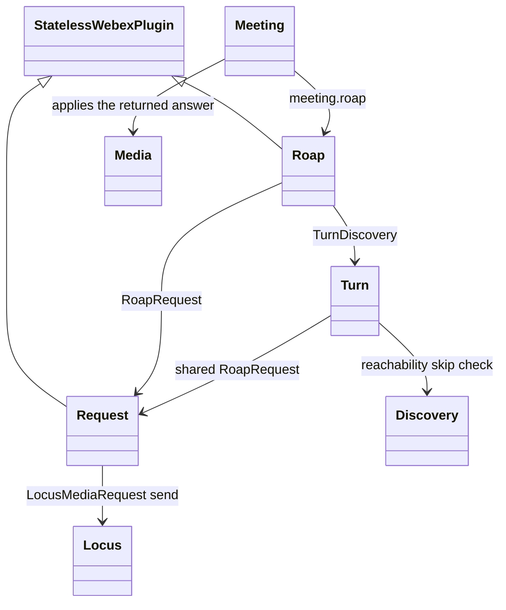

<!-- sdd-generated-metadata
doc_kind: module-spec
generated_from: module-spec@0.3.0
generated_by: claude-code
approved_by: rarajes2@cisco.com
updated_at: 2026-11-17T03:14:21Z
validation_status: pass-with-warnings
-->

# ROAP

This source-local document at `src/roap/docs/README.md` is the canonical source-local spec for
`src/roap/` and owns the stable specification for **the ROAP module** of `@webex/plugin-meetings`:
the `Roap` sender that a `Meeting` uses to send outgoing ROAP messages to Locus, the `RoapRequest`
adapter that sends them through the Meeting's `LocusMediaRequest`, and `TurnDiscovery`, which runs
the TURN discovery exchange before media setup. Ground every claim in package evidence and link to
the [package architecture](../../../docs/architecture.md) instead of repeating broader facts. No
service specification exists because this package is a library.

Related context: [documentation index](../../../docs/index.md) ·
[package agent instructions](../../../AGENTS.md) · repo architecture:
[package architecture](../../../docs/architecture.md) · registry:
[specification registry](../../../docs/specs/README.md) · related module:
[media](../../media/docs/README.md)

## Metadata

| Field | Value |
| ----- | ----- |
| Owner | @webex/web-client, @webex/web-sdk |
| Source path | `src/roap` |
| Resource kind | module |
| Status | Draft |
| Last verified | 2026-11-16 at `0b8c34db7f` |
| Module id | `plugin-meetings/roap` |
| Parent spec | — |
| Doc kind | Module spec |
| Coverage score | Pending coverage assessment |
| Validation status | not-run |

Coverage state and the contracts baseline are recorded in `.sdd/manifest.json`.

## Applicability

| Condition ID | Status | Evidence or reason | Owned section |
| ------------ | ------ | ------------------ | ------------- |
| `module.has_tiers` | N/A | No tier policy exists in `package.json` | Tier |
| `module.has_ui` | N/A | `src/roap/index.ts` sends messages and returns promises | UI use-case flow |
| `module.crosses_service_boundaries` | Applicable | `src/roap/request.ts` sends ROAP messages to Locus through `src/meeting/locusMediaRequest.ts`; `src/roap/turnDiscovery.ts` reads reachability and waits for Mercury-delivered responses | Cross-boundary use-case flow |
| `module.holds_client_state` | Applicable | `src/roap/turnDiscovery.ts` holds the in-progress defer, the TURN info, and the response timer | Client state model |
| `module.enforces_domain_rules` | Applicable | Skip, rethrow, sequence, and header rules in `src/roap/turnDiscovery.ts` and `src/roap/index.ts` | Business rules and invariants |
| `module.is_concurrent_async` | Applicable | Every operation in `src/roap/index.ts` and `src/roap/turnDiscovery.ts` returns a promise; TURN discovery waits on a timer or a Mercury message | Concurrency and reactive flow |
| `module.owns_persistence` | N/A | Nothing in `src/roap/turnDiscovery.ts` or `src/roap/request.ts` is stored | Data, schema, and migration discipline |
| `module.stateful_transitions` | N/A | The manifest section profile resolves this to false; the ROAP offer/answer state machine belongs to the media connection, reached from `src/meeting/index.ts` | State machine |
| `module.exposes_wire_protocol` | Applicable | ROAP message bodies built in `src/roap/index.ts` and `src/roap/turnDiscovery.ts`; the Locus request body in `src/roap/request.ts` | Protocol and wire format |
| `module.ui_multi_screen` | N/A | No UI in `src/roap/index.ts` | UI flow |
| `module.large_data_model` | N/A | `src/roap/types.ts` declares three small types | Data model |
| `module.returns_caller_errors` | Applicable | Rejections in `src/roap/request.ts` and `src/roap/index.ts`; 409/403 rethrow and skip results in `src/roap/turnDiscovery.ts` | Caller-visible failure modes |
| `module.module_specific_conventions` | N/A | The manifest section profile resolves this to false; repository rules in `AGENTS.md` apply | Module-specific rules |
| `module.published_package` | N/A | `src/index.ts` re-exports nothing from src/roap | Export stability |
| `module.embedded_in_host` | N/A | No host mount API in `src/roap/index.ts` | Host integration and theming |
| `module.has_design_tradeoff` | Applicable | `src/roap/turnDiscovery.ts` resolves most failures as a skip so join continues without TURN | Key design trade-off |
| `module.has_submodules` | N/A | src/roap has no child module in `.sdd/manifest.json` | Sub-modules |

## Evidence register

Requirements cite current implementation and mirrored unit-test paths. Current code wins over
retained prose when they conflict; commit and PR history are excluded by repository-owner decision.
Missing test evidence is stated as a gap rather than inferred.

| Evidence | What it establishes |
| -------- | ------------------- |
| `src/roap/index.ts` | `Roap extends StatelessWebexPlugin`; `sendRoapOK`, `sendRoapAnswer`, `sendRoapError`, `sendRoapMediaRequest`; TURN discovery delegation; type re-exports |
| `src/roap/request.ts` | `RoapRequest.sendRoap`: the Locus request body, reachability and client media preferences, the missing-`locusMediaRequest` rejection, `locus.roapSeq` |
| `src/roap/turnDiscovery.ts` | `TurnDiscovery`: skip check, request generation, HTTP and Mercury response handling, OK, abort, 10-second wait, 409/403 rethrow, seq 0 |
| `src/roap/types.ts` | `TurnDiscoverySkipReason` values, `TurnServerInfo`, `TurnDiscoveryResult` |
| `src/constants.ts` | `ROAP.ROAP_TYPES` (`OFFER`, `ANSWER`, `OK`, `ERROR`, `TURN_DISCOVERY_REQUEST`, `TURN_DISCOVERY_RESPONSE`) and `ROAP.ROAP_VERSION` `'2'` |
| `src/meeting/index.ts` | Creates `new Roap({}, {parent: this.webex})`; sends OK, OFFER, and ANSWER from the media connection's `ROAP_MESSAGE_TO_SEND` events; applies returned answers through `roapMessageReceived`; calls the TURN discovery methods during join |
| `src/meetings/util.ts` | `handleRoapMercury` routes `TURN_DISCOVERY_RESPONSE` to `roap.turnDiscovery.handleTurnDiscoveryResponse` and other ROAP messages to `Meeting.roapMessageReceived` |
| `src/meeting/locusMediaRequest.ts` | Queues and sends `RoapMessage` requests to Locus one at a time |
| `src/reconnection-manager/index.ts` | Forces TURN discovery with `doTurnDiscovery(meeting, true, true)` when reconnecting |
| `test/unit/spec/roap/index.ts`, `test/unit/spec/roap/request.ts`, `test/unit/spec/roap/turnDiscovery.ts` | Mirrored unit coverage |
| `test/unit/spec/meetings/utils.js` | `handleRoapMercury` routing cases, including `TURN_DISCOVERY_RESPONSE` |
| Observation, no stated WHY | After a failure other than 409/403 inside `doTurnDiscovery` (the request rejects or the 10-second wait times out), `TurnDiscovery` keeps its `defer`, so later `doTurnDiscovery` and `generateTurnDiscoveryRequestMessage` calls report `already in progress` until `abort()` runs (`src/roap/turnDiscovery.ts`). Not a requirement until a reason is recorded |

## Purpose and boundary

- Responsibility: sends outgoing ROAP messages (OK, ANSWER, ERROR, and the OFFER media request),
  returns the ROAP answer found in their HTTP responses, and performs TURN discovery for meeting
  media. Incoming Mercury ROAP routing is owned by `MeetingsUtil`; `Meeting` hands incoming
  messages to the media connection, whose ROAP state machine handles sequence and
  glare.
- In scope: the ROAP message bodies; the Locus request through `LocusMediaRequest` with reachability
  data; parsing the answer or TURN response out of `mediaConnections[0].remoteSdp`; TURN discovery
  skip, request, response, OK, abort, and failure handling.
- Out of scope: ROAP sequence numbers and glare for SDP negotiation (the media connection, through
  `Meeting`); queuing Locus requests (`src/meeting/locusMediaRequest.ts`); applying answers and media
  connection setup (`Meeting`, `src/media`); reachability probing (`src/reachability`).
- Consumers: `Meeting` (`src/meeting/index.ts`), `MeetingsUtil` (`src/meetings/util.ts`), and
  `ReconnectionManager` (`src/reconnection-manager/index.ts`).

## Structure and key files

`src/roap/` contains 4 direct source/reference file(s) and has 3 mirrored unit-test file(s) under
`test/unit/spec/roap/`. The module facade and primary exports are `index.ts`; the HTTP request
boundary is `request.ts`, `turnDiscovery.ts` holds TURN discovery, `types.ts` holds the module type
declarations, and this canonical module specification is `src/roap/docs/README.md`. The code is
TypeScript in the Node 22.14 Yarn workspace; Webex core/plugin abstractions and
Mocha/Sinon/`@webex/test-helper-chai` tests. Build target:
`yarn workspace @webex/plugin-meetings build:src`.

| File | Holds |
| ---- | ----- |
| `src/roap/index.ts` | module facade `Roap`: outgoing ROAP messages, TURN discovery delegation, and the primary type exports |
| `src/roap/request.ts` | HTTP request boundary `RoapRequest`: sends one ROAP message through `LocusMediaRequest` |
| `src/roap/turnDiscovery.ts` | `TurnDiscovery`: the TURN discovery exchange, its skip rules, and its failure handling |
| `src/roap/types.ts` | module type declarations: `TurnDiscoverySkipReason`, `TurnServerInfo`, `TurnDiscoveryResult` |
| `test/unit/spec/roap/index.ts` and 2 sibling test file(s) | mirrored characterization/unit coverage (`request.ts`, `turnDiscovery.ts`) |

## Public surface

None of these are re-exported by `src/index.ts`; they are reached through `meeting.roap`. Contract
ID `roap-signaling` is registered in `.sdd/manifest.json` and indexed in the
[package architecture](../../../docs/architecture.md#public-and-consumer-surfaces).

Manifest contracts: provides `roap-signaling`; requires `locus-http` and
`webex-core-plugin-host`.

| Contract ID | Type | Surface | Purpose | Compatibility / deprecation | Schema / detail link | Root index |
| ----------- | ---- | ------- | ------- | --------------------------- | -------------------- | ---------- |
| `roap-signaling` | SDK / remote | `Roap.sendRoapOK()`, `sendRoapAnswer()`, `sendRoapError()`, and `sendRoapMediaRequest()` | Build and send outgoing ROAP control/media messages through the current Locus media route (`meeting.locusMediaRequest`). | Preserve message/action fields and returned promise behavior: `sendRoapMediaRequest()` resolves `{locus, roapAnswer}`, the others resolve after the request; inbound Mercury ordering is owned elsewhere. | `src/roap/index.ts` | package architecture |
| `roap-signaling` | request adapter | `RoapRequest.sendRoap()` | Issue the outgoing Locus media request and return its response/rejection to `Roap`. | Preserve the request body `{type: 'RoapMessage', selfUrl, mediaId, roapMessage, reachability, clientMediaPreferences}` and direct promise propagation; it resolves `{locus}`, with `locus.roapSeq` set to the sent `seq`, and adds `mediaConnections` (the whole response array) only when the response's first media connection is truthy, so callers must treat it as optional. | `src/roap/request.ts` | package architecture |
| `roap-signaling` | TURN discovery | `Roap.doTurnDiscovery()`, `generateTurnDiscoveryRequestMessage()`, `handleTurnDiscoveryHttpResponse()`, and `abortTurnDiscovery()` | Delegate TURN discovery lifecycle through the active `TurnDiscovery` instance. | Preserve skip-vs-rethrow distinctions and abort ownership. | `src/roap/index.ts`, `src/roap/turnDiscovery.ts` | package architecture |
| `roap-signaling` | TURN discovery component | `TurnDiscovery.handleTurnDiscoveryResponse()`, `generateTurnDiscoveryRequestMessage()`, `handleTurnDiscoveryHttpResponse()`, `abort()`, `sendRoapOK()`, `isSkipped()`, and `doTurnDiscovery()` | Generate the discovery offer, interpret HTTP or Mercury results, and expose normalized TURN server information or skip reason. | HTTP 409/403 are rethrown; other handled discovery failures resolve a skipped result (`failure: <message>`). `handleTurnDiscoveryHttpResponse()` throws when no discovery is in progress. | `src/roap/turnDiscovery.ts` | package architecture |
| `roap-signaling` | exported contracts | `TurnDiscoveryResult`, `TurnServerInfo`, and `TurnDiscoverySkipReason` | Share the exact success/skip shape returned to Meeting negotiation. | Add fields and skip reasons compatibly; existing values (`missing http response`, `reachability`, `already in progress`, and `failure: <message>`) are consumer-visible. `src/roap/index.ts` re-exports the three types. | `src/roap/types.ts`, `src/roap/index.ts` | package architecture |

Compatibility notes:

- Prefer additive options and payload fields. Preserve method/event names, rejection semantics, and cleanup timing; route public changes through `src/index.ts` or the documented owning object.

## Dependencies

Meeting/Locus media request transport (`meeting.locusMediaRequest`), the Meeting's media
connection and sequence state, reachability for TURN skip decisions and request preferences, and
Webex TURN discovery through Locus.

| Dependency | Why it is required | Failure behavior |
| ---------- | ------------------ | ---------------- |
| `LocusMediaRequest` (`src/meeting/locusMediaRequest.ts`, `locus-http`) | Sends `RoapMessage` requests to the Locus media endpoint | Rejections are logged and rethrown by `RoapRequest.sendRoap` |
| `@webex/webex-core` `StatelessWebexPlugin` (`webex-core-plugin-host`) | Base class of `Roap` and `RoapRequest`; `this.webex.meetings` access | — |
| `webex.meetings.reachability` | `getClientMediaPreferences`, `getReachabilityReportToAttachToRoap`, `isAnyPublicClusterReachable` | Preference or report errors are logged and a fallback is sent; a reachable public cluster skips TURN discovery |
| `webex.meetings.meetingCollection` | Finds the Meeting by `correlationId` for OK, ANSWER, and ERROR | — |
| `MeetingUtil.getIpVersion` (`src/meeting/util.ts`) | IP version for client media preferences | — |
| `@webex/common` `Defer` | The TURN discovery wait | — |
| `src/metrics/index.ts` | `ROAP_HTTP_RESPONSE_MISSING`, `TURN_DISCOVERY_FAILURE`, `TURN_DISCOVERY_REQUIRES_OK` | — |
| `src/constants.ts` | `ROAP` message types and version | — |

## Requirements

| ID | WHAT | WHY | Source evidence | Test / example evidence | Assumptions / gaps | Confidence |
| --- | ---- | --- | --------------- | ----------------------- | ------------------ | ---------- |
| `ROAP-R-001` | Send outgoing ROAP media messages and process the returned response; inbound Mercury routing is outside `src/roap/`, except that `TurnDiscovery.handleTurnDiscoveryResponse()` receives the TURN responses `MeetingsUtil` routes to it. | Ownership must match current call paths so changes to incoming sequence/glare logic are made in `MeetingsUtil` and `Meeting`, not in this sender. | `src/roap/index.ts`, `src/meetings/util.ts`, `src/meeting/index.ts` | `test/unit/spec/roap/index.ts`, `test/unit/spec/meetings/utils.js` | none | PRESENT |
| `ROAP-R-002` | send Locus media requests and return the SDP answer: `sendRoapMediaRequest()` updates the Meeting's media connections, parses `mediaConnections[0].remoteSdp`, and resolves `{locus, roapAnswer}`, where `roapAnswer` is set only for an `ANSWER` message; otherwise it sends `ROAP_HTTP_RESPONSE_MISSING`. `Meeting` applies the answer. | Locus media requests and TURN discovery have different response and failure semantics during negotiation. | `src/roap/index.ts`, `src/roap/request.ts` | `test/unit/spec/roap/index.ts` | none | PRESENT |
| `ROAP-R-003` | Outgoing media-request failures reject their caller. TURN discovery rethrows HTTP 409/403, while other handled discovery failures resolve a result with `turnDiscoverySkippedReason` `failure: <message>`; this sender owns no inbound Mercury listener. | Negotiation code must distinguish direct request rejection from TURN skip results and the specific 409/403 rethrow path; the code comment says 409/403 mean the client was dropped from the meeting, so continuing media setup is pointless. | `src/roap/index.ts`, `src/roap/request.ts`, `src/roap/turnDiscovery.ts` | `test/unit/spec/roap/index.ts`, `test/unit/spec/roap/turnDiscovery.ts` | none | PRESENT |
| `ROAP-R-004` | Incoming ROAP sequence and glare handling are delegated by `MeetingsUtil.handleRoapMercury()` to `Meeting.roapMessageReceived()`, which passes the message to the media connection's `roapMessageReceived()`; `TURN_DISCOVERY_RESPONSE` goes to `TurnDiscovery` instead. `src/roap/types.ts` only declares TURN-discovery shapes. | Explicit cross-module ownership prevents passive TURN types from being mistaken for inbound negotiation guards. | `src/meetings/util.ts`, `src/meeting/index.ts`, `src/roap/types.ts` | `test/unit/spec/meetings/utils.js`, `test/unit/spec/meeting/index.js` | none | PRESENT |
| `ROAP-R-005` | TURN discovery normalizes service results for the active media negotiation: it collects every `x-cisco-turn-url` header and the last `x-cisco-turn-username` and `x-cisco-turn-password`, drops empty URLs, fails when any of the three is missing, sends OK unless the response has `noOkInTransaction`, rethrows 409/403, and reports other handled failures through the documented skip reason. | Media setup needs the correct relay configuration and an explicit skipped outcome rather than fabricated credentials or a blanket rejection claim; the code comment says empty URLs arrive from video mesh nodes. | `src/roap/turnDiscovery.ts`, `src/roap/request.ts` | `test/unit/spec/roap/turnDiscovery.ts`, `test/unit/spec/roap/request.ts` | none | PRESENT |
| `ROAP-R-006` | Unless forced, TURN discovery is skipped with reason `reachability` when any public cluster is reachable; a forced discovery (`isForced`) always runs. | The skip-reason comment: TURN is not needed when UDP reachability to public clusters is fine; reconnection forces it (`src/reconnection-manager/index.ts`). | `src/roap/turnDiscovery.ts`, `src/roap/types.ts` | `test/unit/spec/roap/turnDiscovery.ts` | none | PRESENT |
| `ROAP-R-007` | TURN discovery messages (`TURN_DISCOVERY_REQUEST` and its OK) always use `seq` 0, and the request carries headers `includeAnswerInHttpResponse` and `noOkInTransaction`. | The code comment: TURN discovery always precedes the first SDP exchange, which starts at seq 1, so seq 0 works whether or not discovery is done. | `src/roap/turnDiscovery.ts` | `test/unit/spec/roap/turnDiscovery.ts` | none | PRESENT |
| `ROAP-R-008` | `sendRoapMediaRequest()` sends an `OFFER` with the caller's `seq`, `tieBreaker`, and headers `includeAnswerInHttpResponse` and `noOkInTransaction`, always with the Meeting's `mediaId`, and `preferTranscoding` set for non-multistream meetings. | The code comment: an empty media id is only for reconnecting, and reconnection always sends `TURN_DISCOVERY_REQUEST` first, so the offer never needs one. | `src/roap/index.ts` | `test/unit/spec/roap/index.ts` | none | PRESENT |
| `ROAP-R-009` | When the reachability calls fail, `RoapRequest.sendRoap()` logs the error and still sends the message with fallback client media preferences `{joinCookie: undefined, ipver: unknown, preferTranscoding: !isMultistream}` and no reachability report. | The code comment: the bare minimum fallback value that should still allow the join. | `src/roap/request.ts` | `test/unit/spec/roap/request.ts` | none | PRESENT |

## Design overview

`src/roap/index.ts` is the outgoing ROAP sender: it builds/sends Locus media requests through
`request.ts` and returns the SDP answer found in the response for `Meeting` to apply.
`turnDiscovery.ts` separately resolves TURN data. Incoming Mercury routing belongs to
`MeetingsUtil`, and sequence and glare handling belong to the media connection that `Meeting`
feeds, outside this module.

`Meeting` creates one `Roap` per meeting; `Roap` creates one `RoapRequest` and one `TurnDiscovery`
that share it. `Meeting` calls `sendRoapOK`, `sendRoapMediaRequest`, and `sendRoapAnswer` when the
media connection emits `ROAP_MESSAGE_TO_SEND`, and `sendRoapError` for errors. TURN discovery has
two entry styles: `doTurnDiscovery()` runs the whole exchange itself, while join with media calls
`generateTurnDiscoveryRequestMessage()`, sends the message inside the join request, and then calls
`handleTurnDiscoveryHttpResponse()` or `abortTurnDiscovery()`.

## Data flow and sequence coverage

Call style: in-process promises from `Meeting`; HTTPS to Locus through `LocusMediaRequest`; inbound
TURN responses either in the HTTP response or over Mercury through `MeetingsUtil`.

Sequence coverage:

| Operation group | Diagram | Failure coverage |
|---|---|---|
| UC-1…UC-4 — outgoing ROAP and TURN operation groups | Outgoing ROAP and TURN primary sequence | missing `locusMediaRequest`, outgoing Locus media request rejection, invalid returned SDP JSON, TURN 409/403 rethrow, handled skip result, and abort |
| UC-2, UC-4 — TURN discovery exchange | TURN discovery sequence | reachability skip, already in progress, missing HTTP response with Mercury fallback, 10-second timeout, missing headers, 409/403 rethrow |
| UC-3 — TURN discovery inside join | Join-time TURN discovery sequence | missing HTTP response, abort when join fails |

Outgoing ROAP and TURN primary sequence:

TURN discovery sequence:

Join-time TURN discovery sequence:

## Class and component relationships

The arrows identify ownership and delegation inside `src/roap/`; files that only declare types or constants are not presented as transports.

## Use cases and flows

| Use case | Actor or caller | Primary steps and outcome | Failure or boundary behavior | Evidence |
| -------- | --------------- | ------------------------- | ---------------------------- | -------- |
| `UC-1` | Meeting | Send outgoing ROAP OK, answer, error, or media-request payloads through `RoapRequest.sendRoap()` and return the response/rejection | Missing `locusMediaRequest` rejects | `src/roap/index.ts`, `src/roap/request.ts` |
| `UC-2` | Meeting, ReconnectionManager | Generate a TURN discovery request, interpret its response, and expose normalized TURN server information | Skip, rethrow, or `failure:` result | `src/roap/turnDiscovery.ts` |
| `UC-3` | Meeting (join with media) | Abort an active discovery through the owning `Roap`/`TurnDiscovery` lifecycle | `abort()` outside a discovery does nothing | `src/roap/index.ts`, `src/roap/turnDiscovery.ts` |
| `UC-4` | Meeting | Distinguish 409/403 rethrows from other handled discovery outcomes that produce a skip reason, without assigning inbound Mercury/glare processing to this module | Inbound ROAP goes through `MeetingsUtil` to `Meeting` and the media connection | `src/roap/turnDiscovery.ts`, `src/meeting/index.ts`, `src/meetings/util.ts` |

### Cross-boundary use-case flow

| Boundary | Transport and ordering | Compatibility | Timeout, retry, and recovery |
| -------- | ---------------------- | ------------- | ---------------------------- |
| Locus media endpoint (`UC-1`, `UC-2`) | HTTPS through `LocusMediaRequest`, which queues requests and sends them one at a time | Request body and ROAP messages under Protocol and wire format | No retry here; rejections propagate (TURN discovery turns them into skip results except 409/403) |
| Mercury (`UC-2`) | `event:locus.message.roap` routed by `MeetingsUtil.handleRoapMercury` | Only `TURN_DISCOVERY_RESPONSE` reaches `TurnDiscovery` | 10-second wait, then a `failure:` skip result |
| Reachability (`UC-1`, `UC-2`) | In-process promises on `webex.meetings.reachability` | Client media preferences and reachability report attached to every ROAP request | Errors fall back to minimal preferences |

## Client state model

ROAP sequence, pending offer/answer, and negotiation state are held per media negotiation by the
media connection that `Meeting` owns; `src/roap/` keeps only the TURN discovery results and the
in-progress wait.

| State or slice | Owner | Initial state | Transition triggers | Reset or persistence boundary |
| -------------- | ----- | ------------- | ------------------- | ----------------------------- |
| `defer` (discovery in progress) | `TurnDiscovery` | undefined | Set by `generateTurnDiscoveryRequestMessage` and `sendRoapTurnDiscoveryRequest` | Cleared on success, 409/403, `abort()`, and failures inside `handleTurnDiscoveryHttpResponse`; kept after other `doTurnDiscovery` failures |
| `turnInfo` `{urls, username, password}` | `TurnDiscovery` | Empty urls and strings | Reset and refilled by every `handleTurnDiscoveryResponse` | Instance memory, one `TurnDiscovery` per `Roap` |
| `responseTimer` | `TurnDiscovery` | undefined | Armed by the Mercury wait | Cleared when a response is handled |

## Business rules and invariants

| ID | Invariant | WHY | Enforcement source | Test evidence |
| --- | --------- | --- | ------------------ | ------------- |
| `INV-001` | `src/roap/` owns outgoing request/response and TURN discovery only. Incoming Mercury sequencing/glare remains in `src/meetings/util.ts` and `src/meeting/index.ts`, and the media connection they feed. | Ownership must match the call paths (`ROAP-R-001`, `ROAP-R-004`). | `src/roap/index.ts`, `src/meetings/util.ts` | `test/unit/spec/meetings/utils.js` |
| `INV-002` | Direct outgoing ROAP request failures reject; TURN discovery rethrows 409/403, while its other handled failures resolve a result containing `turnDiscoverySkippedReason`. | 409/403 mean the client was dropped from the meeting; other failures let the join continue without TURN (code comments in `handleTurnDiscoveryFailure`). | `src/roap/request.ts`, `src/roap/turnDiscovery.ts` | `test/unit/spec/roap/turnDiscovery.ts` |
| `INV-003` | Only one TURN discovery runs at a time per `TurnDiscovery`; a second start reports `already in progress`. | The skip-reason comment in `src/roap/types.ts` names this case. | `src/roap/turnDiscovery.ts` | `test/unit/spec/roap/turnDiscovery.ts` |

## Concurrency and reactive flow

- Execution model: one JavaScript event loop; every operation returns a promise.
- Each outgoing ROAP/TURN operation is represented by its returned promise and owns no inbound Mercury listener or persistent negotiation state. Incoming ROAP sequence/glare ordering remains in `MeetingsUtil.handleRoapMercury()` and `Meeting.roapMessageReceived()`, which hands the message to the media connection.
- Ordering guarantees: Locus requests are serialized by the Meeting's `LocusMediaRequest` queue,
  not by `src/roap/`; TURN discovery sends its request, waits for the response, and only then
  sends OK.
- Reactive input: a Mercury-delivered `TURN_DISCOVERY_RESPONSE` settles the pending `defer`;
  one arriving when no discovery is in progress is logged and ignored.
- Idempotency and retry: nothing is retried; `abort()` outside a discovery does nothing.

## Protocol and wire format

ROAP messages are JSON objects carried in the Locus media request; preserve current field names,
enum/raw values, sequence identifiers, and compatibility behavior, and do not treat the normalized
client model as the wire schema.

| Message or frame | Version | Producer or serializer | Consumer or parser | Compatibility and ordering rule |
| ---------------- | ------- | ---------------------- | ------------------ | ------------------------------- |
| `OFFER` `{messageType, sdps: [sdp], version, seq, tieBreaker, headers: ['includeAnswerInHttpResponse', 'noOkInTransaction']}` | ROAP `'2'` | `Roap.sendRoapMediaRequest` | Locus | `seq` and `tieBreaker` come from the media connection |
| `ANSWER` `{messageType, sdps: [sdp], version, seq}`; `OK` `{messageType, version, seq}`; `ERROR` `{messageType, version, errorType, seq}` | ROAP `'2'` | `Roap.sendRoapAnswer`, `sendRoapOK`, `sendRoapError` | Locus | `seq` from the caller |
| `TURN_DISCOVERY_REQUEST` `{messageType, version, seq: 0, headers: ['includeAnswerInHttpResponse', 'noOkInTransaction']}` and its `OK` with `seq` 0 | ROAP `'2'` | `TurnDiscovery` | Locus | Always seq 0 (`ROAP-R-007`) |
| Locus request `{type: 'RoapMessage', selfUrl, mediaId, roapMessage, reachability, clientMediaPreferences}` | — | `RoapRequest.sendRoap` | `LocusMediaRequest` | `locus.roapSeq` of the response is set to the sent `seq` |
| Response `mediaConnections[0].remoteSdp`: JSON string whose `roapMessage` carries `seq`, `messageType`, `sdps`, `errorType`, `errorCause`, `headers` | — | Locus | `sendRoapMediaRequest`, `parseHttpTurnDiscoveryResponse` | For TURN discovery the `remoteSdp` field holds the TURN response, as the backend sends it |
| `TURN_DISCOVERY_RESPONSE` headers `x-cisco-turn-url=…` (one or more), `x-cisco-turn-username=…`, `x-cisco-turn-password=…`, optional `noOkInTransaction` | — | Locus, in the HTTP response or over Mercury | `TurnDiscovery.handleTurnDiscoveryResponse` | Unknown headers are ignored; empty URLs are dropped |

## Caller-visible failure modes

| Condition | Signal | Caller recovery |
|---|---|---|
| Required Locus media request context/payload is absent | The request helper rejects rather than issuing an invalid outgoing ROAP request: without `locusMediaRequest`, `sendRoap` rejects with `sendRoap called when locusMediaRequest is undefined`; an empty `mediaId` is only logged and sent. | Supply the current `locusMediaRequest` and ROAP payload. |
| Locus media request rejects, or TURN discovery encounters a handled failure | The media-request promise rejects; TURN 409/403 rethrows, while other handled discovery failures resolve with `turnDiscoverySkippedReason` `failure: <message>`. `src/roap/` has no inbound Mercury listener to clean up. | Branch on request rejection versus TURN rethrow/skip result in the Meeting negotiation flow. |
| Locus returns an accepted ROAP/SDP response | `Roap` returns `{locus, roapAnswer}` to Meeting; `roapAnswer` is undefined, and `ROAP_HTTP_RESPONSE_MISSING` is sent, when the response holds no `ANSWER`. | Apply it only within the current Meeting negotiation. |
| `remoteSdp` in the OFFER response is not valid JSON | `sendRoapMediaRequest()` rejects with the parse error. | Treated by Meeting as a missing answer. |
| `handleTurnDiscoveryHttpResponse()` without a started discovery | Throws `handleTurnDiscoveryHttpResponse() called before generateTurnDiscoveryRequestMessage()`. | Call `generateTurnDiscoveryRequestMessage()` first. |
| TURN discovery already in progress | Resolves `turnDiscoverySkippedReason: 'already in progress'` with no TURN info. | Wait, or `abortTurnDiscovery()`. |

## Pitfalls and constraints

- Offer/answer messages are ordered protocol state. Retrying or applying a stale sequence can corrupt the peer connection.
- Public behavior may be reachable through a parent `Meeting`/`Meetings` object even when the source helper is not exported directly.
- After a `doTurnDiscovery` failure other than 409/403, the `defer` stays set and later discoveries report `already in progress` until `abort()` (Evidence register observation).
- `handleTurnDiscoveryResponse` rejects the `defer` for an unexpected `messageType` but then still parses the headers and may call `resolve` on the already-rejected `defer`; the first settlement wins.

## Key design trade-off

- Explicit ROAP state preserves interoperability and recoverable errors but makes media setup sequential and stateful; that state lives in the media connection, and `src/roap/` stays a stateless sender apart from the single TURN discovery in progress.

| Chosen trade-off | Preserved invariant or benefit | Cost or limitation | Decision evidence |
| ---------------- | ------------------------------ | ------------------ | ----------------- |
| TURN discovery failures, except 409/403, resolve as a skip instead of rejecting | The join continues without TURN (code comment in `handleTurnDiscoveryFailure`) | Callers must read `turnDiscoverySkippedReason` to notice the failure | `src/roap/turnDiscovery.ts` |
| Answers and TURN responses are requested inline in the HTTP response, with Mercury as the fallback for TURN | One round trip in the normal case | Two delivery paths for the TURN response | `src/roap/index.ts`, `src/roap/turnDiscovery.ts` |

## Verification

Use the current mirrored suites: `test/unit/spec/roap/index.ts`, `test/unit/spec/roap/request.ts`, `test/unit/spec/roap/turnDiscovery.ts`. Characterize the roap-specific use cases above and each listed failure condition; add cleanup or transition cases only for resources and state this module actually owns.

| Behavior / Requirement | Existing test evidence | Gap |
|---|---|---|
| `ROAP-R-001` | `test/unit/spec/roap/index.ts` | no case for `sendRoapOK`, `sendRoapAnswer`, or `sendRoapError`; TURN delegation and `sendRoapMediaRequest` are covered |
| `ROAP-R-002` | `test/unit/spec/roap/index.ts` | no case for invalid JSON in `remoteSdp` |
| `ROAP-R-003` | `test/unit/spec/roap/index.ts`, `test/unit/spec/roap/turnDiscovery.ts` | none: 409/403 rethrow, handled skip results, and abort are distinct cases |
| `ROAP-R-004` | `test/unit/spec/meetings/utils.js`, `test/unit/spec/meeting/index.js` | keep inbound sequence/glare coverage with the owning Meeting module |
| `ROAP-R-005` | `test/unit/spec/roap/turnDiscovery.ts`, `test/unit/spec/roap/request.ts` | none |
| `ROAP-R-006` to `ROAP-R-008` | `test/unit/spec/roap/turnDiscovery.ts`, `test/unit/spec/roap/index.ts` | none |
| `ROAP-R-009` | `test/unit/spec/roap/request.ts` | none |
| `INV-003` | `test/unit/spec/roap/turnDiscovery.ts` | no case for the `defer` kept after a non-409/403 failure |

A module specification is complete only when its public surface, invariants, failure modes, and
test evidence agree with the implementation. Coverage measurement is pending; semantic validation
has not run.
