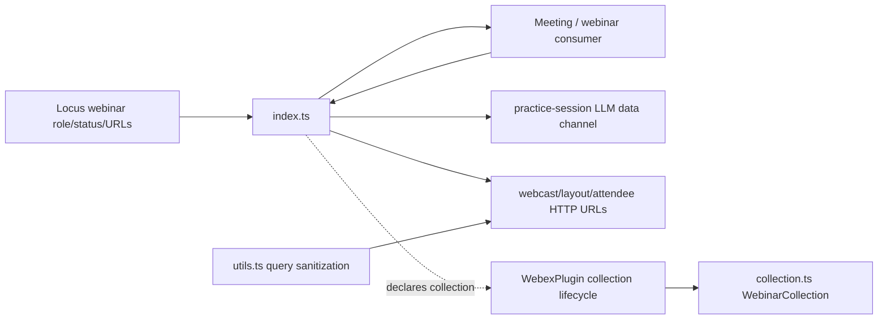
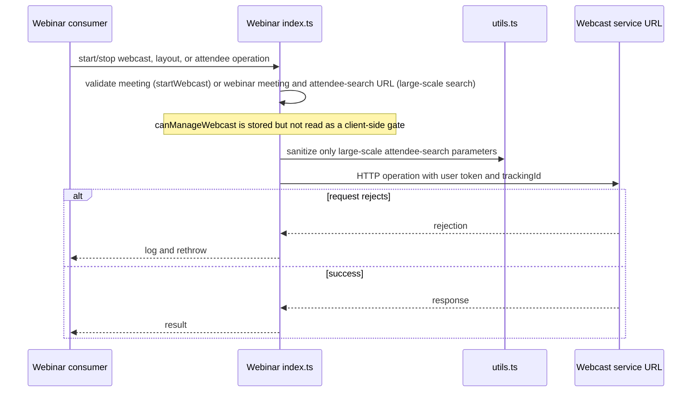
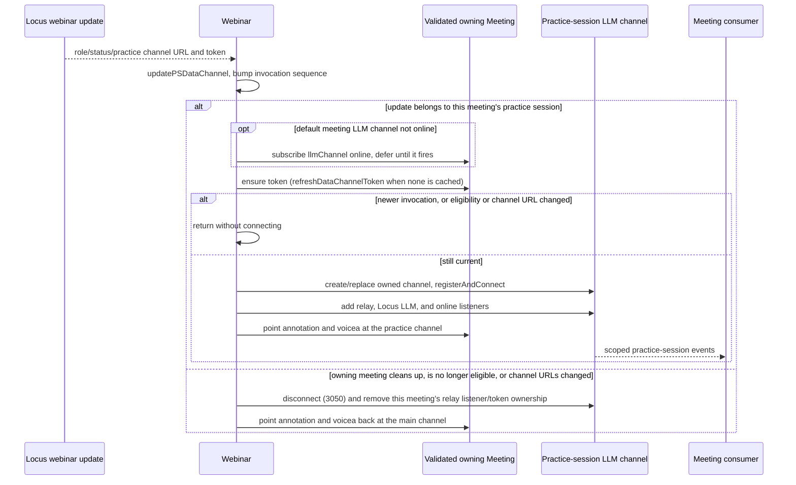
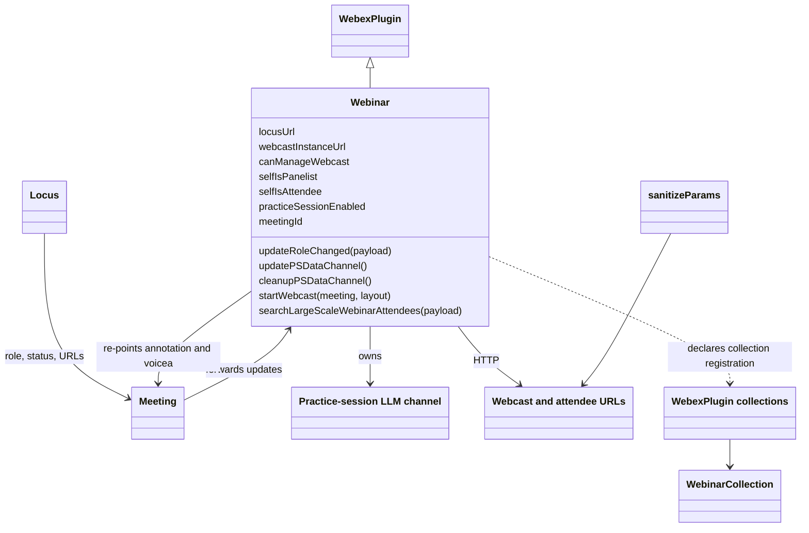
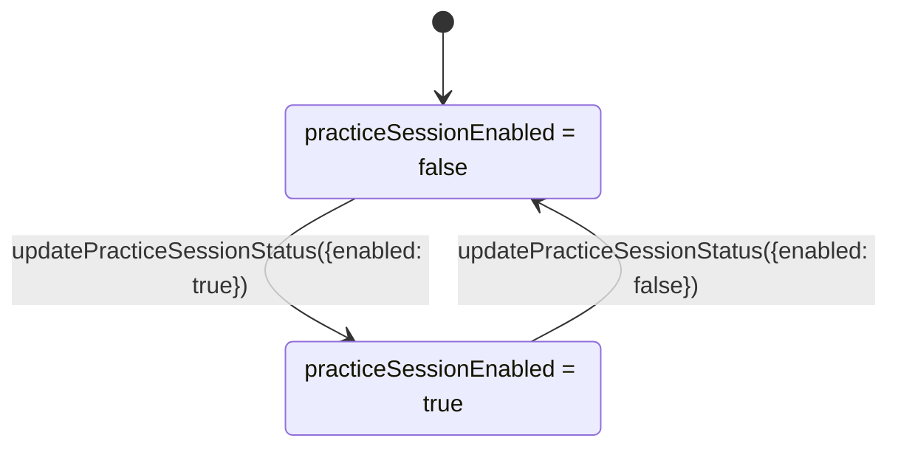
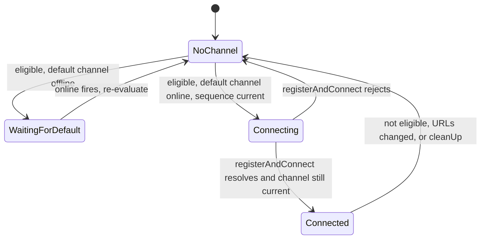

<!-- sdd-generated-metadata
doc_kind: module-spec
generated_from: module-spec@0.3.0
generated_by: claude-code
approved_by: rarajes2@cisco.com
updated_at: 2026-11-16T14:30:00Z
validation_status: not-run
-->

# Webinar

This source-local document at `src/webinar/docs/README.md` owns the stable canonical specification
for **Webinar**: `meeting.webinar`, the meeting-scoped controller for webinar roles, the
practice-session LLM data channel, and host webcast, layout, and attendee operations. Ground every
claim in repository evidence and link to the [package architecture](../../../docs/architecture.md)
instead of repeating broader facts. No service specification exists because this package is a
library.

Start here: root [package agent instructions](../../../AGENTS.md) · router
[documentation index](../../../docs/index.md) · system
[package architecture](../../../docs/architecture.md) · registry
[module registry](../../../docs/specs/README.md).

## Metadata

| Field             | Value |
| ----------------- | ----- |
| Owner             | @webex/web-client, @webex/web-sdk |
| Source path       | `src/webinar` |
| Resource kind     | module |
| Status            | Draft |
| Last verified     | 2026-11-16 at `0b8c34db7f` |
| Module id         | `plugin-meetings/webinar` |
| Parent spec       | — |
| Doc kind          | Module spec |
| Coverage score    | Pending coverage assessment |
| Validation status | not-run |

## Applicability

| Condition ID                         | Status     | Evidence or reason | Owned section |
| ------------------------------------ | ---------- | ------------------ | ------------- |
| `module.has_tiers`                   | N/A        | No tier policy exists in `package.json` | Tier |
| `module.has_ui`                      | N/A        | `src/webinar/index.ts` returns promises and state; it renders nothing | UI use-case flow |
| `module.crosses_service_boundaries`  | Applicable | `src/webinar/index.ts` calls Locus controls, the webcast instance and attendee-search URLs, and the LLM data channel | Cross-boundary use-case flow |
| `module.holds_client_state`          | Applicable | `src/webinar/index.ts` keeps role, practice-session, webcast URL, and practice-channel state | Client state model |
| `module.enforces_domain_rules`       | Applicable | Role transition rules, owner validation, and practice-channel eligibility in `src/webinar/index.ts` | Business rules and invariants |
| `module.is_concurrent_async`         | Applicable | Async practice-channel connect with an invocation-sequence guard and a deferred online listener in `src/webinar/index.ts` | Concurrency and reactive flow |
| `module.owns_persistence`            | N/A        | Nothing is stored; `src/webinar/collection.ts` is in memory only and unused | Data, schema, and migration discipline |
| `module.stateful_transitions`        | Applicable | practiceSessionEnabled and the practice-channel lifecycle in `src/webinar/index.ts` | State machine |
| `module.exposes_wire_protocol`       | N/A        | Request bodies are listed under Cross-boundary use-case flow; no versioned format is owned here | Protocol and wire format |
| `module.ui_multi_screen`             | N/A        | No UI | UI flow |
| `module.large_data_model`            | N/A        | Seven props and three private fields in `src/webinar/index.ts` | Data model |
| `module.returns_caller_errors`       | Applicable | Argument and URL guards throw, and HTTP and channel failures reject, in `src/webinar/index.ts` | Caller-visible failure modes |
| `module.module_specific_conventions` | N/A        | No convention beyond the package rules is recorded in `src/webinar/index.ts` | Module-specific rules |
| `module.published_package`           | N/A        | Reached through meeting.webinar; export stability is owned by the package architecture (`package.json`) | Export stability |
| `module.embedded_in_host`            | N/A        | No host embedding | Host integration and theming |
| `module.has_design_tradeoff`         | N/A        | No recorded trade-off in `src/webinar/index.ts` | Key design trade-off |
| `module.has_submodules`              | N/A        | The directory has no child module | Sub-modules |

## Evidence register

Requirements cite current source and mirrored tests. Current code wins over retained prose when they
conflict; commit and PR history are excluded. Missing evidence stays a gap.

| Evidence | What it establishes |
| -------- | ------------------- |
| `src/webinar/index.ts` | `Webinar` extends `WebexPlugin` in namespace `Meetings` with `collections: {webinar: WebinarCollection}`; props, the practice-session channel lifecycle, and every webcast operation; JSDoc and code comments are the recorded rationale |
| `src/webinar/collection.ts` | `WebinarCollection` with `namespace` `Meetings`, `mainIndex` `sessionId`, `set`, and `get` over `webinarInfo` |
| `src/webinar/utils.ts` | `sanitizeParams` drops `null`, `undefined`, and empty-string values |
| `src/constants.ts` | `SELF_ROLES` (`ATTENDEE`, `PANELIST`, `MODERATOR`), `SHARE_STATUS.WHITEBOARD_SHARE_ACTIVE`, `LOCUS_LLM_EVENT`, `DEFAULT_LARGE_SCALE_WEBINAR_ATTENDEE_SEARCH_LIMIT` (50) |
| `src/meeting/index.ts` | Meeting creates `new Webinar({meetingId}, {parent: webex})` and forwards locus URL, LINKS_RESOURCES, SELF_ROLES_CHANGED, the practice-session status, data-channel URL changes, and the practice-session token; it reads the practice-channel accessors |
| `src/meeting/util.ts` | `MeetingUtil.cleanUp` calls `webinar.cleanUp()`; `updateLocusFromApiResponse` returns the response untouched when no meeting is given |
| `test/unit/spec/webinar/index.ts` | 93 `it` blocks over role changes, owner validation, token handling, channel connect and cleanup, and every webcast request |
| `test/unit/spec/webinar/collection.ts`, `test/unit/spec/webinar/utils.ts` | The collection's namespace and main index; `sanitizeParams` |

## Purpose and boundary

- Responsibility: owns webinar practice-session data-channel lifecycle, role/status projection, and
  host webcast controls including layout and attendee operations.
- In scope: role projection (`selfIsPanelist`, `selfIsAttendee`, `canManageWebcast`); owner
  validation; the practice-session LLM channel, its token, and its listeners; the practice-session
  PATCH; webcast start/stop, layout, attendee view/search/expel, and large-scale attendee search.
- Out of scope: the default meeting LLM channel (`Meeting.updateLLMConnection`); transcription and
  annotation behavior (they are re-pointed, not owned); token issuance (`Meeting.refreshDataChannelToken`);
  server-side webcast authorization.
- Consumers: `Meeting` (`src/meeting/index.ts`, `src/meeting/util.ts`) and applications through
  `meeting.webinar`.

## Structure and key files

`src/webinar/` contains 3 direct source files and has 3 mirrored unit-test files. This spec
separates its public operations, runtime data movement, component ownership, state applicability,
and verification boundary.

| File | Holds |
| ---- | ----- |
| `src/webinar/collection.ts` | module-owned `WebinarCollection`, declared by the plugin but not read or written by it |
| `src/webinar/index.ts` | `Webinar` plugin: state projection, practice-session channel lifecycle, and webcast operations |
| `src/webinar/utils.ts` | `sanitizeParams` query-parameter helper for large-scale attendee search |
| `test/unit/spec/webinar/collection.ts` and 2 sibling test files (`index.ts`, `utils.ts`) | mirrored unit coverage |
| `src/webinar/docs/README.md` | this module specification |

## Public surface

| Contract ID | Type | Surface | Purpose | Compatibility / deprecation | Schema / detail link | Root index |
| ----------- | ---- | ------- | ------- | --------------------------- | -------------------- | ---------- |
| `webinar-api` | SDK / state | `cleanUp()`, `locusUrlUpdate()`, `updateWebcastUrl()`, `updateCanManageWebcast()`, `updateRoleChanged()`, `getValidatedWebinarMeeting()`, and `updateStatusByRole()` | Derive webinar and practice-session state for the owning meeting from current Locus inputs. | Preserve owner validation, the `{isPromoted, isDemoted}` result, and current role/status transitions. | `src/webinar/index.ts` | [architecture](../../../docs/architecture.md#public-and-consumer-surfaces) |
| `webinar-api` | SDK / lifecycle | `isJoinPracticeSessionDataChannel()`, `ensurePracticeSessionDatachannelToken()`, `setPracticeSessionDatachannelToken()`, `updatePSDataChannel()`, `cleanupPSDataChannel()`, `setPracticeSessionState()`, `updatePracticeSessionStatus()`, and the accessors `getPracticeSessionBinding()`, `isPracticeSessionLLMChannelConnected()`, `getPracticeSessionLocusUrl()` | Own the meeting-specific practice-session LLM token, socket, and relay listener lifecycle. | Replacement/cleanup must affect only the owning meeting's channel resources. | `src/webinar/index.ts` | [architecture](../../../docs/architecture.md#public-and-consumer-surfaces) |
| `webinar-api` | SDK / remote | `startWebcast(meeting, layout)` and `stopWebcast()` | Start or stop webcast through the current webcast instance URL. | `startWebcast` validates only its `meeting` input; neither validates the URL or consults `canManageWebcast` locally. | `src/webinar/index.ts` | [architecture](../../../docs/architecture.md#public-and-consumer-surfaces) |
| `webinar-api` | SDK / remote | `queryWebcastLayout()` and `updateWebcastLayout(layout)` | Read or update the webcast layout using the current webcast instance URL and the supplied layout fields. | These methods do not call `sanitizeParams()` or enforce `canManageWebcast`; preserve their direct request outcome. | `src/webinar/index.ts` | [architecture](../../../docs/architecture.md#public-and-consumer-surfaces) |
| `webinar-api` | SDK / remote | `viewAllWebcastAttendees()`, `searchWebcastAttendees(queryString)`, `expelWebcastAttendee(participantId)`, and `searchLargeScaleWebinarAttendees({queryString, limit, next})` | Query, search, or expel webcast attendees through the webcast instance URL, or the Locus attendee-search URL for large-scale search. | Standard search uses `encodeURIComponent`; only large-scale search calls `sanitizeParams()` before `URLSearchParams`. None enforces `canManageWebcast`. | `src/webinar/index.ts`, `src/webinar/utils.ts` | [architecture](../../../docs/architecture.md#public-and-consumer-surfaces) |
| `webinar-api` | exported helpers/models | `sanitizeParams()` and `WebinarCollection.set()` / `get()` | Sanitize request parameters and provide the collection registered by the `Webinar` plugin definition. | `index.ts` declares `collections: {webinar: WebinarCollection}` for framework-managed instantiation; controller methods do not explicitly call the collection's read/write methods. | `src/webinar/index.ts`, `src/webinar/utils.ts`, `src/webinar/collection.ts` | [architecture](../../../docs/architecture.md#public-and-consumer-surfaces) |

Contract ID `webinar-api` is indexed in the
[package architecture](../../../docs/architecture.md#public-and-consumer-surfaces) and registered in
`.sdd/manifest.json`; it requires `webex-core-plugin-host` and `locus-http`.

Compatibility notes:

- Prefer additive fields/options and preserve current rejection/event/cleanup semantics. Internal
  helpers are not public merely because they are exported within the source directory.

## Dependencies

The module requires parent Meeting/Locus state, webinar service URLs, data-channel tokens and the
LLM plugin, role/capability state, request access, and logging.

| Dependency | Why it is required | Failure behavior |
| ---------- | ------------------ | ---------------- |
| `@webex/webex-core` (`WebexPlugin`, `config.trackingIdPrefix`), contract `webex-core-plugin-host` | `this.request` for every HTTP call; the trackingId prefix of webcast requests | Request rejections are logged and rethrown |
| `webex.credentials.getUserToken()` | The explicit `authorization` header of every webcast and attendee request | A token failure rejects the method |
| `webex.internal.llm` (`@webex/internal-plugin-llm`) | `isDataChannelTokenEnabled()` and `createChannel()` for the practice-session channel | `registerAndConnect` rejection clears the current channel reference and rejects |
| `webex.meetings.getMeetingByType` | Resolves the owning meeting from `meetingId` | Unresolvable or mismatched meetings make the owner `undefined` |
| Owning `Meeting` | `isJoined`, `locusInfo`, `llmChannel`, `voiceaChannel`, `annotation`, `refreshDataChannelToken`, `processRelayEvent`, `processLocusLLMEvent`, `handleLLMOnline`, `startTranscriptionIfNeeded`, `shareStatus`, `locusId`, `correlationId` | A missing default channel defers the practice connect; a token refresh failure is logged and the connect proceeds without a refreshed token |
| Locus controls, contract `locus-http` | `setPracticeSessionState` PATCHes `<locusUrl>/controls` with `{practiceSession: {enabled}}` through `this.request` | The rejection is logged and rethrown |
| `MeetingUtil.updateLocusFromApiResponse` (`src/meeting/util.ts`) | Applies the Locus DTO returned by the practice-session PATCH | Returns the response untouched without a meeting |
| `LoggerProxy`, `uuid`, `lodash.get`, `src/constants.ts` | Logging, trackingIds, safe payload reads, role and share constants | — |

## Requirements

| ID | WHAT | WHY | Source evidence | Test / example evidence | Assumptions / gaps | Confidence |
| --- | ---- | --- | --------------- | ----------------------- | ------------------ | ---------- |
| `MOD-001` | derive webinar role, practice-session, and webcast state: `updateRoleChanged` sets `selfIsPanelist`, `selfIsAttendee`, and `canManageWebcast` (MODERATOR role), computes `isPromoted` (ATTENDEE to PANELIST) and `isDemoted` (PANELIST to ATTENDEE, or newly ATTENDEE), calls `updateStatusByRole`, and returns both flags; `updateWebcastUrl` reads `resources.webcastInstance.url`. | Owns webinar practice-session data-channel lifecycle, role/status projection, and host webcast controls; the JSDoc says only the host can manage webcast, and the newly-attendee case covers an attendee who has just joined. | `src/webinar/index.ts` | `test/unit/spec/webinar/index.ts` | none | Present |
| `MOD-002` | start/stop practice-session data channel and webcast: the practice channel is driven by `updatePSDataChannel` and `setPracticeSessionState` (PATCH `<locusUrl>/controls` with `{practiceSession: {enabled}}`), and webcast by PUT `<webcastInstanceUrl>/streaming` with `action` `start` (plus `meetingInfo` and `layout`) or `stop`. | Practice-channel and webcast operations use different owners and request paths, so their lifecycle and authorization behavior must stay distinct. | `src/webinar/index.ts` | `test/unit/spec/webinar/index.ts` | stored `canManageWebcast` is not read by webcast methods; retain as an authorization-gap characterization | Present |
| `MOD-003` | Invalid inputs and HTTP/channel failures remain visible; practice-session cleanup disconnects the channel, removes the relay, Locus LLM, and online listeners for the validated owning meeting, and drops the channel (with its token) even when disconnect throws. | Practice resources are meeting-owned, while webcast authorization currently depends on the service rather than the stored capability. | `src/webinar/index.ts` | `test/unit/spec/webinar/index.ts` | listeners are not removed when the owner cannot be validated | Present |
| `MOD-004` | Practice-session data-channel token/connection state is created, replaced, and cleaned independently from the public meeting channel: a separate channel from `llm.createChannel()`, a pending token kept apart from the meeting's, and annotation and voicea re-pointed to it on connect and back to the main channel on cleanup. | Practice participants must not receive or retain events on the wrong session transport. | `src/webinar/index.ts` | `test/unit/spec/webinar/index.ts` | none | Present |
| `MOD-005` | Webcast operations send the user token against the current webcast URL without reading `canManageWebcast`. `startWebcast()` validates `meeting`; large-scale attendee search validates the resolvable webinar meeting and attendee-search URL and sanitizes its optional query fields. Layout, standard view/search/expel, and stop operations perform no equivalent local validation/sanitization. | This preserves the method-specific enforcement boundary instead of generalizing the large-scale-search checks across unrelated operations. | `src/webinar/index.ts`, `src/webinar/utils.ts` | `test/unit/spec/webinar/index.ts`, `test/unit/spec/webinar/utils.ts` | Possible product authorization defect: confirm whether these operations should reject locally when `canManageWebcast` is false. | Present |
| `MOD-006` | Role and practice/webcast status updates refresh the controller before exposing the new state: `updateRoleChanged` and `updatePracticeSessionStatus` set the props and then call `updatePSDataChannel`. | Consumer controls must follow the latest Locus role/status projection rather than stale local intent. | `src/webinar/index.ts`, `src/meeting/index.ts` | `test/unit/spec/webinar/index.ts` | none | Present |
| `MOD-007` | `getValidatedWebinarMeeting()` returns the meeting for `meetingId` only when `locusUrl` is set and equals the meeting's `locusUrl`; otherwise it warns (when a meeting was found) and returns `undefined`. | The JSDoc: the `meetingId` pointer can drift onto an unrelated transient meeting such as an inbound 1:1 call, so callers must treat a failed match as no owned meeting. | `src/webinar/index.ts` | `test/unit/spec/webinar/index.ts` | none | Present |
| `MOD-008` | `updateStatusByRole` forces `locusInfo.updateMediaShares(mediaShares, true)` when promoted, or when demoted while the share status is whiteboard active, then calls `updatePSDataChannel`. | The code comment: attendees subscribe to streaming for whiteboard sharing while panelists still subscribe natively, so a forced update is needed. | `src/webinar/index.ts` | `test/unit/spec/webinar/index.ts` | none | Present |
| `MOD-009` | `updatePSDataChannel` connects only when the validated meeting is joined, self is a panelist, the practice session is enabled, and `practiceSessionDatachannelUrl` is set; it skips when already connected to the same Locus and data-channel URLs; it waits for the default meeting channel to be online; it ignores an invocation made stale by a newer call or by an eligibility or URL change during the token refresh. | The code comments: the default session must be connected first, the listener is added before the check because the channel does not replay missed events, and stale invocations must not reconnect a session a newer transition already updated or cleaned. | `src/webinar/index.ts` | `test/unit/spec/webinar/index.ts` | none | Present |

## Design overview

`Webinar` projects Locus role/practice/webcast data, owns the practice-session LLM data-channel
token/listener lifecycle, and calls webcast/layout/attendee URLs directly. `utils.ts` sanitizes only
large-scale attendee-search parameters. `index.ts` registers `WebinarCollection` through its
WebexPlugin `collections` declaration for framework-managed instantiation, although controller
methods do not explicitly read or populate it.

The implementation is TypeScript/JavaScript in the Node 22.14 Yarn workspace, built on the Webex
core/plugin abstractions and tested with Mocha/Sinon/`@webex/test-helper-chai`. Meeting constructs
one instance per meeting with its `meetingId` and drives it from Locus events. Every method that
touches the meeting resolves it through `getValidatedWebinarMeeting` (MOD-007), except
`ensurePracticeSessionDatachannelToken`, whose caller passes an already validated meeting. While the
practice channel is connected it carries the meeting's relay and Locus LLM events, annotation, and
voicea; Meeting's `isLLMConnected`, `getLLMLocusUrl`, and `getDataChannelTokenType` read the practice
channel whenever `isJoinPracticeSessionDataChannel()` is true.

## Data flow and sequence coverage

Call style: in-process method calls on `meeting.webinar`; outbound HTTPS through `WebexPlugin.request`
to Locus controls, the webcast instance URL, and the attendee-search URL; a WebSocket practice-session
channel through `webex.internal.llm`.

Sequence coverage:

| Operation group | Diagram | Failure coverage |
| --------------- | ------- | ---------------- |
| UC-003, UC-004 — webinar webcast, layout, and attendee operation groups | Webcast operations sequence | missing meeting or attendee-search URL, webcast rejection, and absent local capability guard |
| UC-002 — webinar practice-channel connect, replace, and cleanup paths | Practice-session channel sequence | not eligible, missing practice channel URL, default channel offline, token refresh failure, stale invocation, replaced channel, connect rejection, and disconnect failure |
| UC-001 — role and status projection | State machine; `src/webinar/index.ts` (MOD-001, MOD-008) | missing role payload treated as empty roles |
| UC-005 — practice-session start or stop request | `src/webinar/index.ts` (one PATCH, MOD-002) | the rejection is logged and rethrown |

### Webcast operations sequence

### Practice-session channel sequence

## Class and component relationships

The arrows identify ownership and delegation inside `src/webinar/`; `utils.ts` and `collection.ts`
are helpers and are not presented as transports.

## Use cases and flows

| Use case | Actor or caller | Primary steps and outcome | Failure or boundary behavior | Evidence |
| -------- | --------------- | ------------------------- | ---------------------------- | -------- |
| `UC-001` | Meeting, on Locus updates | Project webinar role, webcast URL, practice status, and owner identity from Locus updates | Missing role payload is treated as no roles; an unvalidated owner skips the media-share refresh | `src/webinar/index.ts`, `test/unit/spec/webinar/index.ts` |
| `UC-002` | Meeting (panelist in a practice session) | Acquire the practice-session token, connect/replace its LLM channel for the owning meeting, and remove its relay listener during cleanup | Deferred while the default channel is offline; stale invocations return; a connect rejection clears the channel | `src/webinar/index.ts`, `test/unit/spec/webinar/index.ts` |
| `UC-003` | Host application | Start/stop webcast or query/update layout after current input checks; `canManageWebcast` is stored but not enforced by these methods | `startWebcast` throws without a meeting; rejections are logged and rethrown | `src/webinar/index.ts`, `test/unit/spec/webinar/index.ts` |
| `UC-004` | Host application | View or expel attendees directly, standard-search with `encodeURIComponent`, or large-scale-search after `sanitizeParams()` and meeting/search-URL validation, while relying on service authorization | Large-scale search throws without a validated meeting or search URL | `src/webinar/index.ts`, `src/webinar/utils.ts`, `test/unit/spec/webinar/index.ts` |
| `UC-005` | Host application | `setPracticeSessionState(enabled)` PATCHes the Locus controls and applies the returned Locus | The rejection is logged and rethrown | `src/webinar/index.ts`, `test/unit/spec/webinar/index.ts` |

### Cross-boundary use-case flow

| Boundary | Transport and ordering | Compatibility | Timeout, retry, and recovery |
| -------- | ---------------------- | ------------- | ---------------------------- |
| Locus controls (`UC-005`) | PATCH `<locusUrl>/controls` through `this.request` | Body `{practiceSession: {enabled}}` | No retry; logged and rethrown |
| Webcast instance (`UC-003`, `UC-004`) | `<webcastInstanceUrl>/streaming` (PUT), `/layout` (GET, PUT), `/attendees` (GET, `?keyword=`), `/attendees/<participantId>` (DELETE); explicit `authorization` user token and `trackingId` headers | Start body `{action: 'start', meetingInfo: {locusId, correlationId}, layout}`; stop `{action: 'stop'}`; layout `{videoLayout, contentLayout, syncStageLayout, syncStageInMeeting}` | No retry; logged and rethrown |
| Locus attendee search (`UC-004`) | GET `<links.resources.attendeeSearch.url>?search_text&limit&next` | `limit` defaults to 50; empty values are dropped | No retry |
| Practice-session LLM channel (`UC-002`) | `registerAndConnect(locusUrl, practiceSessionDatachannelUrl, token)`; the refresh handler calls `meeting.refreshDataChannelToken()` | Disconnect codes 3050 `done (permanent)` on cleanup and `replaced` for a superseded channel | Re-attempted on the next Locus update or when the default channel comes online |

## Client state model

Webcast URL, management capability, role transition, practice-session status/channel/token, and
listeners are meeting scoped: one instance per Meeting. The attendee collection is declared but holds
nothing.

| State or slice | Owner      | Initial state | Transition triggers | Reset or persistence boundary |
| -------------- | ---------- | ------------- | ------------------- | ----------------------------- |
| `locusUrl`, `webcastInstanceUrl` | `Webinar` instance | undefined | `locusUrlUpdate`, `updateWebcastUrl` | Instance memory |
| `selfIsPanelist`, `selfIsAttendee`, `canManageWebcast` | `Webinar` instance | undefined | `updateRoleChanged`; `updateCanManageWebcast` | Instance memory |
| `practiceSessionEnabled` | `Webinar` instance | undefined (falsy) | `updatePracticeSessionStatus` | Instance memory |
| `meetingId` | `Webinar` instance | The Meeting's id at construction | — | Instance memory |
| `_practiceSessionLLMChannel` | `Webinar` instance | undefined | Set by `updatePSDataChannel`; cleared by `cleanupPSDataChannel` or a connect rejection | Disconnected by `cleanUp` |
| `_pendingPracticeSessionDatachannelToken` | `Webinar` instance | undefined | `setPracticeSessionDatachannelToken`, a token refresh without a channel; moved onto the channel at connect | Not cleared by cleanup |
| `_pendingOnlineListener`, `_updatePSDataChannelSequence` | `Webinar` instance | unset | Deferred connect; every `updatePSDataChannel` call | The listener is removed on cleanup or when the default channel is online |

## Business rules and invariants

| ID | Invariant | WHY | Enforcement source | Test evidence |
| --- | --------- | --- | ------------------ | ------------- |
| `INV-001` | Practice-channel replacement is meeting-owner scoped: only the meeting returned by `getValidatedWebinarMeeting` gets listeners, annotation, and voicea changes. | The meetingId pointer can drift onto a transient meeting (MOD-007). | `src/webinar/index.ts` | `test/unit/spec/webinar/index.ts` |
| `INV-002` | Only `searchLargeScaleWebinarAttendees()` uses `sanitizeParams()`; standard attendee search URL-encodes its keyword, and layout/view/expel operations do neither. Webcast operations rely on server authorization and do not consult `canManageWebcast`. | Each method keeps its own enforcement boundary (MOD-005). | `src/webinar/index.ts`, `src/webinar/utils.ts` | `test/unit/spec/webinar/index.ts` |
| `INV-003` | The practice channel connects only while `isJoinPracticeSessionDataChannel()` (panelist and practice session enabled) holds and the meeting is joined. | Practice participants must not use the wrong session transport (MOD-004, MOD-009). | `src/webinar/index.ts` | `test/unit/spec/webinar/index.ts` |

## Concurrency and reactive flow

- Practice-session channel/listener/token ownership is keyed to the owning meeting and is detached
  when that meeting replaces or cleans up its practice channel. Webcast HTTP operations settle their
  returned promises; current code stores `canManageWebcast` but does not read it as a local
  authorization guard.
- Execution model: one JavaScript event loop; `updatePSDataChannel` and `cleanupPSDataChannel` are
  async and may interleave with Locus updates.
- Ordering guarantees: each `updatePSDataChannel` call takes a sequence number; after the token await
  only the latest call proceeds, and after `registerAndConnect` a channel that is no longer current is
  disconnected with reason `replaced`.
- Deferred work: at most one pending `online` listener on the default channel; when it fires it clears
  itself and calls `updatePSDataChannel` again.
- Fire-and-forget: `updatePracticeSessionStatus` and Meeting's data-channel URL handler call
  `updatePSDataChannel` without awaiting it.

## State machine

The diagram above is limited to the stored boolean projection in `src/webinar/index.ts`.
Practice-channel creation/replacement is a side effect of
`updatePracticeSessionStatus()`/`updatePSDataChannel()`, not a separately named controller state; the
fields it moves through are shown below.

## Caller-visible failure modes

| Condition | Signal | Caller recovery |
| --------- | ------ | --------------- |
| `startWebcast()` lacks a meeting, or large-scale search cannot resolve its webinar meeting/attendee-search URL | The async operation rejects with an `Error` before issuing its request. Layout, stop, standard view/search, and expel do not perform the same local validation. | Supply the method-specific required context; do not infer a shared validation gate. |
| Practice-session channel/token setup fails or its owning meeting cleans up | A `registerAndConnect` rejection rejects `updatePSDataChannel` and clears the channel; a disconnect failure is logged and rethrown after cleanup removes only that meeting's relay listeners; a token refresh failure is logged and the connect proceeds without it. | Re-establish the practice channel for the owning meeting if still required. |
| Webcast HTTP request rejects | The returned promise rejects after an error log. `canManageWebcast` is not consulted as a client-side guard by these operations. | Handle the service rejection; treat local capability enforcement as the recorded product-decision gap. |
| `setPracticeSessionState` request rejects | The promise rejects after `Meeting:webinar#setPracticeSessionState failed` is logged. | Handle the rejection. |

Evidence: `src/webinar/index.ts` and the failure cases in `test/unit/spec/webinar/index.ts`.

## Pitfalls and constraints

- Practice-session media/data-channel state differs from public webcast state. Reusing the ordinary
  meeting channel without cleanup can deliver events to the wrong session.
- Verify both typed constants/enums and raw wire values before changing a logical condition in this
  legacy package (`SELF_ROLES` and `SHARE_STATUS` in `src/constants.ts`).
- No webcast method checks `webcastInstanceUrl`; an unset URL produces a request to
  `undefined/streaming` and similar paths. `expelWebcastAttendee` interpolates `participantId`
  without encoding.
- `updatePracticeSessionStatus` calls `updatePSDataChannel().then(() => {})` with no rejection
  handler, so a connect failure there surfaces as an unhandled rejection.
- Log prefixes vary: `Webinar:index#`, `Meeting:webinar#`, and `Meeting:webinar5k#`.
- The pending practice-session token survives `cleanUp`.

## Verification

Use the current mirrored suites: `test/unit/spec/webinar/collection.ts`,
`test/unit/spec/webinar/index.ts`, `test/unit/spec/webinar/utils.ts`. Characterize the
webinar-specific use cases above and each listed failure condition; add cleanup or transition cases
only for resources and state this module actually owns.

| Behavior / Requirement | Existing test evidence | Gap |
| ---------------------- | ---------------------- | --- |
| `MOD-001` | `test/unit/spec/webinar/index.ts` covers role promotion, demotion, newly attendee, moderator, unchanged, and missing payload | standalone collection use is not exercised beyond its namespace and main index |
| `MOD-002` | `test/unit/spec/webinar/index.ts` covers start/stop, layout, search, and expel request inputs separately, and the practice-session PATCH | pagination (`next`) of large-scale search is not asserted |
| `MOD-003`, `INV-001` | `test/unit/spec/webinar/index.ts` covers cleanup listener removal, removal when disconnect throws, and the pending online listener | prove webcast methods do not read `canManageWebcast` |
| `MOD-004`, `MOD-009`, `INV-003` | `test/unit/spec/webinar/index.ts` covers token refresh, eligibility changes during refresh, same-endpoint skip, endpoint change cleanup, deferral, duplicate-listener guard, replacement mid-connect, and connect rejection | none |
| `MOD-005`, `INV-002` | `test/unit/spec/webinar/index.ts`, `test/unit/spec/webinar/utils.ts` | characterize current no-client-gate behavior; capability enforcement remains a product-decision gap; the unresolvable-meeting branch of large-scale search has no case |
| `MOD-006`, `MOD-008` | `test/unit/spec/webinar/index.ts` | none |
| `MOD-007` | `test/unit/spec/webinar/index.ts` covers match, mismatch, no meeting, and uninitialized locusUrl | none |

Coverage state and the contracts baseline are recorded in `.sdd/manifest.json`. Coverage measurement
is pending; the module stays Partial until coverage review and independent validation run.
