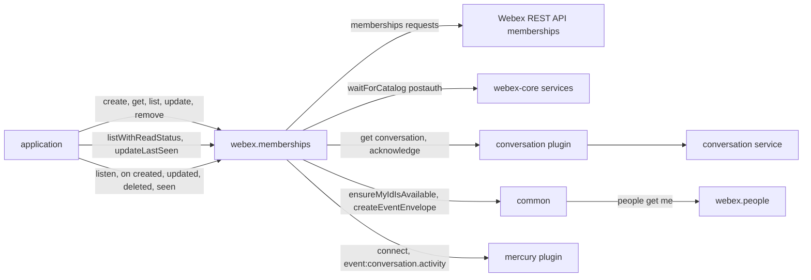
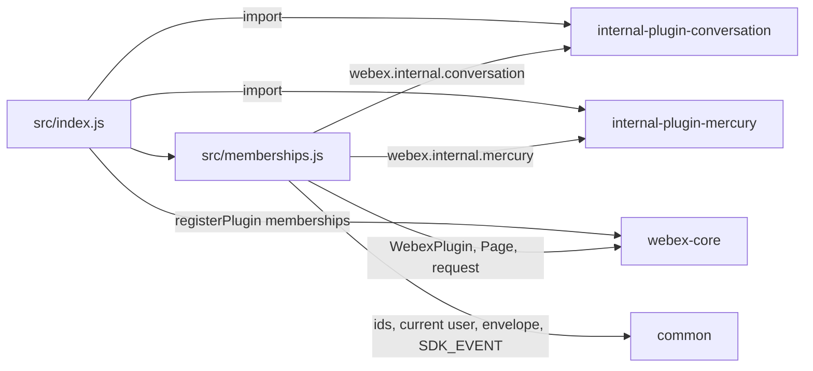
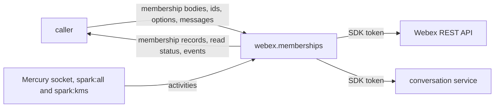

<!-- sdd-generated-metadata
doc_kind: standing-doc
generated_from: architecture@0.3.0
generated_by: claude-code
approved_by: rarajes2@cisco.com
updated_at: 2026-11-12T17:43:13Z
validation_status: pass-with-warnings
-->

# @webex/plugin-memberships architecture

Canonical architecture for this package. Flow behavior lives in the
[Memberships plugin specification](../src/docs/README.md). This page owns package boundaries, the
plugin registration, the contract index, and how the package meets the rest of the SDK.

Related context: [specification registry](specs/README.md) ·
[package agent instructions](../AGENTS.md)

## Applicability

| Condition ID                         | Status     | Evidence or reason | Owned section |
| ------------------------------------ | ---------- | ------------------ | ------------- |
| `repo.owns_datastore`                | N/A        | No database, file store, or migration in `src/memberships.js` | Repository data and schema |
| `repo.holds_client_state`            | N/A        | `src/memberships.js` caches no membership record; the stored event envelope is described in the module specification | Client state model |
| `repo.components_interact`           | Applicable | `src/index.js` registers the conversation and Mercury plugins that `src/memberships.js` calls | Dependency and interaction topology |
| `repo.domain_data_across_components` | Applicable | Membership records, read status, read receipts, and membership events pass from Hydra, the conversation service, and Mercury through `src/memberships.js` to callers | Object and data ownership |
| `repo.caches_data`                   | N/A        | Nothing is kept after a call settles in `src/memberships.js` | Caching catalog |
| `repo.observability_convention`      | N/A        | One error log line and debug trace lines in `src/memberships.js`; no metric or trace convention | Observability patterns |
| `repo.deploys_to_infra`              | N/A        | Library published to npm (`package.json`). No service runtime | Runtime and infrastructure |
| `repo.shared_base_libs`              | Applicable | Extends WebexPlugin and uses the legacy build and lint stack (`babel.config.js`, `.eslintrc.js`) | Shared and base libraries |
| `repo.is_monorepo`                   | N/A        | This SDD root is one package. The workspace around it is out of scope | Package map and inter-package dependencies |
| `repo.multi_platform`                | N/A        | `src/memberships.js` has no platform branch; `process` declares {browser: true} and is not imported | Platform matrix |
| `repo.published_package`             | Applicable | `package.json` name is @webex/plugin-memberships and deploy:npm publishes it | Release and versioning |
| `repo.embedded_in_host`              | N/A        | No host theme or embed API in `src/memberships.js` | Host integration and theming |
| `repo.exposes_commands_or_artifacts` | Applicable | build:src in `package.json` writes dist | Commands and generated artifacts |
| `repo.cross_repo_deps_material`      | Applicable | Behavior depends on the Webex REST API memberships resource, the conversation service, and the Mercury socket (`src/memberships.js`) | Cross-repository topology |
| `repo.security_arch_warranted`       | Applicable | `listen()` needs the spark:all and spark:kms scopes, and person emails, display names, and ids pass through `src/memberships.js` | Security architecture |

## Design overview

`@webex/plugin-memberships` is a published JavaScript library with one module. Importing it registers
the internal `conversation` and `mercury` plugins and then `Memberships` as the public plugin
`memberships`, reached as `webex.memberships`. The `webex` and `webex-node` bundles import it to
register it; no other workspace package calls it from its source.

A membership is a person's relationship to a room (a space): whether they are in it, whether they
moderate it, whether they hid a one-to-one space, and which message they last saw. The Webex REST API
serves memberships to applications through its `memberships` resource, which the SDK reaches as
catalog service `hydra`. The plugin answers four questions: "who is in this room" (create, read, list,
update, delete through Hydra), "how far has each member read" (from the internal conversation
service, converted into Hydra-style membership objects), "I have read up to here" (a read receipt sent
through the conversation service), and "what changed" (Mercury socket activities turned into
webhook-shaped `created`, `updated`, `deleted`, and `seen` events after `listen()`).

The package serves no routes, caches nothing, and persists nothing.

## Resource inventory and responsibilities

| Resource | Kind | Responsibility | Owner | Source | Detailed specification |
| -------- | ---- | -------------- | ----- | ------ | ---------------------- |
| Memberships plugin | package (one module) | Registration; membership records; read status; read receipts; membership events | @webex/web-sdk | src | [`src/docs/README.md`](../src/docs/README.md) |

## Interaction and execution flows

Representative end-to-end flow: a client lists a room's members with their read status, sends a read
receipt for the newest message, and listens for membership changes.

| From | To | Interaction or transport | Purpose | Failure or compatibility behavior |
| ---- | -- | ------------------------ | ------- | --------------------------------- |
| Application | `webex.memberships` | In-process calls; `on` for events | Membership records, read status, read receipts, events | Rejections propagate; a missing argument throws synchronously |
| `Memberships` | Webex REST API | HTTPS through `webex.request`, service `hydra` | Membership records | No retry here |
| `Memberships` | `webex.internal.conversation` | In-process calls after the `postauth` catalog | Read status and read receipts | Rejections propagate |
| `Memberships` | `webex.internal.mercury` | `connect()` and `listenTo` | Membership events | A connect failure rejects `listen()` |
| `Memberships` | `@webex/common` | Import | Ids, room type, current user, envelope, event vocabulary | A failed identity lookup rejects `listWithReadStatus` and leaves the envelope `undefined` |

## Dependency topology

| Dependency | Type | Used by | Purpose | Version, failure, or fallback policy |
| ---------- | ---- | ------- | ------- | ------------------------------------ |
| `@webex/webex-core` | Internal | `src/index.js`, `src/memberships.js` | Registration, plugin base, `Page`, `webex.request`, services | `workspace:*` in `package.json` |
| `@webex/common` | Internal | `src/memberships.js` | Hydra ids, room type, current user, event envelope, `SDK_EVENT` | `workspace:*` |
| `@webex/internal-plugin-conversation` | Internal | `src/index.js` (import), `src/memberships.js` (calls) | Read status and read receipts | `workspace:*` |
| `@webex/internal-plugin-mercury` | Internal | `src/index.js` (import), `src/memberships.js` (calls) | Membership events | `workspace:*` |
| `@webex/plugin-people`, `@webex/plugin-logger` | Internal peer | Reached at run time through `webex.people` and `webex.logger` | Current user for read status and the envelope; error logging | Peer dependencies; not imported by `src/` |
| `@webex/plugin-messages`, `@webex/plugin-rooms` | Internal peer | Not reached by `src/`; the integration spec imports them | Test setup creates rooms and messages | Peer dependencies |
| `lodash`, `debug` | External library | `src/memberships.js` | `cloneDeep`; trace lines | `^4.17.21`, `^4.3.4` |
| Webex REST API memberships resource, conversation service | External service | `src/memberships.js` | Membership records and conversations | Resolved through the service catalog |

No import cycle exists: none of the internal dependencies imports this package. `@webex/common` reads
`webex.people` at run time without importing it.

## Public and consumer surfaces

| Surface | Type | Owner | Consumers | Compatibility policy | Source |
| ------- | ---- | ----- | --------- | -------------------- | ------ |
| `memberships-public-sdk` — package @webex/plugin-memberships, `webex.memberships` with its eight methods and the `created`, `updated`, `deleted`, and `seen` events | SDK, published to npm, public | Memberships plugin | `webex`, `webex-node` (registration); applications and the workspace samples (calls) | No versioning or deprecation rule is declared in the package | `package.json`, `src/index.js`, `src/memberships.js` |

The memberships requests and the event shape are a protocol this package speaks, described under
*Protocol and wire format* in the
[module specification](../src/docs/README.md#protocol-and-wire-format). The other contracts this
package requires are registered in `.sdd/manifest.json` `contract_catalog`.

## Cross-cutting architecture

### Security

- Trust boundaries, scopes, and identity flow: see [Security architecture](#security-architecture).
- Sensitive surfaces and data classes: person emails, display names, and person, organization, room,
  membership, and message ids, plus the last-seen message and date of each member.

### Observability and operations

- Logging and correlation: `getMembershipEvent` logs one `webex.logger.error` line when an activity
  cannot be converted; `debug('memberships')` trace lines print event payloads when `DEBUG` enables
  `memberships`. Request tracking comes from the webex-core interceptors.
- Metrics, traces, and audit signals: none.
- Ownership and operational entry points: the default `*` rule of `.github/CODEOWNERS` at the
  workspace root assigns this package to `@webex/web-sdk`; no line names it. No dashboards or runbooks
  are recorded in this package.

### Quality attributes

- Compatibility: callers rely on the registered name `memberships`, the Hydra membership object,
  `list().items` through `Page`, the read-status fields `lastSeenId` and `lastSeenDate`, and the event
  names `created`, `updated`, `deleted`, and `seen`.
- Latency: `listWithReadStatus` waits for the current user and the `postauth` catalog before its one
  conversation request; it returns every participant in one unpaged object.
- Test confidence: the package has no unit tests, and the integration spec is not run by any script.
  No coverage threshold is enforced.

## Dependency and interaction topology

| From | To | Kind | Purpose | Ordering or failure boundary |
| ---- | -- | ---- | ------- | ---------------------------- |
| `src/index.js` | conversation and Mercury plugins | Import at load | Register `webex.internal.conversation` and `webex.internal.mercury` | Before `memberships` is registered |
| `src/index.js` | webex-core | Call at import | Register `memberships` | First registration wins |
| `src/memberships.js` | common | Import | Ids, current user, envelope, vocabulary | Conversion errors are caught in `getMembershipEvent` |

## Object and data ownership

| Object or state | System of record | May write | May read | Movement or lifecycle |
| --------------- | ---------------- | --------- | -------- | --------------------- |
| Membership record (`id`, `roomId`, `personId`, `personEmail`, `isModerator`, `isRoomHidden`, `created`, and more) | Webex REST API | Callers, through `create`, `update`, `remove` | Callers, through `get` and `list` | Fetched per call; never kept here |
| Member read status (`lastSeenId`, `lastSeenDate`) | Conversation service | Callers, through `updateLastSeen` (their own membership only) | Callers, through `listWithReadStatus` and `seen` events | Built per call from the conversation's participants or the acknowledge activity |
| Current user (`webex.internal.me`) | The webex instance, written by `@webex/common` | `ensureMyIdIsAvailable` and `createEventEnvelope` | `listWithReadStatus` | Fetched once per instance, then reused |
| Event envelope | This plugin instance, built by `@webex/common` | `listen()` | `getMembershipEvent` | Replaced by each `listen()` |

## Shared and base libraries

| Library | Inherited responsibility | Consumers | Version floor | Compatibility rule |
| ------- | ------------------------ | --------- | ------------- | ------------------ |
| `@webex/webex-core` `WebexPlugin` | `webex`, `request`, `logger`, and the event methods | `Memberships` | `workspace:*` | Keep the registered name `memberships` |
| `@webex/babel-config-legacy`, `@webex/eslint-config-legacy`, `@webex/jest-config-legacy`, `@webex/legacy-tools` | Build, lint, and test stack through one-line config files | Package tooling | `workspace:*` | Do not fork the config locally |

## Release and versioning

| Artifact | Publish target | Versioning rule | Deprecation window | Changelog or migration obligation |
| -------- | -------------- | --------------- | ------------------ | --------------------------------- |
| @webex/plugin-memberships | npm through `deploy:npm` | None declared in the package | None declared | None declared in the package; the workspace owns changelog generation |

## Commands and generated artifacts

| Command or artifact | Owner | Inputs | Output or side effect | Compatibility boundary |
| ------------------- | ----- | ------ | --------------------- | ---------------------- |
| `yarn build:src` | Package scripts | `src` | Writes `dist/` (JavaScript and source maps) through `webex-legacy-tools` | `dist/` is generated and never edited by hand |
| `yarn build` | Package scripts | `src` | Runs `build:src` | Same output |
| `yarn test:style` | Package scripts | `src` | ESLint run | The shared config ignores `docs/**` and `*.md` |

## Cross-repository topology

| Repository or external system | Relationship | Exchanged contract or artifact | Owner | Sequencing constraint |
| ----------------------------- | ------------- | ------------------------------ | ----- | --------------------- |
| `@webex/webex-core` (workspace sibling; module spec consulted) | Consumes | `registerPlugin`, `WebexPlugin`, `Page`, `request`, services | @webex/web-sdk | Registered before the first instance |
| `@webex/common` (workspace sibling; module spec consulted) | Consumes | Hydra ids, `ensureMyIdIsAvailable`, `createEventEnvelope`, `SDK_EVENT` | @webex/web-sdk | None |
| `@webex/internal-plugin-conversation` (workspace sibling; no spec, code consulted) | Consumes | `get` and `acknowledge` of conversations | Not recorded in this package | `postauth` catalog ready |
| `@webex/internal-plugin-mercury` (workspace sibling; module spec consulted) | Consumes | `connect`, `event:conversation.activity` | Not recorded in this package | Connected before events flow |
| `webex`, `webex-node` (workspace siblings) | Consumed by | The plugin registration | @webex/web-sdk | None |
| `@webex/plugin-teams` (workspace sibling) | Consumed by | Declared peer dependency; its integration spec calls `webex.memberships` | Not recorded in this package | None |
| Webex REST API memberships resource; conversation service | Consumes | Membership records; conversations and acknowledge activities | Not recorded in this repository | None |

## Security architecture

- This package holds no credential and no key. Every request carries the SDK authorization added by
  webex-core; the README and the `listen()` JSDoc state that most calls work with the
  `spark:memberships_read` and `spark:memberships_write` scopes, and that `listen()` needs `spark:all`
  and `spark:kms`.
- Membership ids go into request paths and options into query strings. The package logs none of them
  through `webex.logger`; its logging is described under
  [Observability and operations](#observability-and-operations).
- What a caller may see or change is decided by the services for the authorized user; the package
  passes records through and keeps no copy. `updateLastSeen` acknowledges as the authorized user.

## Domain language

| Term | Repository-specific meaning | Authoritative source |
| ---- | --------------------------- | -------------------- |
| Membership | A person's relationship to a room: presence, moderator flag, hidden flag, last-seen message | `src/memberships.js` |
| Room, space | A Webex conversation as the public API names it | `src/memberships.js` |
| Hydra | The Webex REST API, reached as catalog service `hydra` | `src/memberships.js` |
| Hydra membership id | base64url of `ciscospark://<cluster>/MEMBERSHIP/<personUUID>:<roomUUID>` | `src/memberships.js` |
| Read status | Each member's `lastSeenId` (the last message they saw) and `lastSeenDate` | `src/memberships.js` |
| Read receipt | An `acknowledge` activity that moves the caller's `lastSeenId` to a message | `src/memberships.js` |
| Hidden space | A one-to-one space the user hid; `isRoomHidden` on that user's membership | `src/memberships.js` |
| Activity verb | The conversation activity verb that picks the event, for example `add`, `leave`, `acknowledge` | `src/memberships.js` |
| Event envelope | Webhook-shaped wrapper built once by `listen()` and cloned per event | `src/memberships.js` |

## References and maintenance

- Decisions: [adr/](adr/index.md)
- Instantiated specifications and routing: [specs/README.md](specs/README.md)
- Repository rules and patterns: [package agent instructions](../AGENTS.md)
- Update this document in the same change that alters package boundaries, resource ownership,
  cross-resource interaction, or cross-cutting architecture.
